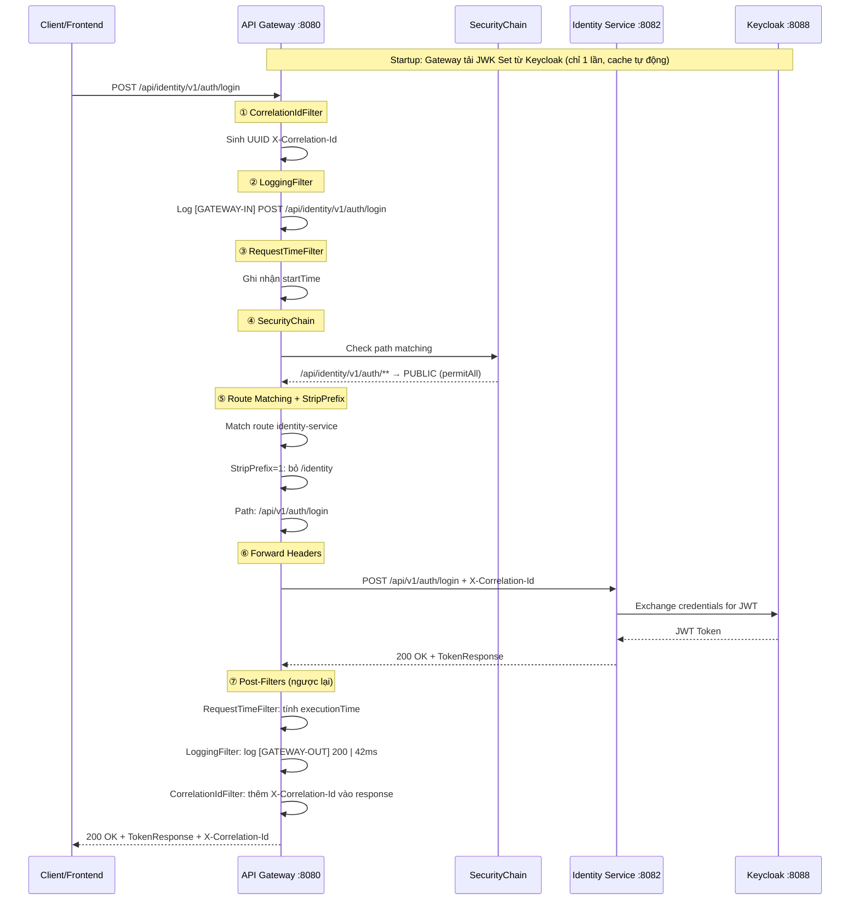
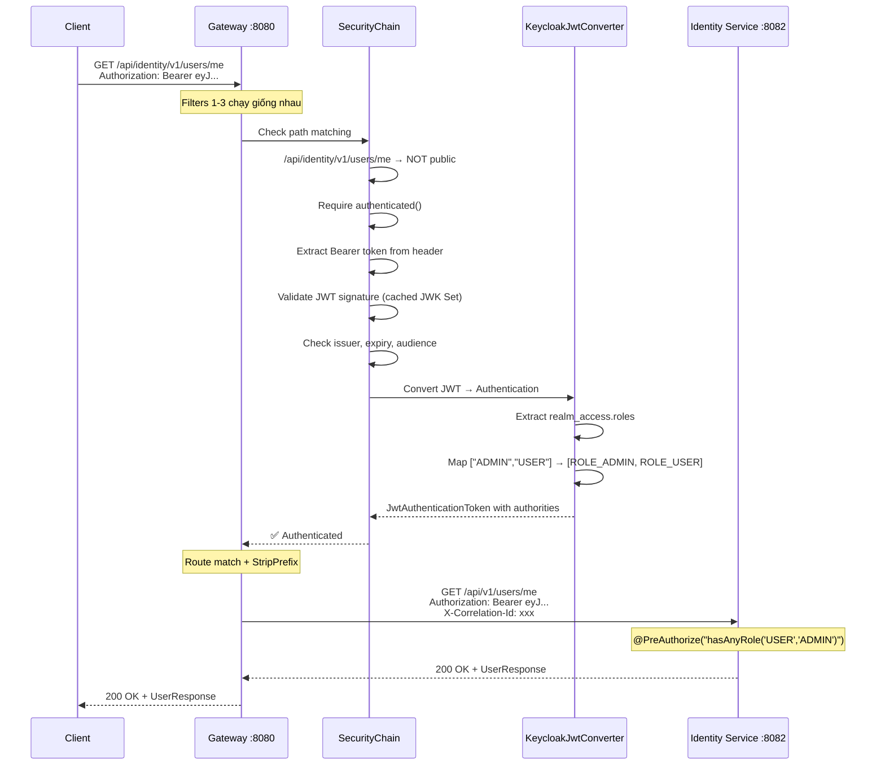
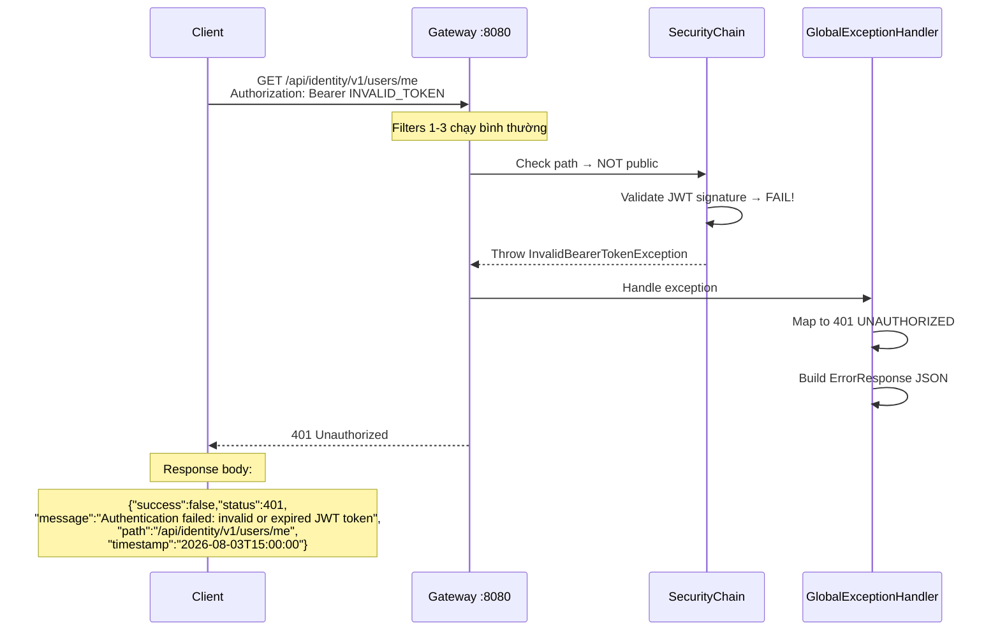
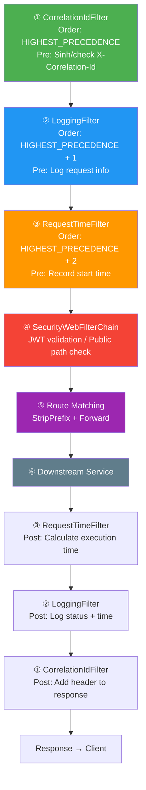

# API Gateway — Walkthrough

## Tổng quan

API Gateway đã được xây dựng hoàn chỉnh với các thành phần sau:

| Package | File | Chức năng |
|---|---|---|
| `config` | [CorsConfig.java](file:///c:/Users/anh.nvt/Desktop/finalProject/DATN-2026/backend/api-gateway/src/main/java/com/datn/api_gateway/config/CorsConfig.java) | CORS tập trung |
| `security` | [SecurityConfig.java](file:///c:/Users/anh.nvt/Desktop/finalProject/DATN-2026/backend/api-gateway/src/main/java/com/datn/api_gateway/security/SecurityConfig.java) | Reactive security chain (JWT) |
| `security` | [KeycloakJwtConverter.java](file:///c:/Users/anh.nvt/Desktop/finalProject/DATN-2026/backend/api-gateway/src/main/java/com/datn/api_gateway/security/KeycloakJwtConverter.java) | Extract Keycloak realm roles |
| `filter` | [CorrelationIdFilter.java](file:///c:/Users/anh.nvt/Desktop/finalProject/DATN-2026/backend/api-gateway/src/main/java/com/datn/api_gateway/filter/CorrelationIdFilter.java) | Sinh/forward X-Correlation-Id |
| `filter` | [LoggingFilter.java](file:///c:/Users/anh.nvt/Desktop/finalProject/DATN-2026/backend/api-gateway/src/main/java/com/datn/api_gateway/filter/LoggingFilter.java) | Log request/response info |
| `filter` | [RequestTimeFilter.java](file:///c:/Users/anh.nvt/Desktop/finalProject/DATN-2026/backend/api-gateway/src/main/java/com/datn/api_gateway/filter/RequestTimeFilter.java) | Theo dõi execution time |
| `exception` | [GlobalExceptionHandler.java](file:///c:/Users/anh.nvt/Desktop/finalProject/DATN-2026/backend/api-gateway/src/main/java/com/datn/api_gateway/exception/GlobalExceptionHandler.java) | JSON error responses (401/403/500) |
| `dto` | [ErrorResponse.java](file:///c:/Users/anh.nvt/Desktop/finalProject/DATN-2026/backend/api-gateway/src/main/java/com/datn/api_gateway/dto/ErrorResponse.java) | Error response DTO |
| `constant` | [GatewayConstant.java](file:///c:/Users/anh.nvt/Desktop/finalProject/DATN-2026/backend/api-gateway/src/main/java/com/datn/api_gateway/constant/GatewayConstant.java) | Shared constants |
| — | [ApiGatewayApplication.java](file:///c:/Users/anh.nvt/Desktop/finalProject/DATN-2026/backend/api-gateway/src/main/java/com/datn/api_gateway/ApiGatewayApplication.java) | Entry point |
| — | [application.yml](file:///c:/Users/anh.nvt/Desktop/finalProject/DATN-2026/backend/api-gateway/src/main/resources/application.yml) | Routes, JWT, CORS, Actuator |
| — | [pom.xml](file:///c:/Users/anh.nvt/Desktop/finalProject/DATN-2026/backend/api-gateway/pom.xml) | Dependencies (WebFlux, Security, OAuth2) |

**Modified:**
| File | Thay đổi |
|---|---|
| [parent pom.xml](file:///c:/Users/anh.nvt/Desktop/finalProject/DATN-2026/backend/pom.xml) | Uncomment `<module>api-gateway</module>` |

---

## Luồng hoạt động chi tiết

### Sơ đồ tổng quan



---

### Chi tiết từng bước

#### 1️⃣ Client gửi Request → Gateway (Port 8080)

```
POST http://localhost:8080/api/identity/v1/auth/login
Content-Type: application/json

{
  "username": "john",
  "password": "secret123"
}
```

Client luôn gửi request tới Gateway (`port 8080`), KHÔNG bao giờ gửi trực tiếp tới identity-service (`port 8082`).

---

#### 2️⃣ CorrelationIdFilter (Order: HIGHEST_PRECEDENCE)

**Chạy ĐẦU TIÊN.**

- Kiểm tra header `X-Correlation-Id` trong request
- Nếu **không có** → sinh UUID mới: `550e8400-e29b-41d4-a716-446655440000`
- Nếu **có rồi** → giữ nguyên giá trị
- **Mutate request**: thêm header `X-Correlation-Id` vào request sẽ forward xuống downstream
- **Lưu vào Exchange Attributes**: để các filter khác truy cập

```
Request Headers (sau khi mutate):
X-Correlation-Id: 550e8400-e29b-41d4-a716-446655440000
```

---

#### 3️⃣ LoggingFilter (Order: HIGHEST_PRECEDENCE + 1)

**Chạy thứ HAI.**

- Đọc Correlation ID từ Exchange Attributes
- Log thông tin request:

```
[GATEWAY-IN]  [550e8400-...] POST /api/identity/v1/auth/login | IP: 192.168.1.100
```

- Ghi nhận `startTime` để tính execution time sau

---

#### 4️⃣ RequestTimeFilter (Order: HIGHEST_PRECEDENCE + 2)

**Chạy thứ BA.**

- Lưu `System.currentTimeMillis()` vào Exchange Attribute `requestStartTime`
- Nếu request mất > 3000ms → log WARNING `[SLOW-REQUEST]`

---

#### 5️⃣ SecurityWebFilterChain — Authentication Check

**Đây là bước quyết định PASS hay REJECT.**

```java
.pathMatchers("/api/identity/v1/auth/**").permitAll()    // ← Match!
.anyExchange().authenticated()
```

- Path `/api/identity/v1/auth/login` khớp với pattern `permitAll()` → **PASS** (không cần JWT)
- Nếu path KHÔNG phải public (ví dụ `/api/identity/v1/users/me`):
  1. Kiểm tra header `Authorization: Bearer <token>`
  2. Validate JWT bằng **JWK Set đã cache** từ Keycloak (KHÔNG gọi Keycloak mỗi request)
  3. Nếu JWT hợp lệ → `KeycloakJwtConverter` extract roles → **PASS**
  4. Nếu JWT không hợp lệ/hết hạn → `GlobalExceptionHandler` trả 401

---

#### 6️⃣ Route Matching + StripPrefix

```yaml
routes:
  - id: identity-service
    uri: http://localhost:8082
    predicates:
      - Path=/api/identity/**
    filters:
      - StripPrefix=1
```

- Gateway match route `identity-service` vì path bắt đầu `/api/identity/`
- `StripPrefix=1` bỏ **1 segment** sau `/api/`:

```
Trước: /api/identity/v1/auth/login
            ^^^^^^^^ → bỏ segment "identity"
Sau:   /api/v1/auth/login
```

- Forward request tới `http://localhost:8082/api/v1/auth/login`

---

#### 7️⃣ Forward Headers

Gateway tự động forward các headers sau xuống downstream:

| Header | Giá trị | Ghi chú |
|---|---|---|
| `Authorization` | `Bearer eyJhbG...` | Forward nguyên bản, KHÔNG sửa |
| `X-Correlation-Id` | `550e8400-...` | Được thêm bởi CorrelationIdFilter |
| `Content-Type` | `application/json` | Forward nguyên bản |
| `Host` | `localhost:8082` | Gateway thay đổi Host header |

---

#### 8️⃣ Downstream Service Xử Lý

Identity Service nhận request `POST /api/v1/auth/login` và xử lý:
1. `AuthController.login()` nhận credentials
2. `KeycloakService.login()` exchange credentials với Keycloak
3. Trả về `TokenResponse` chứa `access_token`, `refresh_token`

---

#### 9️⃣ Post-Filters (Chạy ngược lại)

Sau khi downstream trả response, các filter chạy **ngược thứ tự**:

1. **RequestTimeFilter**: Tính `executionTime = now - startTime`
2. **LoggingFilter**: Log response info
   ```
   [GATEWAY-OUT] [550e8400-...] Status: 200 | Time: 42ms
   ```
3. **CorrelationIdFilter**: Thêm `X-Correlation-Id` vào response headers

---

#### 🔟 Response trả về Client

```json
HTTP/1.1 200 OK
X-Correlation-Id: 550e8400-e29b-41d4-a716-446655440000
Content-Type: application/json

{
  "success": true,
  "message": "Login successful",
  "data": {
    "access_token": "eyJhbGciOiJSUzI1NiIs...",
    "refresh_token": "eyJhbGciOiJIUzI1NiIs...",
    "expires_in": 300,
    "refresh_expires_in": 1800,
    "token_type": "Bearer"
  },
  "timestamp": "2026-08-03T15:00:00"
}
```

---

## Luồng cho Protected Endpoint (có JWT)



---

## Luồng khi JWT không hợp lệ (Error Flow)



---

## Filter Execution Order



---

## Cách thêm Service mới

Khi cần route tới service mới (ví dụ `order-service` chạy ở port `8083`):

### 1. Thêm route vào [application.yml](file:///c:/Users/anh.nvt/Desktop/finalProject/DATN-2026/backend/api-gateway/src/main/resources/application.yml):

```yaml
# ── Order Service ──────────────────────────────────
- id: order-service
  uri: http://localhost:8083
  predicates:
    - Path=/api/order/**
  filters:
    - StripPrefix=1
```

### 2. Thêm public endpoints (nếu có) vào [SecurityConfig.java](file:///c:/Users/anh.nvt/Desktop/finalProject/DATN-2026/backend/api-gateway/src/main/java/com/datn/api_gateway/security/SecurityConfig.java):

```java
private static final String[] PUBLIC_ENDPOINTS = {
    "/api/identity/v1/auth/**",
    "/api/order/v1/public/**",     // ← thêm dòng này
    "/actuator/health",
    "/actuator/info"
};
```

### 3. Không cần sửa gì thêm!

- Filters tự động áp dụng cho route mới
- JWT validation tự động cho protected endpoints
- Correlation ID tự động forward
- CORS tự động xử lý

---

## Verification Checklist

| Check | Status |
|---|---|
| Không có JPA, Entity, Repository, Database | ✅ |
| Không có Business Logic | ✅ |
| Không gọi Keycloak mỗi request (dùng JWKS cache) | ✅ |
| Không kiểm tra Role nghiệp vụ (chỉ Authentication) | ✅ |
| Constructor Injection (không Field Injection) | ✅ |
| JavaDoc cho class public | ✅ |
| Comment giải thích trong mỗi filter | ✅ |
| Log bằng Slf4j | ✅ |
| SOLID principles | ✅ |
| Reactive API (WebFlux) | ✅ |
