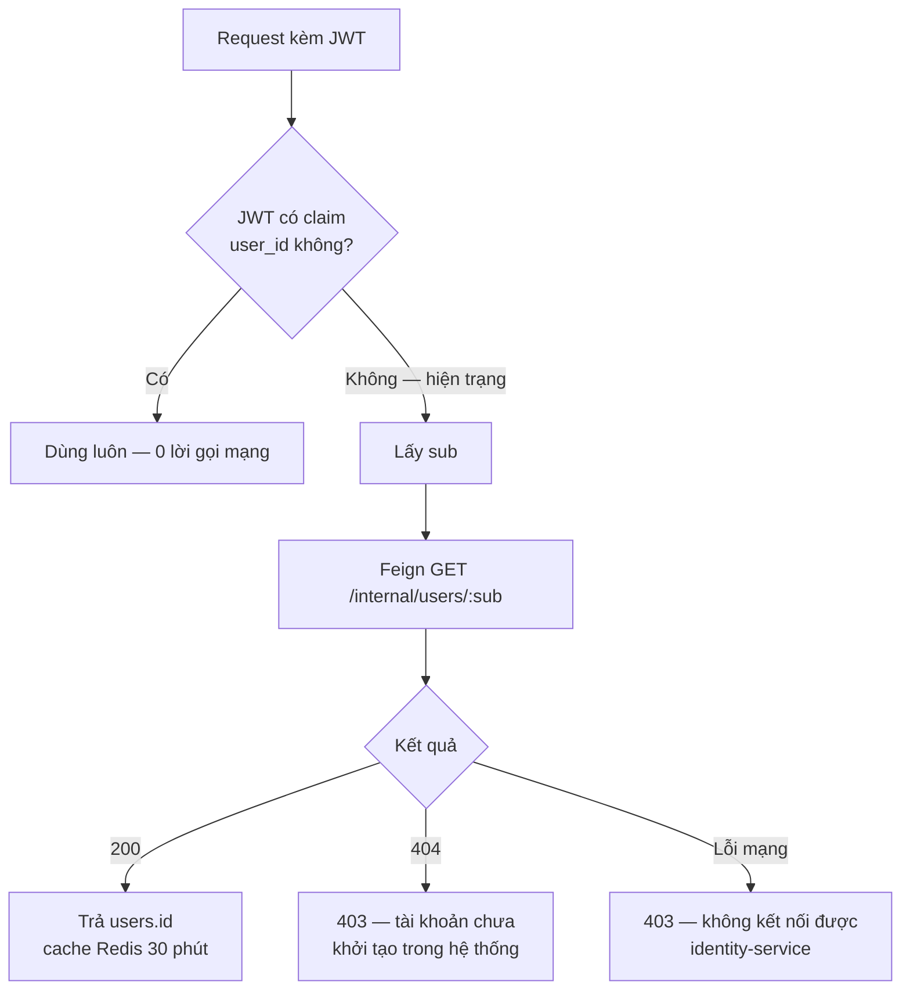
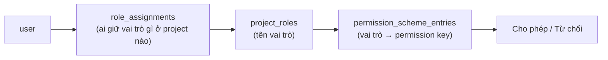
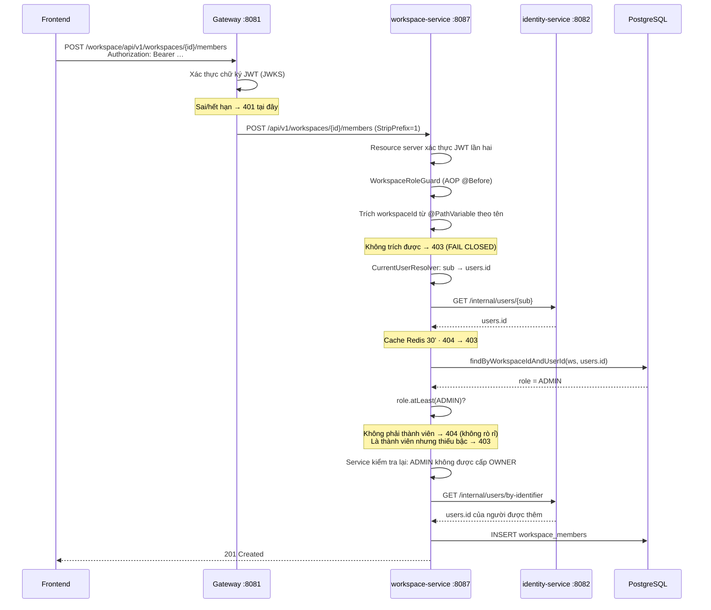

# 🔐 CƠ CHẾ & LUỒNG PHÂN QUYỀN — DATN-2026

> Tài liệu mô tả **hiện trạng** hệ thống phân quyền đang chạy, không phải thiết kế mong muốn.
> Mọi khẳng định đều đối chiếu trực tiếp với mã nguồn; các điểm chưa nhất quán được liệt kê
> riêng ở [§9](#9-các-điểm-chưa-nhất-quán-đã-biết) thay vì bị giấu đi.
>
> Cập nhật: 2026-09-12 · Nhánh `feat/DATN-5`

---

## 1. TỔNG QUAN: SÁU TẦNG KIỂM SOÁT

Một request từ trình duyệt đi qua sáu tầng trước khi chạm vào dữ liệu. Mỗi tầng trả lời một
câu hỏi khác nhau — hiểu nhầm ranh giới giữa chúng là nguồn gốc của hầu hết lỗi phân quyền.

```
┌──────────────────────────────────────────────────────────────────────────┐
│  Trình duyệt (React)                                                     │
│  Tầng 6 — Ẩn/hiện nút bấm. KHÔNG phải bảo mật, chỉ là trải nghiệm.       │
└────────────────────────────────┬─────────────────────────────────────────┘
                                 │  Bearer token (hoặc cookie httpOnly)
┌────────────────────────────────▼─────────────────────────────────────────┐
│  API Gateway :8081                                                       │
│  Tầng 2 — "Token này có hợp lệ không?"  (chữ ký JWKS + realm roles)      │
└────────────────────────────────┬─────────────────────────────────────────┘
                                 │  StripPrefix=1, chuyển tiếp nguyên token
┌────────────────────────────────▼─────────────────────────────────────────┐
│  Service (identity :8082 · work :8083 · workspace :8087)                 │
│  Tầng 3 — Xác thực lại JWT một lần nữa (resource server độc lập)         │
│  Tầng 4 — "Người gọi này THỰC SỰ là ai?"  (sub → users.id)               │
│  Tầng 5 — "Người này được làm gì TRONG phạm vi này?"                     │
└──────────────────────────────────────────────────────────────────────────┘
                                 ▲
┌────────────────────────────────┴─────────────────────────────────────────┐
│  Keycloak :8088 — realm `datn-realm`                                     │
│  Tầng 1 — "Người này là ai?"  (phát hành token, giữ mật khẩu)            │
└──────────────────────────────────────────────────────────────────────────┘
```

**Điểm cần nắm trước tiên:** tầng 1–3 chỉ trả lời *xác thực* (authentication). Toàn bộ
*phân quyền* (authorization) thực sự nằm ở tầng 5, và nó **không dùng role của Keycloak**.
Role `ADMIN`/`USER` trong Keycloak chỉ phục vụ cổng quản trị hệ thống, hoàn toàn tách biệt
với vai trò trong Workspace/Team/Project.

---

## 2. TẦNG 1 — KEYCLOAK: XÁC THỰC

* **Realm**: `datn-realm` · **Client**: `datn-backend` (confidential)
* **Realm roles thực có**: `ADMIN`, `USER` (cộng các role nội bộ `offline_access`,
  `uma_authorization`, `default-roles-ptit` — đều bị lọc bỏ, xem §3.2)

Hai luồng đăng nhập, chi tiết ở [`NORMAL_LOGIN_FLOW.md`](NORMAL_LOGIN_FLOW.md) và
[`GOOGLE_LOGIN_FLOW.md`](GOOGLE_LOGIN_FLOW.md):

| Luồng | Cơ chế |
| :--- | :--- |
| Tài khoản nội bộ | Direct Access Grant (`password`) qua `AuthController.login` |
| Google | Authorization Code exchange qua Identity Provider `google` của Keycloak |

> ⚠️ **Ràng buộc dễ vấp:** realm khai báo `firstName`/`lastName` là **bắt buộc** với role
> `user`, và `VERIFY_PROFILE` đang bật. Tài khoản thiếu hai trường này sẽ đăng nhập thất bại
> với `invalid_grant: Account is not fully set up`, dù trong Admin Console nhìn vẫn bình
> thường (`requiredActions` rỗng, vì `VERIFY_PROFILE` được tính tại thời điểm xác thực chứ
> không lưu trên user). Vì vậy `RegisterRequest` bắt buộc hai trường này bằng `@NotBlank`.

---

## 3. TẦNG 2 — API GATEWAY

Nguồn: [`api-gateway/security/SecurityConfig.java`](../backend/api-gateway/src/main/java/com/datn/api_gateway/security/SecurityConfig.java)

### 3.1. Đường public

Chỉ ba nhóm không cần token — mọi thứ còn lại `authenticated()`:

```java
"/identity/api/v1/auth/**", "/actuator/health", "/actuator/info"
```

### 3.2. Token đọc từ đâu

`CookieOrBearerTokenConverter` chấp nhận **cả** header `Authorization: Bearer …` **lẫn**
cookie httpOnly `access_token`. Thiết kế này cho phép chuyển sang cookie httpOnly sau này
mà không phải sửa lại toàn bộ client.

### 3.3. Role Keycloak → quyền Spring

`KeycloakJwtConverter` bóc `realm_access.roles`, **lọc bỏ** các role nội bộ của Keycloak
(`default-roles*`, `offline_access`, `uma_authorization`), rồi thêm tiền tố `ROLE_` và
viết hoa. Nhờ vậy `@PreAuthorize("hasRole('ADMIN')")` hoạt động.

### 3.4. Bảng định tuyến

| Prefix ngoài | Đích | Ghi chú |
| :--- | :--- | :--- |
| `/identity/api/**`, `/identity/actuator/**` | `:8082` | |
| `/work/api/**`, `/work/actuator/**`, `/work/ws-work/**` | `:8083` | |
| `/workspace/api/**`, `/workspace/actuator/**` | `:8087` | |

Tất cả dùng `StripPrefix=1`.

> 🔒 **Cố ý không định tuyến `/**/internal/**`.** Các endpoint nội bộ
> (`/internal/users/**`, `/internal/workspaces/**`) **không yêu cầu xác thực** vì chúng dành
> cho giao tiếp service-to-service. Chúng an toàn *chỉ nhờ* predicate ở gateway không khớp
> — nghĩa là **bảo mật ở đây phụ thuộc vào cấu hình routing, không phải vào code**. Nếu
> triển khai thật, phải chặn ở tầng mạng (network policy / firewall), không được dựa vào
> gateway.

---

## 4. TẦNG 3 — RESOURCE SERVER TẠI TỪNG SERVICE

Mỗi service tự xác thực lại JWT qua JWKS của Keycloak, **không tin gateway**. Đây là phòng
thủ nhiều lớp: nếu ai đó gọi thẳng `:8083` bỏ qua gateway thì vẫn bị chặn.

| Service | Đường permitAll |
| :--- | :--- |
| identity-service | `/api/v1/auth/**`, `/internal/**`, `/actuator/health`, `/actuator/info` |
| work-service | `/actuator/**`, `/public/**` |
| workspace-service | `/actuator/**`, `/internal/**` |

identity-service dùng thêm `@EnableMethodSecurity` với `@PreAuthorize` ở
[`UserController`](../backend/identity-service/src/main/java/com/datn/identity_service/controller/UserController.java):

| Endpoint | Điều kiện |
| :--- | :--- |
| `GET /api/v1/users/me`, `GET /api/v1/users/search` | `isAuthenticated()` |
| `GET/POST/PUT/DELETE /api/v1/admin/users/**` | `hasRole('ADMIN')` |

**Đây là nơi DUY NHẤT trong toàn hệ thống dùng role Keycloak để phân quyền.** work-service và
workspace-service không dùng `hasRole` ở bất kỳ đâu.

---

## 5. TẦNG 4 — DANH TÍNH CHUẨN (phần tinh tế nhất)

### 5.1. Vấn đề: một người dùng, hai định danh

| Định danh | Nguồn | Tính chất |
| :--- | :--- | :--- |
| Keycloak `sub` | claim `sub` trong JWT | **Có thể đổi** |
| `users.id` | bảng `users` của identity-service | **Bất biến** |

`UserService.getCurrentUser` **ghi đè `user.keycloakId`** khi email trùng khớp với một tài
khoản Keycloak khác (dòng log: *"Linking new Keycloak ID…"*). Nên `keycloak_id` là mutable.
**Một bảng phân quyền khóa theo id mutable sẽ âm thầm mất quyền khi id đó đổi.**

→ Quy ước toàn hệ thống: **`workspace_members.user_id` luôn là `users.id`, không bao giờ là
`sub`.**

### 5.2. Vì sao phải resolve mỗi request

identity-service **đã** ghi attribute `user_id` lên Keycloak ở 4 vị trí
(`UserService.java:81, 170, 202, 363`). Nhưng realm **chưa có protocol mapper** để đưa
attribute đó vào token — kiểm chứng: `grep -c user_id infrastructure/keycloak/realm-export_08082026.json` → **0**.

Nên token thực tế **không có** claim `user_id`, và hệ thống phải đi đường vòng:



| Service | Lớp phụ trách | Hành vi khi thất bại |
| :--- | :--- | :--- |
| workspace-service | `CurrentUserResolver` + `IdentityUserLookup` | **Fail closed** — `ForbiddenException` |
| work-service | `CanonicalUserResolver` | Giữ nguyên id gốc; việc tra membership sau đó sẽ không khớp nên vẫn fail closed |

### 5.3. Vì sao là 403 chứ không phải 401

Khi resolver chạy thì **JWT đã được resource server xác thực xong**. Mọi thất bại ở tầng này
vì thế **không bao giờ chữa được bằng refresh token**.

Trả 401 sẽ kích hoạt nhánh silent-refresh ở [`api.js:143`](../frontend/src/api.js): interceptor
tưởng token hết hạn → gọi `/auth/refresh` → **refresh thành công** (token vốn hợp lệ) →
retry → lại 401. Nhiều request workspace chạy song song cùng dồn vào hàng đợi `isRefreshing`
và sinh ra một loạt promise bị reject.

`CurrentUserResolverTest` có assert `isNotInstanceOf(UnauthorizedException.class)` để khóa
lại quy ước này.

### 5.4. Hệ quả: tài khoản "mồ côi"

Tài khoản tồn tại trên Keycloak nhưng **không có hàng trong bảng `users`** sẽ đăng nhập được
nhưng không dùng được gì. `UserService.getCurrentUser:194` **không** tự tạo hàng — nó throw
`ResourceNotFoundException`. Hệ thống hiện **không có JIT provisioning** cho luồng đăng nhập
thường (luồng Google thì có, qua `findOrCreateGoogleUser`).

Cách thoát: đăng ký qua trang `/register` của ứng dụng (tạo cả Keycloak lẫn hàng `users`).

---

## 6. TẦNG 5 — PHÂN QUYỀN THEO PHẠM VI

Ba phạm vi lồng nhau, và **mỗi phạm vi dùng một cơ chế hoàn toàn khác nhau**:

```
Workspace  →  enum có thứ tự   + AOP guard (fail closed)   ← mới, nhất quán
   └─ Team →  enum, kiểm tra tay trong controller           ← không có cơ chế khai báo
        └─ Project → ma trận quyền 3 bảng + AOP guard (fail OPEN)
```

### 6.1. Workspace — thang bậc có thứ tự

Nguồn: `workspace-service/enums/WorkspaceRole.java`, `security/WorkspaceRoleGuard.java`

```java
OWNER > ADMIN > MEMBER > GUEST      // ordinal nhỏ = quyền cao
role.atLeast(min)                   // so sánh THỨ TỰ, không phải tập hợp
```

Dùng qua annotation, `workspaceId` lấy từ `@PathVariable` **theo đúng tên**:

```java
@PutMapping("/{workspaceId}")
@RequireWorkspaceRole(WorkspaceRole.ADMIN)
public ResponseEntity<...> update(@PathVariable UUID workspaceId, ...)
```

| Thao tác | Bậc tối thiểu |
| :--- | :--- |
| Xem workspace, xem danh sách thành viên | thành viên bất kỳ (kể cả GUEST) |
| Tạo team / project trong workspace | `MEMBER` |
| Thêm / xóa / đổi vai trò thành viên | `ADMIN` |
| Sửa tên, mô tả workspace | `ADMIN` |
| Xóa (soft) / phục hồi workspace | `OWNER` |
| Cấp hoặc thu hồi vai trò `OWNER` | `OWNER` |

**Hai bất biến được thực thi ở tầng service, không phải guard:**

1. **Không rò rỉ sự tồn tại** — người ngoài truy cập workspace nhận **404**, không phải 403.
   403 sẽ tiết lộ rằng workspace đó có thật.
2. **Luôn còn ít nhất một OWNER** — `assertNotLastOwner` chặn `leave`, `removeMember`, và
   hạ bậc OWNER cuối cùng. Nó gọi `lockOwners()` (`SELECT … FOR UPDATE`) **trước khi đếm**,
   vì nếu chỉ đọc thuần thì hai OWNER gọi `/leave` đồng thời sẽ cùng đọc được `count = 2`,
   cùng vượt qua, cùng xóa → workspace về **zero OWNER** và không ai còn quyền sửa vai trò
   cho ai nữa.

### 6.2. Team — kiểm tra tay, không có cơ chế khai báo

Nguồn: `work-service/controller/TeamController.java`

`TeamRole` chỉ có `LEADER`, `MEMBER`, `VIEWER`. **Không có annotation nào** — toàn bộ kiểm
tra nằm trực tiếp trong thân method controller qua các helper `isTeamOwner`, `isTeamLeader`:

| Thao tác | Điều kiện |
| :--- | :--- |
| Xem team, xem danh sách thành viên | bất kỳ ai đã đăng nhập |
| Sửa thông tin team | Owner **hoặc** Leader |
| Thêm / xóa thành viên | Owner **hoặc** Leader |
| Đổi vai trò thành viên | **chỉ** Leader (Owner không đủ) |
| Xóa team | **chỉ** Owner |
| Rời team | thành viên bất kỳ; Owner bị từ chối |

Team mang **hai nguồn sự thật**: cột `teams.owner_id` *và* vai trò `LEADER` trong
`team_members`. Việc hòa giải hai nguồn này là lý do tồn tại của ~6 helper trong controller.
Workspace cố ý **không** lặp lại thiết kế đó (không có cột `owner_id`; hàng membership là
nguồn duy nhất).

### 6.3. Project — ma trận quyền động 3 bảng

Nguồn: `work-service/security/ProjectPermissionGuard.java`, `service/impl/ProjectMemberServiceImpl.java`

10 `PermissionKey`: `PROJECT_ADMIN`, `PROJECT_VIEW`, `ISSUE_CREATE`, `ISSUE_EDIT`,
`ISSUE_DELETE`, `ISSUE_TRANSITION`, `ISSUE_ASSIGN`, `SPRINT_MANAGE`, `RELEASE_MANAGE`,
`COMMENT_CREATE`.

Quyền được tra qua ba bảng, cho phép **tùy biến vai trò theo từng project**:



`hasPermission` chạy theo thứ tự:

1. Project **lead** hoặc **người tạo** → cho qua **tất cả** (đường tắt)
2. Không có `role_assignment` nào → chỉ cho qua nếu quyền yêu cầu là `PROJECT_VIEW`
3. Có vai trò tên `"ADMINISTRATOR"` (so khớp **theo chuỗi**) → cho qua tất cả
4. Ngược lại: tra `permission_scheme_entries`

Ma trận mặc định được seed khi tạo project (`ProjectServiceImpl:379-401`):

| Vai trò | Quyền được cấp |
| :--- | :--- |
| `ADMINISTRATOR` | Toàn bộ 10 `PermissionKey` |
| `MEMBER` | `PROJECT_VIEW`, `ISSUE_CREATE`, `ISSUE_EDIT`, `ISSUE_TRANSITION`, `ISSUE_ASSIGN`, `COMMENT_CREATE` |
| `VIEWER` | `PROJECT_VIEW` |

Các controller đang dùng annotation này: `ProjectController`, `ProjectMemberController`,
`WorkflowController` — **chỉ với `PROJECT_VIEW` và `PROJECT_ADMIN`**. Tám key còn lại đã được
định nghĩa và seed nhưng **chưa endpoint nào thực thi**; chúng mới chỉ dùng để ẩn/hiện nút ở
frontend.

### 6.4. Kiểm tra xuyên service

Nguồn: `work-service/security/WorkspaceAccessChecker.java`

work-service cần biết vai trò workspace nhưng bảng đó thuộc workspace-service. Nó gọi qua
Feign tới `/internal/workspaces/{id}/members/{userId}/role`, cache Redis 60 giây, và
**fail closed**: mọi lỗi Feign/timeout đều thành `ForbiddenException`.

> **Đánh đổi đã cân nhắc:** cả hai bảng đều nằm trong `datn_main_db` nên đọc trực tiếp sẽ
> nhanh hơn và không phụ thuộc tính sẵn sàng của service kia. Vẫn chọn Feign vì work-service
> chạy `ddl-auto: update` — bất kỳ entity nào map ở đó là một bảng Hibernate **được phép
> ALTER**, tức là một service sẽ âm thầm sửa schema của service khác.

---

## 7. TẦNG 6 — GATING Ở FRONTEND

**Đây không phải bảo mật.** Backend luôn là nơi thực thi; frontend chỉ ẩn những nút mà bấm
vào cũng sẽ bị từ chối.

Hai hook, hai đại số khác nhau:

| Hook | Cơ chế | Số request |
| :--- | :--- | :--- |
| `useWorkspaceRole` | So sánh **thứ tự** (`roleAtLeast`) | **0** — `myRole` đã về kèm `listMine()` |
| `useProjectPermission` | Kiểm tra **thuộc tập hợp**, `PROJECT_ADMIN` là override | 1 request/project |

Quy ước nhất quán trong UI:

* **Ẩn** control mà vai trò *không bao giờ* dùng được (GUEST không thấy nút tạo project).
* **Disable + giải thích** control mà vai trò *thường* có nhưng không dùng được *trong
  trường hợp này* — điển hình là OWNER cuối cùng không rời workspace được. Trạng thái này
  được tính **client-side** từ danh sách thành viên đã tải, để người dùng thấy lý do ngay
  thay vì bấm rồi nhận một toast 400 không có ngữ cảnh.

---

## 8. LUỒNG ĐẦY ĐỦ CỦA MỘT REQUEST

Ví dụ: **thêm thành viên vào workspace**.



**Bốn chốt chặn độc lập** trong một request: chữ ký ở gateway → chữ ký ở service → bậc vai
trò ở guard → quy tắc nghiệp vụ ở service. Guard chỉ là cổng thô; service **luôn kiểm tra
lại** và luôn nhận `currentUserId` qua tham số (không tự đọc `SecurityContext`), nhờ vậy
unit test không cần dựng `SecurityContext`.

---

## 9. CÁC ĐIỂM CHƯA NHẤT QUÁN (ĐÃ BIẾT)

Liệt kê thẳng để tiện bảo vệ và lên kế hoạch xử lý.

| # | Vấn đề | Vị trí | Mức độ |
| :-: | :--- | :--- | :--- |
| 1 | **`ProjectPermissionGuard` fail OPEN** — không trích được `projectId` thì `log.debug` rồi `return`, tức gõ sai tên path variable sẽ **âm thầm vô hiệu hóa** kiểm tra quyền. `WorkspaceRoleGuard` cố ý làm ngược lại. | `ProjectPermissionGuard.java:52-55` | 🔴 Cao |
| 2 | **Chiến lược dự phòng "lấy UUID đầu tiên"** trong cùng guard đó: trên method nhận `workItemId` nó sẽ kiểm tra quyền trên **sai thực thể**. | `ProjectPermissionGuard.java` | 🔴 Cao |
| 3 | **Mọi user đã đăng nhập đều có `PROJECT_VIEW` ngầm** trên *mọi* project, kể cả project thuộc workspace mình không tham gia. | `ProjectMemberServiceImpl:57-60` | 🟠 Vừa |
| 4 | **Team không có bảo vệ "leader cuối cùng"** — một LEADER không phải owner rời nhóm tự do, team có thể về zero leader, lúc đó `updateMemberRole` (chỉ leader gọi được) thành bất khả đạt. Workspace đã xử lý, Team thì chưa. | `TeamController.leaveTeam` | 🟠 Vừa |
| 5 | **Thiếu protocol mapper `user_id`** — khiến mỗi phiên tốn một lời gọi Feign để resolve danh tính. Thêm mapper vào realm là đủ, không cần sửa code. | `infrastructure/keycloak/realm-export_08082026.json` | 🟡 Thấp |
| 6 | **`getUserAliasIds` vẫn còn** trong `TeamController` — bắn một lời gọi Feign cho *mỗi* lần kiểm tra quyền (một thao tác xóa thành viên tốn 4+ round-trip). Hệ quả của việc `team_members.user_id` có thể đang lưu lẫn lộn `sub` và `users.id`. | `TeamController:534` | 🟡 Thấp |
| 7 | **Không có JIT provisioning** cho đăng nhập thường → tài khoản chỉ có trên Keycloak bị kẹt vĩnh viễn (xem §5.4). | `UserService.getCurrentUser:194` | 🟠 Vừa |
| 8 | **8/10 `PermissionKey` chưa được thực thi** ở bất kỳ endpoint nào — mới chỉ dùng để gating UI. | `work-service/controller/` | 🟡 Thấp |
| 9 | **`/internal/**` an toàn nhờ cấu hình routing, không nhờ code.** Khi triển khai thật phải chặn ở tầng mạng. | gateway + SecurityConfig các service | 🟠 Vừa |

**Hướng hợp nhất dài hạn:** `DATABASE_DESIGN.md:98` đã thiết kế sẵn mô hình tổng quát
`user_roles(scope_type ENUM('workspace','team','project'), scope_id)` nhưng chưa bao giờ
được hiện thực. Gộp cả ba phạm vi về một cơ chế khai báo duy nhất sẽ xóa được các mục 1, 2,
4 và 8 cùng lúc.

---

## 10. BẢNG THAM CHIẾU NHANH

| Việc cần tìm | File |
| :--- | :--- |
| Đường public của gateway, đọc token từ cookie | `api-gateway/security/SecurityConfig.java`, `CookieOrBearerTokenConverter.java` |
| Role Keycloak → quyền Spring | `api-gateway/security/KeycloakJwtConverter.java` |
| Bảo vệ endpoint quản trị hệ thống | `identity-service/controller/UserController.java` (`@PreAuthorize`) |
| Đổi `sub` → `users.id` | `workspace-service/security/CurrentUserResolver.java`, `IdentityUserLookup.java` |
| Tương tự phía work-service | `work-service/security/CanonicalUserResolver.java` |
| Thang bậc vai trò workspace | `workspace-service/enums/WorkspaceRole.java` |
| Guard workspace (fail closed) | `workspace-service/security/WorkspaceRoleGuard.java` |
| Bất biến "luôn còn một OWNER" | `workspace-service/service/impl/WorkspaceMemberServiceImpl.java` (`assertNotLastOwner`) |
| Kiểm tra quyền project | `work-service/service/impl/ProjectMemberServiceImpl.java` (`hasPermission`) |
| Guard project (fail open) | `work-service/security/ProjectPermissionGuard.java` |
| Kiểm tra workspace từ work-service | `work-service/security/WorkspaceAccessChecker.java` |
| Gating UI | `frontend/src/hooks/useWorkspaceRole.js`, `useProjectPermission.js` |
| Xử lý lỗi 401/403 ở client | `frontend/src/api.js` (response interceptor) |

---

## 11. TÀI LIỆU LIÊN QUAN

* [`0_SERVICES_ARCHITECTURE.md`](services/0_SERVICES_ARCHITECTURE.md) — phân chia bounded context
* [`DATABASE_DESIGN.md`](DATABASE_DESIGN.md) — lược đồ CSDL, gồm cả mô hình RBAC tổng quát chưa hiện thực
* [`NORMAL_LOGIN_FLOW.md`](NORMAL_LOGIN_FLOW.md) · [`GOOGLE_LOGIN_FLOW.md`](GOOGLE_LOGIN_FLOW.md) — chi tiết hai luồng đăng nhập
* [`API_DOCUMENTATION.md`](API_DOCUMENTATION.md) — danh mục endpoint
