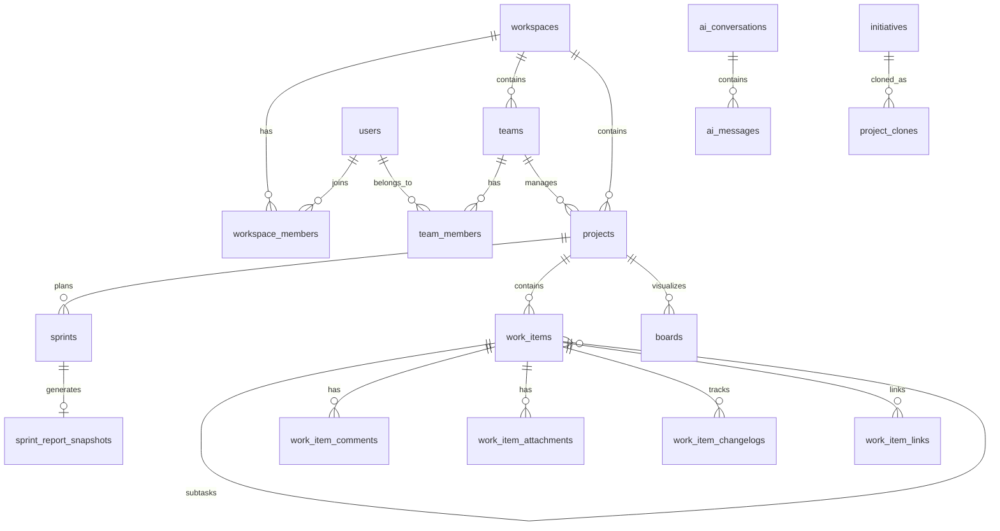

# TÀI LIỆU THIẾT KẾ CƠ SỞ DỮ LIỆU (DATABASE DESIGN SPECIFICATION)

---

## MỤC LỤC
- [1. TỔNG QUAN HỆ THỐNG](#1-tổng-quan-hệ-thống)
- [2. DANH SÁCH BẢNG VÀ THUỘC TÍNH (ENTITIES & ATTRIBUTES)](#2-danh-sách-bảng-và-thuộc-tính-entities--attributes)
  - [2.1. Cấp Workspace & Bảo mật (Authentication & Organization)](#21-cấp-workspace--bảo-mật-authentication--organization)
    - [2.1.1. Bảng `workspaces` (Không gian làm việc)](#211-bảng-workspaces-không-gian-làm-việc)
    - [2.1.2. Bảng `workspace_members` (Thành viên Workspace)](#212-bảng-workspace_members-thành-viên-workspace)
    - [2.1.3. Bảng `users` (Người dùng)](#213-bảng-users-người-dùng)
    - [2.1.4. Phân quyền RBAC (`roles`, `permissions`, `role_permissions`, `user_roles`)](#214-phân-quyền-rbac-roles-permissions-role_permissions-user_roles)
  - [2.2. Phân hệ Quản trị Công việc (Work Service — Jira-Grade Engine)](#22-phân-hệ-quản-trị-công-việc-work-service--jira-grade-engine)
    - [2.2.1. Đội nhóm (`teams`, `team_members`)](#221-đội-nhóm-teams-team_members)
    - [2.2.2. Dự án & Phân quyền Dự án (`projects`, `project_roles`, `role_assignments`, `permission_scheme_entries`)](#222-dự-án--phân-quyền-dự-án-projects-project_roles-role_assignments-permission_scheme_entries)
    - [2.2.3. Loại công việc & Máy trạng thái (`work_item_types`, `statuses`, `workflows`, `workflow_transitions`, `workflow_schemes`, `workflow_scheme_mappings`)](#223-loại-công-việc--máy-trạng-thái-work_item_types-statuses-workflows-workflow_transitions-workflow_schemes-workflow_scheme_mappings)
    - [2.2.4. Agile Scrum, Sprint, Phân hệ & Phiên bản (`sprints`, `sprint_report_snapshots`, `components`, `versions`, `labels`)](#224-agile-scrum-sprint-phân-hệ--phiên-bản-sprints-sprint_report_snapshots-components-versions-labels)
    - [2.2.5. Thực thể Trọng tâm Work Items (`work_items`, `work_item_component_maps`, `work_item_label_maps`, `work_item_links`)](#225-thực-thể-trọng-tâm-work-items-work_items-work_item_component_maps-work_item_label_maps-work_item_links)
    - [2.2.6. Bảng trực quan (`boards`, `board_columns`, `board_column_statuses`, `board_swimlanes`)](#226-bảng-trực-quan-boards-board_columns-board_column_statuses-board_swimlanes)
    - [2.2.7. Nhật ký Audit, Cộng tác & Mở rộng (`work_item_changelogs`, `work_item_comments`, `work_item_attachments`, `custom_field_definitions`, `saved_filters`, `automation_rules`, `outbox_events`)](#227-nhật-ký-audit-cộng-tác--mở-rộng-work_item_changelogs-work_item_comments-work_item_attachments-custom_field_definitions-saved_filters-automation_rules-outbox_events)
  - [2.3. Tích hợp & Thông báo (Integration & Notification)](#23-tích-hợp--thông-báo-integration--notification)
  - [2.4. AI Agent & Tự động hóa](#24-ai-agent--tự-động-hóa)
  - [2.5. Template, Initiative & Blog / Cộng đồng](#25-template-initiative--blog--cộng-đồng)
- [3. BẢNG TỔNG HỢP MỐI QUAN HỆ CỐT LÕI (RELATIONSHIPS)](#3-bảng-tổng-hợp-mối-quan-hệ-cốt-lõi-relationships)
- [4. QUY TẮC RÀNG BUỘC & DỮ LIỆU (DATABASE RULES)](#4-quy-tắc-ràng-buộc--dữ-liệu-database-rules)

---

## 1. TỔNG QUAN HỆ THỐNG
Hệ thống sử dụng cơ sở dữ liệu quan hệ (PostgreSQL) hỗ trợ quản trị đa khách thuê (Multi-tenancy) theo kiến trúc Workspace, phân quyền động RBAC (Role-Based Access Control) theo Scope, quản lý vòng đời dự án - tác vụ (Agile/Kanban/Scrum), lưu vết lịch sử, tích hợp đa nền tảng và hỗ trợ AI Agent.

---

## 2. DANH SÁCH BẢNG VÀ THUỘC TÍNH (ENTITIES & ATTRIBUTES)

### 2.1. Cấp Workspace & Bảo mật (Authentication & Organization)

#### 2.1.1. Bảng `workspaces` (Không gian làm việc)
| Field | Type | Ràng buộc | Ghi chú |
| :--- | :--- | :--- | :--- |
| `id` | `UUID` | **PK**, Default `gen_random_uuid()` | Định danh duy nhất của Workspace |
| `name` | `VARCHAR(255)` | `NOT NULL` | Tên Workspace / Doanh nghiệp |
| `slug` | `VARCHAR(100)` | `UNIQUE`, `NOT NULL` | URL Subdomain (ví dụ: `app.domain.com/company-a`) |
| `logo_url` | `VARCHAR(255)` | `NULL` | Đường dẫn logo doanh nghiệp |
| `owner_id` | `UUID` | **FK** $\rightarrow$ `users(id)`, `NOT NULL` | Người tạo và sở hữu Workspace |
| `created_at` | `TIMESTAMP WITH TIME ZONE` | Default `CURRENT_TIMESTAMP` | Thời gian tạo |
| `updated_at` | `TIMESTAMP WITH TIME ZONE` | Default `CURRENT_TIMESTAMP` | Thời gian cập nhật gần nhất |

#### 2.1.2. Bảng `workspace_members` (Thành viên Workspace)
| Field | Type | Ràng buộc | Ghi chú |
| :--- | :--- | :--- | :--- |
| `workspace_id` | `UUID` | **Composite PK**, **FK** $\rightarrow$ `workspaces(id)` | Workspace tham gia (ON DELETE CASCADE) |
| `user_id` | `UUID` | **Composite PK**, **FK** $\rightarrow$ `users(id)` | Người dùng (ON DELETE CASCADE) |
| `role` | `ENUM` | `NOT NULL`, Default `'member'` | `owner`, `admin`, `member`, `guest` |
| `joined_at` | `TIMESTAMP WITH TIME ZONE` | Default `CURRENT_TIMESTAMP` | Thời điểm tham gia |

#### 2.1.3. Bảng `users` (Người dùng)
| Field | Type | Ràng buộc | Ghi chú |
| :--- | :--- | :--- | :--- |
| `id` | `UUID` | **PK**, Default `gen_random_uuid()` | Định danh người dùng |
| `email` | `VARCHAR(255)` | `UNIQUE`, `NOT NULL` | Địa chỉ email đăng nhập |
| `username` | `VARCHAR(100)` | `UNIQUE`, `NOT NULL` | Tên người dùng |
| `password_hash` | `VARCHAR(255)` | `NULL` | Mật khẩu băm (Nullable nếu login OAuth) |
| `avatar_url` | `VARCHAR(500)` | `NULL` | Đường dẫn ảnh đại diện |
| `provider` | `ENUM` | `NOT NULL`, Default `'local'` | `local`, `google`, `github` |
| `status` | `ENUM` | `NOT NULL`, Default `'active'` | `active`, `inactive`, `banned` |
| `created_at` | `TIMESTAMP WITH TIME ZONE` | Default `CURRENT_TIMESTAMP` | Thời gian tạo tài khoản |
| `updated_at` | `TIMESTAMP WITH TIME ZONE` | Default `CURRENT_TIMESTAMP` | Thời gian cập nhật |

#### 2.1.4. Phân quyền RBAC (`roles`, `permissions`, `role_permissions`, `user_roles`)

##### Bảng `roles`
| Field | Type | Ràng buộc | Ghi chú |
| :--- | :--- | :--- | :--- |
| `id` | `UUID` | **PK** | Định danh vai trò |
| `name` | `VARCHAR(100)` | `NOT NULL`, `UNIQUE` | Tên vai trò (VD: `WORKSPACE_ADMIN`, `PROJECT_LEAD`) |
| `description` | `TEXT` | `NULL` | Mô tả phạm vi và quyền hạn vai trò |

##### Bảng `permissions`
| Field | Type | Ràng buộc | Ghi chú |
| :--- | :--- | :--- | :--- |
| `id` | `UUID` | **PK** | Định danh quyền hạn |
| `code` | `VARCHAR(100)` | `NOT NULL`, `UNIQUE` | Mã quyền hạn (VD: `task.create`, `workspace.manage`, `team.delete`) |
| `description` | `TEXT` | `NULL` | Mô tả chi tiết quyền hạn |

##### Bảng `role_permissions`
| Field | Type | Ràng buộc | Ghi chú |
| :--- | :--- | :--- | :--- |
| `role_id` | `UUID` | **Composite PK**, **FK** $\rightarrow$ `roles(id)` | Vai trò |
| `permission_id` | `UUID` | **Composite PK**, **FK** $\rightarrow$ `permissions(id)` | Quyền hạn gán cho vai trò |

##### Bảng `user_roles`
| Field | Type | Ràng buộc | Ghi chú |
| :--- | :--- | :--- | :--- |
| `id` | `UUID` | **PK** | Định danh bản ghi gán vai trò |
| `user_id` | `UUID` | **FK** $\rightarrow$ `users(id)`, `NOT NULL` | Người dùng được cấp quyền |
| `role_id` | `UUID` | **FK** $\rightarrow$ `roles(id)`, `NOT NULL` | Vai trò áp dụng |
| `scope_type` | `ENUM` | `NOT NULL` | Phạm vi RBAC: `'workspace'`, `'team'`, `'project'` |
| `scope_id` | `UUID` | `NOT NULL` | ID của Workspace, Team hoặc Project tương ứng |

---

### 2.2. Phân hệ Quản trị Công việc (Work Service — Jira-Grade Engine)

#### 2.2.1. Đội nhóm (`teams`, `team_members`)

##### Bảng `teams`
| Field | Type | Ràng buộc | Ghi chú |
| :--- | :--- | :--- | :--- |
| `id` | `UUID` | **PK**, Default `gen_random_uuid()` | Định danh nhóm làm việc |
| `workspace_id` | `UUID` | **FK** $\rightarrow$ `workspaces(id)`, `NOT NULL` | Workspace trực thuộc |
| `name` | `VARCHAR(255)` | `NOT NULL` | Tên nhóm / phòng ban |
| `description` | `TEXT` | `NULL` | Mô tả nhóm |
| `owner_id` | `UUID` | **FK** $\rightarrow$ `users(id)`, `NOT NULL` | Trưởng nhóm / Người tạo |
| `created_at` | `TIMESTAMP WITH TIME ZONE` | Default `CURRENT_TIMESTAMP` | Thời gian tạo |
| `updated_at` | `TIMESTAMP WITH TIME ZONE` | Default `CURRENT_TIMESTAMP` | Thời gian cập nhật |

##### Bảng `team_members`
| Field | Type | Ràng buộc | Ghi chú |
| :--- | :--- | :--- | :--- |
| `id` | `UUID` | **PK**, Default `gen_random_uuid()` | Định danh bản ghi thành viên |
| `team_id` | `UUID` | **FK** $\rightarrow$ `teams(id)`, `NOT NULL` | Nhóm trực thuộc (ON DELETE CASCADE) |
| `user_id` | `UUID` | **FK** $\rightarrow$ `users(id)`, `NOT NULL` | Thành viên nhóm |
| `role` | `VARCHAR(50)` | Default `'MEMBER'`, `NOT NULL` | Vai trò trong nhóm: `LEADER`, `MEMBER`, `VIEWER` |
| `joined_at` | `TIMESTAMP WITH TIME ZONE` | Default `CURRENT_TIMESTAMP` | Thời điểm gia nhập nhóm |

*Ràng buộc duy nhất*: `UNIQUE(team_id, user_id)`.

---

#### 2.2.2. Dự án & Phân quyền Dự án (`projects`, `project_roles`, `role_assignments`, `permission_scheme_entries`)

##### Bảng `projects` (Dự án trung tâm)
| Field | Type | Ràng buộc | Ghi chú |
| :--- | :--- | :--- | :--- |
| `id` | `UUID` | **PK**, Default `gen_random_uuid()` | Định danh dự án |
| `workspace_id` | `UUID` | **FK** $\rightarrow$ `workspaces(id)`, `NOT NULL` | Workspace trực thuộc |
| `team_id` | `UUID` | **FK** $\rightarrow$ `teams(id)`, `NULL` | Nhóm phụ trách (ON DELETE SET NULL) |
| `name` | `VARCHAR(255)` | `NOT NULL` | Tên dự án |
| `key` | `VARCHAR(20)` | `UNIQUE`, `NOT NULL` | Mã tiền tố dự án (ví dụ: `SCRUM`, `PROJ`) |
| `description` | `TEXT` | `NULL` | Mô tả chi tiết dự án |
| `icon_url` | `VARCHAR(500)` | `NULL` | Biểu tượng dự án |
| `lead_user_id` | `UUID` | **FK** $\rightarrow$ `users(id)`, `NOT NULL` | Trưởng dự án (Project Lead) |
| `default_assignee_type` | `VARCHAR(50)` | Default `'PROJECT_LEADER'` | Người nhận việc mặc định: `PROJECT_LEADER`, `UNASSIGNED` |
| `project_type` | `VARCHAR(50)` | Default `'SOFTWARE_SCRUM'` | `SOFTWARE_SCRUM`, `SOFTWARE_KANBAN`, `BUSINESS` |
| `is_template` | `BOOLEAN` | Default `false` | Cờ đánh dấu Template mẫu để clone |
| `start_date` | `DATE` | `NULL` | Ngày bắt đầu |
| `end_date` | `DATE` | `NULL` | Ngày kết thúc dự kiến |
| `created_by` | `UUID` | **FK** $\rightarrow$ `users(id)`, `NOT NULL` | Người tạo dự án |
| `created_at` | `TIMESTAMP WITH TIME ZONE` | Default `CURRENT_TIMESTAMP` | Thời gian tạo |
| `updated_at` | `TIMESTAMP WITH TIME ZONE` | Default `CURRENT_TIMESTAMP` | Thời gian cập nhật |
| `deleted_at` | `TIMESTAMP WITH TIME ZONE` | `NULL` | Soft delete |

##### Bảng `project_roles` (Vai trò trong dự án)
| Field | Type | Ràng buộc | Ghi chú |
| :--- | :--- | :--- | :--- |
| `id` | `UUID` | **PK** | Định danh vai trò dự án |
| `project_id` | `UUID` | **FK** $\rightarrow$ `projects(id)`, `NULL` | Dự án áp dụng (`NULL`: vai trò hệ thống mặc định) |
| `name` | `VARCHAR(100)` | `NOT NULL` | `Administrator`, `Project Manager`, `Developer`, `QA`, `Viewer` |
| `description` | `TEXT` | `NULL` | Mô tả vai trò |

##### Bảng `role_assignments` (Gán vai trò cho người dùng trong dự án)
| Field | Type | Ràng buộc | Ghi chú |
| :--- | :--- | :--- | :--- |
| `id` | `UUID` | **PK** | Định danh bản ghi gán quyền |
| `project_id` | `UUID` | **FK** $\rightarrow$ `projects(id)`, `NOT NULL` | Dự án trực thuộc |
| `user_id` | `UUID` | **FK** $\rightarrow$ `users(id)`, `NOT NULL` | Người dùng được gán |
| `role_id` | `UUID` | **FK** $\rightarrow$ `project_roles(id)`, `NOT NULL` | Vai trò được cấp |
| `assigned_at` | `TIMESTAMP WITH TIME ZONE` | Default `CURRENT_TIMESTAMP` | Thời điểm gán |

*Ràng buộc duy nhất*: `UNIQUE(project_id, user_id, role_id)`.

##### Bảng `permission_scheme_entries` (Ma trận quyền hạn hạt mịn)
| Field | Type | Ràng buộc | Ghi chú |
| :--- | :--- | :--- | :--- |
| `id` | `UUID` | **PK** | Định danh mục phân quyền |
| `project_id` | `UUID` | **FK** $\rightarrow$ `projects(id)`, `NOT NULL` | Dự án áp dụng |
| `role_id` | `UUID` | **FK** $\rightarrow$ `project_roles(id)`, `NOT NULL` | Vai trò được cấp quyền |
| `permission_key` | `VARCHAR(100)` | `NOT NULL` | Quyền hạt mịn (`CREATE_ISSUE`, `TRANSITION_ISSUE`, `SPRINT_MANAGE`...) |

*Ràng buộc duy nhất*: `UNIQUE(project_id, role_id, permission_key)`.

---

#### 2.2.3. Loại công việc & Máy trạng thái (`work_item_types`, `statuses`, `workflows`, `workflow_transitions`, `workflow_schemes`, `workflow_scheme_mappings`)

##### Bảng `work_item_types` (Định nghĩa loại công việc & phân cấp)
| Field | Type | Ràng buộc | Ghi chú |
| :--- | :--- | :--- | :--- |
| `id` | `UUID` | **PK** | Định danh loại công việc |
| `project_id` | `UUID` | **FK** $\rightarrow$ `projects(id)`, `NULL` | Dự án sở hữu (`NULL`: kiểu toàn cục) |
| `name` | `VARCHAR(100)` | `NOT NULL` | `Epic`, `User Story`, `Task`, `Bug`, `Sub-task` |
| `code` | `VARCHAR(50)` | `NOT NULL` | `EPIC`, `STORY`, `TASK`, `BUG`, `SUBTASK` |
| `hierarchy_level`| `INTEGER` | `NOT NULL` | `1`: Epic, `0`: Standard Story/Task/Bug, `-1`: Subtask |
| `is_subtask` | `BOOLEAN` | Default `false` | Cờ đánh dấu công việc con |
| `is_system_default` | `BOOLEAN` | Default `false` | Kiểu mặc định của hệ thống |

##### Bảng `statuses` (Trạng thái công việc)
| Field | Type | Ràng buộc | Ghi chú |
| :--- | :--- | :--- | :--- |
| `id` | `UUID` | **PK** | Định danh trạng thái |
| `name` | `VARCHAR(100)` | `NOT NULL` | `To Do`, `In Progress`, `In Review`, `Done` |
| `category` | `VARCHAR(50)` | `NOT NULL` | Danh mục: `TODO`, `IN_PROGRESS`, `DONE` (Dùng tính Burndown) |
| `color_hex` | `VARCHAR(20)` | `NULL` | Mã màu hiển thị |

##### Bảng `workflows` (Định nghĩa quy trình làm việc)
| Field | Type | Ràng buộc | Ghi chú |
| :--- | :--- | :--- | :--- |
| `id` | `UUID` | **PK** | Định danh quy trình |
| `project_id` | `UUID` | **FK** $\rightarrow$ `projects(id)`, `NULL` | Dự án sở hữu |
| `name` | `VARCHAR(255)` | `NOT NULL` | Tên quy trình (VD: `Software Development Workflow`) |
| `is_default` | `BOOLEAN` | Default `false` | Quy trình mặc định |

##### Bảng `workflow_transitions` (Bước chuyển trạng thái)
| Field | Type | Ràng buộc | Ghi chú |
| :--- | :--- | :--- | :--- |
| `id` | `UUID` | **PK** | Định danh bước chuyển |
| `workflow_id` | `UUID` | **FK** $\rightarrow$ `workflows(id)`, `NOT NULL` | Quy trình trực thuộc |
| `from_status_id`| `UUID` | **FK** $\rightarrow$ `statuses(id)`, `NULL` | Trạng thái nguồn (`NULL`: cho phép chuyển từ mọi trạng thái) |
| `to_status_id` | `UUID` | **FK** $\rightarrow$ `statuses(id)`, `NOT NULL` | Trạng thái đích đến |
| `name` | `VARCHAR(150)` | `NOT NULL` | Tên thao tác (VD: `Start Progress`, `Submit Review`, `Close`) |
| `conditions_config` | `JSONB` | `NULL` | Điều kiện ai được bấm chuyển |
| `validators_config` | `JSONB` | `NULL` | Kiểm tra điều kiện bắt buộc (VD: mọi subtask phải Done) |
| `post_functions_config`| `JSONB` | `NULL` | Hành động tự động sau khi chuyển (gán ngày resolve, notify...) |

##### Bảng `workflow_schemes` & `workflow_scheme_mappings`
* `workflow_schemes`: Bộ sơ đồ quy trình (`id`, `project_id`, `name`, `description`).
* `workflow_scheme_mappings`: Ánh xạ Loại công việc nào dùng Quy trình nào (`scheme_id`, `work_item_type_id`, `workflow_id`).

---

#### 2.2.4. Agile Scrum, Sprint, Phân hệ & Phiên bản (`sprints`, `sprint_report_snapshots`, `components`, `versions`, `labels`)

##### Bảng `sprints` (Chu kỳ lặp Agile Scrum)
| Field | Type | Ràng buộc | Ghi chú |
| :--- | :--- | :--- | :--- |
| `id` | `UUID` | **PK** | Định danh Sprint |
| `project_id` | `UUID` | **FK** $\rightarrow$ `projects(id)`, `NOT NULL` | Dự án trực thuộc |
| `name` | `VARCHAR(255)` | `NOT NULL` | Tên Sprint (VD: `Sprint 1: Architecture & Core Auth`) |
| `goal` | `TEXT` | `NULL` | Mục tiêu Sprint |
| `state` | `VARCHAR(50)` | Default `'FUTURE'`, `NOT NULL` | Vòng đời: `FUTURE`, `ACTIVE`, `CLOSED` |
| `start_date` | `TIMESTAMP WITH TIME ZONE`| `NULL` | Ngày bắt đầu Sprint |
| `end_date` | `TIMESTAMP WITH TIME ZONE`| `NULL` | Ngày kết thúc Sprint |
| `completed_date` | `TIMESTAMP WITH TIME ZONE`| `NULL` | Thời điểm thực tế đóng Sprint |

##### Bảng `sprint_report_snapshots` (Báo cáo chốt sổ Sprint cố định)
| Field | Type | Ràng buộc | Ghi chú |
| :--- | :--- | :--- | :--- |
| `id` | `UUID` | **PK** | Định danh bản ghi snapshot |
| `sprint_id` | `UUID` | **FK** $\rightarrow$ `sprints(id)`, `UNIQUE` | Sprint được tổng kết |
| `total_story_points` | `DECIMAL(10,2)` | Default `0` | Tổng điểm Story Points |
| `completed_story_points`| `DECIMAL(10,2)`| Default `0` | Số điểm đã hoàn thành |
| `incomplete_story_points`| `DECIMAL(10,2)`| Default `0` | Số điểm dở dang |
| `snapshot_data` | `JSONB` | `NOT NULL` | Dữ liệu chi tiết lưu vết để vẽ Burndown & Velocity vĩnh viễn |
| `closed_by` | `UUID` | **FK** $\rightarrow$ `users(id)`, `NOT NULL` | Người đóng Sprint |
| `closed_at` | `TIMESTAMP WITH TIME ZONE` | Default `CURRENT_TIMESTAMP` | Thời điểm chốt sổ |

##### Bảng `components`, `versions`, `labels`
* `components`: Phân hệ kỹ thuật (`id`, `project_id`, `name`, `description`, `lead_user_id` [auto-assignee]).
* `versions`: Phiên bản phát hành release (`id`, `project_id`, `name`, `description`, `release_date`, `is_released`, `is_archived`).
* `labels`: Nhãn phân loại (`id`, `project_id`, `name`, `color_hex`).

---

#### 2.2.5. Thực thể Trọng tâm Work Items (`work_items`, `work_item_component_maps`, `work_item_label_maps`, `work_item_links`)

##### Bảng `work_items` (BẢNG CÔNG VIỆC TRUNG TÂM — SINGLE TABLE INHERITANCE)
| Field | Type | Ràng buộc | Ghi chú |
| :--- | :--- | :--- | :--- |
| `id` | `UUID` | **PK**, Default `gen_random_uuid()` | Định danh công việc |
| `project_id` | `UUID` | **FK** $\rightarrow$ `projects(id)`, `NOT NULL` | Dự án trực thuộc |
| `type_id` | `UUID` | **FK** $\rightarrow$ `work_item_types(id)`, `NOT NULL`| Loại: Epic, Story, Task, Bug, Subtask |
| `status_id` | `UUID` | **FK** $\rightarrow$ `statuses(id)`, `NOT NULL` | Trạng thái hiện tại |
| `parent_id` | `UUID` | **FK** $\rightarrow$ `work_items(id)`, `NULL` | Tự tham chiếu Parent Issue (Epic $\rightarrow$ Story/Task hoặc Story $\rightarrow$ Subtask) |
| `sprint_id` | `UUID` | **FK** $\rightarrow$ `sprints(id)`, `NULL` | Sprint liên kết (`NULL`: Backlog) |
| `code` | `VARCHAR(50)` | `NOT NULL` | Mã hiển thị (Unique theo Project, ví dụ `SCRUM-101`) |
| `summary` | `VARCHAR(500)` | `NOT NULL` | Tiêu đề tóm tắt công việc |
| `description` | `TEXT` | `NULL` | Mô tả chi tiết |
| `priority` | `VARCHAR(50)` | Default `'MEDIUM'`, `NOT NULL` | `LOWEST`, `LOW`, `MEDIUM`, `HIGH`, `HIGHEST` |
| `resolution` | `VARCHAR(100)` | `NULL` | `DONE`, `WONT_DO`, `DUPLICATE`, `CANNOT_REPRODUCE` |
| `reporter_id` | `UUID` | **FK** $\rightarrow$ `users(id)`, `NOT NULL` | Người tạo / giao việc |
| `assignee_id` | `UUID` | **FK** $\rightarrow$ `users(id)`, `NULL` | Người thực hiện (ON DELETE SET NULL) |
| `story_points` | `DECIMAL(6,2)` | `NULL` | Điểm ước lượng Agile |
| `original_estimate_seconds`| `BIGINT` | Default `0` | Thời gian ước tính ban đầu (giây) |
| `remaining_estimate_seconds`| `BIGINT` | Default `0` | Thời gian còn lại (giây) |
| `time_spent_seconds` | `BIGINT` | Default `0` | Tổng thời gian thực tế đã log (giây) |
| `rank` | `VARCHAR(255)` | `NOT NULL` | Chuỗi thứ tự kéo thả LexoRank (ví dụ: `0|i00002:`) |
| `component_id` | `UUID` | **FK** $\rightarrow$ `components(id)`, `NULL` | Phân hệ kỹ thuật chính |
| `fix_version_id` | `UUID` | **FK** $\rightarrow$ `versions(id)`, `NULL` | Phiên bản sửa đổi / phát hành |
| `custom_fields` | `JSONB` | Default `'{}'` | Dữ liệu các trường tùy biến linh hoạt |
| `start_date` | `DATE` | `NULL` | Ngày bắt đầu |
| `due_date` | `DATE` | `NULL` | Hạn hoàn thành |
| `resolved_at` | `TIMESTAMP WITH TIME ZONE`| `NULL` | Thời điểm giải quyết xong |
| `version` | `INTEGER` | Default `0` | Optimistic locking chống Lost Update |
| `created_at` | `TIMESTAMP WITH TIME ZONE`| Default `CURRENT_TIMESTAMP` | Thời gian tạo |
| `updated_at` | `TIMESTAMP WITH TIME ZONE`| Default `CURRENT_TIMESTAMP` | Thời gian cập nhật |
| `deleted_at` | `TIMESTAMP WITH TIME ZONE`| `NULL` | Soft delete |

*Chỉ mục tối ưu*: B-Tree trên `(project_id, rank)`, `(project_id, deleted_at)`, `status_id`, `assignee_id`, `sprint_id`; GIN Index trên `custom_fields`.

##### Bảng `work_item_links` (Liên kết & Phụ thuộc giữa các công việc)
| Field | Type | Ràng buộc | Ghi chú |
| :--- | :--- | :--- | :--- |
| `id` | `UUID` | **PK** | Định danh liên kết |
| `source_item_id` | `UUID` | **FK** $\rightarrow$ `work_items(id)`, `NOT NULL` | Công việc nguồn |
| `target_item_id` | `UUID` | **FK** $\rightarrow$ `work_items(id)`, `NOT NULL` | Công việc đích |
| `link_type` | `VARCHAR(50)` | `NOT NULL` | `BLOCKS`, `RELATES_TO`, `DUPLICATES`, `CAUSES` |
| `created_by` | `UUID` | **FK** $\rightarrow$ `users(id)`, `NOT NULL` | Người tạo liên kết |
| `created_at` | `TIMESTAMP WITH TIME ZONE` | Default `CURRENT_TIMESTAMP` | Thời gian tạo |

*Ràng buộc*: `CHECK (source_item_id <> target_item_id)`, `UNIQUE(source_item_id, target_item_id, link_type)`.

---

#### 2.2.6. Bảng trực quan (`boards`, `board_columns`, `board_column_statuses`, `board_swimlanes`)

##### Bảng `boards` (Bảng làm việc Scrum / Kanban)
| Field | Type | Ràng buộc | Ghi chú |
| :--- | :--- | :--- | :--- |
| `id` | `UUID` | **PK** | Định danh bảng |
| `project_id` | `UUID` | **FK** $\rightarrow$ `projects(id)`, `NOT NULL` | Dự án trực thuộc |
| `name` | `VARCHAR(255)` | `NOT NULL` | Tên bảng (VD: `Sprint Board`, `Team Kanban`) |
| `type` | `VARCHAR(50)` | Default `'SCRUM'`, `NOT NULL` | `SCRUM`, `KANBAN` |
| `filter_jql` | `TEXT` | `NULL` | Bộ lọc JQL tùy biến cho bảng |

##### Bảng `board_columns`, `board_column_statuses`, `board_swimlanes`
* `board_columns`: Cột hiển thị trên Board (`id`, `board_id`, `name`, `column_order`, `min_wip_limit`, `max_wip_limit`).
* `board_column_statuses`: Ánh xạ 1 Cột chứa nhiều Status thực tế (`column_id`, `status_id` - Composite PK).
* `board_swimlanes`: Phân nhóm ngang (`id`, `board_id`, `name`, `strategy` [`BY_EPIC`, `BY_ASSIGNEE`, `BY_PRIORITY`, `CUSTOM_JQL`], `swimlane_order`).

---

#### 2.2.7. Nhật ký Audit, Cộng tác & Mở rộng (`work_item_changelogs`, `work_item_comments`, `work_item_attachments`, `custom_field_definitions`, `saved_filters`, `automation_rules`, `outbox_events`)

##### Bảng `work_item_changelogs` (Audit Trail)
| Field | Type | Ràng buộc | Ghi chú |
| :--- | :--- | :--- | :--- |
| `id` | `UUID` | **PK** | Định danh bản ghi log |
| `work_item_id` | `UUID` | **FK** $\rightarrow$ `work_items(id)`, `NOT NULL` | Công việc bị thay đổi |
| `field_name` | `VARCHAR(100)` | `NOT NULL` | Tên trường (`status`, `assignee`, `story_points`...) |
| `old_value` | `TEXT` | `NULL` | Giá trị trước thay đổi |
| `new_value` | `TEXT` | `NULL` | Giá trị sau thay đổi |
| `changed_by` | `UUID` | **FK** $\rightarrow$ `users(id)`, `NOT NULL` | Người thực hiện |
| `changed_at` | `TIMESTAMP WITH TIME ZONE` | Default `CURRENT_TIMESTAMP` | Thời điểm thay đổi |

##### Các bảng mở rộng khác
* `work_item_comments`: Thảo luận cây phân cấp (`id`, `work_item_id`, `parent_comment_id`, `author_id`, `body`).
* `work_item_attachments`: Tệp đính kèm (`id`, `work_item_id`, `file_name`, `file_url`, `file_size`, `content_type`, `uploaded_by`).
* `custom_field_definitions`: Định nghĩa trường động (`id`, `project_id`, `field_key`, `name`, `field_type`, `options JSONB`, `validation_rules JSONB`).
* `saved_filters`: Bộ lọc JQL lưu trữ (`id`, `project_id`, `name`, `jql_query`, `owner_id`, `is_shared`).
* `automation_rules`: Quy tắc tự động hóa (`id`, `project_id`, `name`, `trigger_type`, `conditions_config JSONB`, `actions_config JSONB`, `is_active`).
* `outbox_events`: Transactional Outbox gửi tin cậy lên Kafka (`id`, `aggregate_type`, `aggregate_id`, `event_type`, `payload JSONB`, `status`, `retry_count`).

---

---

### 2.3. Tích hợp & Thông báo (Integration & Notification)

#### Bảng `notifications` (Thông báo người dùng)
| Field | Type | Ràng buộc | Ghi chú |
| :--- | :--- | :--- | :--- |
| `id` | `UUID` | **PK** | Định danh thông báo |
| `user_id` | `UUID` | **FK** $\rightarrow$ `users(id)`, `NOT NULL` | Người nhận thông báo |
| `type` | `VARCHAR(100)` | `NOT NULL` | Loại thông báo (`TASK_ASSIGNED`, `MENTIONED`, `COMMENT_ADDED`,...) |
| `title` | `VARCHAR(255)` | `NOT NULL` | Tiêu đề thông báo |
| `content` | `TEXT` | `NOT NULL` | Nội dung chi tiết |
| `related_entity_type`| `VARCHAR(50)`| `NULL` | Thực thể liên kết (`task`, `project`, `comment`,...) |
| `related_entity_id` | `UUID` | `NULL` | ID của thực thể liên quan |
| `is_read` | `BOOLEAN` | Default `false` | Trạng thái đã đọc hay chưa |
| `created_at` | `TIMESTAMP WITH TIME ZONE` | Default `CURRENT_TIMESTAMP` | Thời gian tạo thông báo |

#### Bảng `notification_settings` (Cấu hình nhận thông báo)
| Field | Type | Ràng buộc | Ghi chú |
| :--- | :--- | :--- | :--- |
| `id` | `UUID` | **PK** | Định danh cấu hình |
| `user_id` | `UUID` | **FK** $\rightarrow$ `users(id)`, `NOT NULL` | Người dùng cấu hình |
| `notification_type` | `VARCHAR(100)` | `NOT NULL` | Loại thông báo áp dụng |
| `channel` | `ENUM` | `NOT NULL` | Kênh nhận: `in_app`, `email`, `push` |
| `enabled` | `BOOLEAN` | Default `true` | Bật / tắt nhận thông báo qua kênh |

#### Bảng `integrations` (Kết nối dịch vụ bên thứ ba)
| Field | Type | Ràng buộc | Ghi chú |
| :--- | :--- | :--- | :--- |
| `id` | `UUID` | **PK** | Định danh tích hợp |
| `user_id` | `UUID` | **FK** $\rightarrow$ `users(id)`, `NOT NULL` | Người dùng kết nối |
| `provider` | `VARCHAR(50)` | `NOT NULL` | Nhà cung cấp (`github`, `google_calendar`, `slack`,...) |
| `access_token` | `TEXT` | `NOT NULL` | Token xác thực OAuth (được mã hóa) |
| `refresh_token`| `TEXT` | `NULL` | Token làm mới OAuth |
| `scope` | `VARCHAR(255)` | `NULL` | Danh sách quyền được cấp |
| `expires_at` | `TIMESTAMP WITH TIME ZONE` | `NULL` | Thời điểm hết hạn của access token |

#### Bảng `github_repo_links` (Liên kết kho mã nguồn GitHub)
| Field | Type | Ràng buộc | Ghi chú |
| :--- | :--- | :--- | :--- |
| `id` | `UUID` | **PK** | Định danh liên kết repository |
| `project_id` | `UUID` | **FK** $\rightarrow$ `projects(id)`, `NOT NULL` | Dự án được liên kết |
| `repo_owner` | `VARCHAR(100)` | `NOT NULL` | Chủ sở hữu Repository (User/Org) |
| `repo_name` | `VARCHAR(255)` | `NOT NULL` | Tên Repository GitHub |
| `webhook_id` | `VARCHAR(100)` | `NULL` | ID Webhook nhận sự kiện tự động |
| `installation_id`| `VARCHAR(100)`| `NULL` | GitHub App Installation ID |

#### Bảng `calendar_syncs` (Đồng bộ lịch)
| Field | Type | Ràng buộc | Ghi chú |
| :--- | :--- | :--- | :--- |
| `id` | `UUID` | **PK** | Định danh bản ghi đồng bộ |
| `user_id` | `UUID` | **FK** $\rightarrow$ `users(id)`, `NOT NULL` | Người dùng |
| `source_type` | `VARCHAR(50)` | `NOT NULL` | Nguồn dữ liệu (`task`, `milestone`) |
| `source_id` | `UUID` | `NOT NULL` | ID nguồn tương ứng |
| `external_event_id` | `VARCHAR(255)` | `NOT NULL` | ID sự kiện trên Google/Outlook Calendar |
| `provider` | `VARCHAR(50)` | `NOT NULL` | Dịch vụ lịch (`google`, `outlook`) |
| `synced_at` | `TIMESTAMP WITH TIME ZONE` | Default `CURRENT_TIMESTAMP` | Thời điểm đồng bộ gần nhất |

#### Bảng `email_task_mappings` (Ánh xạ tạo Task từ Email)
| Field | Type | Ràng buộc | Ghi chú |
| :--- | :--- | :--- | :--- |
| `id` | `UUID` | **PK** | Định danh ánh xạ |
| `task_id` | `UUID` | **FK** $\rightarrow$ `tasks(id)`, `NOT NULL` | Task được tạo từ Email |
| `email_message_id` | `VARCHAR(255)` | `NOT NULL` | Message-ID của email |
| `thread_id` | `VARCHAR(255)` | `NULL` | Thread ID của luồng trao đổi email |

---

### 2.4. AI Agent & Tự động hóa

#### Bảng `ai_conversations` (Phiên trò chuyện AI)
| Field | Type | Ràng buộc | Ghi chú |
| :--- | :--- | :--- | :--- |
| `id` | `UUID` | **PK** | Định danh phiên chat |
| `user_id` | `UUID` | **FK** $\rightarrow$ `users(id)`, `NOT NULL` | Người trò chuyện |
| `workspace_id` | `UUID` | **FK** $\rightarrow$ `workspaces(id)`, `NULL` | Không gian làm việc liên quan |
| `project_id` | `UUID` | **FK** $\rightarrow$ `projects(id)`, `NULL` | Dự án liên quan đến ngữ cảnh |
| `title` | `VARCHAR(255)` | `NOT NULL` | Tiêu đề phiên trò chuyện |
| `created_at` | `TIMESTAMP WITH TIME ZONE` | Default `CURRENT_TIMESTAMP` | Thời điểm bắt đầu phiên |

#### Bảng `ai_messages` (Tin nhắn AI)
| Field | Type | Ràng buộc | Ghi chú |
| :--- | :--- | :--- | :--- |
| `id` | `UUID` | **PK** | Định danh tin nhắn |
| `conversation_id` | `UUID` | **FK** $\rightarrow$ `ai_conversations(id)`, `NOT NULL` | Phiên trò chuyện trực thuộc |
| `role` | `ENUM` | `NOT NULL` | Vai trò: `user`, `assistant`, `system` |
| `content` | `TEXT` | `NOT NULL` | Nội dung tin nhắn |
| `tokens_used` | `INTEGER` | Default `0` | Số lượng tokens tiêu thụ (input + output) |
| `created_at` | `TIMESTAMP WITH TIME ZONE` | Default `CURRENT_TIMESTAMP` | Thời điểm gửi |

#### Bảng `ai_api_keys` (Cấu hình API Key của người dùng)
| Field | Type | Ràng buộc | Ghi chú |
| :--- | :--- | :--- | :--- |
| `id` | `UUID` | **PK** | Định danh API Key |
| `user_id` | `UUID` | **FK** $\rightarrow$ `users(id)`, `NOT NULL` | Người dùng sở hữu (ON DELETE CASCADE) |
| `provider` | `VARCHAR(50)` | `NOT NULL` | Nhà cung cấp AI (`openai`, `anthropic`, `gemini`) |
| `api_key_encrypted` | `TEXT` | `NOT NULL` | API Key đã được mã hóa an toàn (AES-GCM) |
| `is_default` | `BOOLEAN` | Default `false` | Khóa mặc định sử dụng cho agent |

#### Bảng `ai_task_generations` (Tạo task tự động bằng AI)
| Field | Type | Ràng buộc | Ghi chú |
| :--- | :--- | :--- | :--- |
| `id` | `UUID` | **PK** | Định danh bản ghi sinh task |
| `task_id` | `UUID` | **FK** $\rightarrow$ `tasks(id)`, `NULL` | Task được tạo thành công (nếu có) |
| `conversation_id` | `UUID` | **FK** $\rightarrow$ `ai_conversations(id)`, `NOT NULL` | Phiên trao đổi AI tương ứng |
| `prompt` | `TEXT` | `NOT NULL` | Câu lệnh yêu cầu của người dùng |
| `ai_response` | `JSONB` | `NOT NULL` | Dữ liệu phản hồi có cấu trúc từ AI |
| `status` | `ENUM` | `NOT NULL`, Default `'pending'` | Trạng thái: `pending`, `accepted`, `rejected` |
| `created_at` | `TIMESTAMP WITH TIME ZONE` | Default `CURRENT_TIMESTAMP` | Thời gian tạo |

---

### 2.5. Sáng kiến, Nhân bản Dự án & Blog / Cộng đồng

#### Bảng `initiatives` (Sáng kiến / Dự án cộng đồng)
| Field | Type | Ràng buộc | Ghi chú |
| :--- | :--- | :--- | :--- |
| `id` | `UUID` | **PK** | Định danh sáng kiến |
| `title` | `VARCHAR(255)` | `NOT NULL` | Tiêu đề sáng kiến |
| `description` | `TEXT` | `NULL` | Mô tả chi tiết mục tiêu, giải pháp |
| `category` | `VARCHAR(100)` | `NOT NULL` | Danh mục (Công nghệ, Giáo dục, Open Source,...) |
| `cover_image` | `VARCHAR(500)` | `NULL` | Ảnh bìa sáng kiến |
| `upvotes` | `INTEGER` | Default `0` | Số lượt đánh giá tích cực |
| `downvotes` | `INTEGER` | Default `0` | Số lượt đánh giá tiêu cực |
| `clone_count` | `INTEGER` | Default `0` | Số lượt sao chép sáng kiến |
| `published_at` | `TIMESTAMP WITH TIME ZONE` | `NULL` | Thời điểm xuất bản công khai |
| `status` | `ENUM` | Default `'draft'` | `draft`, `published`, `archived` |

#### Bảng `initiative_votes` (Bình chọn sáng kiến)
| Field | Type | Ràng buộc | Ghi chú |
| :--- | :--- | :--- | :--- |
| `initiative_id` | `UUID` | **Composite PK**, **FK** $\rightarrow$ `initiatives(id)` | Sáng kiến được bình chọn |
| `user_id` | `UUID` | **Composite PK**, **FK** $\rightarrow$ `users(id)` | Người bình chọn |
| `vote_type` | `ENUM` | `NOT NULL` | `up`, `down` |

#### Bảng `project_clones` (Lịch sử nhân bản dự án / Template)
| Field | Type | Ràng buộc | Ghi chú |
| :--- | :--- | :--- | :--- |
| `id` | `UUID` | **PK** | Định danh lượt nhân bản |
| `source_project_id`| `UUID` | **FK** $\rightarrow$ `projects(id)`, `NOT NULL` | Dự án nguồn / Dự án Template mẫu |
| `cloned_project_id`| `UUID` | **FK** $\rightarrow$ `projects(id)`, `NOT NULL` | Dự án mới được tạo ra sau nhân bản |
| `cloned_by` | `UUID` | **FK** $\rightarrow$ `users(id)`, `NOT NULL` | Người thực hiện nhân bản |
| `cloned_at` | `TIMESTAMP WITH TIME ZONE` | Default `CURRENT_TIMESTAMP` | Thời điểm nhân bản |

#### Bảng `posts` (Bài viết / Blog cộng đồng)
| Field | Type | Ràng buộc | Ghi chú |
| :--- | :--- | :--- | :--- |
| `id` | `UUID` | **PK** | Định danh bài viết |
| `author_id` | `UUID` | **FK** $\rightarrow$ `users(id)`, `NOT NULL` | Tác giả bài viết |
| `title` | `VARCHAR(255)` | `NOT NULL` | Tiêu đề bài viết |
| `content` | `TEXT` | `NOT NULL` | Nội dung bài viết (Markdown / HTML) |
| `cover_image` | `VARCHAR(500)` | `NULL` | Ảnh đại diện bài viết |
| `related_project_id` | `UUID` | **FK** $\rightarrow$ `projects(id)`, `NULL` | Dự án liên quan |
| `related_initiative_id`| `UUID`| **FK** $\rightarrow$ `initiatives(id)`, `NULL` | Sáng kiến liên quan |
| `status` | `ENUM` | Default `'draft'` | `draft`, `published`, `archived` |
| `created_at` | `TIMESTAMP WITH TIME ZONE` | Default `CURRENT_TIMESTAMP` | Thời gian đăng |

#### Bảng `tags` & `post_tags` (Thẻ phân loại bài viết)
##### Bảng `tags`
| Field | Type | Ràng buộc | Ghi chú |
| :--- | :--- | :--- | :--- |
| `id` | `UUID` | **PK** | Định danh thẻ |
| `name` | `VARCHAR(100)` | `UNIQUE`, `NOT NULL` | Tên thẻ (VD: `java`, `react`, `agile`) |

##### Bảng `post_tags`
| Field | Type | Ràng buộc | Ghi chú |
| :--- | :--- | :--- | :--- |
| `post_id` | `UUID` | **Composite PK**, **FK** $\rightarrow$ `posts(id)` | Bài viết |
| `tag_id` | `UUID` | **Composite PK**, **FK** $\rightarrow$ `tags(id)` | Thẻ gắn vào bài viết |

#### Bảng `post_comments` & `post_votes` (Tương tác bài viết)
##### Bảng `post_comments`
| Field | Type | Ràng buộc | Ghi chú |
| :--- | :--- | :--- | :--- |
| `id` | `UUID` | **PK** | Định danh bình luận |
| `post_id` | `UUID` | **FK** $\rightarrow$ `posts(id)`, `NOT NULL` | Bài viết |
| `user_id` | `UUID` | **FK** $\rightarrow$ `users(id)`, `SET NULL` | Người bình luận |
| `content` | `TEXT` | `NOT NULL` | Nội dung bình luận |
| `created_at` | `TIMESTAMP WITH TIME ZONE` | Default `CURRENT_TIMESTAMP` | Thời gian tạo |

##### Bảng `post_votes`
| Field | Type | Ràng buộc | Ghi chú |
| :--- | :--- | :--- | :--- |
| `post_id` | `UUID` | **Composite PK**, **FK** $\rightarrow$ `posts(id)` | Bài viết được bình chọn |
| `user_id` | `UUID` | **Composite PK**, **FK** $\rightarrow$ `users(id)` | Người dùng |
| `vote_type` | `ENUM` | `NOT NULL` | `up`, `down` |

---

## 3. BẢNG TỔNG HỢP MỐI QUAN HỆ CỐT LÕI (RELATIONSHIPS)

| Bảng gốc (Source) | Bảng đích (Target) | Loại quan hệ | Ý nghĩa nghiệp vụ |
| :--- | :--- | :---: | :--- |
| `workspaces` | `workspace_members` | **1 - N** | Quản lý danh sách thành viên thuộc Workspace. |
| `workspaces` | `teams` | **1 - N** | Workspace đóng vai trò bao bọc toàn bộ các Teams. |
| `workspaces` | `projects` | **1 - N** | Tất cả Dự án đều gói gọn trong phạm vi 1 Workspace. |
| `users` | `user_roles` | **1 - N** | Người dùng có nhiều vai trò theo từng phạm vi (`workspace`/`team`/`project`). |
| `teams` | `users` (qua `team_members`) | **N - N** | Người dùng tham gia nhiều Team với vai trò (`LEADER`, `MEMBER`, `VIEWER`). |
| `teams` | `projects` | **1 - N** | Team quản lý và triển khai các dự án được giao. |
| `projects` | `project_roles` / `role_assignments` | **1 - N** | Quản trị phân quyền hạt mịn (Project RBAC & Permission Scheme). |
| `projects` | `sprints` | **1 - N** | Quản lý chu kỳ lặp Agile Scrum (`FUTURE`, `ACTIVE`, `CLOSED`). |
| `sprints` | `sprint_report_snapshots` | **1 - 1** | Báo cáo chốt sổ cố định phục vụ vẽ Burndown & Velocity vĩnh viễn. |
| `projects` | `work_items` | **1 - N** | Thực thể hợp nhất chứa Epic (1), Story/Task/Bug (0), Sub-task (-1). |
| `work_items` | `work_items` (self-referencing) | **1 - N** | Cấu trúc phân cấp cha - con (`parent_id`). |
| `work_items` | `work_item_links` | **N - N** | Mối quan hệ liên kết & phụ thuộc (`BLOCKS`, `RELATES_TO`, `DUPLICATES`, `CAUSES`). |
| `projects` | `boards` | **1 - N** | Bảng trực quan Scrum / Kanban hỗ trợ WIP Limits & Swimlanes. |
| `work_items` | `work_item_changelogs` / `comments` / `attachments` | **1 - N** | Lưu vết lịch sử thay đổi từng trường (Audit Trail), bình luận và tệp đính kèm. |
| `projects` | `custom_field_definitions` | **1 - N** | Định nghĩa trường động lưu trữ dưới dạng JSONB (PostgreSQL GIN Indexed). |
| `ai_conversations`| `ai_messages` | **1 - N** | Lưu trữ hội thoại và lượng token sử dụng với AI Agent. |
| `initiatives` / `templates` | `project_clones` | **1 - N** | Theo dõi lượt nhân bản Sáng kiến/Template thành dự án mới (Timeline shift $\Delta\text{days}$). |

---

## 4. QUY TẮC RÀNG BUỘC & DỮ LIỆU (DATABASE RULES)

1. **Khóa chính kép (Composite Primary Key)**:
   - Sử dụng khóa chính kép trực tiếp từ 2 cột Foreign Key cho tất cả các bảng quan hệ $N-N$: `workspace_members`, `team_members`, `work_item_component_maps`, `work_item_label_maps`, `board_column_statuses`, `workflow_scheme_mappings`, `post_tags`, `initiative_votes`, `post_votes`, `role_permissions`.
   - Giúp đảm bảo tính toàn vẹn dữ liệu (tránh trùng lặp quan hệ), không tạo thừa cột ID tự tăng và tối ưu hóa hiệu năng truy vấn chỉ mục (B-Tree Indexing).

2. **Quy tắc xóa dữ liệu (ON DELETE Constraint)**:
   - **FK trỏ tới `users`**: Đặt `ON DELETE SET NULL` (hoặc Soft Delete) cho các trường `assignee_id`, `created_by`, `uploaded_by`, `user_id` trong Work Items, Comments, Changelogs để bảo toàn lịch sử tác vụ khi tài khoản bị vô hiệu hóa hoặc xóa.
   - **Tự tham chiếu (Self-referencing FK)** (`work_items.parent_id`, `work_item_links`): Đặt `ON DELETE SET NULL` hoặc `ON DELETE CASCADE` có kiểm soát nhằm ngăn ngừa việc xóa lan truyền ngoài ý muốn ngắt kết nối cả cây tác vụ con.
   - **Các bảng phụ thuộc hoàn toàn vào Project** (`sprints`, `boards`, `work_items`, `components`, `versions`, `labels`, `work_item_attachments`, `work_item_changelogs`): Đặt `ON DELETE CASCADE` để dọn dẹp sạch dữ liệu rác khi Project bị xóa hoàn toàn.

3. **Kiểm soát đồng thời (Concurrency Control)**:
   - Cột `version` (INTEGER) trong bảng `work_items` áp dụng cơ chế **Optimistic Locking** (`@Version`) để ngăn chặn hiện tượng mất mát dữ liệu (Lost Update) khi có nhiều thành viên cùng kéo thả Kanban hoặc chỉnh sửa cùng lúc (`409 CONFLICT`).

4. **Trường dữ liệu động (JSONB & GIN Indexing)**:
   - Cột `custom_fields` (JSONB) trong bảng `work_items` lưu trữ không giới hạn các thuộc tính tùy chỉnh của doanh nghiệp.
   - Sử dụng PostgreSQL GIN Index (`CREATE INDEX idx_work_items_custom_fields_gin ON work_items USING gin (custom_fields);`) để đảm bảo tốc độ truy vấn tìm kiếm và lọc động luôn dưới 50ms ngay cả khi bảng đạt hàng triệu bản ghi.
