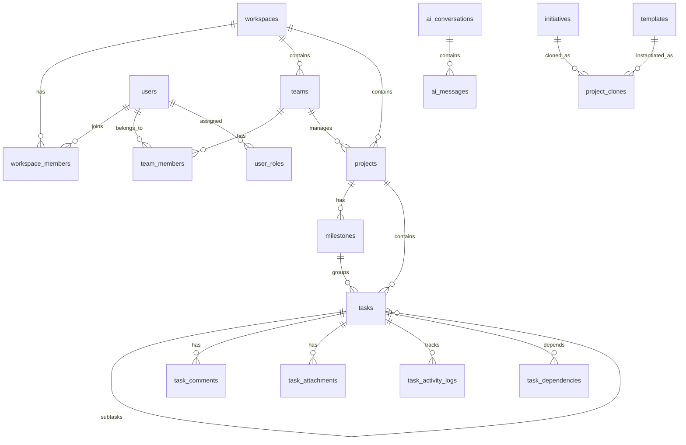

# TÀI LIỆU THIẾT KẾ CƠ SỞ DỮ LIỆU (DATABASE DESIGN SPECIFICATION)

---

## MỤC LỤC
- [1. TỔNG QUAN HỆ THỐNG](#1-tổng-quan-hệ-thống)
- [2. DANH SÁCH BẢNG VÀ THUỘC TÍNH (ENTITIES & ATTRIBUTES)](#2-danh-sách-bảng-và-thuộc-tính-entities--attributes)
  - [2.1. Cấp Workspace & Bảo mật (Authentication & Organization)](#21-cấp-workspace--bảo-mật-authentication--organization)
    - [2.1.1. Bảng `workspaces` (Không gian làm việc)](#211-bảng-workspaces-không-gian-làm-việc)
    - [2.1.2. Bảng `workspace_members` (Thành viên Workspace)](#212-bảng-workspace_members-thành-viên-workspace)
    - [2.1.3. Bảng `users` (Người dùng)](#213-bảng-users-người-dùng)
    - [2.1.4. Phân quyền RBAC (`roles`, `permissions`, `role_permissions`, `user_roles`)](#214-phân-quyền-rbac-roles-permissions-role_permissions-user_roles)
  - [2.2. Team - Project - Task / Issue](#22-team---project---task--issue)
    - [2.2.1. Bảng `teams` & `team_members`](#221-bảng-teams--team_members)
    - [2.2.2. Bảng `projects` (Dự án)](#222-bảng-projects-dự-án)
    - [2.2.3. Bảng `milestones` (Cột mốc)](#223-bảng-milestones-cột-mốc)
    - [2.2.4. Bảng `tasks` (Issues / Tác vụ)](#224-bảng-tasks-issues--tác-vụ)
    - [2.2.5. Các bảng mở rộng của Task](#225-các-bảng-mở-rộng-của-task)
  - [2.3. Tích hợp & Thông báo (Integration & Notification)](#23-tích-hợp--thông-báo-integration--notification)
  - [2.4. AI Agent & Tự động hóa](#24-ai-agent--tự-động-hóa)
  - [2.5. Template, Initiative & Blog / Cộng đồng](#25-template-initiative--blog--cộng-đồng)
- [3. BẢNG TỔNG HỢP MỐI QUAN HỆ CỐT LÕI (RELATIONSHIPS)](#3-bảng-tổng-hợp-mối-quan-hệ-cốt-lõi-relationships)
- [4. QUY TẮC RÀNG BUỘC & DỮ LIỆU (DATABASE RULES)](#4-quy-tắc-ràng-buộc--dữ-liệu-database-rules)

---

## 1. TỔNG QUAN HỆ THỐNG
Hệ thống sử dụng cơ sở dữ liệu quan hệ (PostgreSQL) hỗ trợ quản trị đa khách thuê (Multi-tenancy) theo kiến trúc Workspace, phân quyền động RBAC (Role-Based Access Control) theo Scope, quản lý vòng đời dự án - tác vụ (Agile/Kanban/Scrum), lưu vết lịch sử, tích hợp đa nền tảng và hỗ trợ AI Agent.

---

## 2. DANH SÁCH BẢNG VÀ THUỘC TÍNH (ENTITIES & ATTRIBUTES)

### 2.1. Cấp Workspace & Bảo mật (Authentication & Organization)

#### 2.1.1. Bảng `workspaces` (Không gian làm việc)
| Field | Type | Ràng buộc | Ghi chú |
| :--- | :--- | :--- | :--- |
| `id` | `UUID` | **PK**, Default `gen_random_uuid()` | Định danh duy nhất của Workspace |
| `name` | `VARCHAR(255)` | `NOT NULL` | Tên Workspace / Doanh nghiệp |
| `slug` | `VARCHAR(100)` | `UNIQUE`, `NOT NULL` | URL Subdomain (ví dụ: `app.domain.com/company-a`) |
| `logo_url` | `VARCHAR(255)` | `NULL` | Đường dẫn logo doanh nghiệp |
| `owner_id` | `UUID` | **FK** $\rightarrow$ `users(id)`, `NOT NULL` | Người tạo và sở hữu Workspace |
| `created_at` | `TIMESTAMP WITH TIME ZONE` | Default `CURRENT_TIMESTAMP` | Thời gian tạo |
| `updated_at` | `TIMESTAMP WITH TIME ZONE` | Default `CURRENT_TIMESTAMP` | Thời gian cập nhật gần nhất |

#### 2.1.2. Bảng `workspace_members` (Thành viên Workspace)
| Field | Type | Ràng buộc | Ghi chú |
| :--- | :--- | :--- | :--- |
| `workspace_id` | `UUID` | **Composite PK**, **FK** $\rightarrow$ `workspaces(id)` | Workspace tham gia (ON DELETE CASCADE) |
| `user_id` | `UUID` | **Composite PK**, **FK** $\rightarrow$ `users(id)` | Người dùng (ON DELETE CASCADE) |
| `role` | `ENUM` | `NOT NULL`, Default `'member'` | `owner`, `admin`, `member`, `guest` |
| `joined_at` | `TIMESTAMP WITH TIME ZONE` | Default `CURRENT_TIMESTAMP` | Thời điểm tham gia |

#### 2.1.3. Bảng `users` (Người dùng)
| Field | Type | Ràng buộc | Ghi chú |
| :--- | :--- | :--- | :--- |
| `id` | `UUID` | **PK**, Default `gen_random_uuid()` | Định danh người dùng |
| `email` | `VARCHAR(255)` | `UNIQUE`, `NOT NULL` | Địa chỉ email đăng nhập |
| `username` | `VARCHAR(100)` | `UNIQUE`, `NOT NULL` | Tên người dùng |
| `password_hash` | `VARCHAR(255)` | `NULL` | Mật khẩu băm (Nullable nếu login OAuth) |
| `avatar_url` | `VARCHAR(500)` | `NULL` | Đường dẫn ảnh đại diện |
| `provider` | `ENUM` | `NOT NULL`, Default `'local'` | `local`, `google`, `github` |
| `status` | `ENUM` | `NOT NULL`, Default `'active'` | `active`, `inactive`, `banned` |
| `created_at` | `TIMESTAMP WITH TIME ZONE` | Default `CURRENT_TIMESTAMP` | Thời gian tạo tài khoản |
| `updated_at` | `TIMESTAMP WITH TIME ZONE` | Default `CURRENT_TIMESTAMP` | Thời gian cập nhật |

#### 2.1.4. Phân quyền RBAC (`roles`, `permissions`, `role_permissions`, `user_roles`)

##### Bảng `roles`
| Field | Type | Ràng buộc | Ghi chú |
| :--- | :--- | :--- | :--- |
| `id` | `UUID` | **PK** | Định danh vai trò |
| `name` | `VARCHAR(100)` | `NOT NULL`, `UNIQUE` | Tên vai trò (VD: `WORKSPACE_ADMIN`, `PROJECT_LEAD`) |
| `description` | `TEXT` | `NULL` | Mô tả phạm vi và quyền hạn vai trò |

##### Bảng `permissions`
| Field | Type | Ràng buộc | Ghi chú |
| :--- | :--- | :--- | :--- |
| `id` | `UUID` | **PK** | Định danh quyền hạn |
| `code` | `VARCHAR(100)` | `NOT NULL`, `UNIQUE` | Mã quyền hạn (VD: `task.create`, `workspace.manage`, `team.delete`) |
| `description` | `TEXT` | `NULL` | Mô tả chi tiết quyền hạn |

##### Bảng `role_permissions`
| Field | Type | Ràng buộc | Ghi chú |
| :--- | :--- | :--- | :--- |
| `role_id` | `UUID` | **Composite PK**, **FK** $\rightarrow$ `roles(id)` | Vai trò |
| `permission_id` | `UUID` | **Composite PK**, **FK** $\rightarrow$ `permissions(id)` | Quyền hạn gán cho vai trò |

##### Bảng `user_roles`
| Field | Type | Ràng buộc | Ghi chú |
| :--- | :--- | :--- | :--- |
| `id` | `UUID` | **PK** | Định danh bản ghi gán vai trò |
| `user_id` | `UUID` | **FK** $\rightarrow$ `users(id)`, `NOT NULL` | Người dùng được cấp quyền |
| `role_id` | `UUID` | **FK** $\rightarrow$ `roles(id)`, `NOT NULL` | Vai trò áp dụng |
| `scope_type` | `ENUM` | `NOT NULL` | Phạm vi RBAC: `'workspace'`, `'team'`, `'project'` |
| `scope_id` | `UUID` | `NOT NULL` | ID của Workspace, Team hoặc Project tương ứng |

---

### 2.2. Team - Project - Task / Issue

#### 2.2.1. Bảng `teams` & `team_members`

##### Bảng `teams`
| Field | Type | Ràng buộc | Ghi chú |
| :--- | :--- | :--- | :--- |
| `id` | `UUID` | **PK** | Định danh nhóm |
| `workspace_id` | `UUID` | **FK** $\rightarrow$ `workspaces(id)`, `NOT NULL` | Workspace trực thuộc |
| `name` | `VARCHAR(255)` | `NOT NULL` | Tên nhóm / phòng ban |
| `description` | `TEXT` | `NULL` | Mô tả nhóm |
| `owner_id` | `UUID` | **FK** $\rightarrow$ `users(id)`, `NOT NULL` | Trưởng nhóm / Người tạo |
| `created_at` | `TIMESTAMP WITH TIME ZONE` | Default `CURRENT_TIMESTAMP` | Thời gian tạo |

##### Bảng `team_members`
| Field | Type | Ràng buộc | Ghi chú |
| :--- | :--- | :--- | :--- |
| `team_id` | `UUID` | **Composite PK**, **FK** $\rightarrow$ `teams(id)` | Nhóm trực thuộc |
| `user_id` | `UUID` | **Composite PK**, **FK** $\rightarrow$ `users(id)` | Thành viên nhóm |
| `role_in_team` | `VARCHAR(50)` | Default `'member'` | Vai trò trong nhóm (leader, member,...) |
| `joined_at` | `TIMESTAMP WITH TIME ZONE` | Default `CURRENT_TIMESTAMP` | Thời điểm gia nhập nhóm |

#### 2.2.2. Bảng `projects` (Dự án)
| Field | Type | Ràng buộc | Ghi chú |
| :--- | :--- | :--- | :--- |
| `id` | `UUID` | **PK** | Định danh dự án |
| `workspace_id` | `UUID` | **FK** $\rightarrow$ `workspaces(id)`, `NOT NULL` | Workspace trực thuộc |
| `team_id` | `UUID` | **FK** $\rightarrow$ `teams(id)`, `NULL` | Team phụ trách (nếu có) |
| `key` | `VARCHAR(20)` | `NOT NULL` | Mã tiền tố dự án (ví dụ: `PTMS` $\rightarrow$ `PTMS-101`) |
| `name` | `VARCHAR(255)` | `NOT NULL` | Tên dự án |
| `description` | `TEXT` | `NULL` | Mô tả chi tiết dự án |
| `status` | `ENUM` | `NOT NULL`, Default `'planning'` | `planning`, `active`, `on_hold`, `completed`, `archived` |
| `start_date` | `DATE` | `NULL` | Ngày bắt đầu dự án |
| `end_date` | `DATE` | `NULL` | Ngày kết thúc / bàn giao dự kiến |
| `created_by` | `UUID` | **FK** $\rightarrow$ `users(id)`, `NOT NULL` | Người tạo dự án |
| `is_public` | `BOOLEAN` | Default `false` | Trạng thái riêng tư / công khai trong workspace |
| `created_at` | `TIMESTAMP WITH TIME ZONE` | Default `CURRENT_TIMESTAMP` | Thời gian tạo |
| `updated_at` | `TIMESTAMP WITH TIME ZONE` | Default `CURRENT_TIMESTAMP` | Thời gian cập nhật |

#### 2.2.3. Bảng `milestones` (Cột mốc)
| Field | Type | Ràng buộc | Ghi chú |
| :--- | :--- | :--- | :--- |
| `id` | `UUID` | **PK** | Định danh cột mốc |
| `project_id` | `UUID` | **FK** $\rightarrow$ `projects(id)`, `NOT NULL` | Dự án trực thuộc |
| `name` | `VARCHAR(255)` | `NOT NULL` | Tên cột mốc / Sprint |
| `description` | `TEXT` | `NULL` | Mô tả chi tiết cột mốc |
| `due_date` | `TIMESTAMP WITH TIME ZONE` | `NULL` | Hạn hoàn thành cột mốc |
| `status` | `ENUM` | Default `'open'` | `open`, `in_progress`, `closed` |
| `created_at` | `TIMESTAMP WITH TIME ZONE` | Default `CURRENT_TIMESTAMP` | Thời gian tạo |

#### 2.2.4. Bảng `tasks` (Issues / Tác vụ)
| Field | Type | Ràng buộc | Ghi chú |
| :--- | :--- | :--- | :--- |
| `id` | `UUID` | **PK** | Định danh tác vụ |
| `code` | `VARCHAR(50)` | `NOT NULL` | Unique trong project (ví dụ: `PTMS-101`) |
| `project_id` | `UUID` | **FK** $\rightarrow$ `projects(id)`, `NOT NULL` | Dự án trực thuộc |
| `milestone_id` | `UUID` | **FK** $\rightarrow$ `milestones(id)`, `NULL` | Cột mốc liên kết |
| `parent_task_id` | `UUID` | **FK** $\rightarrow$ `tasks(id)`, `NULL` | Self-reference (cây sub-task đa cấp) |
| `title` | `VARCHAR(500)` | `NOT NULL` | Tiêu đề công việc |
| `description` | `TEXT` | `NULL` | Nội dung và tài liệu mô tả công việc |
| `type` | `ENUM` | `NOT NULL`, Default `'task'` | `task`, `bug`, `story`, `epic` |
| `status` | `ENUM` | `NOT NULL`, Default `'todo'` | `todo`, `in_progress`, `in_review`, `done`, `cancelled` |
| `priority` | `ENUM` | `NOT NULL`, Default `'medium'` | `low`, `medium`, `high`, `urgent` |
| `assignee_id` | `UUID` | **FK** $\rightarrow$ `users(id)`, `NULL` | Người thực hiện (ON DELETE SET NULL) |
| `reporter_id` | `UUID` | **FK** $\rightarrow$ `users(id)`, `NOT NULL` | Người giao / báo cáo task |
| `due_date` | `TIMESTAMP WITH TIME ZONE` | `NULL` | Hạn hoàn thành |
| `is_recurring` | `BOOLEAN` | Default `false` | Bật/tắt cấu hình lặp lại |
| `recurrence_rule` | `VARCHAR(255)` | `NULL` | RRULE quy tắc lặp (ví dụ: FREQ=WEEKLY;INTERVAL=1) |
| `github_issue_url` | `VARCHAR(500)` | `NULL` | Liên kết Issue GitHub tương ứng |
| `branch` | `VARCHAR(255)` | `NULL` | Nhánh Git liên kết thực hiện task |
| `position` | `INTEGER` | Default `0` | Thứ tự kéo thả trên giao diện Kanban |
| `version` | `INTEGER` | Default `1` | Optimistic locking chống ghi đè dữ liệu đồng thời |
| `created_at` | `TIMESTAMP WITH TIME ZONE` | Default `CURRENT_TIMESTAMP` | Thời gian tạo |
| `updated_at` | `TIMESTAMP WITH TIME ZONE` | Default `CURRENT_TIMESTAMP` | Thời gian cập nhật |

#### 2.2.5. Các bảng mở rộng của Task

##### Bảng `task_labels` (Nhãn dán)
| Field | Type | Ràng buộc | Ghi chú |
| :--- | :--- | :--- | :--- |
| `id` | `UUID` | **PK** | Định danh nhãn |
| `project_id` | `UUID` | **FK** $\rightarrow$ `projects(id)`, `NOT NULL` | Dự án sở hữu nhãn |
| `name` | `VARCHAR(100)` | `NOT NULL` | Tên nhãn (VD: Frontend, Backend, UI/UX) |
| `color` | `VARCHAR(20)` | Default `'#6B7280'` | Mã màu hiển thị (HEX code) |

##### Bảng `task_label_map` (Gán nhãn vào Task)
| Field | Type | Ràng buộc | Ghi chú |
| :--- | :--- | :--- | :--- |
| `task_id` | `UUID` | **Composite PK**, **FK** $\rightarrow$ `tasks(id)` | Task được gắn nhãn |
| `label_id` | `UUID` | **Composite PK**, **FK** $\rightarrow$ `task_labels(id)` | Nhãn được gắn |

##### Bảng `task_watchers` (Người theo dõi Task)
| Field | Type | Ràng buộc | Ghi chú |
| :--- | :--- | :--- | :--- |
| `task_id` | `UUID` | **Composite PK**, **FK** $\rightarrow$ `tasks(id)` | Task được theo dõi |
| `user_id` | `UUID` | **Composite PK**, **FK** $\rightarrow$ `users(id)` | Người theo dõi tiến độ |

##### Bảng `task_comments` (Bình luận thảo luận Task)
| Field | Type | Ràng buộc | Ghi chú |
| :--- | :--- | :--- | :--- |
| `id` | `UUID` | **PK** | Định danh bình luận |
| `task_id` | `UUID` | **FK** $\rightarrow$ `tasks(id)`, `NOT NULL` | Task chứa bình luận |
| `user_id` | `UUID` | **FK** $\rightarrow$ `users(id)`, `SET NULL` | Người viết bình luận |
| `content` | `TEXT` | `NOT NULL` | Nội dung bình luận (hỗ trợ Markdown) |
| `parent_comment_id`| `UUID` | **FK** $\rightarrow$ `task_comments(id)`, `NULL` | Trả lời bình luận khác (cấu trúc phân cấp) |
| `created_at` | `TIMESTAMP WITH TIME ZONE` | Default `CURRENT_TIMESTAMP` | Thời gian tạo bình luận |

##### Bảng `task_attachments` (Tệp đính kèm Task)
| Field | Type | Ràng buộc | Ghi chú |
| :--- | :--- | :--- | :--- |
| `id` | `UUID` | **PK** | Định danh tệp đính kèm |
| `task_id` | `UUID` | **FK** $\rightarrow$ `tasks(id)`, `NOT NULL` | Task chứa tệp đính kèm (ON DELETE CASCADE) |
| `file_url` | `VARCHAR(500)` | `NOT NULL` | URL truy cập tệp lưu trên Cloud Storage / MinIO |
| `file_name` | `VARCHAR(255)` | `NOT NULL` | Tên gốc của tệp tin |
| `uploaded_by` | `UUID` | **FK** $\rightarrow$ `users(id)`, `SET NULL` | Người tải lên |
| `created_at` | `TIMESTAMP WITH TIME ZONE` | Default `CURRENT_TIMESTAMP` | Thời gian tải lên |

##### Bảng `task_dependencies` (Mối quan hệ phụ thuộc Task)
| Field | Type | Ràng buộc | Ghi chú |
| :--- | :--- | :--- | :--- |
| `task_id` | `UUID` | **FK** $\rightarrow$ `tasks(id)`, `NOT NULL` | Task hiện tại |
| `depends_on_task_id`| `UUID` | **FK** $\rightarrow$ `tasks(id)`, `NOT NULL` | Task phụ thuộc |
| `type` | `ENUM` | `NOT NULL` | Loại liên kết: `blocks`, `relates_to`, `duplicates` |

##### Bảng `task_activity_logs` (Nhật ký thay đổi Task)
| Field | Type | Ràng buộc | Ghi chú |
| :--- | :--- | :--- | :--- |
| `id` | `UUID` | **PK** | Định danh bản ghi audit log |
| `task_id` | `UUID` | **FK** $\rightarrow$ `tasks(id)`, `NOT NULL` | Task bị thay đổi |
| `user_id` | `UUID` | **FK** $\rightarrow$ `users(id)`, `SET NULL` | Người thực hiện hành động |
| `action` | `VARCHAR(100)` | `NOT NULL` | Loại hành động (`UPDATE_STATUS`, `REASSIGN`, `EDIT_DESC`,...) |
| `old_value` | `JSONB` | `NULL` | Giá trị trước khi thay đổi |
| `new_value` | `JSONB` | `NULL` | Giá trị sau khi thay đổi |
| `created_at` | `TIMESTAMP WITH TIME ZONE` | Default `CURRENT_TIMESTAMP` | Thời gian ghi nhận thay đổi |

---

### 2.3. Tích hợp & Thông báo (Integration & Notification)

#### Bảng `notifications` (Thông báo người dùng)
| Field | Type | Ràng buộc | Ghi chú |
| :--- | :--- | :--- | :--- |
| `id` | `UUID` | **PK** | Định danh thông báo |
| `user_id` | `UUID` | **FK** $\rightarrow$ `users(id)`, `NOT NULL` | Người nhận thông báo |
| `type` | `VARCHAR(100)` | `NOT NULL` | Loại thông báo (`TASK_ASSIGNED`, `MENTIONED`, `COMMENT_ADDED`,...) |
| `title` | `VARCHAR(255)` | `NOT NULL` | Tiêu đề thông báo |
| `content` | `TEXT` | `NOT NULL` | Nội dung chi tiết |
| `related_entity_type`| `VARCHAR(50)`| `NULL` | Thực thể liên kết (`task`, `project`, `comment`,...) |
| `related_entity_id` | `UUID` | `NULL` | ID của thực thể liên quan |
| `is_read` | `BOOLEAN` | Default `false` | Trạng thái đã đọc hay chưa |
| `created_at` | `TIMESTAMP WITH TIME ZONE` | Default `CURRENT_TIMESTAMP` | Thời gian tạo thông báo |

#### Bảng `notification_settings` (Cấu hình nhận thông báo)
| Field | Type | Ràng buộc | Ghi chú |
| :--- | :--- | :--- | :--- |
| `id` | `UUID` | **PK** | Định danh cấu hình |
| `user_id` | `UUID` | **FK** $\rightarrow$ `users(id)`, `NOT NULL` | Người dùng cấu hình |
| `notification_type` | `VARCHAR(100)` | `NOT NULL` | Loại thông báo áp dụng |
| `channel` | `ENUM` | `NOT NULL` | Kênh nhận: `in_app`, `email`, `push` |
| `enabled` | `BOOLEAN` | Default `true` | Bật / tắt nhận thông báo qua kênh |

#### Bảng `integrations` (Kết nối dịch vụ bên thứ ba)
| Field | Type | Ràng buộc | Ghi chú |
| :--- | :--- | :--- | :--- |
| `id` | `UUID` | **PK** | Định danh tích hợp |
| `user_id` | `UUID` | **FK** $\rightarrow$ `users(id)`, `NOT NULL` | Người dùng kết nối |
| `provider` | `VARCHAR(50)` | `NOT NULL` | Nhà cung cấp (`github`, `google_calendar`, `slack`,...) |
| `access_token` | `TEXT` | `NOT NULL` | Token xác thực OAuth (được mã hóa) |
| `refresh_token`| `TEXT` | `NULL` | Token làm mới OAuth |
| `scope` | `VARCHAR(255)` | `NULL` | Danh sách quyền được cấp |
| `expires_at` | `TIMESTAMP WITH TIME ZONE` | `NULL` | Thời điểm hết hạn của access token |

#### Bảng `github_repo_links` (Liên kết kho mã nguồn GitHub)
| Field | Type | Ràng buộc | Ghi chú |
| :--- | :--- | :--- | :--- |
| `id` | `UUID` | **PK** | Định danh liên kết repository |
| `project_id` | `UUID` | **FK** $\rightarrow$ `projects(id)`, `NOT NULL` | Dự án được liên kết |
| `repo_owner` | `VARCHAR(100)` | `NOT NULL` | Chủ sở hữu Repository (User/Org) |
| `repo_name` | `VARCHAR(255)` | `NOT NULL` | Tên Repository GitHub |
| `webhook_id` | `VARCHAR(100)` | `NULL` | ID Webhook nhận sự kiện tự động |
| `installation_id`| `VARCHAR(100)`| `NULL` | GitHub App Installation ID |

#### Bảng `calendar_syncs` (Đồng bộ lịch)
| Field | Type | Ràng buộc | Ghi chú |
| :--- | :--- | :--- | :--- |
| `id` | `UUID` | **PK** | Định danh bản ghi đồng bộ |
| `user_id` | `UUID` | **FK** $\rightarrow$ `users(id)`, `NOT NULL` | Người dùng |
| `source_type` | `VARCHAR(50)` | `NOT NULL` | Nguồn dữ liệu (`task`, `milestone`) |
| `source_id` | `UUID` | `NOT NULL` | ID nguồn tương ứng |
| `external_event_id` | `VARCHAR(255)` | `NOT NULL` | ID sự kiện trên Google/Outlook Calendar |
| `provider` | `VARCHAR(50)` | `NOT NULL` | Dịch vụ lịch (`google`, `outlook`) |
| `synced_at` | `TIMESTAMP WITH TIME ZONE` | Default `CURRENT_TIMESTAMP` | Thời điểm đồng bộ gần nhất |

#### Bảng `email_task_mappings` (Ánh xạ tạo Task từ Email)
| Field | Type | Ràng buộc | Ghi chú |
| :--- | :--- | :--- | :--- |
| `id` | `UUID` | **PK** | Định danh ánh xạ |
| `task_id` | `UUID` | **FK** $\rightarrow$ `tasks(id)`, `NOT NULL` | Task được tạo từ Email |
| `email_message_id` | `VARCHAR(255)` | `NOT NULL` | Message-ID của email |
| `thread_id` | `VARCHAR(255)` | `NULL` | Thread ID của luồng trao đổi email |

---

### 2.4. AI Agent & Tự động hóa

#### Bảng `ai_conversations` (Phiên trò chuyện AI)
| Field | Type | Ràng buộc | Ghi chú |
| :--- | :--- | :--- | :--- |
| `id` | `UUID` | **PK** | Định danh phiên chat |
| `user_id` | `UUID` | **FK** $\rightarrow$ `users(id)`, `NOT NULL` | Người trò chuyện |
| `workspace_id` | `UUID` | **FK** $\rightarrow$ `workspaces(id)`, `NULL` | Không gian làm việc liên quan |
| `project_id` | `UUID` | **FK** $\rightarrow$ `projects(id)`, `NULL` | Dự án liên quan đến ngữ cảnh |
| `title` | `VARCHAR(255)` | `NOT NULL` | Tiêu đề phiên trò chuyện |
| `created_at` | `TIMESTAMP WITH TIME ZONE` | Default `CURRENT_TIMESTAMP` | Thời điểm bắt đầu phiên |

#### Bảng `ai_messages` (Tin nhắn AI)
| Field | Type | Ràng buộc | Ghi chú |
| :--- | :--- | :--- | :--- |
| `id` | `UUID` | **PK** | Định danh tin nhắn |
| `conversation_id` | `UUID` | **FK** $\rightarrow$ `ai_conversations(id)`, `NOT NULL` | Phiên trò chuyện trực thuộc |
| `role` | `ENUM` | `NOT NULL` | Vai trò: `user`, `assistant`, `system` |
| `content` | `TEXT` | `NOT NULL` | Nội dung tin nhắn |
| `tokens_used` | `INTEGER` | Default `0` | Số lượng tokens tiêu thụ (input + output) |
| `created_at` | `TIMESTAMP WITH TIME ZONE` | Default `CURRENT_TIMESTAMP` | Thời điểm gửi |

#### Bảng `ai_api_keys` (Cấu hình API Key của người dùng)
| Field | Type | Ràng buộc | Ghi chú |
| :--- | :--- | :--- | :--- |
| `id` | `UUID` | **PK** | Định danh API Key |
| `user_id` | `UUID` | **FK** $\rightarrow$ `users(id)`, `NOT NULL` | Người dùng sở hữu (ON DELETE CASCADE) |
| `provider` | `VARCHAR(50)` | `NOT NULL` | Nhà cung cấp AI (`openai`, `anthropic`, `gemini`) |
| `api_key_encrypted` | `TEXT` | `NOT NULL` | API Key đã được mã hóa an toàn (AES-GCM) |
| `is_default` | `BOOLEAN` | Default `false` | Khóa mặc định sử dụng cho agent |

#### Bảng `ai_task_generations` (Tạo task tự động bằng AI)
| Field | Type | Ràng buộc | Ghi chú |
| :--- | :--- | :--- | :--- |
| `id` | `UUID` | **PK** | Định danh bản ghi sinh task |
| `task_id` | `UUID` | **FK** $\rightarrow$ `tasks(id)`, `NULL` | Task được tạo thành công (nếu có) |
| `conversation_id` | `UUID` | **FK** $\rightarrow$ `ai_conversations(id)`, `NOT NULL` | Phiên trao đổi AI tương ứng |
| `prompt` | `TEXT` | `NOT NULL` | Câu lệnh yêu cầu của người dùng |
| `ai_response` | `JSONB` | `NOT NULL` | Dữ liệu phản hồi có cấu trúc từ AI |
| `status` | `ENUM` | `NOT NULL`, Default `'pending'` | Trạng thái: `pending`, `accepted`, `rejected` |
| `created_at` | `TIMESTAMP WITH TIME ZONE` | Default `CURRENT_TIMESTAMP` | Thời gian tạo |

---

### 2.5. Template, Initiative & Blog / Cộng đồng

#### Bảng `templates` (Mẫu dự án/quy trình)
| Field | Type | Ràng buộc | Ghi chú |
| :--- | :--- | :--- | :--- |
| `id` | `UUID` | **PK** | Định danh template |
| `owner_id` | `UUID` | **FK** $\rightarrow$ `users(id)`, `NOT NULL` | Tác giả mẫu |
| `name` | `VARCHAR(255)` | `NOT NULL` | Tên mẫu dự án |
| `description` | `TEXT` | `NULL` | Mô tả nội dung template |
| `is_public` | `BOOLEAN` | Default `false` | Công khai trên Marketplace/Community |
| `source_project_id`| `UUID` | **FK** $\rightarrow$ `projects(id)`, `NULL` | Dự án nguồn trích xuất cấu trúc |
| `structure_json` | `JSONB` | `NOT NULL` | Cấu trúc cột Kanban, Task mẫu, nhãn,... |
| `usage_count` | `INTEGER` | Default `0` | Số lượt sử dụng / nhân bản |
| `created_at` | `TIMESTAMP WITH TIME ZONE` | Default `CURRENT_TIMESTAMP` | Thời gian tạo |

#### Bảng `initiatives` (Sáng kiến / Dự án cộng đồng)
| Field | Type | Ràng buộc | Ghi chú |
| :--- | :--- | :--- | :--- |
| `id` | `UUID` | **PK** | Định danh sáng kiến |
| `project_id` | `UUID` | **FK** $\rightarrow$ `projects(id)`, `NOT NULL` | Dự án gốc phát triển sáng kiến |
| `title` | `VARCHAR(255)` | `NOT NULL` | Tiêu đề sáng kiến |
| `description` | `TEXT` | `NULL` | Mô tả chi tiết mục tiêu, giải pháp |
| `category` | `VARCHAR(100)` | `NOT NULL` | Danh mục (Công nghệ, Giáo dục, Open Source,...) |
| `cover_image` | `VARCHAR(500)` | `NULL` | Ảnh bìa sáng kiến |
| `upvotes` | `INTEGER` | Default `0` | Số lượt đánh giá tích cực |
| `downvotes` | `INTEGER` | Default `0` | Số lượt đánh giá tiêu cực |
| `clone_count` | `INTEGER` | Default `0` | Số lượt sao chép sáng kiến |
| `published_at` | `TIMESTAMP WITH TIME ZONE` | `NULL` | Thời điểm xuất bản công khai |
| `status` | `ENUM` | Default `'draft'` | `draft`, `published`, `archived` |

#### Bảng `initiative_votes` (Bình chọn sáng kiến)
| Field | Type | Ràng buộc | Ghi chú |
| :--- | :--- | :--- | :--- |
| `initiative_id` | `UUID` | **Composite PK**, **FK** $\rightarrow$ `initiatives(id)` | Sáng kiến được bình chọn |
| `user_id` | `UUID` | **Composite PK**, **FK** $\rightarrow$ `users(id)` | Người bình chọn |
| `vote_type` | `ENUM` | `NOT NULL` | `up`, `down` |

#### Bảng `project_clones` (Lịch sử nhân bản dự án)
| Field | Type | Ràng buộc | Ghi chú |
| :--- | :--- | :--- | :--- |
| `id` | `UUID` | **PK** | Định danh lượt nhân bản |
| `initiative_id` | `UUID` | **FK** $\rightarrow$ `initiatives(id)`, `NULL` | Nguồn từ sáng kiến (nếu có) |
| `template_id` | `UUID` | **FK** $\rightarrow$ `templates(id)`, `NULL` | Nguồn từ template (nếu có) |
| `cloned_project_id`| `UUID` | **FK** $\rightarrow$ `projects(id)`, `NOT NULL` | Dự án mới được tạo ra sau nhân bản |
| `cloned_by` | `UUID` | **FK** $\rightarrow$ `users(id)`, `NOT NULL` | Người thực hiện nhân bản |
| `cloned_at` | `TIMESTAMP WITH TIME ZONE` | Default `CURRENT_TIMESTAMP` | Thời điểm nhân bản |

#### Bảng `posts` (Bài viết / Blog cộng đồng)
| Field | Type | Ràng buộc | Ghi chú |
| :--- | :--- | :--- | :--- |
| `id` | `UUID` | **PK** | Định danh bài viết |
| `author_id` | `UUID` | **FK** $\rightarrow$ `users(id)`, `NOT NULL` | Tác giả bài viết |
| `title` | `VARCHAR(255)` | `NOT NULL` | Tiêu đề bài viết |
| `content` | `TEXT` | `NOT NULL` | Nội dung bài viết (Markdown / HTML) |
| `cover_image` | `VARCHAR(500)` | `NULL` | Ảnh đại diện bài viết |
| `related_project_id` | `UUID` | **FK** $\rightarrow$ `projects(id)`, `NULL` | Dự án liên quan |
| `related_initiative_id`| `UUID`| **FK** $\rightarrow$ `initiatives(id)`, `NULL` | Sáng kiến liên quan |
| `status` | `ENUM` | Default `'draft'` | `draft`, `published`, `archived` |
| `created_at` | `TIMESTAMP WITH TIME ZONE` | Default `CURRENT_TIMESTAMP` | Thời gian đăng |

#### Bảng `tags` & `post_tags` (Thẻ phân loại bài viết)
##### Bảng `tags`
| Field | Type | Ràng buộc | Ghi chú |
| :--- | :--- | :--- | :--- |
| `id` | `UUID` | **PK** | Định danh thẻ |
| `name` | `VARCHAR(100)` | `UNIQUE`, `NOT NULL` | Tên thẻ (VD: `java`, `react`, `agile`) |

##### Bảng `post_tags`
| Field | Type | Ràng buộc | Ghi chú |
| :--- | :--- | :--- | :--- |
| `post_id` | `UUID` | **Composite PK**, **FK** $\rightarrow$ `posts(id)` | Bài viết |
| `tag_id` | `UUID` | **Composite PK**, **FK** $\rightarrow$ `tags(id)` | Thẻ gắn vào bài viết |

#### Bảng `post_comments` & `post_votes` (Tương tác bài viết)
##### Bảng `post_comments`
| Field | Type | Ràng buộc | Ghi chú |
| :--- | :--- | :--- | :--- |
| `id` | `UUID` | **PK** | Định danh bình luận |
| `post_id` | `UUID` | **FK** $\rightarrow$ `posts(id)`, `NOT NULL` | Bài viết |
| `user_id` | `UUID` | **FK** $\rightarrow$ `users(id)`, `SET NULL` | Người bình luận |
| `content` | `TEXT` | `NOT NULL` | Nội dung bình luận |
| `created_at` | `TIMESTAMP WITH TIME ZONE` | Default `CURRENT_TIMESTAMP` | Thời gian tạo |

##### Bảng `post_votes`
| Field | Type | Ràng buộc | Ghi chú |
| :--- | :--- | :--- | :--- |
| `post_id` | `UUID` | **Composite PK**, **FK** $\rightarrow$ `posts(id)` | Bài viết được bình chọn |
| `user_id` | `UUID` | **Composite PK**, **FK** $\rightarrow$ `users(id)` | Người dùng |
| `vote_type` | `ENUM` | `NOT NULL` | `up`, `down` |

---

## 3. BẢNG TỔNG HỢP MỐI QUAN HỆ CỐT LÕI (RELATIONSHIPS)

| Bảng gốc (Source) | Bảng đích (Target) | Loại quan hệ | Ý nghĩa nghiệp vụ |
| :--- | :--- | :---: | :--- |
| `workspaces` | `workspace_members` | **1 - N** | Quản lý danh sách thành viên thuộc Workspace. |
| `workspaces` | `teams` | **1 - N** | Workspace đóng vai trò bao bọc toàn bộ các Teams. |
| `workspaces` | `projects` | **1 - N** | Tất cả Dự án đều gói gọn trong phạm vi 1 Workspace. |
| `users` | `user_roles` | **1 - N** | Người dùng có nhiều vai trò theo từng phạm vi (`workspace`/`team`/`project`). |
| `teams` | `users` (qua `team_members`) | **N - N** | Người dùng có thể tham gia nhiều Team trong workspace. |
| `teams` | `projects` | **1 - N** | Team quản lý và triển khai các dự án được giao. |
| `projects` | `milestones` | **1 - N** | Dự án chia ra các cột mốc bàn giao / sprint. |
| `projects` | `tasks` | **1 - N** | Dự án chứa danh sách các tác vụ/lỗi cần xử lý. |
| `milestones` | `tasks` | **1 - N** | Milestone gom nhóm các Task liên quan (nullable). |
| `tasks` | `tasks` (self-referencing) | **1 - N** | Cấu trúc công việc cha - con (Sub-task đa cấp). |
| `tasks` | `tasks` (qua `task_dependencies`) | **N - N** | Thiết lập phụ thuộc công việc (`blocks`, `relates_to`, `duplicates`). |
| `tasks` | `task_comments` / `attachments` / `activity_logs` | **1 - N** | Lưu vết bình luận, tệp tin và lịch sử thay đổi của task. |
| `ai_conversations`| `ai_messages` | **1 - N** | Lưu trữ hội thoại và lượng token sử dụng với AI Agent. |
| `initiatives` / `templates` | `project_clones` | **1 - N** | Theo dõi lượt nhân bản Sáng kiến/Template thành dự án mới. |

---

## 4. QUY TẮC RÀNG BUỘC & DỮ LIỆU (DATABASE RULES)

1. **Khóa chính kép (Composite Primary Key)**:
   - Sử dụng khóa chính kép trực tiếp từ 2 cột Foreign Key cho tất cả các bảng quan hệ $N-N$: `workspace_members`, `team_members`, `task_label_map`, `post_tags`, `initiative_votes`, `post_votes`, `role_permissions`.
   - Giúp đảm bảo tính toàn vẹn dữ liệu (tránh trùng lặp quan hệ), không tạo thừa cột ID tự tăng và tối ưu hóa hiệu năng truy vấn chỉ mục (B-Tree Indexing).

2. **Quy tắc xóa dữ liệu (ON DELETE Constraint)**:
   - **FK trỏ tới `users`**: Đặt `ON DELETE SET NULL` (hoặc Soft Delete) cho các trường `assignee_id`, `created_by`, `uploaded_by`, `user_id` trong Task, Comments, Activity Logs để bảo toàn lịch sử tác vụ khi tài khoản bị vô hiệu hóa hoặc xóa.
   - **Tự tham chiếu (Self-referencing FK)** (`tasks.parent_task_id`, `task_dependencies`): Đặt `ON DELETE RESTRICT` hoặc `ON DELETE SET NULL` nhằm ngăn ngừa việc xóa lan truyền ngoài ý muốn ngắt kết nối cả cây tác vụ con.
   - **Các bảng phụ thuộc hoàn toàn vào User/Project** (`ai_api_keys`, `task_attachments`, `task_activity_logs`, `workspace_members`): Đặt `ON DELETE CASCADE` để dọn dẹp sạch dữ liệu rác khi đối tượng cha bị xóa hoàn toàn.

3. **Kiểm soát đồng thời (Concurrency Control)**:
   - Cột `version` (INTEGER) trong bảng `tasks` áp dụng cơ chế **Optimistic Locking** để ngăn chặn hiện tượng mất mát dữ liệu (Lost Update) khi có nhiều thành viên cùng kéo thả Kanban hoặc chỉnh sửa cùng lúc.
