# CHƯƠNG 2. XÂY DỰNG CÁC GIẢI PHÁP KỸ THUẬT CỐT LÕI

Chương này giới thiệu sáu bài toán kỹ thuật chính của hệ thống rồi trình bày giải pháp cho từng bài toán. Trọng tâm là bài toán **quản trị dự án** (mục 2.3): loại công việc, trạng thái, quy trình, liên kết giữa các công việc, tùy biến theo ngành và giai đoạn làm việc. Chương dùng tiếng Việt theo đúng tên hiển thị trên giao diện; tên trong mã nguồn (đặt trong dấu huyền) chỉ nêu khi cần đối chiếu.

## 2.1. Các bài toán kỹ thuật chính

Mỗi bài toán được mô tả theo cách nhìn của người dùng: họ bắt đầu từ đâu (đầu vào) và mong muốn nhận được gì (đầu ra).

### 2.1.1. Xác thực và phân quyền

Người dùng đăng nhập một lần và chỉ nhìn thấy, thao tác được trên những gì mình được cấp quyền. Quyền được xét ở hai phạm vi lồng nhau: **không gian làm việc** (nơi tổ chức đặt nhiều dự án) và **dự án**.

**Bảng 2.1: Đầu vào và đầu ra của bài toán xác thực, phân quyền**

| Đầu vào | Đầu ra |
| :--- | :--- |
| Tài khoản, mật khẩu (hoặc tài khoản Google) | Phiên đăng nhập hợp lệ, tự gia hạn khi hết hạn |
| Vai trò của người dùng trong không gian làm việc | Được xem, tạo dự án, quản lý thành viên hay xóa không gian làm việc |
| Vai trò của người dùng trong dự án và ma trận quyền của vai trò đó | Được hoặc không được thực hiện từng thao tác (tạo việc, chuyển trạng thái, quản lý chu kỳ, …) |
| Lời mời từ quản trị viên | Gia nhập không gian làm việc hoặc dự án khi người được mời đồng ý |

### 2.1.2. Quản trị dự án và quản lý công việc (trọng tâm)

Nhóm cần một nơi để lập kế hoạch và theo dõi công việc theo cách riêng của ngành mình: tự đặt loại công việc, tự đặt các trạng thái và đường đi giữa chúng, nối các công việc phụ thuộc nhau, chia dự án thành các giai đoạn.

**Bảng 2.2: Đầu vào và đầu ra của bài toán quản trị dự án**

| Đầu vào | Đầu ra |
| :--- | :--- |
| Thông tin dự án mới (tên, mã, loại dự án) | Dự án dùng được ngay, có sẵn loại công việc, trạng thái, quy trình, bảng tiến độ |
| Loại công việc và trạng thái do nhóm tự đặt | Cấu hình riêng của ngành mà vẫn luôn hợp lệ, không làm hỏng dữ liệu cũ |
| Một công việc cùng việc cha, việc con | Mã dễ nhớ (ví dụ MOC-12), cây công việc đúng tầng |
| Liên kết "A chặn B", "A trùng B", … | Quan hệ phụ thuộc rõ ràng, không bị vòng lặp bế tắc |
| Chọn một bước chuyển trạng thái | Công việc sang trạng thái mới nếu đủ điều kiện, kèm lịch sử thay đổi |
| Kế hoạch chia việc theo từng giai đoạn | Bắt đầu, theo dõi, kết thúc từng giai đoạn; việc dang dở được chuyển tiếp hợp lý |

### 2.1.3. Quản lý đóng góp và quản lý tiến độ

**Bảng 2.3: Đầu vào và đầu ra của bài toán đóng góp, tiến độ**

| Đầu vào | Đầu ra |
| :--- | :--- |
| Thành viên báo "đã làm xong" một việc | Việc chỉ được tính xong sau khi quản trị viên dự án xác nhận |
| Các việc đã hoàn thành, trễ hạn, bị mở lại | Điểm đóng góp công bằng của từng thành viên, truy vết được từng dòng |
| Lịch sử thay đổi của công việc trong một giai đoạn | Biểu đồ tiến độ, năng suất, luồng trạng thái; số liệu giai đoạn đã đóng không đổi về sau |

### 2.1.4. Mẫu dự án

**Bảng 2.4: Đầu vào và đầu ra của bài toán mẫu dự án**

| Đầu vào | Đầu ra |
| :--- | :--- |
| Một dự án mẫu có sẵn, ngày bắt đầu mới | Dự án mới giống mẫu, mọi mốc thời gian tự dời theo ngày bắt đầu |
| Chỉnh sửa nhanh ngay lúc xem mẫu (đổi tên, bỏ bớt giai đoạn hoặc công việc) | Dự án mới đã gọn đúng nhu cầu, tạo bằng một thao tác duy nhất |
| Một dự án đang chạy tốt | Lưu thành mẫu hoặc nhân bản để dùng lại |

### 2.1.5. Thông báo

**Bảng 2.5: Đầu vào và đầu ra của bài toán thông báo**

| Đầu vào | Đầu ra |
| :--- | :--- |
| Một thay đổi liên quan đến người dùng (được giao việc, bị nhắc tên, được mời, việc sắp đến hạn, …) | Thông báo hiện ngay trên chuông, kèm thư điện tử với việc quan trọng |
| Dịch vụ thông báo tạm ngừng hoặc nghiệp vụ bị hoàn tác | Không mất thông báo, không báo cho thay đổi chưa hề xảy ra |
| Cài đặt cá nhân (tắt nhóm thông báo, tắt tiếng một dự án) | Chỉ nhận đúng những gì mình muốn |

### 2.1.6. Tích hợp GitHub (cho dự án phần mềm)

**Bảng 2.6: Đầu vào và đầu ra của bài toán tích hợp GitHub**

| Đầu vào | Đầu ra |
| :--- | :--- |
| Tài khoản GitHub và một kho mã | Dự án liên kết với kho, tự nhận sự kiện từ GitHub |
| Nhánh, yêu cầu hợp nhất (pull request) có chứa mã công việc | Công việc hiển thị các yêu cầu hợp nhất liên quan; trạng thái tự cập nhật theo tiến trình lập trình |
| Vấn đề (Issue) trên GitHub | Công việc tương ứng trên bảng, đồng bộ hai chiều |

## 2.2. Giải pháp xác thực và phân quyền

### 2.2.1. Xác thực tập trung

Việc đăng nhập, lưu mật khẩu và cấp mã truy cập được giao cho một máy chủ định danh chuyên dụng (Keycloak) theo các chuẩn OAuth2 và OpenID Connect, thay vì tự viết lại. Mọi yêu cầu từ trình duyệt đi qua **cổng giao tiếp API**; cổng này đọc mã truy cập từ tiêu đề xác thực hoặc từ cookie chỉ gửi qua giao thức web (httpOnly) (mã độc trên trang không đọc được cookie này), rồi chuyển tiếp xuống dịch vụ phía sau. Các dịch vụ nghiệp vụ chỉ kiểm tra chữ ký và thời hạn của mã chứ không gọi lại máy chủ định danh ở từng yêu cầu [25].

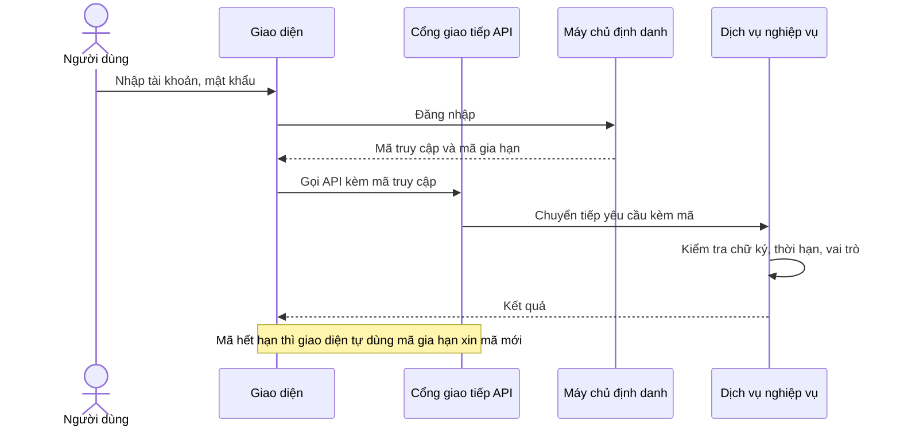

Đăng ký tài khoản mới tạo tài khoản ở trạng thái chờ và gửi thư xác thực; chỉ sau khi bấm liên kết trong thư mới đăng nhập được. Người dùng cũng có thể đăng nhập bằng tài khoản Google. Quản trị hệ thống quản lý người dùng và được bỏ qua kiểm tra quyền ở cấp dự án.

### 2.2.2. Phân quyền trong không gian làm việc

Không gian làm việc là cấp cao nhất, gom các dự án của một tổ chức. Quyền ở đây là một **thang bậc có thứ tự** gồm bốn vai trò: Chủ sở hữu > Quản trị viên > Thành viên > Khách. Mọi kiểm tra là so sánh bậc ("có từ bậc X trở lên không").

**Bảng 2.7: Bậc tối thiểu cho từng thao tác trong không gian làm việc**

| Thao tác | Bậc tối thiểu |
| :--- | :--- |
| Xem không gian làm việc và danh sách thành viên | Khách |
| Tạo dự án mới trong không gian làm việc | Thành viên |
| Mời, xóa, đổi vai trò thành viên; sửa tên và mô tả | Quản trị viên |
| Xóa (mềm), khôi phục không gian làm việc; cấp hoặc thu hồi vai trò Chủ sở hữu | Chủ sở hữu |

Mỗi điểm cuối của hai dịch vụ đều khai báo bậc tối thiểu cần có. Hai bất biến được bảo đảm ở tầng nghiệp vụ:

1. **Không lộ sự tồn tại.** Người ngoài truy cập một không gian làm việc nhận lỗi 404 chứ không phải 403, vì 403 tiết lộ rằng không gian đó có thật.
2. **Luôn còn ít nhất một Chủ sở hữu.** Rời đi, xóa thành viên hay hạ bậc chủ sở hữu cuối cùng đều bị chặn. Hàm kiểm tra khóa các dòng chủ sở hữu **trước khi đếm**: nếu chỉ đọc thuần thì hai chủ sở hữu cùng rời đi một lúc sẽ cùng thấy "còn hai người", cùng được phép, và không gian làm việc mất hết chủ.

Dịch vụ công việc cần biết vai trò của người dùng trong không gian làm việc, nhưng dữ liệu đó thuộc dịch vụ không gian làm việc. Vì vậy dịch vụ công việc hỏi qua một lời gọi nội bộ, lưu tạm 60 giây và **từ chối khi không gọi được**: nếu dịch vụ không gian làm việc sập mà cho qua thì thành "ai cũng vào được mọi không gian làm việc".

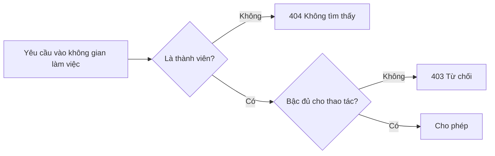

### 2.2.3. Phân quyền trong dự án

Trong mỗi dự án, quyền được định nghĩa bằng dữ liệu để quản trị viên dự án tự điều chỉnh. Có 15 khóa quyền:

**Bảng 2.8: Các quyền của dự án**

| Nhóm | Quyền |
| :--- | :--- |
| Dự án | Quản trị dự án; xem dự án |
| Công việc | Tạo; sửa; xóa; chuyển trạng thái; giao việc |
| Giai đoạn, phát hành | Quản lý giai đoạn; quản lý phiên bản phát hành |
| Bình luận | Tạo; sửa bình luận của mình; xóa bình luận của mình; xóa bình luận của mọi người |
| Tệp đính kèm | Xóa tệp của mình; xóa tệp của mọi người |

Ba bảng dữ liệu nối người dùng với quyền: **phân vai** (ai giữ vai trò nào ở dự án nào), **vai trò của dự án** (tên vai trò) và **bảng quyền** (vai trò nào có quyền nào). Khi tạo dự án, hệ thống gieo sẵn ba vai trò: Quản trị viên (đủ 15 quyền), Thành viên (xem, tạo, sửa, giao việc, chuyển trạng thái, bình luận, sửa bình luận của mình) và Người xem (chỉ xem). Muốn cho Người xem được giao việc, quản trị viên chỉ cần bật quyền giao việc cho vai trò đó.

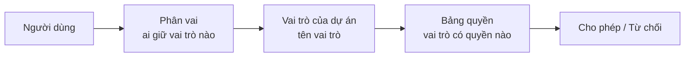

Quyết định cuối cùng do một bước kiểm tra duy nhất đưa ra, theo thứ tự và theo nguyên tắc **mặc định từ chối**:

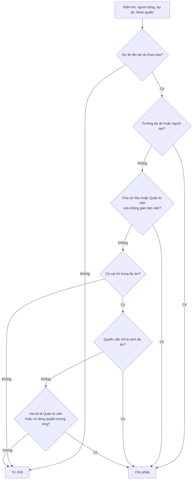

Ba đường cưỡng chế quyết định này:

1. **Lớp chặn trước mỗi thao tác.** Mỗi điểm cuối của dịch vụ công việc khai báo quyền cần có. Trước khi chạy, một lớp chặn xác định thao tác này thuộc dự án nào theo thứ tự: (0) nếu thao tác nhắm vào bảng, giai đoạn hay công việc thì lấy tài nguyên đó rồi truy ngược ra dự án; (1) mã dự án trên đường dẫn; (2) tham số có tên chứa "project"; (3) mã dự án nằm trong dữ liệu gửi lên. **Không xác định được dự án thì từ chối.** Lớp này cố ý không bắt ngoại lệ "không tìm thấy" để tài nguyên không tồn tại trả 404 chứ không bị biến thành 403.
2. **Bảo vệ cấp không gian làm việc** như mục 2.2.2.
3. **Kiểm tra trong tầng nghiệp vụ** cho quyền có phạm vi sở hữu như sửa bình luận của mình, xóa tệp của mình, vì khi đó phải so sánh người tạo nội dung với người đang thao tác.

Giao diện cũng ẩn hoặc làm mờ nút theo quyền, nhưng đó chỉ là lớp tiện dụng; việc cưỡng chế thật nằm ở phía máy chủ.

### 2.2.4. Lời mời tham gia

Thêm thành viên **không ghi thẳng** vào dự án hay không gian làm việc. Quản trị viên tạo một lời mời; chỉ khi người được mời chấp nhận thì bản ghi phân vai mới được tạo. Cách làm này tránh kéo người vào nơi họ không biết, và là một điểm phát sinh thông báo (mục 2.6).

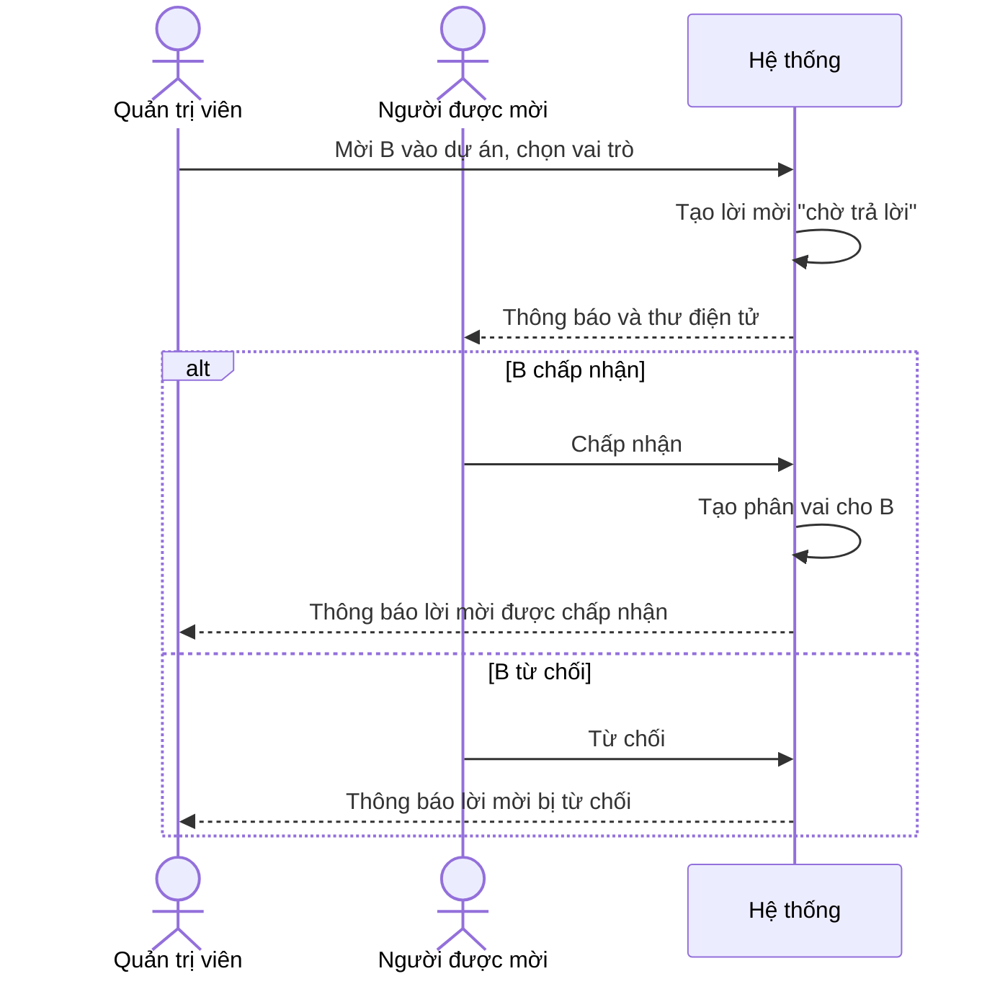

## 2.3. Giải pháp quản trị dự án và quản lý công việc

Ý tưởng xuyên suốt là **không viết cứng quy trình làm việc vào mã**: loại công việc, trạng thái, bước chuyển, nhãn, trường tùy chỉnh đều là dữ liệu của từng dự án, hệ thống chỉ giữ các quy tắc bảo đảm cấu hình luôn hợp lệ. Nhờ vậy cùng một hệ thống phục vụ được nhóm phần mềm, nhóm tiếp thị hay một quán cà phê.

### 2.3.1. Mô hình dự án và bộ sinh mã công việc

Dự án thuộc một không gian làm việc, có trưởng dự án, khung thời gian và **loại dự án**:

**Bảng 2.9: Các loại dự án**

| Loại dự án | Cách làm việc | Bảng tiến độ mặc định |
| :--- | :--- | :--- |
| Theo chu kỳ, theo giai đoạn | Chia thành các giai đoạn lần lượt, chỉ tập trung vào giai đoạn đang chạy | Chỉ hiện việc của giai đoạn đang chạy |
| Bảng công việc liên tục | Việc phát sinh đến đâu làm đến đó, kiểm soát bằng giới hạn việc đang làm | Hiện toàn bộ việc của dự án |
| Nghiệp vụ doanh nghiệp | Như bảng liên tục | Hiện toàn bộ việc của dự án |

Mỗi công việc có mã dễ nhớ dạng MOC-12 (mã dự án và số thứ tự). Số thứ tự do **dãy số riêng của cơ sở dữ liệu** cấp cho từng dự án nên không trùng dù nhiều người tạo việc cùng lúc. Dự án bị xóa là xóa mềm để khôi phục được. Khi tạo dự án, hệ thống gieo sẵn một bộ cấu hình tối thiểu để dùng ngay:

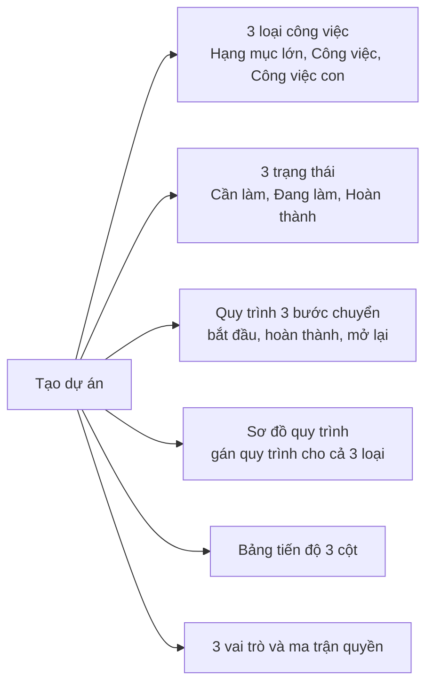

### 2.3.2. Loại công việc và phân cấp ba tầng

Loại công việc cho biết một việc "là gì" và nằm ở tầng nào của cây, qua **mức phân cấp** 1, 0 hoặc -1. Tên hiển thị được Việt hóa trung tính (hạng mục lớn, yêu cầu, công việc, sự cố, công việc con) để người ngoài ngành phần mềm dễ hiểu.

**Bảng 2.10: Ma trận hợp lệ giữa công việc cha và công việc con**

| Loại con (mức) | Cha hợp lệ | Quy tắc |
| :--- | :--- | :--- |
| Hạng mục lớn (1) | Không có cha | Luôn là gốc của cây |
| Yêu cầu, công việc, sự cố (0) | Không có cha hoặc hạng mục lớn | Đứng riêng hoặc thuộc một hạng mục lớn |
| Công việc con (-1) | Công việc mức 0 | Bắt buộc có cha, không lồng công việc con trong công việc con |

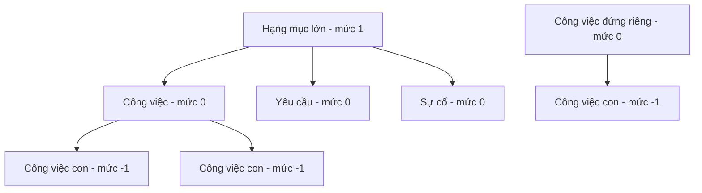

Hệ thống kiểm tra ma trận này mỗi khi tạo hoặc đổi cha, kèm các điều kiện biên: không tự làm cha của mình, cha cùng dự án và chưa bị xóa. Giới hạn ba tầng là lựa chọn có chủ ý để cây đủ nông cho việc tính tiến độ và điểm, đồng thời là hạn chế với các ngành cần nhiều tầng hơn (Chương 4).

Quản trị viên dự án được thêm, sửa, xóa loại công việc theo ngành ("yêu cầu khách hàng", "bài viết SEO", …) với các ràng buộc: tên và mã không trùng; không đổi mức của loại đã có công việc; luôn còn ít nhất một loại ở mỗi mức; không xóa loại đang được dùng.

### 2.3.3. Trạng thái công việc

Mỗi trạng thái thuộc một dự án, có tên, màu và **nhóm trạng thái**: Cần làm, Đang làm hoặc Hoàn thành. Tên do người dùng tự đặt theo ngành ("Đang duyệt mã", "Sẵn sàng nghiệm thu"…), nhưng mọi logic của hệ thống (báo cáo, tiến độ việc cha, điểm đóng góp, kết thúc giai đoạn) dựa vào **nhóm** chứ không dựa vào **tên**, nên một việc "xong" luôn được nhận diện đúng.

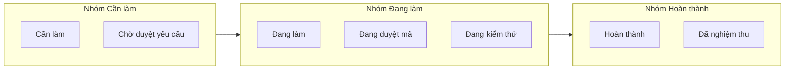

Để cấu hình không bị hỏng: tên trạng thái không trùng trong dự án; mỗi nhóm luôn còn ít nhất một trạng thái (không xóa hoặc đổi nhóm của trạng thái cuối cùng trong nhóm); không xóa trạng thái đang có việc dùng; khi xóa được thì các bước chuyển và cột bảng liên quan bị xóa theo. Việc mới luôn bắt đầu ở trạng thái đầu tiên của nhóm Cần làm.

### 2.3.4. Quy trình, bước chuyển và máy trạng thái

**Quy trình** là tập các **bước chuyển**, mỗi bước đi từ trạng thái nguồn tới trạng thái đích. Quy trình mặc định có ba bước:

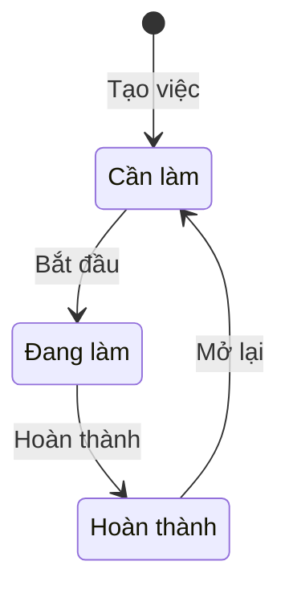

Quản trị viên tạo thêm bước chuyển bất kỳ giữa hai trạng thái của dự án (đích khác nguồn, không trùng cặp). **Sơ đồ quy trình** gán quy trình cho từng loại công việc, ví dụ "sự cố" có thêm bước kiểm thử còn "công việc" đi đường ngắn. Mỗi bước chuyển mang ba cấu hình lưu dạng JSON nên thêm quy tắc mới không đổi cấu trúc dữ liệu:

- **Điều kiện:** quyết định bước có hiện ra không (chỉ người được giao, chỉ người tạo, hoặc cần một quyền cụ thể).
- **Bộ kiểm tra:** kiểm tra trước khi chuyển (bắt buộc có kết quả xử lý, điền một số trường, hoặc mọi việc con phải xong).
- **Hàm sau chuyển:** việc tự động sau khi chuyển (ghi mốc thời gian, nhật ký, lưu bình luận đi kèm).

Hệ thống thực hiện một bước chuyển như sau:

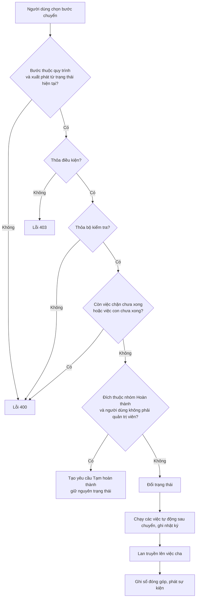

Trạng thái được **lan truyền cha–con** hai chiều: việc con bị mở lại thì việc cha đã hoàn thành tự mở lại; việc con bắt đầu làm thì việc cha còn ở nhóm Cần làm tự chuyển sang đang làm. Mọi đường đổi trạng thái, kể cả kéo thả thẻ trên bảng tiến độ, đều đi qua máy trạng thái này để ràng buộc luôn được kiểm tra và báo cáo luôn đúng.

### 2.3.5. Liên kết giữa các công việc

Công việc liên kết với nhau theo bốn loại, mỗi loại đọc được theo hai chiều:

**Bảng 2.11: Các loại liên kết giữa công việc**

| Loại | Từ việc nguồn | Từ việc đích | Tạo phụ thuộc thực thi |
| :--- | :--- | :--- | :-: |
| Chặn | Chặn tiến độ của | Bị chặn tiến độ bởi | Có |
| Gây ra | Gây ra | Bị gây ra bởi | Có |
| Trùng lặp | Trùng lặp với | Bị trùng lặp bởi | Không, nhưng tự đóng việc nguồn |
| Liên quan | Liên quan tới | Liên quan tới | Không |

Mỗi liên kết chỉ lưu một bản ghi, chiều ngược lại được suy ra khi hiển thị. Hệ thống từ chối tự liên kết, liên kết với việc đã xóa, liên kết giữa cha và con ruột, liên kết chặn trực tiếp giữa hạng mục lớn và công việc con, và liên kết đã tồn tại.

**Chặn vòng lặp phụ thuộc.** Nếu A chặn B, B chặn C rồi C chặn A thì cả ba bị khóa vĩnh viễn. Trước khi lưu một liên kết chặn từ A tới B, hệ thống dùng thuật toán tìm kiếm theo chiều sâu (DFS) [22] tìm đường đi từ B về A trong các liên kết đã có; có đường đi nghĩa là liên kết mới sẽ khép vòng nên bị từ chối kèm chu trình dễ đọc.

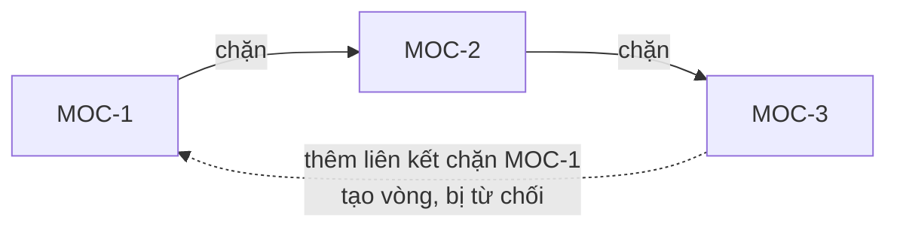

Liên kết còn tác động tới các phần khác: việc bị chặn bởi một việc chưa xong thì không hoàn thành được; chi tiết công việc có cờ cảnh báo "đang bị chặn", "xung đột phụ thuộc" và "xung đột thời gian" (hạn việc con muộn hơn hạn việc cha); đánh dấu trùng lặp sẽ đóng việc nguồn với kết quả "Trùng lặp" (người không phải quản trị viên chỉ tạo yêu cầu "Tạm hoàn thành", mục 2.4); liên kết chặn báo cho người thực hiện việc bị chặn.

### 2.3.6. Tùy biến theo ngành: trạng thái, loại công việc và trường tùy chỉnh

Gom lại, mức độ tùy biến mà dự án được phép:

**Bảng 2.12: Những gì người dùng được tùy biến**

| Đối tượng | Tùy biến được | Ràng buộc giữ cấu hình hợp lệ |
| :--- | :--- | :--- |
| Loại công việc | Thêm, sửa, xóa; đặt tên, màu, biểu tượng, mức phân cấp | Luôn còn một loại mỗi mức; không đổi mức hoặc xóa loại đang có việc |
| Trạng thái | Thêm, sửa, xóa; đặt tên, màu, chọn nhóm | Luôn còn một trạng thái mỗi nhóm; không xóa trạng thái đang có việc |
| Bước chuyển, quy trình | Tạo bước chuyển bất kỳ giữa hai trạng thái; thêm điều kiện, bộ kiểm tra, hàm sau chuyển; gán quy trình theo loại | Không trùng cặp, đích khác nguồn, cùng dự án |
| Cột bảng tiến độ | Gom một hoặc nhiều trạng thái vào một cột, đặt giới hạn việc đang làm | Một trạng thái không thuộc hai cột |
| Nhãn, thành phần, phiên bản phát hành | Tự tạo để phân loại công việc | Không trùng tên trong dự án |
| Trường tùy chỉnh | Định nghĩa thêm thông tin riêng của ngành | Khóa trường không trùng trong dự án |

**Trường tùy chỉnh** dành cho thông tin riêng của từng ngành (mã căn hộ, độ ngọt nông sản…). Mỗi trường được định nghĩa trong dự án với kiểu dữ liệu (văn bản, số, chọn một, chọn nhiều, ngày, người dùng, ô đánh dấu, đường dẫn) và loại công việc áp dụng; giá trị lưu trong một cột dạng JSON của công việc nên thêm trường không cần thêm cột hay bảng. Hiện hệ thống đã lưu và nhân bản được giá trị, nhưng **chưa có giao diện để người dùng tự tạo định nghĩa mới**, là việc để lại ở hướng phát triển.

### 2.3.7. Thuộc tính của công việc, tìm kiếm và sắp xếp

**Bảng 2.13: Thuộc tính chính của công việc**

| Nhóm | Thuộc tính | Ghi chú |
| :--- | :--- | :--- |
| Nội dung | Tiêu đề (bắt buộc, tối đa 500 ký tự), mô tả | Mô tả hỗ trợ định dạng văn bản |
| Mức ưu tiên | Thấp nhất, thấp, trung bình, cao, cao nhất | Mặc định là trung bình |
| Con người | Người báo cáo, người thực hiện | Người thực hiện phải là thành viên dự án; người báo cáo mặc định là người tạo |
| Ước lượng | Điểm ước lượng; thời gian ước lượng ban đầu, còn lại, đã dùng (tính bằng giây) | Công việc con không mang điểm riêng |
| Thời gian | Ngày bắt đầu, hạn chót, thời điểm giải quyết | Hạn của con không nên muộn hơn hạn của cha |
| Kết quả xử lý | Hoàn thành, đã sửa, không làm, trùng lặp, không tái hiện được | Ghi khi sang nhóm Hoàn thành, xóa khi mở lại |
| Phân loại | Nhãn (thẻ màu, nhiều nhãn mỗi việc), thành phần (có người phụ trách), phiên bản phát hành (ngày phát hành, đã phát hành, lưu trữ) | Do dự án tự định nghĩa |
| Mở rộng | Trường tùy chỉnh | Mục 2.3.6 |

**Lọc động.** Bộ lọc ghép các tiêu chí người dùng chọn (từ khóa, loại, trạng thái, mức ưu tiên, người thực hiện, giai đoạn, nhãn, hạn chót, ngày tạo…) thành một truy vấn duy nhất và lưu lại được thành bộ lọc riêng. **Giao việc** chỉ cần quyền giao việc, người được giao phải là thành viên dự án.

**Sắp xếp bằng LexoRank.** Nếu lưu vị trí bằng số nguyên liên tiếp thì mỗi lần chèn một thẻ vào giữa phải đánh số lại cả danh sách. Hệ thống dùng LexoRank [26]: mỗi việc có một chuỗi ký tự xếp hạng, thứ tự việc là thứ tự từ điển của các chuỗi; chèn giữa hai thẻ chỉ cần tính một chuỗi nằm giữa và ghi **đúng một bản ghi**, không ảnh hưởng các thẻ khác.

**Nhật ký thay đổi.** Mọi thay đổi trên công việc được ghi vào nhật ký chỉ thêm (trường nào đổi, giá trị cũ, mới, ai, lúc nào), phục vụ thẻ Lịch sử, truy vết trách nhiệm và dựng biểu đồ tiến độ (mục 2.4). Khi hai người cùng sửa một thẻ, cơ chế khóa lạc quan phát hiện xung đột và trả mã 409; giao diện đưa thẻ về chỗ cũ và tải lại bảng.

### 2.3.8. Giai đoạn, kho việc và bảng tiến độ

Dự án theo chu kỳ chia công việc thành các **giai đoạn** (còn gọi là chu kỳ): nhịp điệu lặp lại đều đặn mà dự án luôn tiến về đích. Nhóm phần mềm chia giai đoạn hai tuần; dự án mở quán cà phê chia thành "Pháp lý, mặt bằng", "Thi công nội thất", "Tuyển dụng và khai trương".

**Vòng đời một chiều:**

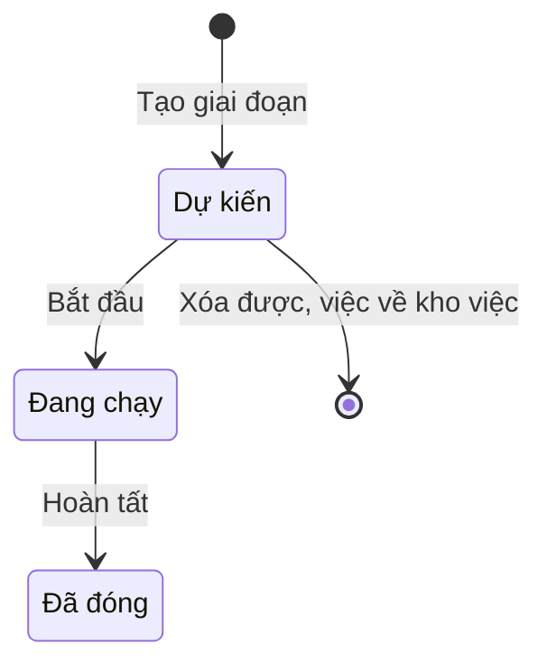

Các quy tắc chính: mỗi dự án chỉ có **một giai đoạn đang chạy** (được bảo đảm cả bằng ràng buộc ở cơ sở dữ liệu); bắt đầu phải có ngày kết thúc và các giai đoạn dự kiến được bắt đầu **lần lượt** theo thứ tự kế hoạch; giai đoạn đã đóng giữ lại để lưu vết và không mở lại được; công việc con luôn cùng giai đoạn với cha.

**Kho việc** gồm các việc chưa thuộc giai đoạn nào, hiển thị cùng giai đoạn đang chạy, giai đoạn dự kiến và giai đoạn đã hoàn tất. **Bảng tiến độ** có hai kiểu: theo chu kỳ (chỉ việc của giai đoạn đang chạy) và liên tục (toàn bộ việc); mỗi cột ánh xạ tới một hoặc nhiều trạng thái, kéo thẻ sang cột khác là một bước chuyển trạng thái đi qua máy trạng thái. Hai công cụ hỗ trợ: **giới hạn việc đang làm** chặn thẻ đi vào cột đã đầy (kéo ra hoặc sắp xếp trong cột luôn được), và **phân làn công việc** chia bảng thành các làn ngang theo hạng mục lớn, người thực hiện hoặc mức ưu tiên.

**Hoàn tất giai đoạn** là bước tinh tế nhất:

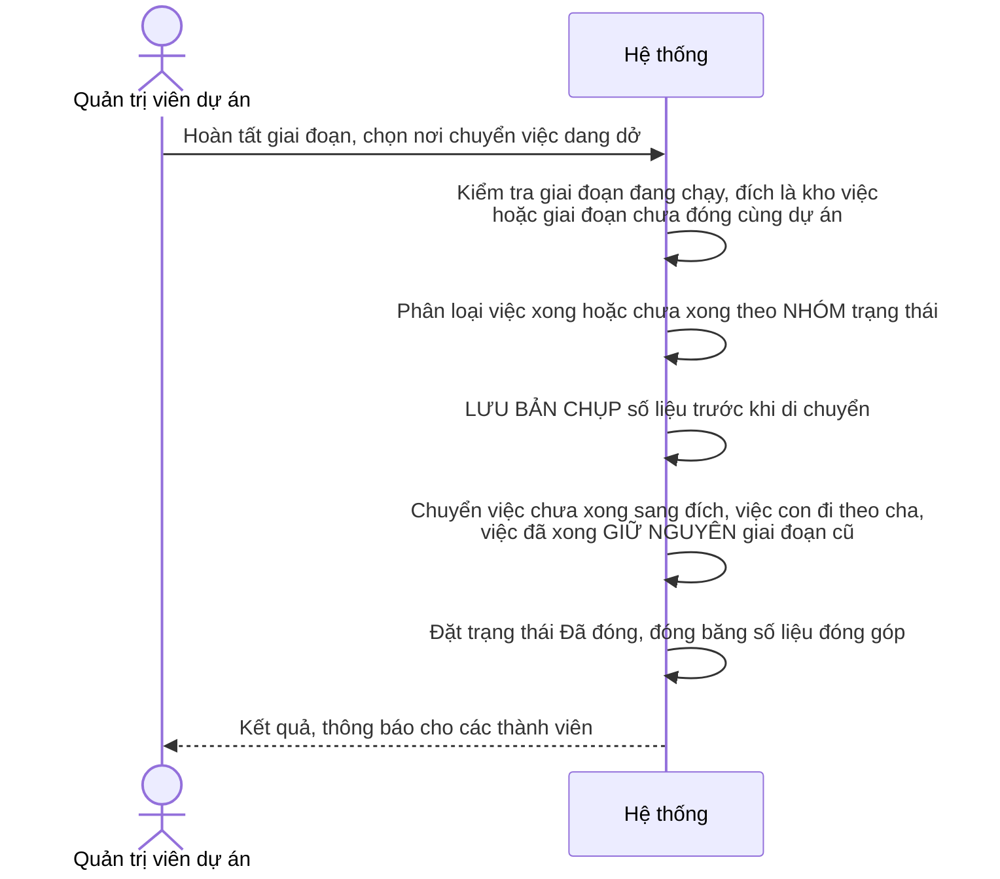

Hai thứ tự này quan trọng: bản chụp phải lưu **trước** khi di chuyển để mô tả đúng những gì giai đoạn đạt được; việc đã xong phải **giữ nguyên** giai đoạn cũ, nếu không giai đoạn đã đóng trông như chẳng làm được gì và năng suất mất ý nghĩa.

## 2.4. Giải pháp quản lý đóng góp và quản lý tiến độ

**Xác nhận hoàn thành.** Chỉ quản trị viên dự án mới được đưa công việc vào nhóm Hoàn thành. Khi thành viên khác chọn "Hoàn thành", trạng thái **không đổi**; hệ thống tạo một yêu cầu "Tạm hoàn thành" chờ quản trị viên xác nhận hoặc từ chối. Giữ nguyên trạng thái trong lúc chờ giúp mọi báo cáo vẫn đúng mà không phải sửa từng nơi đếm việc đã xong.

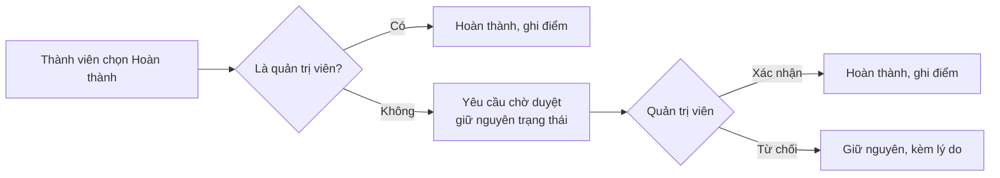

**Sổ ghi đóng góp.** Điểm của từng người được ghi vào một sổ chỉ thêm, không sửa không xóa, nên truy vết được từng dòng. Khi việc hoàn thành, người thực hiện nhận điểm của việc; việc cha có việc con thì tính 0 để không trùng điểm. Trễ hạn bị trừ 10% mỗi ngày, tối đa 50% (việc 5 điểm trễ 2 ngày nhận 4,0 điểm), tính theo ngày thành viên báo hoàn thành chứ không theo ngày được duyệt. Việc bị mở lại thì ghi một dòng điểm âm bù lại. Khi đóng giai đoạn, số liệu đóng góp được đóng băng để không đổi về sau.

**Quản lý tiến độ.** Giai đoạn đã đóng đọc số liệu từ bản chụp lưu lúc đóng. Giai đoạn đang chạy được dựng bằng cách **phát lại nhật ký thay đổi**: từ nhật ký suy ra trạng thái từng việc tại từng ngày, rồi tính điểm còn lại so với đường lý tưởng giảm đều theo ngày làm việc. Cùng cách này tạo biểu đồ luồng trạng thái; năng suất làm việc so điểm cam kết với điểm hoàn thành của các giai đoạn đã đóng.

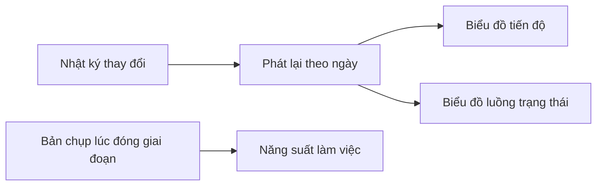

## 2.5. Giải pháp mẫu dự án

Dự án mẫu chính là một dự án được đánh dấu là mẫu, nên mang đủ trạng thái, quy trình, vai trò, giai đoạn và công việc. Một cơ chế duy nhất phục vụ tạo từ mẫu, lưu thành mẫu và nhân bản. Thành viên, bình luận, tệp đính kèm và nhật ký không được sao chép; công việc sao chép được đặt lại tiến độ.

**Thời gian.** Hệ thống tính độ dời bằng số ngày từ mốc gốc của mẫu đến ngày bắt đầu mới, rồi cộng độ dời đó vào mọi mốc (giai đoạn, hạn công việc, ngày phát hành, hạn dự án). Độ dài giai đoạn và khoảng cách giữa các mốc được giữ nguyên; giai đoạn sao chép về trạng thái dự kiến.

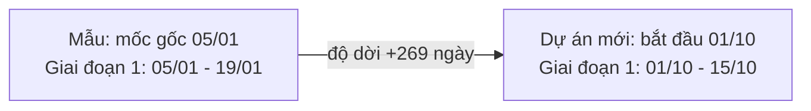

**Tùy chỉnh trước khi tạo.** Người dùng sửa ngay trong màn hình xem trước mẫu, rồi tạo dự án bằng **một yêu cầu duy nhất** trong một giao dịch: hoặc xong cả, hoặc hoàn tác sạch, không để dự án dở dang.

**Bảng 2.14: Tùy chỉnh được trước khi tạo dự án từ mẫu**

| Đối tượng | Được phép | Không được phép |
| :--- | :--- | :--- |
| Trạng thái, loại công việc | Đổi tên | Thêm, xóa (làm sau khi tạo để không gãy quy trình) |
| Giai đoạn | Đổi tên, bỏ qua | |
| Công việc | Đổi tiêu đề, bỏ qua | |

Bỏ một giai đoạn thì việc của giai đoạn đó về kho việc; bỏ một công việc cha thì mọi việc con bị bỏ theo.

**Nhân bản và kiểm tra.** Khi nhân bản, mọi bản ghi mới được ghi cặp mã cũ–mới để nối lại các quan hệ (bước chuyển, cột bảng, việc với giai đoạn); cây công việc sao chép hai lượt để nối quan hệ cha–con đúng. Bản thiết kế được kiểm tra toàn vẹn ở bốn thời điểm (đánh dấu mẫu, xem trước, trước và sau khi nhân bản); có lỗi thì khóa nút dùng mẫu hoặc hoàn tác.

## 2.6. Giải pháp thông báo

Thông báo phải đến đúng người, không mất khi một dịch vụ tạm ngừng và không báo cho thay đổi chưa xảy ra. Hệ thống dùng Kafka kèm **hộp thư sự kiện giao dịch** [15], [23]: nghiệp vụ ghi sự kiện vào hộp thư **trong cùng giao dịch** với dữ liệu, một tiến trình nền mỗi giây đẩy sự kiện lên Kafka, dịch vụ thông báo nhận, lưu và đẩy xuống trình duyệt bằng WebSocket, đồng thời gửi thư điện tử với việc quan trọng.

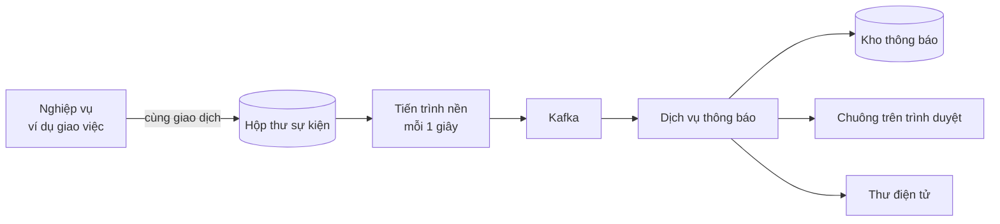

Bên phát tính sẵn người nhận, bên nhận dựng nội dung tiếng Việt cho 53 loại thông báo chia chín nhóm (công việc, phụ thuộc, xác nhận hoàn thành, bình luận, giai đoạn, nhắc hạn, thành viên, dự án, đóng góp). Kafka tạm ngừng thì sự kiện vẫn chờ và tự gửi tiếp. Kafka giao lặp không sinh thông báo trùng nhờ khóa duy nhất cho mỗi người và mỗi sự kiện. Người dùng bật tắt theo nhóm và kênh, tắt tiếng từng dự án; dịch vụ chạy nhiều bản sao vẫn đẩy đúng người nhờ Redis.

## 2.7. Giải pháp tích hợp GitHub

Dành cho dự án phần mềm, quản trị viên liên kết dự án với một kho GitHub bằng cấp quyền OAuth; token được mã hóa khi lưu, tham số trao đổi được ký, sự kiện GitHub gửi đến được xác thực chữ ký.

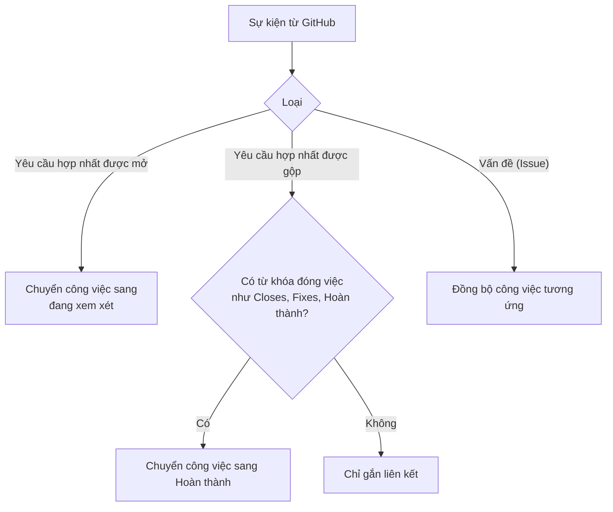

Hệ thống nhận ra mã công việc (ví dụ MOC-12) trong tên nhánh, tiêu đề và mô tả của yêu cầu hợp nhất rồi gắn vào công việc. Chỉ yêu cầu nhắm vào nhánh chính mới tự chuyển trạng thái, và việc đóng công việc bắt buộc có từ khóa đóng để việc cần nhiều yêu cầu không bị hoàn thành sớm. Mọi chuyển trạng thái đều đi qua máy trạng thái và quy tắc xác nhận hoàn thành. Chiều ngược lại, công việc hoàn thành thì Issue được đóng, đổi người thực hiện thì đồng bộ sang GitHub.

## 2.8. Tổng kết chương

Chương này đã giới thiệu sáu bài toán và giải pháp tương ứng. Điểm chung là đưa quy tắc nghiệp vụ vào đúng tầng bảo đảm chúng: quyền được quyết định tập trung theo hướng từ chối mặc định; loại công việc, trạng thái và quy trình là dữ liệu do dự án tự cấu hình nhưng luôn được giữ hợp lệ; mọi thay đổi trạng thái đi qua một máy trạng thái duy nhất; số liệu báo cáo được chụp bất biến hoặc phát lại từ nhật ký; thông báo gắn với giao dịch qua hộp thư sự kiện. Chương tiếp theo đặc tả yêu cầu, phân tích và thiết kế chi tiết hệ thống.
