# CHƯƠNG 3. ĐẶC TẢ, PHÂN TÍCH, THIẾT KẾ HỆ THỐNG

Chương này đặc tả yêu cầu, phân tích kịch bản và luồng nghiệp vụ, rồi trình bày thiết kế hệ thống dựa trên sáu nhóm giải pháp đã nêu ở Chương 2: xác thực và phân quyền; quản trị dự án và công việc (trọng tâm); quản lý đóng góp và tiến độ; mẫu dự án; thông báo; tích hợp GitHub. Thuật ngữ dùng thống nhất với Chương 2.

## 3.1. Đặc tả hệ thống

### 3.1.1. Yêu cầu chức năng

**Bảng 3.1: Bảng yêu cầu chức năng**

| Mã | Nhóm | Yêu cầu |
| :-: | :--- | :--- |
| FR-1.1 | Tài khoản | Đăng ký, xác thực thư điện tử; đăng nhập bằng tên đăng nhập hoặc tài khoản Google |
| FR-1.2 | Tài khoản | Quên và đặt lại mật khẩu qua thư; tự gia hạn phiên đăng nhập; xem, sửa hồ sơ |
| FR-1.3 | Quản trị hệ thống | Quản trị hệ thống xem, tạo, đổi vai trò, đặt lại mật khẩu, xóa người dùng |
| FR-2.1 | Không gian làm việc | Tạo, sửa, xóa mềm, khôi phục, rời không gian làm việc |
| FR-2.2 | Không gian làm việc | Mời thành viên, trả lời lời mời, đổi vai trò (Chủ sở hữu, Quản trị viên, Thành viên, Khách), xóa thành viên |
| FR-2.3 | Không gian làm việc | Luôn còn ít nhất một Chủ sở hữu |
| FR-3.1 | Dự án | Tạo dự án (trống hoặc từ mẫu), sửa, xóa mềm, khôi phục; chọn loại dự án (theo chu kỳ, bảng liên tục, nghiệp vụ doanh nghiệp) |
| FR-3.2 | Dự án | Mời và quản lý thành viên dự án; xem quyền của mình |
| FR-3.3 | Dự án | Quản lý vai trò và quyền của từng vai trò trong dự án |
| FR-4.1 | Công việc | Tạo, xem, sửa, xóa mềm công việc; tìm theo mã (MOC-12); lọc nhiều tiêu chí, lưu bộ lọc |
| FR-4.2 | Công việc | Quản lý loại công việc của dự án; phân cấp ba tầng (hạng mục lớn, công việc, công việc con) |
| FR-4.3 | Công việc | Quản lý trạng thái theo ba nhóm (Cần làm, Đang làm, Hoàn thành) và tên tùy ý |
| FR-4.4 | Công việc | Giao, hủy giao công việc; ghi lịch sử mọi thay đổi người thực hiện |
| FR-4.5 | Công việc | Liên kết công việc (chặn, gây ra, trùng lặp, liên quan); chặn vòng lặp phụ thuộc |
| FR-4.6 | Công việc | Quản lý nhãn, thành phần, phiên bản phát hành; trường tùy chỉnh |
| FR-4.7 | Công việc | Bình luận, nhắc tên, đính kèm tệp; xem nhật ký thay đổi; sắp xếp kéo thả |
| FR-5.1 | Quy trình | Tạo, sửa quy trình, bước chuyển; cấu hình điều kiện, bộ kiểm tra, việc tự động sau chuyển; gán quy trình theo loại công việc |
| FR-5.2 | Quy trình | Chuyển trạng thái theo bước chuyển hợp lệ; lan truyền trạng thái cha–con; hoàn thành dây chuyền việc con |
| FR-6.1 | Giai đoạn | Tạo, sửa, xóa, bắt đầu, hoàn tất giai đoạn; thêm, bớt công việc |
| FR-6.2 | Kho việc | Xem kho việc cùng các giai đoạn trong một màn hình |
| FR-6.3 | Bảng tiến độ | Bảng theo chu kỳ và bảng liên tục; kéo thả đổi cột; giới hạn việc đang làm; phân làn công việc; cấu hình cột |
| FR-7.1 | Hoàn thành | Gửi yêu cầu "Tạm hoàn thành"; quản trị viên xác nhận, từ chối; người gửi rút lại |
| FR-7.2 | Đóng góp | Xem đóng góp theo thành viên, sổ ghi công; điều chỉnh tay; xuất tệp |
| FR-8.1 | Tiến độ | Biểu đồ tiến độ chu kỳ, năng suất làm việc, biểu đồ luồng trạng thái |
| FR-9.1 | Mẫu dự án | Xem thư viện mẫu và bản xem trước; tùy chỉnh nhanh trước khi tạo; tạo dự án từ mẫu |
| FR-9.2 | Mẫu dự án | Lưu dự án thành mẫu; nhân bản dự án; kiểm tra toàn vẹn mẫu |
| FR-10.1 | Thông báo | Nhận thông báo thời gian thực trên chuông; xem, lọc, đánh dấu đã đọc, xóa và hoàn tác |
| FR-10.2 | Thông báo | Gửi thư điện tử với việc quan trọng; nhắc hạn hằng ngày |
| FR-10.3 | Thông báo | Bật tắt theo nhóm và kênh; tắt tiếng từng dự án |
| FR-11.1 | GitHub | Kết nối tài khoản GitHub, liên kết kho, đồng bộ Issue |
| FR-11.2 | GitHub | Gắn yêu cầu hợp nhất vào công việc; tự chuyển trạng thái theo yêu cầu hợp nhất; đóng Issue khi công việc hoàn thành |

### 3.1.2. Yêu cầu phi chức năng

**Bảng 3.2: Bảng yêu cầu phi chức năng**

| Mã | Nhóm | Yêu cầu | Tiêu chí |
| :-: | :--- | :--- | :--- |
| NFR-1.1 | Bảo mật | Xác thực tập trung; mật khẩu không lưu trong dữ liệu của hệ thống | Mọi API riêng tư đều yêu cầu mã hợp lệ |
| NFR-1.2 | Bảo mật | Phân quyền mặc định từ chối ở cả không gian làm việc và dự án | Thiếu thông tin thì từ chối |
| NFR-1.3 | Bảo mật | Token GitHub được mã hóa; sự kiện GitHub được xác thực chữ ký | Không lưu token dạng rõ |
| NFR-2.1 | Toàn vẹn | Cấu hình dự án luôn hợp lệ (loại, trạng thái, quy trình) | Chặn xóa hoặc đổi làm hỏng dữ liệu |
| NFR-2.2 | Toàn vẹn | Nhật ký thay đổi và sổ đóng góp chỉ thêm | Không có thao tác sửa, xóa |
| NFR-2.3 | Toàn vẹn | Số liệu giai đoạn đã đóng không đổi | Đọc từ bản chụp lưu lúc đóng |
| NFR-2.4 | Toàn vẹn | Thông báo không mất, không sai | Ghi cùng giao dịch với nghiệp vụ |
| NFR-3.1 | Hiệu năng | Thông báo đến trình duyệt gần như tức thì | Trễ khoảng 1 giây |
| NFR-3.2 | Hiệu năng | Kéo thả chỉ cập nhật một thẻ | Một bản ghi mỗi lần kéo |
| NFR-3.3 | Hiệu năng | Màn hình kho việc nạp trong một lần gọi | Một yêu cầu cho cả màn hình |
| NFR-4.1 | Sẵn sàng | Một dịch vụ tạm ngừng không làm mất sự kiện | Sự kiện chờ và xử lý khi dịch vụ chạy lại |
| NFR-4.2 | Mở rộng | Dịch vụ thông báo chạy được nhiều bản sao | Đẩy đúng người nhận, công việc định kỳ chạy một lần |
| NFR-5.1 | Khả dụng | Giao diện tối giản, thuần Việt, dùng được cho nhiều ngành | Theo bộ quy chuẩn giao diện của dự án |
| NFR-6.1 | Bảo trì | Cấu trúc dữ liệu có phiên bản, dựng lại được | Quản lý bằng công cụ chuyển đổi cấu trúc |
| NFR-7.1 | Triển khai | Đóng gói bằng Docker, tự động triển khai khi có mã mới | Quy trình CI/CD, kiểm tra qua HTTPS |

### 3.1.3. Xác định và mô tả các Actor

**Bảng 3.3: Danh sách Actor**

| Actor | Phạm vi | Mô tả |
| :--- | :--- | :--- |
| Khách vãng lai | Hệ thống | Chưa đăng nhập: xem trang giới thiệu, đăng ký, đăng nhập, xác thực thư, quên mật khẩu |
| Người dùng | Hệ thống | Đã đăng nhập: quản lý hồ sơ, tạo không gian làm việc, trả lời lời mời |
| Quản trị hệ thống | Hệ thống | Quản lý người dùng; được bỏ qua kiểm tra quyền ở cấp dự án |
| Chủ sở hữu | Không gian làm việc | Toàn quyền, kể cả xóa không gian làm việc và cấp quyền chủ sở hữu |
| Quản trị viên không gian làm việc | Không gian làm việc | Quản lý thành viên, cấu hình; quản trị mọi dự án trong không gian |
| Thành viên không gian làm việc | Không gian làm việc | Xem và tạo dự án mới |
| Khách của không gian làm việc | Không gian làm việc | Chỉ xem, không tạo được gì |
| Quản trị viên dự án | Dự án | Trưởng dự án, người tạo hoặc người giữ vai trò Quản trị viên: cấu hình loại công việc, trạng thái, quy trình, phân quyền, giai đoạn, duyệt hoàn thành |
| Thành viên dự án | Dự án | Tạo, sửa, giao việc, chuyển trạng thái, bình luận |
| Người xem dự án | Dự án | Chỉ xem nội dung dự án |
| Hệ thống tự động | Nền | Tiến trình gửi sự kiện, nhắc hạn lúc 08:00, dọn dẹp; các hệ thống ngoài (GitHub, máy chủ định danh, thư điện tử) |

Ba vai trò dự án là mặc định; quản trị viên dự án có thể tạo thêm vai trò và chỉnh quyền từng vai trò (Chương 2).

### 3.1.4. Xác định và mô tả các Use Case

**Bảng 3.4: Danh sách Use Case**

| Mã | Use Case | Actor chính |
| :-: | :--- | :--- |
| UC01 | Đăng ký, xác thực thư điện tử | Khách vãng lai |
| UC02 | Đăng nhập, quên và đặt lại mật khẩu | Khách vãng lai |
| UC03 | Quản lý hồ sơ cá nhân | Người dùng |
| UC04 | Quản lý người dùng hệ thống | Quản trị hệ thống |
| UC05 | Quản lý không gian làm việc, thành viên và lời mời | Chủ sở hữu, Quản trị viên, Người dùng |
| UC06 | Tạo và cấu hình dự án (dự án trống hoặc từ mẫu; loại công việc, trạng thái, quy trình, trường tùy chỉnh) | Thành viên không gian làm việc, Quản trị viên dự án |
| UC07 | Quản lý thành viên và quyền trong dự án | Quản trị viên dự án |
| UC08 | Tạo, chỉnh sửa và giao công việc | Thành viên dự án |
| UC09 | Liên kết công việc | Thành viên dự án |
| UC10 | Chuyển trạng thái và xác nhận hoàn thành | Thành viên dự án, Quản trị viên dự án |
| UC11 | Bình luận, nhắc tên, đính kèm tệp | Thành viên dự án |
| UC12 | Quản lý giai đoạn (lập kế hoạch, bắt đầu, hoàn tất) | Quản trị viên dự án |
| UC13 | Bảng tiến độ và báo cáo tiến độ | Mọi thành viên dự án |
| UC14 | Nhận thông báo | Người dùng |
| UC15 | Tích hợp GitHub | Quản trị viên dự án |

**Hình 3.1: Biểu đồ Use Case tổng quan**

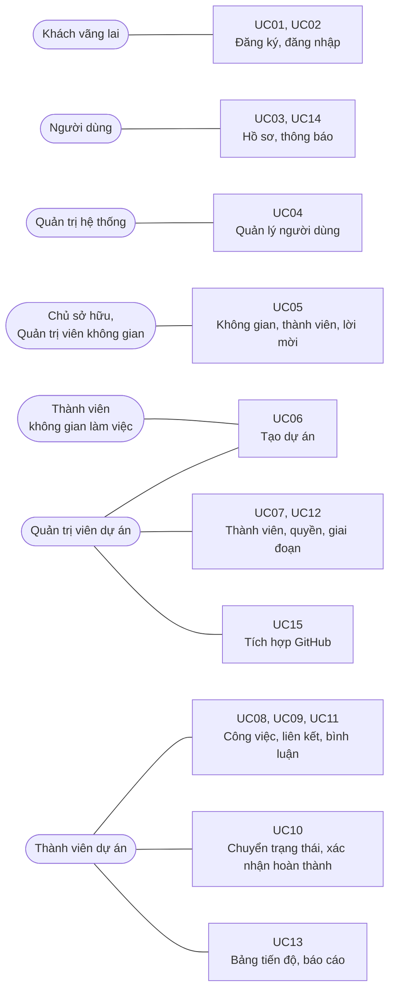

### 3.1.5. Một số Use Case tính năng chính

Phần này mô tả kịch bản chi tiết của chín nhóm chức năng quan trọng: UC01, UC02, UC06, UC08, UC09, UC10, UC13, UC14 và UC15.

**UC01. Đăng ký, xác thực thư điện tử**

| Mục | Nội dung |
| :--- | :--- |
| Tên Use Case | Đăng ký, xác thực thư điện tử |
| Tác nhân | Khách vãng lai |
| Mô tả | Khách tạo tài khoản mới và xác thực địa chỉ thư điện tử để được đăng nhập |
| Điều kiện trước | Khách chưa có tài khoản; có địa chỉ thư điện tử nhận được thư |
| Điều kiện sau | Tài khoản được kích hoạt, đăng nhập được |
| Luồng sự kiện chính | 1. Khách mở trang đăng ký, nhập tên đăng nhập, thư điện tử, mật khẩu, họ tên. 2. Hệ thống kiểm tra dữ liệu hợp lệ, tên đăng nhập và thư điện tử chưa được dùng. 3. Hệ thống tạo tài khoản ở trạng thái chờ xác thực (chưa đăng nhập được). 4. Hệ thống gửi thư chứa liên kết xác thực dùng một lần. 5. Khách mở thư, bấm liên kết. 6. Hệ thống kiểm tra mã còn hiệu lực, kích hoạt tài khoản và báo thành công. |
| Ngoại lệ | 2a. Dữ liệu không hợp lệ, tên đăng nhập hoặc thư điện tử đã tồn tại: báo lỗi, giữ nguyên biểu mẫu. 6a. Mã sai, hết hạn hoặc đã dùng: báo lỗi và cho gửi lại thư xác thực. Sau bước 3, nếu khách đăng nhập khi chưa xác thực: hệ thống từ chối và nhắc xác thực thư. |

**UC02. Đăng nhập, quên và đặt lại mật khẩu**

| Mục | Nội dung |
| :--- | :--- |
| Tên Use Case | Đăng nhập, quên và đặt lại mật khẩu |
| Tác nhân | Khách vãng lai |
| Mô tả | Đăng nhập bằng tài khoản của hệ thống hoặc tài khoản Google; lấy lại mật khẩu qua thư |
| Điều kiện trước | Đã có tài khoản (đã xác thực thư, hoặc có tài khoản Google) |
| Điều kiện sau | Phiên đăng nhập được thiết lập; người dùng vào danh sách không gian làm việc |
| Luồng sự kiện chính | 1. Khách nhập tên đăng nhập hoặc thư điện tử và mật khẩu. 2. Hệ thống xác thực với máy chủ định danh. 3. Hệ thống cấp mã truy cập và mã gia hạn, lưu mã truy cập vào cookie chỉ gửi qua giao thức web. 4. Giao diện chuyển tới danh sách không gian làm việc. |
| Luồng thay thế | A. Đăng nhập Google: khách bấm "Đăng nhập bằng Google", được chuyển sang Google để đồng ý, quay về hệ thống; lần đầu hệ thống tự tạo tài khoản (không cần xác thực thư) rồi cấp phiên. B. Quên mật khẩu: khách nhập thư điện tử, hệ thống gửi liên kết đặt lại có hiệu lực 30 phút, khách mở liên kết và nhập mật khẩu mới, hệ thống cập nhật và yêu cầu đăng nhập lại. |
| Ngoại lệ | 2a. Sai thông tin: báo lỗi, không cấp mã. 2b. Tài khoản chưa xác thực thư: từ chối kèm hướng dẫn xác thực. Trong phiên: mã truy cập hết hạn thì giao diện tự dùng mã gia hạn để xin mã mới; mã gia hạn hết hạn thì yêu cầu đăng nhập lại. B1. Liên kết đặt lại hết hạn hoặc đã dùng: báo lỗi, cho yêu cầu lại. |

**UC06. Tạo và cấu hình dự án**

| Mục | Nội dung |
| :--- | :--- |
| Tên Use Case | Tạo và cấu hình dự án |
| Tác nhân | Thành viên không gian làm việc (tạo), Quản trị viên dự án (cấu hình) |
| Mô tả | Tạo dự án mới, trống hoặc từ dự án mẫu; sau đó tùy biến loại công việc, trạng thái, quy trình, trường tùy chỉnh theo ngành |
| Điều kiện trước | Người dùng có bậc Thành viên trở lên trong không gian làm việc |
| Điều kiện sau | Dự án mới sẵn sàng; người tạo là Quản trị viên dự án |
| Luồng sự kiện chính (tạo từ mẫu) | 1. Người dùng chọn "Tạo dự án", chuyển sang tab chọn mẫu. 2. Hệ thống hiển thị thư viện mẫu; người dùng chọn một mẫu. 3. Hệ thống dựng bản xem trước (tổng quan, trạng thái và quy trình, giai đoạn và công việc, phân quyền) và kết quả kiểm tra toàn vẹn của mẫu. 4. Người dùng tùy chỉnh nhanh: đổi tên trạng thái và loại công việc; đổi tên hoặc bỏ giai đoạn; đổi tiêu đề hoặc bỏ công việc (bỏ việc cha thì việc con bị bỏ theo). Các tùy chỉnh được giữ lại khi quay lại xem mẫu. 5. Người dùng nhập tên, mã dự án, ngày bắt đầu và bấm tạo. 6. Hệ thống tính độ dời ngày so với mốc gốc của mẫu, nhân bản dự án trong một giao dịch, áp các tùy chỉnh, dời mọi mốc thời gian, đặt lại tiến độ công việc. 7. Hệ thống kiểm tra toàn vẹn kết quả, báo số bản ghi đã tạo và chuyển vào dự án mới. |
| Luồng thay thế | A. Tạo dự án trống: người dùng nhập tên, mã, loại dự án (theo chu kỳ, bảng liên tục, nghiệp vụ doanh nghiệp), trưởng dự án, khung thời gian; hệ thống gieo sẵn 3 loại công việc, 3 trạng thái, quy trình ba bước, bảng tiến độ và ba vai trò. B. Cấu hình sau khi tạo: quản trị viên thêm, sửa, xóa loại công việc (mức phân cấp 1, 0, -1); thêm, sửa, xóa trạng thái và chọn nhóm; tạo bước chuyển, gắn điều kiện, bộ kiểm tra, việc sau chuyển; gán quy trình theo loại; tạo nhãn, thành phần, phiên bản phát hành; hệ thống kiểm tra các ràng buộc giữ cấu hình luôn hợp lệ. |
| Ngoại lệ | 3a. Mẫu có lỗi toàn vẹn: khóa nút dùng mẫu. 5a. Mã dự án trùng hoặc không hợp lệ, ngày kết thúc trước ngày bắt đầu: báo lỗi. 6a. Lỗi giữa chừng: hoàn tác toàn bộ, không để dự án dở dang. B1. Tên hoặc mã trùng; đổi mức của loại đã có việc; xóa loại hoặc trạng thái cuối cùng của mức hoặc nhóm; xóa loại hoặc trạng thái đang có việc dùng; bước chuyển có đích trùng nguồn hoặc trùng cặp: hệ thống từ chối kèm lý do. |

**UC08. Tạo, chỉnh sửa và giao công việc**

| Mục | Nội dung |
| :--- | :--- |
| Tên Use Case | Tạo, chỉnh sửa và giao công việc |
| Tác nhân | Thành viên dự án |
| Mô tả | Tạo công việc (hạng mục lớn, công việc, yêu cầu, sự cố hoặc công việc con), chỉnh sửa thuộc tính và giao cho người thực hiện |
| Điều kiện trước | Thành viên có quyền tạo (và quyền giao việc khi giao cho người khác) |
| Điều kiện sau | Công việc được lưu với mã mới, ghi nhật ký; người được giao nhận thông báo |
| Luồng sự kiện chính | 1. Thành viên mở kho việc hoặc bảng tiến độ, bấm "Tạo công việc". 2. Chọn loại, nhập tiêu đề; có thể nhập mô tả, mức ưu tiên, điểm ước lượng, hạn chót, công việc cha, giai đoạn, nhãn, thành phần, trường tùy chỉnh. 3. Hệ thống kiểm tra quyền và quan hệ cha–con theo ma trận ba tầng. 4. Hệ thống cấp mã công việc (ví dụ MOC-12), đặt trạng thái khởi tạo (trạng thái đầu của nhóm Cần làm), xếp thẻ vào cuối danh sách, lưu và ghi nhật ký. 5. Thành viên chọn người thực hiện; hệ thống kiểm tra người đó thuộc dự án, lưu, ghi lịch sử người thực hiện và gửi thông báo. 6. Khi chỉnh sửa, hệ thống ghi từng trường thay đổi vào nhật ký (giá trị cũ, mới, người đổi, thời điểm). |
| Luồng thay thế | Kéo thả đổi thứ tự: chỉ cập nhật đúng thẻ được kéo. Hủy giao: chọn "chưa giao". Tạo công việc con ngay trong chi tiết công việc cha. |
| Ngoại lệ | 2a. Thiếu tiêu đề hoặc quá 500 ký tự: báo lỗi. 3a. Hạng mục lớn có cha; công việc con không có cha hoặc cha không phải công việc mức 0; cha khác dự án hoặc đã xóa: từ chối. 3b. Thiếu quyền tạo: từ chối. 5a. Giao cho người ngoài dự án, hoặc giao cho người khác khi thiếu quyền giao việc: từ chối. 6a. Hai người cùng sửa một thẻ: báo xung đột, giao diện tải lại thẻ. |

**UC09. Liên kết công việc**

| Mục | Nội dung |
| :--- | :--- |
| Tên Use Case | Liên kết công việc |
| Tác nhân | Thành viên dự án |
| Mô tả | Nối hai công việc theo quan hệ chặn, gây ra, trùng lặp hoặc liên quan |
| Điều kiện trước | Hai công việc tồn tại, chưa bị xóa |
| Điều kiện sau | Liên kết được lưu, hiển thị hai chiều ở cả hai công việc |
| Luồng sự kiện chính | 1. Thành viên mở công việc nguồn, chọn "Thêm liên kết". 2. Chọn loại liên kết và công việc đích. 3. Hệ thống kiểm tra các điều kiện hợp lệ (không tự liên kết, không với việc đã xóa, không giữa cha và con ruột, không chặn trực tiếp giữa hạng mục lớn và công việc con, chưa tồn tại). 4. Với liên kết chặn hoặc gây ra, hệ thống kiểm tra vòng lặp phụ thuộc bằng cách tìm đường đi từ đích về nguồn. 5. Hệ thống lưu một liên kết, ghi nhật ký ở cả hai công việc, hiển thị theo chiều tương ứng ("chặn tiến độ của", "bị chặn tiến độ bởi", …). 6. Với liên kết chặn, hệ thống thông báo cho người thực hiện việc bị chặn. |
| Luồng thay thế | Liên kết "trùng lặp": việc nguồn chuyển sang Hoàn thành với kết quả "Trùng lặp"; nếu người thao tác không phải quản trị viên thì chỉ tạo yêu cầu "Tạm hoàn thành". Gỡ liên kết: xóa liên kết, ghi nhật ký. |
| Ngoại lệ | 3a. Vi phạm một điều kiện hợp lệ: từ chối kèm lý do. 4a. Liên kết tạo vòng lặp (ví dụ MOC-1 chặn MOC-2, MOC-2 chặn MOC-3, thêm MOC-3 chặn MOC-1): từ chối và báo chu trình MOC-1 → MOC-2 → MOC-3 → MOC-1. |

**UC10. Chuyển trạng thái và xác nhận hoàn thành**

| Mục | Nội dung |
| :--- | :--- |
| Tên Use Case | Chuyển trạng thái và xác nhận hoàn thành |
| Tác nhân | Thành viên dự án; Quản trị viên dự án (xác nhận) |
| Mô tả | Đưa công việc qua các trạng thái theo quy trình; việc đưa vào nhóm Hoàn thành phải được quản trị viên xác nhận |
| Điều kiện trước | Người dùng có quyền chuyển trạng thái; có bước chuyển hợp lệ từ trạng thái hiện tại |
| Điều kiện sau | Công việc ở trạng thái mới, hoặc có yêu cầu "Tạm hoàn thành" chờ duyệt |
| Luồng sự kiện chính | 1. Thành viên mở chi tiết công việc (hoặc kéo thẻ sang cột khác). 2. Hệ thống liệt kê các bước chuyển hợp lệ từ trạng thái hiện tại, đã lọc theo điều kiện. 3. Thành viên chọn một bước chuyển (có thể kèm kết quả xử lý, bình luận). 4. Hệ thống kiểm tra bộ kiểm tra, việc chặn chưa xong, việc con chưa xong, giới hạn việc đang làm của cột đích. 5. Hệ thống đổi trạng thái, chạy các việc tự động sau chuyển, ghi nhật ký. 6. Hệ thống lan truyền lên công việc cha (mở lại hoặc tự bắt đầu), ghi sổ đóng góp, gửi thông báo. |
| Luồng thay thế | A. Đích thuộc nhóm Hoàn thành và người dùng không phải quản trị viên: hệ thống tạo yêu cầu "Tạm hoàn thành", giữ nguyên trạng thái, báo cho quản trị viên. A1. Quản trị viên chọn Xác nhận: hệ thống chạy lại bước chuyển đã lưu, đưa việc sang Hoàn thành, ghi điểm cho người thực hiện (tính trễ hạn theo ngày gửi), báo người gửi. A2. Quản trị viên chọn Từ chối (kèm lý do): công việc giữ nguyên, báo người gửi. A3. Người gửi hoặc quản trị viên rút lại yêu cầu; yêu cầu tự hủy nếu trạng thái công việc bị đổi trước khi duyệt. B. Người dùng là quản trị viên: đổi sang Hoàn thành ngay và ghi điểm. |
| Ngoại lệ | 2a. Không có bước chuyển hợp lệ: báo quy trình không có đường đi. 4a. Còn việc chặn hoặc việc con chưa xong, thiếu thông tin bắt buộc: từ chối kèm lý do. 4b. Cột đích đã đạt giới hạn việc đang làm: chặn thẻ đi vào. 4c. Mở lại việc thuộc giai đoạn đã đóng: từ chối. 3a. Thẻ vừa bị người khác sửa: báo xung đột, tải lại. A1a. Người xác nhận không phải quản trị viên: từ chối. Quy trình không còn đường tới Hoàn thành: báo lỗi, đề nghị từ chối hoặc chỉnh quy trình. |

**UC13. Bảng tiến độ và báo cáo tiến độ**

| Mục | Nội dung |
| :--- | :--- |
| Tên Use Case | Bảng tiến độ và báo cáo tiến độ |
| Tác nhân | Mọi thành viên dự án |
| Mô tả | Theo dõi công việc trên bảng theo cột và xem các biểu đồ tiến độ của giai đoạn hoặc toàn bộ quá trình |
| Điều kiện trước | Là thành viên dự án; dự án có bảng tiến độ |
| Điều kiện sau | Người dùng nắm được tiến độ; các thao tác trên bảng được lưu |
| Luồng sự kiện chính | 1. Thành viên mở "Bảng tiến độ": hệ thống hiển thị thẻ theo cột (bảng theo chu kỳ chỉ hiện việc của giai đoạn đang chạy; bảng liên tục hiện toàn bộ việc), kèm số việc của từng cột so với giới hạn, thanh đếm ngược của giai đoạn. 2. Thành viên lọc, chia thành các phân làn theo hạng mục lớn, người thực hiện hoặc mức ưu tiên. 3. Thành viên kéo thẻ: trong cùng cột thì đổi thứ tự; sang cột khác thì thực hiện bước chuyển trạng thái (UC10). 4. Thành viên mở trang "Báo cáo", chọn giai đoạn (hoặc toàn bộ quá trình). 5. Hệ thống hiển thị biểu đồ tiến độ chu kỳ (đường lý tưởng, đường thực tế, thay đổi phạm vi), năng suất làm việc, biểu đồ luồng trạng thái. |
| Luồng thay thế | Giai đoạn đã đóng: số liệu đọc từ bản chụp lưu lúc đóng. Giai đoạn đang chạy: hệ thống phát lại nhật ký thay đổi để dựng biểu đồ ngay giữa giai đoạn. Báo cáo còn có phần đóng góp theo thành viên (tổng điểm, tỷ lệ đúng hạn, số lần bị mở lại). |
| Ngoại lệ | 1a. Bảng theo chu kỳ chưa có giai đoạn đang chạy: bảng trống kèm lời mời sang kho việc. 1b. Công việc có trạng thái chưa gán cột nào: cảnh báo, không âm thầm ẩn. 3a. Không có bước chuyển tới cột đích: cột bị vô hiệu hóa, hoặc thẻ trượt về chỗ cũ kèm lý do. 5a. Giai đoạn thiếu ngày bắt đầu hoặc kết thúc: không dựng được biểu đồ tiến độ. |

**UC14. Nhận thông báo**

| Mục | Nội dung |
| :--- | :--- |
| Tên Use Case | Nhận thông báo |
| Tác nhân | Người dùng; hệ thống tự động |
| Mô tả | Người dùng nhận thông báo về các thay đổi liên quan đến mình, trong ứng dụng và qua thư điện tử |
| Điều kiện trước | Người dùng đã đăng nhập; trình duyệt đã kết nối kênh thời gian thực |
| Điều kiện sau | Thông báo được lưu, hiển thị trên chuông; việc "Cần xử lý" được đánh dấu cho đến khi giải quyết |
| Luồng sự kiện chính | 1. Một sự kiện phát sinh (được giao việc, bị nhắc tên, lời mời, yêu cầu hoàn thành, việc sắp đến hạn…). 2. Hệ thống ghi sự kiện cùng giao dịch với nghiệp vụ, rồi gửi sang dịch vụ thông báo. 3. Dịch vụ thông báo bỏ người thực hiện thao tác, áp cài đặt cá nhân, dựng nội dung, lưu thông báo (bỏ trùng). 4. Hệ thống đẩy thông báo tới trình duyệt người nhận; số trên chuông tăng ngay không cần tải lại trang; với việc quan trọng gửi thêm thư điện tử. 5. Người dùng mở bảng thông báo, bấm vào một thông báo: hệ thống đánh dấu đã đọc và chuyển tới công việc hoặc trang liên quan. |
| Luồng thay thế | Thông báo "Cần xử lý" (lời mời, yêu cầu hoàn thành) nằm ở tab riêng và tự chuyển "Đã xử lý" khi được giải quyết, kể cả do người khác giải quyết. Người dùng lọc theo nhóm, đọc tất cả, xóa (hoàn tác trong 5 giây). Cài đặt: bật tắt theo nhóm và kênh (ứng dụng, thư), tắt tiếng từng dự án; một số loại bắt buộc không tắt được. Công việc nhắc hạn chạy lúc 08:00 mỗi ngày. |
| Ngoại lệ | 2a. Dịch vụ thông báo hoặc Kafka tạm ngừng: sự kiện chờ và được xử lý khi chạy lại, không mất. 3a. Sự kiện giao lặp: bỏ qua nhờ khóa chống trùng. 4a. Mất kết nối kênh thời gian thực: giao diện hiện "đang kết nối lại" và tự nối lại. 5a. Công việc được nhắc đến không còn tồn tại: báo không tìm thấy. |

**UC15. Tích hợp GitHub**

| Mục | Nội dung |
| :--- | :--- |
| Tên Use Case | Tích hợp GitHub |
| Tác nhân | Quản trị viên dự án (kết nối); lập trình viên (làm việc trên GitHub) |
| Mô tả | Liên kết dự án phần mềm với kho GitHub để công việc và mã nguồn đồng bộ với nhau |
| Điều kiện trước | Người dùng là quản trị viên dự án và có tài khoản GitHub |
| Điều kiện sau | Dự án liên kết với kho; sự kiện GitHub cập nhật công việc |
| Luồng sự kiện chính | 1. Quản trị viên mở tab GitHub của dự án, bấm "Kết nối với GitHub". 2. Hệ thống chuyển sang trang cấp quyền của GitHub kèm tham số trao đổi được ký. 3. Sau khi đồng ý, GitHub trả về; hệ thống kiểm tra tham số, đổi lấy token và lưu đã mã hóa. 4. Quản trị viên chọn kho, nhánh chính và các tùy chọn tự động (tự chuyển sang đang xem xét, tự đóng khi gộp, đóng Issue khi hoàn thành, từ khóa đóng việc). 5. Hệ thống đăng ký kênh nhận sự kiện với khóa bí mật, có thể đồng bộ các Issue đang mở về làm công việc. 6. Lập trình viên mở yêu cầu hợp nhất có tên nhánh, tiêu đề hoặc mô tả chứa mã công việc (ví dụ MOC-12): hệ thống xác thực chữ ký, gắn yêu cầu hợp nhất vào công việc và chuyển sang đang xem xét. 7. Khi yêu cầu hợp nhất được gộp vào nhánh chính và mô tả có từ khóa đóng việc (Closes, Fixes, Hoàn thành…): hệ thống chuyển công việc sang Hoàn thành. |
| Luồng thay thế | Chiều ngược lại: công việc sang Hoàn thành thì Issue tương ứng được đóng; đổi người thực hiện thì đồng bộ sang GitHub. Từ công việc, người dùng tạo Issue GitHub bằng một nút và nhận gợi ý tên nhánh chứa mã. Quản trị viên có thể ngắt kết nối. |
| Ngoại lệ | 3a. Tham số trao đổi sai người hoặc sai dự án: từ chối. 6a. Sự kiện sai chữ ký: bỏ qua. 6b. Yêu cầu hợp nhất vào nhánh khác nhánh chính: chỉ gắn liên kết, không đổi trạng thái. 7a. Gộp không có từ khóa đóng việc: giữ nguyên trạng thái (tránh hoàn thành sớm khi việc cần nhiều yêu cầu hợp nhất). 7b. Người thao tác trên GitHub chưa liên kết tài khoản, hoặc không có bước chuyển phù hợp: chỉ cập nhật liên kết. 7c. Người thao tác không phải quản trị viên: chỉ tạo yêu cầu "Tạm hoàn thành". |

## 3.2. Phân tích hệ thống

### 3.2.1. Phân tích luồng nghiệp vụ chính

**Hình 3.2: Luồng chuyển trạng thái và xác nhận hoàn thành**

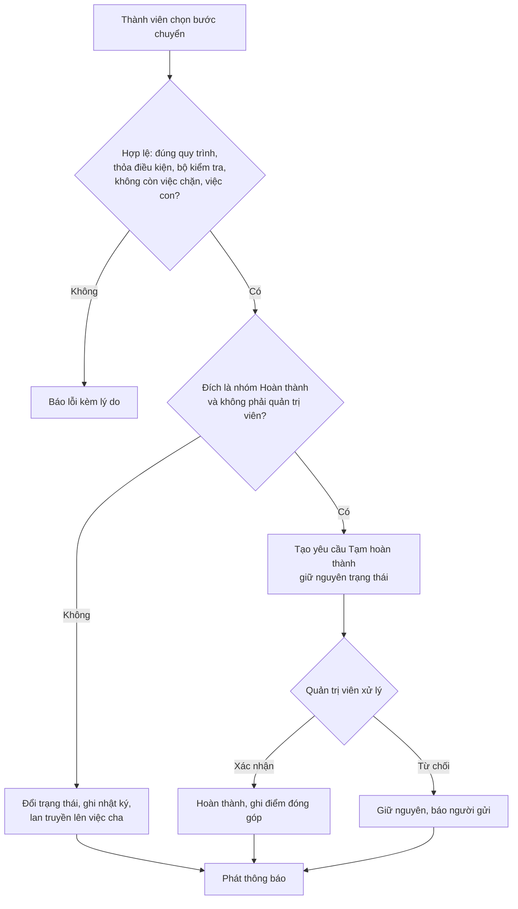

**Hình 3.3: Luồng hoàn tất giai đoạn**

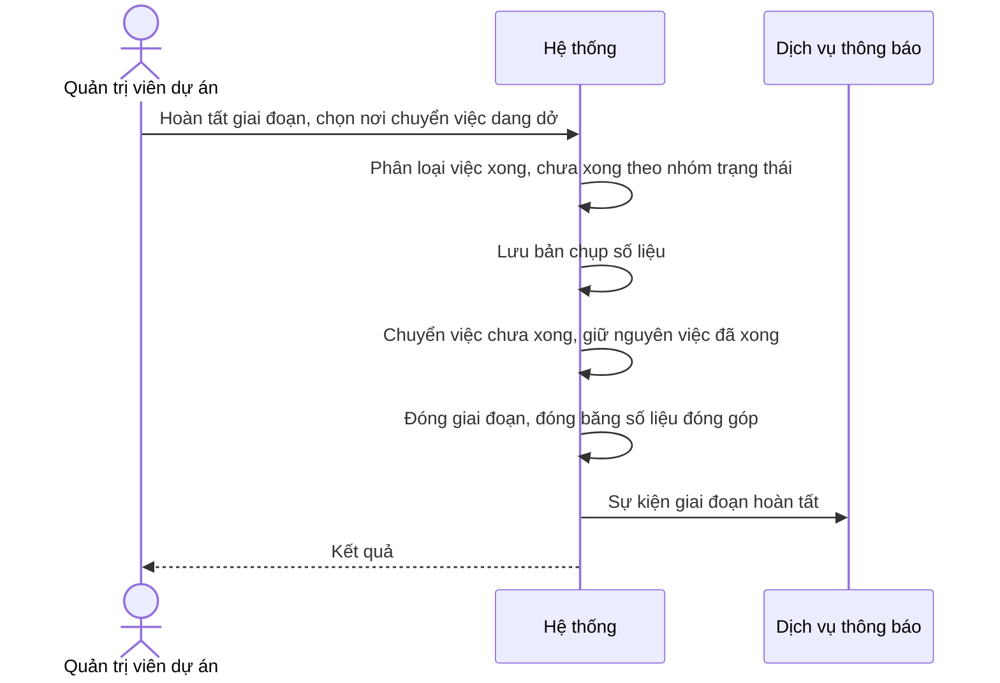

**Hình 3.4: Luồng tạo dự án từ mẫu**

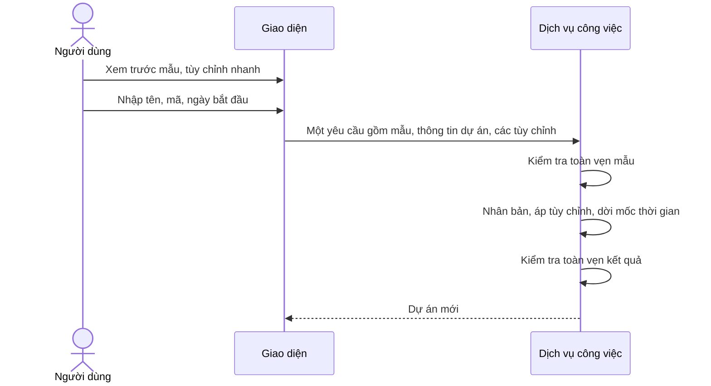

**Hình 3.5: Luồng phát và nhận thông báo**

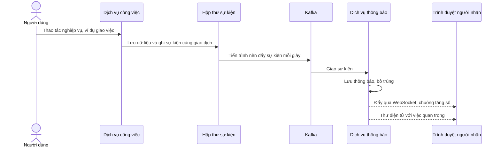

**Hình 3.6: Luồng xét quyền trong không gian làm việc và dự án**

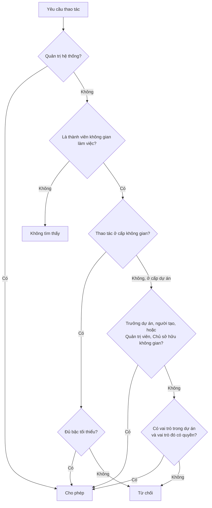

**Hình 3.7: Luồng kiểm tra khi cấu hình loại công việc và trạng thái**

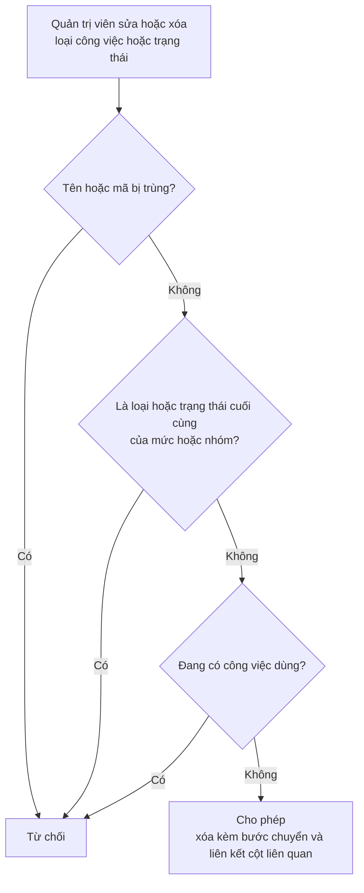

**Hình 3.8: Luồng tính điểm đóng góp**

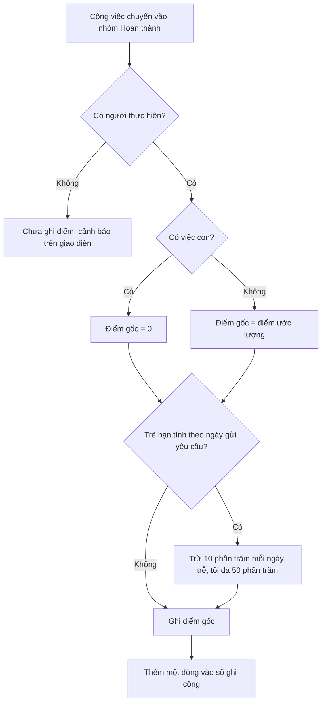

**Hình 3.9: Luồng GitHub khi có yêu cầu hợp nhất**

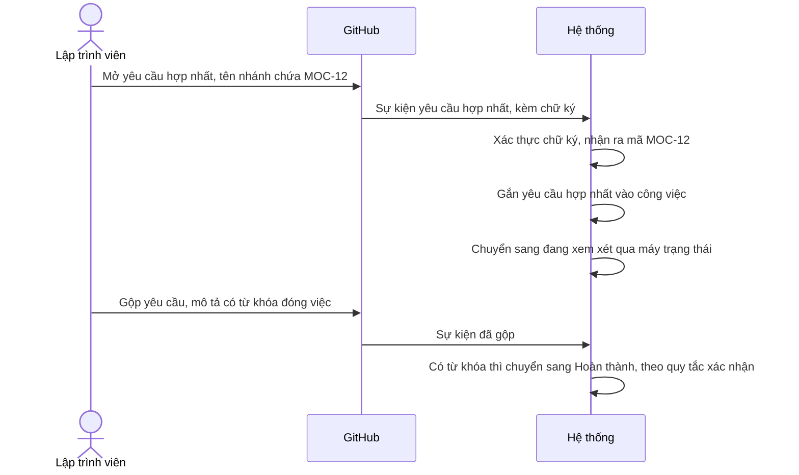

## 3.3. Thiết kế hệ thống

### 3.3.1. Thiết kế kiến trúc hệ thống

Hệ thống theo kiến trúc Microservice: giao diện, cổng giao tiếp API, bốn dịch vụ nghiệp vụ và hạ tầng dùng chung.

**Hình 3.10: Tổng quan kiến trúc hệ thống**

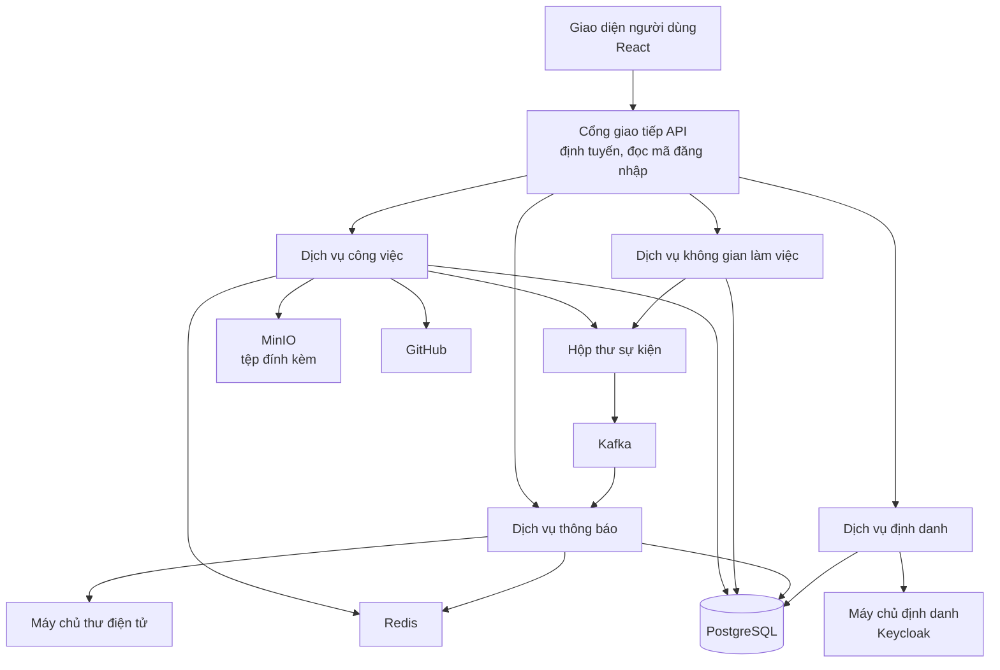

**Bảng 3.5: Công nghệ và trách nhiệm của từng dịch vụ**

| Dịch vụ | Cổng | Trách nhiệm | Công nghệ chính |
| :--- | :-: | :--- | :--- |
| Cổng giao tiếp API | 8081 | Định tuyến, giới hạn nguồn truy cập, đọc mã đăng nhập từ tiêu đề hoặc cookie rồi chuyển xuống dịch vụ | Spring Cloud Gateway |
| Dịch vụ định danh | 8082 | Đăng ký, đăng nhập, xác thực thư, quản trị người dùng | Spring Security, Keycloak |
| Dịch vụ công việc | 8083 | Dự án, công việc, loại, trạng thái, quy trình, liên kết, giai đoạn, bảng tiến độ, báo cáo, đóng góp, mẫu dự án, GitHub, hộp thư sự kiện | Spring Boot, JPA, Redis, MinIO, Kafka |
| Dịch vụ không gian làm việc | 8087 | Không gian làm việc, thành viên, lời mời | Spring Boot, JPA |
| Dịch vụ thông báo | 9994 | Nhận sự kiện, lưu và đẩy thông báo, gửi thư điện tử | Spring Kafka, WebSocket, Redis |
| Giao diện | 5173 | Giao diện người dùng | React 19, Vite 8 |

**Bảng 3.6: Định tuyến tại cổng giao tiếp API**

| Đường dẫn công khai | Dịch vụ đích |
| :--- | :--- |
| `/identity/...` | Dịch vụ định danh |
| `/work/...` | Dịch vụ công việc |
| `/workspace/...` | Dịch vụ không gian làm việc |
| `/notification/...` (kể cả WebSocket) | Dịch vụ thông báo |

Các dịch vụ giao tiếp theo hai cách. **Đồng bộ:** dịch vụ công việc hỏi dịch vụ định danh (tra tên người dùng) và dịch vụ không gian làm việc (vai trò của người dùng), lỗi thì từ chối thay vì cho qua. **Bất đồng bộ:** thông báo đi qua hộp thư sự kiện và Kafka (Chương 2). Các dịch vụ dùng chung một cơ sở dữ liệu nhưng mỗi dịch vụ chỉ sở hữu bảng của mình.

### 3.3.2. Sơ đồ lớp pha thiết kế

Các sơ đồ dưới đây thể hiện thực thể chính và quan hệ theo đúng các giải pháp ở Chương 2: dự án và công việc, giai đoạn và đóng góp, phân quyền, rồi mẫu dự án, thông báo và GitHub.

**Hình 3.11: Sơ đồ lớp: dự án, công việc, loại, trạng thái, quy trình**

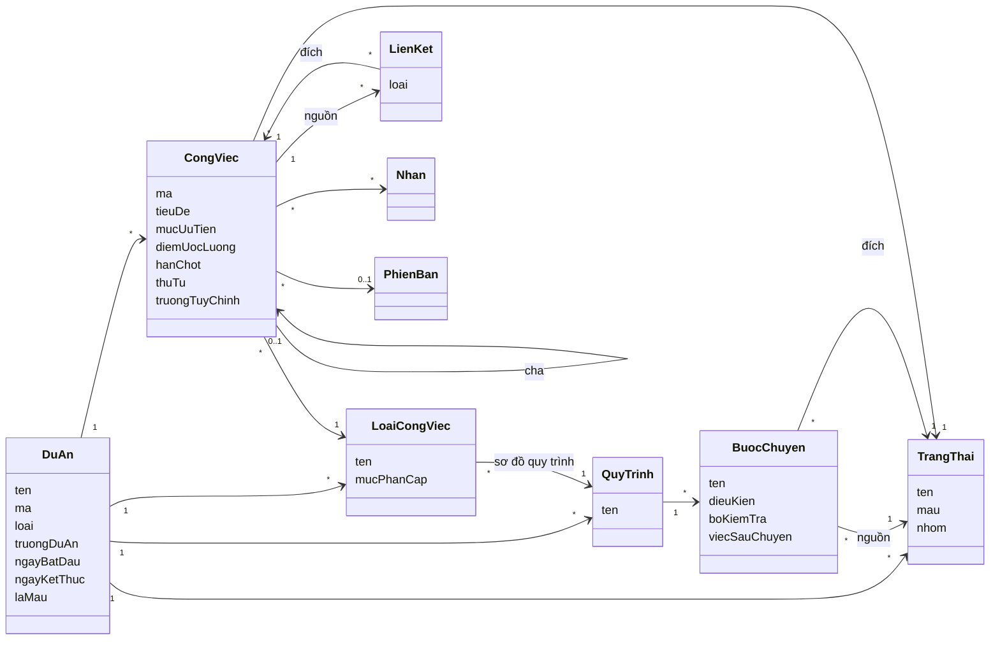

**Hình 3.12: Sơ đồ lớp: giai đoạn, bảng tiến độ, hoàn thành, đóng góp**

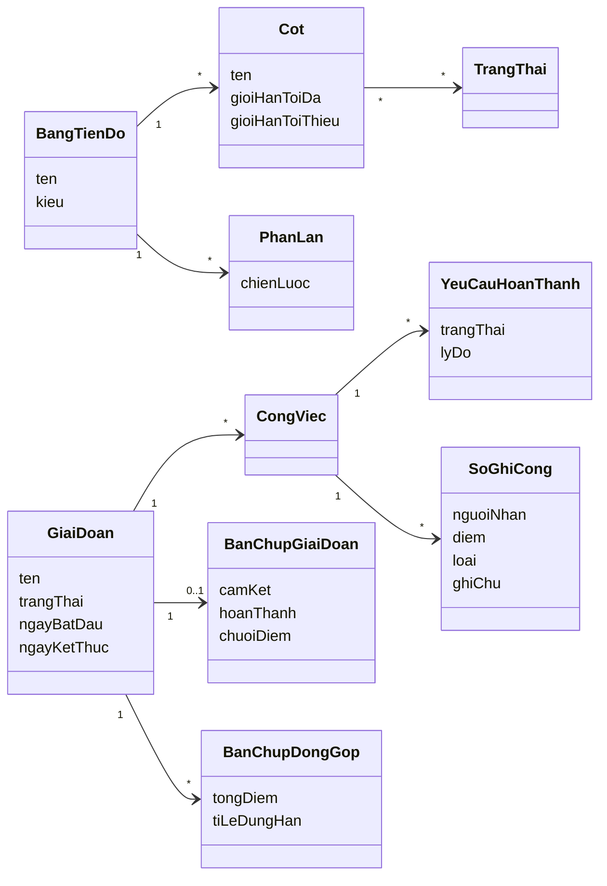

**Hình 3.13: Sơ đồ lớp: không gian làm việc, phân quyền, lời mời**

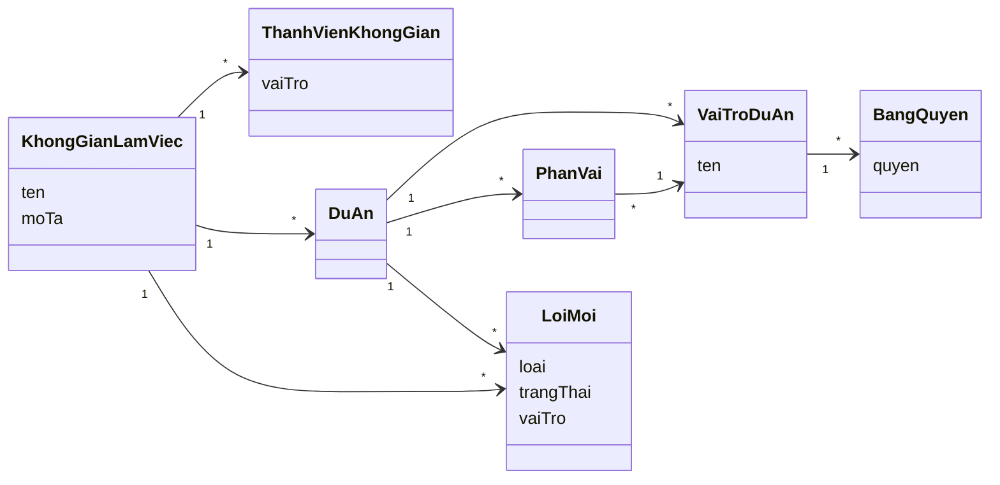

**Hình 3.14: Sơ đồ lớp: mẫu dự án, thông báo, GitHub**

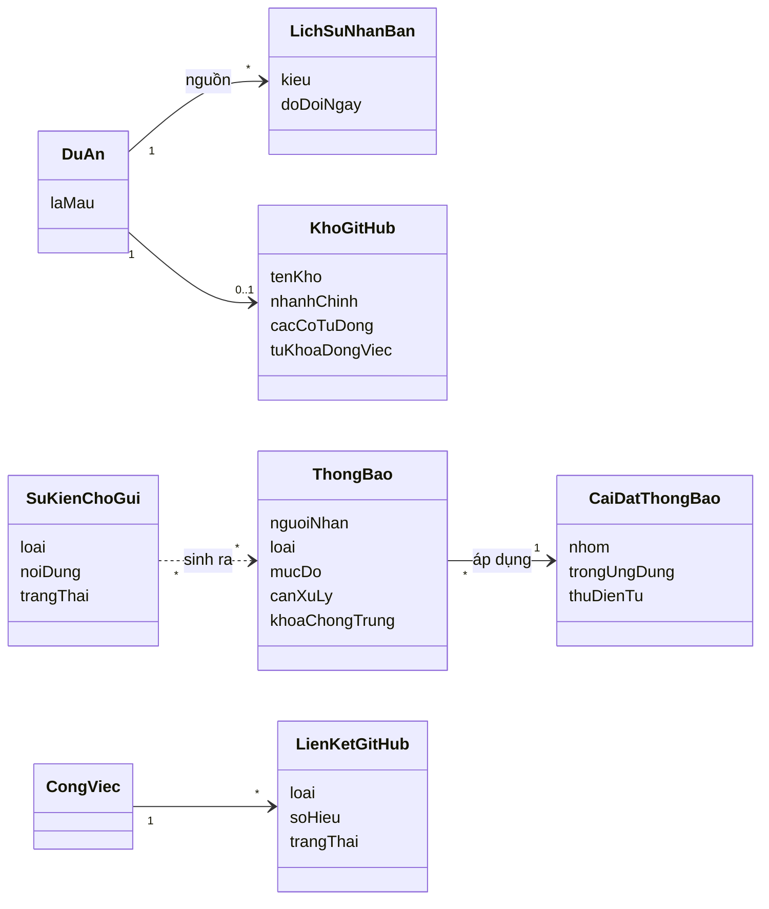

Các lớp xử lý nghiệp vụ tương ứng: kiểm tra phân cấp, máy trạng thái, phát hiện vòng lặp phụ thuộc, sắp xếp thứ tự, quản lý giai đoạn, giới hạn việc đang làm, phát lại nhật ký, tính đóng góp, nhân bản và kiểm tra mẫu, phát và nhận thông báo, tích hợp GitHub.

### 3.3.3. Thiết kế cơ sở dữ liệu toàn hệ thống

Hệ thống dùng một cơ sở dữ liệu PostgreSQL chung; mỗi dịch vụ sở hữu một nhóm bảng, cấu trúc được quản lý theo phiên bản bằng công cụ chuyển đổi cấu trúc (riêng dịch vụ định danh do khung ORM tự tạo).

**Bảng 3.7: Các nhóm dữ liệu theo dịch vụ**

| Dịch vụ | Dữ liệu |
| :--- | :--- |
| Dịch vụ định danh | Người dùng; mã xác thực thư điện tử |
| Dịch vụ không gian làm việc | Không gian làm việc; thành viên; lời mời |
| Dịch vụ công việc | Dự án; vai trò, bảng quyền, phân vai, lời mời dự án; công việc, loại, liên kết, bình luận, tệp đính kèm, nhật ký, nhãn, thành phần, phiên bản, trường tùy chỉnh, bộ lọc đã lưu; trạng thái, quy trình, bước chuyển, sơ đồ quy trình; giai đoạn, bảng tiến độ, cột, phân làn, bản chụp báo cáo; yêu cầu hoàn thành, sổ ghi công, bản chụp đóng góp; lịch sử nhân bản; tài khoản và kho GitHub, liên kết GitHub; hộp thư sự kiện |
| Dịch vụ thông báo | Thông báo; cài đặt thông báo; dự án bị tắt tiếng |

**Hình 3.15: Sơ đồ thực thể và quan hệ của dịch vụ công việc**

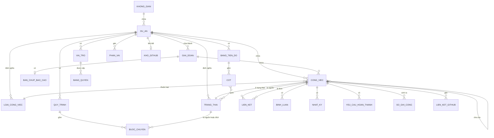

Các thực thể được mô tả theo từng nhóm bài toán của Chương 2. Mọi thực thể thuộc dự án đều có mã định danh duy nhất; các cột người dùng lưu mã người dùng thống nhất toàn hệ thống.

**Bảng 3.8: Nhóm phân quyền và thành viên**

| Thực thể | Thuộc tính chính | Ràng buộc |
| :--- | :--- | :--- |
| Không gian làm việc | Tên, đường dẫn định danh, mô tả, ảnh, người tạo, thời điểm xóa mềm | Đường dẫn định danh duy nhất |
| Thành viên không gian | Không gian, người dùng, vai trò (Chủ sở hữu, Quản trị viên, Thành viên, Khách), người mời, ngày tham gia | Mỗi người một dòng cho mỗi không gian; luôn còn ít nhất một Chủ sở hữu |
| Lời mời không gian | Không gian, người được mời, người mời, vai trò, trạng thái (chờ, chấp nhận, từ chối, hủy), thời điểm trả lời | Một lời mời chờ cho mỗi người |
| Vai trò dự án | Dự án, tên, mô tả | Tên không trùng trong dự án; luôn có Quản trị viên, Thành viên, Người xem |
| Bảng quyền | Dự án, vai trò, khóa quyền (một trong 15) | Mỗi bộ ba duy nhất |
| Phân vai | Dự án, người dùng, vai trò | Người không có dòng phân vai thì không có quyền gì (trừ khi là trưởng dự án, người tạo hoặc quản trị không gian) |
| Lời mời dự án | Dự án, người được mời, người mời, vai trò dự án, trạng thái, thời điểm trả lời | Một lời mời chờ cho mỗi người và mỗi dự án |

**Bảng 3.9: Nhóm dự án, loại công việc, trạng thái và quy trình**

| Thực thể | Thuộc tính chính | Ràng buộc |
| :--- | :--- | :--- |
| Dự án | Không gian, tên, mã, mô tả, trưởng dự án, người tạo, loại dự án, cách chọn người thực hiện mặc định, cờ dự án mẫu và nhóm mẫu, ngày bắt đầu và kết thúc, thời điểm xóa mềm | Mã dự án dùng để sinh mã công việc, chuẩn hóa chữ hoa |
| Loại công việc | Dự án, tên, mã, mô tả, biểu tượng, màu, mức phân cấp, cờ công việc con, cờ mặc định hệ thống | Tên, mã không trùng trong dự án; mức chỉ 1, 0, -1; mỗi mức luôn còn một loại |
| Trạng thái | Dự án, tên, mô tả, màu, nhóm | Tên không trùng không phân biệt hoa thường; mỗi nhóm luôn còn một trạng thái |
| Quy trình | Dự án, tên, mô tả, cờ mặc định | |
| Bước chuyển | Quy trình, trạng thái nguồn (rỗng nếu là bước khởi tạo), trạng thái đích, tên, điều kiện, bộ kiểm tra, việc sau chuyển (dạng JSON) | Đích khác nguồn; không trùng cặp nguồn–đích; tên không trùng trong quy trình |
| Sơ đồ quy trình | Dự án; ánh xạ loại công việc → quy trình | Mỗi loại một quy trình |

**Bảng 3.10: Nhóm công việc và tùy biến**

| Thực thể | Thuộc tính chính | Ràng buộc |
| :--- | :--- | :--- |
| Công việc | Mã, dự án, loại, trạng thái, công việc cha, giai đoạn, tiêu đề (tối đa 500 ký tự), mô tả, mức ưu tiên (thấp nhất đến cao nhất, mặc định trung bình), kết quả xử lý, người báo cáo, người thực hiện, điểm ước lượng, ước lượng thời gian (ban đầu, còn lại, đã dùng), thứ tự xếp hạng, thành phần, phiên bản phát hành, trường tùy chỉnh (JSON), ngày bắt đầu, hạn chót, thời điểm giải quyết, số phiên bản, thời điểm xóa mềm | Mã duy nhất; cha cùng dự án; số phiên bản dùng cho khóa lạc quan |
| Liên kết công việc | Việc nguồn, việc đích, loại (chặn, gây ra, trùng lặp, liên quan), người tạo | Không tự liên kết; mỗi bộ (nguồn, đích, loại) duy nhất; không có vòng lặp phụ thuộc |
| Bình luận | Công việc, bình luận cha (trả lời lồng nhau), tác giả, nội dung, thời điểm tạo và sửa, thời điểm xóa mềm | |
| Tệp đính kèm | Công việc, tên tệp, đường dẫn trong kho lưu trữ, dung lượng, kiểu tệp, người tải lên | Nội dung tệp lưu ở kho tệp, cơ sở dữ liệu chỉ giữ đường dẫn |
| Nhật ký thay đổi | Công việc, tên trường, giá trị cũ, giá trị mới, người đổi, thời điểm | Chỉ thêm |
| Nhãn | Dự án, tên, màu | Tên không trùng trong dự án |
| Thành phần | Dự án, tên, mô tả, người phụ trách | Tên không trùng trong dự án |
| Phiên bản phát hành | Dự án, tên, mô tả, ngày phát hành, cờ đã phát hành, cờ lưu trữ | Tên không trùng trong dự án |
| Định nghĩa trường tùy chỉnh | Dự án, khóa trường, tên, kiểu dữ liệu (văn bản, số, chọn một, chọn nhiều, ngày, người dùng, ô đánh dấu, đường dẫn), danh sách lựa chọn, quy tắc kiểm tra, danh sách loại công việc áp dụng | Khóa trường không trùng trong dự án |
| Bộ lọc đã lưu | Dự án, tên, mô tả, điều kiện lọc, chủ sở hữu, cờ dùng chung | |

**Bảng 3.11: Nhóm giai đoạn, bảng tiến độ, đóng góp và tiến độ**

| Thực thể | Thuộc tính chính | Ràng buộc |
| :--- | :--- | :--- |
| Giai đoạn | Dự án, tên, mục tiêu, trạng thái (dự kiến, đang chạy, đã đóng), ngày bắt đầu và kết thúc, thời điểm hoàn tất, số phiên bản | Mỗi dự án tối đa một giai đoạn đang chạy |
| Bảng tiến độ | Dự án, tên, kiểu (theo chu kỳ hoặc liên tục) | |
| Cột | Bảng, tên, thứ tự, giới hạn việc đang làm tối thiểu và tối đa | Một trạng thái không thuộc hai cột |
| Liên kết cột–trạng thái | Cột, trạng thái | Mỗi cặp duy nhất |
| Phân làn | Bảng, tên, chiến lược (theo hạng mục lớn, người thực hiện, mức ưu tiên), thứ tự | Mỗi lúc một chiến lược |
| Bản chụp báo cáo giai đoạn | Giai đoạn, tổng điểm, điểm hoàn thành, điểm chưa hoàn thành, số việc, số việc hoàn thành, dữ liệu biểu đồ (JSON), người đóng, thời điểm đóng | Mỗi giai đoạn một bản |
| Yêu cầu hoàn thành | Dự án, công việc, bước chuyển đã chọn, trạng thái đích, kết quả xử lý đề xuất, cờ hoàn thành luôn việc con, ghi chú, người gửi, thời điểm gửi, trạng thái (chờ duyệt, đã xác nhận, bị từ chối, đã hủy), người quyết định, thời điểm quyết định, ghi chú quyết định | Mỗi công việc tối đa một yêu cầu chờ duyệt; không xóa bản ghi |
| Sổ ghi công | Dự án, giai đoạn, công việc, người được ghi nhận, điểm (dương hoặc âm), loại (hoàn thành, mở lại, xóa, điều chỉnh), ghi chú, người thao tác, thời điểm | Chỉ thêm, không sửa, không xóa |
| Bản chụp đóng góp | Giai đoạn, người dùng, tổng điểm, tỷ lệ đóng góp, số việc hoàn thành, số bình luận, số sự cố báo cáo, tỷ lệ đúng hạn, số lần bị mở lại | Mỗi cặp giai đoạn–người dùng duy nhất |

**Bảng 3.12: Nhóm mẫu dự án, thông báo và GitHub**

| Thực thể | Thuộc tính chính | Ràng buộc |
| :--- | :--- | :--- |
| Lịch sử nhân bản | Dự án nguồn, dự án đích, kiểu nhân bản (từ mẫu, lưu thành mẫu, nhân bản), độ dời ngày, tùy chọn và thống kê số bản ghi, người thực hiện, thời điểm | |
| Sự kiện chờ gửi | Loại đối tượng, mã đối tượng, loại sự kiện, nội dung (JSON), trạng thái (chờ gửi, đã gửi, thất bại), số lần thử, thời điểm tạo và gửi | Ghi cùng giao dịch với nghiệp vụ; dùng chung cho dịch vụ công việc và dịch vụ không gian làm việc |
| Thông báo | Người nhận, loại (một trong 53), nhóm, mức độ, cờ cần xử lý và thời điểm đã xử lý, tiêu đề, nội dung, đường dẫn, không gian, dự án, đối tượng liên quan, người gây ra, số người gây ra, khóa gộp, khóa chống trùng, mã sự kiện nguồn, thời điểm đọc và xóa mềm | Khóa chống trùng duy nhất |
| Cài đặt thông báo | Người dùng, nhóm, bật trong ứng dụng, bật thư điện tử | Mỗi cặp người dùng–nhóm một dòng |
| Dự án bị tắt tiếng | Người dùng, dự án, tên dự án, tắt đến khi nào | Mỗi cặp người dùng–dự án một dòng |
| Tài khoản GitHub | Người dùng, mã và tên tài khoản GitHub, ảnh, token đã mã hóa | Mỗi người một tài khoản |
| Kho GitHub của dự án | Dự án, chủ kho, tên kho, đường dẫn, nhánh chính, mã kênh nhận sự kiện và khóa bí mật, các cờ tự động (đồng bộ Issue, chuyển sang đang xem xét, tự đóng khi gộp, đóng Issue khi hoàn thành), từ khóa đóng việc, thời điểm đồng bộ cuối | Mỗi cặp (dự án, kho) duy nhất |
| Liên kết GitHub của công việc | Công việc, loại (Issue, yêu cầu hợp nhất), số hiệu, tiêu đề, đường dẫn, trạng thái (mở, đã gộp, đóng), tác giả | |

Các ràng buộc quan trọng ở tầng cơ sở dữ liệu: mỗi dự án tối đa một giai đoạn đang chạy; mỗi công việc tối đa một yêu cầu hoàn thành chờ duyệt; mỗi giai đoạn một bản chụp báo cáo; khóa chống trùng của thông báo duy nhất; mỗi lời mời chờ là duy nhất cho một cặp (đối tượng, người được mời). Tầng nhóm trung gian (Team) của phiên bản đầu đã được loại bỏ để còn kiến trúc phẳng hai cấp: không gian làm việc, dự án.

### 3.3.4. Thiết kế giao diện lập trình

Giao diện lập trình theo chuẩn REST, dữ liệu JSON, phản hồi được bọc thống nhất; lỗi dùng mã HTTP chuẩn: 400 (dữ liệu hoặc quy tắc không hợp lệ), 401 (chưa xác thực), 403 (không đủ quyền), 404 (không tìm thấy hoặc không được biết là có), 409 (xung đột, ví dụ hai người cùng sửa một thẻ hoặc đã có giai đoạn đang chạy).

**Bảng 3.13: Nhóm giao diện lập trình theo dịch vụ**

| Dịch vụ | Nhóm chức năng |
| :--- | :--- |
| Dịch vụ định danh | Đăng ký, xác thực thư, đăng nhập, làm mới mã, đăng xuất, quên và đặt lại mật khẩu, đăng nhập Google, hồ sơ, tìm người dùng, quản trị người dùng |
| Dịch vụ không gian làm việc | Không gian làm việc (tạo, sửa, xóa, khôi phục, rời); thành viên (mời, đổi vai trò, xóa); lời mời (xem, chấp nhận, từ chối, thu hồi) |
| Dịch vụ công việc | Dự án; thành viên, vai trò, quyền của dự án; lời mời dự án; công việc (tạo, lọc, sửa, xóa, giao việc, đổi thứ tự, việc con); loại công việc; trạng thái, quy trình, bước chuyển, sơ đồ quy trình; chuyển trạng thái; liên kết; bình luận; tệp đính kèm; nhật ký; giai đoạn (bắt đầu, hoàn tất, thêm bớt việc); kho việc; bảng tiến độ (dữ liệu, kéo thẻ, cột, phân làn); xác nhận hoàn thành; báo cáo tiến độ, năng suất, luồng trạng thái; báo cáo đóng góp; mẫu dự án (xem trước, tạo, lưu, nhân bản, kiểm tra); tích hợp GitHub |
| Dịch vụ thông báo | Danh sách và lọc; số chưa đọc; đánh dấu đã đọc; xóa và hoàn tác; cài đặt; tắt tiếng dự án |

Việc đẩy thông báo xuống trình duyệt dùng WebSocket với giao thức STOMP: mã đăng nhập được xác thực ngay lúc kết nối, và mỗi người đăng ký một kênh riêng chỉ nhận thông báo của mình. Danh sách đầy đủ từng điểm cuối ở Phụ lục A.

### 3.3.5. Thiết kế giao diện người dùng

Giao diện là ứng dụng một trang, điều hướng như sau:

**Hình 3.16: Sơ đồ điều hướng màn hình**

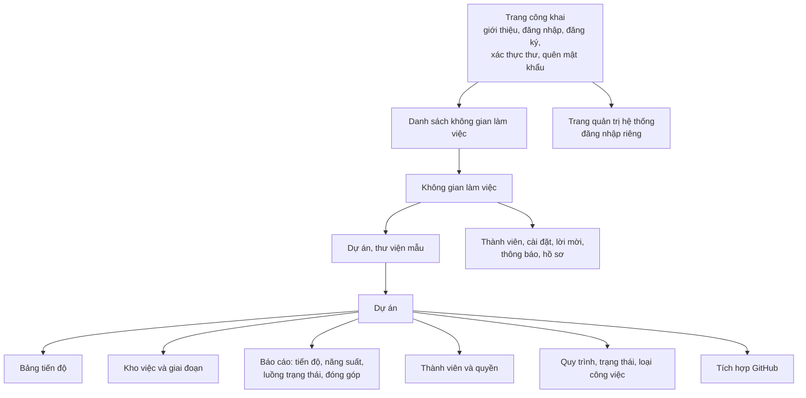

Công việc được mở bằng đường dẫn theo mã (ví dụ MOC-12) nên dùng được trong thông báo và thư điện tử. Ứng dụng giữ hai bộ phiên đăng nhập (người dùng và quản trị), tự gia hạn khi hết hạn; phần thông báo nhận qua WebSocket và cập nhật chuông ngay.

Giao diện theo phong cách tối giản kiểu Linear trong bộ quy chuẩn giao diện của dự án: ít chữ, một cột, nội dung chia thành các dòng chuẩn, một màu nhấn duy nhất, không đổ bóng, trạng thái hiển thị bằng chấm màu nhỏ, thao tác ít dùng gom vào trình đơn, thao tác nguy hiểm xác nhận ngay trong dòng, công tắc bật tắt lưu ngay. Phần chưa dùng được thì làm mờ và giải thích thay vì ẩn. Thuật ngữ thuần Việt, trung tính theo ngành (giai đoạn, kho việc, bảng tiến độ, hạng mục lớn, yêu cầu, sự cố, công việc con) để người ngoài lĩnh vực phần mềm dễ làm quen. Các thành phần giao diện đều tự thiết kế, không dùng thư viện giao diện dựng sẵn.

## 3.4. Thiết kế các module chuyên biệt

### 3.4.1. Module thông báo

Dịch vụ thông báo độc lập, gồm các thành phần: bộ nhận sự kiện từ Kafka; bộ dựng nội dung tiếng Việt cho 53 loại; bộ lưu có chống trùng và gộp; bộ đẩy WebSocket; bộ gửi thư điện tử theo mẫu; bộ áp cài đặt cá nhân và tắt tiếng dự án; các thành phần cho nhiều bản sao (đẩy qua Redis, khóa công việc định kỳ); công việc dọn dẹp lúc 03:00.

Dữ liệu gồm ba nhóm: thông báo (mục 3.3.3), cài đặt thông báo theo nhóm và kênh của từng người, và danh sách dự án bị tắt tiếng.

**Bảng 3.14: Chức năng giao diện lập trình của dịch vụ thông báo**

| Chức năng | Mô tả |
| :--- | :--- |
| Danh sách | Phân trang, lọc theo nhóm, đã đọc, cần xử lý |
| Số chưa đọc | Dùng cho chuông |
| Đánh dấu đã đọc, đọc tất cả | Cập nhật trạng thái |
| Xóa, hoàn tác | Xóa mềm, hoàn tác trong 5 giây, dọn hẳn sau 30 ngày |
| Cài đặt, tắt tiếng dự án | Bật tắt theo nhóm và kênh; tắt tiếng từng dự án |
| Gửi thư nội bộ | Dành cho dịch vụ khác, không qua cổng giao tiếp API |

### 3.4.2. Module báo cáo tiến độ và đóng góp

Nằm trong dịch vụ công việc. Báo cáo tiến độ gồm ba biểu đồ: tiến độ chu kỳ, năng suất làm việc, luồng trạng thái; dựng từ bản chụp lúc đóng giai đoạn (giai đoạn đã đóng) hoặc phát lại nhật ký thay đổi (giai đoạn đang chạy). Báo cáo đóng góp gồm tổng quan, sổ ghi công, chi tiết từng thành viên, điều chỉnh thủ công và xuất tệp, dựng từ sổ ghi công chỉ thêm và bản chụp đóng góp mỗi giai đoạn. Cách tính xem Chương 2 (mục 2.4).

### 3.4.3. Module dự án mẫu

Gồm các thành phần: nạp bản thiết kế của dự án nguồn; dựng bản xem trước; kiểm tra toàn vẹn (chạy ở bốn thời điểm); nhân bản sâu có ánh xạ mã và dời thời gian; gieo các mẫu mặc định (ví dụ mẫu cửa hàng F&B). Chức năng: xem thư viện mẫu, xem trước, tạo dự án từ mẫu kèm tùy chỉnh nhanh, lưu dự án thành mẫu, nhân bản dự án, kiểm tra toàn vẹn.

### 3.4.4. Module tích hợp GitHub

Gồm các thành phần: cấp quyền OAuth và ký tham số trao đổi; mã hóa token; nhận sự kiện GitHub (xác thực chữ ký, xử lý yêu cầu hợp nhất và Issue); đồng bộ ngược trạng thái và người thực hiện sang GitHub; liên kết yêu cầu hợp nhất và Issue vào công việc. Dữ liệu gồm tài khoản GitHub của người dùng (token mã hóa), kho liên kết với dự án (kèm cấu hình tự động chuyển, tự đóng, từ khóa đóng việc) và liên kết giữa công việc với yêu cầu hợp nhất, Issue. Phía giao diện có trang tích hợp GitHub của dự án và màn hình nhận kết quả cấp quyền.
