# CHƯƠNG 3. ĐẶC TẢ, PHÂN TÍCH, THIẾT KẾ HỆ THỐNG

Chương này đặc tả yêu cầu, phân tích kịch bản và luồng nghiệp vụ, rồi trình bày thiết kế hệ thống dựa trên sáu nhóm giải pháp đã nêu ở Chương 2: xác thực và phân quyền; quản trị dự án và công việc (trọng tâm); quản lý đóng góp và tiến độ; mẫu dự án; thông báo; tích hợp GitHub. Thuật ngữ dùng thống nhất với Chương 2.

## 3.1. Đặc tả hệ thống

### 3.1.1. Yêu cầu chức năng

**Bảng 3.1: Bảng yêu cầu chức năng**

| Mã | Nhóm | Yêu cầu |
| :-: | :--- | :--- |
| FR-1.1 | Tài khoản | Đăng ký, xác thực thư điện tử; đăng nhập bằng tên đăng nhập hoặc tài khoản Google |
| FR-1.2 | Tài khoản | Quên và đặt lại mật khẩu qua thư; tự gia hạn phiên đăng nhập; xem, sửa hồ sơ |
| FR-1.3 | Quản trị hệ thống | Quản trị hệ thống xem, tạo, đổi vai trò, đặt lại mật khẩu, xóa người dùng |
| FR-2.1 | Không gian làm việc | Tạo, sửa, xóa mềm, khôi phục, rời không gian làm việc |
| FR-2.2 | Không gian làm việc | Mời thành viên, trả lời lời mời, đổi vai trò (Chủ sở hữu, Quản trị viên, Thành viên, Khách), xóa thành viên |
| FR-2.3 | Không gian làm việc | Luôn còn ít nhất một Chủ sở hữu |
| FR-3.1 | Dự án | Tạo dự án (trống hoặc từ mẫu), sửa, xóa mềm, khôi phục; chọn loại dự án (theo chu kỳ, bảng liên tục, nghiệp vụ doanh nghiệp) |
| FR-3.2 | Dự án | Mời và quản lý thành viên dự án; xem quyền của mình |
| FR-3.3 | Dự án | Quản lý vai trò và quyền của từng vai trò trong dự án |
| FR-4.1 | Công việc | Tạo, xem, sửa, xóa mềm công việc; tìm theo mã (MOC-12); lọc nhiều tiêu chí, lưu bộ lọc |
| FR-4.2 | Công việc | Quản lý loại công việc của dự án; phân cấp ba tầng (hạng mục lớn, công việc, công việc con) |
| FR-4.3 | Công việc | Quản lý trạng thái theo ba nhóm (Cần làm, Đang làm, Hoàn thành) và tên tùy ý |
| FR-4.4 | Công việc | Giao, hủy giao công việc; ghi lịch sử mọi thay đổi người thực hiện |
| FR-4.5 | Công việc | Liên kết công việc (chặn, gây ra, trùng lặp, liên quan); chặn vòng lặp phụ thuộc |
| FR-4.6 | Công việc | Quản lý nhãn, thành phần, phiên bản phát hành; trường tùy chỉnh |
| FR-4.7 | Công việc | Bình luận, nhắc tên, đính kèm tệp; xem nhật ký thay đổi; sắp xếp kéo thả |
| FR-5.1 | Quy trình | Tạo, sửa quy trình, bước chuyển; cấu hình điều kiện, bộ kiểm tra, việc tự động sau chuyển; gán quy trình theo loại công việc |
| FR-5.2 | Quy trình | Chuyển trạng thái theo bước chuyển hợp lệ; lan truyền trạng thái cha–con; hoàn thành dây chuyền việc con |
| FR-6.1 | Giai đoạn | Tạo, sửa, xóa, bắt đầu, hoàn tất giai đoạn; thêm, bớt công việc |
| FR-6.2 | Kho việc | Xem kho việc cùng các giai đoạn trong một màn hình |
| FR-6.3 | Bảng tiến độ | Bảng theo chu kỳ và bảng liên tục; kéo thả đổi cột; giới hạn việc đang làm; phân làn công việc; cấu hình cột |
| FR-7.1 | Hoàn thành | Gửi yêu cầu "Tạm hoàn thành"; quản trị viên xác nhận, từ chối; người gửi rút lại |
| FR-7.2 | Đóng góp | Xem đóng góp theo thành viên, sổ ghi công; điều chỉnh tay; xuất tệp |
| FR-8.1 | Tiến độ | Biểu đồ tiến độ chu kỳ, năng suất làm việc, biểu đồ luồng trạng thái |
| FR-9.1 | Mẫu dự án | Xem thư viện mẫu và bản xem trước; tùy chỉnh nhanh trước khi tạo; tạo dự án từ mẫu |
| FR-9.2 | Mẫu dự án | Lưu dự án thành mẫu; nhân bản dự án; kiểm tra toàn vẹn mẫu |
| FR-10.1 | Thông báo | Nhận thông báo thời gian thực trên chuông; xem, lọc, đánh dấu đã đọc, xóa và hoàn tác |
| FR-10.2 | Thông báo | Gửi thư điện tử với việc quan trọng; nhắc hạn hằng ngày |
| FR-10.3 | Thông báo | Bật tắt theo nhóm và kênh; tắt tiếng từng dự án |
| FR-11.1 | GitHub | Kết nối tài khoản GitHub, liên kết kho, đồng bộ Issue |
| FR-11.2 | GitHub | Gắn yêu cầu hợp nhất vào công việc; tự chuyển trạng thái theo yêu cầu hợp nhất; đóng Issue khi công việc hoàn thành |

### 3.1.2. Yêu cầu phi chức năng

**Bảng 3.2: Bảng yêu cầu phi chức năng**

| Mã | Nhóm | Yêu cầu | Tiêu chí |
| :-: | :--- | :--- | :--- |
| NFR-1.1 | Bảo mật | Xác thực tập trung; mật khẩu không lưu trong dữ liệu của hệ thống | Mọi API riêng tư đều yêu cầu mã hợp lệ |
| NFR-1.2 | Bảo mật | Phân quyền mặc định từ chối ở cả không gian làm việc và dự án | Thiếu thông tin thì từ chối |
| NFR-1.3 | Bảo mật | Token GitHub được mã hóa; sự kiện GitHub được xác thực chữ ký | Không lưu token dạng rõ |
| NFR-2.1 | Toàn vẹn | Cấu hình dự án luôn hợp lệ (loại, trạng thái, quy trình) | Chặn xóa hoặc đổi làm hỏng dữ liệu |
| NFR-2.2 | Toàn vẹn | Nhật ký thay đổi và sổ đóng góp chỉ thêm | Không có thao tác sửa, xóa |
| NFR-2.3 | Toàn vẹn | Số liệu giai đoạn đã đóng không đổi | Đọc từ bản chụp lưu lúc đóng |
| NFR-2.4 | Toàn vẹn | Thông báo không mất, không sai | Ghi cùng giao dịch với nghiệp vụ |
| NFR-3.1 | Hiệu năng | Thông báo đến trình duyệt gần như tức thì | Trễ khoảng 1 giây |
| NFR-3.2 | Hiệu năng | Kéo thả chỉ cập nhật một thẻ | Một bản ghi mỗi lần kéo |
| NFR-3.3 | Hiệu năng | Màn hình kho việc nạp trong một lần gọi | Một yêu cầu cho cả màn hình |
| NFR-4.1 | Sẵn sàng | Một dịch vụ tạm ngừng không làm mất sự kiện | Sự kiện chờ và xử lý khi dịch vụ chạy lại |
| NFR-4.2 | Mở rộng | Dịch vụ thông báo chạy được nhiều bản sao | Đẩy đúng người nhận, công việc định kỳ chạy một lần |
| NFR-5.1 | Khả dụng | Giao diện tối giản, thuần Việt, dùng được cho nhiều ngành | Theo bộ quy chuẩn giao diện của dự án |
| NFR-6.1 | Bảo trì | Cấu trúc dữ liệu có phiên bản, dựng lại được | Quản lý bằng công cụ chuyển đổi cấu trúc |
| NFR-7.1 | Triển khai | Đóng gói bằng Docker, tự động triển khai khi có mã mới | Quy trình CI/CD, kiểm tra qua HTTPS |

### 3.1.3. Xác định và mô tả các Actor

**Bảng 3.3: Danh sách Actor**

| Actor | Phạm vi | Mô tả |
| :--- | :--- | :--- |
| Khách vãng lai | Hệ thống | Chưa đăng nhập: xem trang giới thiệu, đăng ký, đăng nhập, xác thực thư, quên mật khẩu |
| Người dùng | Hệ thống | Đã đăng nhập: quản lý hồ sơ, tạo không gian làm việc, trả lời lời mời |
| Quản trị hệ thống | Hệ thống | Quản lý người dùng; được bỏ qua kiểm tra quyền ở cấp dự án |
| Chủ sở hữu | Không gian làm việc | Toàn quyền, kể cả xóa không gian làm việc và cấp quyền chủ sở hữu |
| Quản trị viên không gian làm việc | Không gian làm việc | Quản lý thành viên, cấu hình; quản trị mọi dự án trong không gian |
| Thành viên không gian làm việc | Không gian làm việc | Xem và tạo dự án mới |
| Khách của không gian làm việc | Không gian làm việc | Chỉ xem, không tạo được gì |
| Quản trị viên dự án | Dự án | Trưởng dự án, người tạo hoặc người giữ vai trò Quản trị viên: cấu hình loại công việc, trạng thái, quy trình, phân quyền, giai đoạn, duyệt hoàn thành |
| Thành viên dự án | Dự án | Tạo, sửa, giao việc, chuyển trạng thái, bình luận |
| Người xem dự án | Dự án | Chỉ xem nội dung dự án |
| Hệ thống tự động | Nền | Tiến trình gửi sự kiện, nhắc hạn lúc 08:00, dọn dẹp; các hệ thống ngoài (GitHub, máy chủ định danh, thư điện tử) |

Ba vai trò dự án là mặc định; quản trị viên dự án có thể tạo thêm vai trò và chỉnh quyền từng vai trò (Chương 2).

### 3.1.4. Xác định và mô tả các Use Case

**Bảng 3.4: Danh sách Use Case**

| Mã | Use Case | Actor chính |
| :-: | :--- | :--- |
| UC01 | Đăng ký, xác thực thư điện tử | Khách vãng lai |
| UC02 | Đăng nhập, quên và đặt lại mật khẩu | Khách vãng lai |
| UC03 | Quản lý hồ sơ cá nhân | Người dùng |
| UC04 | Quản lý người dùng hệ thống | Quản trị hệ thống |
| UC05 | Quản lý không gian làm việc và thành viên | Chủ sở hữu, Quản trị viên |
| UC06 | Trả lời lời mời | Người dùng |
| UC07 | Tạo dự án (trống hoặc từ mẫu) | Thành viên không gian làm việc |
| UC08 | Quản lý thành viên và quyền dự án | Quản trị viên dự án |
| UC09 | Cấu hình loại công việc, trạng thái, quy trình, trường tùy chỉnh | Quản trị viên dự án |
| UC10 | Tạo và chỉnh sửa công việc | Thành viên dự án |
| UC11 | Giao và hủy giao công việc | Thành viên dự án |
| UC12 | Liên kết công việc | Thành viên dự án |
| UC13 | Chuyển trạng thái công việc | Thành viên dự án |
| UC14 | Gửi yêu cầu "Tạm hoàn thành" | Thành viên dự án |
| UC15 | Xác nhận hoặc từ chối hoàn thành | Quản trị viên dự án |
| UC16 | Bình luận, nhắc tên, đính kèm tệp | Thành viên dự án |
| UC17 | Lập kế hoạch giai đoạn trên kho việc | Quản trị viên dự án |
| UC18 | Bắt đầu và hoàn tất giai đoạn | Quản trị viên dự án |
| UC19 | Làm việc trên bảng tiến độ | Thành viên dự án |
| UC20 | Xem tiến độ (biểu đồ tiến độ, năng suất, luồng trạng thái) | Mọi thành viên dự án |
| UC21 | Xem và điều chỉnh đóng góp | Thành viên; quản trị viên |
| UC22 | Quản lý dự án mẫu (lưu, xem trước, nhân bản) | Quản trị viên dự án |
| UC23 | Nhận và quản lý thông báo | Người dùng |
| UC24 | Cài đặt thông báo, tắt tiếng dự án | Người dùng |
| UC25 | Tích hợp GitHub | Quản trị viên dự án |

**Hình 3.1: Biểu đồ Use Case tổng quan**

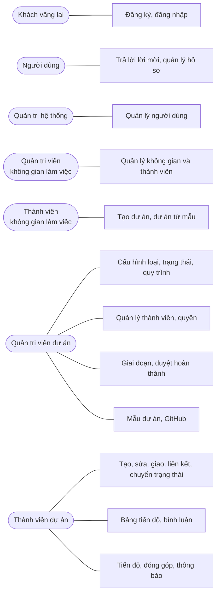

### 3.1.5. Một số Use Case tính năng chính

Các Use Case dưới đây được nhóm theo sáu bài toán của Chương 2, trọng tâm là quản trị dự án và công việc.

#### a) Xác thực và phân quyền

**UC05. Quản lý thành viên không gian làm việc**

| Mục | Nội dung |
| :--- | :--- |
| Actor | Chủ sở hữu, Quản trị viên không gian làm việc |
| Điều kiện trước | Có bậc Quản trị viên trở lên |
| Luồng chính | 1. Chọn "Mời thành viên", nhập người cần mời và vai trò (Quản trị viên, Thành viên hoặc Khách). 2. Hệ thống tạo lời mời chờ trả lời, chưa thêm người đó vào. 3. Người được mời chấp nhận thì mới trở thành thành viên. 4. Quản trị viên có thể đổi vai trò hoặc xóa thành viên. |
| Luồng thay thế | Chỉ Chủ sở hữu mới cấp hoặc thu hồi vai trò Chủ sở hữu, xóa hoặc khôi phục không gian làm việc. |
| Ngoại lệ | Rời đi, bị xóa hoặc bị hạ bậc khi là Chủ sở hữu cuối cùng thì bị từ chối. Người ngoài truy cập nhận "không tìm thấy". |

**UC08. Quản lý thành viên và quyền trong dự án**

| Mục | Nội dung |
| :--- | :--- |
| Actor | Quản trị viên dự án |
| Luồng chính | 1. Mời thành viên vào dự án, chọn vai trò (Quản trị viên, Thành viên, Người xem hoặc vai trò tự tạo). 2. Người được mời chấp nhận thì được phân vai. 3. Quản trị viên mở ma trận quyền, bật hoặc tắt từng quyền của một vai trò (ví dụ cho Người xem được giao việc). |
| Ngoại lệ | Không xóa được trưởng dự án hoặc quản trị viên cuối cùng. Vai trò thuộc dự án khác bị từ chối. Người chưa có vai trò chỉ thấy "không có quyền". |

#### b) Quản trị dự án và công việc

**UC09a. Quản lý loại công việc**

| Mục | Nội dung |
| :--- | :--- |
| Actor | Quản trị viên dự án |
| Luồng chính | 1. Mở trang cấu hình loại công việc. 2. Thêm loại mới (tên, mã, màu, biểu tượng, mức phân cấp 1, 0 hoặc -1) hoặc sửa, xóa loại có sẵn. 3. Loại mới dùng được ngay khi tạo công việc. |
| Ngoại lệ | Tên hoặc mã trùng; mức phân cấp ngoài 1, 0, -1; đổi mức của loại đã có việc; đổi hoặc xóa loại cuối cùng của một mức; xóa loại đang có việc dùng (hệ thống báo số việc và yêu cầu chuyển loại trước). |

**UC09b. Quản lý trạng thái**

| Mục | Nội dung |
| :--- | :--- |
| Actor | Quản trị viên dự án |
| Luồng chính | 1. Thêm trạng thái (tên, màu, nhóm Cần làm, Đang làm hoặc Hoàn thành) hoặc sửa, xóa. 2. Gom trạng thái vào cột của bảng tiến độ. |
| Ngoại lệ | Tên trùng (không phân biệt hoa thường); xóa hoặc đổi nhóm của trạng thái cuối cùng trong nhóm; xóa trạng thái đang có việc dùng. Khi xóa được thì các bước chuyển và liên kết cột liên quan bị xóa theo. |

**UC09c. Cấu hình quy trình và bước chuyển**

| Mục | Nội dung |
| :--- | :--- |
| Actor | Quản trị viên dự án |
| Luồng chính | 1. Tạo bước chuyển giữa hai trạng thái, đặt tên. 2. Thêm điều kiện (chỉ người được giao, chỉ người tạo, cần một quyền), bộ kiểm tra (bắt buộc kết quả xử lý, mọi việc con phải xong…), việc tự động sau chuyển. 3. Gán quy trình cho từng loại công việc. |
| Ngoại lệ | Thiếu đích hoặc tên; đích trùng nguồn; trạng thái không thuộc dự án; trùng cặp nguồn–đích; trùng tên bước trong quy trình. |

**UC09d. Quản lý nhãn, thành phần, phiên bản và trường tùy chỉnh**

| Mục | Nội dung |
| :--- | :--- |
| Actor | Quản trị viên dự án |
| Luồng chính | Tạo nhãn (thẻ màu), thành phần (có người phụ trách), phiên bản phát hành (ngày phát hành); gán vào công việc. Trường tùy chỉnh: định nghĩa trường theo loại công việc, giá trị lưu trong công việc. |
| Ghi chú | Hiện hệ thống lưu và nhân bản được giá trị trường tùy chỉnh nhưng chưa có giao diện để người dùng tự tạo định nghĩa mới. |

**UC12. Liên kết công việc**

| Mục | Nội dung |
| :--- | :--- |
| Actor | Thành viên dự án |
| Luồng chính | 1. Mở công việc nguồn, chọn "Thêm liên kết". 2. Chọn loại (chặn, gây ra, trùng lặp, liên quan) và công việc đích. 3. Hệ thống lưu một liên kết, hiển thị hai chiều ở hai việc, ghi nhật ký cả hai đầu. |
| Luồng thay thế | Liên kết "trùng lặp": việc nguồn tự sang Hoàn thành với kết quả "Trùng lặp" (người không phải quản trị viên chỉ tạo yêu cầu "Tạm hoàn thành"). Liên kết "chặn": báo cho người thực hiện việc bị chặn. |
| Ngoại lệ | Tự liên kết; việc đã xóa; cha–con ruột; chặn giữa hạng mục lớn và công việc con; liên kết đã tồn tại; liên kết tạo vòng lặp phụ thuộc (kèm chu trình cụ thể). |

**UC13. Chuyển trạng thái công việc**

| Mục | Nội dung |
| :--- | :--- |
| Actor | Thành viên dự án (có quyền chuyển trạng thái) |
| Điều kiện trước | Đã đăng nhập, là thành viên dự án, công việc tồn tại |
| Luồng chính | 1. Mở chi tiết công việc. 2. Hệ thống liệt kê các bước chuyển hợp lệ từ trạng thái hiện tại, đã lọc theo điều kiện. 3. Chọn một bước. 4. Hệ thống kiểm tra bộ kiểm tra, việc chặn, việc con chưa xong. 5. Đổi trạng thái, chạy các việc tự động sau chuyển, ghi nhật ký, lan truyền lên việc cha, ghi sổ đóng góp. |
| Luồng thay thế | Đích thuộc nhóm Hoàn thành và người dùng không phải quản trị viên: tạo yêu cầu "Tạm hoàn thành", giữ nguyên trạng thái (UC14). Kéo thẻ sang cột khác trên bảng tiến độ cũng đi qua đúng luồng này. |
| Ngoại lệ | Không có bước chuyển hợp lệ; còn việc chặn hoặc việc con chưa xong; thiếu quyền; thẻ vừa bị người khác sửa; cột đã đạt giới hạn việc đang làm. |
| Kết quả | Công việc ở trạng thái mới, có nhật ký và thông báo. |

**UC17. Lập kế hoạch giai đoạn trên kho việc**

| Mục | Nội dung |
| :--- | :--- |
| Actor | Quản trị viên dự án (quyền quản lý giai đoạn) |
| Luồng chính | 1. Tạo giai đoạn (tên, mục tiêu, ngày bắt đầu và kết thúc dự kiến). 2. Kéo công việc từ kho việc vào giai đoạn; việc con tự đi theo cha. 3. Sắp xếp thứ tự bằng kéo thả. |
| Ngoại lệ | Ngày kết thúc không sau ngày bắt đầu; thêm hoặc bớt việc ở giai đoạn đã đóng; kéo riêng một công việc con. |

**UC18. Bắt đầu và hoàn tất giai đoạn**

| Mục | Nội dung |
| :--- | :--- |
| Actor | Quản trị viên dự án |
| Luồng chính (bắt đầu) | Chọn "Bắt đầu" ở giai đoạn đứng đầu kế hoạch; bảng tiến độ chỉ hiện việc của giai đoạn này. |
| Ngoại lệ (bắt đầu) | Đã có giai đoạn đang chạy; thiếu ngày kết thúc; giai đoạn rỗng chưa xác nhận; còn giai đoạn dự kiến đứng trước. |
| Luồng chính (hoàn tất) | 1. Chọn "Hoàn tất". 2. Hệ thống cho biết số việc xong và chưa xong. 3. Chọn nơi chuyển việc chưa xong (kho việc hoặc giai đoạn chưa đóng). 4. Hệ thống lưu bản chụp, chuyển việc, đóng giai đoạn, đóng băng số liệu đóng góp, gửi thông báo. |
| Ngoại lệ (hoàn tất) | Giai đoạn chưa chạy; đích là giai đoạn đã đóng, khác dự án hoặc chính giai đoạn đang đóng. |

#### c) Quản lý đóng góp và tiến độ

**UC15. Xác nhận hoặc từ chối hoàn thành**

| Mục | Nội dung |
| :--- | :--- |
| Actor | Quản trị viên dự án |
| Điều kiện trước | Có yêu cầu chờ duyệt |
| Luồng chính | 1. Mở danh sách "Chờ xác nhận" hoặc chi tiết công việc. 2. Chọn Xác nhận. 3. Hệ thống chạy lại bước chuyển đã lưu, đưa việc sang Hoàn thành. 4. Ghi điểm cho người thực hiện (tính trễ hạn theo ngày gửi). 5. Thông báo cho người gửi. |
| Luồng thay thế | Từ chối (kèm lý do tùy chọn): công việc giữ nguyên, người gửi nhận thông báo. Người gửi hoặc quản trị viên có thể rút lại yêu cầu. |
| Ngoại lệ | Người gọi không phải quản trị viên; quy trình không còn đường tới Hoàn thành. |

**UC20 và UC21. Xem tiến độ và đóng góp**

| Mục | Nội dung |
| :--- | :--- |
| Actor | Mọi thành viên dự án; quản trị viên điều chỉnh đóng góp |
| Luồng chính | 1. Mở trang Báo cáo. 2. Chọn giai đoạn (hoặc toàn bộ quá trình). 3. Xem biểu đồ tiến độ chu kỳ, năng suất làm việc, biểu đồ luồng trạng thái. 4. Mở tab đóng góp: tổng điểm, tỷ lệ, số việc hoàn thành, tỷ lệ đúng hạn, số lần bị mở lại; xem sổ ghi công từng dòng. |
| Luồng thay thế | Quản trị viên điều chỉnh điểm thủ công (ghi thành một dòng mới trong sổ, không sửa dòng cũ) và xuất báo cáo ra tệp. |
| Ghi chú | Giai đoạn đã đóng đọc từ bản chụp; giai đoạn đang chạy dựng từ nhật ký thay đổi. |

#### d) Mẫu dự án, thông báo, GitHub

**UC07. Tạo dự án từ mẫu**

| Mục | Nội dung |
| :--- | :--- |
| Actor | Thành viên không gian làm việc |
| Luồng chính | 1. Chọn mẫu trong thư viện, xem bản xem trước (tổng quan, quy trình, giai đoạn và công việc, phân quyền) và kết quả kiểm tra toàn vẹn. 2. Tùy chỉnh nhanh: đổi tên trạng thái, loại công việc; đổi tên hoặc bỏ giai đoạn; đổi tiêu đề hoặc bỏ công việc. 3. Nhập tên, mã, ngày bắt đầu. 4. Hệ thống nhân bản trong một giao dịch, dời mọi mốc thời gian theo ngày bắt đầu mới. |
| Ngoại lệ | Mẫu có lỗi toàn vẹn thì khóa nút dùng mẫu; lỗi giữa chừng thì hoàn tác toàn bộ. |
| Kết quả | Dự án mới giống mẫu, giai đoạn ở trạng thái dự kiến, công việc được đặt lại tiến độ, chưa có thành viên khác. |

**UC23 và UC24. Nhận và cài đặt thông báo**

| Mục | Nội dung |
| :--- | :--- |
| Actor | Người dùng |
| Luồng chính | 1. Một sự kiện phát sinh (được giao việc, bị nhắc tên, lời mời, việc sắp đến hạn…). 2. Chuông cập nhật số chưa đọc ngay. 3. Mở bảng, bấm vào thông báo: đánh dấu đã đọc và chuyển tới công việc hoặc trang liên quan. |
| Luồng thay thế | Thông báo "Cần xử lý" (lời mời, yêu cầu hoàn thành) nằm ở tab riêng, tự chuyển "Đã xử lý" khi được giải quyết. Người dùng bật tắt theo nhóm và kênh, tắt tiếng từng dự án; một số loại bắt buộc không tắt được. |

**UC25. Tích hợp GitHub**

| Mục | Nội dung |
| :--- | :--- |
| Actor | Quản trị viên dự án (dự án phần mềm) |
| Luồng chính | 1. Bấm "Kết nối với GitHub", cấp quyền OAuth. 2. Chọn kho và nhánh chính; hệ thống đăng ký kênh nhận sự kiện. 3. Khi có yêu cầu hợp nhất chứa mã công việc, hệ thống gắn vào công việc và tự chuyển trạng thái theo cấu hình. 4. Có thể đồng bộ Issue về làm công việc, tạo Issue từ công việc. |
| Ngoại lệ | Người thao tác trên GitHub chưa liên kết tài khoản thì chỉ gắn liên kết, không chuyển trạng thái; gộp yêu cầu hợp nhất không có từ khóa đóng việc thì giữ trạng thái. |

## 3.2. Phân tích hệ thống

### 3.2.1. Một số kịch bản chính

**Bảng 3.5: Kịch bản thành viên gửi yêu cầu "Tạm hoàn thành"**

| Bước | Tác nhân | Hành động | Phản hồi của hệ thống |
| :-: | :--- | :--- | :--- |
| 1 | Bình (thành viên) | Chọn trạng thái Hoàn thành cho MOC-5 | Kiểm tra điều kiện, bộ kiểm tra, việc chặn, việc con |
| 2 | Hệ thống | Xác định Bình không có quyền xác nhận | Tạo yêu cầu chờ duyệt, giữ nguyên trạng thái, ghi nhật ký |
| 3 | Hệ thống | Phát sự kiện | Thông báo "Yêu cầu xác nhận hoàn thành" tới quản trị viên dự án |
| 4 | An (quản trị viên) | Chọn Xác nhận | MOC-5 sang Hoàn thành, ghi điểm cho người thực hiện |
| 5 | Hệ thống | Thông báo kết quả | Bình nhận thông báo "Được xác nhận hoàn thành" |
| Ngoại lệ | An | Từ chối kèm lý do | MOC-5 giữ nguyên; Bình nhận thông báo kèm lý do |

**Bảng 3.6: Kịch bản liên kết công việc bị chặn vòng lặp**

| Bước | Hành động | Phản hồi |
| :-: | :--- | :--- |
| 1 | An liên kết "MOC-1 chặn MOC-2" | Chấp nhận |
| 2 | An liên kết "MOC-2 chặn MOC-3" | Chấp nhận |
| 3 | An liên kết "MOC-3 chặn MOC-1" | Từ chối, báo chu trình MOC-1 → MOC-2 → MOC-3 → MOC-1 |
| 4 | Bình chuyển MOC-2 sang Hoàn thành khi MOC-1 chưa xong | Từ chối vì còn việc chặn chưa xong |

**Bảng 3.7: Kịch bản tùy biến trạng thái và quy trình của dự án**

| Bước | Hành động | Phản hồi |
| :-: | :--- | :--- |
| 1 | An thêm trạng thái "Đang duyệt mã" vào nhóm Đang làm | Chấp nhận (tên chưa trùng) |
| 2 | An thêm bước chuyển Đang làm → Đang duyệt mã → Hoàn thành, gán cho loại "sự cố" | Chấp nhận; "công việc" vẫn đi đường ngắn |
| 3 | An xóa trạng thái "Hoàn thành" (trạng thái cuối cùng của nhóm) | Từ chối: nhóm phải còn ít nhất một trạng thái |
| 4 | An xóa trạng thái đang có việc dùng | Từ chối, nêu số việc đang dùng |

**Bảng 3.8: Kịch bản hoàn tất giai đoạn**

| Bước | Hành động | Phản hồi |
| :-: | :--- | :--- |
| 1 | An chọn "Hoàn tất" ở giai đoạn đang chạy | Hiện số việc xong, chưa xong và hộp chọn đích |
| 2 | An chọn chuyển việc dang dở sang giai đoạn kế | Kiểm tra đích hợp lệ |
| 3 | An xác nhận | Lưu bản chụp, chuyển việc chưa xong (việc con đi theo cha), việc đã xong giữ nguyên giai đoạn cũ |
| 4 | Hệ thống | Đóng giai đoạn, đóng băng số liệu đóng góp, phát thông báo |
| 5 | An mở tiến độ | Báo cáo giai đoạn vừa đóng đọc từ bản chụp |

**Bảng 3.9: Kịch bản tạo dự án từ mẫu**

| Bước | Hành động | Phản hồi |
| :-: | :--- | :--- |
| 1 | An chọn mẫu "Xây dựng cửa hàng F&B" | Hiện bản xem trước và kết quả kiểm tra toàn vẹn |
| 2 | An bỏ công việc "Thuê mặt bằng", đổi tên một công việc | Các việc con của việc bị bỏ cũng bị bỏ theo |
| 3 | An nhập tên, mã MOC, ngày bắt đầu hôm nay | Hệ thống tính độ dời ngày |
| 4 | An tạo dự án | Nhân bản trong một giao dịch, kiểm tra lại kết quả, báo số bản ghi đã tạo |

**Bảng 3.10: Kịch bản mời thành viên vào dự án**

| Bước | Tác nhân | Hành động | Phản hồi |
| :-: | :--- | :--- | :--- |
| 1 | An | Chọn người cần mời và vai trò | Tạo lời mời chờ trả lời, chưa thêm vào dự án |
| 2 | Hệ thống | Phát thông báo và thư điện tử | Chi nhận được lời mời |
| 3 | Chi | Chấp nhận | Tạo phân vai, đóng lời mời, báo cho An |
| Ngoại lệ | Chi | Từ chối | Lời mời đóng, không thêm vào dự án |

**Bảng 3.11: Kịch bản phân quyền trong không gian làm việc và dự án**

| Bước | Tác nhân | Hành động | Phản hồi của hệ thống |
| :-: | :--- | :--- | :--- |
| 1 | Chi (người ngoài) | Mở đường dẫn của một không gian làm việc | "Không tìm thấy" (không cho biết không gian đó có thật) |
| 2 | Chi (Khách) | Bấm tạo dự án | Từ chối: cần từ bậc Thành viên |
| 3 | Bình (Thành viên không gian) | Tạo dự án | Chấp nhận; Bình là người tạo nên được gán Quản trị viên dự án |
| 4 | Bình (Thành viên dự án) | Tạo giai đoạn | Từ chối: thiếu quyền quản lý giai đoạn |
| 5 | An (Quản trị viên không gian làm việc) | Mở dự án của Bình | Được vào với toàn quyền, dù chưa có vai trò trong dự án |
| 6 | An (Chủ sở hữu cuối cùng) | Rời không gian làm việc | Từ chối: phải còn ít nhất một Chủ sở hữu |

**Bảng 3.12: Kịch bản quản lý loại công việc tùy biến theo ngành**

| Bước | Hành động | Phản hồi |
| :-: | :--- | :--- |
| 1 | An thêm loại "Yêu cầu khách hàng" mức 0 | Chấp nhận; dùng được khi tạo việc, có thể thuộc hạng mục lớn và có việc con |
| 2 | An thêm loại thứ hai trùng tên | Từ chối: tên đã tồn tại |
| 3 | An đổi mức của loại "Công việc" đã có 20 việc | Từ chối: loại đã có dữ liệu |
| 4 | An xóa loại "Công việc con" (loại duy nhất của mức -1) | Từ chối: luôn còn ít nhất một loại mỗi mức |
| 5 | An xóa loại "Yêu cầu khách hàng" đang có 3 việc | Từ chối, nêu số việc; sau khi chuyển 3 việc sang loại khác thì xóa được |
| 6 | Bình tạo công việc con và chọn cha là hạng mục lớn | Từ chối: công việc con phải thuộc công việc mức 0 |

**Bảng 3.13: Kịch bản vòng đời giai đoạn**

| Bước | Hành động | Phản hồi |
| :-: | :--- | :--- |
| 1 | An tạo "Giai đoạn 1" và "Giai đoạn 2", kéo việc vào | Cả hai ở trạng thái dự kiến |
| 2 | An bắt đầu "Giai đoạn 2" | Từ chối: phải bắt đầu giai đoạn đứng đầu kế hoạch trước |
| 3 | An bắt đầu "Giai đoạn 1" (đã có ngày kết thúc) | Giai đoạn 1 đang chạy; bảng tiến độ chỉ hiện việc của giai đoạn này |
| 4 | An bắt đầu "Giai đoạn 2" khi Giai đoạn 1 đang chạy | Từ chối: chỉ một giai đoạn đang chạy |
| 5 | An hoàn tất Giai đoạn 1, chuyển việc dang dở sang Giai đoạn 2 | Việc đã xong giữ nguyên Giai đoạn 1, việc chưa xong sang Giai đoạn 2 (việc con đi theo cha) |
| 6 | An thêm việc vào Giai đoạn 1 đã đóng | Từ chối: giai đoạn đã đóng không sửa được |

**Bảng 3.14: Kịch bản tính điểm đóng góp**

| Bước | Hành động | Điểm ghi vào sổ |
| :-: | :--- | :--- |
| 1 | Bình hoàn thành việc 5 điểm đúng hạn (đã được An xác nhận) | +5,0 cho Bình, ghi chú "Đúng hạn" |
| 2 | Bình hoàn thành việc 5 điểm trễ 2 ngày | +4,0, ghi chú "Trễ 2 ngày (-20%)" |
| 3 | Bình báo xong việc 5 điểm trễ 7 ngày | +2,5 (phạt tối đa 50%) |
| 4 | Việc ở bước 1 bị mở lại | -5,0 (dòng "mở lại" bù điểm đã cộng) |
| 5 | Bình hoàn thành lại việc đó đúng hạn | +5,0, ghi chú "Hoàn thành lại" |
| 6 | Việc cha có hai việc con hoàn thành | Điểm tính ở các việc con; việc cha tính 0 để không trùng |
| 7 | An điều chỉnh tay +1,0 cho Bình | Thêm một dòng điều chỉnh mới, không sửa dòng cũ |

**Bảng 3.15: Kịch bản tích hợp GitHub**

| Bước | Tác nhân | Hành động | Phản hồi của hệ thống |
| :-: | :--- | :--- | :--- |
| 1 | An | Kết nối kho GitHub, chọn nhánh chính | Lưu kho, đăng ký kênh nhận sự kiện |
| 2 | Bình (đã liên kết tài khoản GitHub) | Mở yêu cầu hợp nhất có tên nhánh chứa MOC-12 | Gắn yêu cầu hợp nhất vào MOC-12; chuyển MOC-12 sang đang xem xét |
| 3 | Bình | Gộp yêu cầu, mô tả có "Closes MOC-12" | MOC-12 chuyển sang Hoàn thành (nếu Bình là quản trị viên) hoặc chỉ tạo yêu cầu "Tạm hoàn thành" |
| 4 | Bình | Gộp yêu cầu khác chỉ nhắc MOC-13, không có từ khóa đóng | Chỉ gắn liên kết, MOC-13 giữ trạng thái |
| 5 | An | Chuyển MOC-14 sang Hoàn thành trên bảng | Issue GitHub liên kết với MOC-14 được đóng |

### 3.2.2. Phân tích luồng nghiệp vụ chính

**Hình 3.2: Luồng chuyển trạng thái và xác nhận hoàn thành**

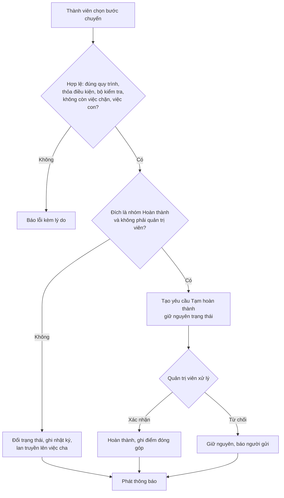

**Hình 3.3: Luồng hoàn tất giai đoạn**

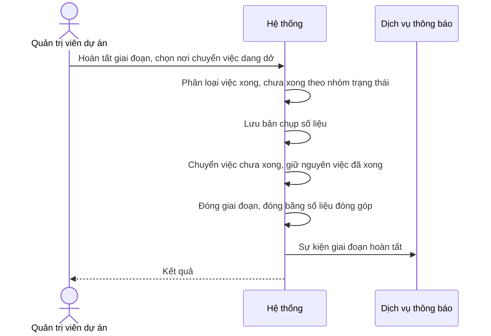

**Hình 3.4: Luồng tạo dự án từ mẫu**

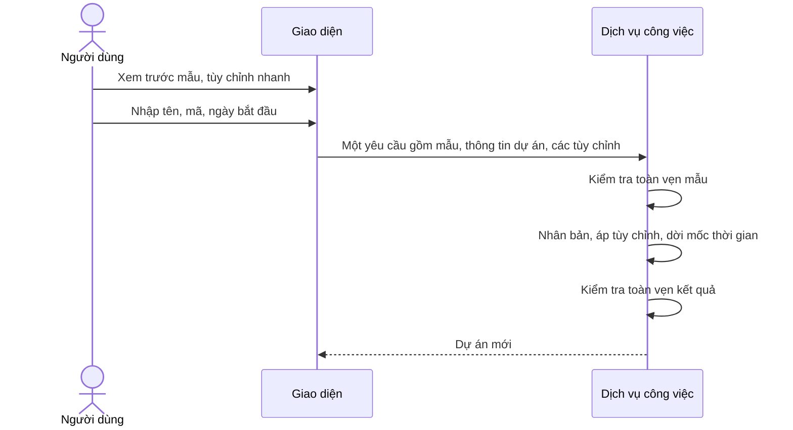

**Hình 3.5: Luồng phát và nhận thông báo**

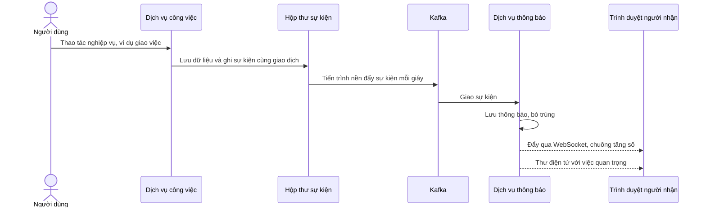

**Hình 3.6: Luồng xét quyền trong không gian làm việc và dự án**

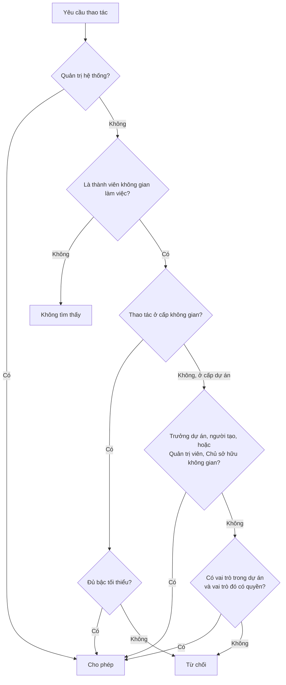

**Hình 3.7: Luồng kiểm tra khi cấu hình loại công việc và trạng thái**

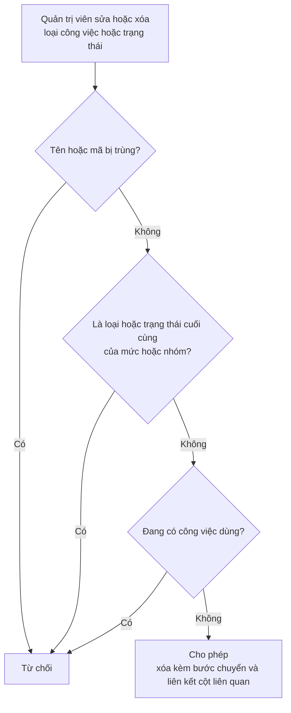

**Hình 3.8: Luồng tính điểm đóng góp**

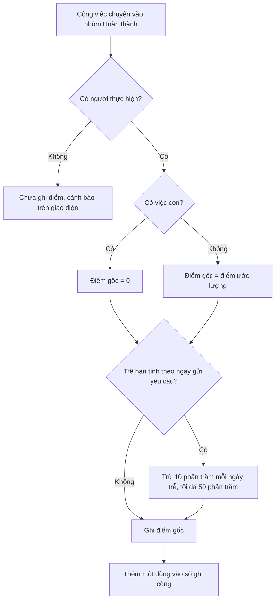

**Hình 3.9: Luồng GitHub khi có yêu cầu hợp nhất**

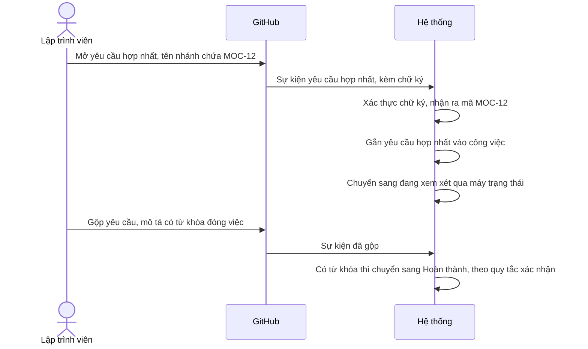

## 3.3. Thiết kế hệ thống

### 3.3.1. Thiết kế kiến trúc hệ thống

Hệ thống theo kiến trúc Microservice: giao diện, cổng giao tiếp API, bốn dịch vụ nghiệp vụ và hạ tầng dùng chung.

**Hình 3.10: Tổng quan kiến trúc hệ thống**

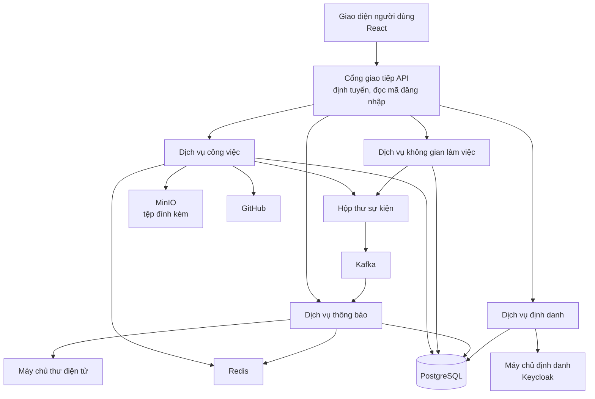

**Bảng 3.16: Công nghệ và trách nhiệm của từng dịch vụ**

| Dịch vụ | Cổng | Trách nhiệm | Công nghệ chính |
| :--- | :-: | :--- | :--- |
| Cổng giao tiếp API | 8081 | Định tuyến, giới hạn nguồn truy cập, đọc mã đăng nhập từ tiêu đề hoặc cookie rồi chuyển xuống dịch vụ | Spring Cloud Gateway |
| Dịch vụ định danh | 8082 | Đăng ký, đăng nhập, xác thực thư, quản trị người dùng | Spring Security, Keycloak |
| Dịch vụ công việc | 8083 | Dự án, công việc, loại, trạng thái, quy trình, liên kết, giai đoạn, bảng tiến độ, báo cáo, đóng góp, mẫu dự án, GitHub, hộp thư sự kiện | Spring Boot, JPA, Redis, MinIO, Kafka |
| Dịch vụ không gian làm việc | 8087 | Không gian làm việc, thành viên, lời mời | Spring Boot, JPA |
| Dịch vụ thông báo | 9994 | Nhận sự kiện, lưu và đẩy thông báo, gửi thư điện tử | Spring Kafka, WebSocket, Redis |
| Giao diện | 5173 | Giao diện người dùng | React 19, Vite 8 |

**Bảng 3.17: Định tuyến tại cổng giao tiếp API**

| Đường dẫn công khai | Dịch vụ đích |
| :--- | :--- |
| `/identity/...` | Dịch vụ định danh |
| `/work/...` | Dịch vụ công việc |
| `/workspace/...` | Dịch vụ không gian làm việc |
| `/notification/...` (kể cả WebSocket) | Dịch vụ thông báo |

Các dịch vụ giao tiếp theo hai cách. **Đồng bộ:** dịch vụ công việc hỏi dịch vụ định danh (tra tên người dùng) và dịch vụ không gian làm việc (vai trò của người dùng), lỗi thì từ chối thay vì cho qua. **Bất đồng bộ:** thông báo đi qua hộp thư sự kiện và Kafka (Chương 2). Các dịch vụ dùng chung một cơ sở dữ liệu nhưng mỗi dịch vụ chỉ sở hữu bảng của mình.

### 3.3.2. Sơ đồ lớp pha thiết kế

Các sơ đồ dưới đây thể hiện thực thể chính và quan hệ theo đúng các giải pháp ở Chương 2: dự án và công việc, giai đoạn và đóng góp, phân quyền, rồi mẫu dự án, thông báo và GitHub.

**Hình 3.11: Sơ đồ lớp: dự án, công việc, loại, trạng thái, quy trình**

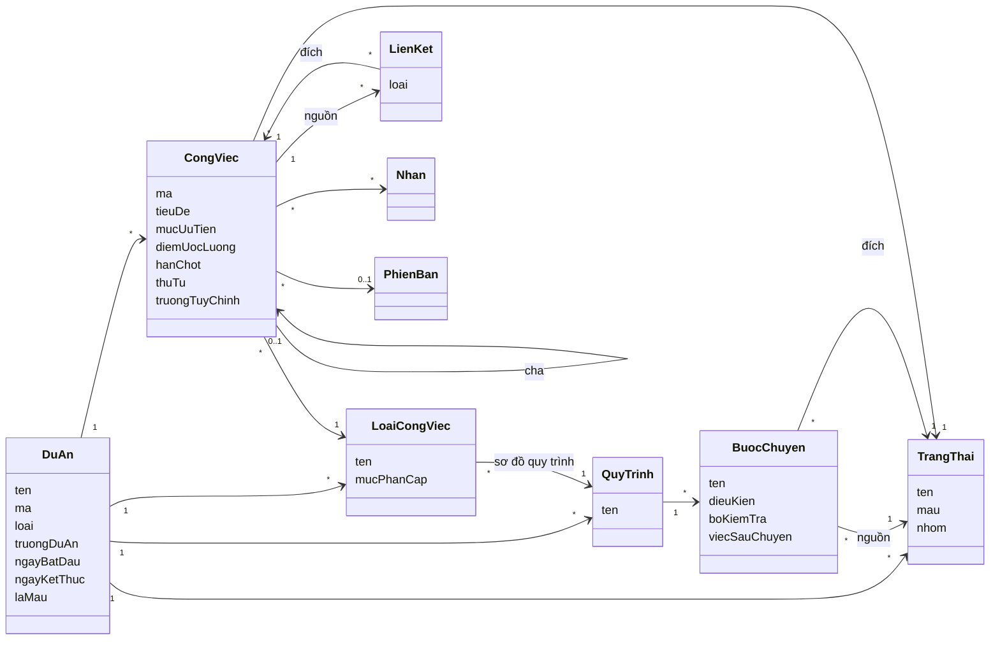

**Hình 3.12: Sơ đồ lớp: giai đoạn, bảng tiến độ, hoàn thành, đóng góp**

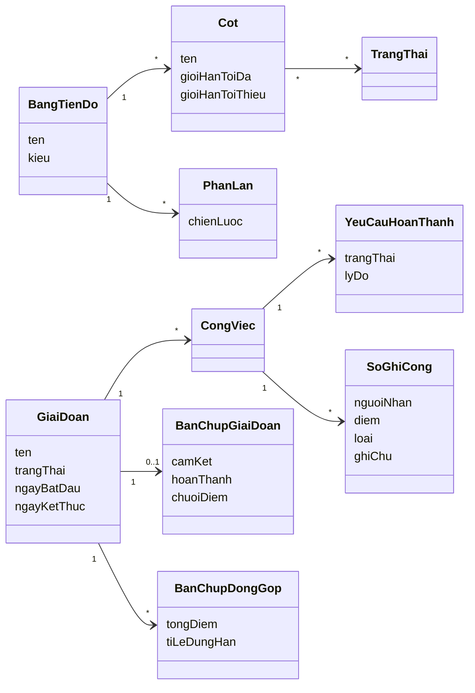

**Hình 3.13: Sơ đồ lớp: không gian làm việc, phân quyền, lời mời**

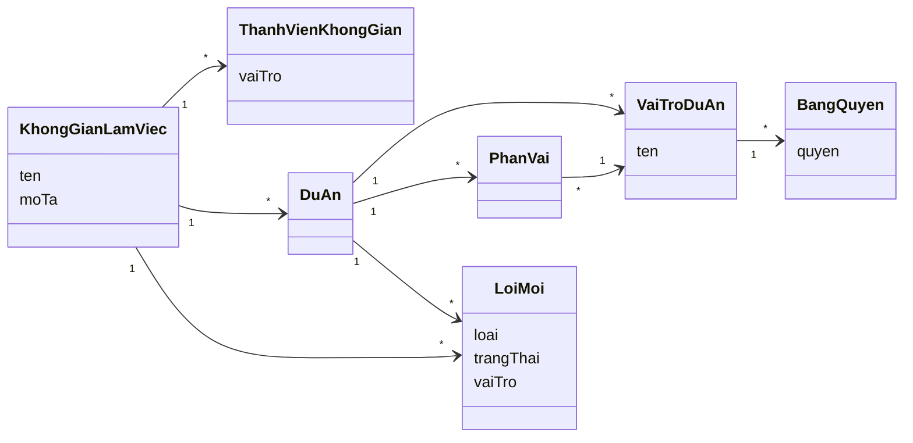

**Hình 3.14: Sơ đồ lớp: mẫu dự án, thông báo, GitHub**

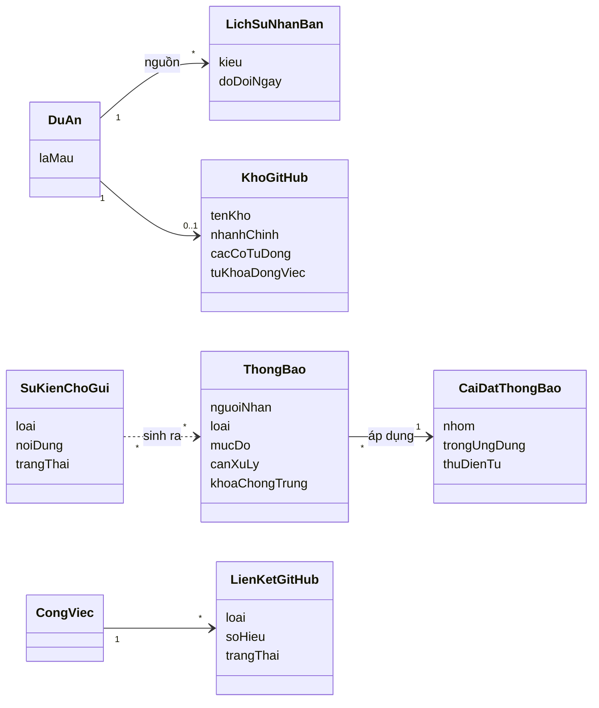

Các lớp xử lý nghiệp vụ tương ứng: kiểm tra phân cấp, máy trạng thái, phát hiện vòng lặp phụ thuộc, sắp xếp thứ tự, quản lý giai đoạn, giới hạn việc đang làm, phát lại nhật ký, tính đóng góp, nhân bản và kiểm tra mẫu, phát và nhận thông báo, tích hợp GitHub.

### 3.3.3. Thiết kế cơ sở dữ liệu toàn hệ thống

Hệ thống dùng một cơ sở dữ liệu PostgreSQL chung; mỗi dịch vụ sở hữu một nhóm bảng, cấu trúc được quản lý theo phiên bản bằng công cụ chuyển đổi cấu trúc (riêng dịch vụ định danh do khung ORM tự tạo).

**Bảng 3.18: Các nhóm dữ liệu theo dịch vụ**

| Dịch vụ | Dữ liệu |
| :--- | :--- |
| Dịch vụ định danh | Người dùng; mã xác thực thư điện tử |
| Dịch vụ không gian làm việc | Không gian làm việc; thành viên; lời mời |
| Dịch vụ công việc | Dự án; vai trò, bảng quyền, phân vai, lời mời dự án; công việc, loại, liên kết, bình luận, tệp đính kèm, nhật ký, nhãn, thành phần, phiên bản, trường tùy chỉnh, bộ lọc đã lưu; trạng thái, quy trình, bước chuyển, sơ đồ quy trình; giai đoạn, bảng tiến độ, cột, phân làn, bản chụp báo cáo; yêu cầu hoàn thành, sổ ghi công, bản chụp đóng góp; lịch sử nhân bản; tài khoản và kho GitHub, liên kết GitHub; hộp thư sự kiện |
| Dịch vụ thông báo | Thông báo; cài đặt thông báo; dự án bị tắt tiếng |

**Hình 3.15: Sơ đồ thực thể và quan hệ của dịch vụ công việc**

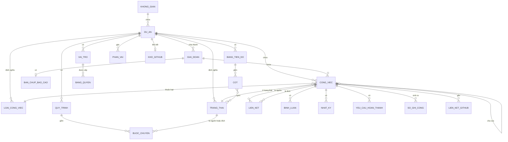

Các thực thể được mô tả theo từng nhóm bài toán của Chương 2. Mọi thực thể thuộc dự án đều có mã định danh duy nhất; các cột người dùng lưu mã người dùng thống nhất toàn hệ thống.

**Bảng 3.19: Nhóm phân quyền và thành viên**

| Thực thể | Thuộc tính chính | Ràng buộc |
| :--- | :--- | :--- |
| Không gian làm việc | Tên, đường dẫn định danh, mô tả, ảnh, người tạo, thời điểm xóa mềm | Đường dẫn định danh duy nhất |
| Thành viên không gian | Không gian, người dùng, vai trò (Chủ sở hữu, Quản trị viên, Thành viên, Khách), người mời, ngày tham gia | Mỗi người một dòng cho mỗi không gian; luôn còn ít nhất một Chủ sở hữu |
| Lời mời không gian | Không gian, người được mời, người mời, vai trò, trạng thái (chờ, chấp nhận, từ chối, hủy), thời điểm trả lời | Một lời mời chờ cho mỗi người |
| Vai trò dự án | Dự án, tên, mô tả | Tên không trùng trong dự án; luôn có Quản trị viên, Thành viên, Người xem |
| Bảng quyền | Dự án, vai trò, khóa quyền (một trong 15) | Mỗi bộ ba duy nhất |
| Phân vai | Dự án, người dùng, vai trò | Người không có dòng phân vai thì không có quyền gì (trừ khi là trưởng dự án, người tạo hoặc quản trị không gian) |
| Lời mời dự án | Dự án, người được mời, người mời, vai trò dự án, trạng thái, thời điểm trả lời | Một lời mời chờ cho mỗi người và mỗi dự án |

**Bảng 3.20: Nhóm dự án, loại công việc, trạng thái và quy trình**

| Thực thể | Thuộc tính chính | Ràng buộc |
| :--- | :--- | :--- |
| Dự án | Không gian, tên, mã, mô tả, trưởng dự án, người tạo, loại dự án, cách chọn người thực hiện mặc định, cờ dự án mẫu và nhóm mẫu, ngày bắt đầu và kết thúc, thời điểm xóa mềm | Mã dự án dùng để sinh mã công việc, chuẩn hóa chữ hoa |
| Loại công việc | Dự án, tên, mã, mô tả, biểu tượng, màu, mức phân cấp, cờ công việc con, cờ mặc định hệ thống | Tên, mã không trùng trong dự án; mức chỉ 1, 0, -1; mỗi mức luôn còn một loại |
| Trạng thái | Dự án, tên, mô tả, màu, nhóm | Tên không trùng không phân biệt hoa thường; mỗi nhóm luôn còn một trạng thái |
| Quy trình | Dự án, tên, mô tả, cờ mặc định | |
| Bước chuyển | Quy trình, trạng thái nguồn (rỗng nếu là bước khởi tạo), trạng thái đích, tên, điều kiện, bộ kiểm tra, việc sau chuyển (dạng JSON) | Đích khác nguồn; không trùng cặp nguồn–đích; tên không trùng trong quy trình |
| Sơ đồ quy trình | Dự án; ánh xạ loại công việc → quy trình | Mỗi loại một quy trình |

**Bảng 3.21: Nhóm công việc và tùy biến**

| Thực thể | Thuộc tính chính | Ràng buộc |
| :--- | :--- | :--- |
| Công việc | Mã, dự án, loại, trạng thái, công việc cha, giai đoạn, tiêu đề (tối đa 500 ký tự), mô tả, mức ưu tiên (thấp nhất đến cao nhất, mặc định trung bình), kết quả xử lý, người báo cáo, người thực hiện, điểm ước lượng, ước lượng thời gian (ban đầu, còn lại, đã dùng), thứ tự xếp hạng, thành phần, phiên bản phát hành, trường tùy chỉnh (JSON), ngày bắt đầu, hạn chót, thời điểm giải quyết, số phiên bản, thời điểm xóa mềm | Mã duy nhất; cha cùng dự án; số phiên bản dùng cho khóa lạc quan |
| Liên kết công việc | Việc nguồn, việc đích, loại (chặn, gây ra, trùng lặp, liên quan), người tạo | Không tự liên kết; mỗi bộ (nguồn, đích, loại) duy nhất; không có vòng lặp phụ thuộc |
| Bình luận | Công việc, bình luận cha (trả lời lồng nhau), tác giả, nội dung, thời điểm tạo và sửa, thời điểm xóa mềm | |
| Tệp đính kèm | Công việc, tên tệp, đường dẫn trong kho lưu trữ, dung lượng, kiểu tệp, người tải lên | Nội dung tệp lưu ở kho tệp, cơ sở dữ liệu chỉ giữ đường dẫn |
| Nhật ký thay đổi | Công việc, tên trường, giá trị cũ, giá trị mới, người đổi, thời điểm | Chỉ thêm |
| Nhãn | Dự án, tên, màu | Tên không trùng trong dự án |
| Thành phần | Dự án, tên, mô tả, người phụ trách | Tên không trùng trong dự án |
| Phiên bản phát hành | Dự án, tên, mô tả, ngày phát hành, cờ đã phát hành, cờ lưu trữ | Tên không trùng trong dự án |
| Định nghĩa trường tùy chỉnh | Dự án, khóa trường, tên, kiểu dữ liệu (văn bản, số, chọn một, chọn nhiều, ngày, người dùng, ô đánh dấu, đường dẫn), danh sách lựa chọn, quy tắc kiểm tra, danh sách loại công việc áp dụng | Khóa trường không trùng trong dự án |
| Bộ lọc đã lưu | Dự án, tên, mô tả, điều kiện lọc, chủ sở hữu, cờ dùng chung | |

**Bảng 3.22: Nhóm giai đoạn, bảng tiến độ, đóng góp và tiến độ**

| Thực thể | Thuộc tính chính | Ràng buộc |
| :--- | :--- | :--- |
| Giai đoạn | Dự án, tên, mục tiêu, trạng thái (dự kiến, đang chạy, đã đóng), ngày bắt đầu và kết thúc, thời điểm hoàn tất, số phiên bản | Mỗi dự án tối đa một giai đoạn đang chạy |
| Bảng tiến độ | Dự án, tên, kiểu (theo chu kỳ hoặc liên tục) | |
| Cột | Bảng, tên, thứ tự, giới hạn việc đang làm tối thiểu và tối đa | Một trạng thái không thuộc hai cột |
| Liên kết cột–trạng thái | Cột, trạng thái | Mỗi cặp duy nhất |
| Phân làn | Bảng, tên, chiến lược (theo hạng mục lớn, người thực hiện, mức ưu tiên), thứ tự | Mỗi lúc một chiến lược |
| Bản chụp báo cáo giai đoạn | Giai đoạn, tổng điểm, điểm hoàn thành, điểm chưa hoàn thành, số việc, số việc hoàn thành, dữ liệu biểu đồ (JSON), người đóng, thời điểm đóng | Mỗi giai đoạn một bản |
| Yêu cầu hoàn thành | Dự án, công việc, bước chuyển đã chọn, trạng thái đích, kết quả xử lý đề xuất, cờ hoàn thành luôn việc con, ghi chú, người gửi, thời điểm gửi, trạng thái (chờ duyệt, đã xác nhận, bị từ chối, đã hủy), người quyết định, thời điểm quyết định, ghi chú quyết định | Mỗi công việc tối đa một yêu cầu chờ duyệt; không xóa bản ghi |
| Sổ ghi công | Dự án, giai đoạn, công việc, người được ghi nhận, điểm (dương hoặc âm), loại (hoàn thành, mở lại, xóa, điều chỉnh), ghi chú, người thao tác, thời điểm | Chỉ thêm, không sửa, không xóa |
| Bản chụp đóng góp | Giai đoạn, người dùng, tổng điểm, tỷ lệ đóng góp, số việc hoàn thành, số bình luận, số sự cố báo cáo, tỷ lệ đúng hạn, số lần bị mở lại | Mỗi cặp giai đoạn–người dùng duy nhất |

**Bảng 3.23: Nhóm mẫu dự án, thông báo và GitHub**

| Thực thể | Thuộc tính chính | Ràng buộc |
| :--- | :--- | :--- |
| Lịch sử nhân bản | Dự án nguồn, dự án đích, kiểu nhân bản (từ mẫu, lưu thành mẫu, nhân bản), độ dời ngày, tùy chọn và thống kê số bản ghi, người thực hiện, thời điểm | |
| Sự kiện chờ gửi | Loại đối tượng, mã đối tượng, loại sự kiện, nội dung (JSON), trạng thái (chờ gửi, đã gửi, thất bại), số lần thử, thời điểm tạo và gửi | Ghi cùng giao dịch với nghiệp vụ; dùng chung cho dịch vụ công việc và dịch vụ không gian làm việc |
| Thông báo | Người nhận, loại (một trong 53), nhóm, mức độ, cờ cần xử lý và thời điểm đã xử lý, tiêu đề, nội dung, đường dẫn, không gian, dự án, đối tượng liên quan, người gây ra, số người gây ra, khóa gộp, khóa chống trùng, mã sự kiện nguồn, thời điểm đọc và xóa mềm | Khóa chống trùng duy nhất |
| Cài đặt thông báo | Người dùng, nhóm, bật trong ứng dụng, bật thư điện tử | Mỗi cặp người dùng–nhóm một dòng |
| Dự án bị tắt tiếng | Người dùng, dự án, tên dự án, tắt đến khi nào | Mỗi cặp người dùng–dự án một dòng |
| Tài khoản GitHub | Người dùng, mã và tên tài khoản GitHub, ảnh, token đã mã hóa | Mỗi người một tài khoản |
| Kho GitHub của dự án | Dự án, chủ kho, tên kho, đường dẫn, nhánh chính, mã kênh nhận sự kiện và khóa bí mật, các cờ tự động (đồng bộ Issue, chuyển sang đang xem xét, tự đóng khi gộp, đóng Issue khi hoàn thành), từ khóa đóng việc, thời điểm đồng bộ cuối | Mỗi cặp (dự án, kho) duy nhất |
| Liên kết GitHub của công việc | Công việc, loại (Issue, yêu cầu hợp nhất), số hiệu, tiêu đề, đường dẫn, trạng thái (mở, đã gộp, đóng), tác giả | |

Các ràng buộc quan trọng ở tầng cơ sở dữ liệu: mỗi dự án tối đa một giai đoạn đang chạy; mỗi công việc tối đa một yêu cầu hoàn thành chờ duyệt; mỗi giai đoạn một bản chụp báo cáo; khóa chống trùng của thông báo duy nhất; mỗi lời mời chờ là duy nhất cho một cặp (đối tượng, người được mời). Tầng nhóm trung gian (Team) của phiên bản đầu đã được loại bỏ để còn kiến trúc phẳng hai cấp: không gian làm việc, dự án.

### 3.3.4. Thiết kế giao diện lập trình

Giao diện lập trình theo chuẩn REST, dữ liệu JSON, phản hồi được bọc thống nhất; lỗi dùng mã HTTP chuẩn: 400 (dữ liệu hoặc quy tắc không hợp lệ), 401 (chưa xác thực), 403 (không đủ quyền), 404 (không tìm thấy hoặc không được biết là có), 409 (xung đột, ví dụ hai người cùng sửa một thẻ hoặc đã có giai đoạn đang chạy).

**Bảng 3.24: Nhóm giao diện lập trình theo dịch vụ**

| Dịch vụ | Nhóm chức năng |
| :--- | :--- |
| Dịch vụ định danh | Đăng ký, xác thực thư, đăng nhập, làm mới mã, đăng xuất, quên và đặt lại mật khẩu, đăng nhập Google, hồ sơ, tìm người dùng, quản trị người dùng |
| Dịch vụ không gian làm việc | Không gian làm việc (tạo, sửa, xóa, khôi phục, rời); thành viên (mời, đổi vai trò, xóa); lời mời (xem, chấp nhận, từ chối, thu hồi) |
| Dịch vụ công việc | Dự án; thành viên, vai trò, quyền của dự án; lời mời dự án; công việc (tạo, lọc, sửa, xóa, giao việc, đổi thứ tự, việc con); loại công việc; trạng thái, quy trình, bước chuyển, sơ đồ quy trình; chuyển trạng thái; liên kết; bình luận; tệp đính kèm; nhật ký; giai đoạn (bắt đầu, hoàn tất, thêm bớt việc); kho việc; bảng tiến độ (dữ liệu, kéo thẻ, cột, phân làn); xác nhận hoàn thành; báo cáo tiến độ, năng suất, luồng trạng thái; báo cáo đóng góp; mẫu dự án (xem trước, tạo, lưu, nhân bản, kiểm tra); tích hợp GitHub |
| Dịch vụ thông báo | Danh sách và lọc; số chưa đọc; đánh dấu đã đọc; xóa và hoàn tác; cài đặt; tắt tiếng dự án |

Việc đẩy thông báo xuống trình duyệt dùng WebSocket với giao thức STOMP: mã đăng nhập được xác thực ngay lúc kết nối, và mỗi người đăng ký một kênh riêng chỉ nhận thông báo của mình. Danh sách đầy đủ từng điểm cuối ở Phụ lục A.

### 3.3.5. Thiết kế giao diện người dùng

Giao diện là ứng dụng một trang, điều hướng như sau:

**Hình 3.16: Sơ đồ điều hướng màn hình**

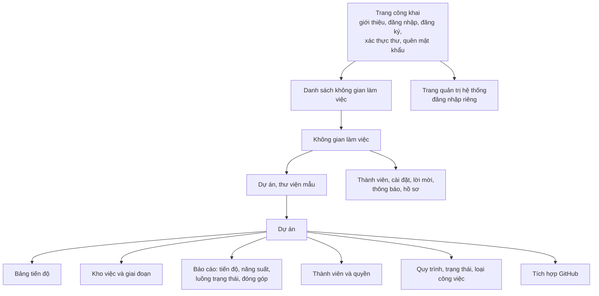

Công việc được mở bằng đường dẫn theo mã (ví dụ MOC-12) nên dùng được trong thông báo và thư điện tử. Ứng dụng giữ hai bộ phiên đăng nhập (người dùng và quản trị), tự gia hạn khi hết hạn; phần thông báo nhận qua WebSocket và cập nhật chuông ngay.

Giao diện theo phong cách tối giản kiểu Linear trong bộ quy chuẩn giao diện của dự án: ít chữ, một cột, nội dung chia thành các dòng chuẩn, một màu nhấn duy nhất, không đổ bóng, trạng thái hiển thị bằng chấm màu nhỏ, thao tác ít dùng gom vào trình đơn, thao tác nguy hiểm xác nhận ngay trong dòng, công tắc bật tắt lưu ngay. Phần chưa dùng được thì làm mờ và giải thích thay vì ẩn. Thuật ngữ thuần Việt, trung tính theo ngành (giai đoạn, kho việc, bảng tiến độ, hạng mục lớn, yêu cầu, sự cố, công việc con) để người ngoài lĩnh vực phần mềm dễ làm quen. Các thành phần giao diện đều tự thiết kế, không dùng thư viện giao diện dựng sẵn.

## 3.4. Thiết kế các module chuyên biệt

### 3.4.1. Module thông báo

Dịch vụ thông báo độc lập, gồm các thành phần: bộ nhận sự kiện từ Kafka; bộ dựng nội dung tiếng Việt cho 53 loại; bộ lưu có chống trùng và gộp; bộ đẩy WebSocket; bộ gửi thư điện tử theo mẫu; bộ áp cài đặt cá nhân và tắt tiếng dự án; các thành phần cho nhiều bản sao (đẩy qua Redis, khóa công việc định kỳ); công việc dọn dẹp lúc 03:00.

Dữ liệu gồm ba nhóm: thông báo (mục 3.3.3), cài đặt thông báo theo nhóm và kênh của từng người, và danh sách dự án bị tắt tiếng.

**Bảng 3.25: Chức năng giao diện lập trình của dịch vụ thông báo**

| Chức năng | Mô tả |
| :--- | :--- |
| Danh sách | Phân trang, lọc theo nhóm, đã đọc, cần xử lý |
| Số chưa đọc | Dùng cho chuông |
| Đánh dấu đã đọc, đọc tất cả | Cập nhật trạng thái |
| Xóa, hoàn tác | Xóa mềm, hoàn tác trong 5 giây, dọn hẳn sau 30 ngày |
| Cài đặt, tắt tiếng dự án | Bật tắt theo nhóm và kênh; tắt tiếng từng dự án |
| Gửi thư nội bộ | Dành cho dịch vụ khác, không qua cổng giao tiếp API |

### 3.4.2. Module báo cáo tiến độ và đóng góp

Nằm trong dịch vụ công việc. Báo cáo tiến độ gồm ba biểu đồ: tiến độ chu kỳ, năng suất làm việc, luồng trạng thái; dựng từ bản chụp lúc đóng giai đoạn (giai đoạn đã đóng) hoặc phát lại nhật ký thay đổi (giai đoạn đang chạy). Báo cáo đóng góp gồm tổng quan, sổ ghi công, chi tiết từng thành viên, điều chỉnh thủ công và xuất tệp, dựng từ sổ ghi công chỉ thêm và bản chụp đóng góp mỗi giai đoạn. Cách tính xem Chương 2 (mục 2.4).

### 3.4.3. Module dự án mẫu

Gồm các thành phần: nạp bản thiết kế của dự án nguồn; dựng bản xem trước; kiểm tra toàn vẹn (chạy ở bốn thời điểm); nhân bản sâu có ánh xạ mã và dời thời gian; gieo các mẫu mặc định (ví dụ mẫu cửa hàng F&B). Chức năng: xem thư viện mẫu, xem trước, tạo dự án từ mẫu kèm tùy chỉnh nhanh, lưu dự án thành mẫu, nhân bản dự án, kiểm tra toàn vẹn.

### 3.4.4. Module tích hợp GitHub

Gồm các thành phần: cấp quyền OAuth và ký tham số trao đổi; mã hóa token; nhận sự kiện GitHub (xác thực chữ ký, xử lý yêu cầu hợp nhất và Issue); đồng bộ ngược trạng thái và người thực hiện sang GitHub; liên kết yêu cầu hợp nhất và Issue vào công việc. Dữ liệu gồm tài khoản GitHub của người dùng (token mã hóa), kho liên kết với dự án (kèm cấu hình tự động chuyển, tự đóng, từ khóa đóng việc) và liên kết giữa công việc với yêu cầu hợp nhất, Issue. Phía giao diện có trang tích hợp GitHub của dự án và màn hình nhận kết quả cấp quyền.
