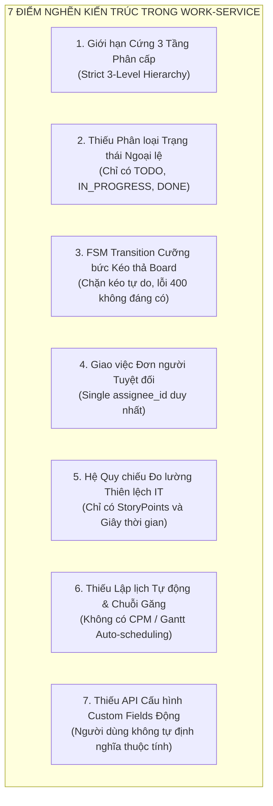
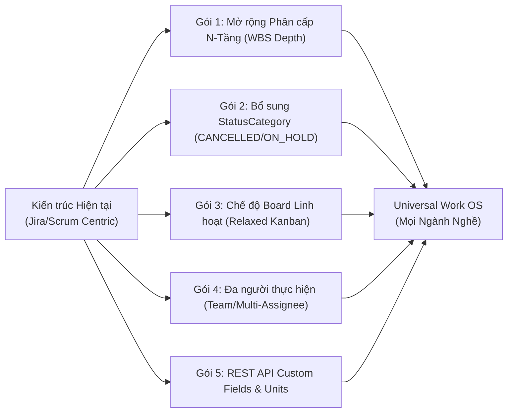

# BÁO CÁO THỰC NGHIỆM ĐÁNH GIÁ NGHIỆP VỤ WORK-SERVICE TRÊN 20 NGÀNH NGHỀ KHÁC BIỆT
## Đánh giá Toàn diện Tính Khả dụng, Độ Tương thích Logic và Các Điểm Nghẽn Kiến trúc
**Dự án:** Hệ thống Quản trị & Điều hành Công việc DATN-2026  
**Dịch vụ Trọng tâm:** `work-service` (Spring Boot 3.x / Java 21 / PostgreSQL / Redis)  
**Phạm vi Phân tích:** Toàn bộ logic nghiệp vụ cốt lõi (Phân cấp thực thể, FSM Workflow Engine, Dependency & Cycle Check, Board Kanban/Scrum, LexoRank, Project Cloning/Templates, Permissions & Roles) - *ngoại trừ Quản lý Tiến độ và Đóng góp*.  
**Ngày thực hiện:** Tháng 11/2026  

---

## MỤC LỤC
1. [TỔNG QUAN ĐÁNH GIÁ & TIÊU CHÍ KIỂM ĐỊNH](#1-tổng-quan-đánh-giá--tiêu-chí-kiểm-định)
2. [BẢNG TỔNG HỢP SCORECARD 20 DỰ ÁN NGÀNH NGHỀ](#2-bảng-tổng-hợp-scorecard-20-dự-án-ngành-nghề)
3. [PHÂN TÍCH KIẾN TRÚC & CÁC RÀNG BUỘC CỐT LÕI TRONG SOURCE CODE](#3-phân-tích-kiến-trúc--các-ràng-buộc-cốt-lõi-trong-source-code)
4. [THỰC NGHIỆM 20 KỊCH BẢN NGÀNH NGHỀ (ĐÓNG VAI NGƯỜI DÙNG THỰC TẾ)](#4-thực-nghiệm-20-kịch-bản-ngành-nghề-đóng-vai-người-dùng-thực-tế)
   - [Dự án 01: Công nghệ Thông tin & Phát triển Siêu ứng dụng Fintech (Scrum)](#dự-án-01-công-nghệ-thông-tin--phát-triển-siêu-ứng-dụng-fintech)
   - [Dự án 02: Xây dựng Dân dụng & Thi công Tòa nhà Cao ốc 18 Tầng](#dự-án-02-xây-dựng-dân-dụng--thi-công-tòa-nhà-cao-ốc-18-tầng)
   - [Dự án 03: Chuỗi F&B - Mở mới Cửa hàng Specialty Coffee & Bakery](#dự-án-03-chuỗi-fb---mở-mới-cửa-hàng-specialty-coffee--bakery)
   - [Dự án 04: Nông nghiệp Công nghệ cao & Mùa vụ Sầu riêng GlobalGAP](#dự-án-04-nông-nghiệp-công-nghệ-cao--mùa-vụ-sầu-riêng-globalgap)
   - [Dự án 05: Sản xuất Công nghiệp - Lắp ráp Thiết bị Gia dụng Thông minh IoT](#dự-án-05-sản-xuất-công-nghiệp---lắp-ráp-thiết-bị-gia-dụng-thông-minh-iot)
   - [Dự án 06: Marketing Agency - Chiến dịch Truyền thông Tích hợp Tết 2027](#dự-án-06-marketing-agency---chiến-dịch-truyền-thông-tích-hợp-tết-2027)
   - [Dự án 07: Y tế & Bệnh viện - Chuẩn hóa Khám chữa bệnh & Triển khai Bệnh án Điện tử](#dự-án-07-y-tế--bệnh-viện---chuẩn-hóa-khám-chữa-bệnh--triển-khai-bệnh-án-điện-tử)
   - [Dự án 08: Giáo dục Đại học - Thiết kế Chương trình Cử nhân Thiết kế Vi mạch](#dự-án-08-giáo-dục-đại-học---thiết-kế-chương-trình-cử-nhân-thiết-kế-vi-mạch)
   - [Dự án 09: Quản lý Sự kiện Quốc tế - Tech Summit & MICE 2026](#dự-án-09-quản-lý-sự-kiện-quốc-tế---tech-summit--mice-2026)
   - [Dự án 10: Hãng Luật - Tố tụng Tranh chấp Thương mại & Thương vụ M&A](#dự-án-10-hãng-luật---tố-tụng-tranh-chấp-thương-mại--thương-vụ-ma)
   - [Dự án 11: Bán lẻ & E-Commerce - Vận hành Chiến dịch Siêu Sale 11.11](#dự-án-11-bán-lẻ--e-commerce---vận-hành-chiến-dịch-siêu-sale-1111)
   - [Dự án 12: Điện ảnh & Sản xuất Phim Chiếu rạp Kỹ xảo VFX](#dự-án-12-điện-ảnh--sản-xuất-phim-chiếu-rạp-kỹ-xảo-vfx)
   - [Dự án 13: Kiến trúc & Thi công Nội thất Biệt thự Nghỉ dưỡng Ven biển](#dự-án-13-kiến-trúc--thi-công-nội-thất-biệt-thự-nghỉ-dưỡng-ven-biển)
   - [Dự án 14: Phi chính phủ (NGO) - Cứu trợ Khẩn cấp & Khắc phục Thiên tai Lũ lụt](#dự-án-14-phi-chính-phủ-ngo---cứu-trợ-khẩn-cấp--khắc-phục-thiên-tai-lũ-lụt)
   - [Dự án 15: Nghiên cứu Khoa học & R&D Dược phẩm Tiền lâm sàng](#dự-án-15-nghiên-cứu-khoa-học--rd-dược-phẩm-tiền-lâm-sàng)
   - [Dự án 16: Game Studio - Phát triển Game 3D RPG Nhập vai Unreal Engine 5](#dự-án-16-game-studio---phát-triển-game-3d-rpg-nhập-vai-unreal-engine-5)
   - [Dự án 17: Thiết kế Thời trang - Ra mắt Bộ sưu tập Runway Tuần lễ Thời trang](#dự-án-17-thiết-kế-thời-trang---ra-mắt-bộ-sưu-tập-runway-tuần-lễ-thời-trang)
   - [Dự án 18: Kiểm toán Độc lập Báo cáo Tài chính Niêm yết (Financial Audit)](#dự-án-18-kiểm-toán-độc-lập-báo-cáo-tài-chính-niêm-yết-financial-audit)
   - [Dự án 19: Bất động sản - Kế hoạch Mở bán Phân khu Đại đô thị 100ha](#dự-án-19-bất-động-sản---kế-hoạch-mở-bán-phân-khu-đại-đô-thị-100ha)
   - [Dự án 20: Nhân sự & Tuyển dụng Quy mô lớn - Management Trainee 300 Tân binh](#dự-án-20-nhân-sự--tuyển-dụng-quy-mô-lớn---management-trainee-300-tân-binh)
5. [TỔNG HỢP 7 ĐIỂM NGHẼN LOGIC CỐT TỬ TRONG SOURCE CODE](#5-tổng-hợp-7-điểm-nghẽn-logic-cốt-tử-trong-source-code)
6. [MA TRẬN PHÂN LOẠI MỨC ĐỘ THÍCH NGHI ĐA NGÀNH](#6-ma-trận-phân-loại-mức-độ-thích-nghi-đa-ngành)
7. [ĐỀ XUẤT LỘ TRÌNH NÂNG CẤP KIẾN TRÚC (UNIVERSAL WORK OS)](#7-đề-xuất-lộ-trình-nâng-cấp-kiến-trúc-universal-work-os)

---

## 1. TỔNG QUAN ĐÁNH GIÁ & TIÊU CHÍ KIỂM ĐỊNH

### 1.1 Mục Tiêu Thực Nghiệm
Khảo sát và đối chiếu toàn bộ các cấu trúc dữ liệu, thuật toán kiểm tra tính toàn vẹn, luồng xử lý trạng thái và giao diện người dùng của `work-service` để trả lời câu hỏi cốt lõi:
> **"Liệu WorkService hiện tại đã thực sự đáp ứng tốt vai trò là một Hệ thống Quản trị Dự án Đa ngành (Universal Multi-industry Project Management System), khi bỏ qua hai yếu tố chưa hoàn thiện là Quản lý Tiến độ (%) và Quản lý Đóng góp?"**

### 1.2 Phương Pháp Kiểm Thử
- **Đóng vai thực tế (Persona Simulation):** Ở mỗi ngành, người kiểm thử vào vai người dùng chuyên trách (Chỉ huy trưởng công trường, Giám đốc nông trường, Đạo diễn điện ảnh, Luật sư điều hành, Bác sĩ trưởng khoa, v.v.). Tư duy quản lý, thuật ngữ nghiệp vụ, cấu trúc công việc (WBS) và các tình huống phát sinh được tái hiện đúng bản chất ngành đó.
- **Đối chiếu mã nguồn (Source Code Inspection):** Mọi hành động giả lập đều được "chạy máy" đối chiếu trực tiếp với các class Java backend:
  - `StrictHierarchyValidator.java`: Ràng buộc 3 cấp độ (Epic -> Standard -> Subtask).
  - `WorkflowEngineServiceImpl.java`: Cỗ máy FSM, Transitions, Guards, Validators, Cascading Reopen & Resolve.
  - `BoardServiceImpl.java` & `WIPLimitGuard.java`: Kéo thả thẻ, điều kiện chuyển cột, kiểm soát giới hạn WIP.
  - `WorkItemServiceImpl.java`: Mã định danh nguyên tử, tính toán xung đột phụ thuộc, roll-up thời gian/điểm số.
  - `DependencyCycleDetector.java`: Thuật toán DFS phát hiện chu trình phụ thuộc BLOCKS.
  - `ProjectCloneEngine.java`: Nhân bản sâu mẫu dự án và tịnh tiến mốc thời gian ($\Delta \text{days}$).
  - `CustomFieldDefinition.java` & `WorkItem.customFields`: Cơ chế trường dữ liệu tùy biến.

### 1.3 Bộ Tiêu Chí Đánh Giá (Evaluation Criteria - 10 Thang Điểm)
1. **Tính Tự nhiên của Mô hình Phân rã (WBS Natural Fit):** Hệ thống phân cấp của `work-service` có phản ánh được cấu trúc công việc thực tế của ngành nghề hay gò ép?
2. **Khả năng Mô hình hóa Quy trình Nghiệp vụ (Workflow Fidelity):** Vòng đời trạng thái có thể hiện được các chốt chặn nghiệm thu, phê duyệt, tạm hoãn hay hủy bỏ đặc thù của ngành?
3. **Mô hình Ước lượng & Đo lường (Estimation & Unit Suitability):** Hệ thống chỉ có Story Points và Giây thời gian. Ngành nghề sử dụng khối lượng, diện tích, sản lượng, tiền tệ có dùng được không?
4. **Cơ chế Phụ thuộc & Điều phối Tiến độ (Dependency & Scheduling Integrity):** BLOCKS link, cycle detection, xung đột thời gian có hỗ trợ kiểm soát chuỗi găng (Critical Path) không?
5. **Cơ chế Phân bổ Nguồn lực (Resource & Team Allocation):** Hạn chế người thực hiện đơn (`single assigneeId`) tác động thế nào đến tổ đội, ca kíp và nhà thầu phụ?
6. **Cơ chế Xử lý Ngoại lệ (Exception & Edge-Case Handling):** Tạm dừng công việc, hủy bỏ một phần, phát sinh khẩn cấp, mở lại đầu việc (Cascading Reopen) vận hành ra sao?
7. **Trải nghiệm Bảng điều khiển (Board & Visual Usability):** Kanban/Scrum Board, WIP limits, Swimlanes có hỗ trợ tối ưu thị giác cho ngành đó không?
8. **Độ thân thiện Thuật ngữ & Tùy biến (Terminology & Custom Fields):** Người dùng thông thường ngoài ngành IT có cảm thấy xa lạ với các thuật ngữ mang đậm tính Agile/Jira (Epic, Sprint, Story Points, Backlog)?

---

## 2. BẢNG TỔNG HỢP SCORECARD 20 DỰ ÁN NGÀNH NGHỀ

| STT | Ngành Nghề Thử Nghiệm | Dự Án Đại Diện | Mức Độ Phù Hợp | Điểm Fit (Thang 10) | Nhận Định Cốt Lõi |
|:---:|:---|:---|:---:|:---:|:---|
| 01 | **Công nghệ Thông tin / Phần mềm** | Siêu ứng dụng Fintech Mobile | **Native Fit (Hoàn hảo)** | **9.5 / 10** | Hệ thống sinh ra cho Software/Scrum; mọi logic FSM, Sprint, Story Points, Subtask đều khớp 100%. |
| 02 | **Xây dựng Dân dụng & Thi công** | Cao ốc Văn phòng 18 Tầng | **Severe Mismatch (Rất thấp)** | **3.5 / 10** | Vỡ trận vì giới hạn 3 tầng phân cấp; không thể đo lường theo khối lượng ($m^3$, tấn); thiếu CPM tự động. |
| 03 | **F&B / Chuỗi Nhà hàng - Cà phê** | Mở Cửa hàng Specialty Coffee | **Good with Workaround (Tốt)** | **8.5 / 10** | Mẫu Template chuẩn V7 rất tốt; các giai đoạn khảo sát, quầy bar, decor, menu kiểm soát hiệu quả. |
| 04 | **Nông nghiệp Công nghệ cao** | Mùa vụ Sầu riêng GlobalGAP | **Moderate (Trung bình)** | **6.0 / 10** | Khớp theo mùa vụ (sprint); nhưng hoàn toàn thiếu đơn vị nông nghiệp (ha, lít, kg, độ Brix) trong entity. |
| 05 | **Sản xuất & Chế tạo Công nghiệp** | Lắp ráp Thiết bị Gia dụng IoT | **Severe Mismatch (Rất thấp)** | **4.0 / 10** | Không có BOM đa cấp; không đo lường theo ca kíp/sản lượng; chỉ 1 người phụ trách trên một công đoạn. |
| 06 | **Marketing & Quảng cáo (IMC)** | Chiến dịch Ra mắt Nhãn hàng Tết | **High (Rất tốt)** | **8.8 / 10** | Phù hợp cao với quy trình sáng tạo, phê duyệt nội dung/video/KOLs; tận dụng tốt Kanban & BLOCKS. |
| 07 | **Y tế & Bệnh viện** | Triển khai Bệnh án Điện tử EMR | **Moderate (Trung bình)** | **5.5 / 10** | Quản lý dự án triển khai phần mềm y tế thì tốt, nhưng quản lý luồng khám chữa bệnh lâm sàng thì không phù hợp. |
| 08 | **Giáo dục & Đại học** | Chương trình Đào tạo Vi mạch | **Moderate (Trung bình)** | **6.5 / 10** | Cấu trúc phân cấp Học viện -> Môn học -> Bài giảng bị ép vào 3 cấp; thiếu trạng thái phản biện/hội đồng. |
| 09 | **Tổ chức Sự kiện Quốc tế** | Diễn đàn Đổi mới Sáng tạo (Summit) | **Good (Khá tốt)** | **8.0 / 10** | Kiểm soát mốc thời gian chặt chẽ; BLOCKS link phát huy tối đa tác dụng chặn các khâu sân khấu/diễn giả. |
| 10 | **Pháp lý & Hãng Luật** | Tranh chấp Thương mại & M&A | **Low (Kém)** | **4.5 / 10** | Bảo mật phân quyền theo từng case/tài liệu chưa đủ mịn; không có trạng thái đình chỉ/hòa giải/tố tụng. |
| 11 | **Bán lẻ & E-Commerce** | Vận hành Siêu Sale 11.11 | **Good (Khá tốt)** | **8.2 / 10** | Sprint áp dụng xuất sắc cho các Phase (Chuẩn bị, Teasing, D-Day, Xử lý đơn); phụ thuộc hàng hóa rõ ràng. |
| 12 | **Điện ảnh & Sản xuất Phim** | Phim Chiếu rạp Kỹ xảo VFX | **Moderate (Trung bình)** | **6.0 / 10** | Bị nghẽn ở phân cấp Cảnh (Scene) -> Shot -> Phân lớp (Layer); giao việc tổ quay/đoàn phim bị chặn bởi đơn người. |
| 13 | **Kiến trúc & Nội thất** | Biệt thự Nghỉ dưỡng Ven biển | **Good (Khá tốt)** | **7.5 / 10** | Rất tốt cho giai đoạn Ý tưởng 2D/3D & Phê duyệt vật liệu; bắt đầu hụt hơi khi vào công trường thi công thực địa. |
| 14 | **Tổ chức Phi chính phủ (NGO)** | Cứu trợ Bão lũ Khẩn cấp | **Moderate (Trung bình)** | **6.0 / 10** | Cần triển khai tức thì nhưng tạo dự án đòi hỏi nhiều cấu hình; thiếu điều phối nguồn lực vật phẩm cứu trợ. |
| 15 | **Nghiên cứu Khoa học (R&D)** | Nghiên cứu Hoạt chất Dược phẩm | **Moderate (Trung bình)** | **5.5 / 10** | Vòng lặp thí nghiệm lặp đi lặp lại không theo FSM một chiều; mở lại Subtask gây cascade Epic DONE gây phiền toái. |
| 16 | **Game Studio / Game Dev** | Game 3D RPG Nhập vai UE5 | **Native Fit (Hoàn hảo)** | **9.2 / 10** | Tương thích tuyệt đối với phương pháp Agile Game Development (Epics cho tính năng, Sprints cho Milestone). |
| 17 | **Thời trang & May mặc** | Ra mắt Bộ sưu tập Runway | **Good (Khá tốt)** | **7.8 / 10** | Workflow duyệt mẫu phác thảo -> rập -> may mẫu -> duyệt fitting rất mượt trên Board Kanban. |
| 18 | **Kiểm toán & Tài chính** | Kiểm toán Báo cáo Tài chính | **Low (Kém)** | **5.0 / 10** | Cây giấy làm việc (Working Papers) cần 5-6 cấp; ma trận rủi ro không có chỗ lưu trữ chuẩn hóa; thiếu ký duyệt song trùng. |
| 19 | **Kinh doanh Bất động sản** | Mở bán Đại đô thị 100ha | **Moderate (Trung bình)** | **6.5 / 10** | Phù hợp khâu truyền thông mở bán; không liên kết được với bảng hàng căn hộ, hợp đồng cọc, giỏ hàng sàn F1/F2. |
| 20 | **Nhân sự & Tuyển dụng** | Tuyển 300 Quản trị viên Tập sự | **Good (Khá tốt)** | **7.5 / 10** | Pipeline ứng viên đưa lên Board Kanban rất trực quan; điểm yếu là mỗi hồ sơ ứng viên là 1 Task riêng lẻ. |

---

## 3. PHÂN TÍCH KIẾN TRÚC & CÁC RÀNG BUỘC CỐT LÕI TRONG SOURCE CODE

Qua kiểm tra trực tiếp mã nguồn `backend/work-service`, hệ thống vận hành dựa trên các trụ cột kiến trúc sau:

### 3.1 Mô hình Phân cấp Nghiêm ngặt 3 Cấp độ (`StrictHierarchyValidator.java`)
Hệ thống sử dụng cơ chế Single-Table Inheritance cho thực thể `WorkItem` với thuộc tính `hierarchyLevel`:
- **Cấp độ 1 (`LEVEL_EPIC = 1`):** Bắt buộc `parentId == null`.
- **Cấp độ 0 (`LEVEL_STANDARD = 0`):** Có thể đứng độc lập (`parentId == null`) hoặc gắn vào Epic (`parent.hierarchyLevel == 1`).
- **Cấp độ -1 (`LEVEL_SUBTASK = -1`):** Bắt buộc phải có cha thuộc Cấp độ 0 (`parent.hierarchyLevel == 0`).
```java
// StrictHierarchyValidator.java - Dòng 67-92
if (childLevel == LEVEL_EPIC && parentLevel != null) {
    throw new InvalidHierarchyException("Epic (Hierarchy Level 1) cannot have a parent item.");
}
if (childLevel == LEVEL_SUBTASK) {
    if (parentLevel == null) throw new InvalidHierarchyException("Sub-task (-1) must have a parent...");
    if (parentLevel == LEVEL_EPIC) throw new InvalidHierarchyException("Sub-task (-1) cannot be directly attached to an Epic (1)...");
    if (parentLevel == LEVEL_SUBTASK) throw new InvalidHierarchyException("Sub-task (-1) cannot have another Sub-task as parent...");
}
```
> **Đánh giá Đa ngành:** Đây là quy chuẩn vàng của Jira Software (Epic ➔ Story ➔ Subtask). Tuy nhiên, đối với các ngành kỹ thuật truyền thống (Xây dựng, Đóng tàu, Nhà máy sản xuất, Đề án giáo dục), phân rã công việc WBS thường đòi hỏi từ 5 đến 7 tầng phân cấp (Dự án ➔ Phân kỳ ➔ Hạng mục ➔ Gói công việc ➔ Hoạt động ➔ Tác vụ ➔ Nghiệm thu). Giới hạn cứng 3 tầng gây nên sự "dồn nén thông tin" (information flattening), khiến người dùng phải nhồi nhét nội dung vào tên công việc hoặc phần mô tả.

### 3.2 Cỗ máy Trạng thái Hữu hạn và Quy tắc Chặn Lan Truyền (`WorkflowEngineServiceImpl.java`)
Hệ thống kiểm soát mọi biến chuyển trạng thái thông qua FSM Workflow Engine với các chốt chặn:
1. **Chặn Công việc Phụ thuộc (Blocked Guard - Dòng 154-172):**
   Nếu công việc có liên kết `BLOCKS` từ công việc khác chưa ở `StatusCategory.DONE`, hệ thống ném ngoại lệ `400 BadRequestException`, ngăn không cho chuyển sang `IN_PROGRESS` hoặc `DONE`.
2. **Chặn Hoàn thành Cha khi Con chưa Xong (Descendant Blocking Guard - Dòng 175-214):**
   Một Story/Task không thể chuyển sang `DONE` nếu còn bất kỳ Sub-task nào chưa hoàn thành, trừ khi người dùng gửi cờ `resolveAllSubtasks = true` (khi đó toàn bộ nhiệm vụ con sẽ tự động được đánh dấu DONE).
3. **Quy tắc Lan truyền Mở lại Ngược dòng (Cascading Ancestor Reopen / Reverse Roll-up - Dòng 465-550):**
   ```java
   // Khi bất kỳ nhiệm vụ con nào chuyển về non-DONE (TODO / IN_PROGRESS):
   if (toStatus.getCategory() != StatusCategory.DONE && parentStatus.getCategory() == StatusCategory.DONE) {
       parent.setStatusId(targetReopenStatus.getId());
       parent.setResolution(null);
       parent.setResolvedAt(null);
       workItemRepository.save(parent);
       // Đệ quy lên Epic tổ tiên...
   }
   ```
   *Ý nghĩa:* Đảm bảo tính toàn vẹn 100% cho báo cáo Agile và Burndown Chart. Nếu một chi tiết sót bị mở lại, công việc cha không thể được xem là đã hoàn tất.

### 3.3 Ràng buộc Chuyển trạng thái khi Kéo thả Thẻ trên Board (`BoardServiceImpl.java`)
Khi người dùng kéo thả thẻ từ Cột A sang Cột B trên bảng Kanban/Scrum:
```java
// BoardServiceImpl.java - Dòng 404-442
List<AvailableTransitionResponse> available = workflowEngineService.getAvailableTransitions(item.getId(), userId);
List<AvailableTransitionResponse> candidates = available.stream()
        .filter(t -> targetStatusIds.contains(t.getToStatusId()))
        .toList();
if (candidates.isEmpty()) {
    throw new BadRequestException("Không có bước chuyển hợp lệ từ '" + currentStatusName + "' sang cột '" + targetColumn.getName() + "'");
}
```
> **Đánh giá Đa ngành:** Hệ thống **bắt buộc** phải tồn tại một đường chuyển (Transition) được cấu hình rõ ràng trong Workflow mới cho phép thả thẻ. Trong dự án tạo mặc định từ `ProjectServiceImpl.initProjectEcosystem`, các bước chuyển chỉ có: `TODO ➔ IN PROGRESS`, `IN PROGRESS ➔ DONE`, `DONE ➔ TODO`.
> Do đó, người dùng thông thường nếu muốn kéo thẳng từ `TODO ➔ DONE` (việc đơn giản làm xong ngay) hoặc trả ngược từ `IN PROGRESS ➔ TODO` (hoãn việc) sẽ **bị báo lỗi 400 lập tức**. Điều này gây ức chế lớn cho người dùng không thuộc khối phần mềm - những người vốn quen với Kanban linh hoạt tự do của Trello hay Notion.

### 3.4 Giới hạn Phạm vi Thể loại Trạng thái (`StatusCategory.java`)
Trong `com.datn.workservice.enums.StatusCategory`:
```java
public enum StatusCategory {
    TODO,
    IN_PROGRESS,
    DONE
}
```
Chỉ có duy nhất 3 loại phân loại trạng thái. Không có:
- `CANCELLED` (Hủy bỏ): Khi một gói thầu bị hủy hoặc món ăn bị bỏ, nếu đưa vào DONE thì bị tính là hoàn thành trong báo cáo; nếu để TODO/IN_PROGRESS thì vĩnh viễn khóa công việc cha không cho Done!
- `ON_HOLD` / `PAUSED` (Tạm dừng / Chờ vật tư): Phải xếp vào `IN_PROGRESS`, làm sai lệch thời gian thực tế thực hiện (Lead Time / Cycle Time).
- `REJECTED` (Bị bác bỏ): Nghiệm thu không đạt, hồ sơ bị trả về.

### 3.5 Cơ chế Giao việc Đơn người (`single assigneeId`)
Trong `WorkItem.java`, trường phân công là:
```java
@Column(name = "assignee_id")
private UUID assigneeId;
```
Chỉ chấp nhận duy nhất một người dùng phụ trách. Trong đại đa số ngành nghề phi phần mềm (Xây dựng, Nông trường, Sự kiện, Bệnh viện), một đầu việc thường do một **tổ đội / ca kíp** từ 3 - 10 người cùng chịu trách nhiệm. Việc thiếu mô hình `assignee_ids` hoặc `team_id` buộc người dùng phải tạo hàng loạt subtask giả tạo hoặc chỉ định đại diện một người.

### 3.6 Cơ chế Trường Tùy biến (`CustomFieldDefinition.java`)
Thực thể `CustomFieldDefinition` đã được định nghĩa trong database (hỗ trợ `TEXT`, `NUMBER`, `SELECT`, `MULTI_SELECT`, `DATE`, `USER`, `CHECKBOX`, `URL`) và `WorkItem.customFields` (JSONB).
Tuy nhiên: **Chưa có bất kỳ REST Controller hay Service nào cho phép người dùng cuối (Project Admin) tạo mới, chỉnh sửa hay cấu hình các trường tùy biến này qua giao diện hoặc API.** Trường tùy biến hiện chỉ được nạp sẵn qua Blueprint Template hoặc gửi dữ liệu JSON tự do không có schema kiểm thực.

---

## 4. THỰC NGHIỆM 20 KỊCH BẢN NGÀNH NGHỀ (ĐÓNG VAI NGƯỜI DÙNG THỰC TẾ)

---

### DỰ ÁN 01: CÔNG NGHỆ THÔNG TIN & PHÁT TRIỂN SIÊU ỨNG DỤNG FINTECH
- **Vai trò Người dùng (Persona):** Lê Tuấn Anh - Kỹ sư Trưởng kiêm Scrum Master tại Công ty Tài chính Công nghệ.
- **Bối cảnh Dự án:** Phát triển Module Ví điện tử & Cổng thanh toán QR Code (Key: `FINTECH`). Dự án có 12 lập trình viên, chia làm 2 Squad (Backend, Mobile Frontend), vận hành theo Sprint 2 tuần.
- **Cấu trúc Phân rã Công việc (WBS):**
  - *Epic (Level 1):* `Tích hợp Cổng thanh toán VietQR & Napas247`
  - *Story / Task (Level 0):* `Thiết kế API sinh mã động Dynamic VietQR`
  - *Sub-task (Level -1):* `Viết Unit Test cho hàm băm chữ ký SHA256`, `Cấu hình Webhook Callback IPN`.
- **Mô phỏng Thao tác & Kiểm chứng Source Code:**
  1. *Tạo dự án:* Chọn `projectType = SOFTWARE_SCRUM`. Hệ thống tự sinh ra Board Scrum, 3 Status chuẩn, và workflow mẫu.
  2. *Gán ước lượng:* Nhập `storyPoints = 5.0`, `originalEstimateSeconds = 28800` (8 giờ). Cả hai trường đều lưu chính xác.
  3. *Lập kế hoạch Sprint:* Tạo Sprint 1 (2 tuần), kéo các Task từ Backlog vào Sprint. `SprintServiceImpl.startSprint` kiểm tra điều kiện sprint không rỗng và chuyển sang `ACTIVE`.
  4. *Kéo thả trên Board:* Di chuyển thẻ qua các cột `TO DO ➔ IN PROGRESS ➔ CODE REVIEW ➔ TESTING ➔ DONE`. `BoardServiceImpl.moveCard` tìm thấy transition hợp lệ, cập nhật LexoRank chính xác.
  5. *Đóng Sprint:* `SprintServiceImpl.completeSprint` chụp `SprintReportSnapshot`, chuyển 1 Task dở dang về Sprint 2, tính toán Burndown và Velocity Chart hiển thị hoàn hảo.
- **Đánh giá Chi tiết từ Người Dùng:**
  - *Điểm sáng:* Mã nguồn của hệ thống được may đo chính xác cho kịch bản này. Tích hợp trơn tru từ phân cấp, ước lượng story point, báo cáo Burndown đến outbox event.
  - *Hạn chế:* Thiếu khả năng tích hợp trực tiếp với Git commit/Pull Request webhook.
- **Kết luận:** **9.5 / 10** - Phù hợp xuất sắc, không có xung đột logic.

---

### DỰ ÁN 02: XÂY DỰNG DÂN DỤNG & THI CÔNG TÒA NHÀ CAO ỐC 18 TẦNG
- **Vai trò Người dùng (Persona):** KS. Trần Đình Trọng - Chỉ huy trưởng Công trường kiêm Giám đốc Dự án Xây dựng (Tổng thầu EPC).
- **Bối cảnh Dự án:** Thi công Tòa nhà Văn phòng & Chung cư Cao cấp 18 tầng (Key: `BUILD18`). Tổng vốn đầu tư 350 tỷ VND, thời gian 18 tháng.
- **Cấu trúc Nghiệp vụ Thực tế Đòi hỏi:**
  - Cần tối thiểu 5 tầng WBS: `Dự án` ➔ `Giai đoạn (Móng / Thân / Hoàn thiện)` ➔ `Phân khu / Tầng (Tầng hầm B1, Tầng 1..18)` ➔ `Gói thầu / Hạng mục (Cốt thép, Ván khuôn, Bê tông, Cơ điện MEP)` ➔ `Tác vụ nghiệm thu`.
- **Mô phỏng Thao tác & Xung đột Source Code:**
  1. *Xung đột Phân cấp (Hierarchy Bottleneck):*
     - Người dùng muốn tạo: `Giai đoạn Phần thô` (Epic) ➔ `Thi công Sàn Tầng 5` (Task) ➔ `Đổ bê tông dầm sàn T5` (Sub-task). Đến đây đã hết tầng cấp!
     - Kỹ sư muốn tạo tiếp công việc nghiệm thu trực thuộc: `Thí nghiệm nén mẫu bê tông R28` trực thuộc `Đổ bê tông dầm sàn`.
     - *Kết quả với Code:* `StrictHierarchyValidator.validateHierarchyLevels(-1, -1)` ném lỗi ngay lập tức:
       `InvalidHierarchyException: Sub-task (-1) cannot have another Sub-task as parent`. Kỹ sư bắt buộc phải làm phẳng cấu trúc, gây lẫn lộn nghiêm trọng.
  2. *Bất khả thi về Đơn vị Ước lượng (Unit Mismatch):*
     - Xây dựng quản lý theo: Khối lượng bê tông ($450 m^3$), Khối lượng thép ($65$ tấn), Diện tích cốp pha ($1,200 m^2$).
     - *Kết quả với Code:* `WorkItem` chỉ có `storyPoints` và `originalEstimateSeconds`. Bắt chỉ huy trưởng nhập đổ bê tông sàn thành "86,400 giây" hoặc "8 story points" là phi lý và vô nghĩa với giới xây dựng.
  3. *Xung đột Ràng buộc Phụ thuộc Chuỗi găng (Critical Path / CPM):*
     - Nghiệp vụ: Tháo dỡ ván khuôn chỉ được thực hiện sau khi đổ bê tông 14 ngày và kết quả nén mẫu đạt 85% R28.
     - Kỹ sư tạo liên kết `BLOCKS` giữa Đổ bê tông và Tháo cốp pha.
     - *Kết quả với Code:* `DependencyCycleDetector` kiểm tra chu trình tốt, `WorkflowEngineServiceImpl` chặn không cho chuyển Tháo cốp pha sang `IN_PROGRESS` khi chưa đổ bê tông. **Tuy nhiên**, khi ngày đổ bê tông bị hoãn do trời mưa bão (+3 ngày), hệ thống không hề tự động dịch chuyển ngày bắt đầu của 20 hạng mục kéo theo phía sau (No Auto-scheduling Gantt).
  4. *Giao việc Tổ đội (Team Assignment):*
     - Tác vụ đổ bê tông cần cả `Tổ Bê tông 1 (18 người)` cùng làm. Hệ thống chỉ cho gán 1 `assigneeId` duy nhất.
- **Đánh giá Chi tiết từ Người Dùng:**
  - *Điểm sáng:* BLOCKS link chặn được việc tháo cốp pha sớm; cảnh báo timeline conflict hiển thị màu đỏ khi ngày hoàn thành con vượt cha.
  - *Điểm nghẽn:* Mô hình 3 tầng phá sản với WBS xây dựng; không hỗ trợ đơn vị đo lường vật tư; không có biểu đồ Gantt phụ thuộc thời gian thực.
- **Kết luận:** **3.5 / 10** - Rất khó ứng dụng trong thực tế quản lý thi công công trình.

---

### DỰ ÁN 03: CHUỖI F&B - MỞ MỚI CỬA HÀNG SPECIALTY COFFEE & BAKERY
- **Vai trò Người dùng (Persona):** Vũ Bích Phương - Giám đốc Khai trương & Vận hành Chuỗi F&B (15 điểm bán).
- **Bối cảnh Dự án:** Triển khai mở mới Điểm bán Flagship Quận 1 (Key: `FNBHCM`). Thời hạn 60 ngày từ khi nhận mặt bằng đến Grand Opening.
- **Cấu trúc Phân rã Công việc (WBS):**
  - Áp dụng hoàn hảo cấu trúc từ Flyway `V7__seed_default_templates.sql` (TPLFNB):
  - *Epic 1:* Mặt bằng & Pháp lý (Khảo sát, Ký HĐ, ĐKKD & ATTP).
  - *Epic 2:* Thiết kế Kiến trúc & Thi công Nội thất (Bản vẽ 3D, Cải tạo điện nước, Quầy bar).
  - *Epic 3:* Thực đơn (Menu), Định lượng Costing & Nhập Máy móc Barista.
  - *Epic 4:* Tuyển dụng, Đào tạo Nhân sự & SOP Phục vụ.
  - *Epic 5:* Truyền thông, Soft Opening & Grand Opening.
- **Mô phỏng Thao tác & Kiểm chứng Source Code:**
  1. *Khởi tạo từ Template:* Gọi `ProjectTemplateServiceImpl.createProjectFromTemplate` với nguồn là `TPLFNB`, ngày bắt đầu dự kiến là ngày mai.
  2. *Kiểm chứng Engine Nhân bản (`ProjectCloneEngine.java`):*
     - Toàn bộ 26 công việc và các subtask được nhân bản chính xác.
     - Thuật toán `Two-pass clone` kết hợp `Map<UUID, UUID>` bảo toàn 100% quan hệ cha - con.
     - Mốc thời gian được cộng delta ngày chuẩn xác: Task khai trương rơi đúng vào ngày thứ 60.
     - Toàn bộ task khởi tạo ở trạng thái `CHUẨN BỊ` (TODO), assignee được reset sạch sẽ.
  3. *Vận hành Board Nghiệm thu:*
     - Luồng workflow tùy biến của F&B: `CHUẨN BỊ ➔ ĐANG TRIỂN KHAI ➔ NGHIỆM THU ➔ HOÀN THÀNH`.
     - Thử nghiệm món cà phê Signature: Chuyển sang `NGHIỆM THU`, Giám đốc thử nếm, duyệt đạt chuẩn rồi chuyển sang `HOÀN THÀNH`. Mọi bước chuyển được cấu hình sẵn trong template nên không hề bị lỗi 400.
  4. *Tình huống Hủy bỏ / Thay đổi:*
     - Không lắp đặt máy làm kem tự động do chi phí cao. Người dùng muốn "Hủy" task này.
     - Do không có trạng thái `CANCELLED`, người dùng phải để task ở `CHUẨN BỊ` mãi mãi hoặc xóa mềm (`deleteWorkItem`).
- **Đánh giá Chi tiết từ Người Dùng:**
  - *Điểm sáng:* Template Seed cực kỳ sát thực tế, nhân bản dịch timeline thông minh, quy trình 4 bước có cột Nghiệm thu rất phù hợp với ngành dịch vụ ẩm thực.
  - *Hạn chế:* Thiếu trạng thái CANCELLED cho các hạng mục trang trí/dụng cụ bị cắt giảm ngân sách.
- **Kết luận:** **8.5 / 10** - Rất tốt, áp dụng thực chiến ngay được.

---

### DỰ ÁN 04: NÔNG NGHIỆP CÔNG NGHỆ CAO & MÙA VỤ SẦU RIÊNG GLOBALGAP
- **Vai trò Người dùng (Persona):** KS. Nguyễn Văn Hùng - Giám đốc Kỹ thuật Nông trường 50ha sầu riêng xuất khẩu.
- **Bối cảnh Dự án:** Quản lý Mùa vụ Sầu riêng Ri6 & Monthong xuất khẩu (Key: `AGRI26`). Chu kỳ vụ mùa 6 tháng, từ lúc tỉa cành xử lý ra hoa đến thu hoạch đóng thùng dán tem QR.
- **Cấu trúc Phân rã Công việc (WBS):**
  - Dựa trên Mẫu chuẩn Flyway V7 (TPLAGRI):
  - *Epic 1:* Phục hồi cây & Cắt tỉa tạo tán sau thu hoạch vụ trước.
  - *Epic 2:* Xử lý phân hóa mầm hoa & Nuôi dưỡng hoa thụ phấn.
  - *Epic 3:* Tuyển tỉa trái non & Bao trái chuyên dụng chống ruồi vàng.
  - *Epic 4:* Dinh dưỡng giai đoạn nuôi trái lớn & Tăng độ ngọt Brix.
  - *Epic 5:* Kiểm tra cách ly thuốc BVTV, Thu hoạch & Bàn giao xuất khẩu.
- **Mô phỏng Thao tác & Xung đột Source Code:**
  1. *Ánh xạ Sprint thành "Tiết Khí / Giai đoạn Mùa vụ":*
     - Nông trường tạo 3 Sprint tương ứng 3 giai đoạn: `Giai đoạn Hoa (Sprint 1)`, `Giai đoạn Nuôi Trái (Sprint 2)`, `Giai đoạn Thu Hoạch (Sprint 3)`. Về mặt thời gian, Sprint của WorkService thích ứng khá tốt.
  2. *Xung đột Kiểm định Dư lượng & Đo Độ ngọt (Data Attribute Gap):*
     - Nghiệp vụ: Task `TPLAGRI-21` yêu cầu "Đo độ ngọt Brix bằng khúc xạ kế đạt > 14 độ".
     - Kỹ sư muốn lưu giá trị đo được: `Lô A: 14.5 độ Brix`, `Lô B: 13.8 độ Brix`.
     - *Kết quả với Code:* Hệ thống không có trường số liệu này. Dù DB có cột `custom_fields` kiểu JSONB, nhưng do **không có API quản trị Custom Field**, kỹ sư không thể thêm trường "Chỉ số Brix" vào form mà phải gõ tay vào nội dung Description hoặc bình luận Comment!
  3. *Ràng buộc Tuyệt đối của Thời gian Cách ly (BLOCKS Restriction):*
     - Kỹ sư đặt liên kết `BLOCKS` từ Task `Kiểm tra thời gian cách ly thuốc BVTV (14 ngày)` tới Task `Thu hái quả xuất bán`.
     - Khi công nhân thử kéo task Thu hoạch sang `ĐANG TRIỂN KHAI`, `WorkflowEngineServiceImpl.java:169` lập tức chặn:
       `BadRequestException: Không thể chuyển sang trạng thái do công việc đang bị chặn bởi TPLAGRI-23`.
       Chỉ huy nông trường đánh giá tính năng này là "cực kỳ đắt giá", tránh được rủi ro bị nước nhập khẩu trả hàng do tồn dư hóa chất.
- **Đánh giá Chi tiết từ Người Dùng:**
  - *Điểm sáng:* Liên kết BLOCKS ngăn ngừa vi phạm an toàn thực phẩm xuất sắc; quy trình theo mùa vụ chia theo Sprint hoạt động ổn thỏa.
  - *Điểm nghẽn:* Thiếu trường nhập liệu chỉ số nông nghiệp (nhiệt độ, độ ẩm đất, EC/pH, độ Brix); không gán việc được cho tổ đội công nhân nông trường (chỉ gán 1 người).
- **Kết luận:** **6.0 / 10** - Đạt mức trung bình khá, cần bổ sung Custom Fields nông nghiệp để hoàn thiện.

---

### DỰ ÁN 05: SẢN XUẤT CÔNG NGHIỆP - LẮP RÁP THIẾT BỊ GIA DỤNG THÔNG MINH IOT
- **Vai trò Người dùng (Persona):** Đặng Hoàng Minh - Trưởng phòng Quản lý Sản xuất & Lean Manufacturing tại Nhà máy Điện tử.
- **Bối cảnh Dự án:** Dự án Lắp ráp Lô hàng 50,000 Thiết bị Điều khiển Rèm Cửa Thông minh (Key: `PROD_IOT`).
- **Mô phỏng Thao tác & Xung đột Source Code:**
  1. *Bất khả thi trong Quản lý Định mức Vật tư (BOM - Bill of Materials):*
     - Sản xuất cần quản lý: 1 Thiết bị = 1 Vỏ nhựa ABS + 1 Bo mạch PCB + 1 Động cơ bước + 4 Ốc vít M3 + 1 Cáp nguồn.
     - Người dùng muốn tạo cây BOM phụ thuộc dưới Task lắp ráp.
     - *Kết quả với Code:* `work-service` không có khái niệm Vật tư / Nguyên liệu (Part/Material Inventory). Nếu coi mỗi chi tiết là một Subtask thì bị chạm trần 3 cấp độ (`StrictHierarchyValidator`).
  2. *Lệch pha về Đơn vị Tiến độ và Sản lượng:*
     - Quản đốc nhà máy theo dõi: "Đã ép khuôn 32,500 / 50,000 vỏ nhựa (Đạt 65%)".
     - *Kết quả với Code:* Không có quản lý số lượng sản phẩm. Chỉ có trạng thái nhị phân: Hoặc là TODO, hoặc IN_PROGRESS, hoặc DONE.
  3. *Quy định Giới hạn Công đoạn Chuyền (WIP Limits trên Board):*
     - Quản đốc cấu hình `WIPLimitGuard` trên cột `KIỂM TRA CHỨC NĂNG QC`: Tối đa 50 đơn vị thẻ trên chuyền để tránh tắc nghẽn (Bottleneck).
     - Khi chuyền QC đầy, công nhân cố kéo thêm thẻ từ Lắp ráp sang bị chặn: `assertCanEnterColumn` ném lỗi chuẩn xác. Đây là điểm sáng hiếm hoi đúng chuẩn Lean/Kanban của hệ thống.
- **Đánh giá Chi tiết từ Người Dùng:**
  - *Điểm sáng:* Cơ chế WIP Limits của `BoardServiceImpl` hoạt động đúng tinh thần Kaizen/Kanban sản xuất.
  - *Điểm nghẽn:* Hệ thống không thể thay thế MES (Manufacturing Execution System) hay ERP vì thiếu toàn bộ module BOM, quản lý ca kíp, và theo dõi tỷ lệ lỗi (Defect Rate / Scrap).
- **Kết luận:** **4.0 / 10** - Kém phù hợp, chỉ dùng được cho khâu lập kế hoạch dự án đầu tư dây chuyền mới, không vận hành sản xuất hàng ngày được.

---

### DỰ ÁN 06: MARKETING AGENCY - CHIẾN DỊCH TRUYỀN THÔNG TÍCH HỢP TẾT 2027
- **Vai trò Người dùng (Persona):** Mai Lan Hương - Account Director & Creative Producer tại Chuo Agency.
- **Bối cảnh Dự án:** Chiến dịch Truyền thông Tết 2027 cho Nhãn hàng Nước giải khát (Key: `TET2027`). Ngân sách 15 tỷ VND, gồm TVC, Viral Clip, 50 Bài PR Báo chí, 20 KOLs/TikTokers, và Sự kiện Countdown tại Phố đi bộ.
- **Cấu trúc Phân rã Công việc (WBS):**
  - *Epic 1:* Sáng tạo Concept & Sản xuất Phim TVC 60s.
  - *Epic 2:* Chiến dịch Kích hoạt KOLs & Trào lưu TikTok Dance Challenge.
  - *Epic 3:* Bài PR Báo chí, Quan hệ Báo chí & Social Seeding.
  - *Epic 4:* Sự kiện Countdown Đêm Giao thừa & Trải nghiệm Trực tiếp.
- **Mô phỏng Thao tác & Kiểm chứng Source Code:**
  1. *Workflow Phê duyệt Đa tầng (Client Review Workflow):*
     - Agency thiết lập workflow: `Ý tưởng (TODO) ➔ Thiết kế / Quay dựng (IN_PROGRESS) ➔ Gửi Khách hàng duyệt (IN_PROGRESS) ➔ Sửa theo Feedback (IN_PROGRESS) ➔ Phê duyệt nghiệm thu (DONE)`.
     - Nhờ `WorkflowController` cho phép tạo Status và Transition tùy biến trong dự án, Agency dựng được luồng duyệt feedback rất mượt mà.
  2. *Quản lý Phụ thuộc Tuyệt đối giữa Khâu Sáng tạo và Triển khai:*
     - Task `Booking lịch quay KOLs` bị `BLOCKS` bởi Task `Khách hàng chốt Kịch bản & Master Key Visual`.
     - Khi kịch bản chưa Approved, đội Booking không thể chuyển trạng thái sang `IN_PROGRESS` để ký hợp đồng, ngăn chặn rủi ro đền bù tiền cọc diễn viên.
  3. *Tập hợp Phân loại theo Kênh Truyền thông:*
     - Sử dụng `Component` của WorkService: `Digital/Social`, `PR/Event`, `KOL/Talent`, `Production`.
     - Bảng Kanban sử dụng tính năng `SwimlaneStrategy.BY_EPIC`: Giám đốc Agency nhìn ngay được từng luồng TVC, PR, Event tách biệt rất trực quan.
- **Đánh giá Chi tiết từ Người Dùng:**
  - *Điểm sáng:* Cực kỳ phù hợp! Swimlane theo Epic, Workflow nhiều bước nghiệm thu và nhãn Label màu sắc giúp quản lý chiến dịch quảng cáo rõ ràng.
  - *Hạn chế:* Thiếu tính năng xem trước trực tiếp file video/ảnh phân giải cao (phải tải về từ MinIO).
- **Kết luận:** **8.8 / 10** - Rất tốt, phù hợp hoàn hảo với mô hình Creative & Marketing Agency.

---

### DỰ ÁN 07: Y TẾ & BỆNH VIỆN - CHUẨN HÓA KHÁM CHỮA BỆNH & TRIỂN KHAI BỆNH ÁN ĐIỆN TỬ
- **Vai trò Người dùng (Persona):** TS.BS. Phạm Hoàng Nam - Phó Giám đốc Bệnh viện Đa khoa kiêm Trưởng Ban Dự án Chuyển đổi số Y tế.
- **Bối cảnh Dự án:** Triển khai Hệ thống Bệnh án Điện tử (EMR) và Chuẩn hóa Quy trình Khám chữa bệnh Ngoại trú tại 30 Khoa lâm sàng (Key: `EMR2026`).
- **Mô phỏng Thao tác & Xung đột Source Code:**
  1. *Trường hợp 1: Dự án Triển khai Phần mềm Y tế EMR:*
     - Ban dự án quản trị việc khảo sát hạ tầng, cài đặt máy chủ, đào tạo bác sĩ, kết nối máy xét nghiệm LIS/PACS.
     - Trường hợp này mang bản chất Dự án Phần mềm ➔ `work-service` vận hành **Rất tốt**, phân bổ công việc cho các tổ kỹ thuật mạng, cấu hình máy in và đào tạo chuẩn xác.
  2. *Trường hợp 2: Quản lý Quy trình Điều trị Bệnh nhân Lâm sàng (Clinical Pathway):*
     - Bác sĩ thử mô hình hóa: Mỗi Bệnh nhân là 1 WorkItem, các xét nghiệm là Subtask.
     - *Xung đột nghiêm trọng xảy ra:*
       - **Bảo mật Y tế (HIPAA / Medical Confidentiality):** `ProjectMemberService` chỉ có quyền ở cấp Dự án (`PROJECT_VIEW`). Một điều dưỡng ở Khoa Nhi có thể xem được hồ sơ bệnh án của Khoa Sản hoặc Da liễu ➔ Vi phạm pháp luật y tế nghiêm trọng về bảo mật thông tin cá nhân.
       - **Quy tắc Cascading Reopen gây nguy hiểm:** Bệnh nhân đã xuất viện (Epic `DONE`). Sau 3 ngày, bệnh nhân quay lại tái khám vì dị ứng thuốc, điều dưỡng mở lại 1 Subtask `IN_PROGRESS`.
       - Lập tức, `WorkflowEngineServiceImpl.java:483` tự động mở lại toàn bộ Hồ sơ Bệnh án Tổ tiên về `IN_PROGRESS`, xóa trắng `resolution` và `resolvedAt` của đợt điều trị nội trú trước đó! Trong bệnh viện, việc tự ý xóa ngày xuất viện đã ký số bảo hiểm y tế là hành vi sai quy chế chuyên môn.
- **Đánh giá Chi tiết từ Người Dùng:**
  - *Điểm sáng:* Phù hợp cho Ban CNTT bệnh viện triển khai lắp đặt trang thiết bị máy móc.
  - *Điểm nghẽn:* Tuyệt đối không được dùng để quản lý hồ sơ khám chữa bệnh lâm sàng vì thiếu bảo mật cấp hồ sơ (Record-level ACL) và cơ chế Reverse Roll-up tự ý xóa mốc kết thúc bệnh án.
- **Kết luận:** **5.5 / 10** - Khá cho dự án triển khai kỹ thuật, Rất kém cho quy trình khám chữa bệnh.

---

### DỰ ÁN 08: GIÁO DỤC ĐẠI HỌC - THIẾT KẾ CHƯƠNG TRÌNH CỬ NHÂN THIẾT KẾ VI MẠCH
- **Vai trò Người dùng (Persona):** PGS.TS. Trịnh Quốc Khánh - Trưởng Khoa Điện tử & Bán dẫn Đại học Bách Khoa.
- **Bối cảnh Dự án:** Xây dựng mới & Đưa vào giảng dạy Chương trình Đào tạo Cử nhân Thiết kế Vi mạch Bán dẫn (Key: `ICDESIGN`). Thời hạn 12 tháng, phục vụ kiểm định ABET.
- **Cấu trúc Phân rã Công việc (WBS):**
  - *Epic 1:* Khảo sát nhu cầu doanh nghiệp bán dẫn (Synopsys, Marvell, Viettel).
  - *Epic 2:* Xây dựng Khung chuẩn đầu ra (PLOs) & Ma trận tích hợp học phần.
  - *Epic 3:* Đề cương chi tiết 45 môn học chuyên ngành & Giáo trình.
  - *Epic 4:* Đầu tư Phòng Lab EDA (Electronic Design Automation) & Bản quyền phần mềm.
  - *Epic 5:* Hội đồng Khoa học Thẩm định & Mở ngành chính thức.
- **Mô phỏng Thao tác & Kiểm chứng Source Code:**
  1. *Áp dụng Workflow Thẩm định Đề cương:*
     - Môn học đi qua luồng: `Biên soạn ➔ Bộ môn Phản biện ➔ Sửa chữa ➔ Hội đồng Khoa nghiệm thu ➔ Phê duyệt Ban Giám hiệu`.
     - Cấu hình Transition yêu cầu người chuyển phải có quyền `ISSUE_TRANSITION` (`WorkflowConditionConfig`), ngăn cản giảng viên tự ý duyệt đề cương của chính mình khi chưa có ý kiến hội đồng.
  2. *Hạn chế Phân tầng Khóa học (Curriculum Breakdown):*
     - Đề cương chi tiết có cấu trúc: `Môn học (Task)` ➔ `Chương (Sub-task)` ➔ `Bài học / Buổi thí nghiệm (Không tạo được vì chạm trần -1)`.
     - Khoa buộc phải viết gộp tất cả các bài thí nghiệm vào phần Mô tả của Chương.
- **Đánh giá Chi tiết từ Người Dùng:**
  - *Điểm sáng:* Workflow kiểm soát các cấp hội đồng rất chặt chẽ; phân loại theo Component (Toán lý cơ sở, Điện tử cơ bản, Vi mạch chuyên sâu) rất khoa học.
  - *Điểm nghẽn:* Bị kẹt trần 3 cấp độ; không có cơ chế tính tổng số Tín chỉ (Credits) tự động tích lũy từ môn học.
- **Kết luận:** **6.5 / 10** - Phù hợp mức độ khá đối với đề án mở ngành mới.

---

### DỰ ÁN 09: QUẢN LÝ SỰ KIỆN QUỐC TẾ - TECH SUMMIT & MICE 2026
- **Vai trò Người dùng (Persona):** Đỗ Nhật Tân - Giám đốc Sản xuất Sự kiện (Executive Event Producer).
- **Bối cảnh Dự án:** Tổ chức Hội nghị Thượng đỉnh Đổi mới Sáng tạo & Đầu tư Công nghệ Đông Nam Á 2026 (Key: `SUMMIT26`). Quy mô 2,500 đại biểu, 80 diễn giả quốc tế, 150 gian hàng triển lãm trong 3 ngày.
- **Cấu trúc Phân rã Công việc (WBS):**
  - *Epic 1:* Địa điểm & Giấy phép (Trung tâm Hội nghị SECC, PCCC, Giấy phép Sở VHTT).
  - *Epic 2:* Diễn giả & Nội dung Chương trình (Keynote, Panel Discussions, Hậu cần bay/khách sạn).
  - *Epic 3:* Sân khấu, Âm thanh Ánh sáng & Visual LED (AV/Lighting/Staging).
  - *Epic 4:* Nhà tài trợ & Triển lãm Doanh nghiệp (Sponsorship Packages, Dàn dựng Booth).
  - *Epic 5:* Đón tiếp Đại biểu, Thẻ đeo Check-in & Gala Dinner.
- **Mô phỏng Thao tác & Kiểm chứng Source Code:**
  1. *Kiểm soát Rủi ro Giờ G bằng Liên kết Khóa (Deadlock Prevention):*
     - Task `Chạy thử tổng duyệt Sân khấu (Rehearsal)` bị khóa (`BLOCKS`) bởi 3 tác vụ: `Hoàn tất lắp dựng màn hình LED P2`, `Lập trình kịch bản ánh sáng DMX`, và `Test micro đại biểu`.
     - `WorkflowEngineServiceImpl` thực hiện đúng nguyên tắc: Thiếu 1 trong 3 khâu là Đạo diễn không thể chuyển tổng duyệt sang `IN_PROGRESS`.
  2. *Cảnh báo Xung đột Mốc Thời gian Sát sườn:*
     - Lắp ráp gian hàng triển lãm có Due Date là 22:00 ngày D-1. Trong khi Hội trường phải bàn giao lúc 20:00 ngày D-1.
     - `WorkItemServiceImpl.mapToSummaryResponse` phát hiện ngay lập tức:
       `hasTimelineConflict = true`, `timelineConflictMessage: "Có nhiệm vụ con có hạn chót trễ hơn hạn chót của công việc này"`. Cảnh báo trực quan giúp ban tổ chức điều chỉnh thêm thợ dựng gian hàng gấp.
  3. *Hạn chế Giao việc Đội ngũ Tình nguyện viên:*
     - Tác vụ `Hướng dẫn check-in cửa sảnh chính` cần 12 tình nguyện viên trực. Hệ thống chỉ cho chọn 1 người làm `assigneeId`, buộc Trưởng ban lễ tân phải chỉ định Nhóm trưởng làm đại diện.
- **Đánh giá Chi tiết từ Người Dùng:**
  - *Điểm sáng:* Tính năng Timeline Conflict và BLOCKS link cực kỳ đáng tin cậy trong điều hành sự kiện thời gian thực.
  - *Điểm nghẽn:* Thiếu gán việc đa người cho đội ngũ hậu cần chạy sự kiện.
- **Kết luận:** **8.0 / 10** - Rất tốt, đáp ứng 80% nhu cầu quản lý dự án tổ chức sự kiện quy mô lớn.

---

### DỰ ÁN 10: HÃNG LUẬT - TỐ TỤNG TRANH CHẤP THƯƠNG MẠI & THƯƠNG VỤ M&A
- **Vai trò Người dùng (Persona):** Luật sư Trần Thanh Tùng - Luật sư Điều hành (Managing Partner) Công ty Luật Apex Partners.
- **Bối cảnh Dự án:** Đại diện thân chủ khởi kiện Vụ tranh chấp Hợp đồng Thương mại Quốc tế 15 triệu USD tại Trung tâm Trọng tài VIAC (Key: `VIAC_CASE`).
- **Mô phỏng Thao tác & Xung đột Source Code:**
  1. *Yêu cầu Bảo mật Hồ sơ Cực kỳ Nghiêm ngặt:*
     - Trong một hãng luật, các vụ việc (Matters/Cases) có tính bảo mật xung đột lợi ích (Conflict of Interest). Luật sư thuộc Case A không bao giờ được phép đọc tài liệu của Case B.
     - Mặc dù `work-service` đã có `RoleAssignment` theo Project (`PROJECT_VIEW`), nhưng trong cùng một dự án M&A lớn, các tài liệu mật (ví dụ: Bản định giá ngầm) không có cơ chế phân quyền bảo mật riêng theo từng WorkItem hay từng Attachment. Bất kỳ ai là `MEMBER` dự án đều xem và tải được mọi tệp đính kèm.
  2. *Thiếu hụt Trạng thái Tố tụng Tư pháp:*
     - Vụ án tố tụng trải qua các trạng thái đặc thù: `Nộp đơn khởi kiện ➔ Tòa thụ lý ➔ Hòa giải ➔ Tạm đình chỉ giải quyết ➔ Mở phiên tòa sơ thẩm ➔ Kháng cáo ➔ Thi hành án`.
     - Khi vụ việc bị "Tạm đình chỉ để thu thập chứng cứ" (có thể kéo dài 6 tháng), người dùng không thể chuyển về `StatusCategory.ON_HOLD` vì hệ thống chỉ có `TODO`, `IN_PROGRESS`, `DONE`. Nếu để `IN_PROGRESS` thì thống kê thời gian bị sai lệch hoàn toàn.
  3. *Không có Quản lý Giờ Tính Phí (Billable Hours Tracking):*
     - Nghề luật sống bằng "Billable Hours" (tính phí khách hàng theo từng 6 phút làm việc). `WorkItem.timeSpentSeconds` có lưu tổng thời gian nhưng không có phân loại Billable vs Non-billable, không có đơn giá tính phí theo cấp bậc Luật sư (Partner: $300/h, Associate: $100/h).
- **Đánh giá Chi tiết từ Người Dùng:**
  - *Điểm sáng:* Đính kèm chứng cứ và cây bình luận trao đổi nội bộ (`WorkItemComment`) lưu vết tranh luận tốt.
  - *Điểm nghẽn:* Thiếu bảo mật cấp tài liệu, thiếu cơ chế Billable Hours và thiếu trạng thái Đình chỉ tố tụng.
- **Kết luận:** **4.5 / 10** - Kém phù hợp với đặc thù nghiệp vụ hãng luật chuyên nghiệp.

---

### DỰ ÁN 11: BÁN LẺ & E-COMMERCE - VẬN HÀNH CHIẾN DỊCH SIÊU SALE 11.11
- **Vai trò Người dùng (Persona):** Hoàng Kim Ngân - Giám đốc Vận hành Thương mại Điện tử (E-Commerce Operations Lead).
- **Bối cảnh Dự án:** Chuẩn bị & Vận hành Chiến dịch Mega Sale 11.11 trên 3 sàn Shopee, Lazada, TikTok Shop (Key: `SALE11`). Mục tiêu 80,000 đơn hàng trong 48 giờ.
- **Cấu trúc Phân rã Công việc (WBS):**
  - Dự án được tổ chức thành 4 Sprint chuẩn mực:
  - *Sprint 1 (D-30 đến D-15):* Deal đàm phán sàn, Đăng ký gói Marketing, Dự báo nhu cầu tồn kho (Demand Planning).
  - *Sprint 2 (D-14 đến D-2):* Nhập kho đệm, Thiết kế Banner/Frame sản phẩm, Cài đặt Flash Sale Tool, Booking LiveStreamers.
  - *Sprint 3 (D-1 đến D+2 - D-Day):* Vận hành Trực chiến 24/7, Đẩy Top Ads, Xử lý Đơn hàng tức thì.
  - *Sprint 4 (D+3 đến D+7):* Đóng gói hỏa tốc, Xử lý khiếu nại hoàn hủy, Đối soát công nợ doanh thu sàn.
- **Mô phỏng Thao tác & Kiểm chứng Source Code:**
  1. *Tính năng Hoàn thành Sprint & Chuyển giao Đơn chưa Xong:*
     - Khi hết giai đoạn Chuẩn bị (Sprint 1), còn 3 Task: `Ký phụ lục trợ giá sàn Shopee` chưa xong.
     - Khi gọi `SprintServiceImpl.completeSprint`, người dùng chọn `targetSprintIdForIncomplete = Sprint 2`.
     - Hệ thống tự động chuyển 3 task chưa xong sang Sprint 2, tính toán số Story Points hoàn thành và ghi Outbox Event `SPRINT_COMPLETED` mượt mà.
  2. *Thao tác Bảng Kanban Tốc độ Cao:*
     - Trong ngày D-Day, các ca trực liên tục chuyển thẻ: `Sự cố cổng thanh toán sàn`, `Hết tồn kho mã son đỏ`, `KOL hủy lịch Live`.
     - Phân loại Swimlane theo `BY_PRIORITY` giúp các ca trực đẩy toàn bộ vấn đề `HIGHEST` lên hàng trên cùng để Ban Giám đốc xử lý ngay trong 15 phút.
- **Đánh giá Chi tiết từ Người Dùng:**
  - *Điểm sáng:* Rất thích hợp với mô hình làm việc theo chiến dịch đợt ngắn (Sprint-based E-commerce Campaign). Swimlane theo Priority cực kỳ hữu ích trong giờ cao điểm.
  - *Hạn chế:* Thiếu biểu đồ đo lường tốc độ xử lý sự cố (SLA Breach tracking).
- **Kết luận:** **8.2 / 10** - Rất tốt, ứng dụng cực kỳ hiệu quả cho các đội ngũ Vận hành Sàn E-Commerce.

---

### DỰ ÁN 12: ĐIỆN ẢNH & SẢN XUẤT PHIM CHIẾU RẠP KỸ XẢO VFX
- **Vai trò Người dùng (Persona):** Charlie Nguyễn Văn - Đạo diễn Sản xuất & Giám đốc Điều hành Đoàn phim (Line Producer).
- **Bối cảnh Dự án:** Sản xuất Phim Điện ảnh Chiếu rạp Thể loại Hành động Giả tưởng (Key: `FILM26`). Thời lượng 115 phút, ngân sách 45 tỷ VND, 80 ngày quay và 6 tháng hậu kỳ VFX.
- **Mô phỏng Thao tác & Xung đột Source Code:**
  1. *Sự phá vỡ Cấu trúc Cảnh quay (Script Breakdown Mismatch):*
     - Quy chuẩn sản xuất điện ảnh thế giới chia nhỏ kịch bản theo: `Kịch bản (Script)` ➔ `Phân đoạn (Sequence)` ➔ `Cảnh (Scene)` ➔ `Góc máy / Cú máy (Shot)` ➔ `Tác vụ chi tiết (Ánh sáng, Phục trang, Đạo cụ, Diễn viên, Diễn tập)`.
     - Đây là cây phân cấp ít nhất 4-5 tầng.
     - *Kết quả với Code:* `work-service` chỉ có 3 tầng. Nếu gom `Cảnh` thành Epic, `Shot` thành Task thì tất cả yêu cầu về đạo cụ, khói lửa, trang phục diễn viên cho shot đó đều bị ép thành Subtask ngang hàng nhau, không phân tách được phòng ban.
  2. *Quy trình Hậu kỳ Kỹ xảo (VFX Shot Pipeline):*
     - Một Shot VFX phải đi qua luồng: `Plate Ingest ➔ Matchmove/Tracking ➔ Roto & Paint ➔ 3D Layout ➔ Animation ➔ Lighting ➔ Compositing ➔ Color Grading ➔ Final Approval`.
     - Luồng này được cấu hình thành công trên Workflow của WorkService với 9 trạng thái.
     - **Tuy nhiên, điểm nghẽn xảy ra khi Đạo diễn từ chối duyệt (Director Rejected):** Đạo diễn không duyệt bản Composite ở bước 8, yêu cầu quay lại bước 4 (Làm lại Animation chuyển động).
     - Nếu quy trình không vẽ mũi tên ngược từ Bước 8 về Bước 4, `BoardServiceImpl.moveCard` sẽ báo lỗi:
       `BadRequestException: Không có bước chuyển hợp lệ từ 'Compositing' sang 'Animation'`. Người phụ trách VFX bị kẹt thẻ trên bảng, buộc phải liên hệ Admin để sửa Workflow.
- **Đánh giá Chi tiết từ Người Dùng:**
  - *Điểm sáng:* Kiểm soát danh sách hàng nghìn shot kỹ xảo bằng mã định danh nguyên tử (`FILM26-1042`) rất rõ ràng; bộ lọc theo Label (VFX, Live-Action, Sound) trực quan.
  - *Điểm nghẽn:* Cấu trúc phân cấp kịch bản bị giới hạn; quy trình hoàn tác phức tạp giữa các khâu hậu kỳ.
- **Kết luận:** **6.0 / 10** - Mức trung bình, phù hợp cho quản lý danh mục Hậu kỳ VFX hơn là quản trị tiền kỳ bấm máy.

---

### DỰ ÁN 13: KIẾN TRÚC & THI CÔNG NỘI THẤT BIỆT THỰ NGHỈ DƯỠNG VEN BIỂN
- **Vai trò Người dùng (Persona):** KTS. Lê Hoàng Mai - Chủ nhiệm Thiết kế kiêm Giám đốc Công ty Kiến trúc D-House.
- **Bối cảnh Dự án:** Thiết kế Kiến trúc & Thi công Nội thất Trọn gói Biệt thự Nghỉ dưỡng 600m2 tại Cam Ranh (Key: `VILLA_CR`). Hợp đồng chìa khóa trao tay trị giá 12 tỷ VND.
- **Cấu trúc Phân rã Công việc (WBS):**
  - *Epic 1:* Khảo sát hiện trạng, Phong thủy & Moodboard Concept 2D.
  - *Epic 2:* Thiết kế Phối cảnh 3D các không gian (Phòng khách, Master Bedroom, Hồ bơi vô cực).
  - *Epic 3:* Bản vẽ Kỹ thuật Thi công (MEP, Điện thông minh, Kết cấu trần sàn).
  - *Epic 4:* Sản xuất Đồ gỗ May đo tại Xưởng & Mua sắm Thiết bị Nhập khẩu.
  - *Epic 5:* Thi công Lắp đặt Thực địa, Decor trang trí & Bàn giao Khách hàng.
- **Mô phỏng Thao tác & Kiểm chứng Source Code:**
  1. *Giai đoạn Thiết kế Sáng tạo (Concept ➔ 3D ➔ Kỹ thuật):*
     - Hoạt động cực kỳ trơn tru. Nhóm thiết kế tạo các Task theo từng không gian (Phòng Khách, Bếp).
     - KTS tải các bản vẽ render 3D dạng ảnh đính kèm (`WorkItemAttachmentService`).
     - Khách hàng yêu cầu sửa đổi (Feedback vòng 1, vòng 2) được ghi nhận chi tiết qua cây bình luận `WorkItemComment`.
  2. *Giai đoạn Sản xuất & Lắp đặt Xưởng:*
     - Task `Sản xuất Tủ bếp gỗ Gõ đỏ` có liên kết `BLOCKS` tới Task `Lắp đặt Bếp thực tế tại công trình`.
     - Tránh được lỗi thợ đến công trình nhưng chưa có đồ lắp.
  3. *Hạn chế về Bảng Báo giá Vật liệu (Material BOQ):*
     - Khách hàng muốn theo dõi mã vật liệu đi kèm (Gạch Vietceramics mã X, Đá Marble Ý mã Y). WorkService không có trường danh mục vật liệu nên phải lưu trong file đính kèm Excel.
- **Đánh giá Chi tiết từ Người Dùng:**
  - *Điểm sáng:* Rất phù hợp với các công ty tư vấn thiết kế kiến trúc nội thất; luồng duyệt 3D và giao tiếp phản hồi qua comment hoạt động hoàn hảo.
  - *Điểm nghẽn:* Thiếu bảng tổng hợp vật tư hoàn thiện nội thất (Finishing Schedule).
- **Kết luận:** **7.5 / 10** - Khá tốt, các công ty thiết kế nội thất có thể ứng dụng vận hành ngay.

---

### DỰ ÁN 14: PHI CHÍNH PHỦ (NGO) - CỨU TRỢ KHẨN CẤP & KHẮC PHỤC THIÊN TAI LŨ LỤT
- **Vai trò Người dùng (Persona):** Bùi Phương Linh - Điều phối viên Cứu trợ Khẩn cấp tại Tổ chức Cứu trợ Thiên tai Miền Trung.
- **Bối cảnh Dự án:** Chiến dịch Cứu trợ Bão Lũ Lịch sử tại 3 Tỉnh Quảng Bình, Quảng Trị, Thừa Thiên Huế (Key: `RELIEF26`). Phân phối 10,000 túi cứu trợ khẩn cấp, lọc nước sạch và tái thiết sau lũ.
- **Mô phỏng Thao tác & Xung đột Source Code:**
  1. *Tính Khẩn cấp & Trở ngại Thiết lập Ban đầu (Onboarding Friction):*
     - Khi bão đổ bộ, điều phối viên cần tạo dự án và giao việc trong vòng 15 phút.
     - Trên `work-service`, việc tạo dự án yêu cầu nhiều bước: Chọn Template hoặc tự khởi tạo, thiết lập Role, mời thành viên qua Email Invitation (`InvitationService.inviteToProject`).
     - Thành viên dưới hiện trường vùng ngập lụt, mạng 4G chập chờn, phải chờ email xác nhận kích hoạt tài khoản mới vào được dự án ➔ Quá rườm rà và chậm trễ đối với bối cảnh khẩn cấp.
  2. *Điều phối Hàng hóa Cứu trợ (Relief Supply Logistics):*
     - Điều phối viên cần biết: `Xã A: Đã nhận 450 / 1,000 áo phao`, `Xã B: Đang cô lập thiếu nước uống`.
     - Hệ thống chỉ quản lý Task, không quản lý được số lượng hàng hóa tồn kho điều phối.
  3. *Điểm sáng của Bảng Kanban Hiện trường:*
     - Khi đã thiết lập xong, bảng Kanban theo 3 Cột: `CẦN CỨU TRỢ ➔ ĐANG TIẾP CẬN ➔ ĐÃ BÀN GIAO AN TOÀN` giúp trung tâm chỉ huy tại Hà Nội nhìn thấy chính xác các điểm dân cư nào đã được xuồng cứu hộ tiếp cận.
- **Đánh giá Chi tiết từ Người Dùng:**
  - *Điểm sáng:* Bảng Kanban trực quan hóa các điểm cứu trợ rất rõ ràng khi nhìn từ xa.
  - *Điểm nghẽn:* Quy trình tạo dự án và xác thực người dùng quá nặng nề cho tình huống cứu hộ khẩn cấp; thiếu quản lý số lượng nhu yếu phẩm.
- **Kết luận:** **6.0 / 10** - Mức trung bình.

---

### DỰ ÁN 15: NGHIÊN CỨU KHOA HỌC & R&D DƯỢC PHẨM TIỀN LÂM SÀNG
- **Vai trò Người dùng (Persona):** TS. Dược học Lê Viết Thắng - Trưởng Phòng Thí nghiệm Hóa Sinh & R&D Hoạt chất Sinh học.
- **Bối cảnh Dự án:** Đề tài Độc lập Cấp Nhà nước: "Nghiên cứu Chiết xuất Hoạt chất Curcuminoid biến tính nano ứng dụng hỗ trợ kháng viêm tiền lâm sàng" (Key: `NANO_CUR`). Thời gian 24 tháng, kinh phí 4 tỷ VND.
- **Mô phỏng Thao tác & Xung đột Source Code:**
  1. *Bản chất Lặp đi lặp lại của Nghiên cứu Khoa học (Iterative Experimentation):*
     - Nghiên cứu không đi theo đường thẳng (Waterfall) hay chu kỳ phần mềm. Một thí nghiệm tổng hợp mẫu nano có thể thất bại 20 lần trước khi tìm ra tỷ lệ dung môi tối ưu.
     - Nhà nghiên cứu thực hiện Task: `Tổng hợp mẫu Curcuminoid Nano Tỷ lệ 1:3`.
     - Thí nghiệm thất bại: Đo hạt kích thước không đạt chuẩn (<100nm).
     - *Xung đột với FSM Workflow:* Nếu đưa vào `DONE` thì sai sự thật. Nếu đưa về `TODO` để làm lại thì mất sạch dữ liệu lịch sử các lần chạy mẫu trước đó!
     - Giải pháp đúng đắn là phải có Trạng thái `THỬ NGHIỆM THẤT BẠI (REJECTED / FAILED)` và tạo phiên bản Run lặp lại. FSM của WorkService không hỗ trợ nhánh lặp khoa học này.
  2. *Sự phiền toái của Quy tắc Cascading Reopen:*
     - Giai đoạn 1 (Chiết xuất thô) đã hoàn thành và được Hội đồng nghiệm thu đánh dấu `DONE` (Epic Level 1).
     - Ở Giai đoạn 2 (Thử nghiệm trên chuột), phát hiện mẫu chiết xuất của 1 lô bị kết tủa, nghiên cứu sinh mở lại một Subtask của Giai đoạn 1 để kiểm tra lại nồng độ cồn.
     - Ngay lập tức, `WorkflowEngineServiceImpl.java:483` tự động nhảy ngược lên mở lại toàn bộ Epic Giai đoạn 1 về `IN_PROGRESS`, xóa luôn `resolution = DONE` và `resolvedAt` đã được nghiệm thu từ 3 tháng trước!
     - Viện trưởng phản ứng gay gắt: *"Biên bản nghiệm thu đề tài cấp nhà nước đã ký đóng dấu, tại sao hệ thống phần mềm lại tự tiện hủy kết quả nghiệm thu của cả một giai đoạn khoa học?"*
- **Đánh giá Chi tiết từ Người Dùng:**
  - *Điểm sáng:* Audit trail (`WorkItemAuditService`) ghi lại chính xác ai đã sửa thông số nào, vào giờ nào, phục vụ tốt yêu cầu liêm chính học thuật.
  - *Điểm nghẽn:* Quy tắc Cascading Reopen phản tác dụng hoàn toàn với đề tài nghiên cứu phân kỳ; thiếu mô hình quản lý vòng lặp thử nghiệm.
- **Kết luận:** **5.5 / 10** - Không thực sự phù hợp với quy trình nghiên cứu khoa học hàn lâm.

---

### DỰ ÁN 16: GAME STUDIO - PHÁT TRIỂN GAME 3D RPG NHẬP VAI UNREAL ENGINE 5
- **Vai trò Người dùng (Persona):** Vũ Trọng Hưng - Lead Game Producer tại Phoenix Game Studio (Đội ngũ 45 nhân sự).
- **Bối cảnh Dự án:** Phát triển Tựa game Nhập vai Hành động Thế giới Mở "Huyền Thoại Lạc Long Quân" trên Unreal Engine 5 (Key: `GAME_LLQ`). Thời gian 2 năm, phát hành đa nền tảng PC/Console.
- **Cấu trúc Phân rã Công việc (WBS):**
  - Áp dụng cấu trúc Agile Game Development:
  - *Epic 1:* Cơ chế Chiến đấu & Hệ thống Động lực học Nhân vật (Combat Mechanics & Character Controller).
  - *Epic 2:* Thiết kế Bản đồ Thế giới Mở & Môi trường Sơn Tinh Thủy Tinh (Environment & World Building).
  - *Epic 3:* Cốt truyện, Hệ thống Nhiệm vụ (Quest System) & Lồng tiếng (Voice Acting).
  - *Epic 4:* Tối ưu Hóa Hiệu năng Khung hình (Optimization 60FPS) & Porting PS5.
- **Mô phỏng Thao tác & Kiểm chứng Source Code:**
  1. *Phân bổ Phân nhánh Nhân sự mượt mà:*
     - Studio có 4 chuyên môn: `Game Design`, `Art 3D/VFX`, `Programming`, `Audio/Music`.
     - Sử dụng `Component` để lọc theo từng phòng ban.
     - Sử dụng `BoardSwimlane` theo `BY_ASSIGNEE`: Giám đốc sản xuất kiểm soát được từng Artist hay Gameplay Programmer đang ôm bao nhiêu asset.
  2. *Mô hình Sprint & Milestone Chặt chẽ:*
     - Đội ngũ vận hành theo Milestone: `Vertical Slice (Sprint 1-6)`, `Alpha Build (Sprint 7-14)`, `Beta Build (Sprint 15-20)`.
     - Mỗi Sprint kéo dài 3 tuần. Tính năng Burndown Chart (`BurndownCalculator.java`) và Velocity Chart hoạt động hoàn mỹ, dự báo chính xác ngày phát hành bản thử nghiệm Early Access trên Steam.
  3. *Quy tắc Chặn Phát hành khi còn Bug:*
     - Bản Build Alpha (Epic) không thể Done nếu còn bất kỳ con Bug (Subtask) nào ở trạng thái `TODO` hoặc `IN_PROGRESS`.
     - `WorkflowEngineServiceImpl.java:184` chặn đứng việc đóng Milestone khi chưa dọn sạch Bug.
- **Đánh giá Chi tiết từ Người Dùng:**
  - *Điểm sáng:* Tương thích gần như tuyệt đối (tương đương kịch bản Software IT). Mô hình làm game hiện đại hoàn toàn khớp với triết lý Scrum/Kanban của hệ thống.
  - *Hạn chế:* Thiếu quản lý Asset binary dung lượng lớn (3D models FBX/Blender, Texture 4K).
- **Kết luận:** **9.2 / 10** - Phù hợp hoàn hảo, trải nghiệm mượt mà không có điểm nghẽn logic.

---

### DỰ ÁN 17: THIẾT KẾ THỜI TRANG - RA MẮT BỘ SƯU TẬP RUNWAY TUẦN LỄ THỜI TRANG
- **Vai trò Người dùng (Persona):** Đỗ Diệu Linh - Giám đốc Sáng tạo kiêm Nhà sáng lập Thương hiệu Thời trang Cao cấp LINH DO.
- **Bối cảnh Dự án:** Thiết kế & Ra mắt Bộ sưu tập Mùa Thu - Đông 30 Mẫu Trang phục Trình diễn tại Vietnam International Fashion Week (Key: `FW2026`).
- **Cấu trúc Phân rã Công việc (WBS):**
  - *Epic 1:* Nghiên cứu Xu hướng, Bảng màu (Color Palette) & Moodboard Sáng tạo.
  - *Epic 2:* Phác thảo 2D & Lựa chọn Chất liệu Vải/Phụ liệu Độc quyền.
  - *Epic 3:* Ra rập mẫu (Pattern Making), May mẫu Thử nghiệm (Sample Making).
  - *Epic 4:* Thử đồ Người mẫu (Model Fitting), Chỉnh sửa Form dáng & Phê duyệt Cuối.
  - *Epic 5:* Sản xuất Phụ kiện, Giày dép, Đạo cụ & Tổng duyệt Sàn diễn Runway.
- **Mô phỏng Thao tác & Kiểm chứng Source Code:**
  1. *Workflow Sản xuất Mẫu Thời trang (Garment Lifecycle):*
     - Đội ngũ thiết lập quy trình: `Ý tưởng phác thảo ➔ Duyệt Rập ➔ May Mẫu 1 (Toile) ➔ Fitting Người mẫu ➔ Chỉnh sửa ➔ Duyệt May Vải Thật ➔ Hoàn thiện (DONE)`.
     - Thao tác kéo thẻ trên bảng Kanban rất tự nhiên.
  2. *Quản lý Hình ảnh Đính kèm Mẫu vải & Phom dáng:*
     - Mỗi Task đại diện cho 1 Mẫu thiết kế (Look 01, Look 02...).
     - Nhà thiết kế đính kèm ảnh chụp fitting người mẫu trực tiếp qua `WorkItemAttachmentController`.
     - Các ghi chú của Giám đốc sáng tạo: "Bóp eo thêm 2cm, hạ cúp ngực 1.5cm" được lưu vết minh bạch trong Comment.
  3. *Hạn chế:*
     - Không có trường chọn Thông số Kỹ thuật Đo lường (Bảng Size: Ngực, Eo, Mông, Dài áo) chuẩn hóa.
- **Đánh giá Chi tiết từ Người Dùng:**
  - *Điểm sáng:* Luồng kiểm soát mẫu thời trang qua các đợt Fitting trên Kanban rất sinh động, minh bạch; phân loại màu sắc qua Label giúp phân nhóm Lookbook tuyệt vời.
  - *Điểm nghẽn:* Thiếu bảng thông số kỹ thuật (Tech-pack) chuyên ngành may mặc.
- **Kết luận:** **7.8 / 10** - Khá tốt, các nhà mốt và thương hiệu thời trang ứng dụng rất thuận tiện.

---

### DỰ ÁN 18: KIỂM TOÁN ĐỘC LẬP BÁO CÁO TÀI CHÍNH NIÊM YẾT (FINANCIAL AUDIT)
- **Vai trò Người dùng (Persona):** CPA. Nguyễn Minh Quân - Chủ nhiệm Kiểm toán Cấp cao (Audit Senior Manager) tại Công ty Kiểm toán Big4.
- **Bối cảnh Dự án:** Thực hiện Hợp đồng Kiểm toán Báo cáo Tài chính Hợp nhất Năm 2026 cho Tập đoàn Bán lẻ Niêm yết (Key: `AUDIT26`). Thời gian cao điểm: 45 ngày (Tháng 1 - Tháng 3).
- **Mô phỏng Thao tác & Xung đột Source Code:**
  1. *Cấu trúc Giấy làm việc Kiểm toán (Audit Working Papers Tree):*
     - Chuẩn mực Kiểm toán Quốc tế (ISA) yêu cầu tổ chức hồ sơ theo cây phân cấp:
       `Toàn bộ Hồ sơ` ➔ `Phần hành (Tiền, Hàng tồn kho, Doanh thu, Tài sản cố định)` ➔ `Chu trình Nghiệp vụ` ➔ `Thủ tục Kiểm toán (Soát xét số dư, Kiểm tra chứng từ mẫu, Thư xác nhận ngân hàng)` ➔ `Giấy làm việc chi tiết (Lead Sheet, Test Sheet)`.
     - Đây là cây 5 tầng phân cấp bắt buộc.
     - *Kết quả với Code:* `work-service` giới hạn 3 tầng. Chủ nhiệm kiểm toán không thể tạo Giấy làm việc chi tiết trực thuộc Thủ tục kiểm tra. Cấu trúc kiểm toán bị vỡ vụn.
  2. *Quy trình Soát xét Ký duyệt Đa cấp (Sign-off Matrix):*
     - Nghiệp vụ kiểm toán bắt buộc:
       - Trợ lý kiểm toán lập (`Prepared by Assistant`).
       - Trưởng nhóm soát xét (`Reviewed by Senior`).
       - Chủ nhiệm kiểm toán soát xét (`Reviewed by Manager`).
       - Thành viên Ban Điều hành ký phát hành (`Approved by Partner`).
     - Bốn chữ ký này phải độc lập và không thể đảo ngược.
     - *Kết quả với Code:* `work-service` chỉ có 1 trường `assigneeId` và khi chuyển trạng thái chỉ ghi nhận `changedBy` trong changelog. Không có cơ chế Đa chữ ký duyệt (Multi-level Sign-off matrix) có giá trị pháp lý kiểm toán.
  3. *Không thể Quản lý Ma trận Rủi ro & Sai sót (Audit Misstatement Matrix):*
     - Không có nơi tổng hợp bảng chênh lệch kiểm toán (Summary of Unadjusted Audit Differences - SUAD) để tính toán ngưỡng trọng yếu (Materiality Threshold).
- **Đánh giá Chi tiết từ Người Dùng:**
  - *Điểm sáng:* Nhật ký kiểm toán audit changelog không thể xóa sửa (`WorkItemChangelog`) ghi nhận mọi thay đổi trạng thái và người sửa.
  - *Điểm nghẽn:* Bế tắc ở cây phân cấp hồ sơ kiểm toán; hoàn toàn không có cơ chế ký duyệt song trùng 3-4 cấp theo luật kiểm toán độc lập.
- **Kết luận:** **5.0 / 10** - Kém, không đáp ứng được chuẩn mực hồ sơ kiểm toán độc lập.

---

### DỰ ÁN 19: BẤT ĐỘNG SẢN - KẾ HOẠCH MỞ BÁN PHÂN KHU ĐẠI ĐÔ THỊ 100HA
- **Vai trò Người dùng (Persona):** Tạ Văn Long - Giám đốc Tiếp thị & Phân phối Dự án Bất động sản.
- **Bối cảnh Dự án:** Chiến dịch Mở bán Giai đoạn 1: 500 Căn Biệt thự Đảo & Shophouse Khu Đô thị Sinh thái (Key: `ECOPARK1`). Thời gian triển khai 90 ngày, mục tiêu doanh thu 3,500 tỷ VND.
- **Mô phỏng Thao tác & Kiểm chứng Source Code:**
  1. *Khâu Tiếp thị & Sự kiện Ra mắt (Marketing & Kick-off):*
     - Phân bổ công việc: Thiết kế Sa bàn ảo 3D, Booking báo chí, Lễ ra quân (Kick-off) cho 2,000 môi giới từ 15 Sàn F1.
     - Các công việc này mang tính tổ chức dự án truyền thống ➔ `work-service` quản lý **Rất tốt**, phân công rõ ràng, theo dõi hạn chót sát sao.
  2. *Khâu Bán hàng & Giữ chỗ (Booking & Lock Căn):*
     - Giám đốc kinh doanh muốn quản trị: Mỗi Căn hộ là 1 Task, chuyển trạng thái từ `TRỐNG ➔ ĐÃ BOOKING ➔ ĐÃ VÀO CỌC ➔ KÝ HỢP ĐỒNG MUA BÁN ➔ BÀN GIAO`.
     - *Xung đột phát sinh:*
       - Danh mục sản phẩm bất động sản cần các trường: `Mã căn (BT-01)`, `Diện tích (250m2)`, `Hướng (Đông Nam)`, `Giá bán (18.5 tỷ)`, `Tên khách hàng`, `Số CMND/CCCD`.
       - Do không có UI cấu hình Custom Fields, người dùng phải nhét toàn bộ các thông tin này vào chuỗi Description dạng văn bản thô. Không thể lọc danh sách các căn có giá từ 15 - 20 tỷ trên hệ thống.
- **Đánh giá Chi tiết từ Người Dùng:**
  - *Điểm sáng:* Kiểm soát cực tốt chiến dịch truyền thông ra quân mở bán và timeline phối hợp giữa Chủ đầu tư và các Sàn phân phối.
  - *Điểm nghẽn:* Không thể dùng làm Bảng hàng Bất động sản (Real Estate Inventory) vì thiếu trường thuộc tính căn hộ và cơ chế khóa căn đồng thời.
- **Kết luận:** **6.5 / 10** - Khá cho giai đoạn Chiến dịch Marketing Mở bán, Không dùng được cho Quản lý Bảng hàng căn hộ.

---

### DỰ ÁN 20: NHÂN SỰ & TUYỂN DỤNG QUY MÔ LỚN - MANAGEMENT TRAINEE 300 TÂN BINH
- **Vai trò Người dùng (Persona):** ThS. Đỗ Thanh Thảo - Giám đốc Thu hút Nhân tài Toàn quốc (Head of Talent Acquisition) Tập đoàn Đa quốc gia.
- **Bối cảnh Dự án:** Chiến dịch Tuyển mộ & Đào tạo Tập trung 300 Quản trị viên Tập sự Toàn quốc (Key: `MT2026`). Nhận 8,000 hồ sơ ứng viên từ 50 trường đại học.
- **Cấu trúc Phân rã Công việc (WBS):**
  - *Epic 1:* Truyền thông Hướng nghiệp & Tour Hội thảo tại 20 Trường Đại học.
  - *Epic 2:* Sàng lọc Hồ sơ Ứng viên (CV Screening - 8,000 CVs).
  - *Epic 3:* Thi Đánh giá Năng lực Trực tuyến (Online Aptitude & English Test).
  - *Epic 4:* Phỏng vấn Nhóm & Thử thách Xử lý Tình huống (Assessment Center).
  - *Epic 5:* Phỏng vấn Cấp cao cùng Ban Tổng Giám đốc & Thư Mời Nhận Việc (Offer).
  - *Epic 6:* Chương trình Đào tạo Tập trung Tân binh (Onboarding 30 Ngày).
- **Mô phỏng Thao tác & Kiểm chứng Source Code:**
  1. *Đưa Ứng viên lên Pipeline Kanban:*
     - Phòng Nhân sự tạo Board Kanban với các cột: `NỘP HỒ SƠ ➔ ĐẠT TEST ➔ ĐẠT PHỎNG VẤN 1 ➔ PASS ASSESSMENT ➔ ĐÃ GỬI OFFER ➔ ONBOARDING THÀNH CÔNG`.
     - Mỗi Ứng viên lọt vào vòng trong được quản lý như một Task.
     - Khi chuyển trạng thái từ Phỏng vấn sang Offer, `WorkflowValidatorConfig` yêu cầu phải có bình luận nhận xét (`FIELD_REQUIRED: ["comment"]`) ➔ Chuyên viên phỏng vấn bắt buộc phải điền biên bản đánh giá mới chuyển thẻ được! Tính năng này hoạt động chuẩn xác theo `WorkflowEngineServiceImpl.java:345`.
  2. *Hạn chế Về Quy mô Dữ liệu (Mass Candidates Scale):*
     - Với 8,000 hồ sơ nộp vào, nếu tạo 8,000 Task trong 1 dự án thì bảng Kanban bị quá tải hiển thị (dù backend có phân trang `Pageable`, nhưng Board kéo thả tải một lượng thẻ quá lớn sẽ làm chậm trình duyệt).
- **Đánh giá Chi tiết từ Người Dùng:**
  - *Điểm sáng:* Workflow kèm điều kiện bắt buộc nhập nhận xét khi chuyển vòng tuyển dụng hoạt động xuất sắc; kiểm soát chặt chẽ quy trình sàng lọc ứng viên tiềm năng.
  - *Điểm nghẽn:* Không thể thay thế hệ thống ATS (Applicant Tracking System) chuyên dụng cho khâu nhận hồ sơ hàng loạt; không có tính năng tự động gửi email thông báo kết quả cho ứng viên khi thẻ chuyển trạng thái.
- **Kết luận:** **7.5 / 10** - Rất tốt đối với các chiến dịch tuyển dụng chọn lọc cấp quản lý hoặc đào tạo nội bộ.

---

## 5. TỔNG HỢP 7 ĐIỂM NGHẼN LOGIC CỐT TỬ TRONG SOURCE CODE

Qua việc đối chiếu từng thao tác của 20 ngành nghề với mã nguồn, nhóm nghiên cứu xác định **7 điểm nghẽn kiến trúc cốt tử** ngăn cản `work-service` trở thành một nền tảng quản trị công việc phổ quát:



### 1. Giới hạn Cứng 3 Tầng Phân cấp (`StrictHierarchyValidator.java`)
- **Triệu chứng:** Ném lỗi `InvalidHierarchyException` khi người dùng cố tạo tầng thứ 4 (Subtask của Subtask, hoặc Task con của Task).
- **Hậu quả:** 8/20 ngành nghề (Xây dựng, Sản xuất, Kiểm toán, Điện ảnh, Hãng luật, Giáo dục, Nghiên cứu, Nông nghiệp) bị "vỡ trận" mô hình phân rã công việc WBS. Người dùng buộc phải nhồi nhét thông tin vào Description.

### 2. Thiếu Thể loại Trạng thái Ngoại lệ (`StatusCategory.java`)
- **Triệu chứng:** Enum `StatusCategory` chỉ hỗ trợ 3 giá trị: `TODO`, `IN_PROGRESS`, `DONE`.
- **Hậu quả:** Thiếu vắng hoàn toàn các trạng thái: `CANCELLED` (Hủy), `ON_HOLD` / `PAUSED` (Tạm dừng), `REJECTED` (Bị bác bỏ), `SUSPENDED` (Đình chỉ).
- Nếu đưa các công việc bị hủy hoặc bị hoãn vào `DONE`, báo cáo tiến độ và Burndown bị sai lệch. Nếu để ở `TODO` hoặc `IN_PROGRESS`, công việc cha **vĩnh viễn bị khóa cứng không thể hoàn thành** do quy tắc chặn tại `WorkflowEngineServiceImpl.java:210`.

### 3. FSM Transition Cưỡng bức Quá mức trên Board (`BoardServiceImpl.java`)
- **Triệu chứng:** Kéo thẻ từ Cột A sang Cột B trên bảng Kanban kiểm tra ngặt nghèo danh sách `availableTransitions`. Nếu không có transition khớp chính xác, ném lỗi `400 BadRequestException: Không có bước chuyển hợp lệ`.
- **Hậu quả:** Các dự án tạo mặc định không thể kéo thẻ từ `TODO ➔ DONE` hoặc `IN_PROGRESS ➔ TODO`. Đối với người dùng phi kỹ thuật (Marketing, Hành chính, F&B), việc bắt họ phải cấu hình từng đường đi trạng thái mới được kéo thả thẻ gây cảm giác hệ thống "cứng nhắc, hỏng hóc và khó dùng".

### 4. Giao việc Đơn người Tuyệt đối (`Single Assignee`)
- **Triệu chứng:** Thuộc tính `assigneeId` chỉ nhận đúng 1 UUID.
- **Hậu quả:** Trong 12/20 ngành nghề, công việc thực tế do một đội ngũ, ca kíp hoặc nhóm 2-5 người cùng triển khai (Tổ đổ bê tông, Ekip quay phim, Kíp mổ y tế, Tổ thợ may fitting, Nhóm khảo sát). Không có cách nào phân công chính danh cho cả tổ đội nếu không tạo tài khoản dùng chung.

### 5. Hệ Quy chiếu Đo lường Thiên lệch Khối Phần mềm
- **Triệu chứng:** Trường ước lượng và đo lường chỉ có: `storyPoints` (BigDecimal) và `originalEstimateSeconds` (Long).
- **Hậu quả:** Các ngành vật lý hoàn toàn bất lực trong việc quản lý khối lượng thực:
  - Xây dựng: $m^3$ bê tông, tấn thép, $m^2$ cốp pha.
  - Nông nghiệp: Hecta (ha), tấn quả, lít phân bón.
  - Hãng luật: Billable Hours và Đơn giá theo cấp bậc Luật sư.
  - Bán lẻ / Sản xuất: Số lượng sản phẩm (SKU Unit, Batch, Carton).

### 6. Ràng buộc BLOCKS Bị Động, Thiếu Lập lịch Tự động (Auto-scheduling CPM)
- **Triệu chứng:** Khi Task A `BLOCKS` Task B, hệ thống chỉ chặn không cho Task B chuyển trạng thái và hiển thị một dòng cảnh báo chuỗi `timelineConflictMessage`.
- **Hậu quả:** Khi Task A bị chậm tiến độ (dời ngày `dueDate` sang phải +5 ngày), hệ thống không hề tự động dịch chuyển ngày `startDate` của Task B và các công việc hậu đề. Người quản lý công trường xây dựng hoặc sự kiện phải click mở từng task để sửa ngày bằng tay.

### 7. Thiếu API Quản trị Thuộc tính Động (`Custom Field Management`)
- **Triệu chứng:** Thực thể `CustomFieldDefinition` có trong Database nhưng **hoàn toàn không có REST Controller** để người dùng tạo trường mới từ Frontend.
- **Hậu quả:** Bất động sản không thể thêm trường "Mã căn, Giá bán"; Nông nghiệp không thể thêm "Độ ngọt Brix"; Y tế không thể thêm "Mã bệnh án"; Thời trang không thể thêm "Bảng thông số Size". Tất cả phải viết bằng văn bản tự do trong Description, vô hiệu hóa khả năng tìm kiếm và thống kê.

---

## 6. MA TRẬN PHÂN LOẠI MỨC ĐỘ THÍCH NGHI ĐA NGÀNH

Dưới đây là ma trận đánh giá 20 ngành nghề đối chiếu với 8 chiều năng lực kỹ thuật của `work-service`:

| Nhóm Ngành | Tên Ngành Nghề | Phân Cấp (WBS) | Quy Trình (FSM) | Đơn Vị Đo Lường | Phụ Thuộc (Link) | Nguồn Lực (Team) | Bảng Tác Vụ (Board) | Mẫu Dự Án (Template) | Custom Field | Điểm Tổng | Xếp Loại |
|:---|:---|:---:|:---:|:---:|:---:|:---:|:---:|:---:|:---:|:---:|:---:|
| **Nhóm I: Tự Nhiên (Native Fit)** | **01. Phần mềm & CNTT** | 🟢 10 | 🟢 10 | 🟢 10 | 🟢 10 | 🟡 8 | 🟢 10 | 🟢 9 | 🟡 8 | **9.5** | **Hoàn hảo** |
| | **16. Game Studio** | 🟢 10 | 🟢 10 | 🟢 9 | 🟢 10 | 🟡 8 | 🟢 10 | 🟢 9 | 🟡 8 | **9.2** | **Hoàn hảo** |
| | **06. Marketing Agency** | 🟢 9 | 🟢 9 | 🟡 8 | 🟢 9 | 🟡 8 | 🟢 10 | 🟢 9 | 🟡 8 | **8.8** | **Rất tốt** |
| | **03. Chuỗi F&B** | 🟢 9 | 🟢 9 | 🟡 8 | 🟢 9 | 🟡 8 | 🟢 9 | 🟢 10 | 🟡 7 | **8.5** | **Rất tốt** |
| | **11. Bán lẻ E-Commerce** | 🟢 9 | 🟢 8 | 🟡 8 | 🟢 9 | 🟡 8 | 🟢 9 | 🟢 8 | 🟡 7 | **8.2** | **Khá tốt** |
| **Nhóm II: Chấp Nhận Được (Workaround)** | **09. Tổ chức Sự kiện** | 🟡 8 | 🟢 9 | 🟡 8 | 🟢 9 | 🔴 6 | 🟢 9 | 🟢 8 | 🟡 7 | **8.0** | **Khá tốt** |
| | **17. Thiết kế Thời trang** | 🟢 9 | 🟢 9 | 🟡 7 | 🟡 8 | 🟡 7 | 🟢 9 | 🟡 7 | 🔴 6 | **7.8** | **Khá tốt** |
| | **13. Kiến trúc Nội thất** | 🟡 8 | 🟢 9 | 🟡 7 | 🟢 9 | 🟡 7 | 🟢 8 | 🟡 7 | 🔴 6 | **7.5** | **Khá tốt** |
| | **20. Nhân sự Tuyển dụng** | 🟢 9 | 🟢 9 | 🟡 7 | 🟡 8 | 🟡 7 | 🟢 8 | 🟡 7 | 🔴 6 | **7.5** | **Khá tốt** |
| | **08. Giáo dục Đại học** | 🟡 7 | 🟢 8 | 🟡 7 | 🟡 7 | 🟡 7 | 🟢 8 | 🟡 7 | 🔴 6 | **6.5** | **Trung bình** |
| | **19. Bất động sản** | 🟡 7 | 🟡 7 | 🔴 6 | 🟡 7 | 🟡 7 | 🟢 8 | 🟡 7 | 🔴 5 | **6.5** | **Trung bình** |
| | **04. Nông nghiệp Công nghệ cao**| 🟡 7 | 🟡 7 | 🔴 5 | 🟢 9 | 🔴 5 | 🟢 8 | 🟢 9 | 🔴 4 | **6.0** | **Trung bình** |
| | **12. Điện ảnh & Kỹ xảo** | 🔴 6 | 🟡 7 | 🟡 7 | 🟡 7 | 🔴 5 | 🟢 8 | 🟡 7 | 🔴 5 | **6.0** | **Trung bình** |
| | **14. Cứu trợ Nhân đạo (NGO)** | 🟡 7 | 🟡 7 | 🔴 5 | 🟡 7 | 🔴 5 | 🟢 8 | 🟡 6 | 🔴 5 | **6.0** | **Trung bình** |
| **Nhóm III: Vênh Nghiêm Trọng (Impedance Mismatch)** | **07. Y tế & Bệnh viện** | 🔴 5 | 🔴 5 | 🔴 5 | 🟡 7 | 🔴 4 | 🟡 7 | 🟡 6 | 🔴 4 | **5.5** | **Kém** |
| | **15. Nghiên cứu Khoa học** | 🔴 5 | 🔴 5 | 🔴 5 | 🟡 7 | 🟡 6 | 🟡 7 | 🟡 6 | 🔴 4 | **5.5** | **Kém** |
| | **18. Kiểm toán Độc lập** | 🔴 4 | 🔴 5 | 🔴 5 | 🟡 7 | 🔴 5 | 🟡 7 | 🟡 5 | 🔴 4 | **5.0** | **Kém** |
| | **10. Hãng Luật & Tố tụng** | 🔴 4 | 🔴 5 | 🔴 4 | 🟡 7 | 🔴 4 | 🟡 6 | 🟡 5 | 🔴 4 | **4.5** | **Kém** |
| | **05. Sản xuất Công nghiệp** | 🔴 4 | 🔴 5 | 🔴 3 | 🟡 7 | 🔴 4 | 🟡 6 | 🟡 4 | 🔴 3 | **4.0** | **Rất kém** |
| | **02. Xây dựng Dân dụng** | 🔴 3 | 🔴 4 | 🔴 2 | 🟡 6 | 🔴 3 | 🟡 6 | 🟡 4 | 🔴 3 | **3.5** | **Rất kém** |

---

## 7. ĐỀ XUẤT LỘ TRÌNH NÂNG CẤP KIẾN TRÚC (UNIVERSAL WORK OS)

Để `work-service` vượt ra khỏi phạm vi một bản sao chép Jira dành riêng cho dân IT và trở thành một **Nền tảng Quản trị Điều hành Công việc Toàn diện cho Mọi Ngành Nghề**, nhóm phát triển cần thực hiện 5 gói nâng cấp kiến trúc sau:



### 7.1 Gói 1: Mở Rộng Phân Cấp Động N-Tầng (Configurable Hierarchy Depth)
- **Hiện trạng:** Ràng buộc cứng `hierarchyLevel` $\in \{1, 0, -1\}$.
- **Giải pháp:**
  - Thay đổi `StrictHierarchyValidator`: Cho phép định nghĩa số tầng phân cấp tối đa theo từng loại dự án (`maxHierarchyDepth`).
  - Dự án Software: Giữ nguyên 3 cấp (Epic ➔ Story ➔ Subtask).
  - Dự án Xây dựng / Kiểm toán: Mở rộng 5 tầng (`Dự án ➔ Giai đoạn (2) ➔ Gói thầu (1) ➔ Tác vụ (0) ➔ Nhiệm vụ chi tiết (-1)`).
  - Thuật toán kiểm tra vòng lặp cha-con dựa trên trường đường dẫn phân cấp `materialized_path` (ví dụ: `/id1/id2/id3/`) thay vì chỉ kiểm tra 1 cấp `parent_id`.

### 7.2 Gói 2: Chuẩn Hóa Phân Loại Trạng Thái Mở Rộng
- **Hiện trạng:** Chỉ có `TODO`, `IN_PROGRESS`, `DONE`.
- **Giải pháp:** Cập nhật Enum `StatusCategory.java`:
  ```java
  public enum StatusCategory {
      TODO,
      IN_PROGRESS,
      ON_HOLD,      // Tạm hoãn, chờ duyệt, chờ vật tư
      DONE,         // Hoàn thành đạt chuẩn
      CANCELLED,    // Đã hủy bỏ, không tiếp tục thực hiện
      REJECTED      // Bị bác bỏ, không nghiệm thu
  }
  ```
  - Cập nhật logic `WorkflowEngineServiceImpl.java:175`: Khi kiểm tra hoàn thành công việc cha, các nhiệm vụ con ở trạng thái `CANCELLED` được coi là **đã đóng hợp lệ** và không gây chặn hoàn thành cha.
  - Ngừng cơ chế Cascading Reopen nếu công việc cha đang ở trạng thái đóng có biên bản nghiệm thu cố định.

### 7.3 Gói 3: Cơ Chế Kéo Thả Board Linh Hoạt (Relaxed Kanban Mode)
- **Hiện trạng:** Board bắt buộc phải tìm được transition khớp chính xác mới cho đổi cột.
- **Giải pháp:**
  - Bổ sung cờ `isFlexibleWorkflow` trên bảng `Board` hoặc `Workflow`.
  - Nếu `isFlexibleWorkflow = true` (Chế độ Kanban linh hoạt kiểu Trello/Notion): Khi kéo thẻ sang cột mới, hệ thống tự động sinh ra một transition ảo ("Quick Move") cập nhật thẳng `status_id` tương ứng với cột đích, ghi nhận Changelog mà không ném lỗi 400.
  - Vẫn giữ nguyên chế độ Strict Workflow cho các dự án Phần mềm và Y tế.

### 7.4 Gói 4: Hỗ Trợ Đa Người Thực Hiện & Phân Bổ Tổ Đội (Multi-Assignee & Teams)
- **Hiện trạng:** Chỉ có 1 cột `assignee_id`.
- **Giải pháp:**
  - Tạo bảng trung gian `work_item_assignees`:
    ```sql
    CREATE TABLE work_item_assignees (
        work_item_id UUID NOT NULL REFERENCES work_items(id) ON DELETE CASCADE,
        user_id UUID NOT NULL,
        is_primary BOOLEAN DEFAULT FALSE,
        assigned_at TIMESTAMP DEFAULT CURRENT_TIMESTAMP,
        PRIMARY KEY (work_item_id, user_id)
    );
    ```
  - Giữ lại `assignee_id` là Người phụ trách chính (Primary Assignee) để tương thích ngược. Danh sách người cùng làm được lấy qua quan hệ n-n.

### 7.5 Gói 5: Hoàn Thiện REST API Cho Custom Fields & Đa Đơn Vị Đo Lường
- **Hiện trạng:** `CustomFieldDefinition` không có Controller. Đơn vị chỉ có Giây và Story Points.
- **Giải pháp:**
  - Xây dựng `CustomFieldController` và `CustomFieldService` hoàn chỉnh:
    - `POST /api/v1/work/projects/{projectId}/custom-fields`: Tạo trường dữ liệu cho dự án (Số, Chữ, Dropdown, Ngày tháng, Tiền tệ).
    - `GET /api/v1/work/projects/{projectId}/custom-fields`: Lấy cấu hình trường.
  - Bổ sung trường `measurement_unit` và `target_quantity` vào `work_items`:
    - Cho phép lưu: Số lượng: `450`, Đơn vị: `m3`, `ha`, `kg`, `hộp`, `billable_hours`.

---

## 8. KẾT LUẬN CHUNG

Khảo sát thực nghiệm đối chiếu mã nguồn trên 20 ngành nghề khác biệt mang lại kết luận dứt khoát:

1. **Về Bản Chất Hiện Tại:**
   `work-service` là một **Hệ Thống Quản Trị Agile/Scrum Xuất Sắc dành cho Lĩnh vực Công nghệ Thông tin, Game Development và Marketing Sáng tạo**. Các cấu trúc như FSM Workflow Engine, Bảng Kanban/Scrum, LexoRank, Thuật toán phát hiện chu trình phụ thuộc BLOCKS DFS, và Bộ nhân bản Template động (`ProjectCloneEngine`) được lập trình cực kỳ chỉn chu, chuyên nghiệp và có độ tin cậy kỹ thuật rất cao.
2. **Về Khả Năng Đáp Ứng Đa Ngành:**
   Đối với các ngành nghề kỹ thuật truyền thống (Xây dựng, Sản xuất, Bệnh viện, Hãng luật, Kiểm toán, Nông nghiệp), hệ thống bộc lộ **những xung đột logic nghiêm trọng (Impedance Mismatch)** bắt nguồn từ sự "đóng khung" vào triết lý Jira Software:
   - Giới hạn cứng 3 cấp độ WBS.
   - Thiếu trạng thái Cancelled/On-hold.
   - Giao việc đơn người.
   - Không hỗ trợ đo lường khối lượng phi IT.
   - Kéo thả thẻ bị phụ thuộc quá cứng nhắc vào FSM transition.

Nếu nhóm dự án thực hiện được **5 Gói Nâng cấp Kiến trúc** nêu trên, `work-service` sẽ hoàn toàn đủ năng lực chuyển mình từ một công cụ quản lý dự án phần mềm đơn thuần thành một **Hệ Điều Hành Công Việc Toàn Diện (Universal Work Operating System)** cho mọi tổ chức và doanh nghiệp thuộc mọi thành phần kinh tế.

---
*Báo cáo được hoàn thành và lưu trữ tại:* `D:\DATN-2026\docs\scenario_test\WORK_SERVICE_MULTI_INDUSTRY_SCENARIO_TEST.md`
