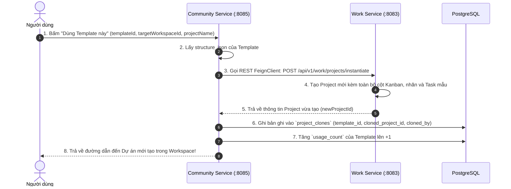

# 🌐 Tài liệu Kỹ thuật: Community Service – DATN-2026

> **Module:** `community-service`  
> **Port:** `8085`  
> **Tech Stack:** Spring Boot 3, Spring Data JPA, PostgreSQL, Redis Caching, Spring Cloud OpenFeign  
> **Java:** 21

---

## 1. TỔNG QUAN SERVICE

`community-service` là dịch vụ mở (Public Platform) cho phép người dùng trong hệ sinh thái chia sẻ sáng kiến cộng đồng, bài viết kỹ thuật (Blog/Knowledge), thảo luận và chia sẻ các **Mẫu dự án / Quy trình làm việc (Project Templates)** để các thành viên khác có thể nhân bản (clone) về Workspace của họ.

```
                      ┌────────────────────────┐
                      │   API Gateway (:8081)  │
                      └───────────┬────────────┘
                                  │ Forward /community/**
                                  ▼
                      ┌────────────────────────┐
                      │   Community Service    │  :8085
                      │ (Knowledge & Templates)│
                      └─────┬────────────┬─────┘
                            │            │
            ┌───────────────┘            └────────────────┐
            ▼                                             ▼
  ┌───────────────────┐                         ┌───────────────────┐
  │ PostgreSQL DB     │                         │ Work Service      │
  │ (Initiatives,     │                         │ (:8083)           │
  │  Posts, Templates)│                         │ (Clone Project    │
  └───────────────────┘                         │  from Template)   │
                                                └───────────────────┘
```

---

## 2. DANH SÁCH THỰC THỂ DỮ LIỆU (ENTITIES)

Service quản lý trực tiếp các thực thể:
1. **Sáng kiến cộng đồng**: `initiatives`, `initiative_votes`
2. **Bài viết & Tri thức**: `posts`, `tags`, `post_tags`, `post_comments`, `post_votes`

---

## 3. DANH SÁCH REST API CHÍNH (`/api/v1/community`)

### 3.1. Sáng kiến cộng đồng (Initiatives)
| Method | Endpoint | Mô tả |
| :--- | :--- | :--- |
| `POST` | `/api/v1/community/initiatives` | Tạo sáng kiến cộng đồng mới |
| `GET` | `/api/v1/community/initiatives` | Danh sách sáng kiến (hỗ trợ phân trang, lọc theo category, sắp xếp theo upvote) |
| `GET` | `/api/v1/community/initiatives/{id}` | Chi tiết sáng kiến |
| `POST` | `/api/v1/community/initiatives/{id}/vote` | Bình chọn Upvote / Downvote sáng kiến |

### 3.2. Bài viết & Thảo luận (Posts & Knowledge)
| Method | Endpoint | Mô tả |
| :--- | :--- | :--- |
| `POST` | `/api/v1/community/posts` | Đăng bài viết chia sẻ kinh nghiệm |
| `GET` | `/api/v1/community/posts` | Danh sách bài viết (lọc theo Tag, Search từ khóa) |
| `GET` | `/api/v1/community/posts/{id}` | Đọc chi tiết bài viết |
| `POST` | `/api/v1/community/posts/{id}/comments` | Thêm bình luận trao đổi dưới bài viết |
| `POST` | `/api/v1/community/posts/{id}/vote` | Đánh giá bài viết |
| `GET` | `/api/v1/community/tags` | Danh sách các Tag phổ biến |

### 3.3. Kho Mẫu Dự án (Marketplace Project Templates & Cloning)
| Method | Endpoint | Mô tả |
| :--- | :--- | :--- |
| `GET` | `/api/v1/community/templates` | Khám phá các Project Template công khai (`is_template = true & is_public = true`) |
| `GET` | `/api/v1/community/templates/{projectId}` | Xem chi tiết cấu trúc cột Kanban & Task mẫu của Template |
| `POST` | `/api/v1/community/templates/{projectId}/clone` | **Nhân bản Template**: Khởi tạo 1 Project mới trong Workspace của User |

---

## 4. TÍNH NĂNG NHÂN BẢN DỰ ÁN (PROJECT CLONING FLOW)



---

## 5. TỐI ƯU HIỆU NĂNG VỚI REDIS CACHE

Do Community là dịch vụ thiên về **Đọc dữ liệu (Read-Heavy)**:
- Cache danh sách Top Templates phổ biến vào Redis (`TTL = 1 giờ`).
- Cache danh sách bài viết hot và danh mục Tags.
- Khi có lượt Vote mới, cập nhật Atomic Counter trên Redis trước khi ghi nhận xuống Database.
