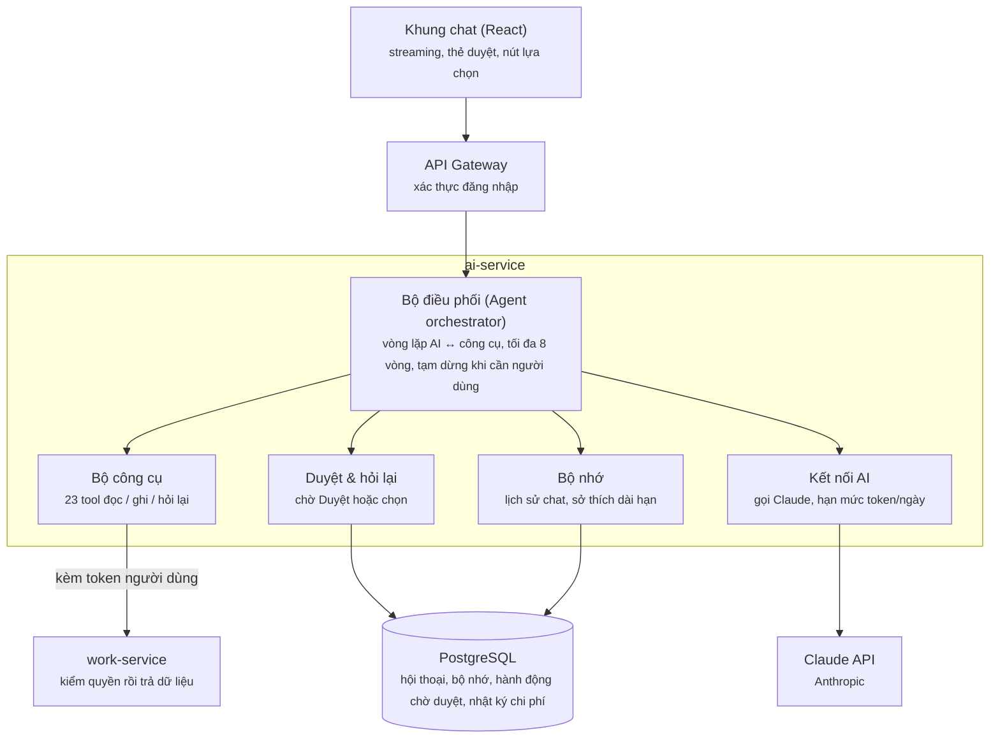
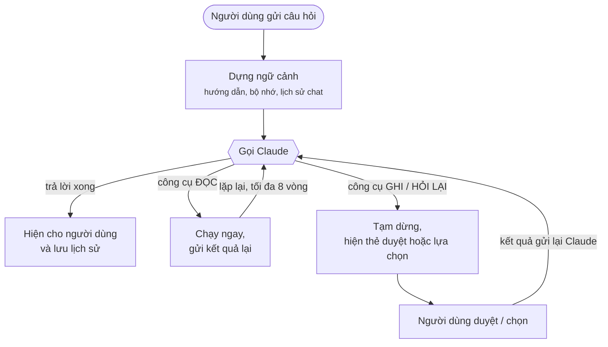
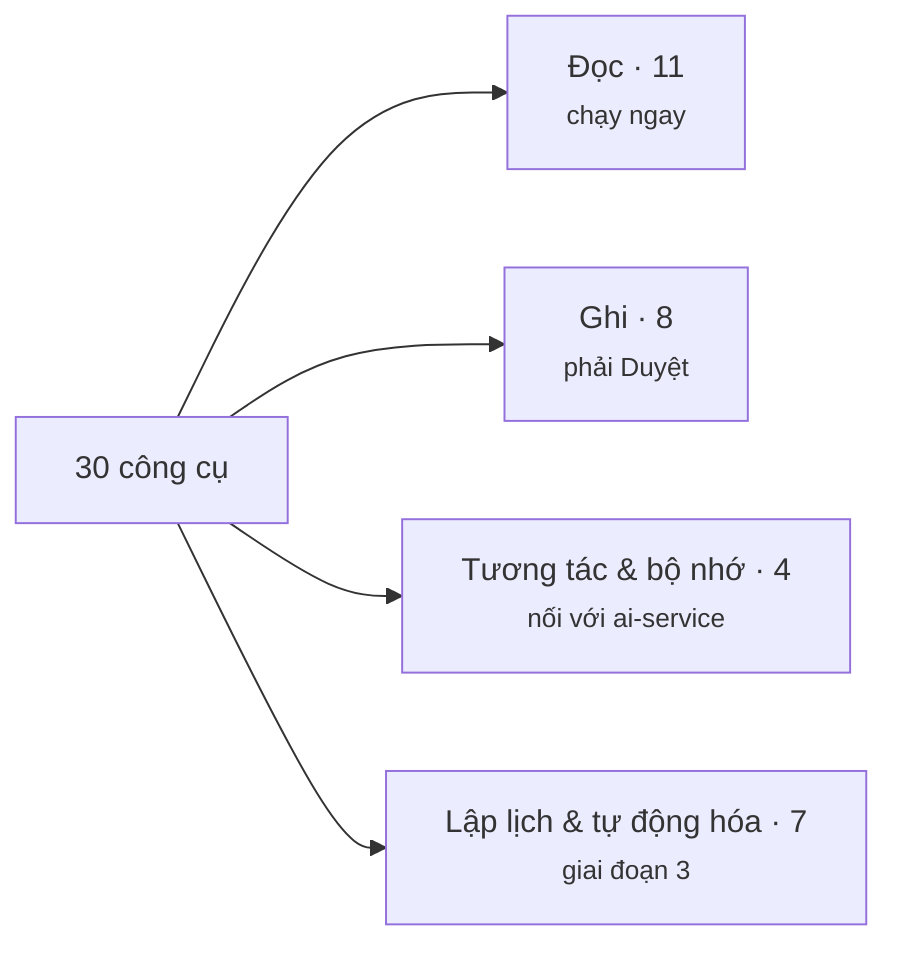
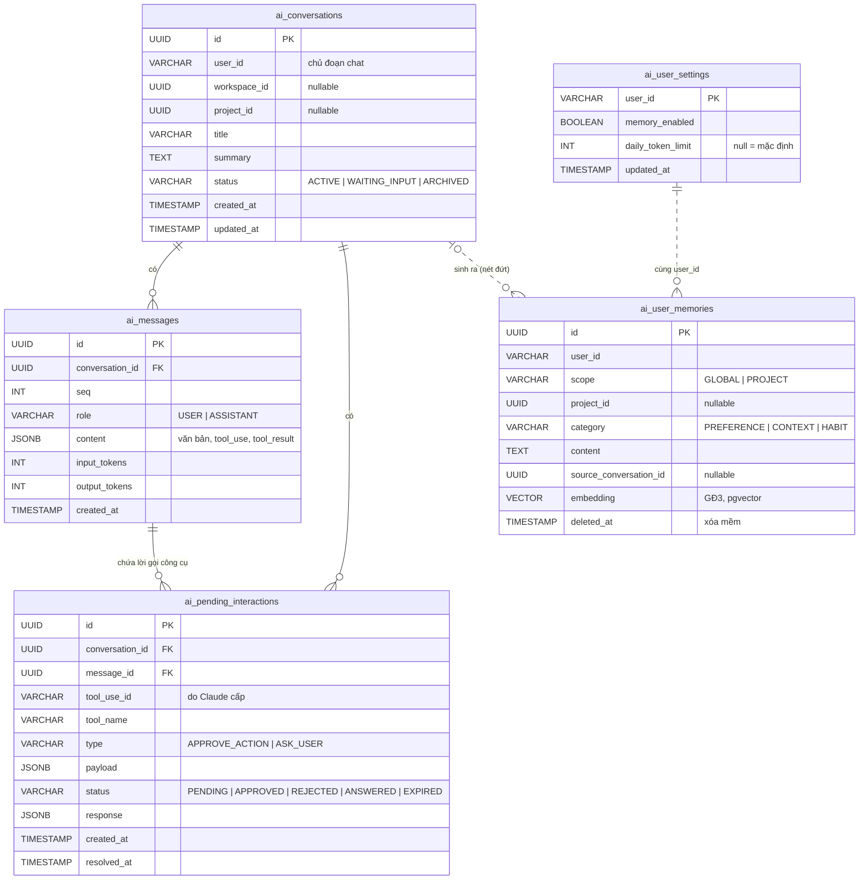
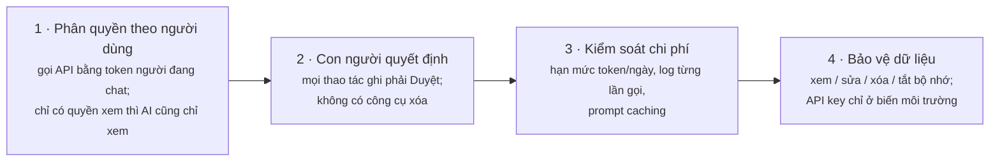
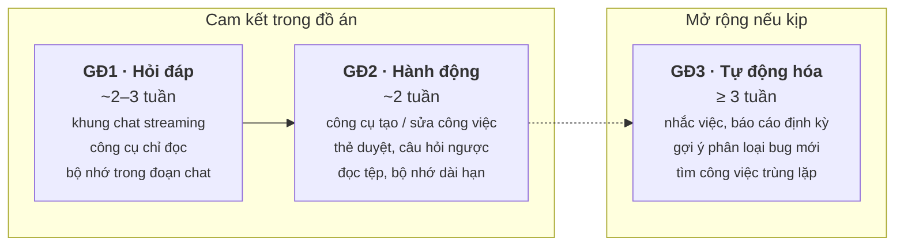

# 01 · Tổng hợp đề xuất Trợ lý AI (AI Agent) cho DATN-2026

> **Nguồn:** `De-xuat-chuc-nang-Tro-ly-AI-DATN-2026.docx` (12/11/2026, Nguyễn Viết Tuấn Anh).
> **Mục đích tài liệu này:** bản Markdown gọn của đề xuất, sắp lại theo logic *vấn đề → giải pháp → cách hoạt động → dữ liệu → an toàn → kế hoạch → đánh giá*. Năm hình trong file Word được vẽ lại bằng Mermaid.
> **Không thêm ý mới:** mọi nhận xét, chỗ sai và đề xuất sửa nằm ở [02_DANH_GIA_DE_XUAT_TRO_LY_AI.md](02_DANH_GIA_DE_XUAT_TRO_LY_AI.md). Thiết kế triển khai ở [03_TAI_LIEU_TRIEN_KHAI_TRO_LY_AI.md](03_TAI_LIEU_TRIEN_KHAI_TRO_LY_AI.md).

---

## Tóm tắt một đoạn

Thêm vào hệ thống một **khung chat AI bên phải màn hình**. Người dùng hỏi hoặc ra lệnh bằng tiếng Việt, trợ lý tự tra cứu dữ liệu và soạn sẵn thao tác. **Mọi thay đổi dữ liệu phải được người dùng bấm Duyệt**, và trợ lý **không bao giờ vượt quá quyền** của người đang dùng, vì nó gọi API bằng chính token của người đó.

| Mục | Nội dung chính |
|---|---|
| Đặt ở đâu | `ai-service` (microservice mới), đi qua API Gateway như các service khác |
| Mô hình AI | Claude (Anthropic) |
| Cách lấy dữ liệu | Chỉ qua API có sẵn của `work-service`, dưới dạng 23 **công cụ** (tool), không truy cập thẳng DB |
| Cam kết | Giai đoạn 1 (hỏi đáp) + giai đoạn 2 (hành động). Giai đoạn 3 (tự động hóa) là mở rộng |
| Đánh giá | Bộ ~30 câu hỏi mẫu, đo 6 tiêu chí định lượng |

---

## 1. Vấn đề và mục tiêu

Người dùng tốn nhiều thao tác cho việc lặp lại: phải mở nhiều màn hình, đặt bộ lọc rồi tự tổng hợp.

| Tình huống hiện tại | Phải làm tay |
|---|---|
| "Sprint này còn bao nhiêu việc chưa xong, của ai?" | Mở Board → lọc sprint → đếm từng cột |
| Chia một story thành 3 subtask | Mở form tạo item 3 lần, điền lại các trường giống nhau |
| Thành viên mới chưa quen giao diện | Không biết chức năng nằm ở đâu |

Ngành đã đi theo hướng này: Linear và Jira đều có trợ lý AI hỏi bằng ngôn ngữ tự nhiên và làm hộ thao tác.

**Mục tiêu:** giảm số thao tác. Người dùng *nói điều mình muốn* thay vì phải biết *bấm vào đâu*.

---

## 2. Trợ lý làm được gì

Khung chat dùng được ở mọi trang trong dự án và biết người dùng đang ở dự án nào, đang mở công việc nào (nên hiểu được câu kiểu "tóm tắt cái này").

| # | Khả năng | Người dùng nói | Trợ lý làm |
|---|---|---|---|
| 1 | Hỏi đáp, tra cứu | "Bug nào của tôi sắp quá hạn?" | Tìm và trả danh sách kèm mã công việc, hạn chót |
| 2 | Thực hiện hành động | "Tạo 3 subtask cho AUTH-12" | Soạn sẵn 3 subtask, hiện **thẻ xác nhận**; chỉ tạo khi bấm **Duyệt** |
| 3 | Hỏi lại khi chưa rõ | "Sửa item login" | Thấy 3 item khớp → hỏi lại kèm **nút lựa chọn** |
| 4 | Ghi nhớ | "Luôn trả lời ngắn gọn giúp tôi" | Lưu sở thích, áp dụng cho các lần chat sau |

Nguyên tắc: **trợ lý đề xuất, người dùng quyết định.**

```
┌──────────────────────────────────────────┐
│ Trợ lý AI                             ✕  │
├──────────────────────────────────────────┤
│ Bạn: Tạo 3 subtask cho AUTH-12           │
│                                          │
│ ┌ Xác nhận tạo 3 subtask ──────────────┐ │
│ │ • Thiết kế form đăng nhập            │ │
│ │ • Gọi API xác thực                   │ │
│ │ • Viết test                          │ │
│ │          [ Từ chối ]  [ Duyệt ]      │ │
│ └──────────────────────────────────────┘ │
│                                          │
│ Bạn: Sửa item login                      │
│ AI: Có 3 công việc khớp, bạn chọn:       │
│ [AUTH-3 Trang login] [AUTH-7 Login GG]   │
│ [AUTH-9 Lỗi login]                       │
└──────────────────────────────────────────┘
```
*Minh họa lại hình 1 của bản gốc: thẻ duyệt hành động và câu hỏi ngược có lựa chọn.*

---

## 3. Cách hoạt động

AI không chạm vào cơ sở dữ liệu. Nó làm việc như một nhân viên dùng phần mềm: được giao một bộ **công cụ**, tự chọn công cụ phù hợp. Mỗi công cụ là một lời gọi tới API sẵn có (ví dụ "tìm công việc", "xem tiến độ sprint").

### 3.1. Kiến trúc tổng quan



Điểm mấu chốt: bộ công cụ gọi `work-service` **bằng token của người dùng**, nên mọi kiểm tra quyền vẫn do hệ thống phân quyền hiện có đảm nhận.

### 3.2. Vòng lặp xử lý một câu hỏi

Bộ điều phối gửi câu hỏi + danh sách công cụ cho Claude. Claude trả lời ngay hoặc yêu cầu dùng công cụ. Bộ điều phối xử lý theo **loại công cụ**, gửi kết quả lại, lặp cho tới khi có câu trả lời cuối (**tối đa 8 vòng**).



| Loại công cụ | Hành vi |
|---|---|
| Đọc | Chạy ngay, không hỏi |
| Ghi | Dừng, hiện thẻ xác nhận, chỉ chạy khi bấm **Duyệt** |
| Hỏi lại (`ask_user`) | Dừng, hiện 2–5 lựa chọn; câu trả lời của người dùng là kết quả công cụ |

### 3.3. Phần sinh viên tự xây dựng

Mô hình AI chỉ là một khối. Khối lượng chính nằm ở phần bao quanh:

| Thành phần | Vai trò |
|---|---|
| Bộ điều phối | Vòng lặp gọi AI và công cụ, giới hạn số vòng, tạm dừng / tiếp tục |
| Bộ công cụ | 23 công cụ đọc, ghi, tương tác (giai đoạn 1–2) |
| Duyệt và hỏi lại | Dừng chờ người dùng duyệt hoặc chọn đáp án |
| Bộ nhớ | Ngắn hạn (trong một đoạn chat) và dài hạn (sở thích người dùng) |
| Tích hợp phân quyền | Truyền danh tính người dùng để phân quyền hiện có tự kiểm tra |
| Giao diện chat | Streaming từng chữ, thẻ duyệt, nút lựa chọn |

---

## 4. Danh mục công cụ

23 công cụ cho giai đoạn 1–2, cộng 7 công cụ giai đoạn 3. Mỗi công cụ là **một lớp Java** khai báo tên, mô tả, định dạng đầu vào và loại. Mỗi lượt chat chỉ đưa cho AI **15–20 công cụ phù hợp với trang đang mở**.



### 4.1. Đọc dữ liệu (chạy ngay)

| Công cụ | Chức năng | Controller (work-service) | GĐ |
|---|---|---|:-:|
| `search_work_items` | Tìm theo từ khóa, loại, trạng thái, người được giao, sprint, ưu tiên | WorkItemController | 1 |
| `get_work_item` | Chi tiết theo mã (vd. AUTH-12): mô tả, subtask, bình luận gần nhất | WorkItemController | 1 |
| `get_my_issues` | Công việc giao cho người đang chat | WorkItemController | 1 |
| `get_project_metadata` | Loại công việc, trạng thái workflow, mức ưu tiên (để tra đúng id) | WorkItemTypeController, WorkflowController | 1 |
| `list_project_members` | Thành viên và vai trò (đổi tên người → userId) | ProjectMemberController | 1 |
| `list_sprints` | Sprint đang chạy / sắp tới / đã xong | SprintController | 1 |
| `get_sprint_progress` | Point đã xong / còn lại, số việc theo trạng thái | SprintController, AgileReportController | 1 |
| `get_agile_report` | Velocity, burndown | AgileReportController | 1 |
| `get_contribution_report` | Đóng góp từng thành viên trong sprint | ContributionReportController | 2 |
| `list_attachments` | Tệp đính kèm của một công việc | WorkItemAttachmentController | 2 |
| `read_attachment` | Đọc nội dung tệp (PDF, ảnh, Word, Excel), có giới hạn dung lượng | WorkItemAttachmentController (MinIO) | 2 |

### 4.2. Ghi dữ liệu (chỉ chạy khi bấm Duyệt)

| Công cụ | Chức năng | Controller (work-service) | GĐ |
|---|---|---|:-:|
| `create_work_item` | Tạo Epic / Story / Task / Bug | WorkItemController | 2 |
| `create_subtasks` | Tạo nhiều subtask trong một lần duyệt | WorkItemController | 2 |
| `update_work_item` | Sửa tóm tắt, mô tả, ưu tiên, story point, ngày bắt đầu, hạn chót | WorkItemController | 2 |
| `transition_work_item` | Chuyển trạng thái theo workflow | WorkItemTransitionController | 2 |
| `assign_work_item` | Giao việc cho thành viên | WorkItemController | 2 |
| `move_to_sprint` | Đưa vào / ra khỏi sprint | BacklogController | 2 |
| `add_comment` | Thêm bình luận | WorkItemCommentController | 2 |
| `link_work_items` | Liên kết hai công việc (chặn, liên quan, trùng) | WorkItemLinkController | 2 |

### 4.3. Tương tác và bộ nhớ (xử lý trong ai-service)

| Công cụ | Chức năng | Cách xử lý | GĐ |
|---|---|---|:-:|
| `ask_user` | Hỏi lại kèm 2–5 lựa chọn | Tạm dừng; câu trả lời là kết quả công cụ | 2 |
| `save_memory` | Ghi nhớ sở thích / bối cảnh | Chạy ngay, hiện "Đã ghi nhớ"; người dùng xóa được | 2 |
| `delete_memory` | Xóa một mục ghi nhớ | Chạy ngay | 2 |
| `search_past_conversations` | Tìm trong các đoạn chat cũ | Chạy ngay, chỉ trong chat của chính người dùng | 2 |

### 4.4. Lập lịch và tự động hóa (giai đoạn 3, mở rộng)

| Công cụ | Chức năng | Loại |
|---|---|---|
| `create_reminder` | Nhắc việc vào một thời điểm | Ghi |
| `create_scheduled_task` | Tác vụ định kỳ (vd. tóm tắt sprint mỗi thứ 2 gửi email) | Ghi |
| `list_scheduled_tasks` | Xem lời nhắc / tác vụ định kỳ | Đọc |
| `cancel_scheduled_task` | Hủy lời nhắc / tác vụ | Ghi |
| `send_notification` | Gửi email cho thành viên qua notification-service | Ghi |
| `suggest_sprint_plan` | Đề xuất việc đưa vào sprint theo velocity và backlog | Đọc |
| `find_similar_work_items` | Tìm công việc gần giống (phát hiện trùng) | Đọc |

> **Cố ý không có công cụ xóa** (công việc, sprint, dự án). Thao tác khó hoàn tác luôn do người dùng tự làm trên giao diện.

---

## 5. Bộ nhớ và cơ sở dữ liệu

Các bảng nằm trong PostgreSQL sẵn có, do `ai-service` quản lý bằng **Flyway riêng**. Mọi cột `user_id` là **Keycloak `sub`**, thống nhất với `work-service`.

| Loại bộ nhớ | Cách hoạt động |
|---|---|
| **Ngắn hạn** (một đoạn chat) | Mỗi lượt đọc lại lịch sử trong `ai_messages` và gửi kèm cho AI. Chat quá dài → tin cũ được tóm tắt vào cột `summary`, chỉ giữ nguyên tin gần nhất; kết quả công cụ cũ được rút gọn |
| **Dài hạn** (theo người dùng) | Các mục trong `ai_user_memories` được đưa vào phần hướng dẫn đầu mỗi đoạn chat. Chỉ ghi điều hệ thống chưa có (sở thích, bối cảnh, thói quen); dữ liệu công việc luôn lấy mới qua công cụ |

### 5.1. Quan hệ 5 bảng bộ nhớ



### 5.2. Bảng khác của ai-service

| Bảng | Dùng để | GĐ |
|---|---|:-:|
| `ai_usage_logs` | Token, chi phí ước tính, model của từng lần gọi AI | 1 |
| `ai_chat_files` | Tệp tải thẳng vào khung chat (lưu MinIO) | 2 |
| `ai_scheduled_tasks` | Lời nhắc và tác vụ định kỳ | 3 |

Bộ đếm hạn mức token trong ngày đặt ở **Redis** (đã có), không cần bảng.

---

## 6. An toàn và kiểm soát



Thêm: nội dung công việc (mô tả, bình luận) được AI coi là **dữ liệu, không phải mệnh lệnh** để chống *prompt injection*; bước duyệt là lớp chặn cuối.

---

## 7. Phạm vi và lộ trình

Mỗi giai đoạn xong đều là sản phẩm dùng và demo được. Thời gian là ước tính.



GĐ3 cần cơ chế **chạy nền khi người dùng không trực tuyến**, nên để làm hướng phát triển.

---

## 8. Đánh giá kết quả

Bộ ~30 câu hỏi mẫu trên dữ liệu dự án thử nghiệm, kèm đáp án mong đợi; chạy và ghi lại kết quả.

| Tiêu chí | Cách đo |
|---|---|
| Tỉ lệ chọn đúng công cụ | So công cụ AI gọi với công cụ mong đợi |
| Tỉ lệ trả lời đúng | So câu trả lời với dữ liệu thật |
| Tỉ lệ hỏi lại hợp lý | Câu mơ hồ → AI có hỏi lại thay vì đoán không |
| Thời gian phản hồi (giây) | Tới chữ đầu tiên và tới khi xong |
| Chi phí mỗi câu (USD) | Tính từ token đã log |
| Số thao tác tiết kiệm | Số lần bấm làm tay vs. dùng trợ lý, cho 5 tác vụ tiêu biểu |

Kết quả trình bày trong báo cáo cuối kỳ, kèm phân tích các câu trả lời sai.

---

## 9. Kết luận của đề xuất

| Giá trị | Diễn giải |
|---|---|
| Tiết kiệm thao tác | Nói điều mình muốn thay vì tìm nút bấm |
| An toàn | Dùng lại phân quyền sẵn có; mọi thay đổi do con người duyệt |
| Mở rộng được | Thêm khả năng = viết thêm công cụ, không sửa bộ điều phối |

---

## Phụ lục · Ghi chú chuyển đổi

- Giữ nguyên toàn bộ 30 công cụ, 8 bảng, 6 tiêu chí đánh giá và lộ trình của bản gốc.
- Bỏ dòng trống cuối bảng "Đánh giá kết quả" trong bản Word.
- Câu kết "Em kính mong thầy cô xem xét…" được lược vì tài liệu này dùng nội bộ nhóm.
- Hình 1 (mockup khung chat) vẽ lại dạng ASCII; hình 2–5 vẽ lại bằng Mermaid, giữ nguyên nội dung.
