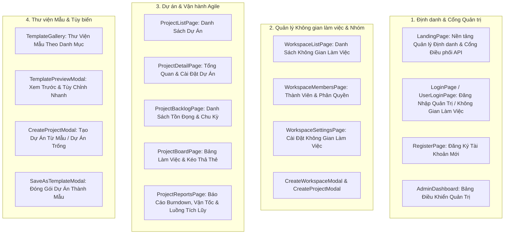

# BẢN ĐẶC TẢ & TỪ ĐIỂN THUẬT NGỮ TIẾNG VIỆT TRONG FRONTEND (UI/UX TERMINOLOGY & STYLE GUIDE)

> **Dự án:** Hệ thống Quản trị Công việc & Dự án Vi dịch vụ (DATN-2026)  
> **Phạm vi áp dụng:** Toàn bộ giao diện người dùng Frontend (`frontend/src/` - React 19 / Vite / Lucide Icons)  
> **Vị trí tài liệu:** `docs/services/language/1_FRONTEND_VIETNAMESE_TERMINOLOGY_AND_STYLE_GUIDE.md`  
> **Ngày phê duyệt & cập nhật:** 22/10/2026  
> **Trạng thái:** `Chính thức áp dụng (Active Standard)`  

---

## 📑 MỤC LỤC

1. [Mục đích & Phạm vi Chuẩn hóa](#1-mục-đích--phạm-vi-chuẩn-hóa)
2. [Nguyên tắc Bản địa hóa & Giọng văn (Tone of Voice & Principles)](#2-nguyên-tắc-bản-địa-hóa--giọng-văn-tone-of-voice--principles)
3. [Từ điển Thuật ngữ Cốt lõi & Đối chiếu Anh - Việt (Master Bilingual Glossary)](#3-từ-điển-thuật-ngữ-cốt-lõi--đối-chiếu-anh---việt-master-bilingual-glossary)
   - [3.1. Quản lý Công việc & Phân cấp (Work Items & Hierarchy)](#31-quản-lý-công-việc--phân-cấp-work-items--hierarchy)
   - [3.2. Nhóm Trạng thái & Vòng đời Quy trình FSM (Status & Workflow)](#32-nhóm-trạng-thái--vòng-đời-quy-trình-fsm-status--workflow)
   - [3.3. Mức độ Ưu tiên (Priorities)](#33-mức-độ-ưu-tiên-priorities)
   - [3.4. Chu kỳ Sprint, Danh sách chờ & Bảng điều khiển (Sprint, Backlog & Board)](#34-chu-kỳ-sprint-danh-sách-chờ--bảng-điều-khiển-sprint-backlog--board)
   - [3.5. Không gian làm việc & Phân quyền (Workspace & Identity)](#35-không-gian-làm-việc--phân-quyền-workspace--identity)
   - [3.6. Thư viện Mẫu & Nhân bản Dự án (Template & Cloning)](#36-thư-viện-mẫu--nhân-bản-dự-án-template--cloning)
   - [3.7. Mối quan hệ & Liên kết Phụ thuộc (Issue Links)](#37-mối-quan-hệ--liên-kết-phụ-thuộc-issue-links)
4. [Từ điển Nhãn Giao diện, Nút bấm & Biểu mẫu (UI Actions, Forms & Placeholders)](#4-từ-điển-nhãn-giao-diện-nút-bấm--biểu-mẫu-ui-actions-forms--placeholders)
   - [4.1. Các nút bấm Thao tác Chính (Action Buttons)](#41-các-nút-bấm-thao-tác-chính-action-buttons)
   - [4.2. Nhãn Trường Biểu mẫu (Form Field Labels)](#42-nhãn-trường-biểu-mẫu-form-field-labels)
   - [4.3. Gợi ý Nhập liệu (Placeholders)](#43-gợi-ý-nhập-liệu-placeholders)
5. [Hệ thống Thông báo, Cảnh báo & Trạng thái Lỗi (Toasts & Alerts)](#5-hệ-thống-thông-báo-cảnh-báo--trạng-thái-lỗi-toasts--alerts)
   - [5.1. Thông báo Thành công (Success Toasts)](#51-thông-báo-thành-công-success-toasts)
   - [5.2. Thông báo Lỗi & Từ chối Quyền (Error / Warning Toasts)](#52-thông-báo-lỗi--từ-chối-quyền-error--warning-toasts)
   - [5.3. Hộp thoại Cảnh báo Nguy hiểm (Destructive Confirmations)](#53-hộp-thoại-cảnh-báo-nguy-hiểm-destructive-confirmations)
6. [Bảng Kiểm kê Thuật ngữ theo Từng Phân hệ Màn hình (Screen Inventory)](#6-bảng-kiểm-kê-thuật-ngữ-theo-từng-phân-hệ-màn-hình-screen-inventory)
7. [Báo cáo Rà soát: Các điểm Lệch chuẩn & Đề xuất Thống nhất](#7-báo-cáo-rà-soát-các-điểm-lệch-chuẩn--đề-xuất-thống-nhất)

---

## 1. MỤC ĐÍCH & PHẠM VI CHUẨN HÓA

Trong quá trình phát triển hệ thống **DATN-2026** (một nền tảng quản trị công việc và quy trình chuẩn Jira Cloud), việc đồng bộ ngôn ngữ đóng vai trò sống còn đối với trải nghiệm người dùng (UX) và tính chuyên nghiệp của sản phẩm:
- **Khắc phục tình trạng dịch tự động chắp vá ("nửa nạc nửa mỡ")**: Tránh việc màn hình này dùng từ tiếng Anh (`Epic`, `Sprint`, `Workspace`), màn hình kia lại dùng tiếng Việt dịch thô hoặc không nhất quán.
- **Tiêu chuẩn hóa văn phong công sở chuyên nghiệp**: Cung cấp bộ từ điển ngữ nghĩa rõ ràng, trang trọng, phù hợp với văn hóa doanh nghiệp Việt Nam nhưng vẫn giữ đúng bản chất phương pháp luận quốc tế Agile/Scrum.
- **Tài liệu tham chiếu bắt buộc**: Định hướng cho các kỹ sư Frontend, Backend, Tester và Hội đồng chấm bảo vệ đồ án tốt nghiệp khi đối chiếu giữa mã nguồn và tài liệu nghiệp vụ.

---

## 2. NGUYÊN TẮC BẢN ĐỊA HÓA & GIỌNG VĂN (TONE OF VOICE & PRINCIPLES)

```
┌─────────────────────────────────────────────────────────────────────────────┐
│                       3 NGUYÊN TẮC CỐT LÕI BẢN ĐỊA HÓA                      │
├─────────────────────────────────────────────────────────────────────────────┤
│ 1. TỰ NHIÊN & CHÍNH XÁC: Rõ nghĩa, không dịch máy móc (word-by-word).       │
│ 2. SONG NGỮ KỸ THUẬT: Giữ nguyên thuật ngữ IT/Agile toàn cầu (Scrum, Kanban)│
│ 3. NHẤT QUÁN CHÍNH TẢ: Tuân thủ quy chuẩn ngữ pháp tiếng Việt hiện đại.    │
└─────────────────────────────────────────────────────────────────────────────┘
```

1. **Nguyên tắc 1: Tự nhiên và Đúng nghĩa Nghiệp vụ**
   - Không dịch từ theo nghĩa đen gây khó hiểu (ví dụ: `Epic` **không** dịch là "Sử thi", mà dịch là **"Hạng mục lớn"**; `Story` dịch là **"Câu chuyện người dùng"**; `Backlog` dịch là **"Danh sách tồn đọng"**).
   - Đặt hành động lên hàng đầu đối với nút bấm: Động từ + Danh từ ngắn gọn (*Tạo dự án*, *Lưu thay đổi*, *Khôi phục*).

2. **Nguyên tắc 2: Chiến lược Song ngữ (Bilingual Strategy)**
   - **Giữ nguyên thuật ngữ chuyên ngành toàn cầu**: `Scrum`, `Kanban`, `Markdown`, `Keycloak`, `OAuth2`, `JQL`, `REST API`, `UUID`.
   - **Việt hóa toàn diện thực thể người dùng tương tác**: `Workspace` $\to$ Không gian làm việc, `Issue / Work Item` $\to$ Công việc / Nhiệm vụ, `Priority` $\to$ Mức độ ưu tiên.

3. **Nguyên tắc 3: Quy chuẩn Chính tả Tiếng Việt**
   - **Quy tắc bỏ dấu mới**: Ưu tiên chuẩn chính tả tiếng Việt hiện đại: Dùng **Hủy** (thay vì *Huỷ*), **Quy trình** (thay vì *Qui trình*), **Dịch vụ**, **Ký tự**.
   - **Viết hoa**: Chỉ viết hoa chữ cái đầu câu và danh từ riêng/tên nhãn chức năng (Title Case cho tiêu đề chính, Sentence case cho nút bấm và nhãn phụ).

---

## 3. TỪ ĐIỂN THUẬT NGỮ CỐT LÕI & ĐỐI CHIẾU ANH - VIỆT (MASTER BILINGUAL GLOSSARY)

### 3.1. Quản lý Công việc & Phân cấp (Work Items & Hierarchy)

Hệ thống phân cấp công việc tuân thủ cấu trúc 3 tầng chuẩn Jira (`Hierarchy Level: 1, 0, -1`). Các thuật ngữ được định nghĩa chính thức tại `frontend/src/constants/workConstants.js` và `frontend/src/constants/jiraTokens.js`:

| Thuật ngữ Gốc (En) | Thuật ngữ Tiếng Việt Chuẩn | Phân cấp | Mã Hệ Thống | Giải thích Ngữ cảnh |
|---|---|:---:|:---:|---|
| **Work Item / Issue** | **Công việc / Hạng mục** | — | `WORK_ITEM` | Thực thể đơn vị công việc trong dự án |
| **Epic** | **Hạng mục lớn** | Cấp 1 (`1`) | `EPIC` | Mục tiêu lớn hoặc tập hợp tính năng phức tạp kéo dài qua nhiều chu kỳ |
| **User Story** | **Câu chuyện người dùng** | Cấp 0 (`0`) | `STORY` | Yêu cầu nghiệp vụ hoặc tính năng nhìn từ góc độ người dùng cuối |
| **Task** | **Nhiệm vụ** | Cấp 0 (`0`) | `TASK` | Công việc kỹ thuật hoặc tác vụ phát triển tiêu chuẩn |
| **Bug** | **Lỗi phần mềm** | Cấp 0 (`0`) | `BUG` | Lỗi phát sinh hoặc sự cố kỹ thuật cần khắc phục |
| **Sub-task / Subtask** | **Nhiệm vụ con** | Cấp -1 (`-1`)| `SUB_TASK` | Tác vụ chi tiết được chia nhỏ từ công việc cấp cha (Level 0) |
| **Parent Item** | **Công việc cha** | — | `parentItemId` | Công việc cấp trên sở hữu nhiệm vụ con |
| **Hierarchy Level** | **Cấp bậc phân cấp** | — | `hierarchyLevel` | Bậc phân cấp: 1 (Lớn), 0 (Tiêu chuẩn), -1 (Con) |
| **Summary** | **Tiêu đề công việc** | — | `summary` | Tóm tắt ngắn gọn nội dung công việc |
| **Description** | **Mô tả chi tiết** | — | `description` | Nội dung mô tả chi tiết, tiêu chí nghiệm thu (Markdown) |
| **Story Points** | **Điểm ước lượng** | — | `storyPoints` | Điểm đo lường quy mô, độ phức tạp tương đối |

---

### 3.2. Nhóm Trạng thái & Vòng đời Quy trình FSM (Status & Workflow)

Hệ sinh thái trạng thái được nhóm thành 3 Category chuẩn Jira Cloud:

| Thuật ngữ Gốc (En) | Thuật ngữ Tiếng Việt | Nhóm (Category) | Mã Màu Chuẩn | Giải thích Ý nghĩa |
|---|---|:---:|:---:|---|
| **To Do** | **Cần làm** | `TODO` | `#42526E` (Xám) | Công việc mới được tạo, đang chờ xử lý |
| **In Progress** | **Đang thực hiện** / **Đang làm** | `IN_PROGRESS` | `#0052CC` (Xanh dương) | Công việc đang được thành viên tích cực xử lý |
| **In Review** | **Chờ duyệt** / **Đang xét duyệt** | `IN_PROGRESS` | `#7C3AED` (Tím) | Công việc đã làm xong, chờ kiểm thử hoặc phê duyệt |
| **Done** | **Hoàn thành** | `DONE` | `#00875A` (Xanh lá) | Công việc đã hoàn tất nghiệm thu và đóng lại |
| **Workflow** | **Quy trình làm việc** | — | — | Máy trạng thái hữu hạn (FSM) điều khiển các bước chuyển |
| **Transition** | **Bước chuyển trạng thái** | — | — | Hành động chuyển từ trạng thái xuất phát sang đích |
| **Condition** | **Điều kiện tiên quyết** | — | — | Ràng buộc để nút chuyển trạng thái hiển thị |
| **Validator** | **Kiểm tra hợp lệ** | — | — | Điều kiện bắt buộc phải thỏa mãn trước khi bấm chuyển |
| **Post Function** | **Hàm hậu xử lý** | — | — | Tác vụ tự động chạy sau khi trạng thái đã đổi thành công |

#### Bảng chi tiết các Quy tắc Workflow FSM đã Việt hóa:
- **Chỉ người được giao việc** (`ASSIGNEE_ONLY`): Chỉ người được chỉ định mới được bấm chuyển.
- **Yêu cầu quyền hạn dự án** (`PERMISSION_REQUIRED`): Đòi hỏi quyền nội bộ trong dự án.
- **Toàn bộ nhiệm vụ con phải hoàn thành** (`ALL_SUBTASKS_DONE`): Bắt buộc đóng hết subtasks trước khi đóng task cha.
- **Bắt buộc có ước lượng** (`ESTIMATE_REQUIRED`): Phải có Story Point trước khi bắt đầu.
- **Ghi nhận thời gian giải quyết** (`SET_RESOLVED_TIME`): Tự động đánh dấu ngày kết thúc khi về `DONE`.

---

### 3.3. Mức độ Ưu tiên (Priorities)

Được định nghĩa tại `frontend/src/constants/jiraTokens.js` & `workConstants.js`:

| Mã Gốc (Code) | Tiếng Việt Hiển thị | Màu Nhận Diện | Cấp Độ (Level) |
|---|---|:---:|:---:|
| `HIGHEST` / `BLOCKER` | **Khẩn cấp** / **Rất cao** | `#DE350B` / `#DC2626` | Cấp 5 - 6 (Đỏ rực) |
| `HIGH` | **Cao** | `#FF5630` / `#EA580C` | Cấp 4 (Cam đậm) |
| `MEDIUM` | **Trung bình** | `#FFAB00` / `#D97706` | Cấp 3 (Vàng hổ phách) |
| `LOW` | **Thấp** | `#36B37E` / `#059669` | Cấp 2 (Xanh lục) |
| `LOWEST` | **Rất thấp** / **Thấp nhất** | `#6B778C` / `#94A3B8` | Cấp 1 (Xám) |

---

### 3.4. Chu kỳ Sprint, Danh sách chờ & Bảng điều khiển (Sprint, Backlog & Board)

| Thuật ngữ Gốc (En) | Thuật ngữ Tiếng Việt | Ngữ cảnh Sử dụng |
|---|---|---|
| **Sprint** | **Chu kỳ làm việc / Chu kỳ** *(hoặc giữ Sprint trong ngữ cảnh Agile)* | Khung thời gian cố định 1–4 tuần để hoàn thành cam kết |
| **Future Sprint** | **Chu kỳ dự kiến** | Sprint được lên kế hoạch trong tương lai, chưa bắt đầu |
| **Active Sprint** | **Chu kỳ đang chạy** | Sprint đang hoạt động trực tiếp trên Bảng (Active Board) |
| **Closed Sprint** | **Chu kỳ đã hoàn tất** | Sprint đã được đóng và tổng kết chỉ số |
| **Backlog** | **Danh sách tồn đọng** | Danh sách tập hợp toàn bộ các công việc đang chờ được xếp chu kỳ |
| **Active Board** | **Bảng làm việc** | Giao diện bảng trực quan dạng thẻ kéo thả (Kanban/Scrum) |
| **Board Column** | **Cột bảng** | Cột đại diện cho một hoặc nhiều trạng thái công việc |
| **WIP Limit** | **Giới hạn việc đang làm** | Số lượng thẻ công việc tối đa được phép nằm trong một cột |
| **Swimlane** | **Phân làn công việc** | Dòng phân chia bảng theo Tiêu chí (Người thực hiện, Hạng mục lớn...) |
| **Start Sprint** | **Bắt đầu chu kỳ** | Hành động kích hoạt một sprint chuyển sang trạng thái Active |
| **Complete Sprint** | **Hoàn tất chu kỳ** | Đóng sprint, chuyển việc chưa xong sang sprint mới hoặc về Backlog |
| **Velocity** | **Vận tốc làm việc / Vận tốc đội ngũ** | Tổng số Story Point hoàn thành trung bình mỗi chu kỳ |
| **Burndown Chart** | **Biểu đồ tiến độ (Burndown)** | Biểu đồ thể hiện khối lượng công việc giảm dần theo thời gian |
| **Cumulative Flow** | **Biểu đồ luồng tích lũy (CFD)** | Biểu đồ theo dõi sự ổn định của luồng công việc qua các trạng thái |

---

### 3.5. Không gian làm việc & Phân quyền (Workspace & Identity)

| Thuật ngữ Gốc (En) | Thuật ngữ Tiếng Việt | Ghi chú & Định vị |
|---|---|---|
| **Workspace** | **Không gian làm việc** | Tầng cao nhất bao bọc các dự án |
| **Workspace Switcher** | **Chuyển đổi không gian làm việc** | Hộp menu chọn chuyển nhanh giữa các workspace |
| **Team** | ~~Nhóm làm việc~~ | *(Đã loại bỏ trong kiến trúc phẳng 2 cấp Workspace -> Project)* |
| **Project** | **Dự án** | Đơn vị quản lý công việc cụ thể theo Scrum hoặc Kanban |
| **Project Key / Prefix** | **Mã dự án / Tiền tố viết tắt** | Mã định danh viết hoa (VD: `DATN`, `TCP`, `SHOP`) |
| **Admin Portal** | **Cổng Quản trị** | Cổng giao diện dành riêng cho Quản trị viên hệ thống |
| **Dashboard** | **Bảng điều khiển / Bảng tổng quan** | Màn hình hiển thị các widget đo lường chỉ số |
| **Admin** | **Quản trị viên** | Vai trò có toàn quyền cấu hình và điều hành |
| **Leader** | **Trưởng nhóm / Trưởng dự án** | Người lãnh đạo quản lý tiến độ và phân công thành viên |
| **Member** | **Thành viên** | Thành viên chính thức có quyền thực thi và tạo công việc |
| **Viewer** | **Người xem** | Quyền chỉ xem (Read-only), không chỉnh sửa dữ liệu |
| **Organisation** | **Tổ chức / Mã tổ chức** | Đơn vị doanh nghiệp quản lý định danh người dùng Keycloak |

---

### 3.6. Thư viện Mẫu & Nhân bản Dự án (Template & Cloning)

| Thuật ngữ Gốc (En) | Thuật ngữ Tiếng Việt | Giải thích |
|---|---|---|
| **Project Template** | **Dự án mẫu / Mẫu dự án** | Bản mẫu cấu hình sẵn trạng thái, loại việc, sprint và công việc |
| **Template Gallery** | **Thư viện dự án mẫu** | Nơi trưng bày các mẫu theo danh mục ngành nghề |
| **Blueprint** | **Bản thiết kế mẫu** | Toàn bộ dữ liệu cấu trúc bên trong của mẫu |
| **Quick Customization** | **Tùy chỉnh nhanh** | Tính năng sửa tên, bỏ bớt sprint/task ngay tại modal preview |
| **Use Template** | **Dùng mẫu này** | Nạp mẫu đã chọn vào form khởi tạo dự án |
| **Change Template** | **Đổi mẫu** | Hủy chọn mẫu hiện tại để chọn mẫu khác |
| **Preview Template** | **Xem trước mẫu** | Mở modal duyệt cấu trúc chi tiết của mẫu |
| **Back to Preview** | **Quay lại xem mẫu** | Nút quay lại modal xem trước từ form tạo dự án mà không bị mất dữ liệu |
| **Exclude / Skip** | **Bỏ qua / Loại trừ** | Đánh dấu không sao chép sprint hoặc công việc này |
| **Excluded by Parent** | **Bỏ qua theo cha** | Công việc con tự động bị bỏ qua do công việc cha bị loại trừ |
| **Undo / Restore** | **Khôi phục / Hoàn tác** | Khôi phục lại sprint hoặc công việc đã bị đánh dấu bỏ qua |
| **Reset to Default** | **Đặt lại mặc định** | Xóa toàn bộ các tùy chỉnh để trở về nguyên bản gốc của mẫu |
| **Save as Template** | **Lưu thành mẫu** | Đóng gói dự án đang chạy thành mẫu để tái sử dụng |

#### Bảng Danh mục Mẫu (Template Categories):
- **Phần mềm** (`SOFTWARE`): Dành cho lập trình, Agile Scrum, Kanban phần mềm.
- **Kinh doanh** (`BUSINESS`): Dành cho cửa hàng, nhà hàng, F&B, thương mại.
- **Tiếp thị & Truyền thông** (`MARKETING`): Dành cho chiến dịch truyền thông, quảng cáo, mạng xã hội.
- **Thiết kế** (`DESIGN`): Dành cho thiết kế đồ họa, UI/UX, thương hiệu.
- **Vận hành** (`OPERATIONS`): Quản lý hậu cần, chuỗi cung ứng, kho bãi.
- **Giáo dục** (`EDUCATION`): Kế hoạch giảng dạy, khóa học, đào tạo.
- **Khác** (`OTHER`): Dự án tự do hoặc mục đích khác.

---

### 3.7. Mối quan hệ & Liên kết Phụ thuộc (Issue Links)

Định nghĩa tại `frontend/src/constants/workConstants.js` (`LINK_TYPE_CONFIG`):

| Loại Liên Kết | Chiều Xuất Phát (Outward) | Chiều Đích (Inward) | Ý nghĩa Nghiệp vụ |
|---|---|---|---|
| `BLOCKS` | **Chặn tiến độ của** | **Bị chặn tiến độ bởi** | Task nguồn chưa xong thì task đích không thể làm |
| `RELATES_TO` | **Liên quan tới** | **Có liên quan tới** | Hai công việc có liên hệ nội dung với nhau |
| `DUPLICATES` | **Trùng lặp với** | **Bị trùng lặp bởi** | Hai công việc có nội dung trùng lặp cần gộp |
| `CLONES` | **Nhân bản từ** | **Bị nhân bản bởi** | Công việc được tạo ra từ việc sao chép công việc khác |
| `CAUSES` | **Gây ra lỗi** | **Bị gây ra bởi** | Một tác vụ hoặc thay đổi dẫn đến lỗi phần mềm |

---

## 4. TỪ ĐIỂN NHÃN GIAO DIỆN, NÚT BẤM & BIỂU MẪU (UI ACTIONS, FORMS & PLACEHOLDERS)

### 4.1. Các nút bấm Thao tác Chính (Action Buttons)

```
┌─────────────────────────┬─────────────────────────┬─────────────────────────┐
│     HÀNH ĐỘNG TẠO       │     HÀNH ĐỘNG LƯU       │    HÀNH ĐỘNG ĐIỀU HƯỚNG │
├─────────────────────────┼─────────────────────────┼─────────────────────────┤
│ • Tạo dự án             │ • Lưu thay đổi          │ • Quay lại xem mẫu      │
│ • Tạo không gian làm việc│ • Lưu bản nháp          │ • Quay lại              │
│ • Tạo nhóm làm việc     │ • Đổi mật khẩu          │ • Đổi mẫu               │
│ • Tạo công việc         │ • Cập nhật thông tin    │ • Xem trước             │
│ • Thêm thành viên       │ • Hoàn tất chu kỳ       │ • Đóng                  │
└─────────────────────────┴─────────────────────────┴─────────────────────────┘
```

| Nút Bấm Hiển Thị | Trạng thái Chờ (Loading State) | Ngữ cảnh Sử Dụng |
|---|---|---|
| **Đăng nhập** | `Đang xử lý...` | Form xác thực đăng nhập |
| **Đăng ký tài khoản** | `Đang đăng ký...` | Form tạo tài khoản người dùng mới |
| **Tạo mới / Tạo dự án** | `Đang khởi tạo dự án...` | Modal tạo dự án mới |
| **Lưu thay đổi** | `Đang lưu...` | Cập nhật cấu hình cài đặt dự án / workspace |
| **Xác nhận xóa** | `Đang xóa...` | Xác nhận xóa vĩnh viễn thực thể |
| **Thêm vào nhóm** | `Đang thêm...` | Mời/gán người dùng vào nhóm làm việc |
| **Rời khỏi nhóm** | `Đang rời...` | Rút lui khỏi nhóm làm việc hiện tại |
| **Liên kết** | `Đang tạo liên kết...` | Tạo quan hệ phụ thuộc giữa 2 công việc |
| **Gửi bình luận** | `Đang gửi...` | Đăng trao đổi trong chi tiết công việc |
| **Bỏ qua / Loại trừ** | — | Loại bỏ sprint/công việc trong modal tùy chỉnh |
| **Khôi phục** | — | Khôi phục sprint/công việc đã bị bỏ qua |
| **Đặt lại mặc định** | — | Khôi phục toàn bộ cấu hình ban đầu của mẫu |
| **Thử lại** | — | Nạp lại dữ liệu khi xảy ra lỗi mạng |
| **Đăng xuất** | — | Đăng xuất khỏi phiên làm việc hiện tại |

---

### 4.2. Nhãn Trường Biểu mẫu (Form Field Labels)

- **Tên không gian làm việc \*** (`workspaceName`): Bắt buộc.
- **Tên nhóm làm việc \*** (`teamName`): Bắt buộc.
- **Tên dự án \*** (`projectName`): Bắt buộc.
- **Mã dự án (Tiền tố viết tắt) \*** (`projectKey`): Viết hoa, từ 2 đến 10 ký tự (VD: `PROJ`).
- **Mô hình quản lý công việc**: Lựa chọn giữa Quy trình Scrum hoặc Bảng Kanban.
- **Tiêu đề công việc \*** (`summary`): Tiêu đề ngắn gọn mô tả tác vụ.
- **Loại công việc \*** (`workItemType`): Danh sách Hạng mục lớn, Câu chuyện, Nhiệm vụ, Lỗi, Nhiệm vụ con.
- **Công việc cha \*** (`parentItem`): Bắt buộc khi tạo Nhiệm vụ con (Subtask).
- **Mức độ ưu tiên** (`priority`): Khẩn cấp, Cao, Trung bình, Thấp, Rất thấp.
- **Điểm ước lượng** (`storyPoints`): Điểm Fibonacci (1, 2, 3, 5, 8, 13...).
- **Người thực hiện** (`assignee`): Thành viên được chỉ định chịu trách nhiệm chính.
- **Người báo cáo / khởi tạo** (`reporter`): Người tạo công việc.
- **Chu kỳ làm việc** (`sprint`): Sprint mà công việc thuộc về (hoặc đưa về Backlog).
- **Hạn chót dự kiến** (`dueDate`): Ngày cần bàn giao nghiệm thu.
- **Màu sắc nhận diện** (`colorHex`): Mã hex đại diện trực quan cho trạng thái hoặc nhãn.
- **Cấp bậc phân cấp \*** (`hierarchyLevel`): Cấp 1, Cấp 0 hoặc Cấp -1.

---

### 4.3. Gợi ý Nhập liệu (Placeholders)

- `Nhập tiêu đề công việc rồi nhấn Enter...`
- `Nhập tiêu đề nhiệm vụ con...`
- `Chu kỳ này hướng tới điều gì?`
- `Thêm mô tả, tiêu chí nghiệm thu, link tài liệu (Hỗ trợ Markdown)...`
- `Thêm bình luận trao đổi (Hỗ trợ Markdown)...`
- `Tìm mẫu theo tên, mã, mô tả...`
- `Tìm theo mã (DATN-102) hoặc tiêu đề...`
- `Tìm trên bảng...`
- `Tìm thành viên theo tên, email, vai trò...`
- `Mô tả phạm vi trách nhiệm hoặc mục tiêu của nhóm làm việc...`
- `Mô tả ý nghĩa của trạng thái...`
- `Mô tả ý nghĩa, tiêu chuẩn và hướng dẫn sử dụng loại công việc này...`
- `Mật khẩu mới (tối thiểu 6 ký tự)...`
- `VD: Nghiệm thu, Yêu cầu, Bug nóng...`
- `VD: Đang duyệt mã, Đang kiểm thử, Sẵn sàng nghiệm thu...`

---

## 5. HỆ THỐNG THÔNG BÁO, CẢNH BÁO & TRẠNG THÁI LỖI (TOASTS & ALERTS)

### 5.1. Thông báo Thành công (Success Toasts)

- `Đã đăng xuất thành công!`
- `Đã đăng nhập thành công vào hệ thống!`
- `Đã tạo {tên_dự_án} từ mẫu: {N} trạng thái, {N} chu kỳ làm việc, {N} công việc.`
- `Công việc {MÃ_TASK} đã được tạo thành công!`
- `Đã cập nhật tiêu đề công việc.`
- `Đã lưu thay đổi quy trình làm việc.`
- `Đã hoàn tất chu kỳ {tên_sprint}.`
- `Đã kích hoạt chu kỳ {tên_sprint}.`
- `Đã thêm thành viên {tên} vào dự án.`
- `Đã hủy lời mời tham gia.`
- `Đã lưu dự án thành mẫu thành công!`

---

### 5.2. Thông báo Lỗi & Từ chối Quyền (Error / Warning Toasts)

- `Vui lòng nhập Tên đăng nhập và Mật khẩu.`
- `Chưa xác định được không gian làm việc. Vui lòng tải lại trang.`
- `Mã dự án chỉ được chứa chữ cái in hoa (A-Z) và số, độ dài từ 2 đến 10 ký tự.`
- `Không thể tải chi tiết công việc. Vui lòng kiểm tra kết nối mạng.`
- `Bạn không có quyền chuyển trạng thái công việc.`
- `Thẻ này vừa được người khác di chuyển. Đang tải lại bảng.`
- `Không thể đóng công việc cha khi vẫn còn nhiệm vụ con chưa hoàn thành!`
- `Bắt buộc phải nhập điểm ước lượng trước khi chuyển sang trạng thái Đang làm.`
- `Cột này đã đạt giới hạn việc đang làm (WIP Limit). Không thể nhận thêm thẻ!`
- `Không thể tải danh sách dự án: {lý_do}.`
- `Xóa dự án thất bại: Vui lòng kiểm tra lại quyền quản trị.`

---

### 5.3. Hộp thoại Cảnh báo Nguy hiểm (Destructive Confirmations)

- **Xác nhận xóa dự án:**
  > *"Hành động này không thể hoàn tác. Mọi công việc, chu kỳ làm việc, cấu hình quy trình và lịch sử đính kèm của dự án sẽ bị xóa vĩnh viễn. Để xác nhận, vui lòng nhập chính xác mã dự án `{MÃ_DỰ_ÁN}`:"*
- **Xác nhận xóa không gian làm việc:**
  > *"Bạn có chắc chắn muốn xóa không gian làm việc này? Toàn bộ các dự án và nhóm làm việc trực thuộc sẽ bị ảnh hưởng."*
- **Xác nhận rời nhóm làm việc:**
  > *"Bạn sẽ mất quyền truy cập vào các công việc và tài nguyên thuộc nhóm này."*

---

## 6. BẢNG KIỂM KÊ THUẬT NGỮ THEO TỪNG PHÂN HỆ MÀN HÌNH (SCREEN INVENTORY)



| Phân Hệ | Màn Hình / Component Chính | Thuật ngữ Tiếng Việt Chủ Đạo |
|---|---|---|
| **1. Định danh & Quản trị** | `LandingPage.jsx`, `LoginPage.jsx`, `UserLoginPage.jsx`, `RegisterPage.jsx`, `AdminDashboard.jsx` | Cổng Quản trị, Nền tảng Quản lý Định danh, Cổng Điều phối API, Xác thực Keycloak, Tên đăng nhập, Mật khẩu, Mã tổ chức, Vi dịch vụ đã kết nối, Tổng người dùng. |
| **2. Không gian làm việc & Nhóm** | `WorkspaceListPage.jsx`, `WorkspaceMembersPage.jsx`, `WorkspaceSettingsPage.jsx`, `WorkspaceSwitcher.jsx` | Không gian làm việc, Chuyển đổi không gian, Nhóm làm việc, Thành viên, Mời thành viên, Rời nhóm, Xóa không gian làm việc, Vai trò, Trưởng nhóm, Quản trị viên. |
| **3. Dự án & Cấu hình** | `ProjectListPage.jsx`, `ProjectDetailPage.jsx`, `ProjectWorkflowTab.jsx`, `ProjectMembersTab.jsx` | Mã dự án viết tắt, Mô hình quản lý, Quy trình làm việc, Trạng thái, Bước chuyển, Điều kiện tiên quyết, Kiểm tra hợp lệ, Hàm hậu xử lý, Bản thiết kế. |
| **4. Backlog & Chu kỳ** | `ProjectBacklogPage.jsx`, `SprintAccordion.jsx`, `SprintFormModal.jsx`, `CompleteSprintModal.jsx` | Danh sách tồn đọng, Chu kỳ làm việc, Bắt đầu chu kỳ, Hoàn tất chu kỳ, Điểm ước lượng, Đưa về tồn đọng, Di chuyển sang chu kỳ mới, Mục tiêu chu kỳ. |
| **5. Bảng Active Board** | `ProjectBoardPage.jsx`, `BoardColumn.jsx`, `BoardCard.jsx`, `InteractiveBoard.jsx` | Bảng làm việc, Cột bảng, Kéo thả thẻ, Giới hạn việc đang làm (WIP Limit), Lọc theo người thực hiện, Lọc theo Hạng mục lớn, Phân làn công việc (Swimlane). |
| **6. Chi tiết & Tạo công việc** | `CreateWorkItemModal.jsx`, `WorkItemDetailModal.jsx`, `BacklogIssueRow.jsx` | Hạng mục lớn, Câu chuyện người dùng, Nhiệm vụ, Lỗi phần mềm, Nhiệm vụ con, Công việc cha, Tiêu đề, Mô tả Markdown, Quan hệ phụ thuộc, Hoạt động & Nhật ký kiểm toán. |
| **7. Báo cáo & Đo lường** | `ProjectReportsPage.jsx`, `BurndownChart.jsx`, `VelocityChart.jsx`, `CumulativeFlowChart.jsx` | Báo cáo dự án, Biểu đồ khối lượng giảm dần (Burndown), Vận tốc đội ngũ (Velocity), Biểu đồ luồng tích lũy (Cumulative Flow), Đường lý tưởng, Điểm hoàn thành. |
| **8. Mẫu dự án & Nhân bản** | `TemplateGallery.jsx`, `TemplatePreviewModal.jsx`, `CreateProjectModal.jsx`, `SaveAsTemplateModal.jsx` | Dự án mẫu, Thư viện mẫu, Tùy chỉnh nhanh, Đổi tên trạng thái/loại việc, Bỏ qua sprint/công việc, Bỏ qua theo cha, Khôi phục, Quay lại xem mẫu, Dời ngày tự động. |

---

## 7. BÁO CÁO RÀ SOÁT: CÁC ĐIỂM LỆCH CHUẨN & ĐỀ XUẤT THỐNG NHẤT

Qua quá trình rà soát tự động 93 tệp tin mã nguồn Frontend (`1902 dòng chứa tiếng Việt`), hệ thống ghi nhận **3 điểm không nhất quán nhỏ** cần được lưu ý và tiếp tục chuẩn hóa trong các lượt cập nhật tiếp theo:

### 7.1. Chính tả từ "Hủy" vs "Huỷ"
- **Hiện trạng:**
  - 98% codebase dùng chữ `Hủy` (dấu hỏi trên chữ y: *Hủy bỏ*, *Hủy thao tác*).
  - Vẫn còn 2 vị trí dùng chữ `Huỷ` (dấu hỏi trên chữ u kiểu cũ):
    - `frontend/src/components/backlog/InlineCreateIssueRow.jsx:113`
    - `frontend/src/components/sprints/SprintFormModal.jsx:159`
- **Đề xuất:** Thay thế 2 vị trí trên về chuẩn chung: **`Hủy`**.

### 7.2. Sử dụng linh hoạt giữa "Chu kỳ làm việc", "Chu kỳ" và "Sprint"
- **Hiện trạng:**
  - Trong các thông báo người dùng và nhãn modal: dùng **"Chu kỳ làm việc"** hoặc **"Chu kỳ"**.
  - Trong tên nút kỹ thuật hoặc văn cảnh Agile đặc thù: dùng **"Sprint"** (ví dụ: *Start Sprint*, *Complete Sprint*, *Sprint 1*).
- **Đề xuất:**
  - **Giữ nguyên cách dùng này**: Đây là cách tiếp cận chuẩn "Bilingual Agile". Giúp người dùng doanh nghiệp dễ hiểu nghĩa tiếng Việt ("Chu kỳ"), nhưng các kỹ sư phần mềm quen thuộc với Scrum vẫn nhận diện được khái niệm "Sprint".

### 7.3. Sử dụng giữa "Không gian làm việc" và "Workspace"
- **Hiện trạng:**
  - Tiêu đề màn hình và nhãn chính dùng **"Không gian làm việc"**.
  - Tên component kỹ thuật và URL route dùng `workspace` (ví dụ: `/workspace/:id/projects`).
- **Đề xuất:**
  - Hoàn toàn chính xác theo tiêu chuẩn: Giao diện hiển thị (UI string) là tiếng Việt 100%, đường dẫn kỹ thuật giữ tiếng Anh để tương thích RESTful URL.

---

> **Kết luận:** Hệ sinh thái giao diện Frontend của DATN-2026 đã đạt mức độ hoàn thiện bản địa hóa tiếng Việt **~98%**, văn phong trang trọng, chuẩn phương pháp luận Scrum/Jira Cloud và sẵn sàng phục vụ trình chiếu, đánh giá tốt nghiệp.
