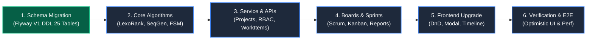

# 🏢 TỔNG QUAN KIẾN TRÚC & CHIẾN LƯỢC REFACTOR WORK SERVICE (JIRA-GRADE)
## DỰ ÁN: DATN-2026 — QUẢN LÝ DỰ ÁN & CÔNG VIỆC DOANH NGHIỆP

> **Module:** `work-service` (Core Project & Work Management Engine)  
> **Phiên bản:** 2.0 (Jira-Grade Enterprise Refactoring)  
> **Trạng thái:** Thiết kế & Lộ trình triển khai nâng cấp toàn diện  
> **Tài liệu liên quan:**  
> - [`2_WORK_DATABASE_DESIGN.md`](file:///d:/DATN-2026/docs/services/work_service_new/2_WORK_DATABASE_DESIGN.md) (Thiết kế CSDL 25 bảng & Indexing)  
> - [`3_WORK_SEQUENCE_DIAGRAMS.md`](file:///d:/DATN-2026/docs/services/work_service_new/3_WORK_SEQUENCE_DIAGRAMS.md) (Sơ đồ tuần tự các luồng nghiệp vụ)  
> - [`4_WORK_IMPLEMENTATION_PLAN.md`](file:///d:/DATN-2026/docs/services/work_service_new/4_WORK_IMPLEMENTATION_PLAN.md) (Lộ trình triển khai Fullstack 9 giai đoạn)  
> - [`5_WORK_FRONTEND_UI_JIRA_SPEC.md`](file:///d:/DATN-2026/docs/services/work_service_new/5_WORK_FRONTEND_UI_JIRA_SPEC.md) (Quy chuẩn giao diện Frontend chuẩn Jira Cloud & Ảnh mẫu)  
> - [`6_WORK_TESTING_GUIDE_PHASE1_TO_5.2.md`](file:///d:/DATN-2026/docs/services/work_service_new/6_WORK_TESTING_GUIDE_PHASE1_TO_5.2.md) (Hướng dẫn kiểm thử toàn diện từ Giai đoạn 1 đến Bước 5.2)

---

## 📑 MỤC LỤC
1. [Bối cảnh & Đánh giá Tính khả thi của việc Refactor](#1-bối-cảnh--đánh-giá-tính-khả-thi-của-việc-refactor)
2. [Triết lý Thiết kế: Kế thừa Hệ thống cũ & Chuẩn hóa Jira-Grade](#2-triết-lý-thiết-kế-kế-thừa-hệ-thống-cũ--chuẩn-hóa-jira-grade)
3. [So sánh Hiện trạng (V1) và Kiến trúc Đề xuất (V2)](#3-so-sánh-hiện-trạng-v1-và-kiến-trúc-đề-xuất-v2)
4. [Các Trụ cột Nâng cấp Cốt lõi (Core Architectural Pillars)](#4-các-trụ-cột-nâng-cấp-cốt-lõi-core-architectural-pillars)
5. [Tính Linh hoạt & Sự Mềm dẻo trong Mô hình Dữ liệu (Pragmatic Data Modeling)](#5-tính-linh-hoạt--sự-mềm-dẻo-trong-mô-hình-dữ-liệu-pragmatic-data-modeling)
6. [Chiến lược Chuyển đổi Không Gián đoạn (Zero-Downtime Migration Strategy)](#6-chiến-lược-chuyển-đổi-không-gián-đoạn-zero-downtime-migration-strategy)

---

## 1. Bối cảnh & Đánh giá Tính khả thi của việc Refactor

### 1.1. Hiện trạng Hệ thống (Work Service V1)
Trong giai đoạn đầu phát triển, `work-service` được xây dựng với mục tiêu cung cấp tính năng quản lý công việc và dự án cơ bản:
- **Tổ chức:** Cấu trúc phân cấp phẳng 2 tầng: Workspace -> Dự án (Project) -> Work Items, hỗ trợ phân quyền hạt mịn và sao chép Template (ProjectClone).
- **Công việc:** Mô hình Todo/Task phẳng hoặc liên kết cha-con đơn giản, trạng thái (Status) gắn cố định theo enum hoặc bảng cấu hình rời rạc.
- **Hạn chế gặp phải khi mở rộng:**
  1. *Thiếu phân cấp chuẩn Agile:* Khó phân biệt ranh giới giữa Epic (sáng kiến lớn), Story/Task (công việc tiêu chuẩn) và Sub-task (nhiệm vụ kỹ thuật con).
  2. *Quy trình chuyển trạng thái thiếu kiểm soát:* Bất kỳ ai cũng có thể chuyển task sang Done hoặc bỏ qua các bước kiểm thử/phê duyệt mà không có ràng buộc (Conditions/Validators).
  3. *Hiệu năng sắp xếp vị trí (Reordering):* Sử dụng số thứ tự nguyên integer thông thường gây nghẽn $O(N)$ write locks khi kéo thả thẻ trên Kanban / Backlog.
  4. *Audit Trail & Realtime yếu:* Không có cơ chế ghi log tự động dạng field-diff chuẩn xác và thiếu đồng bộ trạng thái realtime khi nhiều người cùng thao tác.

### 1.2. Đánh giá Tính Khả Thi
> [!IMPORTANT]
> **Kết luận nghiên cứu:** Dự án **HOÀN TOÀN KHẢ THI** và **CẦN THIẾT** để triển khai Refactor theo chuẩn Jira-Grade. 
> 
> Hệ thống hiện tại đã sở hữu sẵn nền móng rất tốt:
> - Đã có cấu trúc Microservices (API Gateway 8081, Identity Service 8082, Work Service 8083).
> - Đã có hạ tầng đầy đủ trong `docker-compose.infra.yml` (PostgreSQL 16, Keycloak 24, Redis 7, Kafka 3.8).
> - Backend sử dụng Java 21 + Spring Boot 3.x với Spring Data JPA, hỗ trợ rất mạnh cho việc triển khai Domain-Driven Design (DDD), Transactional Outbox và JPA Specification.
> - Frontend sử dụng React 19 + Vite + TailwindCSS + Lucide, dễ dàng bổ sung các component Kanban DnD, Backlog Accordion và Modal chi tiết Issue chuẩn hiện đại.

---

## 2. Triết lý Thiết kế: Kế thừa Hệ thống cũ & Chuẩn hóa Jira-Grade

Chiến lược refactor này tuân thủ nguyên tắc: **"Kế thừa vững chắc — Chuẩn hóa sâu sắc — Tinh chỉnh mềm dẻo"**.

```
┌─────────────────────────────────────────────────────────────────────────────┐
│                    TRIẾT LÝ REFACTOR WORK SERVICE V2                        │
├─────────────────────────┬──────────────────────────┬────────────────────────┤
│ 🛡️ TÔN TRỌNG CÁI CŨ    │ ⚙️ CHUẨN HÓA JIRA-GRADE  │ 🧩 LINH HOẠT & THỰC DỤNG│
├─────────────────────────┼──────────────────────────┼────────────────────────┤
│ • Giữ vững cấu trúc     │ • Phân cấp 3 tầng rõ     │ • Cho phép tùy biến    │
│   Workspace & Project   │   ràng (Epic/Story/Sub). │   Custom Fields JSONB. │
│   Workspace boundary.   │ • Máy trạng thái FSM     │ • Không gò bó DDL khi  │
│ • Không làm hỏng các    │   chặt chẽ (Conditions,  │   thêm trường mới.     │
│   tính năng Frontend    │   Validators, Post-fns). │ • Hỗ trợ cả 2 mô hình: │
│   cũ đang hoạt động.    │ • Mã việc nguyên tử      │   Simple Task (nhanh) &│
│ • Duy trì cơ chế clone  │   (PROJ-101) & LexoRank  │   Enterprise Scrum     │
│   template thông minh.  │   sắp xếp O(1).          │   (chặt chẽ).          │
└─────────────────────────┴──────────────────────────┴────────────────────────┘
```

1. **Tôn trọng hệ thống cũ:**
   - Bảo toàn phân định Workspace của `workspace-service` và phân quyền Project của `work-service`.
   - Các API cũ vẫn có adapter/wrapper tương thích để Frontend chuyển tiếp mượt mà.
   - Giữ lại tính năng cốt lõi đã làm tốt: Quản lý thành viên, vai trò trong dự án, clone template dự án kèm dịch chuyển timeline (Two-pass Date Shifting).

2. **Chặt chẽ theo chuẩn Jira (Jira-Grade):**
   - **Strict 3-Level Hierarchy:** Ngăn chặn tuyệt đối việc tạo Subtask lồng Subtask hoặc Story làm cha của Epic.
   - **Dynamic Workflow Engine (FSM):** Trạng thái công việc không còn là một chuỗi text tự do; nó được điều hướng bởi Workflow Transition có kiểm tra quyền và điều kiện.
   - **Audit Trail tự động:** Mỗi lần chỉnh sửa tóm tắt, mô tả, người gán, độ ưu tiên hay trạng thái đều tự động sinh bản ghi Changelog với giá trị cũ (old_value) và mới (new_value).

3. **Mềm dẻo và Thực dụng (Pragmatism):**
   - Không sao chép máy móc những phần quá cồng kềnh của Jira Enterprise (như ScriptRunner phức tạp hay hàng trăm bảng quan hệ phụ trợ).
   - Sử dụng sức mạnh của **PostgreSQL JSONB + GIN Indexing** để lưu trữ Custom Fields và Workflow Scheme Configurations, giúp hệ thống vừa mở rộng tức thì mà vẫn giữ tốc độ truy vấn cao.

---

## 3. So sánh Hiện trạng (V1) và Kiến trúc Đề xuất (V2)

| Đặc tính | Hiện trạng (V1) | Đề xuất Refactor (V2 Jira-Grade) | Lợi ích mang lại |
| :--- | :--- | :--- | :--- |
| **Mô hình Dữ liệu** | Bảng Task đơn giản, thiếu phân định rõ cấp bậc | Single-Table Inheritance (`work_items`) với `hierarchy_level` (-1, 0, 1) | Quản lý đồng nhất mọi loại công việc, dễ truy vấn cây quan hệ |
| **Mã công việc** | Tăng tự động hoặc UUID | Sinh mã nguyên tử theo Key dự án (vd: `DATN-1`, `DATN-2`) | Chuẩn nhận diện quốc tế, dễ trao đổi, tìm kiếm tức thì |
| **Quy trình Trạng thái** | Cập nhật trực tiếp status_id bất kỳ | Máy trạng thái FSM: Kiểm tra Transition, Conditions, Validators | Chặt chẽ, chống nhảy cóc quy trình, tự động hóa đóng việc |
| **Sắp xếp Thẻ (Ordering)** | Index số nguyên `display_order` | Chuỗi ký tự `LexoRank` (vd: `0|i0000z:`) | Kéo thả $O(1)$, không bao giờ phải re-index hàng trăm dòng dữ liệu |
| **Mở rộng Thuộc tính** | Sửa Schema DDL hoặc bảng EAV chậm chạp | `custom_fields JSONB` + `custom_field_defs` + GIN Index | Thêm trường động không cần sửa database, tìm kiếm siêu tốc |
| **Bảng Công việc (Board)**| Cột cố định TODO / DOING / DONE | Cột tùy biến liên kết nhiều Statuses, giới hạn WIP Limits | Hỗ trợ chuẩn mực cả Scrum Board & Kanban Board nâng cao |
| **Vòng đời Sprint** | Lưu ngày bắt đầu/kết thúc đơn thuần | Trạng thái vòng đời (`FUTURE` $\rightarrow$ `ACTIVE` $\rightarrow$ `CLOSED`) + Snapshot Report | Lưu trữ cố định số liệu Burndown Chart & Velocity không bị sai lệch |
| **Kiểm toán (Audit)** | Thiếu lịch sử thay đổi chi tiết | `work_item_changelogs` bắt diff tự động qua EntityListener | Minh bạch 100% ai đã sửa gì, khi nào, từ giá trị nào sang giá trị nào |
| **Toàn vẹn Sự kiện** | Gửi Kafka trực tiếp trong Controller/Service | Transactional Outbox Pattern (`outbox_events`) | Không bao giờ mất sự kiện dù mạng hay Kafka broker gặp sự cố |

---

## 4. Các Trụ cột Nâng cấp Cốt lõi (Core Architectural Pillars)

```
                              ┌───────────────────────────────────┐
                              │     API GATEWAY (Port: 8081)      │
                              └─────────────────┬─────────────────┘
                                                │
                                                ▼
┌─────────────────────────────────────────────────────────────────────────────────────────────────┐
│                              WORK SERVICE (Port: 8083 - Spring Boot 3)                          │
├─────────────────────────────────────────────────────────────────────────────────────────────────┤
│ ┌──────────────────────┐  ┌──────────────────────┐  ┌──────────────────────┐  ┌───────────────┐ │
│ │ 1. Hierarchy & Key   │  │ 2. FSM Workflow      │  │ 3. LexoRank          │  │ 4. Audit Trail│ │
│ │ • Strict 3-Level     │  │ • Transitions        │  │ • O(1) Reordering    │  │ • Field Diff  │ │
│ │ • Atomic Code Gen    │  │ • Pre/Post Hooks     │  │ • Collision Resolve  │  │ • Auto Log    │ │
│ └──────────────────────┘  └──────────────────────┘  └──────────────────────┘  └───────────────┘ │
│ ┌──────────────────────┐  ┌──────────────────────┐  ┌──────────────────────┐  ┌───────────────┐ │
│ │ 5. Agile Lifecycle   │  │ 6. Board Engine      │  │ 7. Template Cloner   │  │ 8. Realtime   │ │
│ │ • Sprint State Mach. │  │ • WIP Limit Guards   │  │ • Two-pass Shift Date│  │ • WebSocket   │ │
│ │ • Snapshot Reports   │  │ • Dynamic Swimlanes  │  │ • Deep Tree Copy     │  │ • Outbox Kafka│ │
│ └──────────────────────┘  └──────────────────────┘  └──────────────────────┘  └───────────────┘ │
└───────────────────────────────────────────────┬─────────────────────────────────────────────────┘
                                                │
                 ┌──────────────────────────────┼──────────────────────────────┐
                 ▼                              ▼                              ▼
      ┌────────────────────┐         ┌────────────────────┐         ┌────────────────────┐
      │   PostgreSQL 16    │         │      Redis 7       │         │  Apache Kafka 3.8  │
      │ 25 Tables + JSONB  │         │ Ephemeral Presence │         │ Outbox Event Queue │
      │ B-Tree & GIN Index │         │ Fast Caching Locks │         │ Inter-service Sync │
      └────────────────────┘         └────────────────────┘         └────────────────────┘
```

### Trụ cột 1: Phân cấp Công việc 3 Tầng Nghiêm ngặt (Strict 3-Level Hierarchy)
- **Level 1 (Epic):** Sáng kiến lớn hoặc tính năng lớn xuyên suốt nhiều Sprint. Không có parent.
- **Level 0 (Standard Items):** `User Story`, `Task`, `Bug`. Có thể gắn vào 1 Epic (parent_id) hoặc đứng độc lập.
- **Level -1 (Sub-task):** Nhiệm vụ phân rã nhỏ của Story/Task/Bug. Bắt buộc phải có parent là Level 0. Không cho phép Sub-task lồng Sub-task.

### Trụ cột 2: Máy Trạng thái Hữu hạn (Dynamic Finite State Machine Workflow)
- Thay vì `item.setStatus("DONE")`, mọi thay đổi trạng thái phải đi qua phương thức:  
  `workflowEngine.executeTransition(workItemId, transitionId, userContext, inputPayload)`
- Quy trình gồm 4 giai đoạn thực thi tuần tự:
  1. **Condition Check:** Người dùng có đủ quyền (Role/Assignee/Reporter) để thấy/bấm bước chuyển không?
  2. **Validator Check:** Dữ liệu có thỏa mãn điều kiện chuyển (vd: Muốn Done thì phải đóng hết Subtask, hoặc bắt buộc nhập Resolution/Time Spent)?
  3. **State Mutation:** Chuyển trạng thái sang Status mới và cập nhật thời gian.
  4. **Post-function Hooks:** Tự động hóa sau chuyển đổi (Ghi changelog, bắn thông báo, tạo Outbox event, cập nhật Resolution Date).

### Trụ cột 3: Sắp xếp Vị trí $O(1)$ với Thuật toán LexoRank
- Thay vì sử dụng số nguyên `order_index` (khiến mỗi lần kéo thả giữa 2 card phải `UPDATE tasks SET order_index = order_index + 1 WHERE ...` gây khóa hàng loạt dòng), LexoRank sinh ra chuỗi ký tự nằm giữa 2 chuỗi có sẵn.
- **Ví dụ:** Kéo thẻ vào giữa `0|i0000a:` và `0|i0000c:` $\rightarrow$ Rank mới là `0|i0000b:`.
- Thao tác chỉ thực thi duy nhất **1 câu lệnh UPDATE đơn lẻ** ($O(1)$) trên thẻ vừa di chuyển.

### Trụ cột 4: Audit Trail & Changelog Bắt Diff Tự động
- Tích hợp JPA EntityListener (`@PostUpdate`, `@PostPersist`).
- Tự động so sánh trạng thái trước và sau khi lưu của thực thể `WorkItem` để trích xuất danh sách các trường bị thay đổi (`summary`, `assignee_id`, `priority`, `status_id`, `story_points`...).
- Ghi tức thì vào bảng `work_item_changelogs` với định dạng JSONB rõ ràng, hỗ trợ truy xuất lịch sử mượt mà cho giao diện Activity tab.

---

## 5. Tính Linh hoạt & Sự Mềm dẻo trong Mô hình Dữ liệu (Pragmatic Data Modeling)

Để tránh rơi vào cái bẫy "quá tải kỹ thuật" (over-engineering) của Jira gốc, kiến trúc đề xuất áp dụng các giải pháp mềm dẻo:

1. **Gom nhóm bảng qua Single-Table Inheritance:**
   - Tất cả Epic, Story, Task, Bug, Subtask đều lưu trữ chung tại bảng `work_items`.
   - Phân biệt bằng `type_id` (trỏ đến `work_item_types`) có trường `hierarchy_level` và cờ `is_subtask`.
   - Giúp bảng biểu nhẹ nhàng, dễ viết truy vấn tìm kiếm toàn diện và tiết kiệm bộ nhớ kết nối CSDL.

2. **Mở rộng trường động bằng JSONB thay vì EAV (Entity-Attribute-Value):**
   - Các trường tùy biến (như *Ngày nghiệm thu*, *Mức độ nghiêm trọng*, *Khách hàng báo cáo*, *Link Figma*) được lưu trực tiếp trong cột `custom_fields JSONB` của `work_items`.
   - Bảng `custom_field_defs` chỉ đóng vai trò khai báo Metadata (Tên hiển thị, Kiểu dữ liệu `TEXT`, `NUMBER`, `DATE`, `DROPDOWN`, Bắt buộc hay không).
   - Đánh chỉ mục `GIN (custom_fields)` cho phép truy vấn tìm kiếm lọc trường động đạt tốc độ mili-giây.

3. **Hai chế độ làm việc (Hybrid Work Mode):**
   - Dự án vừa có thể cấu hình **Simple Workflow** (Open $\rightarrow$ In Progress $\rightarrow$ Done nhanh gọn cho các team nhỏ).
   - Vừa có thể áp dụng **Advanced Workflow Scheme** (Phân nhánh riêng cho Bug, Story với nhiều bước kiểm duyệt khắt khe cho team dự án lớn).

---

## 6. Chiến lược Chuyển đổi Không Gián đoạn (Zero-Downtime Migration Strategy)

Quá trình refactor được chia thành từng bước rõ ràng để không làm ảnh hưởng đến các service khác:



1. **Khởi tạo Database Song hành:** Toàn bộ bảng dữ liệu mới đã được thiết kế sẵn sàng trong Flyway migration script, bảo toàn các khóa ngoại liên kết tới Workspace và User ID của Identity Service.
2. **Kế thừa và Tương thích API:** Các Controller tiếp nhận request và trả về chuẩn `ApiResponse<T>` thống nhất toàn hệ thống DATN-2026.
3. **Optimistic Locking:** Sử dụng trường `@Version Long version` trên `work_items` và `sprints` để đảm bảo khi nhiều người dùng cùng chỉnh sửa hoặc kéo thả đồng thời trên Board, hệ thống tự động phát hiện xung đột và yêu cầu client refresh dữ liệu một cách an toàn.

---
> **Tiếp theo:** Vui lòng tham khảo chi tiết thiết kế CSDL tại [`2_WORK_DATABASE_DESIGN.md`](file:///d:/DATN-2026/docs/services/work_service_new/2_WORK_DATABASE_DESIGN.md).
