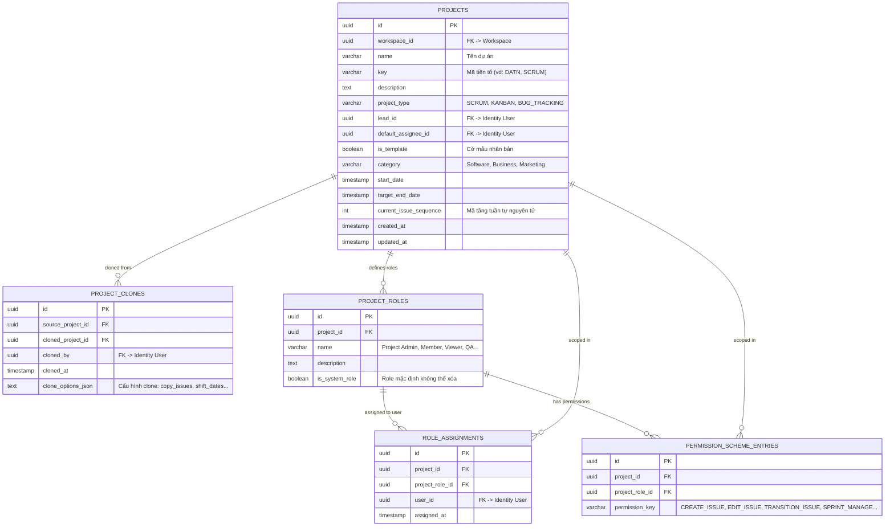
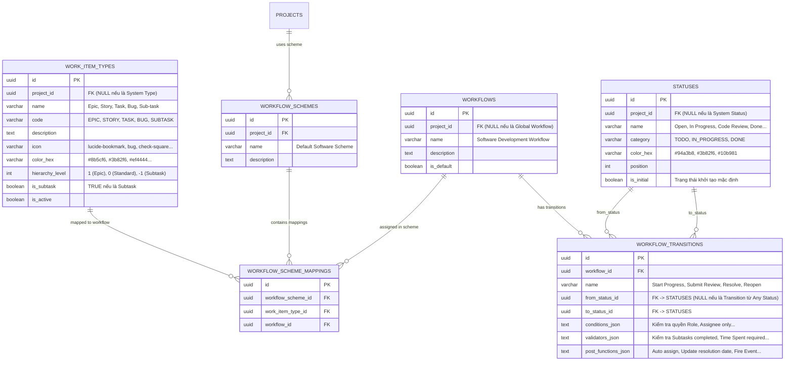
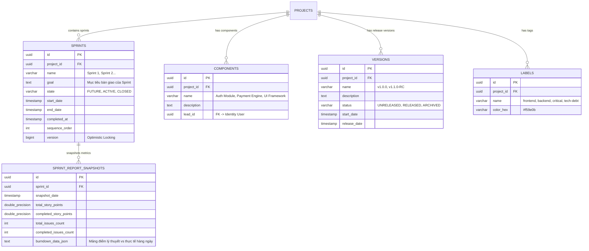
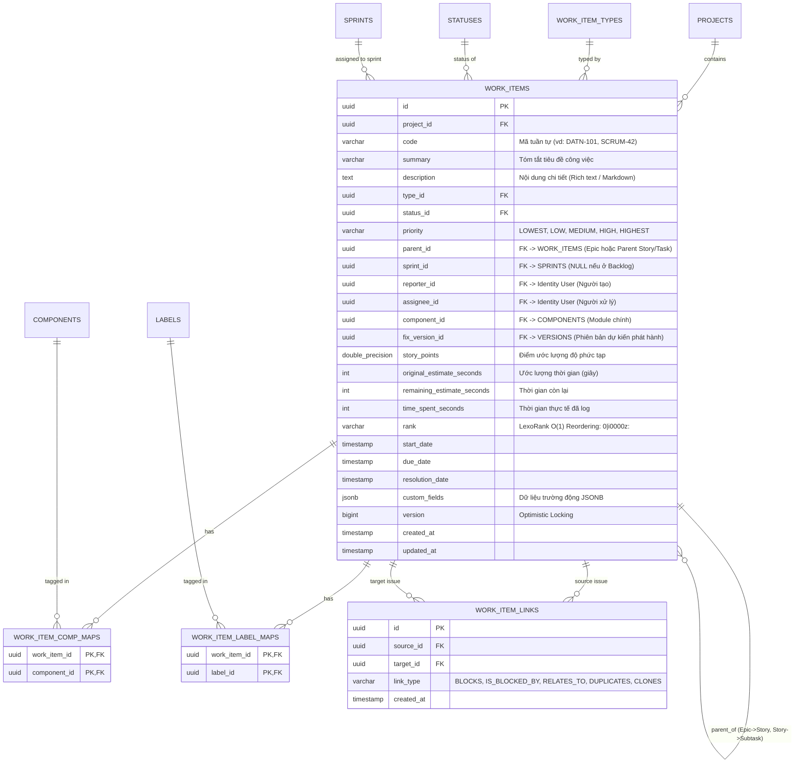
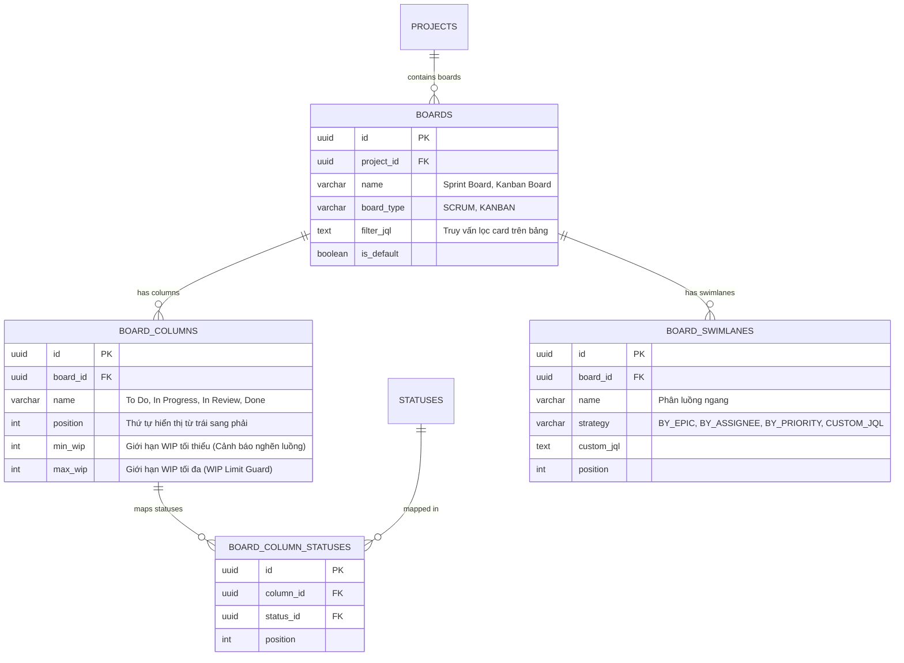

# 🗄️ THIẾT KẾ CƠ SỞ DỮ LIỆU CHUẨN JIRA-GRADE — WORK SERVICE (V2)
## DỰ ÁN: DATN-2026 — HỆ THỐNG QUẢN LÝ DỰ ÁN & CÔNG VIỆC DOANH NGHIỆP

> **Hệ quản trị CSDL:** PostgreSQL 16+  
> **Schema Migration:** Flyway (`V1__init_work_jira_schema.sql`)  
> **Tài liệu tham chiếu:** [`1_TONG_QUAN_KIEN_TRUC_WORK_SERVICE.md`](file:///d:/DATN-2026/docs/services/work_service/1_TONG_QUAN_KIEN_TRUC_WORK_SERVICE.md), [`3_SO_DO_TUAN_TU_NGHIEP_VU.md`](file:///d:/DATN-2026/docs/services/work_service/3_SO_DO_TUAN_TU_NGHIEP_VU.md), [`4_KE_HOACH_TRIEN_KHAI_CHI_TIET.md`](file:///d:/DATN-2026/docs/services/work_service/4_KE_HOACH_TRIEN_KHAI_CHI_TIET.md).

---

## 📑 MỤC LỤC
1. [Sơ đồ Phân cấp & Kiến trúc Tổng thể](#1-sơ-đồ-phân-cấp--kiến-trúc-tổng-thể)
2. [ERD Phân hệ 1: Tổ chức, Dự án & Phân quyền RBAC (7 bảng)](#2-erd-phân-hệ-1-tổ-chức-dự-án--phân-quyền-rbac)
3. [ERD Phân hệ 2: Loại công việc & Máy trạng thái Workflow FSM (6 bảng)](#3-erd-phân-hệ-2-loại-công-việc--máy-trạng-thái-workflow-fsm)
4. [ERD Phân hệ 3: Agile Scrum, Sprint, Component & Version (5 bảng)](#4-erd-phân-hệ-3-agile-scrum-sprint-component--version)
5. [ERD Phân hệ 4: Trọng tâm Work Items & Liên kết Phụ thuộc (4 bảng)](#5-erd-phân-hệ-4-trọng-tâm-work-items--liên-kết-phụ-thuộc)
6. [ERD Phân hệ 5: Bảng trực quan Boards, Columns & Swimlanes (4 bảng)](#6-erd-phân-hệ-5-bảng-trực-quan-boards-columns--swimlanes)
7. [ERD Phân hệ 6: Audit Trail, Tự động hóa & Transactional Outbox (7 bảng)](#7-erd-phân-hệ-6-audit-trail-tự-động-hóa--transactional-outbox)
8. [Chiến lược Indexing Tối ưu Hiệu năng (B-Tree & GIN Indexes)](#8-chiến-lược-indexing-tối-ưu-hiệu-năng-b-tree--gin-indexes)
9. [Bảng Tra cứu Tổng hợp 25 Thực thể (Data Dictionary)](#9-bảng-tra-cứu-tổng-hợp-25-thực-thể-data-dictionary)

---

## 1. Sơ đồ Phân cấp & Kiến trúc Tổng thể

```mermaid
graph TD
    classDef ws fill:#0f172a,stroke:#3b82f6,stroke-width:2px,color:#fff;
    classDef proj fill:#0369a1,stroke:#38bdf8,stroke-width:2px,color:#fff;
    classDef wi fill:#1e1b4b,stroke:#818cf8,stroke-width:2px,color:#fff;
    classDef epic fill:#581c87,stroke:#c084fc,stroke-width:2px,color:#fff;
    classDef std fill:#1e3a8a,stroke:#60a5fa,stroke-width:2px,color:#fff;
    classDef sub fill:#334155,stroke:#94a3b8,stroke-width:2px,color:#fff;

    WS["🏢 WORKSPACE (Workspace Service)<br/><i>Ranh giới tổ chức / Doanh nghiệp</i>"]:::ws
    PROJ["📁 PROJECTS (Work Service)<br/><i>Dự án Scrum / Kanban (Key: PROJ, SCRUM...)</i>"]:::proj
    WI["🗂️ BẢNG TRUNG TÂM work_items<br/><i>Single-Table Inheritance + JSONB custom_fields</i>"]:::wi

    L1["🟣 LEVEL 1: EPIC<br/><i>Sáng kiến lớn / Module cấp cao (parent_id = NULL)</i>"]:::epic
    STORY["🟢 LEVEL 0: USER STORY<br/><i>Yêu cầu nghiệp vụ (parent_id = Epic ID)</i>"]:::std
    TASK["🔵 LEVEL 0: TECHNICAL TASK<br/><i>Nhiệm vụ kỹ thuật (parent_id = Epic ID / NULL)</i>"]:::std
    BUG["🔴 LEVEL 0: DEFECT / BUG<br/><i>Lỗi phát sinh (parent_id = Epic ID / NULL)</i>"]:::std
    SUB["⚪ LEVEL -1: SUB-TASK<br/><i>Nhiệm vụ phân rã nhỏ (parent_id = Story/Task/Bug ID)</i>"]:::sub

    WS -->|1-to-N (Kiến trúc phẳng)| PROJ
    PROJ -->|Chứa tập hợp| WI

    WI -->|Hierarchy Level 1| L1
    WI -->|Hierarchy Level 0| STORY
    WI -->|Hierarchy Level 0| TASK
    WI -->|Hierarchy Level 0| BUG

    L1 -.->|Parent của| STORY
    L1 -.->|Parent của| TASK
    L1 -.->|Parent của| BUG

    STORY -->|Phân rã 1-to-N| SUB
    TASK -->|Phân rã 1-to-N| SUB
    BUG -->|Phân rã 1-to-N| SUB
```

---

## 2. ERD Phân hệ 1: Tổ chức, Dự án & Phân quyền RBAC



---

## 3. ERD Phân hệ 2: Loại công việc & Máy trạng thái Workflow FSM



---

## 4. ERD Phân hệ 3: Agile Scrum, Sprint, Component & Version



---

## 5. ERD Phân hệ 4: Trọng tâm Work Items & Liên kết Phụ thuộc



---

## 6. ERD Phân hệ 5: Bảng trực quan Boards, Columns & Swimlanes



---

## 7. ERD Phân hệ 6: Audit Trail, Tự động hóa & Transactional Outbox

```mermaid
erDiagram
    WORK_ITEMS ||--o{ WORK_ITEM_CHANGELOGS : "audited by"
    WORK_ITEMS ||--o{ WORK_ITEM_COMMENTS : "has discussion"
    WORK_ITEMS ||--o{ WORK_ITEM_ATTACHMENTS : "has files"
    PROJECTS ||--o{ CUSTOM_FIELD_DEFS : "defines custom fields"
    PROJECTS ||--o{ SAVED_FILTERS : "has saved filters"
    PROJECTS ||--o{ AUTOMATION_RULES : "has automation rules"

    WORK_ITEM_CHANGELOGS {
        uuid id PK
        uuid work_item_id FK
        uuid author_id "FK -> Identity User"
        varchar field_name "summary, status, assignee, priority..."
        text old_value
        text new_value
        timestamp created_at
    }

    WORK_ITEM_COMMENTS {
        uuid id PK
        uuid work_item_id FK
        uuid author_id "FK -> Identity User"
        uuid parent_id "FK -> WORK_ITEM_COMMENTS (Cây bình luận lồng nhau)"
        text body "Nội dung thảo luận (Markdown / Mentions)"
        timestamp created_at
        timestamp updated_at
    }

    WORK_ITEM_ATTACHMENTS {
        uuid id PK
        uuid work_item_id FK
        uuid uploader_id "FK -> Identity User"
        varchar file_name "screenshot-1.png, specs.pdf"
        varchar file_url "/uploads/work/..."
        varchar file_type "image/png, application/pdf"
        bigint file_size_bytes
        timestamp uploaded_at
    }

    CUSTOM_FIELD_DEFS {
        uuid id PK
        uuid project_id "FK (NULL nếu là trường Global)"
        varchar field_key "client_approval, acceptance_date, risk_score"
        varchar field_name "Ngày nghiệm thu khách hàng"
        varchar field_type "TEXT, NUMBER, DATE, DROPDOWN, CHECKBOX, USER_PICKER"
        text options_json "['Low', 'Medium', 'High']"
        boolean is_required
    }

    SAVED_FILTERS {
        uuid id PK
        uuid project_id FK
        uuid owner_id "FK -> Identity User"
        varchar name "Tất cả Bug nghiêm trọng đang mở"
        text jql_query "type = 'BUG' AND priority = 'HIGHEST' AND status != 'DONE'"
        boolean is_starred
    }

    AUTOMATION_RULES {
        uuid id PK
        uuid project_id FK
        varchar name "Tự động chuyển Story sang Done khi mọi Subtask đã Done"
        text trigger_event "SUBTASK_STATUS_CHANGED"
        text conditions_json "all_subtasks_match: { status_category: 'DONE' }"
        text actions_json "transition_parent: { to_status: 'DONE' }"
        boolean is_enabled
    }

    OUTBOX_EVENTS {
        uuid id PK
        varchar aggregate_type "WORK_ITEM, SPRINT, PROJECT"
        varchar aggregate_id "ID thực thể phát sinh sự kiện"
        varchar event_type "WORK_ITEM_CREATED, WORK_ITEM_TRANSITIONED, SPRINT_CLOSED"
        text payload "Nội dung JSON của sự kiện"
        varchar status "PENDING, PUBLISHED, FAILED"
        int retry_count
        timestamp created_at
        timestamp published_at
    }
```



---

## 8. Chiến lược Indexing Tối ưu Hiệu năng (B-Tree & GIN Indexes)

Để hệ thống đạt độ trễ phản hồi cực thấp (< 50ms) ngay cả khi có hàng trăm nghìn công việc, các chỉ mục được đánh chính xác theo tần suất truy vấn:

```sql
-- 1. Tìm kiếm và Lọc Work Items theo Dự án, Mã code và Vị trí sắp xếp
CREATE INDEX idx_work_items_project_id ON work_items(project_id);
CREATE UNIQUE INDEX idx_work_items_project_code ON work_items(project_id, code);
CREATE INDEX idx_work_items_sprint_id ON work_items(sprint_id);
CREATE INDEX idx_work_items_parent_id ON work_items(parent_id);
CREATE INDEX idx_work_items_assignee_id ON work_items(assignee_id);
CREATE INDEX idx_work_items_status_id ON work_items(status_id);
CREATE INDEX idx_work_items_rank ON work_items(rank);

-- 2. GIN Index cho Trường Động Custom Fields (Tìm kiếm JSONB siêu tốc)
CREATE INDEX idx_work_items_custom_fields_gin ON work_items USING gin(custom_fields);

-- 3. Composite Indexes cho Board & Backlog Filtering
CREATE INDEX idx_work_items_board_fetch ON work_items(project_id, sprint_id, status_id, rank);

-- 4. Audit Changelog Indexing theo Work Item và Thời gian
CREATE INDEX idx_changelogs_work_item_created ON work_item_changelogs(work_item_id, created_at DESC);

-- 5. Outbox Polling Index (Đảm bảo Transactional Outbox không bị nghẽn)
CREATE INDEX idx_outbox_pending_events ON outbox_events(status, created_at) WHERE status = 'PENDING';
```

---

## 9. Bảng Tra cứu Tổng hợp 25 Thực thể (Data Dictionary)

| STT | Tên Bảng CSDL | JPA Entity Class tương ứng | Vai trò & Mục đích sử dụng |
| :--- | :--- | :--- | :--- |
| **3** | `projects` | `Project.java` | Dự án Scrum / Kanban, quản lý Key mã hóa và bộ đếm tuần tự `current_issue_sequence` |
| **4** | `project_clones` | `ProjectClone.java` | Nhật ký nhân bản dự án từ template mẫu kèm tùy chọn sao chép |
| **5** | `project_roles` | `ProjectRole.java` | Định nghĩa vai trò nội bộ trong từng dự án (Admin, PM, Developer, QA...) |
| **6** | `role_assignments` | `RoleAssignment.java` | Gán vai trò dự án cho tài khoản người dùng cụ thể |
| **7** | `permission_scheme_entries` | `PermissionSchemeEntry.java` | Bảng phân quyền chi tiết (CREATE_ISSUE, TRANSITION_ISSUE, MANAGE_SPRINT...) |
| **8** | `work_item_types` | `WorkItemType.java` | Loại công việc phân theo 3 cấp độ: Epic (Level 1), Standard Items như Task/Story/Bug (Level 0), Subtask (Level -1) |
| **9** | `statuses` | `Status.java` | Trạng thái công việc thuộc 3 nhóm phân loại chuẩn (`TODO`, `IN_PROGRESS`, `DONE`) |
| **10** | `workflows` | `Workflow.java` | Quy trình trạng thái nghiệp vụ |
| **11** | `workflow_transitions` | `WorkflowTransition.java` | Bước chuyển trạng thái kèm bộ lọc Conditions, Validators và Post-functions |
| **12** | `workflow_schemes` | `WorkflowScheme.java` | Bộ cấu hình quy trình áp dụng cho từng dự án |
| **13** | `workflow_scheme_mappings` | `WorkflowSchemeMapping.java` | Ánh xạ Loại công việc $\rightarrow$ Quy trình Workflow cụ thể |
| **14** | `sprints` | `Sprint.java` | Chu kỳ Sprint Agile (Trạng thái `FUTURE` $\rightarrow$ `ACTIVE` $\rightarrow$ `CLOSED`) |
| **15** | `sprint_report_snapshots` | `SprintReportSnapshot.java` | Lưu vết số liệu cố định của Sprint phục vụ Burndown Chart & Velocity |
| **16** | `components` | `Component.java` | Phân hệ kỹ thuật của dự án và Trưởng phân hệ (Lead) |
| **17** | `versions` | `Version.java` | Phiên bản phát hành sản phẩm và Release Notes |
| **18** | `labels` | `Label.java` | Nhãn phân loại linh hoạt tạo on-the-fly |
| **19** | `work_items` | `WorkItem.java` | **Thực thể trung tâm**: Quản lý toàn bộ Epic, Story, Task, Bug, Subtask, LexoRank, JSONB |
| **20** | `work_item_comp_maps` | `WorkItemComponentMap.java` | Bảng liên kết N-N giữa Work Item và nhiều Components |
| **21** | `work_item_label_maps` | `WorkItemLabelMap.java` | Bảng liên kết N-N giữa Work Item và nhiều Labels |
| **22** | `work_item_links` | `WorkItemLink.java` | Mối quan hệ liên kết (BLOCKS, RELATES_TO, DUPLICATES, CLONES) |
| **23** | `boards` | `Board.java` | Bảng trực quan Scrum / Kanban |
| **24** | `board_columns` | `BoardColumn.java` | Cột Kanban kèm giới hạn công việc đang xử lý (Min/Max WIP Limits) |
| **25** | `board_column_statuses` | `BoardColumnStatus.java` | Ánh xạ nhiều Status vào cùng 1 Cột Kanban |
| **26** | `board_swimlanes` | `BoardSwimlane.java` | Phân luồng ngang trên Board (By Epic, Assignee, Priority) |
| **27** | `work_item_changelogs` | `WorkItemChangelog.java` | Nhật ký kiểm toán tự động ghi nhận field-diff khi công việc thay đổi |
| **28** | `work_item_comments` | `WorkItemComment.java` | Cây bình luận thảo luận đa cấp |
| **29** | `work_item_attachments` | `WorkItemAttachment.java` | Tệp tin đính kèm hình ảnh, tài liệu |
| **30** | `custom_field_defs` | `CustomFieldDefinition.java` | Định nghĩa thuộc tính mở rộng động (Metadata) |
| **31** | `saved_filters` | `SavedFilter.java` | Bộ lọc truy vấn JQL người dùng đã lưu |
| **32** | `automation_rules` | `AutomationRule.java` | Quy tắc tự động hóa nội bộ (Trigger $\rightarrow$ Conditions $\rightarrow$ Actions) |
| **33** | `outbox_events` | `OutboxEvent.java` | Lưu sự kiện phát hành Kafka đảm bảo toàn vẹn giao dịch phân tán |

---
> **Tiếp theo:** Vui lòng tham khảo các sơ đồ tuần tự chi tiết tại [`3_SO_DO_TUAN_TU_NGHIEP_VU.md`](file:///d:/DATN-2026/docs/services/work_service/3_SO_DO_TUAN_TU_NGHIEP_VU.md).
