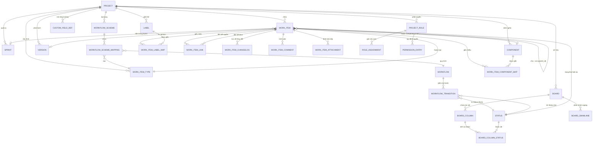

# 🏛️ TÀI LIỆU THIẾT KẾ KIẾN TRÚC & TRIỂN KHAI TOÀN DIỆN WORK SERVICE (JIRA-GRADE ENGINE)
## DỰ ÁN: DATN-2026 — HỆ THỐNG QUẢN LÝ DỰ ÁN & CÔNG VIỆC DOANH NGHIỆP

> **Module:** `work-service`  
> **Cổng dịch vụ (Port):** `8083`  
> **Nền tảng công nghệ:** Java 21, Spring Boot 3.x, Spring Data JPA, PostgreSQL 16 (JSONB & GIN), Redis (Pub/Sub & Presence), Apache Kafka, Spring WebSocket / STOMP.  
> **Tài liệu tham chiếu:** `Chi_tiet_thanh_phan_cot_loi_Work_Service.docx`, `Tai_lieu_quan_ly_du_an_Jira.docx`, Jira Cloud Architecture Standards 2025–2026, Linear Realtime Protocol.

---

## 📑 MỤC LỤC

1. [TỔNG QUAN & MỤC ĐÍCH TÁI CẤU TRÚC](#1-tổng-quan--mục-đích-tái-cấu-trúc)
2. [SO SÁNH TOÀN DIỆN: HIỆN TRẠNG (BEFORE) VS THIẾT KẾ MỚI (AFTER)](#2-so-sánh-toàn-diện-hiện-trạng-before-vs-thiết-kế-mới-after)
3. [KIẾN TRÚC TỔNG THỂ & MIỀN NGHIỆP VỤ (DOMAIN ARCHITECTURE)](#3-kiến-trúc-tổng-thể--miền-nghiệp-vụ-domain-architecture)
4. [CHI TIẾT 12 PHÂN HỆ CỐT LÕI (JIRA-GRADE WORK ENGINE)](#4-chi-tiết-12-phân-hệ-cốt-lõi-jira-grade-work-engine)
   - 4.1. [Work Item Types & Strict Hierarchy Engine](#41-work-item-types--strict-hierarchy-engine)
   - 4.2. [Dynamic Workflow Engine (Finite State Machine)](#42-dynamic-workflow-engine-finite-state-machine)
   - 4.3. [Board & View Engine (Scrum Board & Kanban Board)](#43-board--view-engine-scrum-board--kanban-board)
   - 4.4. [Backlog, Sprint & Agile Lifecycle Engine](#44-backlog-sprint--agile-lifecycle-engine)
   - 4.5. [Architecture Components & Vertical Ownership](#45-architecture-components--vertical-ownership)
   - 4.6. [Versions & Release Management](#46-versions--release-management)
   - 4.7. [Labels & Dynamic Tagging](#47-labels--dynamic-tagging)
   - 4.8. [Linked Issues & Dependency Graph Engine](#48-linked-issues--dependency-graph-engine)
   - 4.9. [Dynamic Custom Fields Engine (PostgreSQL JSONB + GIN Index)](#49-dynamic-custom-fields-engine-postgresql-jsonb--gin-index)
   - 4.10. [JQL & Search / Filter Engine](#410-jql--search--filter-engine)
   - 4.11. [Lightweight Event-Driven Automation Engine](#411-lightweight-event-driven-automation-engine)
   - 4.12. [Project RBAC & Granular Permission Scheme](#412-project-rbac--granular-permission-scheme)
5. [CÁC CƠ CHẾ KỸ THUẬT NỀN TẢNG & REALTIME PERFORMANCE](#5-các-cơ-chế-kỹ-thuật-nền-tảng--realtime-performance)
6. [THIẾT KẾ CƠ SỞ DỮ LIỆU CHI TIẾT (POSTGRESQL DDL & SCHEMAS)](#6-thiết-kế-cơ-sở-dữ-liệu-chi-tiết-postgresql-ddl--schemas)
7. [CHUẨN HÓA REST API SPECIFICATION (`/api/v1/work/...`)](#7-chuẩn-hóa-rest-api-specification-apiv1work)
8. [KẾ HOẠCH CHUYỂN ĐỔI & LỘ TRÌNH TRIỂN KHAI (ROADMAP)](#8-kế-hoạch-chuyển-đổi--lộ-trình-triển-khai-roadmap)
9. [GHI CHÚ RANH GIỚI VỚI CÁC DỊCH VỤ KHÁC (EXTERNAL TOUCHPOINTS)](#9-ghi-chú-ranh-giới-với-các-dịch-vụ-khác-external-touchpoints)

---

## 1. TỔNG QUAN & MỤC ĐÍCH TÁI CẤU TRÚC

Hệ thống **Work Service** là trái tim của nền tảng quản lý điều hành dự án DATN-2026. Để đáp ứng chuẩn mực quản trị hiện đại theo mô hình Jira Cloud / Linear, dịch vụ cần thoát khỏi mô hình Todo/Kanban tĩnh thông thường để trở thành một **Work Engine đa năng, hỗ trợ cả Scrum lẫn Kanban, cho phép tùy biến linh hoạt quy trình, trường dữ liệu, cây phân cấp và truy vấn nâng cao**.

### Mục tiêu thiết kế mới:
1. **Chuẩn hóa Work Item**: Đổi mới tư duy từ bảng `Task` đơn giản sang thực thể hợp nhất `WorkItem` (hỗ trợ Epic, Story, Task, Bug, Sub-task) với bộ khóa tự tăng tuần tự theo dự án (`PRJ-101`).
2. **Workflow Engine động**: Không fix cứng trạng thái bằng Enum. Cho phép dự án tự định nghĩa Status, Status Category, Transition kèm Condition/Validator/Post-function.
3. **Agile Scrum & Kanban hoàn chỉnh**: Hỗ trợ Backlog xếp theo LexoRank $O(1)$, vòng đời Sprint (`FUTURE` $\rightarrow$ `ACTIVE` $\rightarrow$ `CLOSED`), snapshot báo cáo Burndown/Velocity/CFD.
4. **Kiến trúc Module hóa**: Bổ sung `Components` (hỗ trợ mô hình Vertical Ownership), `Versions` (Release Notes tự động), `Labels`, `Custom Fields` (JSONB) và `JQL Parser`.
5. **Hiệu năng & Đồng bộ Realtime**: Duy trì độ trễ dưới 50ms qua WebSocket STOMP, Redis Pub/Sub, Transactional Outbox Pattern cho Kafka, và Optimistic Locking.

---

## 2. SO SÁNH TOÀN DIỆN: HIỆN TRẠNG (BEFORE) VS THIẾT KẾ MỚI (AFTER)

| Tiêu chí | Hiện trạng (Before) | Thiết kế mới (After - Jira Grade) | Lợi ích mang lại |
| :--- | :--- | :--- | :--- |
| **Thực thể công việc** | Bảng `tasks` đơn giản, dùng Enum `TaskType` (`TASK`, `BUG`, `SUBTASK`, `STORY`) và Enum `TaskStatus` cứng. | Bảng hợp nhất `work_items` (Single-Table Inheritance) với mã khóa `code` tự tăng theo Project (VD: `AUTH-101`), `work_item_types` động. | Thống nhất cấu trúc dữ liệu, dễ dàng mở rộng loại công việc mới mà không phải sửa Enum/Code. |
| **Phân cấp công việc (Hierarchy)** | `parent_task_id` tự do, không kiểm soát cấp bậc, dễ dẫn đến vòng lặp hoặc phân cấp vô hạn. | **Strict Hierarchy Engine**: Level 1 (`Epic`) $\rightarrow$ Level 0 (`Story`, `Task`, `Bug`) $\rightarrow$ Level -1 (`Sub-task`). Cấm Sub-task có con, cấm Epic có cha, cấm vòng lặp. | Đảm bảo tính toán Roadmap, Epic Burndown và Rollup Story Points chính xác 100%. |
| **Quy trình trạng thái (Workflow)** | Trạng thái fix cứng qua Enum (`TODO`, `IN_PROGRESS`, `REVIEW`, `DONE`, `CANCELLED`). Không có transition rules. | **Finite State Machine (FSM)**: Bảng `workflows`, `statuses`, `workflow_transitions`, `workflow_schemes`. Hỗ trợ Condition, Validator, Post-function. | Cho phép mỗi loại công việc (Bug vs Story) có quy trình riêng biệt, tự động hóa chuyển trạng thái cha khi con hoàn thành. |
| **Bảng công việc (Board)** | Board fix cứng theo status Enum của Project, không tách biệt Scrum/Kanban, không có WIP limit. | **Dynamic Board Engine**: Bảng `boards`, `board_columns`, `board_column_statuses`, `board_swimlanes`. Phân loại Scrum vs Kanban, hỗ trợ WIP Limits, Swimlanes theo Epic/Assignee. | Quản trị trực quan linh hoạt, cảnh báo tắc nghẽn dòng chảy (WIP bottleneck), hỗ trợ cả team Scrum và Kanban. |
| **Quản lý Backlog & Sắp xếp** | Dùng số nguyên `position` hoặc sắp theo `created_at`. Khi kéo thả phải update hàng loạt dòng. | **Backlog Engine & LexoRank**: Thứ tự thẻ dùng chuỗi LexoRank (Base-36). Kéo thả chỉ UPDATE **đúng 1 bản ghi** duy nhất ($O(1)$ complexity). | Triệt tiêu nguy cơ Deadlock DB, chịu tải hàng nghìn card sắp xếp đồng thời mượt mà. |
| **Chu kỳ Sprint & Báo cáo** | Dùng chung bảng `milestones` đại diện chung chung cho cả Sprint lẫn Milestone. Không có vòng đời Sprint chuẩn. | **Sprint Engine**: Bảng `sprints` với trạng thái `FUTURE` $\rightarrow$ `ACTIVE` $\rightarrow$ `CLOSED`. Khi đóng sprint tự động rollover task tồn sang Backlog/Next Sprint, lưu snapshot phục vụ Burndown & Velocity. | Báo cáo số liệu chính xác theo chu kỳ Sprint thực tế mà không bị sai lệch khi task thay đổi sau này. |
| **Kiến trúc & Phân hệ (Components)** | Không có khái niệm Component. Không hỗ trợ vertical ownership theo module hệ thống. | Bảng `components` gắn với `lead_user_id`. Hỗ trợ gán mặc định assignee khi tạo task, lọc báo cáo theo module kỹ thuật. | Rất phù hợp với mô hình thành viên sở hữu trọn vẹn (Vertical Ownership) các service/module. |
| **Phiên bản phát hành (Versions)** | Không có. Không quản lý được các đợt Release độc lập với Sprint. | Bảng `versions` với cờ `released`, `release_date`. Hỗ trợ Fix Version & Affects Version, tự động sinh Release Notes. | Tách bạch giữa chu kỳ làm việc (Sprint) và đợt phát hành sản phẩm (Release), quản trị phát hành chuyên nghiệp. |
| **Trường tùy chỉnh (Custom Fields)** | Cột dữ liệu cố định trong bảng `tasks`. Thêm trường mới phải sửa entity JPA và migration DB. | **Dynamic Custom Fields (JSONB)**: Lưu trữ linh hoạt kiểu dữ liệu trong cột `custom_fields` của `work_items`, đánh chỉ mục **GIN Index** để tìm kiếm siêu tốc. | PM/Admin tự do tạo trường mà không cần can thiệp mã nguồn hay migration DB. |
| **Truy vấn & Bộ lọc** | Lọc cơ bản qua query param SQL cứng (`status`, `priority`, `projectId`). | **JQL & Query Engine**: Hỗ trợ cú pháp JQL (`project = "PRJ" AND status != Done AND assignee = currentUser()`), bảng `saved_filters`. | Cung cấp khả năng tìm kiếm mạnh mẽ cho cả Board, Dashboard Gadget và người dùng cá nhân. |
| **Tự động hóa (Automation)** | Không có quy tắc tự động hóa nội bộ. | **Lightweight Automation Engine**: Trigger $\rightarrow$ Condition $\rightarrow$ Action (tự động chuyển Story sang In Review khi Subtasks xong, nhắc nhở không hoạt động, v.v.). | Giảm tải các thao tác thủ công lặp lại của đội ngũ phát triển. |
| **Phân quyền trong Project** | Quyền hạn đơn giản dựa trên Team (`LEADER`, `MEMBER`, `VIEWER`). | **Granular Project RBAC**: Bảng `project_roles`, `role_assignments`, `permission_scheme_entries` với Permission Keys chi tiết. | Phân quyền chi tiết tới từng hành động (`CREATE_ISSUE`, `TRANSITION_ISSUE`, `MANAGE_SPRINT`, `ADMIN_PROJECT`). |
| **Đồng bộ Realtime & Outbox** | WebSocket cơ bản, chưa tối ưu cho scale nhiều server. | **Enterprise Realtime Architecture**: STOMP WebSocket + Redis Pub/Sub Backplane + Redis Presence + Transactional Outbox Pattern cho Kafka. | Đảm bảo tính nhất quán dữ liệu phân tán (No Dual-write) và trải nghiệm phản hồi dưới 50ms cho người dùng. |

---

## 3. KIẾN TRÚC TỔNG THỂ & MIỀN NGHIỆP VỤ (DOMAIN ARCHITECTURE)

### 3.1. Sơ đồ Kiến trúc Tầng của Work Service
```
                                 ┌──────────────────────────────────────────────┐
                                 │              Client Applications             │
                                 │     (React Web App, Mobile App, Postman)     │
                                 └──────────────┬───────────────────────────────┘
                                                │
                                                │ REST API (JSON) & WebSocket STOMP
                                                ▼
                                 ┌──────────────────────────────────────────────┐
                                 │              API Gateway (:8081)             │
                                 └──────────────┬───────────────────────────────┘
                                                │ Forward /api/v1/work/** & /ws-work/**
                                                ▼
┌───────────────────────────────────────────────────────────────────────────────────────────────────────────┐
│ WORK SERVICE (:8083)                                                                                      │
│                                                                                                           │
│  ┌─────────────────────────────────────────────────────────────────────────────────────────────────────┐  │
│  │                                          CONTROLLER LAYER                                           │  │
│  │   WorkItemController  │  WorkflowController  │  BoardController  │  SprintController  │ ...         │  │
│  └──────────────────────────────────────────────────┬──────────────────────────────────────────────────┘  │
│                                                     │                                                     │
│  ┌──────────────────────────────────────────────────▼──────────────────────────────────────────────────┐  │
│  │                                           SERVICE LAYER                                             │  │
│  │   WorkItemService     │  WorkflowService     │  BoardService     │  SprintService     │ ...         │  │
│  └──────────────────────────────────────────────────┬──────────────────────────────────────────────────┘  │
│                                                     │                                                     │
│  ┌──────────────────────────────────────────────────▼──────────────────────────────────────────────────┐  │
│  │                                      CORE DOMAIN ENGINES (LÕI)                                      │  │
│  │  ┌──────────────────────┐  ┌──────────────────────┐  ┌──────────────────────┐  ┌─────────────────┐  │  │
│  │  │ StrictHierarchyEngine│  │ FiniteStateMachine  │  │ LexoRankPositionCalc │  │  JQLQueryParser │  │  │
│  │  └──────────────────────┘  └──────────────────────┘  └──────────────────────┘  └─────────────────┘  │  │
│  │  ┌──────────────────────┐  ┌──────────────────────┐  ┌──────────────────────┐  ┌─────────────────┐  │  │
│  │  │ LightweightAutomator │  │ ProjectCloningEngine │  │ AuditDiffExtractor   │  │ PermissionGuard │  │  │
│  │  └──────────────────────┘  └──────────────────────┘  └──────────────────────┘  └─────────────────┘  │  │
│  └──────────────────────────────────────────────────┬──────────────────────────────────────────────────┘  │
│                                                     │                                                     │
│  ┌──────────────────────────────────────────────────▼──────────────────────────────────────────────────┐  │
│  │                                         REPOSITORY LAYER                                            │  │
│  │   WorkItemRepository  │  WorkflowRepository  │  BoardRepository  │  SprintRepository  │ ...         │  │
│  └───────────────────┬──────────────────────────────┬──────────────────────────────┬───────────────────┘  │
└──────────────────────┼──────────────────────────────┼──────────────────────────────┼──────────────────────┘
                       │                              │                              │
                       ▼                              ▼                              ▼
        ┌─────────────────────────────┐┌─────────────────────────────┐┌─────────────────────────────┐
        │        PostgreSQL 16        ││            Redis            ││        Apache Kafka         │
        │  - Relational Schema        ││  - Pub/Sub Backplane        ││  - task-events-topic        │
        │  - JSONB Custom Fields      ││  - Ephemeral Presence (TTL) ││  - project-events-topic     │
        │  - Atomic Key Sequences     ││  - Board Fast Caching       ││  (via Transactional Outbox) │
        │  - Outbox Table             │└─────────────────────────────┘└─────────────────────────────┘
        └─────────────────────────────┘
```

---

### 3.2. Sơ đồ Quan hệ Thực thể (Entity Relationship Diagram - Mermaid)



---

## 4. CHI TIẾT 12 PHÂN HỆ CỐT LÕI (JIRA-GRADE WORK ENGINE)

### 4.1. Work Item Types & Strict Hierarchy Engine

#### A. Khái niệm & Quy tắc Phân cấp (Business Rules)
Work Item là đơn vị công việc trọng tâm của hệ thống. Mỗi Work Item gắn với một loại (`WorkItemType`) có định nghĩa rõ ràng về cấp bậc phân cấp (`hierarchy_level`):

| Loại Work Item | Hierarchy Level | Parent hợp lệ | Con (Children) hợp lệ | Đặc điểm nghiệp vụ |
| :--- | :---: | :--- | :--- | :--- |
| **Epic** | `1` | Không có cha (`parent_id = null`) | Story, Task, Bug | Gom cụm tính năng lớn, kéo dài nhiều Sprint; có màu sắc riêng (`epic_color`), tên ngắn (`epic_name`). |
| **Story** | `0` | Epic (tùy chọn) | Sub-task | Yêu cầu nghiệp vụ người dùng; có ước lượng `story_points`, theo dõi Burndown. |
| **Task** | `0` | Epic (tùy chọn) | Sub-task | Công việc kỹ thuật/vận hành độc lập; có thể ước lượng theo `story_points` hoặc `estimate_hours`. |
| **Bug** | `0` | Epic (tùy chọn) | Sub-task | Lỗi kỹ thuật; có thêm trường `environment`, `steps_to_reproduce`. |
| **Sub-task** | `-1` | **Bắt buộc** là Story / Task / Bug | **Không được có con** | Chia nhỏ công việc thực thi; không tồn tại độc lập ngoài cha. |

#### B. Quy tắc Ràng buộc Toàn vẹn (Integrity Enforcement)
1. **Kiểm tra Parent-Child hợp lệ**: Khi tạo hoặc đổi `parent_id`, hệ thống kiểm tra `Parent.hierarchy_level > Child.hierarchy_level`. Sub-task chỉ được nhận cha có `level == 0`. Epic không được phép có cha.
2. **Chống chu trình vòng lặp (Anti-Cycle Detection)**: Kiểm tra đệ quy chuỗi cha-con trước khi cập nhật.
3. **Chính sách Xóa Cascade / Unlink**: Khi xóa Epic hoặc Story cha, hệ thống cung cấp 2 tùy chọn: (1) `UNLINK` (giữ các con và set `parent_id = null`), hoặc (2) `RESTRICT` (chặn xóa nếu còn con chưa xóa).

---

### 4.2. Dynamic Workflow Engine (Finite State Machine)

#### A. Kiến trúc Máy trạng thái
Workflow là một máy trạng thái hữu hạn kiểm soát vòng đời của Work Item. Mỗi Work Item luôn ở đúng 1 Status và chỉ có thể chuyển sang Status khác thông qua Transition hợp lệ.

* **Status Categories (Danh mục Trạng thái chuẩn)**:
  - `TODO` (Xám / Xanh lam): Công việc chưa bắt đầu.
  - `IN_PROGRESS` (Vàng / Xanh dương): Công việc đang trong quá trình thực hiện / review / test.
  - `DONE` (Xanh lá): Công việc đã hoàn thành nghiệm thu.
  *(Status Category giúp tính toán Burndown Chart, Velocity, CFD tổng quát bất kể tên trạng thái được tùy biến như thế nào).*

* **Cấu trúc của một Workflow Transition**:
  $$\text{Transition} = \langle \text{from\_status}, \text{to\_status}, \text{action\_name}, [\text{Conditions}], [\text{Validators}], [\text{PostFunctions}] \rangle$$

```
                           ┌────────────────────────┐
                           │      TO DO (TODO)      │
                           └───────────┬────────────┘
                                       │
                                       │ Transition: "Start Progress"
                                       │ [Condition: Assignee only]
                                       │ [PostFunction: Set start_date = NOW()]
                                       ▼
                           ┌────────────────────────┐
                 ┌─────────┤ IN PROGRESS (PROGRESS) │◀────────┐
                 │         └───────────┬────────────┘         │
                 │                     │                      │
  Transition:    │                     │ Transition:          │ Transition:
  "Put on Hold"  │                     │ "Submit for Review"  │ "Reject / Reopen"
                 ▼                     ▼                      │
     ┌───────────────────────┐ ┌──────────────────────┐       │
     │ BLOCKED (IN_PROGRESS) │ │ IN REVIEW (PROGRESS) │───────┘
     └───────────────────────┘ └───────────┬──────────┘
                                           │
                                           │ Transition: "Approve & Complete"
                                           │ [Validator: Require Resolution]
                                           │ [PostFunction: Set resolved_at = NOW()]
                                           ▼
                               ┌──────────────────────┐
                               │     DONE (DONE)      │
                               └──────────────────────┘
```

#### B. Engine Hooks: Conditions, Validators & Post-Functions
1. **Conditions (Điều kiện hiển thị nút chuyển)**:
   - `ASSIGNEE_ONLY`: Chỉ người được giao việc mới nhìn thấy nút chuyển.
   - `PERMISSION_REQUIRED`: Yêu cầu user có permission key cụ thể (VD: `APPROVE_ISSUE`).
2. **Validators (Kiểm tra dữ liệu trước khi thực thi)**:
   - `FIELD_REQUIRED`: Bắt buộc điền các trường chỉ định (VD: `resolution`, `fix_version`).
   - `ALL_SUBTASKS_DONE`: Bắt buộc toàn bộ Sub-task của Story phải ở trạng thái Category `DONE` trước khi cho phép Story chuyển sang `DONE`.
3. **Post-Functions (Tác vụ tự động chạy sau khi chuyển thành công)**:
   - `SET_RESOLVED_TIME`: Tự động điền `resolved_at = NOW()`.
   - `CLEAR_RESOLUTION`: Xóa giá trị `resolution` nếu mở lại (Reopen).
   - `AUTO_TRANSITION_PARENT`: Nếu tất cả Subtasks đều Done $\rightarrow$ Tự động chuyển Story cha sang `IN_REVIEW` hoặc `DONE`.
   - `EMIT_AUDIT_LOG`: Ghi lại sự kiện chuyển đổi trạng thái vào `work_item_changelogs`.

---

### 4.3. Board & View Engine (Scrum Board & Kanban Board)

#### A. Cơ chế Hoạt động của Board
Board là một giao diện trực quan (View) ánh xạ tập hợp Work Items thành các cột thẻ. Board không chứa dữ liệu vật lý riêng mà định nghĩa cách lọc và nhóm trạng thái:

1. **Scrum Board**:
   - Nguồn dữ liệu: Toàn bộ Work Item thuộc **Active Sprint** của Project (kết hợp với bộ lọc bổ sung nếu có).
   - Khi Sprint đóng, Scrum Board tự động chuyển sang hiển thị Sprint mới được kích hoạt.
2. **Kanban Board**:
   - Nguồn dữ liệu: Toàn bộ Work Item của Project (không phụ thuộc Sprint).
   - Hỗ trợ **WIP Limits (Work In Progress Limits)** trên từng cột: Đặt số lượng thẻ tối thiểu/tối đa cho phép trên cột. Giao diện đổi màu cảnh báo khi vi phạm WIP Limit.
3. **Ánh xạ Cột Đa trạng thái (Multi-Status Column Mapping)**:
   - Một cột trên Board (`BoardColumn`) có thể chứa nhiều Status thực tế (Ví dụ: Cột "Đang xử lý" gộp cả `IN_PROGRESS` và `IN_REVIEW`).
4. **Swimlanes (Phân nhóm Hàng ngang)**:
   - Gom nhóm thẻ theo: `BY_EPIC` (mỗi Epic là 1 luồng ngang), `BY_ASSIGNEE` (mỗi thành viên 1 luồng), hoặc `BY_PRIORITY`.

---

### 4.4. Backlog, Sprint & Agile Lifecycle Engine

#### A. Backlog Engine & Thuật toán Xếp thứ tự LexoRank $O(1)$
* **Khái niệm Backlog**: Là danh sách toàn bộ Work Item của Project chưa được đưa vào Active Sprint (bao gồm các item trong `sprint_id IS NULL` hoặc thuộc các Sprint ở trạng thái `FUTURE`), được sắp xếp theo trường `rank`.
* **Thuật toán LexoRank**:
  - Không dùng số nguyên thứ tự (`order = 1, 2, 3...`) vì khi chèn một phần tử vào giữa sẽ phải chạy lệnh `UPDATE order = order + 1` cho hàng nghìn bản ghi phía sau, gây nghẽn DB.
  - Sử dụng chuỗi ký tự cơ số 36 (Base-36) có thể tính toán điểm giữa (Fractional Indexing).
  - Ví dụ: Chèn vào giữa thẻ $A$ (`rank = "0|hzzzzz:"`) và thẻ $B$ (`rank = "0|i00000:"`), thuật toán sinh chuỗi trung vị mới $C$ (`rank = "0|hzzzzz:8"`).
  - Thao tác kéo thả trên Backlog/Board **chỉ cập nhật đúng 1 bản ghi duy nhất** với độ phức tạp thời gian $O(1)$.

#### B. Vòng đời Sprint (Sprint Lifecycle State Machine)
$$\text{FUTURE (Chưa bắt đầu)} \xrightarrow{\text{Start Sprint}} \text{ACTIVE (Đang chạy)} \xrightarrow{\text{Complete / Close Sprint}} \text{CLOSED (Đã đóng)}$$

1. **Quy tắc Active Sprint**: Trong một Board Scrum, tại một thời điểm **chỉ có tối đa 1 Sprint ở trạng thái `ACTIVE`**.
2. **Quy trình Đóng Sprint (Close Sprint Process)**:
   - Hệ thống quét toàn bộ Work Item trong Sprint.
   - Các item có Status Category = `DONE`: Giữ nguyên mốc hoàn thành.
   - Các item chưa hoàn thành (Status Category $\neq$ `DONE`): Người dùng chọn chuyển sang: (1) `NEXT_ACTIVE_OR_FUTURE_SPRINT`, hoặc (2) Trả về `BACKLOG` (`sprint_id = null`).
   - Tạo bản ghi **Sprint Snapshot** cố định số liệu (Tổng Points, Points hoàn thành, Points dở dang, Ngày đóng thực tế) để báo cáo Sprint Report vĩnh viễn không bị biến động.
3. **Báo cáo Agile chuẩn**:
   - **Burndown Chart**: Lấy dữ liệu từ `work_item_changelogs` kết hợp thời gian Sprint để vẽ đường lý tưởng vs đường thực tế lượng Story Points còn lại qua từng ngày.
   - **Velocity Chart**: Thống kê số Story Points cam kết (Commitment) vs Hoàn thành (Completed) qua 5-7 Sprint gần nhất.
   - **Cumulative Flow Diagram (CFD)**: Thống kê số lượng thẻ ở từng trạng thái theo thời gian để phát hiện điểm nghẽn (Bottlenecks).

---

### 4.5. Architecture Components & Vertical Ownership

#### A. Vai trò & Quy tắc Nghiệp vụ
* `Component` đại diện cho một module kỹ thuật / kiến trúc cố định của dự án (Ví dụ: `Auth Service`, `Work Service`, `Notification Service`, `React Frontend`, `Mobile App`).
* Mỗi Component có thể chỉ định một `lead_user_id` (Component Lead).
* **Cơ chế Gán tự động (Auto-assignment)**: Khi một Work Item mới được tạo ra và chọn Component nhưng trường `assignee_id` để trống, hệ thống sẽ tự động gán cho `lead_user_id` của Component đó.
* **Hỗ trợ mô hình Vertical Ownership**: Cho phép lọc, báo cáo và đo lường khối lượng công việc theo từng phân hệ kiến trúc mà từng thành viên phụ trách xuyên suốt từ backend đến frontend.

---

### 4.6. Versions & Release Management

#### A. Vai trò & Quy tắc Nghiệp vụ
* `Version` đại diện cho một gói phát hành sản phẩm (Ví dụ: `v1.0-MVP`, `v1.1-Enterprise-Search`, `v2.0-GA`).
* Khái niệm Version độc lập hoàn toàn với Sprint: Một Version có thể gom góp Work Items hoàn thành từ nhiều Sprint khác nhau.
* Một Work Item có thể gắn với:
  - `fix_version_id`: Phiên bản mà tính năng này sẽ được phát hành / lỗi này được sửa xong.
  - `affects_version_id`: Phiên bản phát hiện ra lỗi (dành riêng cho Bug).
* **Tính năng Sinh Release Notes tự động**: Khi PM bấm "Release Version", hệ thống tự động tổng hợp danh sách các Story, Task, Bug đã `DONE` trong version đó và sinh văn bản Markdown Release Notes theo từng danh mục.

---

### 4.7. Labels & Dynamic Tagging

* Label là các từ khóa phân loại linh hoạt, không cố định theo kiến trúc (Ví dụ: `security`, `tech-debt`, `performance`, `hotfix`, `customer-request`).
* **Cơ chế Tự động Chuẩn hóa On-The-Fly**: Khi người dùng gõ nhãn mới trong ô nhập liệu của Work Item, API tự động kiểm tra trong bảng `labels` của Project (theo chuỗi viết thường đã `trim()`), nếu chưa có thì tự động tạo mới nhãn, không bắt buộc phải vào trang cấu hình tạo trước.

---

### 4.8. Linked Issues & Dependency Graph Engine

#### A. Các loại Liên kết Hỗ trợ
Hệ thống hỗ trợ quan hệ hai chiều giữa các Work Item (kể cả giữa các Project khác nhau):

| Kiểu liên kết (Link Type) | Chiều Xuôi (Outward Description) | Chiều Ngược (Inward Description) | Ý nghĩa nghiệp vụ |
| :--- | :--- | :--- | :--- |
| `BLOCKS` | *blocks* (chặn) | *is blocked by* (bị chặn bởi) | Task $A$ phải hoàn thành thì Task $B$ mới bắt đầu được. |
| `RELATES_TO` | *relates to* (liên quan tới) | *relates to* (liên quan tới) | Hai công việc có liên hệ ngữ nghĩa. |
| `DUPLICATES` | *duplicates* (trùng lặp với) | *is duplicated by* (bị trùng bởi) | Báo cáo lỗi hoặc yêu cầu bị lặp. |
| `CAUSES` | *causes* (gây ra bởi) | *is caused by* (là nguyên nhân của) | Thay đổi ở Task $A$ dẫn đến Bug $B$. |

#### B. Thuật toán Phát hiện Chu trình Khóa (Cycle Detection)
Khi tạo liên kết kiểu `BLOCKS`, hệ thống chạy thuật toán duyệt đồ thị (DFS / BFS) trên bảng `work_item_links` để đảm bảo không tạo chu trình phụ thuộc vòng kín ($A \text{ blocks } B \rightarrow B \text{ blocks } C \rightarrow C \text{ blocks } A$).

---

### 4.9. Dynamic Custom Fields Engine (PostgreSQL JSONB + GIN Index)

#### A. Lựa chọn Kiến trúc Lưu trữ
Thay vì mô hình EAV truyền thống (Entity-Attribute-Value gây chậm chạp khi phải `JOIN` hàng chục bảng) hoặc mô hình sửa schema động (ALTER TABLE gây khóa bảng), hệ thống áp dụng **PostgreSQL JSONB Storage với Dynamic Field Definitions**:

1. Bảng `custom_field_definitions`: Lưu định nghĩa trường (`name`, `field_key`, `field_type`, `options`, `validation_rules`, `applicable_type_ids`).
   - Các kiểu hỗ trợ: `TEXT`, `NUMBER`, `SELECT`, `MULTI_SELECT`, `DATE`, `USER`, `CHECKBOX`, `URL`.
2. Bảng `work_items`: Lưu giá trị thực tế trong cột `custom_fields JSONB`.
   - Ví dụ JSONB: `{"environment": "staging", "qa_reviewer": "usr_99", "risk_level": "HIGH"}`.
3. Đánh chỉ mục **GIN Index** trên cột `custom_fields`:
   ```sql
   CREATE INDEX idx_work_items_custom_fields_gin ON work_items USING gin (custom_fields);
   ```
   Cho phép truy vấn lọc theo trường tùy chỉnh cực nhanh:
   ```sql
   SELECT * FROM work_items WHERE custom_fields @> '{"environment": "staging"}';
   ```

---

### 4.10. JQL & Search / Filter Engine

#### A. Cú pháp Ngữ pháp JQL Hỗ trợ
Hệ thống xây dựng bộ Lexer/Parser cho phép tìm kiếm linh hoạt:
* **Cú pháp mẫu**:
  ```sql
  project = "AUTH" AND status != "Done" AND assignee = currentUser() AND sprint in openSprints() ORDER BY priority DESC, created_at ASC
  ```
* **Các toán tử hỗ trợ**: `=`, `!=`, `>`, `<`, `>=`, `<=`, `IN`, `NOT IN`, `~` (LIKE text), `IS NULL`, `IS NOT NULL`.
* **Toán tử logic**: `AND`, `OR`, `NOT`, cặp ngoặc `( )`.
* **Hàm động (Built-in Functions)**:
  - `currentUser()`: Lấy User ID của người đang thực hiện request.
  - `openSprints()`: Lấy danh sách ID các Sprint đang `ACTIVE` trong project.
  - `startOfDay()`, `endOfDay()`, `now()`.

#### B. Cơ chế Chuyển đổi AST $\rightarrow$ JPA Criteria / SQL
Bộ `JqlQueryParser` chuyển chuỗi JQL thành Cây Cú pháp Trừu tượng (AST), kiểm tra tính hợp lệ của các trường (Field Validation), sau đó chuyển dịch thành **Spring Data JPA `Specification<WorkItem>`** kết hợp truy vấn JSONB nguyên bản.

---

### 4.11. Lightweight Event-Driven Automation Engine

Hệ thống tích hợp sẵn một bộ máy tự động hóa nội bộ hoạt động theo mô hình **Trigger $\rightarrow$ Condition $\rightarrow$ Action**:

```
 ┌───────────────────────────┐
 │          TRIGGER          │ (VD: Khi Work Item chuyển sang status "Done")
 └─────────────┬─────────────┘
               │
               ▼
 ┌───────────────────────────┐
 │         CONDITION         │ (VD: Kiểm tra nếu tất cả Sub-tasks khác của cha cũng "Done")
 └─────────────┬─────────────┘
               │ (True)
               ▼
 ┌───────────────────────────┐
 │          ACTION           │ (VD: Tự động chuyển Story cha sang trạng thái "Done" & Gửi thông báo)
 └───────────────────────────┘
```

* **Các Trigger hỗ trợ**:
  - `ON_WORK_ITEM_CREATED`: Khi có work item mới được tạo.
  - `ON_STATUS_CHANGED`: Khi trạng thái work item thay đổi.
  - `ON_ALL_SUBTASKS_COMPLETED`: Khi toàn bộ subtasks của 1 story cha đạt category `DONE`.
  - `ON_INACTIVITY_WARNING`: Scheduled job quét các item không có cập nhật trong $N$ ngày.
* **Các Action hỗ trợ**:
  - `UPDATE_FIELD`: Đổi giá trị trường (gán assignee, đổi priority, đổi fix version).
  - `TRANSITION_PARENT`: Kích hoạt transition trên work item cha.
  - `AUTO_ASSIGN_COMPONENT_LEAD`: Tự động gán người phụ trách module.
  - `EMIT_KAFKA_NOTIFICATION`: Phát event thông báo ra ngoài.

---

### 4.12. Project RBAC & Granular Permission Scheme

Mỗi Project có một **Permission Scheme** quy định quyền hạn cho từng vai trò trong dự án (`ProjectRole`):

| Permission Key | Tên quyền | Vai trò mặc định |
| :--- | :--- | :--- |
| `PROJECT_ADMIN` | Toàn quyền cấu hình Workflow, Board, Member, Custom Fields | Project Admin |
| `PROJECT_VIEW` | Xem danh sách công việc, Board, Backlog, Báo cáo | Toàn bộ thành viên & Viewer |
| `ISSUE_CREATE` | Tạo mới Epic, Story, Task, Bug, Sub-task | Admin, PM, Developer |
| `ISSUE_EDIT` | Chỉnh sửa tiêu đề, mô tả, trường tùy chỉnh | Admin, PM, Assignee, Reporter |
| `ISSUE_DELETE` | Xóa công việc | Project Admin, PM |
| `ISSUE_TRANSITION`| Kéo thả chuyển trạng thái công việc trên Board | Admin, PM, Developer |
| `ISSUE_ASSIGN` | Gán người thực hiện công việc | Admin, PM, Developer |
| `SPRINT_MANAGE` | Tạo Sprint, Bắt đầu Sprint (Start), Đóng Sprint (Close) | Project Admin, PM |
| `RELEASE_MANAGE` | Tạo và phát hành Version (Release) | Project Admin, PM |
| `COMMENT_CREATE` | Thêm bình luận | Toàn bộ thành viên |

---

## 5. CÁC CƠ CHẾ KỸ THUẬT NỀN TẢNG & REALTIME PERFORMANCE

### 5.1. Bộ sinh Mã Key Tuần tự Nguyên tử (PostgreSQL Atomic Sequence Key Generator)
* Mã công việc hiển thị dưới dạng chuẩn Jira: `{PROJECT_KEY}-{SEQUENCE}` (Ví dụ: `DATN-1`, `DATN-2`).
* **Triển khai**: Khi tạo một Project mới có key là `KEY`, hệ thống thực thi câu lệnh SQL:
  ```sql
  CREATE SEQUENCE IF NOT EXISTS work_item_seq_KEY START WITH 1 INCREMENT BY 1;
  ```
* Khi tạo Work Item: Lấy số thứ tự tiếp theo bằng truy vấn nguyên tử `SELECT nextval('work_item_seq_KEY')`. Đảm bảo 100% không trùng mã, không bị lock bảng khi hàng trăm request tạo việc đồng thời.

---

### 5.2. Đồng bộ Multiplayer Realtime & Co-presence
* **Kiến trúc Kênh WebSocket STOMP**:
  - `/topic/project/{projectId}/board`: Kênh broadcast các sự kiện di chuyển thẻ, đổi trạng thái, cập nhật Story Points cho toàn bộ thành viên đang mở Board.
  - `/topic/work-item/{workItemId}`: Kênh cập nhật chi tiết, bình luận trực tiếp, trạng thái gõ bàn phím (Live Typing).
* **Redis Pub/Sub Backplane**: Khi hệ thống scale ra nhiều instance (Cluster), Redis Pub/Sub đảm bảo một message từ Instance A được đồng bộ ngay lập tức tới tất cả các WebSocket client đang kết nối vào Instance B, C.
* **Ephemeral Presence (Hiển thị ai đang xem việc)**: Lưu trạng thái `presence:work-item:{id}` trong Redis Key với TTL = 15s. Client gửi Heartbeat định kỳ. Khi rời trang, Redis tự động giải phóng và broadcast danh sách người xem còn lại.

---

### 5.3. Tránh Ghi đè Dữ liệu & Giải quyết Xung đột (Optimistic Locking)
* Bảng `work_items` tích hợp cột `@Version private Integer version`.
* Frontend áp dụng **Optimistic UI Update**: Cập nhật thẻ trên giao diện ngay lập tức khi kéo thả.
* Nếu xảy ra xung đột đồng thời (người khác đã sửa trước), server ném `OptimisticLockException` $\rightarrow$ Trả về mã lỗi `409 CONFLICT` kèm bản ghi mới nhất để giao diện tự động Reconcile mượt mà.

---

### 5.4. Đảm bảo Toàn vẹn Sự kiện (Transactional Outbox Pattern & Kafka)
* Tránh rủi ro "Dual-Write" (ghi DB thành công nhưng gửi Kafka thất bại).
* Khi có sự kiện tạo/sửa việc: Trong cùng 1 DB Transaction, hệ thống ghi dữ liệu vào bảng nghiệp vụ đồng thời ghi 1 bản ghi vào bảng `outbox_events (id, aggregate_type, payload, status = 'PENDING')`.
* Một Scheduled Job nền quét bảng `outbox_events` $\rightarrow$ Đẩy message lên Kafka Topic `work-events-topic` $\rightarrow$ Đánh dấu `PROCESSED`.

---

### 5.5. Động cơ Nhân bản Dự án & Tịnh tiến Mốc Thời gian (Two-Pass Project Cloning Engine)
* Khi nhân bản dự án từ mẫu (Template) sang dự án thực tế:
  1. **Tính toán Offset ngày**: $\Delta \text{days} = \text{TargetStartDate} - \text{TemplateStartDate}$.
  2. **Pass 1**: Nhân bản toàn bộ cấu trúc Project, Sprints, Components, Versions, Work Items, cộng thêm $\Delta \text{days}$ cho `start_date`, `due_date`. Lưu bảng ánh xạ ID cũ $\rightarrow$ ID mới (`Map<UUID, UUID> idMapping`).
  3. **Pass 2**: Tái lập toàn bộ quan hệ phân cấp `parent_id = idMapping.get(old_parent_id)` và liên kết `work_item_links`. Toàn bộ trạng thái được reset về `TODO`.

---

## 6. THIẾT KẾ CƠ SỞ DỮ LIỆU CHI TIẾT (POSTGRESQL DDL & SCHEMAS)

Dưới đây là thiết kế chi tiết CSDL PostgreSQL chuẩn hóa cho Work Service:

```sql
-- ============================================================================
-- 1. BẢNG DỰ ÁN & CẤU HÌNH CỐT LÕI
-- ============================================================================

CREATE TABLE projects (
    id UUID PRIMARY KEY DEFAULT gen_random_uuid(),
    workspace_id UUID NOT NULL,
    team_id UUID,
    name VARCHAR(255) NOT NULL,
    key VARCHAR(20) NOT NULL UNIQUE,
    description TEXT,
    icon_url VARCHAR(500),
    lead_user_id UUID NOT NULL,
    default_assignee_type VARCHAR(50) DEFAULT 'PROJECT_LEADER', -- UNASSIGNED, PROJECT_LEADER
    project_type VARCHAR(50) NOT NULL DEFAULT 'SOFTWARE_SCRUM',  -- SOFTWARE_SCRUM, SOFTWARE_KANBAN, BUSINESS
    is_template BOOLEAN NOT NULL DEFAULT FALSE,
    start_date DATE,
    end_date DATE,
    created_by UUID NOT NULL,
    created_at TIMESTAMP WITH TIME ZONE DEFAULT CURRENT_TIMESTAMP,
    updated_at TIMESTAMP WITH TIME ZONE DEFAULT CURRENT_TIMESTAMP,
    deleted_at TIMESTAMP WITH TIME ZONE
);

CREATE INDEX idx_projects_workspace ON projects(workspace_id) WHERE deleted_at IS NULL;
CREATE INDEX idx_projects_key ON projects(key);

-- ============================================================================
-- 2. LOẠI CÔNG VIỆC & PHÂN CẤP (WORK ITEM TYPES & HIERARCHY)
-- ============================================================================

CREATE TABLE work_item_types (
    id UUID PRIMARY KEY DEFAULT gen_random_uuid(),
    project_id UUID REFERENCES projects(id) ON DELETE CASCADE, -- NULL nếu là System Default
    name VARCHAR(100) NOT NULL,
    code VARCHAR(50) NOT NULL, -- EPIC, STORY, TASK, BUG, SUBTASK
    description TEXT,
    icon_name VARCHAR(100),
    color_hex VARCHAR(20),
    hierarchy_level INT NOT NULL, -- 1: Epic, 0: Standard (Story/Task/Bug), -1: Subtask
    is_subtask BOOLEAN NOT NULL DEFAULT FALSE,
    is_system_default BOOLEAN NOT NULL DEFAULT FALSE,
    created_at TIMESTAMP WITH TIME ZONE DEFAULT CURRENT_TIMESTAMP
);

-- ============================================================================
-- 3. QUY TRÌNH TRẠNG THÁI (WORKFLOW & FINITE STATE MACHINE)
-- ============================================================================

CREATE TABLE statuses (
    id UUID PRIMARY KEY DEFAULT gen_random_uuid(),
    name VARCHAR(100) NOT NULL,
    category VARCHAR(50) NOT NULL, -- TODO, IN_PROGRESS, DONE
    description TEXT,
    color_hex VARCHAR(20),
    created_at TIMESTAMP WITH TIME ZONE DEFAULT CURRENT_TIMESTAMP
);

CREATE TABLE workflows (
    id UUID PRIMARY KEY DEFAULT gen_random_uuid(),
    project_id UUID REFERENCES projects(id) ON DELETE CASCADE, -- NULL nếu là System Template
    name VARCHAR(255) NOT NULL,
    description TEXT,
    is_default BOOLEAN NOT NULL DEFAULT FALSE,
    created_at TIMESTAMP WITH TIME ZONE DEFAULT CURRENT_TIMESTAMP,
    updated_at TIMESTAMP WITH TIME ZONE DEFAULT CURRENT_TIMESTAMP
);

CREATE TABLE workflow_transitions (
    id UUID PRIMARY KEY DEFAULT gen_random_uuid(),
    workflow_id UUID NOT NULL REFERENCES workflows(id) ON DELETE CASCADE,
    from_status_id UUID REFERENCES statuses(id) ON DELETE CASCADE, -- NULL nghĩa là Tạo mới (Initial Transition)
    to_status_id UUID NOT NULL REFERENCES statuses(id) ON DELETE CASCADE,
    name VARCHAR(150) NOT NULL, -- Tên nút hiển thị (VD: "Start Progress", "Resolve Issue")
    conditions_config JSONB,    -- Config rule: [{"type": "ASSIGNEE_ONLY"}, {"type": "PERMISSION_REQUIRED", "key": "TRANSITION_ISSUE"}]
    validators_config JSONB,    -- Config rule: [{"type": "FIELD_REQUIRED", "fields": ["resolution"]}]
    post_functions_config JSONB -- Config rule: [{"type": "SET_TIMESTAMP", "field": "resolved_at"}]
);

CREATE TABLE workflow_schemes (
    id UUID PRIMARY KEY DEFAULT gen_random_uuid(),
    project_id UUID NOT NULL REFERENCES projects(id) ON DELETE CASCADE,
    name VARCHAR(255) NOT NULL,
    description TEXT,
    created_at TIMESTAMP WITH TIME ZONE DEFAULT CURRENT_TIMESTAMP
);

CREATE TABLE workflow_scheme_mappings (
    id UUID PRIMARY KEY DEFAULT gen_random_uuid(),
    scheme_id UUID NOT NULL REFERENCES workflow_schemes(id) ON DELETE CASCADE,
    work_item_type_id UUID NOT NULL REFERENCES work_item_types(id) ON DELETE CASCADE,
    workflow_id UUID NOT NULL REFERENCES workflows(id) ON DELETE CASCADE,
    CONSTRAINT uq_scheme_item_type UNIQUE(scheme_id, work_item_type_id)
);

-- ============================================================================
-- 4. SPRINT, COMPONENT, VERSION & LABELS
-- ============================================================================

CREATE TABLE sprints (
    id UUID PRIMARY KEY DEFAULT gen_random_uuid(),
    project_id UUID NOT NULL REFERENCES projects(id) ON DELETE CASCADE,
    name VARCHAR(255) NOT NULL,
    goal TEXT,
    state VARCHAR(50) NOT NULL DEFAULT 'FUTURE', -- FUTURE, ACTIVE, CLOSED
    start_date TIMESTAMP WITH TIME ZONE,
    end_date TIMESTAMP WITH TIME ZONE,
    completed_date TIMESTAMP WITH TIME ZONE,
    created_at TIMESTAMP WITH TIME ZONE DEFAULT CURRENT_TIMESTAMP,
    updated_at TIMESTAMP WITH TIME ZONE DEFAULT CURRENT_TIMESTAMP
);

CREATE INDEX idx_sprints_project_state ON sprints(project_id, state);

CREATE TABLE sprint_report_snapshots (
    id UUID PRIMARY KEY DEFAULT gen_random_uuid(),
    sprint_id UUID NOT NULL REFERENCES sprints(id) ON DELETE CASCADE UNIQUE,
    total_story_points DECIMAL(10, 2) DEFAULT 0,
    completed_story_points DECIMAL(10, 2) DEFAULT 0,
    incomplete_story_points DECIMAL(10, 2) DEFAULT 0,
    total_items INT DEFAULT 0,
    completed_items INT DEFAULT 0,
    snapshot_data JSONB NOT NULL, -- Danh sách chi tiết các item tại thời điểm đóng
    closed_by UUID NOT NULL,
    closed_at TIMESTAMP WITH TIME ZONE DEFAULT CURRENT_TIMESTAMP
);

CREATE TABLE components (
    id UUID PRIMARY KEY DEFAULT gen_random_uuid(),
    project_id UUID NOT NULL REFERENCES projects(id) ON DELETE CASCADE,
    name VARCHAR(255) NOT NULL,
    description TEXT,
    lead_user_id UUID,
    created_at TIMESTAMP WITH TIME ZONE DEFAULT CURRENT_TIMESTAMP,
    CONSTRAINT uq_project_component_name UNIQUE(project_id, name)
);

CREATE TABLE versions (
    id UUID PRIMARY KEY DEFAULT gen_random_uuid(),
    project_id UUID NOT NULL REFERENCES projects(id) ON DELETE CASCADE,
    name VARCHAR(255) NOT NULL,
    description TEXT,
    release_date DATE,
    is_released BOOLEAN NOT NULL DEFAULT FALSE,
    is_archived BOOLEAN NOT NULL DEFAULT FALSE,
    created_at TIMESTAMP WITH TIME ZONE DEFAULT CURRENT_TIMESTAMP,
    CONSTRAINT uq_project_version_name UNIQUE(project_id, name)
);

CREATE TABLE labels (
    id UUID PRIMARY KEY DEFAULT gen_random_uuid(),
    project_id UUID NOT NULL REFERENCES projects(id) ON DELETE CASCADE,
    name VARCHAR(100) NOT NULL,
    color_hex VARCHAR(20) DEFAULT '#6B7280',
    created_at TIMESTAMP WITH TIME ZONE DEFAULT CURRENT_TIMESTAMP,
    CONSTRAINT uq_project_label_name UNIQUE(project_id, name)
);

-- ============================================================================
-- 5. BẢNG TRỌNG TÂM: WORK ITEMS (CÔNG VIỆC TỔNG HỢP)
-- ============================================================================

CREATE TABLE work_items (
    id UUID PRIMARY KEY DEFAULT gen_random_uuid(),
    project_id UUID NOT NULL REFERENCES projects(id) ON DELETE CASCADE,
    type_id UUID NOT NULL REFERENCES work_item_types(id),
    status_id UUID NOT NULL REFERENCES statuses(id),
    parent_id UUID REFERENCES work_items(id) ON DELETE SET NULL, -- Quan hệ phân cấp (Epic -> Story -> Subtask)
    sprint_id UUID REFERENCES sprints(id) ON DELETE SET NULL,
    
    code VARCHAR(50) NOT NULL, -- VD: 'PRJ-101'
    summary VARCHAR(500) NOT NULL,
    description TEXT,
    
    priority VARCHAR(50) NOT NULL DEFAULT 'MEDIUM', -- LOWEST, LOW, MEDIUM, HIGH, HIGHEST
    resolution VARCHAR(100), -- DONE, WONT_DO, DUPLICATE, INCOMPLETE
    
    reporter_id UUID NOT NULL,
    assignee_id UUID,
    
    story_points DECIMAL(6, 2),
    original_estimate_seconds BIGINT DEFAULT 0,
    remaining_estimate_seconds BIGINT DEFAULT 0,
    time_spent_seconds BIGINT DEFAULT 0,
    
    rank VARCHAR(255) NOT NULL, -- LexoRank string (VD: "0|hzzzzz:")
    
    component_id UUID REFERENCES components(id) ON DELETE SET NULL,
    fix_version_id UUID REFERENCES versions(id) ON DELETE SET NULL,
    
    custom_fields JSONB DEFAULT '{}'::jsonb, -- Lưu toàn bộ Custom Fields động
    
    start_date DATE,
    due_date DATE,
    
    resolved_at TIMESTAMP WITH TIME ZONE,
    version INT NOT NULL DEFAULT 0, -- Optimistic Locking
    created_at TIMESTAMP WITH TIME ZONE DEFAULT CURRENT_TIMESTAMP,
    updated_at TIMESTAMP WITH TIME ZONE DEFAULT CURRENT_TIMESTAMP,
    deleted_at TIMESTAMP WITH TIME ZONE,
    
    CONSTRAINT uq_project_work_item_code UNIQUE(project_id, code)
);

-- Chỉ mục tối ưu hóa truy vấn
CREATE INDEX idx_work_items_project ON work_items(project_id) WHERE deleted_at IS NULL;
CREATE INDEX idx_work_items_sprint ON work_items(sprint_id) WHERE deleted_at IS NULL;
CREATE INDEX idx_work_items_parent ON work_items(parent_id) WHERE deleted_at IS NULL;
CREATE INDEX idx_work_items_status ON work_items(status_id);
CREATE INDEX idx_work_items_assignee ON work_items(assignee_id) WHERE deleted_at IS NULL;
CREATE INDEX idx_work_items_rank ON work_items(project_id, rank);
CREATE INDEX idx_work_items_custom_fields_gin ON work_items USING gin (custom_fields);

-- Bảng trung gian N-N cho Component phụ và Labels
CREATE TABLE work_item_component_maps (
    work_item_id UUID NOT NULL REFERENCES work_items(id) ON DELETE CASCADE,
    component_id UUID NOT NULL REFERENCES components(id) ON DELETE CASCADE,
    PRIMARY KEY (work_item_id, component_id)
);

CREATE TABLE work_item_label_maps (
    work_item_id UUID NOT NULL REFERENCES work_items(id) ON DELETE CASCADE,
    label_id UUID NOT NULL REFERENCES labels(id) ON DELETE CASCADE,
    PRIMARY KEY (work_item_id, label_id)
);

-- ============================================================================
-- 6. LIÊN KẾT PHỤ THUỘC (LINKED ISSUES)
-- ============================================================================

CREATE TABLE work_item_links (
    id UUID PRIMARY KEY DEFAULT gen_random_uuid(),
    source_item_id UUID NOT NULL REFERENCES work_items(id) ON DELETE CASCADE,
    target_item_id UUID NOT NULL REFERENCES work_items(id) ON DELETE CASCADE,
    link_type VARCHAR(50) NOT NULL, -- BLOCKS, RELATES_TO, DUPLICATES, CAUSES
    created_by UUID NOT NULL,
    created_at TIMESTAMP WITH TIME ZONE DEFAULT CURRENT_TIMESTAMP,
    CONSTRAINT chk_no_self_link CHECK (source_item_id <> target_item_id),
    CONSTRAINT uq_work_item_link UNIQUE(source_item_id, target_item_id, link_type)
);

-- ============================================================================
-- 7. BẢNG CÔNG VIỆC (BOARDS, COLUMNS & SWIMLANES)
-- ============================================================================

CREATE TABLE boards (
    id UUID PRIMARY KEY DEFAULT gen_random_uuid(),
    project_id UUID NOT NULL REFERENCES projects(id) ON DELETE CASCADE,
    name VARCHAR(255) NOT NULL,
    type VARCHAR(50) NOT NULL DEFAULT 'SCRUM', -- SCRUM, KANBAN
    filter_jql TEXT,
    created_at TIMESTAMP WITH TIME ZONE DEFAULT CURRENT_TIMESTAMP,
    updated_at TIMESTAMP WITH TIME ZONE DEFAULT CURRENT_TIMESTAMP
);

CREATE TABLE board_columns (
    id UUID PRIMARY KEY DEFAULT gen_random_uuid(),
    board_id UUID NOT NULL REFERENCES boards(id) ON DELETE CASCADE,
    name VARCHAR(150) NOT NULL,
    column_order INT NOT NULL,
    min_wip_limit INT,
    max_wip_limit INT,
    created_at TIMESTAMP WITH TIME ZONE DEFAULT CURRENT_TIMESTAMP
);

CREATE TABLE board_column_statuses (
    column_id UUID NOT NULL REFERENCES board_columns(id) ON DELETE CASCADE,
    status_id UUID NOT NULL REFERENCES statuses(id) ON DELETE CASCADE,
    PRIMARY KEY (column_id, status_id)
);

CREATE TABLE board_swimlanes (
    id UUID PRIMARY KEY DEFAULT gen_random_uuid(),
    board_id UUID NOT NULL REFERENCES boards(id) ON DELETE CASCADE,
    name VARCHAR(150) NOT NULL,
    strategy VARCHAR(50) NOT NULL, -- BY_EPIC, BY_ASSIGNEE, BY_PRIORITY, CUSTOM_JQL
    custom_jql TEXT,
    swimlane_order INT NOT NULL
);

-- ============================================================================
-- 8. AUDIT LOGS, COMMENTS, ATTACHMENTS & OUTBOX
-- ============================================================================

CREATE TABLE work_item_changelogs (
    id UUID PRIMARY KEY DEFAULT gen_random_uuid(),
    work_item_id UUID NOT NULL REFERENCES work_items(id) ON DELETE CASCADE,
    field_name VARCHAR(100) NOT NULL, -- status, assignee, sprint, story_points, etc.
    old_value TEXT,
    new_value TEXT,
    changed_by UUID NOT NULL,
    changed_at TIMESTAMP WITH TIME ZONE DEFAULT CURRENT_TIMESTAMP
);

CREATE INDEX idx_changelog_item_time ON work_item_changelogs(work_item_id, changed_at);

CREATE TABLE work_item_comments (
    id UUID PRIMARY KEY DEFAULT gen_random_uuid(),
    work_item_id UUID NOT NULL REFERENCES work_items(id) ON DELETE CASCADE,
    parent_comment_id UUID REFERENCES work_item_comments(id) ON DELETE CASCADE,
    author_id UUID NOT NULL,
    body TEXT NOT NULL,
    created_at TIMESTAMP WITH TIME ZONE DEFAULT CURRENT_TIMESTAMP,
    updated_at TIMESTAMP WITH TIME ZONE DEFAULT CURRENT_TIMESTAMP,
    deleted_at TIMESTAMP WITH TIME ZONE
);

CREATE TABLE work_item_attachments (
    id UUID PRIMARY KEY DEFAULT gen_random_uuid(),
    work_item_id UUID NOT NULL REFERENCES work_items(id) ON DELETE CASCADE,
    file_name VARCHAR(255) NOT NULL,
    file_url VARCHAR(1000) NOT NULL,
    file_size BIGINT NOT NULL,
    content_type VARCHAR(100),
    uploaded_by UUID NOT NULL,
    uploaded_at TIMESTAMP WITH TIME ZONE DEFAULT CURRENT_TIMESTAMP
);

CREATE TABLE custom_field_definitions (
    id UUID PRIMARY KEY DEFAULT gen_random_uuid(),
    project_id UUID REFERENCES projects(id) ON DELETE CASCADE, -- NULL = Toàn hệ thống
    field_key VARCHAR(100) NOT NULL, -- VD: 'qa_reviewer', 'release_risk'
    name VARCHAR(255) NOT NULL,
    field_type VARCHAR(50) NOT NULL, -- TEXT, NUMBER, SELECT, MULTI_SELECT, DATE, USER, CHECKBOX
    options JSONB, -- Mảng các options nếu là SELECT/MULTI_SELECT
    validation_rules JSONB, -- min, max, regex, required
    applicable_type_ids UUID[], -- Áp dụng cho những work_item_type nào
    created_at TIMESTAMP WITH TIME ZONE DEFAULT CURRENT_TIMESTAMP,
    CONSTRAINT uq_proj_field_key UNIQUE(project_id, field_key)
);

CREATE TABLE saved_filters (
    id UUID PRIMARY KEY DEFAULT gen_random_uuid(),
    project_id UUID REFERENCES projects(id) ON DELETE CASCADE,
    name VARCHAR(255) NOT NULL,
    description TEXT,
    jql_query TEXT NOT NULL,
    owner_id UUID NOT NULL,
    is_shared BOOLEAN NOT NULL DEFAULT FALSE,
    created_at TIMESTAMP WITH TIME ZONE DEFAULT CURRENT_TIMESTAMP
);

CREATE TABLE outbox_events (
    id UUID PRIMARY KEY DEFAULT gen_random_uuid(),
    aggregate_type VARCHAR(100) NOT NULL, -- WORK_ITEM, SPRINT, PROJECT
    aggregate_id VARCHAR(100) NOT NULL,
    event_type VARCHAR(100) NOT NULL,     -- WORK_ITEM_CREATED, STATUS_TRANSITIONED
    payload JSONB NOT NULL,
    status VARCHAR(50) NOT NULL DEFAULT 'PENDING', -- PENDING, PROCESSED, FAILED
    retry_count INT DEFAULT 0,
    created_at TIMESTAMP WITH TIME ZONE DEFAULT CURRENT_TIMESTAMP,
    processed_at TIMESTAMP WITH TIME ZONE
);

CREATE INDEX idx_outbox_status_time ON outbox_events(status, created_at) WHERE status = 'PENDING';
```

---

## 7. CHUẨN HÓA REST API SPECIFICATION (`/api/v1/work/...`)

Tất cả các API tuân thủ tiêu chuẩn RESTful của DATN-2026, sử dụng định dạng bao đóng chuẩn `ApiResponse<T>`:
```json
{
  "code": 200,
  "message": "Success",
  "data": { ... }
}
```

### 7.1. Nhóm Quản lý Dự án (Project Management)
* `POST /api/v1/work/projects`: Tạo dự án mới (Tự động sinh chuỗi Sequence PostgreSQL cho mã task, tạo Default Workflow, Default Board).
* `GET /api/v1/work/projects`: Danh sách dự án trong Workspace (hỗ trợ phân trang, lọc).
* `GET /api/v1/work/projects/{projectId}`: Chi tiết dự án, trưởng dự án, danh sách cấu hình.
* `PUT /api/v1/work/projects/{projectId}`: Cập nhật thông tin dự án.
* `DELETE /api/v1/work/projects/{projectId}`: Lưu trữ / Soft delete dự án.
* `POST /api/v1/work/projects/{projectId}/clone`: **Nhân bản dự án / áp dụng Template** kèm tịnh tiến mốc thời gian động (Two-Pass Dynamic Shifting).

### 7.2. Nhóm Quản trị Công việc (Work Items Management)
* `POST /api/v1/work/items`: Tạo mới Work Item (Epic, Story, Task, Bug, Subtask). Tự động sinh `code` tuần tự (`PRJ-101`) và gán LexoRank ở cuối Backlog.
* `GET /api/v1/work/items`: Tìm kiếm và lọc Work Items (Phân trang, lọc theo `sprintId`, `typeId`, `statusId`, `assigneeId`, `componentId`, `fixVersionId`).
* `GET /api/v1/work/items/{itemId}`: Lấy chi tiết Work Item kèm Sub-tasks, Parent Epic, Linked Issues, Attachments, Custom Fields.
* `PUT /api/v1/work/items/{itemId}`: Chỉnh sửa thông tin công việc (Kiểm tra Optimistic Lock `version`).
* `PATCH /api/v1/work/items/{itemId}/rank`: Cập nhật thứ tự LexoRank khi kéo thả (nhận `beforeItemId`, `afterItemId`).
* `DELETE /api/v1/work/items/{itemId}`: Xóa hoặc chuyển vào thùng rác.

### 7.3. Nhóm Quy trình & Chuyển trạng thái (Workflow & Transitions)
* `GET /api/v1/work/items/{itemId}/transitions`: Lấy danh sách các bước chuyển trạng thái khả dụng cho user hiện tại (đã thẩm định qua Conditions).
* `POST /api/v1/work/items/{itemId}/transitions`: Thực thi chuyển trạng thái (`transitionId`, `resolution`, `comment`, các trường bắt buộc).
* `GET /api/v1/work/projects/{projectId}/workflows`: Lấy danh sách Workflow và Workflow Schemes của dự án.
* `POST /api/v1/work/projects/{projectId}/workflows`: Tạo/Cấu hình Workflow mới.

### 7.4. Nhóm Bảng & Backlog (Board & Backlog Management)
* `GET /api/v1/work/boards/{boardId}/data`: Lấy toàn bộ dữ liệu thẻ trên Board phân theo cột (`BoardColumn`) và Swimlanes (Áp dụng cho Active Sprint của Scrum Board hoặc toàn bộ Kanban).
* `GET /api/v1/work/projects/{projectId}/backlog`: Lấy danh sách công việc trong Backlog kèm danh sách các Future Sprints (Sắp xếp chuẩn theo LexoRank).
* `POST /api/v1/work/boards/{boardId}/columns`: Cấu hình cột Board và giới hạn WIP Limits.

### 7.5. Nhóm Sprint & Báo cáo Agile (Sprint Management & Reports)
* `POST /api/v1/work/projects/{projectId}/sprints`: Tạo Sprint mới (`FUTURE`).
* `POST /api/v1/work/sprints/{sprintId}/start`: Bắt đầu Sprint (`ACTIVE` — kiểm tra điều kiện chỉ 1 active sprint).
* `POST /api/v1/work/sprints/{sprintId}/close`: Đóng Sprint (`CLOSED` — xử lý dồn task chưa xong sang Sprint sau/Backlog, lưu Snapshot).
* `POST /api/v1/work/sprints/{sprintId}/items`: Thêm hoặc bớt Work Items vào Sprint.
* `GET /api/v1/work/sprints/{sprintId}/burndown`: Dữ liệu biểu đồ Burndown Chart.
* `GET /api/v1/work/projects/{projectId}/reports/velocity`: Dữ liệu biểu đồ Velocity qua các Sprint.
* `GET /api/v1/work/projects/{projectId}/reports/cfd`: Dữ liệu biểu đồ luồng tích lũy (Cumulative Flow Diagram).

### 7.6. Nhóm Components, Versions, Labels & Links
* `GET|POST /api/v1/work/projects/{projectId}/components`: Quản lý danh sách Component & Lead User.
* `GET|POST /api/v1/work/projects/{projectId}/versions`: Quản lý các Version phát hành.
* `POST /api/v1/work/versions/{versionId}/release`: Kích hoạt phát hành Version & sinh Release Notes tự động.
* `GET|POST /api/v1/work/projects/{projectId}/labels`: Quản lý danh sách Nhãn.
* `POST /api/v1/work/items/{itemId}/links`: Thiết lập quan hệ liên kết (`BLOCKS`, `RELATES_TO`, `DUPLICATES`).

### 7.7. Nhóm Truy vấn JQL & Bộ lọc Đã lưu (JQL & Saved Filters)
* `POST /api/v1/work/jql/search`: Thực thi chuỗi truy vấn JQL tùy ý, trả về danh sách Work Items.
* `GET|POST /api/v1/work/saved-filters`: Quản lý các bộ lọc đã lưu để chia sẻ cho team hoặc gắn lên Dashboard Gadget.

---

## 8. KẾ HOẠCH CHUYỂN ĐỔI & LỘ TRÌNH TRIỂN KHAI (ROADMAP)

```
┌─────────────────────────────────────────────────────────────────────────────────────────────────┐
│                                LỘ TRÌNH TRIỂN KHAI TỪNG BƯỚC                                    │
└─────────────────────────────────────────────────────────────────────────────────────────────────┘

  GIAI ĐOẠN 1: TÁI CẤU TRÚC LÕI DỮ LIỆU & WORK ITEM ENGINE (Tuần 1 - 2)
  ├── 1.1. Viết Migration Script Flyway/Liquibase tạo bộ bảng mới (work_items, work_item_types, statuses, v.v.).
  ├── 1.2. Hiện thực StrictHierarchyEngine (Kiểm soát cấp bậc Epic -> Story/Task/Bug -> Sub-task).
  ├── 1.3. Cài đặt thuật toán sinh mã tuần tự Atomic Key Sequence & LexoRank Positioning.
  └── 1.4. Xây dựng CRUD Work Items với Custom Fields JSONB & Full Entity Listeners.

  GIAI ĐOẠN 2: DYNAMIC WORKFLOW & SPRINT/BOARD ENGINE (Tuần 3 - 4)
  ├── 2.1. Hiện thực Máy trạng thái FiniteStateMachine (Conditions, Validators, Post-functions).
  ├── 2.2. Xây dựng Sprint Lifecycle (State transition FUTURE -> ACTIVE -> CLOSED kèm Snapshot & Rollover).
  ├── 2.3. Hiện thực Dynamic Board Engine (Scrum/Kanban, Multi-status Columns, WIP Limits, Swimlanes).
  └── 2.4. Tính toán số liệu báo cáo Burndown Chart, Velocity & CFD từ changelog.

  GIAI ĐOẠN 3: COMPONENTS, VERSIONS, JQL & AUTOMATION (Tuần 5 - 6)
  ├── 3.1. Hiện thực Components (Auto-assignment cho Lead User) & Versions (Release Notes Generator).
  ├── 3.2. Hiện thực Linked Issues với thuật toán Anti-cycle Detection.
  ├── 3.3. Xây dựng bộ JqlQueryParser (AST -> JPA Criteria / JSONB query) & Saved Filters.
  └── 3.4. Cài đặt Event-driven Lightweight Automation Engine.

  GIAI ĐOẠN 4: REALTIME HIGH-PERFORMANCE, OUTBOX & KIỂM THỬ TOÀN DIỆN (Tuần 7)
  ├── 4.1. Tích hợp STOMP WebSocket + Redis Pub/Sub Backplane & Presence Service.
  ├── 4.2. Cấu hình Transactional Outbox Poller phát hành sự kiện lên Kafka.
  ├── 4.3. Hoàn thiện Two-Pass Dynamic Shifting Project Cloning Engine.
  └── 4.4. Viết Unit Tests / Integration Tests và hoàn tất tài liệu OpenAPI / Swagger UI.
```

---

## 9. GHI CHÚ RANH GIỚI VỚI CÁC DỊCH VỤ KHÁC (EXTERNAL TOUCHPOINTS)

Để đảm bảo nguyên tắc kiến trúc Microservices độc lập (Loosely Coupled), `work-service` chỉ tập trung duy nhất vào nghiệp vụ Quản lý Công việc. Ranh giới giao tiếp với các dịch vụ khác trong hệ thống DATN-2026 được chuẩn hóa như sau:

1. **Với `identity-service` & Keycloak (Quản lý Người dùng & Xác thực)**:
   - `work-service` chỉ lưu trữ `user_id` (UUID) dạng tham chiếu ngoại vi, **không lưu trữ thông tin nhạy cảm (password, email)**.
   - Khi cần hiển thị thông tin User (Tên, Avatar) trên giao diện Work Item, Frontend sẽ map trực tiếp qua Cache User Info hoặc Gateway.
   - Xác thực danh tính: Tiếp nhận JWT Token từ API Gateway, giải mã Claims qua Spring Security Resource Server để lấy `userId` và roles.
2. **Với `notification-service` (Thông báo & Email)**:
   - `work-service` **không gửi email hoặc push notification trực tiếp**.
   - `work-service` phát hành các Event chuẩn thông qua Transactional Outbox $\rightarrow$ Kafka Topic `work-events-topic` (Ví dụ: `WORK_ITEM_ASSIGNED`, `DUE_DATE_APPROACHING`, `COMMENT_MENTIONED`).
   - `notification-service` sẽ consume topic này và chịu trách nhiệm định tuyến gửi Email, Webhook Slack hoặc Push Notifications.
3. **Với `api-gateway` (Định tuyến & Bảo mật Vành đai)**:
   - Định tuyến toàn bộ request dạng `/api/v1/work/**` về cổng `8083`.
   - Định tuyến kết nối WebSocket handshake `/ws-work/**` về `8083` với cấu hình giữ phiên (Sticky Session / CORS chuẩn).
4. **Với `frontend` (React 19 / Vite UI Application)**:
   - Cung cấp API Drag-and-Drop tối ưu với độ trễ cực thấp nhờ trả về chuỗi `rank` LexoRank.
   - Cung cấp kênh WebSocket STOMP cập nhật real-time trạng thái Board, hiển thị ai đang cùng xem việc (Live Presence) và bình luận tức thì.

---
*Tài liệu được biên soạn và chuẩn hóa toàn diện cho đội ngũ phát triển DATN-2026 — Phiên bản 2.0 (Tháng 8/2026).*
