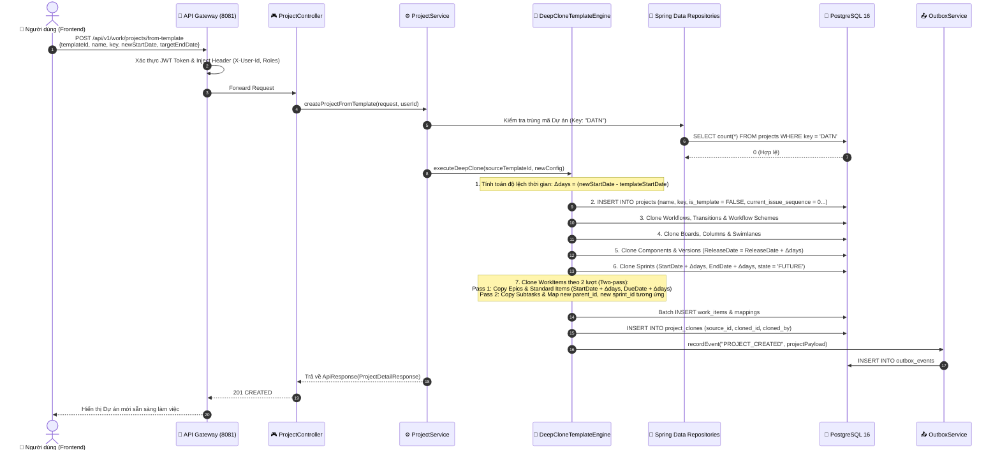
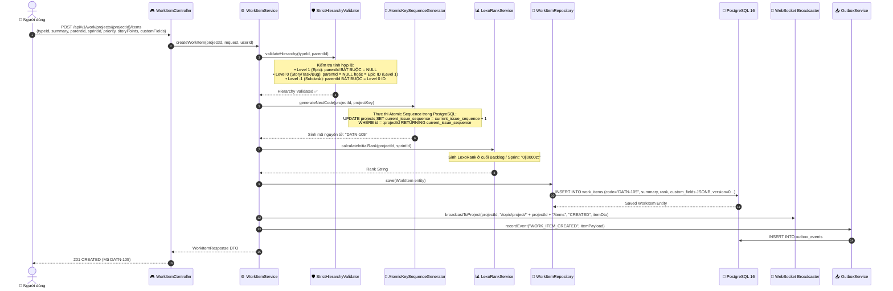
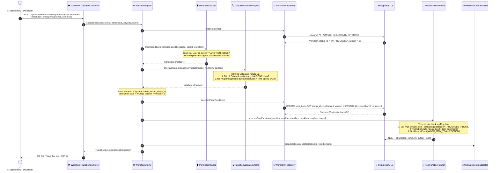
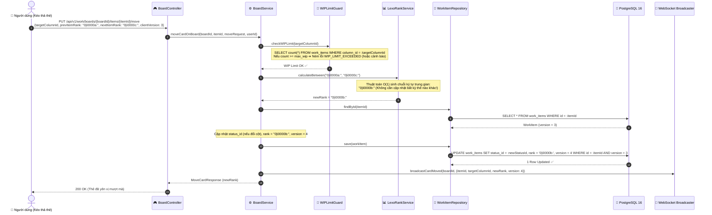
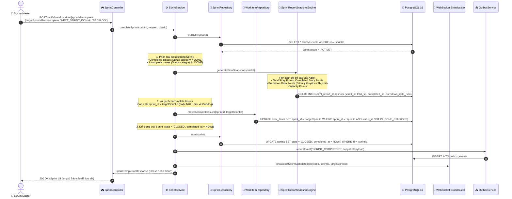
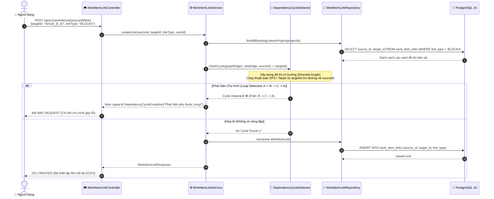
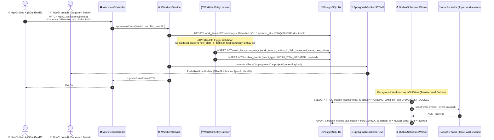

# 🔄 SƠ ĐỒ TUẦN TỰ CÁC LUỒNG NGHIỆP VỤ (SEQUENCE DIAGRAMS) — WORK SERVICE (V2)
## DỰ ÁN: DATN-2026 — HỆ THỐNG QUẢN LÝ DỰ ÁN & CÔNG VIỆC DOANH NGHIỆP

> **Module:** `work-service` (Port: 8083)  
> **Kiến trúc:** Jira-Grade Work Engine, Event-Driven Architecture, Realtime WebSocket STOMP, Transactional Outbox.  
> **Tài liệu tham chiếu:** [`1_WORK_OVERVIEW_REFACTOR.md`](file:///d:/DATN-2026/docs/services/work_service_new/1_WORK_OVERVIEW_REFACTOR.md), [`2_WORK_DATABASE_DESIGN.md`](file:///d:/DATN-2026/docs/services/work_service_new/2_WORK_DATABASE_DESIGN.md), [`4_WORK_IMPLEMENTATION_PLAN.md`](file:///d:/DATN-2026/docs/services/work_service_new/4_WORK_IMPLEMENTATION_PLAN.md).

---

## 📑 MỤC LỤC
1. [Luồng 1: Khởi tạo Dự án từ Template & Dịch chuyển Timeline (Two-Pass Shifting)](#1-luồng-1-khởi-tạo-dự-án-từ-template--dịch-chuyển-timeline-two-pass-shifting)
2. [Luồng 2: Tạo Work Item (Strict 3-Level Hierarchy, Atomic Code Gen & LexoRank)](#2-luồng-2-tạo-work-item-strict-3-level-hierarchy-atomic-code-gen--lexorank)
3. [Luồng 3: Máy trạng thái FSM Chuyển đổi Trạng thái Issue (Hooks & Post-functions)](#3-luồng-3-máy-trạng-thái-fsm-chuyển-đổi-trạng-thái-issue-hooks--post-functions)
4. [Luồng 4: Kéo thả Card trên Kanban Board (LexoRank O(1) & WIP Limit Guard)](#4-luồng-4-kéo-thả-card-trên-kanban-board-lexorank-o1--wip-limit-guard)
5. [Luồng 5: Vòng đời Quản trị Sprint (Start Sprint, Active & Complete Sprint Snapshot)](#5-luồng-5-vòng-đời-quản-trị-sprint-start-sprint-active--complete-sprint-snapshot)
6. [Luồng 6: Thiết lập Liên kết Phụ thuộc & Phát hiện Chu trình (DFS Cycle Check)](#6-luồng-6-thiết-lập-liên-kết-phụ-thuộc--phát-hiện-chu-trình-dfs-cycle-check)
7. [Luồng 7: Audit Trail Tự động & Đồng bộ Realtime (WebSocket & Outbox Kafka)](#7-luồng-7-audit-trail-tự-động--đồng-bộ-realtime-websocket--outbox-kafka)

---

## 1. Luồng 1: Khởi tạo Dự án từ Template & Dịch chuyển Timeline (Two-Pass Shifting)

Khi người dùng tạo một dự án mới từ một Project mẫu (Template), hệ thống thực hiện nhân bản sâu toàn bộ cấu hình, quy trình và các công việc mẫu, đồng thời tự động tính toán dịch chuyển ngày bắt đầu/kết thúc (timeline shifting) chính xác.

---

## 2. Luồng 2: Tạo Work Item (Strict 3-Level Hierarchy, Atomic Code Gen & LexoRank)

Quản lý chặt chẽ phân cấp công việc (Epic $\rightarrow$ Story/Task/Bug $\rightarrow$ Subtask), tự động sinh mã nguyên tử (ví dụ `DATN-101`) và gán vị trí sắp xếp LexoRank ban đầu.

---

## 3. Luồng 3: Máy trạng thái FSM Chuyển đổi Trạng thái Issue (Hooks & Post-functions)

Khi thực hiện chuyển đổi trạng thái (ví dụ từ *In Progress* sang *Done* hoặc *Code Review*), toàn bộ điều kiện (Conditions), kiểm tra tính hợp lệ (Validators) và hành động tự động (Post-functions) được thực thi nghiêm ngặt.

---

## 4. Luồng 4: Kéo thả Card trên Kanban Board (LexoRank O(1) & WIP Limit Guard)

Khi người dùng kéo thả card giữa các cột hoặc thay đổi vị trí trong cùng một cột, hệ thống tính toán LexoRank tức thì mà không cần cập nhật các card xung quanh, đồng thời kiểm tra giới hạn WIP Limits.

---

## 5. Luồng 5: Vòng đời Quản trị Sprint (Start Sprint, Active & Complete Sprint Snapshot)

Quy trình quản lý Sprint Scrum chuẩn: Kích hoạt Sprint, theo dõi tiến độ và khi Đóng Sprint (Complete Sprint), tự động chụp Snapshot số liệu báo cáo và chuyển các Issue chưa hoàn thành (Incomplete Issues) sang Backlog hoặc Sprint tiếp theo.

---

## 6. Luồng 6: Thiết lập Liên kết Phụ thuộc & Phát hiện Chu trình (DFS Cycle Check)

Khi tạo liên kết phụ thuộc dạng `BLOCKS` (Công việc A chặn công việc B), hệ thống chạy thuật toán Depth-First Search (DFS) để phát hiện và ngăn chặn chu trình phụ thuộc vòng (Deadlock: $A \rightarrow B \rightarrow C \rightarrow A$).

---

## 7. Luồng 7: Audit Trail Tự động & Đồng bộ Realtime (WebSocket & Outbox Kafka)

Mọi thay đổi trên Work Item được bắt diff tự động qua JPA EntityListener, ghi vào bảng `work_item_changelogs`, phát thông báo tức thì qua WebSocket STOMP tới tất cả client đang mở trang và ghi nhận vào `outbox_events` cho Kafka.

---
> **Tiếp theo:** Vui lòng tham khảo kế hoạch triển khai chi tiết từng bước tại [`4_WORK_IMPLEMENTATION_PLAN.md`](file:///d:/DATN-2026/docs/services/work_service_new/4_WORK_IMPLEMENTATION_PLAN.md).
