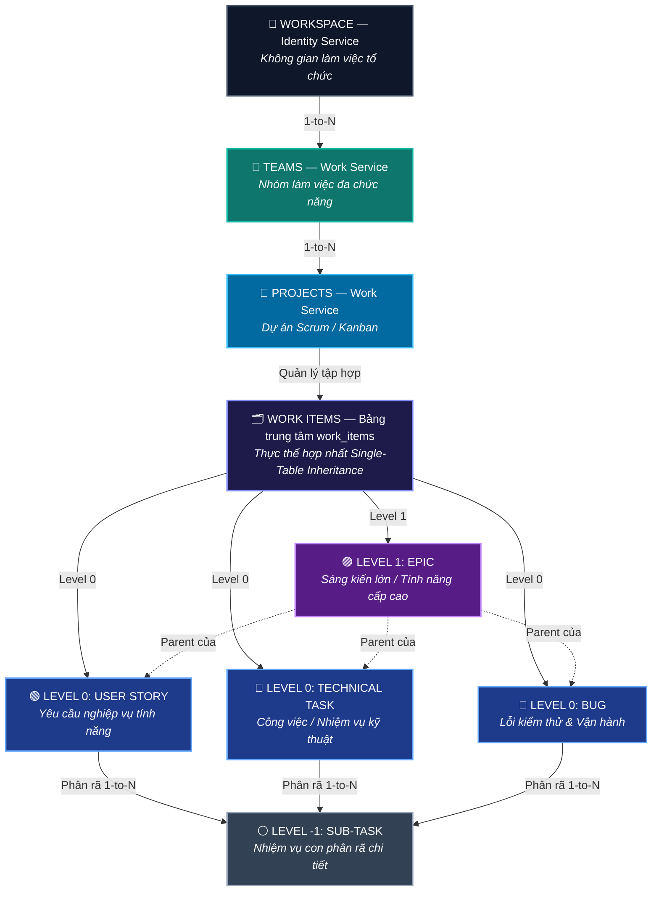
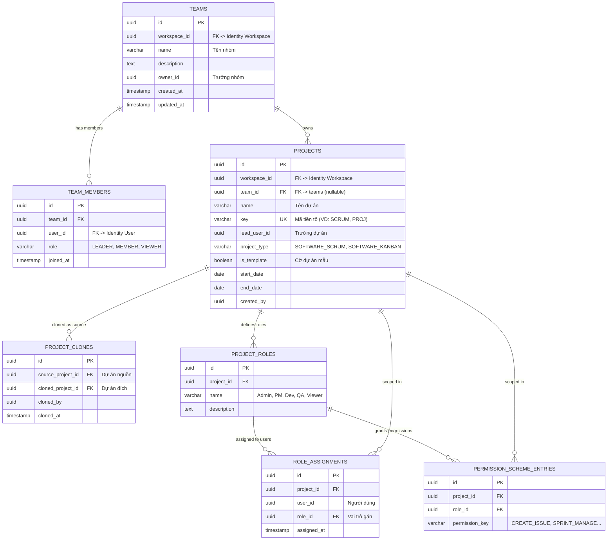
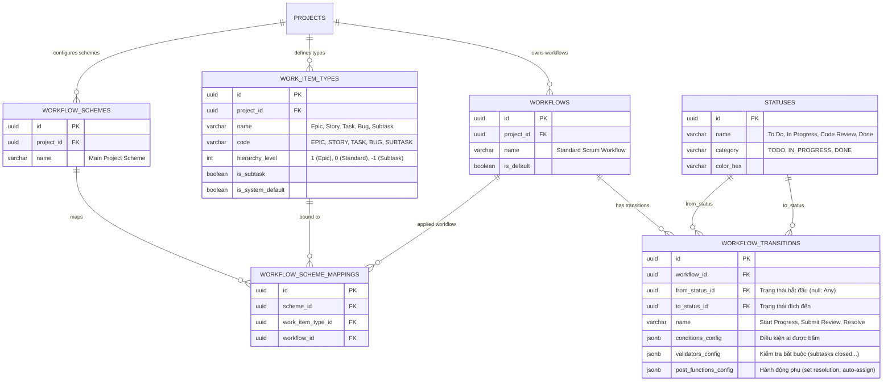
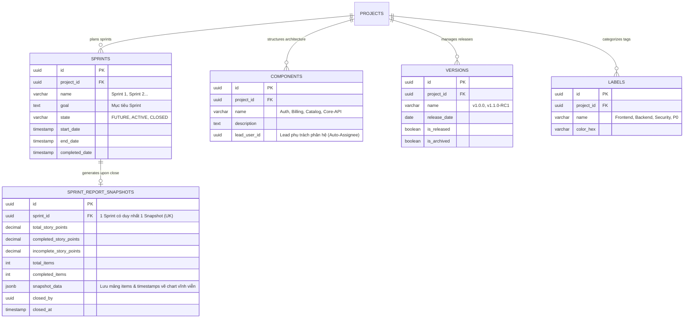
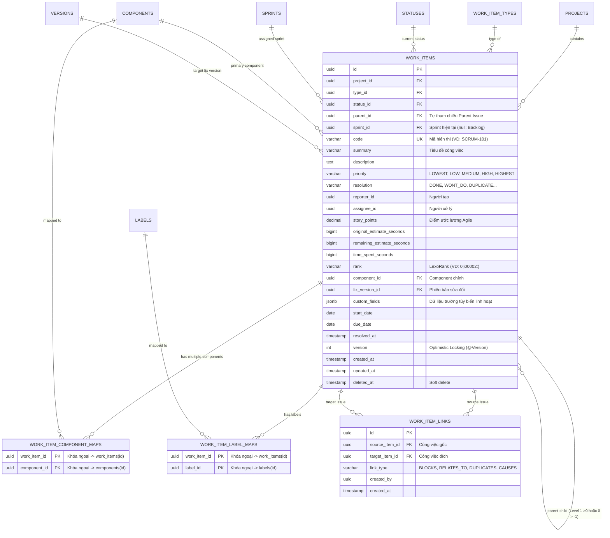
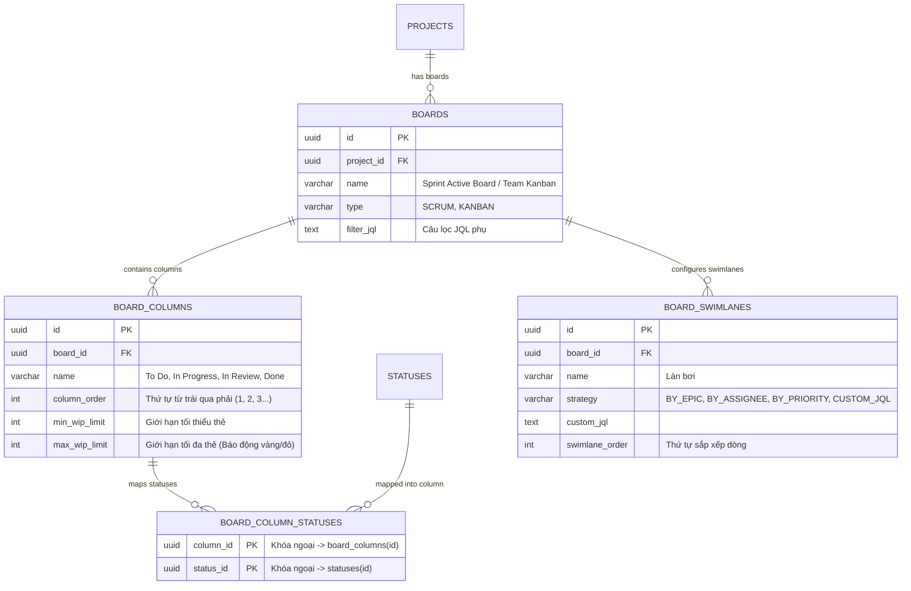
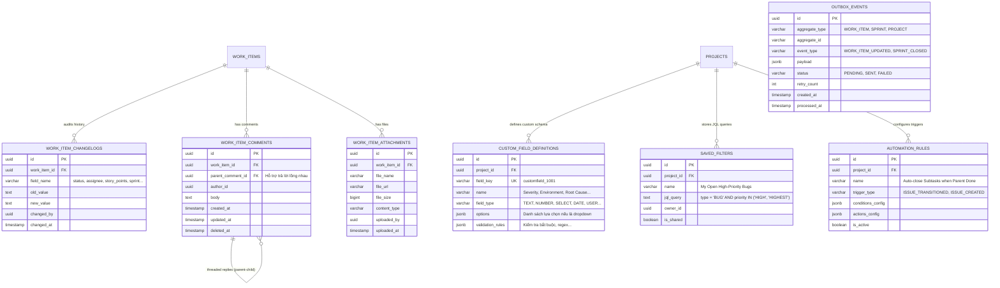

# 🗄️ TÀI LIỆU THIẾT KẾ CƠ SỞ DỮ LIỆU TOÀN DIỆN — WORK SERVICE (JIRA-GRADE)
## DỰ ÁN: DATN-2026 — HỆ THỐNG QUẢN LÝ DỰ ÁN & CÔNG VIỆC DOANH NGHIỆP

> **Hệ quản trị CSDL:** PostgreSQL 16+  
> **Schema Migration:** Flyway (`V1__init_work_jira_schema.sql`)  
> **Tài liệu tham chiếu:** `2_WORK_MAIN_DOC.md`, `3_WORK_IMPLEMENTATION_PLAN.md`

---

## 📑 MỤC LỤC
1. [Sơ đồ Phân cấp Tổng thể (High-Level Hierarchy Diagram)](#1-sơ-đồ-phân-cấp-tổng-thể-high-level-hierarchy-diagram)
2. [Sơ đồ CSDL Phân hệ 1: Tổ chức, Dự án & Phân quyền (Org, Project & RBAC)](#2-sơ-đồ-csdl-phân-hệ-1-tổ-chức-dự-án--phân-quyền)
3. [Sơ đồ CSDL Phân hệ 2: Loại công việc & Máy trạng thái (Work Item Types & Workflow FSM)](#3-sơ-đồ-csdl-phân-hệ-2-loại-công-việc--máy-trạng-thái)
4. [Sơ đồ CSDL Phân hệ 3: Agile Scrum, Sprint, Component & Release Version](#4-sơ-đồ-csdl-phân-hệ-3-agile-scrum-sprint-component--release-version)
5. [Sơ đồ CSDL Phân hệ 4: Trọng tâm Work Items & Liên kết phụ thuộc (Work Items & Cross-links)](#5-sơ-đồ-csdl-phân-hệ-4-trọng-tâm-work-items--liên-kết-phụ-thuộc)
6. [Sơ đồ CSDL Phân hệ 5: Bảng trực quan (Boards, Columns, Swimlanes & WIP Limits)](#6-sơ-đồ-csdl-phân-hệ-5-bảng-trực-quan-boards-columns-swimlanes)
7. [Sơ đồ CSDL Phân hệ 6: Nhật ký Audit, Cộng tác, Mở rộng & Transactional Outbox](#7-sơ-đồ-csdl-phân-hệ-6-nhật-ký-audit-cộng-tác-mở-rộng--outbox)
8. [Bảng Tra cứu Tổng hợp 25 Bảng Dữ liệu & Khóa ngoại (Data Dictionary)](#8-bảng-tra-cứu-tổng-hợp-25-bảng-dữ-liệu--khóa-ngoại)

---

## 1. Sơ đồ Phân cấp Tổng thể (High-Level Hierarchy Diagram)

Sơ đồ thể hiện luồng phân cấp quản trị từ cấp độ toàn hệ thống xuống từng công việc chi tiết:

---

## 2. Sơ đồ CSDL Phân hệ 1: Tổ chức, Dự án & Phân quyền

Quản lý thông tin Đội nhóm (Team), Dự án (Project), Nhân bản mẫu (Template Clones) và Phân quyền nội bộ dự án (Project RBAC):

---

## 3. Sơ đồ CSDL Phân hệ 2: Loại công việc & Máy trạng thái (Workflow FSM)

Động cơ Finite State Machine (FSM) kiểm soát các bước chuyển trạng thái hợp lệ, điều kiện bảo vệ (Guards/Validators) và hành động tự động (Post-functions):

---

## 4. Sơ đồ CSDL Phân hệ 3: Agile Scrum, Sprint, Component & Release Version

Mô hình quản lý chu kỳ lặp (Sprint), cố định số liệu báo cáo (Snapshots), phân hệ kiến trúc (Component) và phiên bản phát hành độc lập (Versions):

---

## 5. Sơ đồ CSDL Phân hệ 4: Trọng tâm Work Items & Liên kết phụ thuộc

Bảng `work_items` là trái tim của hệ thống theo mẫu Single-Table Inheritance kết hợp JSONB Dynamic Fields, mã tuần tự Key-Sequence và thứ tự LexoRank:

---

## 6. Sơ đồ CSDL Phân hệ 5: Bảng trực quan (Boards, Columns, Swimlanes & WIP Limits)

Bảng trực quan hỗ trợ cấu hình đa cột, giới hạn WIP (Work In Progress Limit) và phân làn bơi (Swimlanes):

---

## 7. Sơ đồ CSDL Phân hệ 6: Nhật ký Audit, Cộng tác, Mở rộng & Transactional Outbox

---

## 8. Bảng Tra cứu Tổng hợp 25 Bảng Dữ liệu & Khóa ngoại (Data Dictionary)

| STT | Tên bảng CSDL | Mục đích nghiệp vụ chính | Khóa ngoại chính (Foreign Keys) | Chỉ mục quan trọng |
| :---: | :--- | :--- | :--- | :--- |
| **1** | `teams` | Nhóm làm việc đa chức năng | `workspace_id` | `idx_teams_workspace`, `idx_teams_owner` |
| **2** | `team_members` | Thành viên tham gia nhóm & vai trò | `team_id -> teams(id)` | `uq_team_member(team_id, user_id)` |
| **3** | `projects` | Dự án trung tâm (Scrum/Kanban) | `team_id -> teams(id)` | `idx_projects_key` (UNIQUE), `idx_projects_workspace` |
| **4** | `project_clones` | Nhật ký nhân bản từ Template | `source_project_id`, `cloned_project_id` | `idx_project_clones_source` |
| **5** | `project_roles` | Danh mục vai trò trong dự án | `project_id -> projects(id)` | `idx_project_roles_project` |
| **6** | `role_assignments` | Phân quyền User vào Role dự án | `project_id`, `role_id` | `uq_user_project_role`, `idx_role_assignments_lookup` |
| **7** | `permission_scheme_entries`| Ma trận quyền hạn chi tiết | `project_id`, `role_id` | `uq_perm_entry`, `idx_perm_entries_lookup` |
| **8** | `work_item_types` | Định nghĩa loại công việc & Level | `project_id -> projects(id)` | `idx_work_item_types_level` |
| **9** | `statuses` | Trạng thái công việc toàn cục | Không | B-Tree trên `category` |
| **10**| `workflows` | Định nghĩa quy trình máy trạng thái | `project_id -> projects(id)` | `idx_workflows_project` |
| **11**| `workflow_transitions` | Các bước chuyển trạng thái | `workflow_id`, `from_status_id`, `to_status_id` | `idx_transitions_from_to` |
| **12**| `workflow_schemes` | Sơ đồ quy trình áp dụng dự án | `project_id -> projects(id)` | Khóa chính UUID |
| **13**| `workflow_scheme_mappings`| Gán Loại công việc với Workflow | `scheme_id`, `work_item_type_id`, `workflow_id` | `uq_scheme_item_type` |
| **14**| `sprints` | Chu kỳ Sprint Agile Scrum | `project_id -> projects(id)` | `idx_sprints_project_state(project_id, state)` |
| **15**| `sprint_report_snapshots`| Snapshot cố định số liệu Sprint | `sprint_id -> sprints(id)` (UNIQUE 1:1) | Khóa ngoại UNIQUE `sprint_id` |
| **16**| `components` | Phân hệ kiến trúc kỹ thuật | `project_id -> projects(id)` | `uq_project_component_name` |
| **17**| `versions` | Đợt phát hành Release | `project_id -> projects(id)` | `uq_project_version_name` |
| **18**| `labels` | Nhãn dán phân loại | `project_id -> projects(id)` | `idx_labels_project_name` |
| **19**| `work_items` | **TRỌNG TÂM**: Lưu trữ toàn bộ Issues | `project_id`, `type_id`, `status_id`, `parent_id`, `sprint_id` | `idx_work_items_rank`, GIN `idx_work_items_custom_fields_gin` |
| **20**| `work_item_component_maps`| Gán nhiều Component phụ | `work_item_id`, `component_id` | Composite PK `(work_item_id, component_id)` |
| **21**| `work_item_label_maps` | Gán nhiều Nhãn dán | `work_item_id`, `label_id` | Composite PK `(work_item_id, label_id)` |
| **22**| `work_item_links` | Quan hệ liên kết & phụ thuộc | `source_item_id`, `target_item_id` | `idx_item_links_source`, `idx_item_links_target` |
| **23**| `boards` | Bảng trực quan Scrum/Kanban | `project_id -> projects(id)` | `idx_boards_project` |
| **24**| `board_columns` | Cột hiển thị & Giới hạn WIP | `board_id -> boards(id)` | `idx_board_columns_board_order` |
| **25**| `board_column_statuses` | Gom Status vào Cột hiển thị | `column_id`, `status_id` | Composite PK `(column_id, status_id)` |
| **26**| `board_swimlanes` | Làn bơi phân nhóm ngang | `board_id -> boards(id)` | `idx_swimlanes_board` |
| **27**| `work_item_changelogs` | Nhật ký lưu vết thay đổi trường | `work_item_id -> work_items(id)` | `idx_changelog_item_time` |
| **28**| `work_item_comments` | Cây thảo luận & bình luận | `work_item_id`, `parent_comment_id` | `idx_comments_item` |
| **29**| `work_item_attachments` | Tệp tin đính kèm | `work_item_id -> work_items(id)` | `idx_attachments_item` |
| **30**| `custom_field_definitions`| Định nghĩa schema trường động | `project_id -> projects(id)` | `uq_proj_field_key(project_id, field_key)` |
| **31**| `saved_filters` | Bộ lọc câu truy vấn JQL | `project_id -> projects(id)` | `idx_saved_filters_owner` |
| **32**| `automation_rules` | Quy tắc tự động hóa nội bộ | `project_id -> projects(id)` | `idx_automation_project` |
| **33**| `outbox_events` | Bảng Transactional Outbox Kafka | Không | `idx_outbox_status_time` (`status='PENDING'`) |
