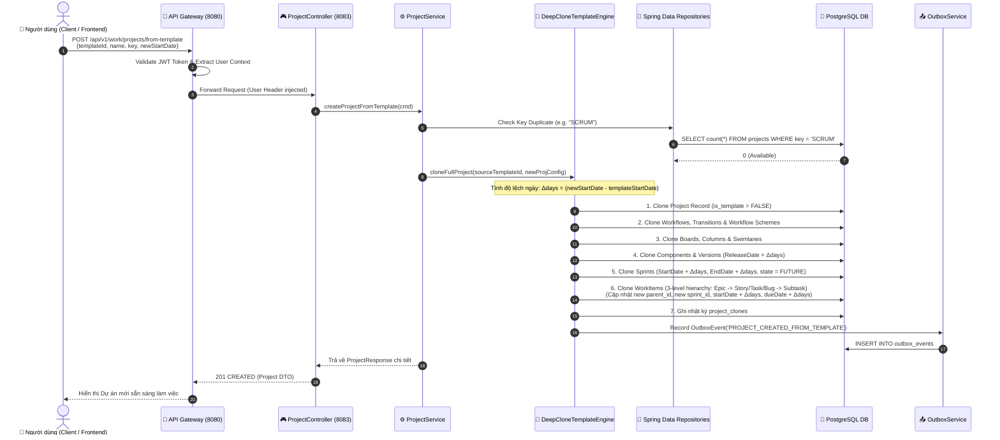
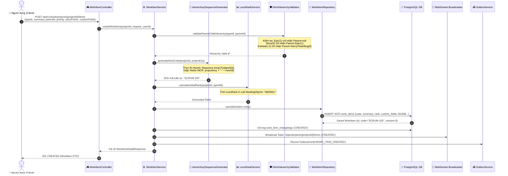
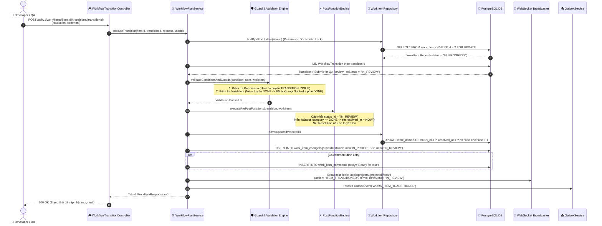
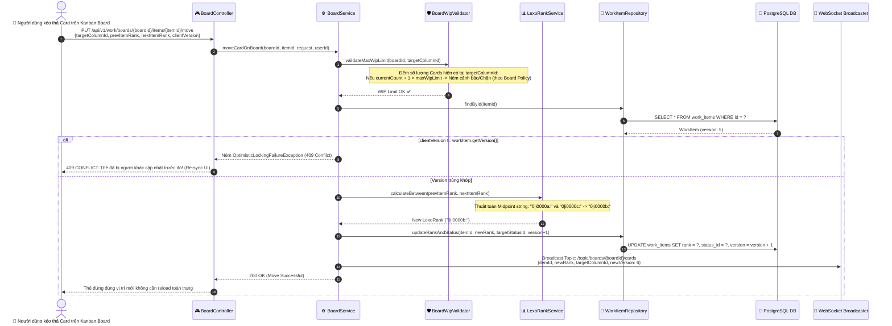
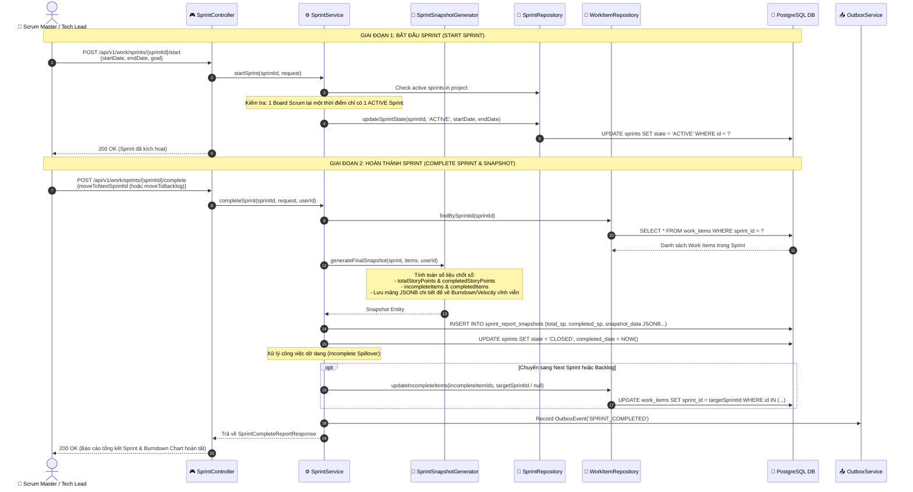
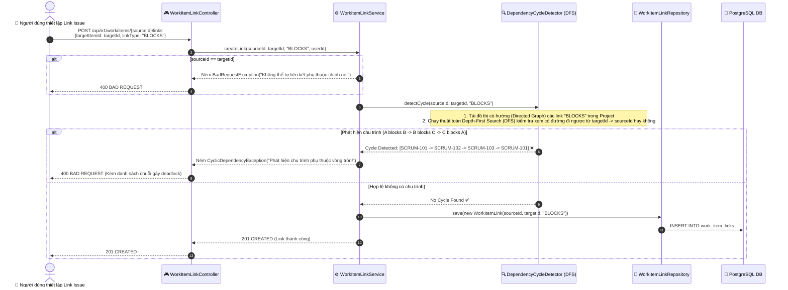
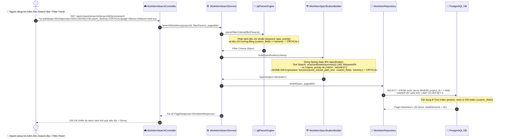
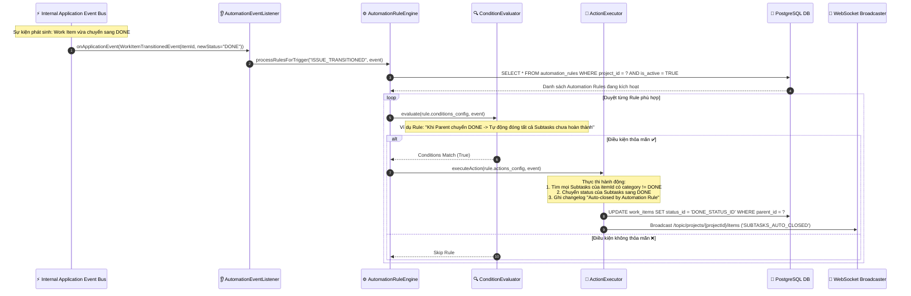

# 🔄 TÀI LIỆU SƠ ĐỒ TUẦN TỰ (SEQUENCE DIAGRAMS) CÁC LUỒNG CHÍNH — WORK SERVICE
## DỰ ÁN: DATN-2026 — HỆ THỐNG QUẢN LÝ DỰ ÁN & CÔNG VIỆC DOANH NGHIỆP

> **Module:** `work-service`  
> **Kiến trúc:** Jira-Grade Work Engine, Event-Driven Architecture (Kafka), Realtime WebSocket STOMP, Distributed Locks (Redis).  
> **Tài liệu tham chiếu:** `2_WORK_MAIN_DOC.md`, `3_WORK_IMPLEMENTATION_PLAN.md`, `4_WORK_DATABASE_DESIGN.md`.

---

## 📑 MỤC LỤC
1. [Luồng 1: Khởi tạo Dự án từ Template Mẫu & Dịch chuyển Timeline tự động](#1-luồng-1-khởi-tạo-dự-án-từ-template-mẫu--dịch-chuyển-timeline-tự-động)
2. [Luồng 2: Tạo mới Work Item (Atomic Key Sequence Generator & LexoRank)](#2-luồng-2-tạo-mới-work-item-atomic-key-sequence-generator--lexorank)
3. [Luồng 3: Máy trạng thái Chuyển đổi Trạng thái Issue (Workflow FSM Engine)](#3-luồng-3-máy-trạng-thái-chuyển-đổi-trạng-thái-issue-workflow-fsm-engine)
4. [Luồng 4: Kéo thả Card trên Board & Cập nhật LexoRank (WIP Limits & Optimistic Locking)](#4-luồng-4-kéo-thả-card-trên-board--cập-nhật-lexorank-wip-limits--optimistic-locking)
5. [Luồng 5: Chu kỳ Quản lý Sprint Scrum (Start Sprint, Active & Complete Sprint Snapshot)](#5-luồng-5-chu-kỳ-quản-lý-sprint-scrum-start-sprint-active--complete-sprint-snapshot)
6. [Luồng 6: Thiết lập Liên kết Phụ thuộc & Phát hiện Chu trình (Cycle Detection DFS)](#6-luồng-6-thiết-lập-liên-kết-phụ-thuộc--phát-hiện-chu-trình-cycle-detection-dfs)
7. [Luồng 7: Thực thi Bộ lọc Động & JQL Search Engine (JPA Specification & GIN Index)](#7-luồng-7-thực-thi-bộ-lọc-động--jql-search-engine-jpa-specification--gin-index)
8. [Luồng 8: Động cơ Tự động hóa Nội bộ (Automation Engine: Trigger -> Action)](#8-luồng-8-động-cơ-tự-động-hóa-nội-bộ-automation-engine-trigger---action)

---

## 1. Luồng 1: Khởi tạo Dự án từ Template Mẫu & Dịch chuyển Timeline tự động

---

## 2. Luồng 2: Tạo mới Work Item (Atomic Key Sequence Generator & LexoRank)

---

## 3. Luồng 3: Máy trạng thái Chuyển đổi Trạng thái Issue (Workflow FSM Engine)

---

## 4. Luồng 4: Kéo thả Card trên Board & Cập nhật LexoRank (WIP Limits & Optimistic Locking)

---

## 5. Luồng 5: Chu kỳ Quản lý Sprint Scrum (Start Sprint, Active & Complete Sprint Snapshot)

---

## 6. Luồng 6: Thiết lập Liên kết Phụ thuộc & Phát hiện Chu trình (Cycle Detection DFS)

---

## 7. Luồng 7: Thực thi Bộ lọc Động & JQL Search Engine (JPA Specification & GIN Index)

---

## 8. Luồng 8: Động cơ Tự động hóa Nội bộ (Automation Engine: Trigger -> Action)

