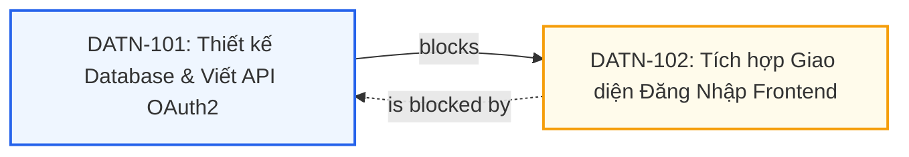
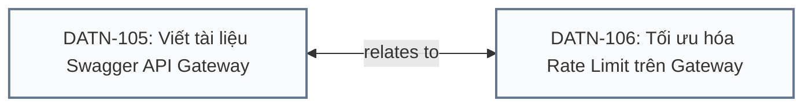
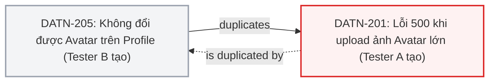
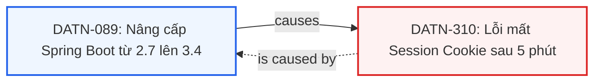

# 🔗 TÀI LIỆU ĐẶC TẢ QUAN HỆ CÔNG VIỆC & ĐỒ THỊ PHỤ THUỘC (ISSUE RELATIONSHIPS & DEPENDENCY GRAPH)
## WORK SERVICE (V2 JIRA-GRADE) — DATN-2026
### HỆ THỐNG QUẢN LÝ DỰ ÁN & CÔNG VIỆC DOANH NGHIỆP

> **Tài liệu tham chiếu:**  
> - [`2_WORK_DATABASE_DESIGN.md`](file:///d:/DATN-2026/docs/services/work_service_new/2_WORK_DATABASE_DESIGN.md) (Thiết kế bảng `work_item_links`)  
> - [`3_WORK_SEQUENCE_DIAGRAMS.md`](file:///d:/DATN-2026/docs/services/work_service_new/3_WORK_SEQUENCE_DIAGRAMS.md) (Sequence Diagram Luồng 6: DFS Cycle Check)  
> - [`4_WORK_IMPLEMENTATION_PLAN.md`](file:///d:/DATN-2026/docs/services/work_service_new/4_WORK_IMPLEMENTATION_PLAN.md) (Bước 5.4: Linked Issues)  
> - [`5_WORK_FRONTEND_UI_JIRA_SPEC.md`](file:///d:/DATN-2026/docs/services/work_service_new/5_WORK_FRONTEND_UI_JIRA_SPEC.md) (Quy chuẩn giao diện Jira Cloud)

---

## 📑 MỤC LỤC

1. [Tổng Quan Về Cơ Chế Liên Kết Công Việc (Issue Linking)](#1-tổng-quan-về-cơ-chế-liên-kết-công-việc-issue-linking)
2. [Mô Hình Dữ Liệu & Hướng Liên Kết Hai Chiều (Bidirectional Mapping)](#2-mô-hình-dữ-liệu--hướng-liên-kết-hai-chiều-bidirectional-mapping)
3. [Chi Tiết 4 Loại Quan Hệ Chuẩn Jira Cloud & Ví Dụ Thực Tế](#3-chi-tiết-4-loại-quan-hệ-chuẩn-jira-cloud--ví-dụ-thực-tế)
   - [3.1. Quan hệ `BLOCKS` (Chặn / Bị chặn bởi)](#31-quan-hệ-blocks-chặn--bị-chặn-bởi)
   - [3.2. Quan hệ `RELATES_TO` (Liên quan đến)](#32-quan-hệ-relates_to-liên-quan-đến)
   - [3.3. Quan hệ `DUPLICATES` (Trùng lặp với / Bị trùng bởi)](#33-quan-hệ-duplicates-trùng-lặp-với--bị-trùng-bởi)
   - [3.4. Quan hệ `CAUSES` (Gây ra / Bị gây ra bởi)](#34-quan-hệ-causes-gây-ra--bị-gây-ra-bởi)
4. [Phân Biệt Quan Hệ Phụ Thuộc (Issue Links) vs Phân Cấp Cấu Trúc (Hierarchy)](#4-phân-biệt-quan-hệ-phụ-thuộc-issue-links-vs-phân-cấp-cấu-trúc-hierarchy)
5. [Thuật Toán DFS Phát Hiện & Ngăn Chặn Chu Trình Deadlock (`DependencyCycleDetector`)](#5-thuật-toán-dfs-phát-hiện--ngăn-chặn-chu-trình-deadlock-dependencycycledetector)
6. [Quy Chuẩn Hiển Thị Giao Diện Người Dùng (UI/UX Jira-Grade)](#6-quy-chuẩn-hiển-thị-giao-diện-người-dùng-uiux-jira-grade)

---

## 🌐 1. TỔNG QUAN VỀ CƠ CHẾ LIÊN KẾT CÔNG VIỆC (ISSUE LINKING)

Trong quản lý dự án Agile/Scrum theo tiêu chuẩn Jira, **Issue Linking (Liên kết công việc)** là cơ chế cho phép thiết lập các mối quan hệ ngữ nghĩa phi phân cấp giữa các công việc (Task, Story, Bug, Epic) trong cùng một dự án hoặc xuyên dự án.

### Mục đích cốt lõi:
1. **Quản trị rủi ro & tiến độ:** Xác định các công việc nằm trên **Đường găng (Critical Path)** có khả năng làm tắc nghẽn toàn bộ Sprint.
2. **Truy vết ngữ cảnh (Traceability):** Kết nối mã nguồn, yêu cầu nghiệp vụ, lỗi phát sinh và tài liệu liên quan mà không làm xáo trộn cấu trúc cây thư mục của dự án.
3. **Tránh trùng lặp nỗ lực (De-duplication):** Nhận diện và gom nhóm các báo cáo lỗi trùng nhau do nhiều người dùng/tester tạo.

---

## 🗄️ 2. MÔ HÌNH DỮ LIỆU & HƯỚNG LIÊN KẾT HAI CHIỀU (BIDIRECTIONAL MAPPING)

### Bảng Cơ Sở Dữ Liệu: `work_item_links`

```sql
CREATE TABLE work_item_links (
    id UUID PRIMARY KEY DEFAULT gen_random_uuid(),
    source_item_id UUID NOT NULL REFERENCES work_items(id) ON DELETE CASCADE,
    target_item_id UUID NOT NULL REFERENCES work_items(id) ON DELETE CASCADE,
    link_type VARCHAR(50) NOT NULL, -- BLOCKS, RELATES_TO, DUPLICATES, CAUSES
    created_by UUID,
    created_at TIMESTAMP WITH TIME ZONE DEFAULT NOW(),
    CONSTRAINT uk_work_item_links_pair UNIQUE (source_item_id, target_item_id, link_type),
    CONSTRAINT chk_no_self_link CHECK (source_item_id <> target_item_id)
);

CREATE INDEX idx_work_item_links_source ON work_item_links(source_item_id);
CREATE INDEX idx_work_item_links_target ON work_item_links(target_item_id);
```

### Cơ chế Ánh xạ Hai Chiều (Bidirectional Description):

Mỗi liên kết được lưu trữ dưới dạng **1 dòng dữ liệu** nhưng khi người dùng mở bất kỳ Task nào trong cặp liên kết, hệ thống sẽ tự động tính toán mô tả quan hệ tương ứng:

```
[Task A (Source)] ──── (Outward Description) ───► [Task B (Target)]
[Task A (Source)] ◄─── (Inward Description)  ──── [Task B (Target)]
```

| Link Type (`link_type`) | Chiều Xuất Phát (Outward - Đứng tại Source Task) | Chiều Nhận Về (Inward - Đứng tại Target Task) | Tính Chất Toán Học |
| :--- | :--- | :--- | :---: |
| **`BLOCKS`** | **`blocks`** *(Chặn)* | **`is blocked by`** *(Bị chặn bởi)* | Có hướng (Directed) |
| **`RELATES_TO`** | **`relates to`** *(Liên quan đến)* | **`relates to`** *(Liên quan đến)* | Đối xứng (Symmetric) |
| **`DUPLICATES`** | **`duplicates`** *(Trùng lặp với)* | **`is duplicated by`** *(Bị trùng lặp bởi)* | Có hướng (Directed) |
| **`CAUSES`** | **`causes`** *(Gây ra)* | **`is caused by`** *(Bị gây ra bởi)* | Có hướng (Directed) |

---

## 🛠️ 3. CHI TIẾT 4 LOẠI QUAN HỆ CHUẨN JIRA CLOUD & VÍ DỤ THỰC TẾ

---

### 3.1. Quan hệ `BLOCKS` (Chặn / Bị chặn bởi)
Quan hệ phụ thuộc kỹ thuật bắt buộc: **Task A phải hoàn thành thì Task B mới có thể triển khai hoặc kiểm thử**.



* **Ý nghĩa:**
  - `DATN-101` là **Tiền đề (Prerequisite)**.
  - `DATN-102` là **Hậu quả/Tắc nghẽn (Blocked Task)**.
* **Giao diện khi mở `DATN-101`:**
  - Nhóm: `CHẶN (BLOCKS) (1)`
  - Thẻ: `[Task] DATN-102 - Tích hợp Giao diện Đăng Nhập Frontend (TO DO)`
* **Giao diện khi mở `DATN-102`:**
  - Nhóm: `BỊ CHẶN BỞI (IS BLOCKED BY) (1)`
  - Thẻ: `[Story] DATN-101 - Thiết kế Database & Viết API OAuth2 (IN PROGRESS)`
* **Bảo vệ hệ thống:** Thuật toán DFS kích hoạt kiểm tra nhằm loại trừ hoàn toàn các vòng lặp chết ($A \rightarrow B \rightarrow A$).

---

### 3.2. Quan hệ `RELATES_TO` (Liên quan đến)
Quan hệ tham chiếu ngữ cảnh, dùng khi hai công việc bổ trợ thông tin cho nhau mà **không ép buộc thứ tự thực hiện trước sau**.



* **Ý nghĩa:** Chia sẻ thông tin kiến trúc, mã nguồn hoặc tài liệu tham khảo chéo.
* **Giao diện:**
  - Đứng tại `DATN-105` hiển thị: `LIÊN QUAN ĐẾN (RELATES TO): DATN-106`.
  - Đứng tại `DATN-106` hiển thị: `LIÊN QUAN ĐẾN (RELATES TO): DATN-105`.

---

### 3.3. Quan hệ `DUPLICATES` (Trùng lặp với / Bị trùng bởi)
Dùng khi nhiều thành viên báo cáo cùng một lỗi (Bug) hoặc tạo các công việc có nội dung trùng lặp nhau.



* **Quy trình xử lý chuẩn:**
  1. Gắn liên kết `DATN-205` **DUPLICATES** `DATN-201`.
  2. Đóng `DATN-205` với trạng thái `DONE` / `REJECTED` (Lý do: Duplicate).
  3. Lập trình viên chỉ cần tập trung fix `DATN-201`.
* **Giao diện khi mở `DATN-201`:**
  - Nhóm: `BỊ TRÙNG BỞI (IS DUPLICATED BY) (1)`
  - Thẻ: `[Bug] DATN-205 - Không đổi được Avatar... (DONE - gạch ngang chữ)`

---

### 3.4. Quan hệ `CAUSES` (Gây ra / Bị gây ra bởi)
Dùng để truy vết lỗi hồi quy (Regression Bug) hoặc sự cố bắt nguồn từ một commit / đợt refactor trước đó.



* **Ý nghĩa:** Hỗ trợ điều tra nguyên nhân gốc rễ (Root Cause Analysis - RCA).
* **Giao diện khi mở Bug `DATN-310`:**
  - Nhóm: `GÂY RA BỞI (IS CAUSED BY) (1)`
  - Thẻ: `[Task] DATN-089 - Nâng cấp Spring Boot từ 2.7 lên 3.4 (DONE)` $\rightarrow$ Giúp team biết cần kiểm tra lại cấu hình Cookie Security của Spring Boot 3.

---

## 🌳 4. PHÂN BIỆT QUAN HỆ PHỤ THUỘC (ISSUE LINKS) VS PHÂN CẤP CẤU TRÚC (HIERARCHY)

Trong Jira và DATN-2026 Work Service, hai khái niệm này phục vụ hai mục đích hoàn toàn khác biệt:

```
┌─────────────────────────────────────────────────────────────┐
│ 1. HIERARCHY (Phân Cấp Cây - Cha/Con Bắt Buộc)              │
│    EPIC (Cấp 1) ────► STORY / TASK (Cấp 2) ────► SUBTASK (3) │
└─────────────────────────────────────────────────────────────┘
                             vs
┌─────────────────────────────────────────────────────────────┐
│ 2. ISSUE LINKS (Mạng Lưới Đồ Thị Ngang Hàng - Bất Kỳ Task)  │
│    Story A <====(BLOCKS)====> Story B                       │
│    Task C  <====(RELATES TO)=> Bug D                        │
│    Bug E   <====(DUPLICATES)=> Bug F                        │
└─────────────────────────────────────────────────────────────┘
```

| Đặc Điểm So Sánh | Cấu Trúc Phân Cấp (Issue Hierarchy) | Mạng Lưới Liên Kết (Issue Links) |
| :--- | :--- | :--- |
| **Cơ chế lưu trữ** | Cột `parent_id` trong bảng `work_items` | Bảng riêng `work_item_links` |
| **Cấu trúc dữ liệu** | Cây phân cấp (Tree Hierarchy) cố định 3 tầng | Đồ thị liên kết tự do (General Graph) |
| **Quan hệ giữa các phần tử** | Quan hệ Cha - Con bắt buộc (`Subtask of`, `Epic Link`) | Quan hệ ngữ nghĩa ngang hàng (*Blocks, Causes...*) |
| **Số lượng liên kết** | Mỗi Task con **chỉ có duy nhất 1 Task cha** | Một Task có thể liên kết với **nhiều Task khác** |
| **Hiển thị trên Board** | Nhóm theo Epic hoặc thanh tiến độ Checklist Subtask | Khối widget **Linked Issues** riêng biệt |

---

## 🛡️ 5. THUẬT TOÁN DFS PHÁT HIỆN & NGĂN CHẶN CHU TRÌNH DEADLOCK (`DependencyCycleDetector`)

Khi người dùng tạo một liên kết có hướng như `BLOCKS` hoặc `CAUSES`, nếu xuất hiện chu trình lặp lại, hai hoặc nhiều lập trình viên sẽ rơi vào trạng thái **chờ đợi lẫn nhau vô thời hạn (Deadlock)**.

### Mô Phỏng Chu Trình Deadlock:
- Bước 1: $A \text{ BLOCKS } B$ (B phải chờ A).
- Bước 2: $B \text{ BLOCKS } C$ (C phải chờ B).
- Bước 3 (Lỗi): Người dùng cố tình thêm $C \text{ BLOCKS } A$ (A lại phải chờ C) $\rightarrow$ **Cả 3 Task đều không thể bắt đầu!**

```mermaid
graph TD
    A["Task A"] -->|BLOCKS| B["Task B"]
    B -->|BLOCKS| C["Task C"]
    C -.->|CỐ TÌNH TẠO BLOCKS (BỊ CHẶN LẬP TỨC)| A
    style A fill:#FEF2F2,stroke:#DC2626,stroke-width:2px;
    style B fill:#FEF2F2,stroke:#DC2626,stroke-width:2px;
    style C fill:#FEF2F2,stroke:#DC2626,stroke-width:2px;
```

### Nguyên Lý Thuật Toán DFS (`DependencyCycleDetector.java`):
1. Trước khi thêm cạnh có hướng $Source \rightarrow Target$:
2. Hệ thống thực hiện thuật toán **Duyệt theo chiều sâu (Depth-First Search - DFS)** xuất phát từ đỉnh $Target$.
3. Mục tiêu: Tìm xem có tồn tại bất kỳ đường đi nào từ $Target$ quay trở về $Source$ hay không.
4. **Nếu tìm thấy đường đi:** Ném ngoại lệ `CyclicDependencyException` kèm toàn bộ chuỗi mắt xích gây lỗi:
   ```text
   Cyclic dependency detected: Task C -> Task A -> Task B -> Task C
   ```
5. **Nếu không tìm thấy:** Cho phép lưu liên kết vào CSDL.

---

## 🎨 6. QUY CHUẨN HIỂN THỊ GIAO DIỆN NGƯỜI DÙNG (UI/UX JIRA-GRADE)

Trong component [`WorkItemDetailModal.jsx`](file:///d:/DATN-2026/frontend/src/components/items/WorkItemDetailModal.jsx), phần **Linked Issues** được thiết kế trực quan theo đúng tiêu chuẩn Jira:

### 1. Phân nhóm trực quan theo danh mục quan hệ:
- `CHẶN (BLOCKS) (2)`
- `BỊ CHẶN BỞI (IS BLOCKED BY) (1)`
- `LIÊN QUAN ĐẾN (RELATES TO) (3)`
- `TRÙNG LẶP VỚI (DUPLICATES) (1)`

### 2. Mỗi thẻ Task liên kết bao gồm:
- **Type Icon:** Icon biểu trưng chuẩn màu (Bookmark tím cho Epic, xanh lá cho Story, vuông xanh dương cho Task, chấm tròn đỏ cho Bug).
- **Issue Code:** Mã công việc có thể nhấp chuột (`cursor: pointer`) để mở ngay chi tiết của công việc đó mà không cần reload trang.
- **Issue Summary:** Tiêu đề công việc.
- **Trạng thái Hoàn thành (Strike-through):** Nếu Task liên kết có `statusCategory === 'DONE'`, chữ tiêu đề sẽ tự động bị **gạch ngang** và mờ đi $\text{DATN-101}$ để báo hiệu công việc này đã xong.
- **Status Badge:** Thẻ trạng thái mang màu sắc cấu hình của dự án (`TO DO`, `IN PROGRESS`, `DONE`).
- **Nút Unlink:** Icon thùng rác có hộp thoại xác nhận để gỡ bỏ liên kết an toàn.

### 3. Modal "+ Link issue" thông minh:
- Dropdown lựa chọn 4 loại quan hệ nhanh chóng.
- Ô tìm kiếm tự động tìm theo mã (`DATN-102`) hoặc từ khóa trong tiêu đề.
- **Bộ lọc an toàn:** Tự động loại trừ chính công việc hiện tại khỏi danh sách gợi ý để ngăn chặn việc tự liên kết với chính nó ($A \rightarrow A$).

---
> **Tài liệu được lưu trữ tại:** [`docs/services/work_service_new/7_WORK_ISSUE_RELATIONSHIPS_AND_DEPENDENCY_GRAPH.md`](file:///d:/DATN-2026/docs/services/work_service_new/7_WORK_ISSUE_RELATIONSHIPS_AND_DEPENDENCY_GRAPH.md)
