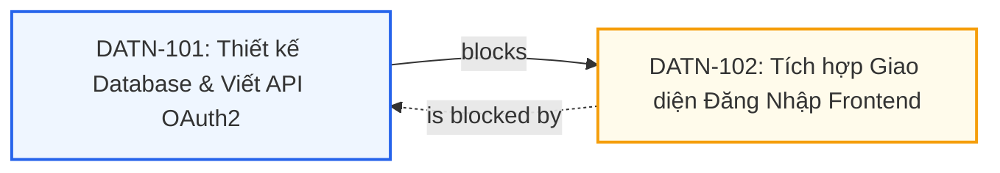
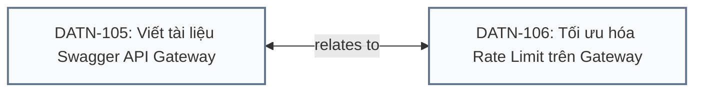
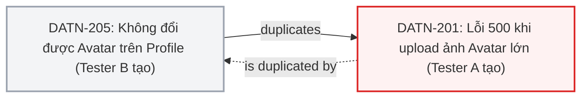
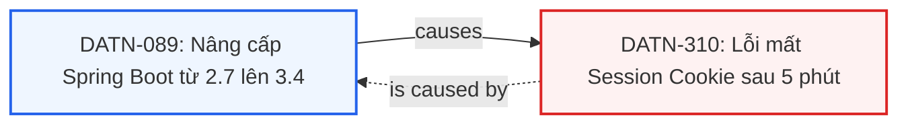

# 🔗 TÀI LIỆU ĐẶC TẢ QUAN HỆ CÔNG VIỆC & ĐỒ THỊ PHỤ THUỘC (ISSUE RELATIONSHIPS & DEPENDENCY GRAPH)
## WORK SERVICE (V2 JIRA-GRADE) — DATN-2026
### HỆ THỐNG QUẢN LÝ DỰ ÁN & CÔNG VIỆC DOANH NGHIỆP

> **Tài liệu tham chiếu:**  
> - [`2_WORK_DATABASE_DESIGN.md`](file:///d:/DATN-2026/docs/services/work_service_new/2_WORK_DATABASE_DESIGN.md) (Thiết kế bảng `work_item_links`)  
> - [`3_WORK_SEQUENCE_DIAGRAMS.md`](file:///d:/DATN-2026/docs/services/work_service_new/3_WORK_SEQUENCE_DIAGRAMS.md) (Sequence Diagram Luồng 6: DFS Cycle Check)  
> - [`4_WORK_IMPLEMENTATION_PLAN.md`](file:///d:/DATN-2026/docs/services/work_service_new/4_WORK_IMPLEMENTATION_PLAN.md) (Bước 5.4: Linked Issues)  
> - [`5_WORK_FRONTEND_UI_JIRA_SPEC.md`](file:///d:/DATN-2026/docs/services/work_service_new/5_WORK_FRONTEND_UI_JIRA_SPEC.md) (Quy chuẩn giao diện Jira Cloud)

---

## 📑 MỤC LỤC

1. [Tổng Quan Về Cơ Chế Liên Kết Công Việc (Issue Linking)](#1-tổng-quan-về-cơ-chế-liên-kết-công-việc-issue-linking)
2. [Mô Hình Dữ Liệu & Hướng Liên Kết Hai Chiều (Bidirectional Mapping)](#2-mô-hình-dữ-liệu--hướng-liên-kết-hai-chiều-bidirectional-mapping)
3. [Chi Tiết 4 Loại Quan Hệ Chuẩn Jira Cloud & Ví Dụ Thực Tế](#3-chi-tiết-4-loại-quan-hệ-chuẩn-jira-cloud--ví-dụ-thực-tế)
   - [3.1. Quan hệ `BLOCKS` (Chặn / Bị chặn bởi)](#31-quan-hệ-blocks-chặn--bị-chặn-bởi)
   - [3.2. Quan hệ `RELATES_TO` (Liên quan đến)](#32-quan-hệ-relates_to-liên-quan-đến)
   - [3.3. Quan hệ `DUPLICATES` (Trùng lặp với / Bị trùng bởi)](#33-quan-hệ-duplicates-trùng-lặp-với--bị-trùng-bởi)
   - [3.4. Quan hệ `CAUSES` (Gây ra / Bị gây ra bởi)](#34-quan-hệ-causes-gây-ra--bị-gây-ra-bởi)
4. [Phân Biệt Quan Hệ Phụ Thuộc (Issue Links) vs Phân Cấp Cấu Trúc (Hierarchy)](#4-phân-biệt-quan-hệ-phụ-thuộc-issue-links-vs-phân-cấp-cấu-trúc-hierarchy)
5. [Quản Lý Mối Quan Hệ Thời Gian, Trạng Thái & Sự Tương Thích Với Task Type (Jira-Grade Time, Status & Task Type Compatibility)](#5-quản-lý-mối-quan-hệ-thời-gian-trạng-thái--sự-tương-thích-với-task-type-jira-grade-time-status--task-type-compatibility)
   - [5.1. Mối Quan Hệ Về Thời Gian & Dải Ngày (Timeline & Sprint Boundaries)](#51-mối-quan-hệ-về-thời-gian--dải-ngày-timeline--sprint-boundaries)
   - [5.2. Mối Quan Hệ Về Trạng Thái & Vòng Đời (Status & Workflow Transitions)](#52-mối-quan-hệ-về-trạng-thái--vòng-đời-status--workflow-transitions)
   - [5.3. Sự Tương Thích Logic Giữa Issue Links Và Các Cấp Độ Task Type](#53-sự-tương-thích-logic-giữa-issue-links-và-các-cấp-độ-task-type)
   - [5.4. Bảng Ma Trận Đối Chiếu Chuẩn Jira Cho Relative Tasks](#54-bảng-ma-trận-đối-chiếu-chuẩn-jira-cho-relative-tasks)
6. [Thuật Toán DFS Phát Hiện & Ngăn Chặn Chu Trình Deadlock (`DependencyCycleDetector`)](#6-thuật-toán-dfs-phát-hiện--ngăn-chặn-chu-trình-deadlock-dependencycycledetector)
7. [Quy Chuẩn Hiển Thị Giao Diện Người Dùng (UI/UX Jira-Grade)](#7-quy-chuẩn-hiển-thị-giao-diện-người-dùng-uiux-jira-grade)

---

## 🌐 1. TỔNG QUAN VỀ CƠ CHẾ LIÊN KẾT CÔNG VIỆC (ISSUE LINKING)

Trong quản lý dự án Agile/Scrum theo tiêu chuẩn Jira, **Issue Linking (Liên kết công việc)** là cơ chế cho phép thiết lập các mối quan hệ ngữ nghĩa phi phân cấp giữa các công việc (Task, Story, Bug, Epic) trong cùng một dự án hoặc xuyên dự án.

### Mục đích cốt lõi:
1. **Quản trị rủi ro & tiến độ:** Xác định các công việc nằm trên **Đường găng (Critical Path)** có khả năng làm tắc nghẽn toàn bộ Sprint.
2. **Truy vết ngữ cảnh (Traceability):** Kết nối mã nguồn, yêu cầu nghiệp vụ, lỗi phát sinh và tài liệu liên quan mà không làm xáo trộn cấu trúc cây thư mục của dự án.
3. **Tránh trùng lặp nỗ lực (De-duplication):** Nhận diện và gom nhóm các báo cáo lỗi trùng nhau do nhiều người dùng/tester tạo.

---

## 🗄️ 2. MÔ HÌNH DỮ LIỆU & HƯỚNG LIÊN KẾT HAI CHIỀU (BIDIRECTIONAL MAPPING)

### Bảng Cơ Sở Dữ Liệu: `work_item_links`

```sql
CREATE TABLE work_item_links (
    id UUID PRIMARY KEY DEFAULT gen_random_uuid(),
    source_item_id UUID NOT NULL REFERENCES work_items(id) ON DELETE CASCADE,
    target_item_id UUID NOT NULL REFERENCES work_items(id) ON DELETE CASCADE,
    link_type VARCHAR(50) NOT NULL, -- BLOCKS, RELATES_TO, DUPLICATES, CAUSES
    created_by UUID,
    created_at TIMESTAMP WITH TIME ZONE DEFAULT NOW(),
    CONSTRAINT uk_work_item_links_pair UNIQUE (source_item_id, target_item_id, link_type),
    CONSTRAINT chk_no_self_link CHECK (source_item_id <> target_item_id)
);

CREATE INDEX idx_work_item_links_source ON work_item_links(source_item_id);
CREATE INDEX idx_work_item_links_target ON work_item_links(target_item_id);
```

### Cơ chế Ánh xạ Hai Chiều (Bidirectional Description):

Mỗi liên kết được lưu trữ dưới dạng **1 dòng dữ liệu** nhưng khi người dùng mở bất kỳ Task nào trong cặp liên kết, hệ thống sẽ tự động tính toán mô tả quan hệ tương ứng:

```
[Task A (Source)] ──── (Outward Description) ───► [Task B (Target)]
[Task A (Source)] ◄─── (Inward Description)  ──── [Task B (Target)]
```

| Link Type (`link_type`) | Chiều Xuất Phát (Outward - Đứng tại Source Task) | Chiều Nhận Về (Inward - Đứng tại Target Task) | Tính Chất Toán Học |
| :--- | :--- | :--- | :---: |
| **`BLOCKS`** | **`blocks`** *(Chặn)* | **`is blocked by`** *(Bị chặn bởi)* | Có hướng (Directed) |
| **`RELATES_TO`** | **`relates to`** *(Liên quan đến)* | **`relates to`** *(Liên quan đến)* | Đối xứng (Symmetric) |
| **`DUPLICATES`** | **`duplicates`** *(Trùng lặp với)* | **`is duplicated by`** *(Bị trùng lặp bởi)* | Có hướng (Directed) |
| **`CAUSES`** | **`causes`** *(Gây ra)* | **`is caused by`** *(Bị gây ra bởi)* | Có hướng (Directed) |

---

## 🛠️ 3. CHI TIẾT 4 LOẠI QUAN HỆ CHUẨN JIRA CLOUD & VÍ DỤ THỰC TẾ

---

### 3.1. Quan hệ `BLOCKS` (Chặn / Bị chặn bởi)
Quan hệ phụ thuộc kỹ thuật bắt buộc: **Task A phải hoàn thành thì Task B mới có thể triển khai hoặc kiểm thử**.



* **Ý nghĩa:**
  - `DATN-101` là **Tiền đề (Prerequisite)**.
  - `DATN-102` là **Hậu quả/Tắc nghẽn (Blocked Task)**.
* **Giao diện khi mở `DATN-101`:**
  - Nhóm: `CHẶN (BLOCKS) (1)`
  - Thẻ: `[Task] DATN-102 - Tích hợp Giao diện Đăng Nhập Frontend (TO DO)`
* **Giao diện khi mở `DATN-102`:**
  - Nhóm: `BỊ CHẶN BỞI (IS BLOCKED BY) (1)`
  - Thẻ: `[Story] DATN-101 - Thiết kế Database & Viết API OAuth2 (IN PROGRESS)`
* **Bảo vệ hệ thống:** Thuật toán DFS kích hoạt kiểm tra nhằm loại trừ hoàn toàn các vòng lặp chết ($A \rightarrow B \rightarrow A$).

---

### 3.2. Quan hệ `RELATES_TO` (Liên quan đến)
Quan hệ tham chiếu ngữ cảnh, dùng khi hai công việc bổ trợ thông tin cho nhau mà **không ép buộc thứ tự thực hiện trước sau**.



* **Ý nghĩa:** Chia sẻ thông tin kiến trúc, mã nguồn hoặc tài liệu tham khảo chéo.
* **Giao diện:**
  - Đứng tại `DATN-105` hiển thị: `LIÊN QUAN ĐẾN (RELATES TO): DATN-106`.
  - Đứng tại `DATN-106` hiển thị: `LIÊN QUAN ĐẾN (RELATES TO): DATN-105`.

---

### 3.3. Quan hệ `DUPLICATES` (Trùng lặp với / Bị trùng bởi)
Dùng khi nhiều thành viên báo cáo cùng một lỗi (Bug) hoặc tạo các công việc có nội dung trùng lặp nhau.



* **Quy trình xử lý chuẩn:**
  1. Gắn liên kết `DATN-205` **DUPLICATES** `DATN-201`.
  2. Đóng `DATN-205` với trạng thái `DONE` / `REJECTED` (Lý do: Duplicate).
  3. Lập trình viên chỉ cần tập trung fix `DATN-201`.
* **Giao diện khi mở `DATN-201`:**
  - Nhóm: `BỊ TRÙNG BỞI (IS DUPLICATED BY) (1)`
  - Thẻ: `[Bug] DATN-205 - Không đổi được Avatar... (DONE - gạch ngang chữ)`

---

### 3.4. Quan hệ `CAUSES` (Gây ra / Bị gây ra bởi)
Dùng để truy vết lỗi hồi quy (Regression Bug) hoặc sự cố bắt nguồn từ một commit / đợt refactor trước đó.



* **Ý nghĩa:** Hỗ trợ điều tra nguyên nhân gốc rễ (Root Cause Analysis - RCA).
* **Giao diện khi mở Bug `DATN-310`:**
  - Nhóm: `GÂY RA BỞI (IS CAUSED BY) (1)`
  - Thẻ: `[Task] DATN-089 - Nâng cấp Spring Boot từ 2.7 lên 3.4 (DONE)` $\rightarrow$ Giúp team biết cần kiểm tra lại cấu hình Cookie Security của Spring Boot 3.

---

## 🌳 4. PHÂN BIỆT QUAN HỆ PHỤ THUỘC (ISSUE LINKS) VS PHÂN CẤP CẤU TRÚC (HIERARCHY)

Trong Jira và DATN-2026 Work Service, hai khái niệm này phục vụ hai mục đích hoàn toàn khác biệt:

```
┌─────────────────────────────────────────────────────────────┐
│ 1. HIERARCHY (Phân Cấp Cây - Cha/Con Bắt Buộc)              │
│    EPIC (Cấp 1) ────► STORY / TASK (Cấp 2) ────► SUBTASK (3) │
└─────────────────────────────────────────────────────────────┘
                             vs
┌─────────────────────────────────────────────────────────────┐
│ 2. ISSUE LINKS (Mạng Lưới Đồ Thị Ngang Hàng - Bất Kỳ Task)  │
│    Story A <====(BLOCKS)====> Story B                       │
│    Task C  <====(RELATES TO)=> Bug D                        │
│    Bug E   <====(DUPLICATES)=> Bug F                        │
└─────────────────────────────────────────────────────────────┘
```

| Đặc Điểm So Sánh | Cấu Trúc Phân Cấp (Issue Hierarchy) | Mạng Lưới Liên Kết (Issue Links) |
| :--- | :--- | :--- |
| **Cơ chế lưu trữ** | Cột `parent_id` trong bảng `work_items` | Bảng riêng `work_item_links` |
| **Cấu trúc dữ liệu** | Cây phân cấp (Tree Hierarchy) cố định 3 tầng | Đồ thị liên kết tự do (General Graph) |
| **Quan hệ giữa các phần tử** | Quan hệ Cha - Con bắt buộc (`Subtask of`, `Epic Link`) | Quan hệ ngữ nghĩa ngang hàng (*Blocks, Causes...*) |
| **Số lượng liên kết** | Mỗi Task con **chỉ có duy nhất 1 Task cha** | Một Task có thể liên kết với **nhiều Task khác** |
| **Hiển thị trên Board** | Nhóm theo Epic hoặc thanh tiến độ Checklist Subtask | Khối widget **Linked Issues** riêng biệt |

---

## ⚖️ 5. QUẢN LÝ MỐI QUAN HỆ THỜI GIAN, TRẠNG THÁI & SỰ TƯƠNG THÍCH VỚI TASK TYPE (JIRA-GRADE TIME, STATUS & TASK TYPE COMPATIBILITY)

Mặc dù Issue Links đại diện cho mạng lưới đồ thị ngang hàng (Horizontal Graph), Jira Cloud kiểm soát sự tương tác của chúng với Dải thời gian (Timeline), Vòng đời trạng thái (Workflow) và Cấp độ phân cấp công việc (Task Types / Hierarchy Levels) theo các chuẩn mực logic chặt chẽ:

```
[Task A (Prerequisite)] ──(BLOCKS)──► [Task B (Dependent)]
  • Thời gian: A.dueDate <= B.startDate (Lệch hạn ➔ Đổi mũi tên sang Đỏ 🔴)
  • Sprint:    A.sprint <= B.sprint (Không cho B chạy trước A)
  • Trạng thái: A chưa DONE ➔ B bị khóa 🔒 không cho chuyển sang IN_PROGRESS / DONE
  • Task Type: Cấm Subtask link với Task cha ruột; Cấm Epic BLOCKS Subtask (Scale Mismatch)
```mermaid
graph TD
    classDef prerequisite fill:#1e3a8a,stroke:#60a5fa,stroke-width:2px,color:#fff;
    classDef blockedTask fill:#7f1d1d,stroke:#f87171,stroke-width:2px,color:#fff;
    classDef unblockedTask fill:#065f46,stroke:#34d399,stroke-width:2px,color:#fff;
    classDef neutralLink fill:#334155,stroke:#94a3b8,stroke-width:1px,color:#fff;
    classDef warningBox fill:#78350f,stroke:#f59e0b,stroke-width:2px,color:#fff;

    subgraph BlocksRelation ["🔒 QUAN HỆ BLOCKS: THỜI GIAN & TRẠNG THÁI (FINISH-TO-START DEPENDENCY)"]
        direction TB
        subgraph TimeConstraints ["⏰ Ràng Buộc Thời Gian & Phân Bổ Sprint"]
            TASK_A_TIME["🔵 TASK A (Prerequisite)<br/>dueDate: 10/10 | Sprint 1"]:::prerequisite
            TASK_B_TIME_VALID["🟢 TASK B (Lên lịch hợp lệ)<br/>startDate: 11/10 ➔ dueDate: 20/10 | Sprint 1 hoặc 2"]:::unblockedTask
            TASK_B_TIME_ERR["⚠️ TASK B (Xung đột Timeline 🔴)<br/>startDate: 05/10 (Bắt đầu trước khi A xong)<br/><i>Biểu đồ Gantt đổi đường nối sang ĐỎ RỰC</i>"]:::warningBox
            
            TASK_A_TIME -->|A.dueDate <= B.startDate| TASK_B_TIME_VALID
            TASK_A_TIME -.->|Xung đột: B.startDate < A.dueDate| TASK_B_TIME_ERR
        end

        subgraph StatusFlow ["🔄 Vòng Đời Trạng Thái (Blocked ➔ Unblocked)"]
            A_ACTIVE["🔵 Task A: TODO / IN_PROGRESS<br/><i>(Đang thực hiện - Chưa giải quyết)</i>"]:::prerequisite
            B_LOCKED["🔴 Task B: BỊ KHÓA (BLOCKED 🔒)<br/><i>Workflow Validator cấm chuyển sang IN_PROGRESS / DONE</i>"]:::blockedTask
            
            A_DONE["🟢 Task A: CHUYỂN SANG DONE<br/><i>Tiêu đề gạch ngang ~~Task A~~</i>"]:::unblockedTask
            B_FREE["🟢 Task B: ĐƯỢC GIẢI PHÓNG (UNBLOCKED 🔓)<br/><i>Cho phép bắt đầu thực hiện bình thường</i>"]:::unblockedTask

            A_ACTIVE -->|Khóa chặn bước chuyển| B_LOCKED
            A_ACTIVE -.->|Sự kiện Transition DONE| A_DONE
            A_DONE ==>|Tự động gỡ ổ khóa| B_FREE
        end
    end

    subgraph OtherLinks ["🔗 CÁC LOẠI LIÊN KẾT KHÁC & TƯƠNG THÍCH TASK TYPE"]
        direction TB
        TASK_CAUSE["🔵 TASK A (Done: 10/10)<br/><i>Nguồn gốc phát sinh lỗi</i>"]:::prerequisite
        BUG_CAUSE["🔴 BUG B (CreatedAt: 15/10)<br/><i>Lỗi hồi quy ngoài kế hoạch</i>"]:::blockedTask
        TASK_CAUSE -->|causes (Quan hệ nhân quả)| BUG_CAUSE

        DUP_SRC["⚪ Task B (Báo cáo sau)"]:::neutralLink
        DUP_TGT["🔵 Task A (Bản ghi gốc)"]:::prerequisite
        DUP_SRC -->|duplicates| DUP_TGT
        DUP_ACTION["⚡ Task B TỰ ĐỘNG ĐÓNG<br/>status: DONE (Resolution: DUPLICATE)"]:::warningBox
        DUP_SRC -.-> DUP_ACTION

        subgraph ScaleRule ["🚫 Quy Chuẩn Tương Thích Cấp Độ (Task Type Guard)"]
            NO_PARENT["❌ CẤM Subtask link BLOCKS với Task cha ruột (Đã có parent_id)"]:::blockedTask
            NO_EPIC_SUB["❌ CẤM Epic link BLOCKS trực tiếp Subtask (Lệch pha quy mô)"]:::blockedTask
        end
    end
```

---

### 5.1. Mối Quan Hệ Về Thời Gian & Dải Ngày (Timeline & Sprint Boundaries)

#### 1. Quan hệ phụ thuộc mạnh `BLOCKS` (Finish-to-Start Dependency)
* **Quy tắc dải ngày:** Công việc bị chặn (`B`) không thể bắt đầu thực thi trước khi công việc tiền đề (`A`) hoàn tất:
  $$\text{A.dueDate} \le \text{B.startDate} \le \text{B.dueDate}$$
* **Cơ chế Cảnh báo Xung đột Thời gian (Dependency Conflict Warning):**
  - Khi người dùng đặt lịch `B.startDate < A.dueDate` hoặc `B.dueDate < A.dueDate`:
  - Hệ thống **không chặn cứng (Non-blocking)** để người quản trị nhận diện được rủi ro chậm tiến độ thực tế.
  - Trên biểu đồ Gantt/Timeline, đường nối phụ thuộc chuyển thành **Màu đỏ rực (Red Dependency Line)** kèm icon `⚠️ Dependency Conflict`.
  - Trên bảng Kanban và Drawer chi tiết của Task B, xuất hiện cảnh báo: `⚠️ Công việc tiền đề [DATN-101] có hạn chót sau ngày bắt đầu của việc này`.
* **Phân bổ chu kỳ Sprint cho công việc bị chặn:**
  - Nếu A BLOCKS B thì Sprint của A phải diễn ra trước hoặc cùng thời điểm với Sprint của B ($\text{A.sprint} \le \text{B.sprint}$).
  - Nếu Task B được kéo vào `Sprint 1` trong khi Task A vẫn nằm ở `Sprint 2` hoặc Product Backlog $\rightarrow$ Hệ thống hiển thị cảnh báo đỏ trên trang Backlog: *"Kế hoạch Sprint không hợp lệ: Thẻ này bị chặn bởi công việc chưa nằm trong Sprint hiện tại"*.

#### 2. Dải ngày với các loại liên kết khác
* **Quan hệ `CAUSES`:** Thường dùng cho lỗi phát sinh sau một tính năng hoặc một đợt phát hành:
  $$\text{Bug.createdAt} \ge \text{CauseTask.startDate}$$
  Bug phát sinh là công việc đột xuất (Unplanned), có thể có deadline gấp, không nhất thiết phải nối đuôi tuyến tính với Task gây lỗi nhưng luôn xuất hiện sau.
* **Quan hệ `DUPLICATES`:** Khi xác nhận Task B trùng lặp với Task A, dải ngày và ước lượng của Task B **mất hiệu lực thực thi** (không còn tính vào capacity của Sprint). Toàn bộ nỗ lực tập trung vào Task A gốc.
* **Quan hệ `RELATES_TO`:** Hai công việc hoàn toàn độc lập về mặt thời gian, có thể chạy song song hoặc cách nhau nhiều tháng mà không phát sinh bất kỳ cảnh báo nào.

---

### 5.2. Mối Quan Hệ Về Trạng Thái & Vòng Đời (Status & Workflow Transitions)

#### 1. Ràng buộc Chặn Chuyển Trạng Thái (Blocked Transition Guard)
* **Khi A BLOCKS B:**
  - Miễn là `A.statusCategory != StatusCategory.DONE`:
    - Task B rơi vào trạng thái **BLOCKED (Bị cản trở)**.
    - **Workflow Validator:** Chặn không cho phép chuyển Task B sang trạng thái `IN_PROGRESS` hoặc `DONE`.
    - Khi người dùng cố tình kéo B sang cột đang làm hoặc hoàn thành, hệ thống hiển thị thông báo lỗi nghiệp vụ:
      > 🚫 *"Không thể bắt đầu/hoàn thành công việc này vì công việc tiền đề [DATN-101] chưa được giải quyết (DONE)!"*
* **Khi A chuyển sang `DONE` (Unblocking Event):**
  - Mã và tiêu đề của A trong khối Linked Issues của B tự động được **gạch ngang** (`~~DATN-101~~`).
  - Biểu tượng ổ khóa `🔒` trên thẻ B được giải phóng.
  - **Automation Event:** Tự động gửi thông báo cho Assignee của B: *"Công việc cản trở [DATN-101] đã hoàn tất. Bạn có thể bắt đầu [DATN-102]"*.

#### 2. Xử lý Mở Lại Công Việc Tiền Đề (Reopen Blocker Rule)
* Nếu Task A đã `DONE` nhưng sau đó bị mở lại (Reopened về `IN_PROGRESS` hoặc `TODO` do phát sinh lỗi):
  - Tất cả các công việc mà A từng chặn (B, C) lập tức bị tái kích hoạt trạng thái **BLOCKED**.
  - Nếu Task B đang dở dang ở `IN_PROGRESS`, hệ thống gắn cờ rủi ro màu đỏ: `⚠️ Blocker đã bị mở lại!`.

#### 3. Xử lý Trạng thái khi Trùng Lặp (`DUPLICATES`)
* Khi người dùng tạo liên kết `B DUPLICATES A`:
  - Hệ thống tự động chuyển trạng thái của B sang **`DONE`** (hoặc `CANCELLED / REJECTED`) với lý do giải quyết `Resolution = DUPLICATE`.
  - Khi Task A gốc được hoàn thành (`DONE`), hệ thống tự động bắn thông báo cập nhật cho toàn bộ Watchers và Reporter của Task B.

---

### 5.3. Sự Tương Thích Logic Giữa Issue Links Và Các Cấp Độ Task Type

Hệ thống thẩm định ngữ nghĩa liên kết (`LinkHierarchyValidator`) ngăn chặn các liên kết phi lý hoặc vi phạm nguyên tắc Agile:

| Cặp Task Type tương tác | Link Type hợp lệ | Link Type KHÔNG hợp lệ / Anti-pattern | Giải thích tính Logic & Quy chuẩn Jira |
| :--- | :--- | :--- | :--- |
| **Parent (0) vs Subtask (-1) của chính nó** | ❌ **CẤM TUYỆT ĐỐI** | 🚫 `BLOCKS`, `CAUSES`, `RELATES_TO` | **Cô lập Phân cấp vs Liên kết:** Quan hệ Cha - Con ruột đã được quản lý bằng phân cấp cấu trúc (`parent_id`). Dùng thêm Issue Link giữa cha và con ruột sẽ gây xung đột đồ thị và tính toán trùng lặp. |
| **Subtask (-1) vs Subtask (-1) (CÙNG Task cha)** | 🟢 `BLOCKS`, `RELATES_TO` | ⚠️ `DUPLICATES` | **Hoàn toàn hợp lệ & Phổ biến:** Các bước kỹ thuật trong cùng 1 Story thường có thứ tự: Subtask DB $\rightarrow$ Subtask Backend API $\rightarrow$ Subtask Frontend UI. |
| **Subtask (-1) vs Subtask (-1) (KHÁC Task cha)** | ⚠️ Hạn chế | 🚫 `BLOCKS` (Anti-pattern) | **Agile Anti-pattern:** Nếu Subtask của Story A lại chặn Subtask của Story B, chứng tỏ 2 Story bị phụ thuộc chéo vi phạm nguyên tắc INVEST. Khuyến cáo nâng liên kết lên cấp Story cha: `Story A BLOCKS Story B`. |
| **Subtask (-1) vs Epic (1)** | ❌ Không cho phép | 🚫 `BLOCKS` (Scale Mismatch) | **Lệch pha quy mô (Scale Mismatch):** Một Subtask vi mô (1-4 giờ) không thể trực tiếp làm cản trở một sáng kiến chiến lược cấp cao (Epic 3 tháng). Bắt buộc phải liên kết thông qua Story trung gian. |
| **Story / Task (0) vs Bug (0)** | 🟢 `CAUSES`, `BLOCKS` | ⚠️ `DUPLICATES` | **Rất logic:** <br>• Task `CAUSES` Bug: Đợt nâng cấp mã nguồn gây ra lỗi hồi quy.<br>• Bug `BLOCKS` Story: Lỗi bảo mật nghiêm trọng cản trở release Story. |
| **Bug (0) vs Bug (0)** | 🟢 `DUPLICATES`, `RELATES_TO` | ⚠️ `BLOCKS` | **Chuẩn xử lý trùng lặp:** 2 tester báo cáo cùng 1 lỗi $\rightarrow$ 1 bug sẽ `DUPLICATES` bug kia và được đóng ngay. |
| **Epic (1) vs Epic (1)** | 🟢 `BLOCKS`, `RELATES_TO` | 🚫 `DUPLICATES`, `CAUSES` | **Lộ trình chiến lược (Roadmap):** `Epic Giai đoạn 1 BLOCKS Epic Giai đoạn 2`. |

---

### 5.4. BẢNG MA TRẬN ĐỐI CHIẾU CHUẨN JIRA CHO RELATIVE TASKS

| Tiêu Chí | `BLOCKS` / `IS BLOCKED BY` | `CAUSES` / `IS CAUSED BY` | `DUPLICATES` / `IS DUPLICATED BY` | `RELATES_TO` |
| :--- | :--- | :--- | :--- | :--- |
| **Ý nghĩa** | Phụ thuộc kỹ thuật bắt buộc | Nguồn gốc lỗi phát sinh | Trùng lặp công việc | Bổ trợ ngữ cảnh |
| **Thuật toán DFS** | **BẮT BUỘC CHECK** (Chống Deadlock) | Tùy chọn kiểm tra | Bắt buộc kiểm tra | Không cần kiểm tra |
| **Ràng buộc Thời gian**| `A.dueDate <= B.startDate` (Báo đỏ nếu vi phạm) | `Bug.createdAt >= A.startDate` | B hủy bỏ dải ngày | Hoàn toàn tự do |
| **Ràng buộc Sprint** | `A.sprint <= B.sprint` | Không ràng buộc | Thẻ trùng rút khỏi Sprint | Độc lập Sprint |
| **Ràng buộc Status** | A chưa DONE $\rightarrow$ Chặn B sang DONE/IN_PROGRESS | Bug mở $\rightarrow$ Cảnh báo chất lượng | Target chuyển ngay sang DONE/REJECTED | Không ràng buộc trạng thái |
| **Cấp độ áp dụng** | Subtask-Subtask (cùng cha), Story-Story, Epic-Epic | Task $\rightarrow$ Bug | Bug $\rightarrow$ Bug, Story $\rightarrow$ Story | Mọi cấp độ |

---

## 🛡️ 6. THUẬT TOÁN DFS PHÁT HIỆN & NGĂN CHẶN CHU TRÌNH DEADLOCK (`DependencyCycleDetector`)

Khi người dùng tạo một liên kết có hướng như `BLOCKS` hoặc `CAUSES`, nếu xuất hiện chu trình lặp lại, hai hoặc nhiều lập trình viên sẽ rơi vào trạng thái **chờ đợi lẫn nhau vô thời hạn (Deadlock)**.

### Mô Phỏng Chu Trình Deadlock:
- Bước 1: $A \text{ BLOCKS } B$ (B phải chờ A).
- Bước 2: $B \text{ BLOCKS } C$ (C phải chờ B).
- Bước 3 (Lỗi): Người dùng cố tình thêm $C \text{ BLOCKS } A$ (A lại phải chờ C) $\rightarrow$ **Cả 3 Task đều không thể bắt đầu!**

```mermaid
graph TD
    A["Task A"] -->|BLOCKS| B["Task B"]
    B -->|BLOCKS| C["Task C"]
    C -.->|CỐ TÌNH TẠO BLOCKS (BỊ CHẶN LẬP TỨC)| A
    style A fill:#FEF2F2,stroke:#DC2626,stroke-width:2px;
    style B fill:#FEF2F2,stroke:#DC2626,stroke-width:2px;
    style C fill:#FEF2F2,stroke:#DC2626,stroke-width:2px;
```

### Nguyên Lý Thuật Toán DFS (`DependencyCycleDetector.java`):
1. Trước khi thêm cạnh có hướng $Source \rightarrow Target$:
2. Hệ thống thực hiện thuật toán **Duyệt theo chiều sâu (Depth-First Search - DFS)** xuất phát từ đỉnh $Target$.
3. Mục tiêu: Tìm xem có tồn tại bất kỳ đường đi nào từ $Target$ quay trở về $Source$ hay không.
4. **Nếu tìm thấy đường đi:** Ném ngoại lệ `CyclicDependencyException` kèm toàn bộ chuỗi mắt xích gây lỗi:
   ```text
   Cyclic dependency detected: Task C -> Task A -> Task B -> Task C
   ```
5. **Nếu không tìm thấy:** Cho phép lưu liên kết vào CSDL.

---

## 🎨 7. QUY CHUẨN HIỂN THỊ GIAO DIỆN NGƯỜI DÙNG (UI/UX JIRA-GRADE)

> [!IMPORTANT]
> Toàn bộ logic Relative Tasks phải được phản ánh trực quan trên Frontend (React 19) thông qua widget **Linked Issues**, trạng thái thẻ trên Kanban Board và các Modal bảo vệ.

Trong component [`WorkItemDetailModal.jsx`](file:///d:/DATN-2026/frontend/src/components/items/WorkItemDetailModal.jsx), phần **Linked Issues** được thiết kế trực quan theo đúng tiêu chuẩn Jira:

### 1. Phân nhóm trực quan theo danh mục quan hệ:
- `CHẶN (BLOCKS) (2)`
- `BỊ CHẶN BỞI (IS BLOCKED BY) (1)`
- `LIÊN QUAN ĐẾN (RELATES TO) (3)`
- `TRÙNG LẶP VỚI (DUPLICATES) (1)`

### 2. Mỗi thẻ Task liên kết bao gồm:
- **Type Icon:** Icon biểu trưng chuẩn màu (Bookmark tím cho Epic, xanh lá cho Story, vuông xanh dương cho Task, chấm tròn đỏ cho Bug).
- **Issue Code:** Mã công việc có thể nhấp chuột (`cursor: pointer`) để mở ngay chi tiết của công việc đó mà không cần reload trang.
- **Issue Summary:** Tiêu đề công việc.
- **Trạng thái Hoàn thành (Strike-through):** Nếu Task liên kết có `statusCategory === 'DONE'`, chữ tiêu đề sẽ tự động bị **gạch ngang** và mờ đi $\text{DATN-101}$ để báo hiệu công việc này đã xong.
- **Status Badge:** Thẻ trạng thái mang màu sắc cấu hình của dự án (`TO DO`, `IN PROGRESS`, `DONE`).
- **Cảnh báo Lệch Hạn (`Timeline Conflict`):** Biểu tượng chấm than đỏ `⚠️ Lệch hạn phụ thuộc` nếu `blocker.dueDate > current.startDate`.
- **Nút Unlink:** Icon thùng rác có hộp thoại xác nhận để gỡ bỏ liên kết an toàn.

### 3. Modal "+ Link issue" thông minh:
- Dropdown lựa chọn 4 loại quan hệ nhanh chóng.
- Ô tìm kiếm tự động tìm theo mã (`DATN-102`) hoặc từ khóa trong tiêu đề.
- **Bộ lọc an toàn tích hợp (Active Semantic Filter):**
  - Tự động loại trừ chính công việc hiện tại ($A \rightarrow A$).
  - **Tự động loại trừ công việc cha và công việc con ruột** khỏi danh sách tìm kiếm (ngăn vi phạm Hierarchy vs Link isolation).
  - Nếu công việc hiện tại là Epic, tự động ẩn / vô hiệu hóa các Sub-tasks khi chọn loại quan hệ `BLOCKS` (ngăn vi phạm Scale Mismatch).

---
> **Tài liệu được lưu trữ tại:** [`docs/services/work_service/7_WORK_ISSUE_RELATIONSHIPS_AND_DEPENDENCY_GRAPH.md`](file:///d:/DATN-2026/docs/services/work_service/7_WORK_ISSUE_RELATIONSHIPS_AND_DEPENDENCY_GRAPH.md)  
> **Tác giả:** Đội ngũ Kiến trúc Hệ thống DATN-2026  
> **Trạng thái phê duyệt:** Đã đồng bộ toàn diện với Backend Java 21, Frontend React 19 và CSDL PostgreSQL 16.
