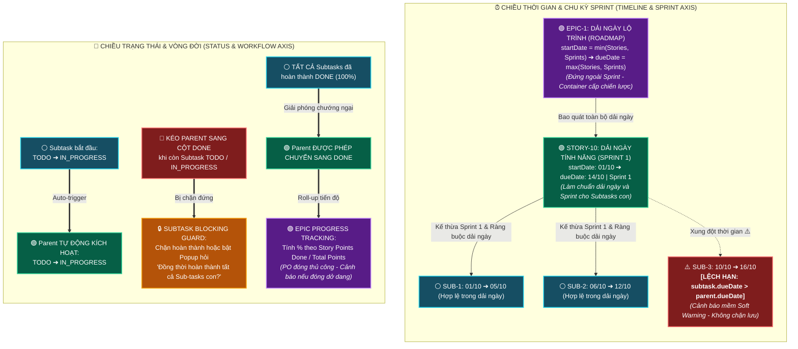

# 🏛️ TÀI LIỆU ĐẶC TẢ LOẠI CÔNG VIỆC & MÔ HÌNH PHÂN CẤP (WORK ITEM TYPES & HIERARCHY SPECIFICATION)
## WORK SERVICE (V2 JIRA-GRADE) — DATN-2026
### HỆ THỐNG QUẢN LÝ DỰ ÁN & CÔNG VIỆC DOANH NGHIỆP

> **Module:** `work-service` (Core Project & Work Management Engine)  
> **Phiên bản:** 2.0 (Jira-Grade Enterprise Specification)  
> **Tài liệu tham chiếu:**  
> - [`1_WORK_OVERVIEW_REFACTOR.md`](file:///d:/DATN-2026/docs/services/work_service/1_WORK_OVERVIEW_REFACTOR.md) (Kiến trúc tổng quan V2 & Triết lý Jira-Grade)  
> - [`2_WORK_DATABASE_DESIGN.md`](file:///d:/DATN-2026/docs/services/work_service/2_WORK_DATABASE_DESIGN.md) (Thiết kế CSDL bảng `work_item_types` & `work_items`)  
> - [`3_WORK_SEQUENCE_DIAGRAMS.md`](file:///d:/DATN-2026/docs/services/work_service/3_WORK_SEQUENCE_DIAGRAMS.md) (Sơ đồ tuần tự tạo việc & validate hierarchy)  
> - [`4_WORK_IMPLEMENTATION_PLAN.md`](file:///d:/DATN-2026/docs/services/work_service/4_WORK_IMPLEMENTATION_PLAN.md) (Lộ trình triển khai phân cấp 3 tầng)  
> - [`5_WORK_FRONTEND_UI_JIRA_SPEC.md`](file:///d:/DATN-2026/docs/services/work_service/5_WORK_FRONTEND_UI_JIRA_SPEC.md) (Quy chuẩn giao diện Kanban/Backlog/Modal)  
> - [`7_WORK_ISSUE_RELATIONSHIPS_AND_DEPENDENCY_GRAPH.md`](file:///d:/DATN-2026/docs/services/work_service/7_WORK_ISSUE_RELATIONSHIPS_AND_DEPENDENCY_GRAPH.md) (Phân hệ Issue Links đồ thị ngang hàng)

---

## 📑 MỤC LỤC

1. [Tổng Quan Về Phân Loại Công Việc (Work Item Types Overview)](#1-tổng-quan-về-phân-loại-công-việc-work-item-types-overview)
2. [Hệ Thống 5 Loại Công Việc Chuẩn Mặc Định (Default Work Item Types)](#2-hệ-thống-5-loại-công-việc-chuẩn-mặc-định-default-work-item-types)
   - [2.1. Epic (Sáng Kiến Lớn / Module Bao Trùm)](#21-epic-sáng-kiến-lớn--module-bao-trùm)
   - [2.2. User Story (Yêu Cầu Nghiệp Vụ Người Dùng)](#22-user-story-yêu-cầu-nghiệp-vụ-người-dùng)
   - [2.3. Task (Nhiệm Vụ Kỹ Thuật Tiêu Chuẩn)](#23-task-nhiệm-vụ-kỹ-thuật-tiêu-chuẩn)
   - [2.4. Bug (Lỗi / Sự Cố Phần Mềm)](#24-bug-lỗi--sự-cố-phần-mềm)
   - [2.5. Sub-task (Nhiệm Vụ Thực Thi Con)](#25-sub-task-nhiệm-vụ-thực-thi-con)
3. [Mô Hình Phân Cấp 3 Tầng Nghiêm Ngặt (Strict 3-Level Hierarchy)](#3-mô-hình-phân-cấp-3-tầng-nghiêm-ngặt-strict-3-level-hierarchy)
   - [3.1. Cấu Trúc Phân Cấp Trực Quan](#31-cấu-trúc-phân-cấp-trực-quan)
   - [3.2. Ma Trận Hợp Lệ Quan Hệ Cha - Con (Parent-Child Validation Matrix)](#32-ma-trận-hợp-lệ-quan-hệ-cha---con-parent-child-validation-matrix)
4. [Các Ràng Buộc Biên & Tính Toàn Vẹn Dữ Liệu (Integrity Constraints)](#4-các-ràng-buộc-biên--tính-toàn-vẹn-dữ-liệu-integrity-constraints)
5. [Quản Lý Mối Quan Hệ Thời Gian, Tiến Độ & Trạng Thái Giữa Các Task Type (Jira-Grade Time & Status Relationships)](#5-quản-lý-mối-quan-hệ-thời-gian-tiến-độ--trạng-thái-giữa-các-task-type-jira-grade-time--status-relationships)
   - [5.1. Mối Quan Hệ Về Thời Gian (Timeline, Start/Due Date & Milestone Span)](#51-mối-quan-hệ-về-thời-gian-timeline-startdue-date--milestone-span)
   - [5.2. Ước Lượng & Đo Lường (Story Points & Time Tracking Roll-up)](#52-ước-lượng--đo-lường-story-points--time-tracking-roll-up)
   - [5.3. Mối Quan Hệ Về Chu Kỳ Sprint (Sprint Inheritance & Cascading)](#53-mối-quan-hệ-về-chu-kỳ-sprint-sprint-inheritance--cascading)
   - [5.4. Mối Quan Hệ Về Trạng Thái & Vòng Đời (Status Category & Workflow Transitions)](#54-mối-quan-hệ-về-trạng-thái--vòng-đời-status-category--workflow-transitions)
   - [5.5. Bảng Ma Trận Đối Chiếu Chuẩn Jira (Comprehensive Cheat Sheet Matrix)](#55-bảng-ma-trận-đối-chiếu-chuẩn-jira-comprehensive-cheat-sheet-matrix)
6. [Đối Chiếu: Cấu Trúc Cây (Hierarchy) vs Mạng Lưới Liên Kết (Issue Links)](#6-đối-chiếu-cấu-trúc-cây-hierarchy-vs-mạng-lưới-liên-kết-issue-links)
7. [Hiện Thực Kỹ Thuật (Technical Implementation)](#7-hiện-thực-kỹ-thuật-technical-implementation)
   - [7.1. Cấu Trúc Cơ Sở Dữ Liệu](#71-cấu-trúc-cơ-sở-dữ-liệu)
   - [7.2. Bộ Thẩm Định Phân Cấp Backend (`StrictHierarchyValidator`)](#72-bộ-thẩm-định-phân-cấp-backend-stricthierarchyvalidator)
   - [7.3. Thuật Toán Bảo Toàn Cây Khi Nhân Bản Template (Two-Pass Clone Remapping)](#73-thuật-toán-bảo-toàn-cây-khi-nhân-bản-template-two-pass-clone-remapping)
8. [Quy Chuẩn Trải Nghiệm Giao Diện Người Dùng (UI/UX Guidelines)](#8-quy-chuẩn-trải-nghiệm-giao-diện-người-dùng-uiux-guidelines)
   - [8.1. Modal Tạo Mới Thông Minh (`CreateWorkItemModal.jsx`)](#81-modal-tạo-mới-thông-minh-createworkitemmodaljsx)
   - [8.2. Bảo Vệ Kéo Thả Trực Quan (`dragGuards.js`)](#82-bảo-vệ-kéo-thả-trực-quan-dragguardsjs)
   - [8.3. Thể Hiện Phân Cấp Trên Chi Tiết Thẻ (Breadcrumbs & Badges)](#83-thể-hiện-phân-cấp-trên-chi-tiết-thẻ-breadcrumbs--badges)
   - [8.4. Xử Lý Giao Diện Cho Mối Quan Hệ Thời Gian, Sprint & Trạng Thái (Frontend Implementation)](#84-xử-lý-giao-diện-cho-mối-quan-hệ-thời-gian-sprint--trạng-thái-frontend-implementation)

---

## 1. TỔNG QUAN VỀ PHÂN LOẠI CÔNG VIỆC (WORK ITEM TYPES OVERVIEW)

Trong các hệ thống quản lý dự án Agile/Scrum doanh nghiệp hiện đại (tiêu biểu như Atlassian Jira Cloud), công việc không thể được quản lý dưới dạng một danh sách phẳng (flat todo list). Dự án quy mô lớn đòi hỏi sự phân tách rành mạch giữa:
1. **Tầm nhìn chiến lược & sáng kiến vĩ mô** (kéo dài qua nhiều tháng / nhiều Sprint).
2. **Giá trị nghiệp vụ bàn giao cho người dùng cuối** (được kiểm thử và nghiệm thu theo từng Sprint).
3. **Nhiệm vụ kỹ thuật vi mô** (được phân bổ chi tiết cho từng kỹ sư thực hiện trong vài giờ).

Để đạt được mục tiêu đó, `work-service` của DATN-2026 áp dụng **Mô hình Phân cấp 3 Tầng Nghiêm ngặt (Strict 3-Level Hierarchy)**. Mỗi công việc trong hệ thống (`WorkItem`) được gắn với một Loại công việc (`WorkItemType`), qua đó xác định:
- Cấp độ thẩm quyền phân cấp (`hierarchy_level`).
- Khả năng có công việc cha (`parent_id`) hoặc sở hữu công việc con.
- Cách thức tham gia vào chu kỳ Sprint, tính toán Story Points và đo lường tiến độ.

```
                    ┌─────────────────────────────────────────────────┐
                    │               LEVEL 1: EPIC                     │
                    │   Sáng kiến lớn, mục tiêu vĩ mô, đa Sprint       │
                    └───────────────────────┬─────────────────────────┘
                                            │ (1 - to - N)
                    ┌───────────────────────▼─────────────────────────┐
                    │          LEVEL 0: STANDARD WORK ITEMS           │
                    │   Story (Nghiệp vụ) | Task (Kỹ thuật) | Bug (Lỗi)│
                    └───────────────────────┬─────────────────────────┘
                                            │ (1 - to - N)
                    ┌───────────────────────▼─────────────────────────┐
                    │             LEVEL -1: SUB-TASK                  │
                    │  Nhiệm vụ vi mô thực thi (1 - 8 giờ làm việc)   │
                    └─────────────────────────────────────────────────┘
```

---

## 2. HỆ THỐNG 5 LOẠI CÔNG VIỆC CHUẨN MẶC ĐỊNH (DEFAULT WORK ITEM TYPES)

Hệ thống cung cấp sẵn 5 loại công việc cốt lõi được cấu hình tự động khi khởi tạo mỗi Dự án mới trong `ProjectServiceImpl`:

| Thuộc tính | 🟣 Epic | 🟢 Story | 🔵 Task | 🔴 Bug | ⚪ Sub-task |
| :--- | :--- | :--- | :--- | :--- | :--- |
| **Mã định danh (`code`)** | `EPIC` | `STORY` | `TASK` | `BUG` | `SUBTASK` |
| **Tên hiển thị** | Epic | Story | Task | Bug | Sub-task |
| **Cấp bậc (`hierarchy_level`)** | **`1` (Epic)** | **`0` (Standard)** | **`0` (Standard)** | **`0` (Standard)** | **`-1` (Sub-task)** |
| **Cờ `is_subtask`** | `false` | `false` | `false` | `false` | **`true`** |
| **Icon đại diện** | `Zap` / `Layers` | `Bookmark` | `CheckSquare` | `Bug` / `AlertCircle` | `GitCommit` |
| **Mã màu thương hiệu** | `#9333EA` (Tím) | `#10B981` (Xanh lá) | `#3B82F6` (Xanh dương) | `#EF4444` (Đỏ) | `#06B6D4` (Xanh lam nhạt) |
| **Thời lượng ước lượng** | Quý / Tháng / Nhiều Sprint | 1 Sprint (1 - 13 Story Points) | 1 - 3 ngày | Vài giờ - 2 ngày | 1 - 8 giờ |
| **Đối tượng tạo chính** | Product Owner, PM | Product Owner, BA | Tech Lead, Dev | QA, Tester, User | Lập trình viên |
| **Thuộc tính đặc trưng** | Epic Name, Epic Color | Acceptance Criteria, Points | Kỹ thuật, Refactor | Steps to Reproduce, Severity | Checkbox checklist, Parent link |

---

### 2.1. Epic (Sáng Kiến Lớn / Module Bao Trùm)
* **Khái niệm:** Là một khối lượng công việc khổng lồ, bao hàm một tính năng cốt lõi hoặc một phân hệ lớn của dự án.
* **Đặc điểm kiến trúc:**
  - Cấp bậc phân cấp: `hierarchy_level = 1`.
  - **Không bao giờ có công việc cha** (`parent_id = NULL` bắt buộc).
  - Vòng đời dài: Thường kéo dài qua nhiều Sprint, thậm chí nhiều quý phát triển.
  - **Không gán trực tiếp vào 1 Sprint duy nhất:** Epic tồn tại ở cấp độ Backlog tổng thể để làm khung định hướng lộ trình (Roadmap).
  - Chứa tập hợp các User Story, Technical Task và Defect Bug.
* **Ví dụ thực tế:**
  - `DATN-1`: *Xây dựng hệ thống Xác thực Tập trung SSO & Phân quyền RBAC qua Keycloak*.
  - `DATN-2`: *Tích hợp Cổng thanh toán trực tuyến Đa kênh (VNPay, Momo, Stripe)*.

---

### 2.2. User Story (Yêu Cầu Nghiệp Vụ Người Dùng)
* **Khái niệm:** Diễn đạt một yêu cầu tính năng dưới góc nhìn và ngôn ngữ của người dùng cuối nhằm mang lại giá trị nghiệp vụ cụ thể.
* **Khuôn mẫu mô tả chuẩn:**
  > *"Là một `[vai trò người dùng]`, tôi muốn `[hành động / tính năng]` để `[lợi ích đạt được]`."*
* **Đặc điểm kiến trúc:**
  - Cấp bậc phân cấp: `hierarchy_level = 0`.
  - Có thể thuộc về một Epic (`parent_id = Epic ID`) hoặc đứng độc lập trong Backlog (`parent_id = NULL`).
  - Được ước lượng độ phức tạp bằng **Story Points** (theo dãy Fibonacci: 1, 2, 3, 5, 8, 13...).
  - Là đơn vị cốt lõi được kéo vào kế hoạch chạy **Sprint Backlog**.
  - Có thể được chia nhỏ thành nhiều Sub-tasks kỹ thuật.
* **Ví dụ thực tế:**
  - `DATN-10`: *Là một Khách hàng, tôi muốn đăng nhập bằng tài khoản Google để truy cập nhanh chóng mà không cần nhớ mật khẩu mới*.

---

### 2.3. Task (Nhiệm Vụ Kỹ Thuật Tiêu Chuẩn)
* **Khái niệm:** Công việc kỹ thuật thuần túy, nâng cấp hạ tầng, viết tài liệu hoặc tối ưu mã nguồn mà không nhất thiết xuất phát từ câu chuyện nghiệp vụ của người dùng cuối.
* **Đặc điểm kiến trúc:**
  - Cấp bậc phân cấp: `hierarchy_level = 0`.
  - Có thể thuộc về một Epic hoặc đứng độc lập (`parent_id = Epic ID` hoặc `NULL`).
  - Thường được ước lượng bằng thời gian (`originalEstimateSeconds`: ví dụ 4h, 8h, 16h) hoặc Story Points.
  - Được thực hiện trong phạm vi một Sprint cụ thể.
  - Có thể phân rã thành các Sub-tasks con.
* **Ví dụ thực tế:**
  - `DATN-15`: *Cấu hình Docker Compose môi trường Staging với PostgreSQL 16 và Redis 7*.
  - `DATN-16`: *Tối ưu hóa B-Tree Index cho bảng `work_item_links` để tăng tốc độ kiểm tra chu trình DFS*.

---

### 2.4. Bug (Lỗi / Sự Cố Phần Mềm)
* **Khái niệm:** Khiếm khuyết, lỗi lập trình hoặc sai lệch hành vi so với tài liệu đặc tả yêu cầu xảy ra trên môi trường Development, Staging hoặc Production.
* **Cấu trúc nội dung chuẩn:**
  1. *Các bước tái hiện lỗi (Steps to Reproduce)*.
  2. *Kết quả thực tế quan sát được (Actual Behavior)*.
  3. *Kết quả kỳ vọng (Expected Behavior)*.
  4. *Môi trường kiểm thử & Log / Ảnh chụp màn hình*.
* **Đặc điểm kiến trúc:**
  - Cấp bậc phân cấp: `hierarchy_level = 0`.
  - Có thể được gom nhóm dưới một Epic phụ trách module đó, hoặc đứng độc lập.
  - Thường gắn với các liên kết ngữ nghĩa phụ trợ như `CAUSES` hoặc `DUPLICATES`.
  - Có thể phân tách thành Sub-task nếu việc sửa lỗi đòi hỏi nhiều bước riêng biệt (vd: 1 subtask viết Unit Test tái hiện lỗi, 1 subtask sửa mã backend, 1 subtask cập nhật UI).
* **Ví dụ thực tế:**
  - `DATN-32`: *Lỗi 500 khi người dùng tải lên tệp đính kèm vượt quá 20MB mà không có thông báo lỗi thân thiện*.

---

### 2.5. Sub-task (Nhiệm Vụ Thực Thi Con)
* **Khái niệm:** Đơn vị công việc kỹ thuật nhỏ nhất trong hệ thống, đại diện cho một phần việc cụ thể được phân bổ cho một kỹ sư hoàn tất trong thời gian ngắn (thường từ 1 đến 8 giờ).
* **Đặc điểm kiến trúc nghiêm ngặt:**
  - Cấp bậc phân cấp: `hierarchy_level = -1`.
  - Cờ nhận diện: `is_subtask = true`.
  - **Bắt buộc phải có công việc cha thuộc Cấp độ 0** (Story, Task hoặc Bug).
  - **Không bao giờ được đứng độc lập** (`parent_id` không bao giờ được phép `NULL`).
  - **Không bao giờ được gắn trực tiếp vào Epic**.
  - **Không cho phép lồng Sub-task đa tầng** (Sub-task không thể có con là Sub-task khác).
  - **Kế thừa tự động Sprint từ công việc cha:** Sub-task luôn nằm trong cùng một Sprint với công việc cha của nó.
* **Ví dụ thực tế (phân rã từ Story `DATN-10` - Google Login):**
  - `DATN-11` (Sub-task): *Tạo OAuth2 Client Credentials trên Google Cloud Console*.
  - `DATN-12` (Sub-task): *Viết API endpoint `/api/v1/auth/google` xử lý exchange Authorization Code*.
  - `DATN-13` (Sub-task): *Xây dựng nút bấm "Đăng nhập với Google" và tích hợp SDK Google Identity Services trên React*.
  - `DATN-14` (Sub-task): *Viết kiểm thử tích hợp (Integration Test) cho luồng đăng ký tài khoản mới qua Google*.

---

## 3. MÔ HÌNH PHÂN CẤP 3 TẦNG NGHIÊM NGẶT (STRICT 3-LEVEL HIERARCHY)

### 3.1. Cấu Trúc Phân Cấp Trực Quan

```mermaid
graph TD
    classDef epicStyle fill:#581c87,stroke:#c084fc,stroke-width:2px,color:#fff;
    classDef storyStyle fill:#065f46,stroke:#34d399,stroke-width:2px,color:#fff;
    classDef taskStyle fill:#1e3a8a,stroke:#60a5fa,stroke-width:2px,color:#fff;
    classDef bugStyle fill:#7f1d1d,stroke:#f87171,stroke-width:2px,color:#fff;
    classDef subStyle fill:#164e63,stroke:#22d3ee,stroke-width:2px,color:#fff;

    subgraph Level1 ["TẦNG 1: EPIC LEVEL (hierarchy_level = 1)"]
        EPIC1["🟣 EPIC-1: Xây dựng Hệ thống Xác thực Keycloak & SSO"]:::epicStyle
    end

    subgraph Level0 ["TẦNG 0: STANDARD ISSUE LEVEL (hierarchy_level = 0)"]
        STORY1["🟢 DATN-10: Đăng nhập Google (Story)"]:::storyStyle
        TASK1["🔵 DATN-15: Cấu hình Redis Session Cluster (Task)"]:::taskStyle
        BUG1["🔴 DATN-32: Sửa lỗi Token hết hạn không tự Refresh (Bug)"]:::bugStyle
        STANDALONE["🔵 DATN-99: Dọn dẹp Log định kỳ (Standalone Task - No Epic)"]:::taskStyle
    end

    subgraph LevelSub ["TẦNG -1: SUB-TASK LEVEL (hierarchy_level = -1)"]
        SUB1["⚪ DATN-11: Cấu hình Google Console Client ID"]:::subStyle
        SUB2["⚪ DATN-12: Backend API Exchange OAuth Code"]:::subStyle
        SUB3["⚪ DATN-13: UI Button React & Hook"]:::subStyle
        SUB4["⚪ DATN-16: Thiết lập Sentinel & Helm Chart"]:::subStyle
        SUB5["⚪ DATN-33: Viết Test Case bắt lỗi Expired JWT"]:::subStyle
    end

    EPIC1 -->|Chứa Story| STORY1
    EPIC1 -->|Chứa Task| TASK1
    EPIC1 -->|Chứa Bug| BUG1

    STORY1 -->|Phân rã| SUB1
    STORY1 -->|Phân rã| SUB2
    STORY1 -->|Phân rã| SUB3

    TASK1 -->|Phân rã| SUB4
    BUG1 -->|Phân rã| SUB5

    class Level1,Level0,LevelSub fill:#0f172a,stroke:#334155,stroke-dasharray: 5 5,color:#94a3b8;
```

---

### 3.2. Ma Trận Hợp Lệ Quan Hệ Cha - Con (Parent-Child Validation Matrix)

Hệ thống thẩm định phân cấp tuân thủ nghiêm ngặt ma trận tổ hợp sau đây. Bất kỳ thao tác tạo mới hoặc cập nhật vi phạm ma trận đều bị chặn đứng bởi `StrictHierarchyValidator`:

| Cấp Bậc Cha (`parentLevel`) | Cấp Bậc Con (`childLevel`) | Trạng Thái | Ý Nghĩa Nghiệp Vụ & Quy Tắc Ràng Buộc | Mã Lỗi / Thông Báo |
| :---: | :---: | :---: | :--- | :--- |
| **`NULL` (Không có cha)** | **`1` (Epic)** | ✅ **HỢP LỆ** | Epic luôn đứng ở cấp cao nhất của dự án, không bao giờ có cha. | Thao tác thành công. |
| **`1` (Epic)** | **`1` (Epic)** | ❌ **TỪ CHỐI** | Không cho phép Epic lồng trong Epic khác (Epic không thể có cha). | `Epic (Hierarchy Level 1) cannot have a parent item.` |
| **`0` (Standard)** | **`1` (Epic)** | ❌ **TỪ CHỐI** | Task/Story thường không thể làm cha của một sáng kiến Epic vĩ mô. | `Epic (Hierarchy Level 1) cannot have a parent item.` |
| **`-1` (Sub-task)** | **`1` (Epic)** | ❌ **TỪ CHỐI** | Nhiệm vụ con không thể làm cha của Epic. | `Epic (Hierarchy Level 1) cannot have a parent item.` |
| **`NULL` (Không có cha)** | **`0` (Standard)** | ✅ **HỢP LỆ** | Story, Task, Bug có thể đứng độc lập trong Backlog mà không cần thuộc Epic nào. | Thao tác thành công. |
| **`1` (Epic)** | **`0` (Standard)** | ✅ **HỢP LỆ** | Story, Task, Bug nằm dưới sự bao trùm và định hướng của Epic. | Thao tác thành công. |
| **`0` (Standard)** | **`0` (Standard)** | ❌ **TỪ CHỐI** | Không cho phép liên kết Cha - Con giữa hai Standard Items. *(Để liên kết phụ thuộc, dùng Issue Links như BLOCKS).* | `Standard item (Story/Task/Bug) can only have an Epic (Level 1) as its parent.` |
| **`-1` (Sub-task)** | **`0` (Standard)** | ❌ **TỪ CHỐI** | Sub-task không thể làm cha của Story/Task/Bug. | `Standard item (Story/Task/Bug) can only have an Epic (Level 1) as its parent.` |
| **`NULL` (Không có cha)** | **`-1` (Sub-task)** | ❌ **TỪ CHỐI** | Sub-task không thể đứng mồ côi một mình, bắt buộc phải thuộc về một công việc cha. | `Sub-task (-1) must have a parent (Story/Task/Bug). It cannot stand alone.` |
| **`1` (Epic)** | **`-1` (Sub-task)** | ❌ **TỪ CHỐI** | Sub-task không được gắn trực tiếp vào Epic (phải đi qua trung gian Story/Task/Bug). | `Sub-task (-1) cannot be directly attached to an Epic (1).` |
| **`0` (Standard)** | **`-1` (Sub-task)** | ✅ **HỢP LỆ** | Sub-task được gắn trực tiếp vào Story, Task hoặc Bug để phân rã kỹ thuật. | Thao tác thành công. |
| **`-1` (Sub-task)** | **`-1` (Sub-task)** | ❌ **TỪ CHỐI** | Nghiêm cấm lồng Sub-task đa tầng (Sub-task con của Sub-task). | `Multi-level subtask nesting is not allowed.` |

---

## 4. CÁC RÀNG BUỘC BIÊN & TÍNH TOÀN VẸN DỮ LIỆU (INTEGRITY CONSTRAINTS)

Bên cạnh cấp bậc phân cấp, hệ thống thiết lập 5 tầng phòng thủ toàn vẹn dữ liệu:

### 1. Ràng buộc Phạm vi cùng Dự án (Same-Project Scope)
- Một công việc con (`child`) và công việc cha (`parent`) **bắt buộc phải thuộc cùng một dự án** (`child.project_id == parent.project_id`).
- Hệ thống từ chối việc gắn Story của Dự án Web Frontend vào Epic của Dự án Backend API thông qua quan hệ Cha - Con.
- *Giải pháp thay thế nếu muốn liên kết xuyên dự án:* Sử dụng **Issue Links** (`RELATES_TO` hoặc `BLOCKS`).

### 2. Ràng buộc Tự thân (Anti-Self Parent)
- Một công việc không bao giờ được phép gán chính nó làm cha (`itemId != parentId`).
- Ngăn chặn lỗi vô tận khi duyệt cây phân cấp.

### 3. Ràng buộc Công việc Đã Xóa (Active Parent Only)
- Không cho phép gán hoặc chuyển cha sang một công việc đã bị xóa mềm (`parent.deletedAt != null`).
- Khi một công việc cha bị xóa mềm (`Soft Delete`):
  - Toàn bộ các Sub-tasks con trực thuộc cũng được cascade cập nhật `deletedAt` để bảo đảm tính nhất quán trên bảng Kanban và báo cáo Sprint.

### 4. Kế thừa Sprint Tự động cho Sub-task (Sprint Inheritance)
- Khi một Sub-task được tạo thông qua API `POST /api/v1/work-items/{parentId}/subtasks`:
  ```java
  // WorkItemServiceImpl.java
  CreateWorkItemRequest fullRequest = CreateWorkItemRequest.builder()
          ...
          .parentId(parentId)
          .sprintId(parent.getSprintId()) // Tự động kế thừa Sprint của cha
          .build();
  ```
- Nếu Task cha chuyển từ Backlog vào `Sprint 1`, tất cả các Sub-task con tự động di chuyển theo Task cha vào `Sprint 1`.
- Không cho phép Sub-task nằm ở một Sprint khác với Sprint của Task cha.

### 5. Khả năng Mở rộng Loại Công Việc Tuỳ Biến (Custom Work Item Types)
- Quản trị viên dự án có thể tạo thêm các Loại công việc mới (ví dụ: *Spike, Design, Documentation, Security Vulnerability*).
- Tuy nhiên, mỗi Loại công việc mới **bắt buộc phải được xếp vào một trong 3 mức phân cấp** (`-1`, `0`, hoặc `1`).
- Nhờ đó, logic thẩm định cây toàn vẹn luôn hoạt động chính xác mà không cần sửa đổi mã nguồn.

---

## 5. QUẢN LÝ MỐI QUAN HỆ THỜI GIAN, TIẾN ĐỘ & TRẠNG THÁI GIỮA CÁC TASK TYPE (JIRA-GRADE TIME & STATUS RELATIONSHIPS)

Trong kiến trúc quản trị dự án Jira Cloud, mỗi loại thẻ công việc có vòng đời riêng biệt nhưng chịu sự ràng buộc chặt chẽ theo chiều dọc thông qua hai cơ chế nền tảng: **Roll-up (Cuộn dữ liệu tổng hợp từ dưới lên)** và **Cascading (Kế thừa & lan truyền từ trên xuống)**.

```
┌────────────────────────────────────────────────────────────────────────────────────────┐
│                                    LEVEL 1: EPIC                                       │
│  • Thời gian: Bao quát toàn bộ lộ trình Sprint & Ngày kết thúc của các Story           │
│  • Ước lượng: Tự động cuộn tổng Story Points (Không nhập thời gian chi tiết)           │
│  • Sprint: Đứng ngoài chu kỳ Sprint (Cross-sprint Container)                           │
│  • Trạng thái: Đóng mở độc lập bởi PM/PO; cảnh báo khi đóng dở dang                    │
└───────────────────────────────────────────▲────────────────────────────────────────────┘
                                            │ Roll-up Points / Dates
                                            │ (Loose Coupling)
┌───────────────────────────────────────────┴────────────────────────────────────────────┐
│                        LEVEL 0: STANDARD (STORY / TASK / BUG)                          │
│  • Thời gian: Dải ngày cốt lõi của tính năng (Start Date ➔ Due Date)                   │
│  • Ước lượng: Nơi DUY NHẤT chấm Story Points; đo lường Time Tracking tổng hợp          │
│  • Sprint: Gán trực tiếp vào Sprint hoặc Backlog; làm chuẩn cho con kế thừa            │
│  • Trạng thái: Bị CHẶN hoàn thành nếu còn Sub-task chưa hoàn tất (Blocking Guard)      │
└───────────────────────────────────────────▲────────────────────────────────────────────┘
                                            │ Roll-up Time / Status
                                            │ Cascading Sprint (Strict Coupling)
┌───────────────────────────────────────────┴────────────────────────────────────────────┐
│                                  LEVEL -1: SUB-TASK                                    │
│  • Thời gian: Nằm trong dải ngày của Task cha (Cảnh báo mềm nếu trễ hơn cha)           │
│  • Ước lượng: KHÔNG chấm Story Points; chỉ ghi nhận Giờ làm (Log Work / Estimates)    │
│  • Sprint: Bắt buộc đồng bộ 100% theo Sprint của Task cha                             │
│  • Trạng thái: Khi bắt đầu ➔ Tự động kích hoạt Task cha chuyển sang IN PROGRESS       │
└────────────────────────────────────────────────────────────────────────────────────────┘


---

### 5.1. Mối Quan Hệ Về Thời Gian (Timeline, Start/Due Date & Milestone Span)

#### 1. Quy tắc bao hàm thời gian (Time Boundary Hierarchy)
Theo logic vận hành, khoảng thời gian thực thi của một công việc con phải nằm trọn trong phạm vi thời gian của công việc cấp trên:
$$\text{parent.startDate} \le \text{subtask.startDate} \le \text{subtask.dueDate} \le \text{parent.dueDate}$$

#### 2. Cơ chế Cảnh Báo Mềm (Soft Warning / Non-blocking Alert)
* **Triết lý Jira:** Trong thực tế phát triển phần mềm, việc Subtask bị trễ hạn chót (`subtask.dueDate > parent.dueDate`) là sự kiện xảy ra thường xuyên. Nếu hệ thống chặn cứng (`Hard Block / 400 Bad Request`), lập trình viên sẽ không thể cập nhật đúng hạn chót thực tế của công việc, dẫn đến sai lệch dữ liệu theo dõi tiến độ.
* **Quy chuẩn xử lý:**
  - Hệ thống **vẫn cho phép lưu trữ** khi `subtask.dueDate > parent.dueDate`.
  - Backend trả về cờ `hasTimelineConflict = true` cùng thông điệp `timelineConflictMessage`.
  - Frontend tự động gắn huy hiệu cảnh báo màu vàng cam `⚠️ Hạn chót trễ hơn Task cha` trên thẻ Kanban Board và Drawer chi tiết.
  - Cung cấp nút tiện ích 1-click: `[Đồng bộ hạn về Task cha]` hoặc `[+ Nới hạn Task cha theo Subtask]` (chỉ dành cho Project Admin / Lead).

#### 3. Cơ chế Cuộn Thời Gian Tự Động (Dynamic Timeline Roll-up)
* Khi Task cha (Story/Task) không được người dùng gán ngày bắt đầu hoặc ngày kết thúc cụ thể, hệ thống sẽ tự động xác định dải ngày dựa trên các Subtasks con:
  $$\text{parent.startDate} = \min_{i=1}^{n} (\text{subtask}_i.\text{startDate})$$
  $$\text{parent.dueDate} = \max_{i=1}^{n} (\text{subtask}_i.\text{dueDate})$$
* **Đối với Epic (Level 1):** Epic bao quát toàn bộ các Story và Sprint trực thuộc:
  $$\text{epic.startDate} = \min \Big( \min_{j}(\text{story}_j.\text{startDate}), \min_{k}(\text{sprint}_k.\text{startDate}) \Big)$$
  $$\text{epic.dueDate} = \max \Big( \max_{j}(\text{story}_j.\text{dueDate}), \max_{k}(\text{sprint}_k.\text{endDate}) \Big)$$

---

### 5.2. Ước Lượng & Đo Lường (Story Points & Time Tracking Roll-up)

#### 1. Quy tắc Phân Lập Story Points (Story Points Exclusivity Rule)
* **Chỉ áp dụng ở Level 0 (Story / Task):** Story Points đại diện cho độ phức tạp và giá trị bàn giao người dùng, do đó chỉ được định giá tại Level 0.
* **Vô hiệu hóa ở Level -1 (Subtask):** Giao diện Subtask khóa hoàn toàn ô nhập Story Points để tránh tính toán trùng lặp (Double Counting) trên Burndown Chart và Velocity Report.
* **Roll-up lên Level 1 (Epic):** Điểm Story Points của Epic được tính lũy kế tự động từ các Story trực thuộc:
  $$\text{Epic Total Points} = \sum_{\text{story} \in \text{Epic}} \text{story.storyPoints}$$
  $$\text{Epic Completed Points} = \sum_{\substack{\text{story} \in \text{Epic} \\ \text{status.category} = \text{DONE}}} \text{story.storyPoints}$$

#### 2. Cuộn Dữ Liệu Thời Gian Làm Việc (Time Tracking Roll-up)
Lập trình viên ghi nhận giờ làm thực tế (`Log Work`) trực tiếp tại từng Subtask. Dữ liệu này tự động cuộn lên Task cha theo công thức:
* **Thời gian đã làm (Time Spent):**
  $$\text{Total Time Spent} = \text{parent.timeSpentSeconds} + \sum_{i=1}^{n} \text{subtask}_i.\text{timeSpentSeconds}$$
* **Thời gian ước lượng còn lại (Remaining Estimate):**
  $$\text{Total Remaining} = \text{parent.remainingEstimateSeconds} + \sum_{i=1}^{n} \text{subtask}_i.\text{remainingEstimateSeconds}$$
* **Hiển thị trên UI:** Drawer chi tiết hiển thị thanh tiến độ kép: *“Thời gian riêng của thẻ này”* và *“Tổng thời gian bao gồm công việc con”*.

---

### 5.3. Mối Quan Hệ Về Chu Kỳ Sprint (Sprint Inheritance & Cascading)

#### 1. Tính Toàn Vẹn Chu Kỳ Sprint (Sprint Integrity Rule)
* **Sub-task không có chu kỳ Sprint độc lập:** Công việc con bắt buộc phải thực hiện trong cùng một Sprint với công việc cha (`subtask.sprintId == parent.sprintId`).
* Sub-task không bao giờ được phép xuất hiện đơn lẻ trong Sprint Backlog khi Task cha đang nằm ở Product Backlog.

#### 2. Kế Thừa & Lan Truyền Tự Động (Cascading Sprint Synchronizer)
* **Khi tạo mới Sub-task:** Hệ thống tự động gán `subtask.sprintId = parent.sprintId`.
* **Khi dời Task cha (Level 0) sang Sprint khác:**
  - Nếu Task cha chuyển từ `Backlog` vào `Sprint 1`, toàn bộ Subtasks con tự động cập nhật `sprintId = Sprint 1`.
  - Nếu Task cha chuyển từ `Sprint 1` sang `Sprint 2` (Spillover / Roll-over), toàn bộ Subtasks con lập tức cập nhật sang `Sprint 2`.
  - Nếu Task cha bị trả về `Backlog` (`sprintId = null`), toàn bộ Subtasks con cũng tự động xóa liên kết Sprint (`sprintId = null`).

#### 3. Epic Đứng Ngoài Chu Kỳ Sprint (Cross-Sprint Container)
* Epic tồn tại độc lập ở cấp độ Dự án / Lộ trình (Roadmap).
* Thẻ Epic **không bao giờ được gán trực tiếp vào Sprint**. Các Story con của một Epic có thể phân bổ rải rác ở Sprint 1, Sprint 2, Sprint 3 hoặc Backlog dài hạn.

---

### 5.4. Mối Quan Hệ Về Trạng Thái & Vòng Đời (Status Category & Workflow Transitions)

Tất cả trạng thái tùy biến trong hệ thống đều phải được ánh xạ vào 1 trong 3 nhóm chuẩn chuẩn quốc tế (`StatusCategory`):
1. **`TODO`** (Chưa bắt đầu / Chờ thực hiện)
2. **`IN_PROGRESS`** (Đang tiến hành / Đang kiểm thử / Review)
3. **`DONE`** (Hoàn thành / Đã đóng / Đã giải quyết)

#### 1. Ràng Buộc Chặn Hoàn Thành Việc Cha (Sub-task Blocking Condition)
* **Quy tắc:** Không cho phép chuyển Task cha sang trạng thái thuộc nhóm `DONE` nếu vẫn còn **bất kỳ Sub-task con nào chưa hoàn thành** (`status.category != DONE`).
* **Hành vi xử lý khi người dùng kéo Task cha sang cột DONE:**
  - **Cách 1 (Chặn nghiêm ngặt - Strict Guard):** Báo lỗi và từ chối cập nhật kèm thông điệp:
    > 🚫 *"Không thể hoàn thành công việc này vì còn 2 nhiệm vụ con (Sub-tasks) chưa hoàn thành!"*
  - **Cách 2 (Hộp thoại hỗ trợ - Guided Modal):** Hiển thị Popup với 2 tùy chọn tiện ích:
    1. *`[Hủy bỏ]`* — Giữ nguyên trạng thái để hoàn tất nốt các việc con.
    2. *`[Đồng thời đánh dấu hoàn thành tất cả Sub-tasks]`* — Hệ thống tự động chuyển toàn bộ các Subtasks còn lại sang trạng thái `DONE` và ghi nhận changelog đồng loạt.

#### 2. Tự Động Bắt Đầu Việc Cha (Auto-transition Parent to IN_PROGRESS)
* Khi Task cha đang ở trạng thái `TODO`:
* Ngay khi một thành viên chuyển bất kỳ một Sub-task con sang `IN_PROGRESS` (bắt đầu viết mã hoặc nghiên cứu):
* **Hệ thống tự động kích hoạt:** Chuyển trạng thái Task cha sang `IN_PROGRESS` (ghi nhận Audit log: *"Hệ thống tự động chuyển trạng thái do Sub-task [DATN-12] bắt đầu thực hiện"*).

#### 3. Tự Động Hoàn Thành Hoặc Gợi Ý Hoàn Thành Việc Cha (Auto-complete Parent)
* Khi Sub-task cuối cùng của Task cha được chuyển sang `DONE`:
* **Hành vi:**
  - Tự động gợi ý thông báo Toast trên màn hình: *"Tất cả Sub-tasks đã hoàn thành. Bạn có muốn chuyển Task cha [DATN-10] sang ĐÃ HOÀN THÀNH không?"*.
  - Hoặc cấu hình Rule tự động chuyển Task cha sang `IN_REVIEW` để chờ Tech Lead nghiệm thu.

#### 4. Quy Tắc Mở Lại Công Việc (Parent Reopen Rule)
* Khi một Task cha bị mở lại từ `DONE` quay về `IN_PROGRESS` hoặc `TODO`:
* **Nguyên tắc:** **Bảo lưu trạng thái của các Sub-tasks con**. Các Subtasks đã `DONE` không bị ép quay về `TODO` (vì các đầu việc kỹ thuật đó thực tế đã hoàn thành), lập trình viên sẽ tạo thêm Subtask mới cho phần việc phát sinh cần sửa đổi.

#### 5. Cảnh Báo Khi Đóng Epic Dở Dang (Epic Resolution Guard)
* Epic không tự động hoàn thành khi tất cả Story con `DONE` (bởi vì việc đóng Epic cần sự phê duyệt tổng thể của Product Owner).
* Khi PO bấm chuyển Epic sang `DONE` trong khi vẫn còn Story con chưa hoàn thành:
  - Hệ thống hiển thị hộp thoại cảnh báo (Non-blocking Confirm):
    > ⚠️ *"Epic này vẫn còn 3 User Stories chưa hoàn tất. Bạn có chắc chắn muốn đóng Epic này không? Các Story con chưa xong sẽ giữ nguyên trạng thái hiện tại."*

---

### 5.5. BẢNG MA TRẬN ĐỐI CHIẾU CHUẨN JIRA (COMPREHENSIVE CHEAT SHEET MATRIX)

| Tiêu Chí Đánh Giá | Sub-task (Level -1) | Standard: Story / Task / Bug (Level 0) | Epic (Level 1) |
| :--- | :--- | :--- | :--- |
| **Tính Độc Lập** | ❌ Bắt buộc phải có Cha (Level 0) | 🟢 Độc lập hoặc thuộc 1 Epic | 🟢 Độc lập (Cấp cao nhất dự án) |
| **Gán Sprint** | 🔗 Bắt buộc kế thừa từ Task cha | 🟢 Gán trực tiếp vào Sprint hoặc Backlog | ❌ Không thuộc Sprint (Cross-sprint) |
| **Story Points** | ❌ Vô hiệu hóa (Không cho nhập) | 🟢 Chấm điểm trực tiếp tại đây | 🔄 Tự động tính tổng ($\sum$) từ Stories |
| **Time Tracking** | 🟢 Log work chi tiết từng giờ | 🔄 Nhập riêng hoặc cuộn từ Subtasks | 🔄 Cuộn tổng quát toàn bộ tính năng |
| **Dải Ngày (Timeline)**| Nằm trong dải ngày của Task cha | Hạn chót chính của tính năng bàn giao | Dải ngày bao trùm toàn bộ Stories |
| **Xử Lý Lệch Hạn** | ⚠️ Cảnh báo mềm nếu trễ hơn cha | ⚠️ Cảnh báo nếu trễ hơn Epic | Dải ngày mở rộng theo các Sprint |
| **Chuyển sang DONE** | Độc lập chuyển bất kỳ lúc nào | 🚫 **Chặn** nếu còn Sub-task chưa DONE | ⚠️ **Cảnh báo** nếu còn Story chưa DONE |
| **Kích Hoạt Tự Động** | Bắt đầu $\rightarrow$ Kéo cha sang In Progress | Xong hết $\rightarrow$ Gợi ý đóng cha | Không tự động đóng theo Story con |

---

## 6. ĐỐI CHIẾU: CẤU TRÚC CÂY (HIERARCHY) VS MẠNG LƯỚI LIÊN KẾT (ISSUE LINKS)

Trong phân hệ Work Service của DATN-2026, hai cơ chế này bổ trợ cho nhau nhưng phục vụ hai mục tiêu hoàn toàn khác nhau:

```
┌─────────────────────────────────────────────────────────────────────────────┐
│ 1. HIERARCHY (Cấu trúc Cây Dọc - Cha/Con Ràng Buộc Khung Sườn)              │
│    EPIC (1) ──────► STORY / TASK / BUG (0) ──────► SUB-TASK (-1)            │
│    • Tổ chức bố cục, phân rã công việc, roll-up tiến độ.                    │
│    • 1 Cha có nhiều Con, mỗi Con CHỈ CÓ DUY NHẤT 1 Cha.                    │
└─────────────────────────────────────────────────────────────────────────────┘
                                      vs
┌─────────────────────────────────────────────────────────────────────────────┐
│ 2. ISSUE LINKS (Mạng Lưới Đồ Thị Ngang - Quan Hệ Ngữ Nghĩa Tự Do)           │
│    Story A  <====(BLOCKS / IS BLOCKED BY)====>  Story B                     │
│    Task C   <====(RELATES TO)===============>  Bug D                        │
│    Bug E    <====(DUPLICATES)===============>  Bug F                        │
│    • Quan hệ phụ thuộc kỹ thuật, nguyên nhân, trùng lặp.                    │
│    • Có thể liên kết N - N giữa bất kỳ loại thẻ nào, kể cả xuyên dự án.     │
└─────────────────────────────────────────────────────────────────────────────┘
```

| Đặc Điểm So Sánh | Cấu Trúc Phân Cấp (Issue Hierarchy) | Mạng Lưới Liên Kết (Issue Links) |
| :--- | :--- | :--- |
| **Bản chất quan hệ** | Phân tầng dọc (Vertical Parent-Child) | Đồ thị ngang hàng (Horizontal Semantic Graph) |
| **Mục đích chính** | Phân rã độ phức tạp, gom nhóm module, tính tiến độ | Quản lý tắc nghẽn kỹ thuật (Deadlock), truy vết lỗi |
| **Cơ chế lưu trữ CSDL** | Cột `parent_id` trong bảng `work_items` | Bảng liên kết riêng `work_item_links` |
| **Số lượng liên kết** | Mỗi Subtask/Story **chỉ có tối đa 1 Cha** | Một công việc có thể liên kết với **vô số việc khác** |
| **Phạm vi dự án** | Bắt buộc **cùng một dự án** | Cho phép liên kết **xuyên nhiều dự án khác nhau** |
| **Ảnh hưởng vòng đời** | Cha xóa $\rightarrow$ Con xóa; Cha đổi Sprint $\rightarrow$ Con đổi theo | Độc lập vòng đời; xóa Task A không làm mất Task B |
| **Kiểm tra vòng lặp** | Kiểm tra cấp bậc 3 tầng cố định (`1 -> 0 -> -1`) | Chạy thuật toán DFS phát hiện chu trình (`DFS Cycle Check`) |
| **Hiển thị trên UI** | Epic Tag, Accordion lồng, Subtask checklist | Khối widget riêng "Linked Issues" (Blocks, Relates...) |

---

## 7. HIỆN THỰC KỸ THUẬT (TECHNICAL IMPLEMENTATION)

### 7.1. Cấu Trúc Cơ Sở Dữ Liệu

```sql
-- 1. BẢNG ĐỊNH NGHĨA LOẠI CÔNG VIỆC
CREATE TABLE work_item_types (
    id UUID PRIMARY KEY DEFAULT gen_random_uuid(),
    project_id UUID REFERENCES projects(id) ON DELETE CASCADE, -- NULL nếu là Global Type
    name VARCHAR(100) NOT NULL,                                 -- Epic, Story, Task, Bug, Subtask
    code VARCHAR(50) NOT NULL,                                 -- EPIC, STORY, TASK, BUG, SUBTASK
    description TEXT,
    icon_name VARCHAR(100),                                    -- Zap, Bookmark, CheckSquare, Bug, GitCommit
    color_hex VARCHAR(20),                                     -- #9333EA, #10B981, #3B82F6, #EF4444, #06B6D4
    hierarchy_level INT NOT NULL,                              -- 1: Epic, 0: Standard, -1: Subtask
    is_subtask BOOLEAN NOT NULL DEFAULT FALSE,
    is_system_default BOOLEAN NOT NULL DEFAULT FALSE,
    created_at TIMESTAMP WITH TIME ZONE NOT NULL DEFAULT CURRENT_TIMESTAMP
);

CREATE INDEX idx_work_item_types_project ON work_item_types(project_id);
CREATE INDEX idx_work_item_types_level ON work_item_types(hierarchy_level);

-- 2. BẢNG TRUNG TÂM CÔNG VIỆC (CHỨA LIÊN KẾT PHÂN CẤP)
CREATE TABLE work_items (
    id UUID PRIMARY KEY DEFAULT gen_random_uuid(),
    project_id UUID NOT NULL REFERENCES projects(id) ON DELETE CASCADE,
    type_id UUID NOT NULL REFERENCES work_item_types(id),
    parent_id UUID REFERENCES work_items(id) ON DELETE SET NULL, -- Liên kết đến công việc cha
    code VARCHAR(50) NOT NULL,                                  -- PROJ-101
    summary VARCHAR(500) NOT NULL,
    story_points DECIMAL(6, 2),
    sprint_id UUID REFERENCES sprints(id) ON DELETE SET NULL,
    created_at TIMESTAMP WITH TIME ZONE DEFAULT CURRENT_TIMESTAMP,
    deleted_at TIMESTAMP WITH TIME ZONE
);

CREATE INDEX idx_work_items_parent ON work_items(parent_id) WHERE deleted_at IS NULL;
CREATE INDEX idx_work_items_project_type ON work_items(project_id, type_id);
```

---

### 7.2. Bộ Thẩm Định Phân Cấp Backend (`StrictHierarchyValidator`)

Mã nguồn tại [`StrictHierarchyValidator.java`](file:///d:/DATN-2026/backend/work-service/src/main/java/com/datn/workservice/service/StrictHierarchyValidator.java):

```java
@Slf4j
@Service
@RequiredArgsConstructor
public class StrictHierarchyValidator {

    public static final int LEVEL_EPIC = 1;
    public static final int LEVEL_STANDARD = 0;
    public static final int LEVEL_SUBTASK = -1;

    private final WorkItemRepository workItemRepository;
    private final WorkItemTypeRepository workItemTypeRepository;

    public void validateHierarchy(UUID currentItemId, UUID childTypeId, UUID parentId, UUID projectId) {
        WorkItemType childType = workItemTypeRepository.findById(childTypeId)
                .orElseThrow(() -> new ResourceNotFoundException("WorkItemType not found: " + childTypeId));

        Integer childLevel = childType.getHierarchyLevel();

        // 1. Nếu không có parent (Công việc độc lập)
        if (parentId == null) {
            validateHierarchyLevels(null, childLevel);
            return;
        }

        // 2. Kiểm tra không được tự làm cha chính mình
        if (currentItemId != null && currentItemId.equals(parentId)) {
            throw new InvalidHierarchyException("An item cannot be its own parent.");
        }

        // 3. Kiểm tra công việc cha tồn tại và cùng dự án
        WorkItem parentItem = workItemRepository.findById(parentId)
                .orElseThrow(() -> new ResourceNotFoundException("Parent WorkItem not found: " + parentId));

        if (!parentItem.getProjectId().equals(projectId)) {
            throw new InvalidHierarchyException("Parent item (" + parentItem.getCode() + ") belongs to a different project.");
        }

        // 4. Kiểm tra cha không bị xóa mềm
        if (parentItem.getDeletedAt() != null) {
            throw new InvalidHierarchyException("Cannot link to a deleted parent item: " + parentItem.getCode());
        }

        // 5. Kiểm tra tính hợp lệ của cặp cấp bậc (Parent Level vs Child Level)
        WorkItemType parentType = workItemTypeRepository.findById(parentItem.getTypeId())
                .orElseThrow(() -> new ResourceNotFoundException("Parent WorkItemType not found: " + parentItem.getTypeId()));

        validateHierarchyLevels(parentType.getHierarchyLevel(), childLevel);
    }

    public void validateHierarchyLevels(Integer parentLevel, Integer childLevel) {
        if (childLevel == LEVEL_EPIC && parentLevel != null) {
            throw new InvalidHierarchyException("Epic (Hierarchy Level 1) cannot have a parent item.");
        }

        if (childLevel == LEVEL_STANDARD) {
            if (parentLevel != null && parentLevel != LEVEL_EPIC) {
                throw new InvalidHierarchyException(
                        "Standard item (Story/Task/Bug) can only have an Epic (Level 1) as its parent. Found: " + parentLevel
                );
            }
        }

        if (childLevel == LEVEL_SUBTASK) {
            if (parentLevel == null) {
                throw new InvalidHierarchyException("Sub-task (-1) must have a parent (Story/Task/Bug). It cannot stand alone.");
            }
            if (parentLevel == LEVEL_EPIC) {
                throw new InvalidHierarchyException("Sub-task (-1) cannot be directly attached to an Epic (1).");
            }
            if (parentLevel == LEVEL_SUBTASK) {
                throw new InvalidHierarchyException("Sub-task (-1) cannot have another Sub-task as parent (No multi-level nesting).");
            }
        }
    }
}
```

---

### 7.3. Thuật Toán Bảo Toàn Cây Khi Nhân Bản Template (Two-Pass Clone Remapping)

Khi người dùng nhân bản một Dự án Mẫu (Project Template) sang Dự án Thực thi mới:
1. **Pass 1 (Tạo toàn bộ bản ghi mà chưa gán `parentId`):**
   - Sao chép toàn bộ các công việc sang dự án mới.
   - Xây dựng bảng tra cứu ID cũ sang ID mới: `Map<UUID, UUID> oldToNewIdMap`.
2. **Pass 2 (Cập nhật `parentId` mới):**
   - Duyệt lại danh sách các công việc con vừa tạo.
   - Tìm ID cha mới: `UUID newParentId = oldToNewIdMap.get(item.getOldParentId())`.
   - Cập nhật `item.setParentId(newParentId)`.
3. **Kết quả:**
   - Toàn bộ cây phân cấp gồm Epic, Story và Sub-task được tái lập chính xác 100% trong dự án mới mà không bị đứt gãy liên kết hay vi phạm ràng buộc khóa ngoại.

---

## 8. QUY CHUẨN TRẢI NGHIỆM GIAO DIỆN NGƯỜI DÙNG (UI/UX GUIDELINES)

### 8.1. Modal Tạo Mới Thông Minh (`CreateWorkItemModal.jsx`)

Bộ chọn loại công việc tự động điều chỉnh các trường nhập liệu tương ứng:
- **Khi chọn `Epic`:**
  - Ẩn hoàn toàn trường chọn "Công việc cha (Parent)".
  - Ẩn trường chọn "Sprint" (Epic nằm ở cấp độ Backlog / Roadmap).
  - Bổ sung trường chọn "Màu Epic (Epic Color Tag)".
- **Khi chọn `Story / Task / Bug`:**
  - Trường "Parent" chuyển thành dropdown lọc danh sách: **Chỉ hiển thị các Epic** trong dự án hiện tại.
  - Cho phép để trống nếu người dùng muốn tạo công việc độc lập.
  - Hiển thị trường nhập "Story Points" (đối với Story).
- **Khi chọn `Sub-task`:**
  - Trường "Parent" trở thành **BẮT BUỘC** (`required`).
  - Dropdown tìm kiếm: **Chỉ hiển thị các Story, Task, Bug (Level 0)** trong dự án.
  - Tự động hiển thị huy hiệu: `Kế thừa Sprint từ công việc cha`.

---

### 8.2. Bảo Vệ Kéo Thả Trực Quan (`dragGuards.js`)

Khi người dùng thao tác kéo thả trên giao diện Backlog hoặc Kanban:
- Kéo thả thẻ Sub-task vào một Sub-task khác $\rightarrow$ Con trỏ chuột chuyển thành biểu tượng cấm `🚫`, kèm thông báo Tooltip màu đỏ: *"Không cho phép lồng Sub-task đa tầng!"*.
- Kéo thả thẻ Epic vào một Task khác $\rightarrow$ Chặn thao tác: *"Epic là cấp độ cao nhất, không thể làm con của công việc khác!"*.
- Kéo thả Sub-task ra khỏi Task cha thành thẻ độc lập $\rightarrow$ Chặn thao tác: *"Sub-task bắt buộc phải thuộc về một Story, Task hoặc Bug!"*.

---

### 8.3. Thể Hiện Phân Cấp Trên Chi Tiết Thẻ (Breadcrumbs & Badges)

Tại tiêu đề của modal chi tiết [`WorkItemDetailModal.jsx`](file:///d:/DATN-2026/frontend/src/components/items/WorkItemDetailModal.jsx), đường dẫn phân cấp (Breadcrumb) được thể hiện chuẩn mực:

```text
🟣 [DATN-1] Xây dựng Hệ thống SSO  >  🟢 [DATN-10] Đăng nhập Google  >  ⚪ [DATN-13] UI Button React
```

- Người dùng có thể nhấp chuột trực tiếp vào `DATN-10` hoặc `DATN-1` trên Breadcrumb để chuyển nhanh đến xem chi tiết công việc cha.
- Thẻ Subtask hiển thị danh sách checklist kèm checkbox hoàn thành nhanh trực tiếp mà không cần mở modal con.

---

### 8.4. Xử Lý Giao Diện Cho Mối Quan Hệ Thời Gian, Sprint & Trạng Thái (Frontend Implementation)

> [!IMPORTANT]
> **Toàn bộ các quy tắc liên tầng KHÔNG CHỈ nằm ở Backend** mà bắt buộc phải có các thành phần giao diện Frontend (React 19) tương ứng nhằm mang lại trải nghiệm mượt mà, phản hồi tức thời (Optimistic UI) và hướng dẫn người dùng trực quan chuẩn Jira.

#### 1. Huy Hiệu & Hành Động Cảnh Báo Lệch Hạn Chót (`TimelineConflictAlert`)
* **Vị trí hiển thị:** Trên thẻ công việc ở bảng Kanban/Scrum, danh sách Backlog và Drawer chi tiết [`WorkItemDetailModal.jsx`](file:///d:/DATN-2026/frontend/src/components/items/WorkItemDetailModal.jsx).
* **Trạng thái kích hoạt:** Khi `hasTimelineConflict === true` hoặc `subtask.dueDate > parent.dueDate`.
* **Giao diện trực quan:**
  - Hiển thị Badge màu vàng cam: `⚠️ Hạn chót trễ hơn Task cha`.
  - Trên Modal chi tiết: Xuất hiện Banner cảnh báo nhẹ nhàng kèm nút bấm:
    - `[Đồng bộ về hạn Task cha]` $\rightarrow$ Click phát sinh cập nhật ngay `dueDate = parent.dueDate`.
    - `[Nới hạn Task cha theo Subtask]` $\rightarrow$ Click mở xác nhận cập nhật `parent.dueDate = subtask.dueDate` (chỉ dành cho Project Lead).

#### 2. Modal Chặn Hoàn Thành Khi Còn Sub-task (`ResolveSubtasksModal.jsx`)
* **Cơ chế kích hoạt:** Khi người dùng kéo thẻ Task cha (Level 0) sang cột `DONE` hoặc bấm nút chuyển trạng thái sang `DONE` trên giao diện, nếu `item.subtasks.some(st => st.statusCategory !== 'DONE')`:
* **Hộp thoại tương tác xuất hiện:**
  - **Tiêu đề cảnh báo:** `⚠️ Không thể hoàn thành công việc [DATN-10]`
  - **Mô tả chi tiết:** *"Công việc này vẫn còn X nhiệm vụ con (Sub-tasks) chưa hoàn thành:"*
  - **Danh sách Checklist:** Liệt kê các Subtasks chưa xong kèm Avatar người phụ trách và trạng thái hiện tại.
  - **Hành động cung cấp:**
    - Nút 1: `[Quay lại]` $\rightarrow$ Hủy bước chuyển, đưa thẻ về vị trí cột cũ.
    - Nút 2: `[Đồng thời hoàn thành tất cả Sub-tasks]` $\rightarrow$ Gửi request chuyển Task cha kèm `resolveAllSubtasks: true`, giao diện đồng loạt chuyển màu xanh lá cây `DONE` cho toàn bộ các Subtasks con.

#### 3. Đồng Bộ Kéo Thả Sprint Trên Giao Diện Backlog (`ProjectBacklogPage.jsx`)
* **Trải nghiệm Accordion:** Khi người dùng mở rộng Story cha trên Backlog, toàn bộ các Subtasks con hiển thị dạng hàng con thụt lề (Indented Sub-rows).
* **Đồng bộ kéo thả:** Khi kéo Story cha từ Backlog vào `Sprint 1`, toàn bộ các Subtasks con lập tức di chuyển theo vào `Sprint 1` trên màn hình (Optimistic Re-render) mà không đòi hỏi người dùng phải kéo từng Subtask lẻ.
* **Bảo vệ:** Chặn kéo thả Subtask riêng lẻ ra khỏi phạm vi Sprint của Task cha.

#### 4. Vô Hiệu Hóa Ô Nhập Story Points Tại Sub-task
* Khi form tạo mới hoặc form chỉnh sửa mở loại thẻ có `hierarchyLevel === -1` (Sub-task):
* Ô nhập `Story Points` tự động chuyển sang trạng thái **Disabled (Khóa xám)**, placeholder ghi rõ:
  > *"Story Points chỉ dành cho Story / Task (Level 0)"*.

#### 5. Thanh Đo Lường Tiến Độ Kép & Phân Bố Trạng Thái Epic
* **Tại Task / Story cha:**
  - Thanh tiến độ Subtask Checklist: `3/4 Sub-tasks hoàn thành (75%)` với visual progress bar màu xanh lá.
  - Khối Time Tracking: Hiển thị 2 chỉ số phân biệt: `Thời gian riêng` (vd: 4h) và `Tổng thời gian đã gộp Sub-tasks` (vd: 16h).
* **Tại Epic:**
  - Thanh tiến độ Story Points: `Đã xong 21 / 34 Points (61.8%)`.
  - Thanh phân bổ trạng thái 3 màu (Tri-color Bar): Xanh lam (`To Do`), Vàng (`In Progress`), Xanh lá (`Done`).

> **Tài liệu được lưu trữ tại:** [`docs/services/work_service/8_WORK_ITEM_TYPES_AND_HIERARCHY.md`](file:///d:/DATN-2026/docs/services/work_service/8_WORK_ITEM_TYPES_AND_HIERARCHY.md)  
> **Tác giả:** Đội ngũ Kiến trúc Hệ thống DATN-2026  
> **Trạng thái phê duyệt:** Đã đồng bộ toàn diện với Backend Java 21, Frontend React 19 và CSDL PostgreSQL 16.
