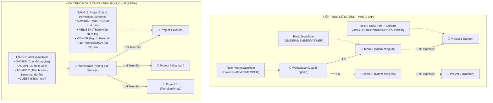

# 01. Phân Tích Lợi – Hại Khi Loại Bỏ Team, Giữ Lại Workspace & Project

> **Đồ án tốt nghiệp DATN-2026: Hệ thống quản lý công việc và dự án kiểu Jira**  
> **Tài liệu đặc tả kiến trúc mới:** Loại bỏ hoàn toàn tầng trung gian `Team`, chuyển đổi sang mô hình 2 tầng tinh gọn `Workspace → Project`.

---

## 1. Bối Cảnh Và Nguồn Gốc Kiến Trúc Cũ

### 1.1 Cấu trúc 3 tầng ban đầu
Trong thiết kế ban đầu (`docs/services/work_service/1_TONG_QUAN_KIEN_TRUC_WORK_SERVICE.md` và `2_THIET_KE_CO_SO_DU_LIEU.md`), hệ thống được định hình theo mô hình 3 tầng phân cấp:

```
[WORKSPACE] (Doanh nghiệp / Tổ chức)
    └── [TEAMS] (Đội ngũ / Phòng ban: Backend, Frontend, Marketing...)
            └── [PROJECTS] (Dự án: Scrum, Kanban)
                    └── [WORK ITEMS] (Epic, Story, Task, Bug, Subtask)
```

Ý đồ ban đầu:
- `Workspace`: Đại diện cho một tổ chức hoặc công ty riêng biệt (Multi-tenancy logic).
- `Team`: Gom nhóm một tập hợp nhân sự và chia sẻ các dự án chung cho đội ngũ đó.
- `Project`: Không gian làm việc cụ thể chứa bảng Scrum/Kanban, backlog và các công việc.

### 1.2 Thực trạng khi vận hành thực tế: "Tại sao Team không hiệu quả?"
Qua quá trình xây dựng và kiểm thử toàn hệ thống (từ Gateway, Identity, Workspace, Work-service đến Frontend React 19), tầng `Team` đã bộc lộ những điểm yếu chí mạng:

1. **Rào cản trải nghiệm (UX Friction) nghiêm trọng đối với người dùng:**
   - Để tạo được một Dự án (`Project`), người dùng bắt buộc phải tạo `Team` trước.
   - Chưa dừng lại ở đó: Người dùng phải là **Trưởng nhóm (`LEADER` hoặc `owner_id`)** của Team đó thì hệ thống mới cho phép mở form và tạo dự án (`canCreateProject = isSystemAdmin || leaderTeams.length > 0`).
   - Nếu một thành viên vào Workspace muốn khởi tạo nhanh một dự án cá nhân hoặc dự án nhóm nhỏ, họ bị hệ thống chặn với thông báo: *"Chỉ trưởng nhóm mới được tạo dự án. Hãy chọn nhóm mà bạn là trưởng nhóm."*
   
2. **Xung đột & Dư thừa mô hình phân quyền (Double Role Hierarchy):**
   - Hệ thống tồn tại cùng lúc **3 bộ Role**:
     - `WorkspaceRole`: `OWNER`, `ADMIN`, `MEMBER`, `GUEST`.
     - `TeamRole`: `LEADER`, `MEMBER`, `VIEWER`.
     - `ProjectRole`: `ADMINISTRATOR`, `MEMBER`, `VIEWER` (gắn kèm ma trận `permission_scheme_entries` 16 quyền kiểu Jira).
   - `TeamRole` nằm lơ lửng ở giữa, không đủ hạt mịn như Jira `ProjectRole`, nhưng lại gây xung đột với `WorkspaceRole`.

3. **Cơn ác mộng đồng bộ dữ liệu (Synchronization Hell):**
   - Mỗi khi một thành viên được thêm vào Team, đổi quyền trong Team, hoặc xóa khỏi Team, backend `work-service` phải chạy hàng loạt vòng lặp để đồng bộ sang các dự án con (`syncMemberToTeamProjects`, `removeMemberFromTeamProjects`, `syncTeamMembersToProject`).
   - Xuất hiện các ca lỗi biên hiểm hóc:
     - *"Bóng ma Leader"*: Khi Trưởng nhóm bị gỡ khỏi Workspace nhưng vẫn còn lưu trong `teams.owner_id` và `team_members`. Code backend trong `TeamController.java` phải viết tới gần 100 dòng chỉ để chắp vá kiểm tra: nếu user không còn trong Workspace thì thu hồi quyền Leader và dọn dẹp data ngầm.
     - Đồng bộ quyền không nhất quán giữa `role_assignments` của Project và `team_members`.

4. **Dư thừa lời mời (Invitation Redundancy):**
   - Một người dùng nhận được 3 lớp lời mời riêng biệt: Lời mời vào Workspace (`workspace_invitations`), Lời mời vào Team (`invitations` type `TEAM`), và Lời mời vào Project (`invitations` type `PROJECT`). Điều này gây bối rối tột độ cho người dùng.

5. **Mô hình thực tế của các SaaS hàng đầu thế giới:**
   - **Linear.app**: Workspace đóng vai trò tổ chức. Bên trong Workspace là các Project và Issue. Khái niệm Team trong Linear chỉ là một team tag/nhãn gom công việc, không phải một container cứng chặn quyền.
   - **Trello / Asana / Notion / Basecamp**: Mô hình cốt lõi luôn là `Workspace (Organization) → Projects / Boards`.
   - **Jira Cloud**: Jira quản lý theo `Atlassian Organization/Site → Projects`. Quản trị viên dự án (`Project Administrator`) và các vai trò dự án (`Project Roles`) quyết định toàn bộ quyền hạn, không phụ thuộc vào một container Team cưỡng bức.

---

## 2. Bảng Phân Tích Toàn Diện: LỢI ÍCH (PROS)

| STT | Khía cạnh | Lợi ích cụ thể khi loại bỏ `Team` | Chi tiết kỹ thuật & Tác động thực tế |
|:---:|---|---|---|
| **1** | **Trải nghiệm người dùng (UX/UI)** | **Tạo dự án tức thì, luồng làm việc mạch lạc** | • Người dùng vào Workspace có thể bấm **"Tạo dự án mới"** ngay lập tức mà không phải qua bước trung gian "Tạo Team".<br>• Giao diện Sidebar thanh thoát: Loại bỏ cây accordion Team lồng nhau phức tạp, thay bằng danh sách Dự án trực tiếp.<br>• Giảm thời gian Onboarding người dùng mới từ vài phút xuống còn vài giây. |
| **2** | **Kiến trúc phân quyền (Authorization)** | **Mô hình 2 tầng Jira chuẩn mực, fail-closed trong sáng** | • Hệ thống phân quyền thu về đúng **2 lớp chuẩn mực**:<br>&nbsp;&nbsp;1. **Workspace Level**: `OWNER`, `ADMIN`, `MEMBER`, `GUEST` (ai được vào tổ chức, ai được tạo dự án mới).<br>&nbsp;&nbsp;2. **Project Level**: `ADMINISTRATOR`, `MEMBER`, `VIEWER` (phân quyền hạt mịn 16 `PermissionKey` theo từng dự án).<br>• Xóa bỏ hoàn toàn lớp phân quyền trung gian `TeamRole`, annotation `@RequireTeamRole`, aspect `TeamRoleGuard`, bean `TeamSecurity`. |
| **3** | **Độ tin cậy & Toàn vẹn dữ liệu (Data Integrity)** | **Triệt tiêu toàn bộ lỗi đồng bộ ngầm & "Bóng ma dữ liệu"** | • Không còn phải viết code đồng bộ hai chiều `syncTeamMembersToProject()`.<br>• Không còn rủi ro user bị kick khỏi Workspace nhưng vẫn giữ quyền Trưởng nhóm trong Team con.<br>• Loại bỏ các ràng buộc khóa ngoại vòng (Foreign Key circular dependencies) giữa `workspaces`, `teams` và `projects`. |
| **4** | **Hiệu năng hệ thống (System Performance)** | **Giảm số lượng API calls, query DB nhanh hơn đáng kể** | • Frontend không cần gọi `teamApi.listMine()`, `teamApi.getMembers()`, `teamApi.getById()`.<br>• Giảm tối thiểu 3 - 5 request mạng mỗi lần chuyển trang hoặc mở modal tạo dự án.<br>• Database giải phóng 2 bảng lớn (`teams`, `team_members`) cùng hàng loạt index và foreign key checks. Query danh sách dự án `projects` chỉ cần WHERE `workspace_id = :wsId`, index scan tối ưu tức thì. |
| **5** | **Độ phức tạp mã nguồn (Code Maintainability)** | **Cắt giảm hơn 4.000 dòng code thừa ở cả Backend & Frontend** | • **Backend**: Xóa bỏ `TeamController` (705 dòng), `TeamSecurity` (132 dòng), `TeamRoleGuard` (150 dòng), `Team` entity, `TeamMember` entity, các DTOs và repositories.<br>• **Frontend**: Xóa bỏ `TeamDetailPage.jsx` (1.778 dòng), `CreateTeamModal.jsx` (260 dòng), thu gọn `Sidebar.jsx`, `WorkspaceLayout.jsx`, `CreateProjectModal.jsx`.<br>• Bảo trì dễ dàng hơn, ít bug hơn, viết test nhanh hơn. |
| **6** | **Luồng Lời mời & Thành viên (Invitations & Members)** | **Đơn giản hóa luồng mời vào hệ thống** | • Chỉ còn 2 loại lời mời rõ ràng:<br>&nbsp;&nbsp;1. *Lời mời tham gia Workspace* (trở thành thành viên của tổ chức).<br>&nbsp;&nbsp;2. *Lời mời tham gia Dự án* (được chỉ định vai trò trong dự án cụ thể).<br>• Không còn lời mời "nửa vời" vào Team. |

---

## 3. Bảng Phân Tích: HẠN CHẾ / THÁCH THỨC (CONS) & ĐỐI SÁCH GIẢI QUYẾT

Khi loại bỏ `Team`, hệ thống có thể gặp một số đánh đổi. Dưới đây là phân tích chi tiết và đối sách khắc phục:

### 3.1 Hạn chế 1: Mất khả năng gán hàng loạt người dùng (Bulk User Assignment)
- **Vấn đề**: Trước đây, khi tạo dự án gắn vào Team, tất cả thành viên trong Team sẽ tự động được cấp quyền trong dự án (Leader → Administrator, Member → Member, Viewer → Viewer). Khi bỏ Team, mỗi dự án phải quản lý thành viên riêng.
- **Mức độ ảnh hưởng**: Trung bình - Nhẹ. Trong phạm vi các nhóm làm việc vừa và nhỏ (đặc biệt là đồ án tốt nghiệp và SME), số lượng thành viên dự án thường từ 3 - 15 người.
- **Đối sách giải quyết**:
  1. Khi tạo dự án mới, người tạo (`Project Lead`) mặc định là `ADMINISTRATOR`.
  2. Bổ sung tính năng **"Thêm nhanh thành viên từ Workspace"**: Trong màn hình tạo dự án hoặc tab Thành viên của dự án, cung cấp checkbox chọn nhiều người dùng từ danh sách `Workspace Members` đã có sẵn.
  3. Dự án mẫu (Template): Template có thể định nghĩa sẵn các vị trí (Roles), khi clone dự án chỉ cần gán user vào vị trí đó.

### 3.2 Hạn chế 2: Thiếu không gian chia sẻ tài liệu chung cấp phòng ban
- **Vấn đề**: Trang `TeamDetailPage` cũ có tab "Documents" (tài liệu nhóm) và "Overview". Bỏ Team thì tài liệu chung cấp phòng ban sẽ hiển thị ở đâu?
- **Mức độ ảnh hưởng**: Rất nhẹ (thực tế các tab Documents của Team trước đây chỉ là mockup UI, chưa có backend lưu trữ file tài liệu riêng cho Team).
- **Đối sách giải quyết**:
  - Tài liệu kỹ thuật, tài liệu dự án được quản lý trực tiếp trong từng `Project` (đính kèm trong Epic/Story/Task).
  - Cấp độ tổ chức thì quản lý ở `Workspace Settings` hoặc tích hợp Wiki/Docs ở cấp Workspace sau này.

### 3.3 Hạn chế 3: Rủi ro gãy dữ liệu cũ và xung đột Migration
- **Vấn đề**: Trong cơ sở dữ liệu hiện tại, các bảng `projects` đang có cột `team_id`, bảng `invitations` có `team_role`, và các service `identity-service`, `workspace-service` có liên kết đến bảng `teams`.
- **Mức độ ảnh hưởng**: Cần thực hiện cẩn trọng theo đúng quy trình.
- **Đối sách giải quyết**:
  - Soạn thảo kịch bản Flyway Migration có fallback an toàn (`IF EXISTS`, migrate dữ liệu thành viên từ `team_members` sang `role_assignments` trước khi DROP bảng).
  - Refactor theo 4 giai đoạn độc lập: Database → Backend Work-Service → Workspace & Identity Service → Frontend React.

---

## 4. So Sánh Kiến Trúc Trước & Sau Refactor



---

## 5. Kết Luận & Đánh Giá Tính Khả Thi

Việc loại bỏ `Team` để chỉ giữ lại `Workspace` và `Project`:
1. **Hoàn toàn đúng đắn về mặt kiến trúc phần mềm**: Đơn giản hóa mô hình quan hệ, tăng tính mạch lạc (high cohesion, low coupling).
2. **Nâng cao vượt trội trải nghiệm người dùng (UX)**: Loại bỏ các bước thừa thãi, giảm thiểu hiểu lầm và lỗi phân quyền vô lý.
3. **Tiết kiệm tài nguyên và công sức bảo trì**: Giảm hàng ngàn dòng code dư thừa, loại bỏ các bug tiềm ẩn về đồng bộ trạng thái giữa các microservices.
4. **Chuẩn hóa đồ án theo các sản phẩm SaaS công nghiệp hiện đại** (Linear, Asana, Jira Cloud).

Kế hoạch này **hoàn toàn khả thi** và nên thực hiện ngay theo lộ trình chi tiết tại tài liệu [02_CHI_TIET_HANG_MUC_REFACTOR.md](file:///D:/DATN-2026/docs/services/work_service/new%20structure/02_CHI_TIET_HANG_MUC_REFACTOR.md).
