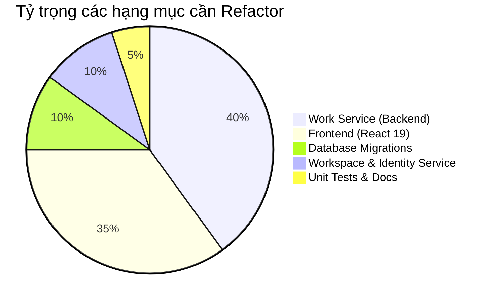

# 02. Chi Tiết Các Hạng Mục Cần Sửa Khi Refactor Kiến Trúc (Bỏ Team)

> **Phạm vi tác động:** `work-service`, `workspace-service`, `identity-service`, `api-gateway`, cơ sở dữ liệu PostgreSQL (`datn_main_db`), và toàn bộ `frontend` React 19.

---

## 1. Tổng Quan Ma Trận Thay Đổi (Change Matrix)



---

## 2. Hạng Mục Cơ Sở Dữ Liệu & Migrations (PostgreSQL)

### 2.1 Service `work-service` (Flyway)
*Thư mục: `backend/work-service/src/main/resources/db/migration/`*

Tạo migration mới: `V8__drop_team_and_restructure_projects.sql`
- **Bước 1: Chuyển đổi dữ liệu cũ (Data Migration)**:
  - Với các dự án đang gắn `team_id`, nếu các thành viên trong `team_members` chưa có trong `role_assignments` của dự án đó, thực hiện INSERT đồng bộ sang `role_assignments`:
    - `role = 'LEADER'` $\rightarrow$ gán role `ADMINISTRATOR` của dự án.
    - `role = 'VIEWER'` $\rightarrow$ gán role `VIEWER` của dự án.
    - Còn lại (`MEMBER`) $\rightarrow$ gán role `MEMBER` của dự án.
- **Bước 2: Dỡ bỏ các ràng buộc khóa ngoại (Drop Foreign Keys)**:
  - Bỏ khóa ngoại `projects.team_id` trỏ tới `teams(id)`.
  - Bỏ khóa ngoại `team_members.team_id` trỏ tới `teams(id)`.
  - Bỏ khóa ngoại từ workspace-service (nếu có: `fk_teams_workspace`).
- **Bước 3: Điều chỉnh bảng `projects`**:
  - `ALTER TABLE projects DROP COLUMN IF EXISTS team_id;`
  - Đảm bảo cột `workspace_id` đã có index: `CREATE INDEX IF NOT EXISTS idx_projects_workspace ON projects(workspace_id);`
- **Bước 4: Điều chỉnh bảng `invitations`**:
  - `ALTER TABLE invitations DROP COLUMN IF EXISTS team_role;`
  - Cập nhật constraint hoặc dữ liệu: Xóa các invitation cũ có `type = 'TEAM'`:
    `DELETE FROM invitations WHERE type = 'TEAM';`
  - Đặt lại CHECK constraint: `ALTER TABLE invitations ADD CONSTRAINT chk_invitation_type CHECK (type IN ('PROJECT'));`
- **Bước 5: Xóa bỏ các bảng thừa**:
  - `DROP TABLE IF EXISTS team_members CASCADE;`
  - `DROP TABLE IF EXISTS teams CASCADE;`

### 2.2 Service `workspace-service` (Flyway)
*Thư mục: `backend/workspace-service/src/main/resources/db/migration/`*

Tạo migration mới: `V5__drop_teams_fk.sql`
- Xóa ràng buộc `fk_teams_workspace` nếu đang tồn tại trên database:
  ```sql
  DO $$
  BEGIN
      IF EXISTS (SELECT 1 FROM pg_constraint WHERE conname = 'fk_teams_workspace') THEN
          ALTER TABLE IF EXISTS teams DROP CONSTRAINT fk_teams_workspace;
      END IF;
  END $$;
  ```

---

## 3. Hạng Mục Backend Java / Spring Boot

### 3.1 Service `work-service`

#### A. Các File CẦN XÓA HOÀN TOÀN:
| STT | File cần xóa | Đường dẫn package | Lý do |
|:---:|---|---|---|
| 1 | `TeamController.java` | `com.datn.workservice.controller` | Toàn bộ 11 REST API của Team không còn sử dụng |
| 2 | `Team.java` | `com.datn.workservice.entity` | Entity Team |
| 3 | `TeamMember.java` | `com.datn.workservice.entity` | Entity TeamMember |
| 4 | `TeamRole.java` | `com.datn.workservice.enums` | Enum LEADER, MEMBER, VIEWER |
| 5 | `TeamRepository.java` | `com.datn.workservice.repository` | Spring Data JPA Repo cho Team |
| 6 | `TeamMemberRepository.java` | `com.datn.workservice.repository` | Spring Data JPA Repo cho TeamMember |
| 7 | `RequireTeamRole.java` | `com.datn.workservice.security` | Annotation AOP kiểm tra quyền Team |
| 8 | `TeamRoleGuard.java` | `com.datn.workservice.security` | Aspect xử lý @RequireTeamRole |
| 9 | `TeamSecurity.java` | `com.datn.workservice.security` | Bean SpEL @teamSecurity |
| 10 | `CreateTeamRequest.java` | `com.datn.workservice.dto.request` | DTO tạo team |
| 11 | `UpdateTeamRequest.java` | `com.datn.workservice.dto.request` | DTO cập nhật team |
| 12 | `AddTeamMemberRequest.java` | `com.datn.workservice.dto.request` | DTO thêm member |
| 13 | `AssignTeamLeaderRequest.java` | `com.datn.workservice.dto.request` | DTO đổi leader |
| 14 | `UpdateTeamMemberRoleRequest.java` | `com.datn.workservice.dto.request` | DTO cập nhật vai trò member |
| 15 | `TeamResponse.java` | `com.datn.workservice.dto.response` | DTO response team |
| 16 | `TeamDetailResponse.java` | `com.datn.workservice.dto.response` | DTO chi tiết team |
| 17 | `TeamMemberResponse.java` | `com.datn.workservice.dto.response` | DTO response member |
| 18 | `TeamControllerTest.java` | `src/test/.../controller` | Unit test controller team |
| 19 | `TeamRoleGuardTest.java` | `src/test/.../security` | Unit test security guard |
| 20 | `TeamSecurityTest.java` | `src/test/.../security` | Unit test team security |

#### B. Các File CẦN CHỈNH SỬA:

1. **`Project.java` (`entity/Project.java`)**:
   - Xóa trường `private UUID teamId;`.

2. **`ProjectRepository.java` (`repository/ProjectRepository.java`)**:
   - Xóa method `List<Project> findByTeamId(UUID teamId);`.

3. **`ProjectServiceImpl.java` (`service/impl/ProjectServiceImpl.java`)**:
   - Xóa bỏ inject `TeamRepository` và `TeamMemberRepository`.
   - **Thẩm quyền tạo dự án mới (`createProject`)**:
     - *Cũ*: Bắt buộc người dùng phải là Leader của `teamId` hoặc Global ADMIN (`validateTeamMembership`).
     - *Mới*: Người dùng có vai trò `OWNER`, `ADMIN`, `MEMBER` trong Workspace (`workspaceAccessChecker.requireMember(workspaceId, currentUserId)`) hoặc Global ADMIN đều được quyền tạo dự án.
   - **Khởi tạo quyền dự án**:
     - Người tạo dự án (`currentUserId`) và `leadUserId` tự động được gán vai trò `ADMINISTRATOR` của dự án đó trong `role_assignments` (đã có).
     - Xóa bỏ hoàn toàn hàm tự động quét team: `syncTeamMembersToProject(project.getId())`.
   - **`getAllProjects()`**:
     - Bỏ tham số `UUID teamId` khỏi method signature.
     - Lọc danh sách dự án trực tiếp theo `workspaceId`, `search`, `isTemplate`, và phân trang `Pageable`.
   - **Mapping DTOs**:
     - Xóa các trường `teamId`, `teamName` khi map sang `ProjectResponse` và `ProjectDetailResponse`.

4. **`ProjectController.java` (`controller/ProjectController.java`)**:
   - Trong endpoint `GET /api/v1/work/projects`: Bỏ tham số `@RequestParam(required = false) UUID teamId`.
   - Cập nhật Javadoc mô tả endpoint.

5. **`ProjectMemberService.java` & `ProjectMemberServiceImpl.java`**:
   - Xóa các method:
     - `syncTeamMemberToProjects(UUID teamId, UUID userId, TeamRole teamRole);`
     - `syncTeamMembersToProject(UUID projectId);`
   - Xóa inject `TeamMemberRepository`.

6. **`Invitation.java` & `enums/InvitationType.java`**:
   - Xóa trường `private TeamRole teamRole;` khỏi entity `Invitation`.
   - Trong enum `InvitationType`: Xóa giá trị `TEAM`, chỉ còn `PROJECT`.

7. **`InvitationService.java` & `InvitationServiceImpl.java`**:
   - Xóa method `inviteToTeam(UUID teamId, UUID inviteeUserId, TeamRole role, UUID invitedBy);`.
   - Trong hàm `accept(UUID invitationId)`: Xóa nhánh xử lý `case TEAM`.
   - Trong hàm `listForTarget(...)`: Chỉ còn xử lý mục tiêu `PROJECT`.

8. **`InvitationController.java` (`controller/InvitationController.java`)**:
   - Xóa param `@RequestParam(value = "teamId", required = false) UUID teamId`.
   - Xóa dependency `TeamSecurity teamSecurity`.
   - Endpoint `GET /api/v1/work/invitations`: Yêu cầu bắt buộc `projectId`.

9. **`InvitationMailer.java`**:
   - Xóa logic phân nhánh email cho Team: `inv.getType() == InvitationType.TEAM ? "nhóm" : "dự án"`. Giờ đây nội dung mail thống nhất là "dự án".

10. **Các DTO liên quan**:
    - `CreateProjectRequest.java`: Bỏ trường `teamId`.
    - `UpdateProjectRequest.java`: Bỏ trường `teamId`.
    - `ProjectResponse.java`: Bỏ trường `teamId`, `teamName`.
    - `ProjectDetailResponse.java`: Bỏ trường `teamId`, `teamName`.
    - `InvitationResponse.java`: Bỏ trường `teamRole`.
    - `CreateProjectFromTemplateRequest.java`: Bỏ trường `teamId`.
    - `SaveAsTemplateRequest.java`: Bỏ trường `teamId`.
    - `TemplatePreviewResponse.java`: Bỏ trường `teamId`.

11. **Dự án mẫu (`ProjectTemplateServiceImpl.java` & `TemplatePreviewBuilder.java`)**:
    - Bỏ kiểm tra `assertCanCreateProject(teamId, ...)`.
    - Thẩm quyền tạo dự án từ mẫu: Thành viên Workspace (`MEMBER` trở lên).
    - Xóa `syncTeamMembersToProject(project.getId())` sau khi clone hoàn tất.

12. **`ProjectSpecification.java`**:
    - Xóa Predicate lọc theo `teamId`.

---

### 3.2 Service `workspace-service`
*Thư mục: `backend/workspace-service/`*

1. **`WorkspaceResponse.java`**:
   - Xóa thuộc tính `private Long teamCount;` (trước đây luôn để null ở v1).
2. **`WorkspaceServiceImpl.java`**:
   - Xóa dòng `.teamCount(null)` trong hàm build `WorkspaceResponse`.
3. **`SchemaIntegrityChecker.java`**:
   - Xóa dòng kiểm tra: `warnIfMissing("public.teams", "fk_teams_workspace");`.
   - Chỉ giữ lại kiểm tra: `warnIfMissing("public.projects", "fk_projects_workspace");`.

---

### 3.3 Service `identity-service`
*Thư mục: `backend/identity-service/`*

1. **`UserRepository.java`**:
   - Xóa query native:
     ```java
     @Modifying
     @Query(value = "DELETE FROM team_members WHERE user_id = :userId", nativeQuery = true)
     void deleteTeamMembershipsByUserId(@Param("userId") UUID userId);
     ```
2. **`WorkDataCleanupService.java`**:
   - Xóa dòng `userRepository.deleteTeamMembershipsByUserId(id);`.

---

## 4. Hạng Mục Frontend (React 19 + Vite)

### 4.1 Các File CẦN XÓA HOÀN TOÀN:
| STT | File cần xóa | Đường dẫn | Chức năng cũ |
|:---:|---|---|---|
| 1 | `TeamDetailPage.jsx` | `frontend/src/pages/TeamDetailPage.jsx` | Trang chi tiết nhóm (1.778 dòng) |
| 2 | `CreateTeamModal.jsx` | `frontend/src/components/modals/CreateTeamModal.jsx` | Modal tạo nhóm mới (260 dòng) |

### 4.2 Các File CẦN CHỈNH SỬA:

1. **`frontend/src/App.jsx`**:
   - Xóa import `TeamDetailPage`.
   - Xóa route: `<Route path="teams/:teamId" element={<TeamDetailPage />} />`.

2. **`frontend/src/components/layout/Sidebar.jsx`**:
   - Xóa bỏ toàn bộ `Section 3: Your Teams Section (Accordion)` (từ dòng 162 đến dòng 280).
   - Xóa các props: `teams`, `loading`, `onOpenCreateTeam`.
   - Xóa state `expandedTeams`, hàm `toggleTeam`.
   - **Tái thiết kế khu vực Sidebar**:
     - Thêm danh sách **"Dự án của bạn" (Your Projects)**: Liệt kê trực tiếp các dự án thuộc Workspace hiện tại.
     - Nút `+` nhanh cạnh tiêu đề để mở thẳng `CreateProjectModal`.
     - Giữ nguyên các link điều hướng chính: *Dự án & Bảng làm việc*, *Nhiệm vụ của tôi*, *Lời mời*, *Thành viên*, *Cài đặt không gian làm việc*.

3. **`frontend/src/components/layout/WorkspaceLayout.jsx`**:
   - Xóa các state: `teams`, `loadingTeams`, `isCreateTeamModalOpen`, `selectedTeamIdForProject`.
   - Xóa hàm `fetchTeams()` và useEffect gọi nó.
   - Xóa component `<CreateTeamModal />`.
   - **Quyền tạo dự án (`canCreateProject`)**:
     - *Cũ*: `isSystemAdmin || leaderTeams.length > 0` (phụ thuộc vào việc có làm leader của team nào không).
     - *Mới*: Dùng trực tiếp hook `useWorkspaceRole()`: Thành viên Workspace có vai trò `MEMBER`, `ADMIN`, `OWNER` hoặc Global Admin đều có quyền tạo dự án:
       `const { canCreateProject } = useWorkspaceRole();`
   - Cập nhật Outlet Context: Bỏ `teams`, `leaderTeams`, `onOpenCreateTeam`, `refreshTeams`. Bổ sung `refreshProjects` nếu cần.

4. **`frontend/src/components/project/CreateProjectModal.jsx`**:
   - Xóa bỏ trường chọn nhóm (`teamId`) trong `formData`.
   - Xóa bỏ validate: `if (!allowPersonal && !formData.teamId) { setErrors({ teamId: ... }); return; }`.
   - Xóa bỏ UI Selector chọn Team (`<select value={formData.teamId}>`).
   - Xóa props `teams`, `defaultTeamId`, `allowPersonal`.
   - Payload gửi lên API `projectApi.create(...)` và `templateApi.createProject(...)`: Chỉ gửi `{ workspaceId, name, key, description, projectType, ... }`.

5. **`frontend/src/pages/ProjectListPage.jsx`**:
   - Xóa query param `teamIdFilter` và bộ lọc `teamId`.
   - Bỏ dòng thông báo: *"Chỉ trưởng nhóm mới có thể tạo dự án..."*. Nút tạo dự án luôn hiển thị với người có quyền trong Workspace.
   - Thẻ dự án: Bỏ hiển thị tên nhóm (`project.teamName`).

6. **`frontend/src/components/admin/AdminProjectManagement.jsx`**:
   - Xóa `teamFilter`, state `teams`, hàm `loadTeams()`.
   - Xóa dropdown lọc theo nhóm (`Tất cả các nhóm`).
   - Cột hiển thị bảng: Thay `project.teamName` bằng `project.workspaceName` hoặc hiển thị trạng thái dự án.
   - Modal tạo/sửa dự án của Admin: Bỏ trường chọn nhóm.

7. **`frontend/src/pages/InvitationsPage.jsx` & `PendingInvitations.jsx`**:
   - Trong `KIND`: Xóa định nghĩa `TEAM: { label: 'Nhóm', ... }`.
   - Bỏ xử lý chuyển hướng về `/teams/:id`. Lời mời chỉ còn `WORKSPACE` và `PROJECT`.
   - `PendingInvitations.jsx`: Bỏ prop `teamId` và lời gọi `invitationApi.forTeam(teamId)`.

8. **`frontend/src/api.js`**:
   - Xóa hoàn toàn object `teamApi = { ... }`.
   - Trong `invitationApi`: Xóa `forTeam: (teamId) => ...`.
   - Trong `projectApi`: Bỏ param `teamId` trong `listAll`.

9. **`frontend/src/hooks/useWorkspaceRole.js`**:
   - Xóa quyền `canCreateTeam`.
   - Đảm bảo `canCreateProject: roleAtLeast(role, 'MEMBER')`.

10. **`frontend/src/utils/projectValidation.js`**:
    - Xóa hàm `validateTeamForm(data)`.

---

## 5. Danh Sách Unit Tests Cần Cập Nhật

| Test File | Vị trí | Thay đổi cần thiết |
|---|---|---|
| `ProjectServiceTest.java` | `work-service/src/test/.../service` | Bỏ mock `teamRepository`, sửa kịch bản test tạo dự án trực tiếp với `workspaceId` |
| `ProjectMemberServiceTest.java` | `work-service/src/test/.../service` | Bỏ các test case liên quan đến `syncTeamMembersToProject` |
| `InvitationServiceTest.java` | `work-service/src/test/.../service` | Bỏ các test case mời vào Team (`inviteToTeam`) |
| `ProjectDtoValidationTest.java` | `work-service/src/test/.../dto` | Cập nhật DTO test không còn trường `teamId` |
| `WorkServiceRepositoryUnitTest.java` | `work-service/src/test/.../repository` | Bỏ test repository của `TeamRepository`, `TeamMemberRepository` |
