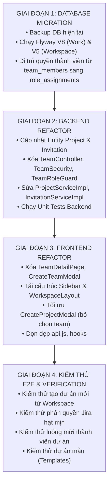

# 03. Lộ Trình Triển Khai & Kịch Bản Migration (An Toàn, Không Mất Dữ Liệu)

> **Mục tiêu:** Chuyển đổi hệ thống từ 3 tầng sang 2 tầng mà không làm gián đoạn các dự án hiện có, không làm mất vai trò của các thành viên, và có đường lui (rollback) an toàn.

---

## 1. Kế Hoạch Triển Khai Theo 4 Giai Đoạn (4-Phase Execution Roadmap)



---

## 2. Kịch Bản SQL Migration Mẫu (`V8__drop_team_and_restructure_projects.sql`)

Dưới đây là nội dung chi tiết của file migration Flyway cho `work-service`:

```sql
-- ============================================================================
-- DATN-2026: WORK SERVICE
-- Flyway Migration: V8__drop_team_and_restructure_projects.sql
-- Description: Loại bỏ hoàn toàn bảng teams & team_members;
--              Đồng bộ dữ liệu thành viên team sang role_assignments;
--              Liên kết dự án trực tiếp vào workspace.
-- ============================================================================

DO $$
BEGIN
    RAISE NOTICE 'Bắt đầu quá trình di trú loại bỏ Team...';

    -- 1. ĐỒNG BỘ DỮ LIỆU THÀNH VIÊN TỪ TEAM_MEMBERS SANG ROLE_ASSIGNMENTS (NẾU CHƯA CÓ)
    -- Với mỗi project đang có team_id:
    --   - Team Leader  -> Project ADMINISTRATOR
    --   - Team Viewer  -> Project VIEWER
    --   - Team Member  -> Project MEMBER
    IF to_regclass('public.team_members') IS NOT NULL 
       AND to_regclass('public.projects') IS NOT NULL 
       AND to_regclass('public.project_roles') IS NOT NULL 
       AND to_regclass('public.role_assignments') IS NOT NULL THEN

        -- 1.1 Đồng bộ LEADER -> ADMINISTRATOR
        INSERT INTO role_assignments (id, project_id, user_id, role_id, assigned_at)
        SELECT 
            gen_random_uuid(),
            p.id,
            tm.user_id,
            pr.id,
            CURRENT_TIMESTAMP
        FROM team_members tm
        JOIN projects p ON p.team_id = tm.team_id
        JOIN project_roles pr ON pr.project_id = p.id AND pr.name = 'ADMINISTRATOR'
        WHERE tm.role = 'LEADER'
          AND NOT EXISTS (
              SELECT 1 FROM role_assignments ra 
              WHERE ra.project_id = p.id AND ra.user_id = tm.user_id
          )
        ON CONFLICT DO NOTHING;

        -- 1.2 Đồng bộ VIEWER -> VIEWER
        INSERT INTO role_assignments (id, project_id, user_id, role_id, assigned_at)
        SELECT 
            gen_random_uuid(),
            p.id,
            tm.user_id,
            pr.id,
            CURRENT_TIMESTAMP
        FROM team_members tm
        JOIN projects p ON p.team_id = tm.team_id
        JOIN project_roles pr ON pr.project_id = p.id AND pr.name = 'VIEWER'
        WHERE tm.role = 'VIEWER'
          AND NOT EXISTS (
              SELECT 1 FROM role_assignments ra 
              WHERE ra.project_id = p.id AND ra.user_id = tm.user_id
          )
        ON CONFLICT DO NOTHING;

        -- 1.3 Đồng bộ MEMBER -> MEMBER
        INSERT INTO role_assignments (id, project_id, user_id, role_id, assigned_at)
        SELECT 
            gen_random_uuid(),
            p.id,
            tm.user_id,
            pr.id,
            CURRENT_TIMESTAMP
        FROM team_members tm
        JOIN projects p ON p.team_id = tm.team_id
        JOIN project_roles pr ON pr.project_id = p.id AND pr.name = 'MEMBER'
        WHERE tm.role NOT IN ('LEADER', 'VIEWER')
          AND NOT EXISTS (
              SELECT 1 FROM role_assignments ra 
              WHERE ra.project_id = p.id AND ra.user_id = tm.user_id
          )
        ON CONFLICT DO NOTHING;

        RAISE NOTICE 'Đã hoàn tất đồng bộ thành viên Team sang Project Role Assignments.';
    END IF;

    -- 2. DỌN DẸP LỜI MỜI CŨ (INVITATIONS) CÓ TYPE = TEAM
    IF to_regclass('public.invitations') IS NOT NULL THEN
        DELETE FROM invitations WHERE type = 'TEAM';
        
        -- Xóa cột team_role
        IF EXISTS (
            SELECT 1 FROM information_schema.columns 
            WHERE table_name = 'invitations' AND column_name = 'team_role'
        ) THEN
            ALTER TABLE invitations DROP COLUMN team_role;
            RAISE NOTICE 'Đã xóa cột team_role khỏi bảng invitations.';
        END IF;

        -- Thêm ràng buộc chỉ cho phép type = PROJECT
        ALTER TABLE invitations DROP CONSTRAINT IF EXISTS chk_invitation_type;
        ALTER TABLE invitations ADD CONSTRAINT chk_invitation_type CHECK (type IN ('PROJECT'));
    END IF;

    -- 3. GỠ KHÓA NGOẠI VÀ CỘT TEAM_ID KHỎI BẢNG PROJECTS
    IF to_regclass('public.projects') IS NOT NULL THEN
        -- Bỏ foreign key nếu có
        ALTER TABLE projects DROP CONSTRAINT IF EXISTS fk_projects_team;
        ALTER TABLE projects DROP CONSTRAINT IF EXISTS projects_team_id_fkey;

        -- Bỏ cột team_id
        IF EXISTS (
            SELECT 1 FROM information_schema.columns 
            WHERE table_name = 'projects' AND column_name = 'team_id'
        ) THEN
            ALTER TABLE projects DROP COLUMN team_id;
            RAISE NOTICE 'Đã xóa cột team_id khỏi bảng projects.';
        END IF;

        -- Đảm bảo index trên workspace_id tồn tại
        CREATE INDEX IF NOT EXISTS idx_projects_workspace ON projects(workspace_id);
    END IF;

    -- 4. DROP CÁC BẢNG TEAMS VÀ TEAM_MEMBERS
    DROP TABLE IF EXISTS team_members CASCADE;
    RAISE NOTICE 'Đã drop bảng team_members.';

    DROP TABLE IF EXISTS teams CASCADE;
    RAISE NOTICE 'Đã drop bảng teams.';

    RAISE NOTICE 'Hoàn thành Flyway Migration V8 thành công!';
END $$;
```

---

## 3. Kịch Bản Kiểm Thử Sau Khi Refactor (Verification Test Matrix)

| Mã test | Mô tả hành động | Kết quả mong đợi |
|:---:|---|---|
| **TC-01** | Người dùng đăng nhập vào Workspace với vai trò `MEMBER` | Thấy nút **"Tạo dự án mới"** trên Sidebar và trang Projects. Bấm vào mở modal không yêu cầu chọn Team. |
| **TC-02** | Tạo dự án mới dạng `SOFTWARE_SCRUM` với Key = `ECOM` | Dự án được tạo thành công, gắn trực tiếp vào `workspace_id`. Người tạo tự động có vai trò `ADMINISTRATOR` của `ECOM`. |
| **TC-03** | Mở tab "Thành viên" trong dự án `ECOM` | Hiển thị người tạo dự án là `ADMINISTRATOR`. Có chức năng tìm kiếm người dùng trong Workspace và gán vai trò (`MEMBER`/`VIEWER`). |
| **TC-04** | Người dùng gửi lời mời vào dự án cho đồng nghiệp | Tạo bản ghi `invitations` (type = `PROJECT`). Đồng nghiệp nhận được thông báo/email và chấp nhận vào dự án thành công. |
| **TC-05** | Tạo dự án từ Dự án mẫu (Template) | Dự án được nhân bản đầy đủ (Sprint, Workflow, Status, Board, Work Items) trực tiếp vào Workspace mà không phát sinh lỗi liên quan đến `team_id`. |
| **TC-06** | Global ADMIN truy cập trang Quản trị dự án (`/admin/projects`) | Xem được toàn bộ danh sách dự án của tất cả các Workspace, phân trang và tìm kiếm mượt mà, không còn dropdown lọc theo Team. |
| **TC-07** | Thử gọi API cũ `GET /work/api/v1/work/teams` qua Postman | Nhận `404 Not Found` (endpoint đã bị gỡ bỏ an toàn). |

---

## 4. Đánh Giá Rủi Ro & Biện Pháp Phòng Ngừa

1. **Rủi ro:** Khi xóa bảng `teams`, nếu có dự án cũ chưa được gán `workspace_id` hợp lệ sẽ bị mồ côi.  
   *Biện pháp:* Trước khi chạy migration, chạy script kiểm tra:  
   `SELECT count(*) FROM projects WHERE workspace_id IS NULL;` (Hiện tại trong codebase, `workspace_id` đã là `NOT NULL` nên hoàn toàn đảm bảo).
2. **Rủi ro:** Client cũ (cached frontend) vẫn gửi `teamId` trong payload request.  
   *Biện pháp:* Trong backend Java `CreateProjectRequest`, trường `teamId` bị loại bỏ (Jackson tự động ignore nếu không cấu hình FAIL_ON_UNKNOWN_PROPERTIES, hoặc tốt nhất là build lại đồng thời cả frontend).
