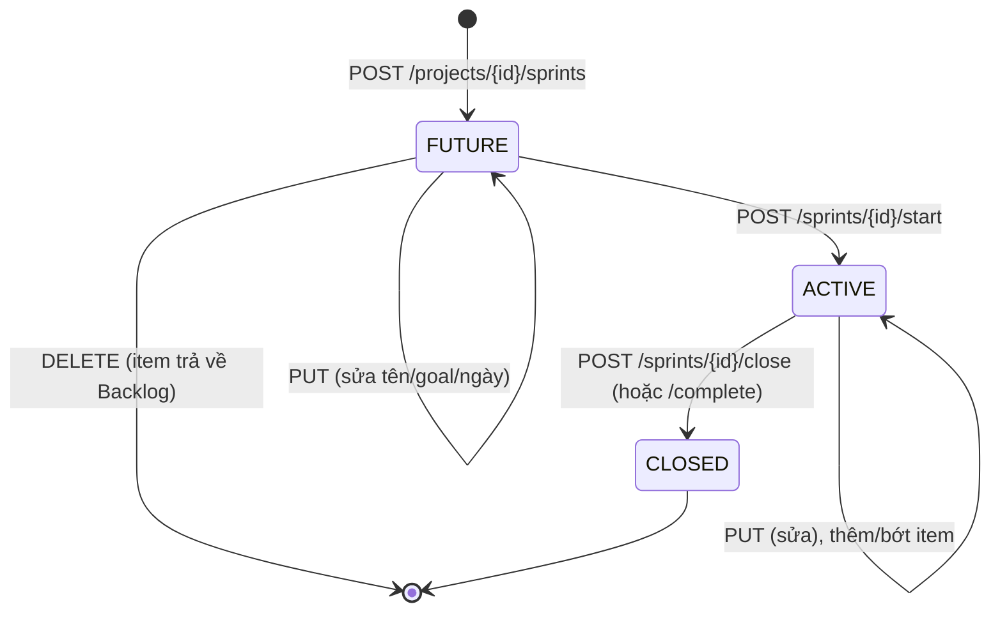
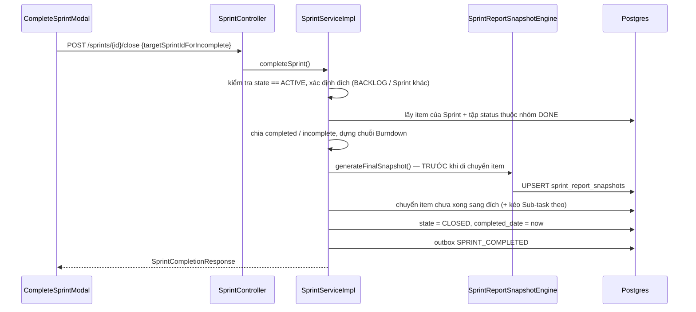
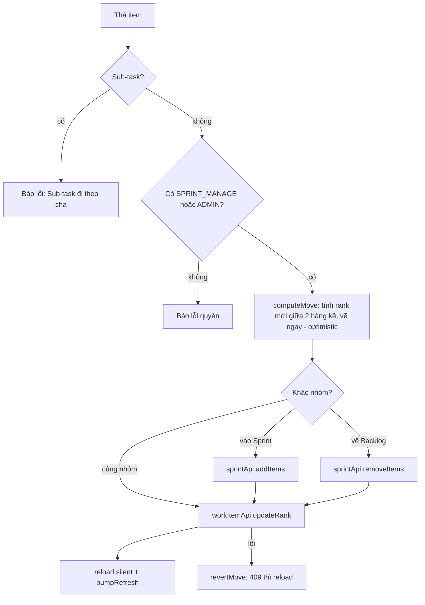

# Sprint & Backlog trong work-service

Tài liệu mô tả **cách Sprint và Backlog vận hành** trong dự án DATN-2026, dựa trên source code hiện tại (nhánh `develop`). Mọi đường dẫn tính từ root repo.

---

## 1. Khái niệm

| Khái niệm | Ý nghĩa trong hệ thống |
|---|---|
| **Backlog** | Không phải một bảng riêng. Backlog = tập `work_items` của dự án có `sprint_id IS NULL` và chưa bị xoá mềm (`deleted_at IS NULL`). |
| **Sprint** | Một chu kỳ làm việc có thời hạn, thuộc một dự án (bảng `sprints`). Vòng đời `FUTURE → ACTIVE → CLOSED`. |
| **Gán công việc vào Sprint** | Chỉ là đặt `work_items.sprint_id`. Bỏ ra khỏi Sprint = đặt lại `NULL` (về Backlog). |
| **Thứ tự (rank)** | Cột `work_items.rank` dạng LexoRank (`0|i00000:`), sắp xếp theo thứ tự từ điển. Thứ tự được tính **trong phạm vi** một Sprint hoặc trong Backlog. |
| **Snapshot** | Khi đóng Sprint, số liệu cuối được “đóng băng” vào `sprint_report_snapshots` để vẽ Burndown/Velocity về sau. |

Chỉ dự án loại **`SOFTWARE_SCRUM`** mới có tab Backlog trên giao diện (`frontend/src/utils/projectType.js` → `isScrumProject`, dùng ở `ProjectDetailPage.jsx`). Dự án Kanban không dùng Sprint: Board Kanban hiển thị toàn bộ dự án.

---

## 2. Mô hình dữ liệu

### 2.1 Bảng `sprints` (V1, bổ sung ở V5)

```sql
sprints (
  id UUID PK,
  project_id UUID NOT NULL → projects(id) ON DELETE CASCADE,
  name VARCHAR(255) NOT NULL,
  goal TEXT,
  state VARCHAR(50) NOT NULL DEFAULT 'FUTURE',   -- FUTURE | ACTIVE | CLOSED
  start_date, end_date, completed_date TIMESTAMPTZ,
  version INTEGER NOT NULL DEFAULT 0,            -- V5: optimistic locking (@Version)
  created_at, updated_at
)
```

Entity: `backend/work-service/src/main/java/com/datn/workservice/entity/Sprint.java`, enum `SprintState`.

### 2.2 Liên kết với `work_items`

```sql
work_items.sprint_id  UUID → sprints(id) ON DELETE SET NULL
work_items.parent_id  UUID → work_items(id)        -- Epic → Story/Task → Sub-task
work_items.story_points DECIMAL(6,2)
work_items.rank VARCHAR(255) NOT NULL              -- LexoRank
```

### 2.3 Bảng `sprint_report_snapshots`

Một dòng cho mỗi Sprint đã đóng (`UNIQUE(sprint_id)`): tổng/hoàn thành/chưa xong story point, số item, `closed_by`, `closed_at` và cột `snapshot_data JSONB` chứa `SprintSnapshotData` (danh sách item hoàn thành/chưa xong, chuỗi burndown, sprint đích nhận việc dở…).

### 2.4 Ràng buộc và index do migration `V5__phase6_sprint_board_agile.sql` thêm

| Đối tượng | Mục đích |
|---|---|
| `uq_sprints_one_active_per_project` — unique index `(project_id) WHERE state='ACTIVE'` | Bất biến **mỗi dự án tối đa 1 Sprint ACTIVE**, chặn cả race condition ở tầng DB. Trước khi tạo index, migration hạ các Sprint ACTIVE thừa về FUTURE (giữ cái mới nhất). |
| `idx_work_items_backlog_fetch` — `(project_id, rank) WHERE deleted_at IS NULL AND sprint_id IS NULL` | Nạp Backlog theo thứ tự rank. |
| `idx_work_items_board_fetch`, `idx_work_items_sprint_status` | Nạp Board và đếm WIP theo Sprint. |
| `idx_sprints_project_completed` | Quét Sprint đã đóng cho Velocity. |
| `idx_changelog_item_field_time` | Replay changelog để dựng Burndown/CFD. |

---

## 3. Vòng đời Sprint



Logic nằm ở `backend/work-service/src/main/java/com/datn/workservice/service/impl/SprintServiceImpl.java`.

### 3.1 Tạo Sprint — `create()`
- Luôn tạo ở trạng thái `FUTURE`, ngày bắt đầu/kết thúc là tuỳ chọn.
- Nếu có cả hai ngày thì `endDate` phải sau `startDate`.
- Frontend gợi ý tên `Chu kỳ N` (N = số Sprint đang hiển thị + 1) và **ngày bắt đầu mặc định = ngày sau mốc cuối cùng** (ngày kết thúc, hoặc ngày bắt đầu nếu chưa có ngày kết thúc) của các Sprint đang có, hoặc hôm nay nếu mốc đó đã qua. Lý do: ngày bắt đầu quyết định thứ tự bắt đầu (BR-S15, xem §3.4), mặc định "hôm nay" sẽ khiến Sprint mới chen lên trước các Sprint đã lên lịch.

### 3.2 Sửa Sprint — `update()`
- Mọi trường tuỳ chọn, `null` = giữ nguyên.
- **Không sửa được Sprint `CLOSED`.**
- Giao diện: nút bút chì trên khối Sprint `FUTURE` (chỉ người có `SPRINT_MANAGE`) mở `SprintFormModal mode="edit"`. Đây là cách **đổi thứ tự** các Sprint: sửa ngày bắt đầu dự kiến.
- Response tính lại `canStart` theo thứ tự mới (trước đây luôn trả `false`).

### 3.3 Xoá Sprint — `delete()`
- **Chỉ xoá được Sprint `FUTURE`.** Sprint ACTIVE phải đóng; Sprint CLOSED phải giữ để lưu vết báo cáo.
- Các item bên trong được đặt `sprintId = null` (trả về Backlog), mỗi item ghi 2 dòng lịch sử `SPRINT` và `SPRINT_SCOPE`.
- Giao diện: nút thùng rác trên khối Sprint `FUTURE` (chỉ người có `SPRINT_MANAGE`) mở `ConfirmModal`, báo số công việc sẽ trở về Backlog. Đây cũng là một cách gỡ khi Sprint đứng đầu kế hoạch còn rỗng và đang chặn các Sprint sau (BR-S15).

### 3.4 Bắt đầu Sprint — `startSprint()`

Kiểm tra theo thứ tự:

1. Sprint đang ở `FUTURE`, nếu không → 400.
2. Dự án chưa bị lưu trữ (`deletedAt == null`).
3. Dự án **chưa có Sprint ACTIVE nào** → nếu có thì 409 `ConflictException` (“Hãy đóng Sprint đó trước…”). Unique index ở V5 là lớp chặn thứ hai.
4. **Sprint này phải đứng đầu thứ tự kế hoạch trong các Sprint `FUTURE`** (BR-S15) → nếu không thì 409 `ConflictException` (“Các Sprint phải được bắt đầu lần lượt theo kế hoạch: hãy bắt đầu '<tên>' trước…”). Thứ tự kế hoạch do `service/SprintSequence.PLAN_ORDER` định nghĩa: `startDate` tăng dần, `null` xếp cuối, rồi `createdAt`, rồi `id`.
5. Xác định ngày:
   - `start` = `request.startDate` → `sprint.startDate` → `now()`.
   - `end` = `request.endDate` → `sprint.endDate`; **bắt buộc có** (để vẽ Burndown).
   - `end > start`, và độ dài **không quá 56 ngày (8 tuần)**.
6. Sprint phải có ít nhất 1 item, trừ khi gửi `allowEmpty: true`.

Sau đó: `state = ACTIVE`, lưu ngày và `goal` (nếu gửi), ghi sự kiện outbox `SPRINT_STARTED`.

### 3.5 Đóng Sprint — `completeSprint()`



Quy tắc chi tiết:

- Chỉ đóng được Sprint `ACTIVE`.
- **Đích cho việc chưa xong** (`targetSprintIdForIncomplete`, kiểu String): rỗng hoặc `"BACKLOG"` → về Backlog; hoặc UUID một Sprint khác **cùng dự án, không phải chính nó, không CLOSED**. Giao diện chỉ liệt kê Backlog và các Sprint `FUTURE`.
- **“Hoàn thành”** = item có `status_id` thuộc nhóm `StatusCategory.DONE`.
- **Item DONE giữ nguyên `sprintId`** của Sprint đã đóng → Velocity và báo cáo vẫn truy được. Chỉ item chưa xong bị chuyển đi.
- Snapshot được chụp **trước** khi di chuyển, để số liệu mô tả Sprint đúng lúc nó kết thúc. Nếu dựng chuỗi Burndown lỗi thì chỉ log cảnh báo và lưu chuỗi rỗng — **không được làm hỏng việc đóng Sprint**.
- Story point của **Sub-task không được cộng** (điểm đã nằm ở Story/Task cha).
- Response trả về số item/điểm hoàn thành, chưa xong, nơi nhận, số Sub-task bị kéo theo và `snapshotId`.

---

## 4. Thêm / bớt công việc khỏi Sprint

### 4.1 Qua API Sprint (đường chính, dùng khi kéo thả trên Backlog)

| API | Hành vi |
|---|---|
| `POST /sprints/{id}/items` `{itemIds}` | Thêm vào Sprint. Sprint không được `CLOSED`; item phải cùng dự án; item đã ở Sprint này thì bỏ qua (idempotent). |
| `DELETE /sprints/{id}/items` hoặc `POST /sprints/{id}/items/remove` `{itemIds}` | Trả về Backlog. Item phải đang thuộc Sprint đó. Có bản POST vì một số gateway bỏ body của DELETE. |

Cả hai đều đi qua hàm dùng chung `moveItemsToSprint()`:

1. Lấy rank cuối cùng trong phạm vi đích (Sprint đích hoặc Backlog), rồi gán rank mới **nối vào cuối** cho từng item (`LexoRankService.calculateAfter`).
2. Ghi 2 dòng changelog cho mỗi item:
   - `SPRINT` — tên Sprint cũ → mới (hiển thị ở tab Lịch sử).
   - `SPRINT_SCOPE` — UUID cũ → mới (dùng cho báo cáo, replay Burndown).
3. `cascadeToDescendants()` — kéo con cháu theo cha, tối đa 2 tầng (Epic → Story/Task → Sub-task), giữ bất biến **Sub-task luôn cùng Sprint với cha**.

### 4.2 Qua API WorkItem
- **Tạo item** (`WorkItemServiceImpl.createWorkItem`): có thể gửi `sprintId` ngay; rank được tính nối vào cuối phạm vi. Sub-task tạo mới **kế thừa `sprintId` của cha**.
- **Sửa item** (`updateWorkItem`): nếu gửi `sprintId` khác, item đổi Sprint và các Sub-task trực tiếp được cascade theo.

### 4.3 Sắp xếp thứ tự
`PATCH /items/{id}/rank` `{ "rank": "<LexoRank>" }` (quyền `ISSUE_EDIT`). Frontend tự tính rank giữa hai item kề nhau bằng `frontend/src/utils/lexorankHelper.js` → `calculateBetween(prev, next)`, nên chỉ cần cập nhật **một dòng** thay vì đánh lại toàn bộ thứ tự.

---

## 5. Màn hình Backlog

### 5.1 Backend — một endpoint cho cả màn hình

`GET /projects/{projectId}/backlog?assigneeId=&epicId=&typeIds=&q=` → `BacklogServiceImpl.getBacklog()`

Mục đích: trả mọi thứ màn hình cần trong **một lần gọi** để không bị nháy khi tải.

Các bước:
1. Lấy Sprint `ACTIVE` + `FUTURE` (**không lấy CLOSED** — chúng thuộc màn hình Báo cáo), sắp theo `SprintSequence.DISPLAY_ORDER`: ACTIVE trước, rồi FUTURE theo thứ tự kế hoạch (`startDate` tăng dần, `null` cuối, rồi `createdAt`).
2. Hai truy vấn: item của các Sprint đó, và item Backlog (`sprint_id IS NULL`, theo rank).
3. Ánh xạ sang `BoardCardResponse` bằng `WorkItemCardMapper` (dùng chung với Board).
4. **Loại Sub-task khỏi danh sách hàng** (chúng đi theo cha), áp bộ lọc, sắp theo rank.
5. Nhóm theo Sprint, tính cho mỗi nhóm: số item và story point theo 3 nhóm trạng thái TODO / IN_PROGRESS / DONE.
6. Cờ UI:
   - `canStart` = Sprint FUTURE **và** có item **và** dự án chưa có Sprint ACTIVE **và** là Sprint FUTURE đứng đầu kế hoạch (`SprintSequence.startableSprintId`). Hệ quả: nút *Bắt đầu* chỉ sáng ở khối FUTURE trên cùng; frontend (`ProjectBacklogPage.startBlockedReason`) chỉ diễn giải lý do khoá thành tooltip, không tự quyết định.
   - `canComplete` = Sprint ACTIVE.
7. Trả kèm `activeSprint`, danh sách `epics` (suy ra từ chính các thẻ, kèm tiến độ điểm), `statuses` của dự án, `totalBacklogItems`.

Cấu trúc `BacklogResponse`:

```text
BacklogResponse
├── projectId, projectKey, generatedAt
├── activeSprint: SprintResponse | null
├── sprints: BacklogGroupResponse[]    (ACTIVE trước, rồi FUTURE)
├── backlog: BacklogGroupResponse      (sprintId = null, name = "Backlog")
├── epics: EpicOptionResponse[]
├── statuses: StatusResponse[]
└── totalBacklogItems
```

### 5.2 Frontend

| File | Vai trò |
|---|---|
| `frontend/src/pages/ProjectBacklogPage.jsx` | Trang chính, kéo thả bằng `@dnd-kit`, mở các modal. |
| `frontend/src/hooks/useProjectBacklog.js` | Nạp dữ liệu, bọc các thao tác ghi (`run` = khoá nút + reload im lặng). |
| `frontend/src/components/backlog/SprintAccordion.jsx` | Một khối Sprint/Backlog có thể thu gọn, nút Sửa (bút chì) / Xoá (thùng rác) / Bắt đầu / Hoàn tất; tooltip nêu lý do khi nút Bắt đầu bị khoá. |
| `frontend/src/components/backlog/BacklogIssueRow.jsx`, `InlineCreateIssueRow.jsx`, `BacklogToolbar.jsx` | Hàng công việc, tạo nhanh, thanh lọc. |
| `frontend/src/components/sprints/SprintFormModal.jsx` | Dùng cho `mode="create"`, `mode="edit"` và `mode="start"`. |
| `frontend/src/components/sprints/CompleteSprintModal.jsx` | Chọn đích cho việc chưa xong (`BACKLOG` hoặc một Sprint FUTURE). |
| `frontend/src/utils/optimisticMove.js` | Hàm thuần `computeMove` / `revertMove`, dùng chung cho Backlog và Board. |
| `frontend/src/api.js` → `sprintApi`, `boardApi.getBacklog`, `workItemApi.updateRank` | Gọi API. |

**Lọc**: bộ lọc trên màn hình (từ khoá, epic, người được giao, “chỉ của tôi”, “cập nhật 7 ngày gần đây”) chạy **ở client** trong hàm `matches()`; hook không truyền tham số lọc lên server dù backend có hỗ trợ.

**Luồng kéo thả** (`handleDragEnd`):



---

## 6. Liên hệ với Board và Báo cáo

- **Board Scrum** (`BoardServiceImpl.getBoardData`): phạm vi hiển thị là Sprint được chỉ định qua `?sprintId=`, mặc định là Sprint `ACTIVE` của dự án; không có Sprint ACTIVE thì bảng rỗng. Kéo thẻ giữa cột tính rank và kiểm WIP limit trong phạm vi Sprint đó. Board Kanban không lọc theo Sprint.
- **Burndown** `GET /sprints/{id}/burndown`: dựng lại bằng cách replay changelog (`WorkItemStateReplayer`, `BurndownCalculator`); với Sprint đã đóng, dữ liệu snapshot được dùng.
- **Velocity** `GET /projects/{id}/velocity?limit=`: dựa trên Sprint CLOSED và snapshot.
- **CFD** `GET /projects/{id}/cfd?sprintId=`.

---

## 7. Phân quyền

| Endpoint | Quyền |
|---|---|
| `GET /projects/{id}/backlog`, `GET /projects/{id}/sprints`, `GET /sprints/{id}`, báo cáo | `PROJECT_VIEW` |
| Tạo/sửa/xoá/bắt đầu/đóng Sprint, thêm/bớt item | `SPRINT_MANAGE` |
| `PATCH /items/{id}/rank` | `ISSUE_EDIT` |

- Các endpoint theo `sprintId` dùng `@RequireProjectPermission(source = ProjectIdSource.SPRINT, param = "sprintId")`: aspect tra `projectId` từ Sprint rồi mới kiểm tra quyền.
- Scheme mặc định khi tạo dự án (`ProjectServiceImpl`): **chỉ `ADMINISTRATOR` có `SPRINT_MANAGE`**; MEMBER và VIEWER không có. Lead/creator dự án và Global `ADMIN` luôn được phép.
- Frontend ẩn nút bằng `useProjectPermission` → `canManageSprint = can('SPRINT_MANAGE')` (hoặc `isAdmin`).

---

## 8. Tóm tắt các quy tắc nghiệp vụ

1. Mỗi dự án tối đa **1 Sprint ACTIVE** (service + unique index).
2. Chỉ Sprint **FUTURE** được xoá hoặc bắt đầu; chỉ Sprint **ACTIVE** được đóng; Sprint **CLOSED** không được sửa hay thêm/bớt item.
3. Bắt đầu Sprint cần **ngày kết thúc**, dài **≤ 8 tuần** và **không rỗng** (trừ khi `allowEmpty`).
3a. Các Sprint được bắt đầu **lần lượt**: chỉ Sprint FUTURE đứng đầu thứ tự kế hoạch (ngày bắt đầu dự kiến) mới được bắt đầu (BR-S15).
4. Xoá Sprint → item về Backlog, không bị xoá.
5. Đóng Sprint → item DONE ở lại Sprint cũ; item chưa xong sang Backlog hoặc Sprint khác; snapshot chụp trước khi di chuyển.
6. **Sub-task luôn cùng Sprint với cha**, không kéo riêng được và không cộng story point.
7. Mọi lần đổi Sprint ghi changelog `SPRINT` + `SPRINT_SCOPE`.
8. Thứ tự dùng LexoRank theo phạm vi (từng Sprint / Backlog).

---

## 9. Những điểm chưa hoàn chỉnh (phát hiện khi đọc code)

Các điểm dưới đây là quan sát từ code, **chưa được sửa**:

1. **Gọi API rank sai định dạng body.** `ProjectBacklogPage.jsx` gọi `workItemApi.updateRank(active.id, result.newRank)` — truyền **chuỗi**, trong khi backend nhận `Map` và đọc `body.get("rank")`. Với header `Content-Type: application/json`, chuỗi rank thô không phải JSON hợp lệ nên yêu cầu sẽ lỗi. Hệ quả: sắp xếp lại trong Backlog không lưu được; khi kéo sang nhóm khác, `addItems`/`removeItems` đã thành công nhưng UI vẫn hoàn tác vì lỗi ở bước rank. Nên gọi `updateRank(id, { rank: result.newRank })`.
2. **Đổi Sprint qua `updateWorkItem` bị lỏng.** Không kiểm tra Sprint cùng dự án hay đã CLOSED, không tính lại rank, không đưa về Backlog được (`sprintId = null` bị bỏ qua), và chỉ cascade một tầng Sub-task. Đường chuẩn vẫn là API `/sprints/{id}/items`.
3. **Đóng Sprint có thể phá bất biến cha–con.** Việc chia completed/incomplete xét từng item độc lập: Sub-task chưa xong của một cha DONE sẽ bị chuyển đi một mình, còn Sub-task DONE của một cha chưa xong bị cascade kéo ra khỏi Sprint đã đóng.
4. ~~`update()` luôn truyền `projectHasActiveSprint = true` vào `toResponse`~~ — **đã sửa 13/11/2026** khi bổ sung BR-S15: `update()` tính lại Sprint được phép bắt đầu.
5. ~~Hook có `updateSprint` / `deleteSprint` nhưng UI chưa dùng~~ — **đã có từ 13/11/2026**: nút sửa (bút chì) và xoá (thùng rác) trên khối Sprint `FUTURE`.
6. **`sprintApi.getReport` gọi `/sprints/{id}/report`**, nhưng backend chưa có endpoint này.
7. Tập status DONE khi đóng Sprint lấy bằng `statusRepository.findByCategory(DONE)` trên **toàn hệ thống**, không lọc theo dự án. Kết quả vẫn đúng vì chỉ dùng để so khớp `statusId`, nhưng truy vấn thừa.

---

## 10. Bản đồ file

```text
backend/work-service/src/main/
├── java/com/datn/workservice/
│   ├── controller/  SprintController, BacklogController, BoardController, AgileReportController
│   ├── service/impl/ SprintServiceImpl, BacklogServiceImpl, BoardServiceImpl, WorkItemServiceImpl
│   ├── service/report/ SprintReportSnapshotEngine, BurndownCalculator, WorkItemStateReplayer
│   ├── service/LexoRankService.java, service/SprintSequence.java (thứ tự kế hoạch, BR-S15), service/mapper/WorkItemCardMapper.java
│   ├── entity/  Sprint, SprintReportSnapshot, WorkItem
│   ├── enums/SprintState.java
│   └── dto/  CreateSprint/UpdateSprint/StartSprint/CompleteSprint/SprintItems Request,
│             SprintResponse, SprintCompletionResponse, BacklogResponse, BacklogGroupResponse
└── resources/db/migration/ V1__init_work_jira_schema.sql, V5__phase6_sprint_board_agile.sql

backend/work-service/src/test/.../service/SprintServiceTest.java   (start/complete, cascade, snapshot, bắt đầu lần lượt)
backend/work-service/src/test/.../service/SprintSequenceTest.java  (thứ tự kế hoạch & Sprint được phép bắt đầu)

frontend/src/
├── pages/ProjectBacklogPage.jsx
├── hooks/useProjectBacklog.js
├── components/backlog/*, components/sprints/*
└── utils/optimisticMove.js, utils/lexorankHelper.js, utils/projectType.js
```
