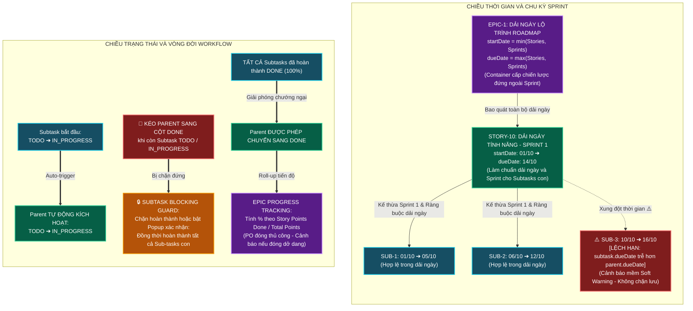
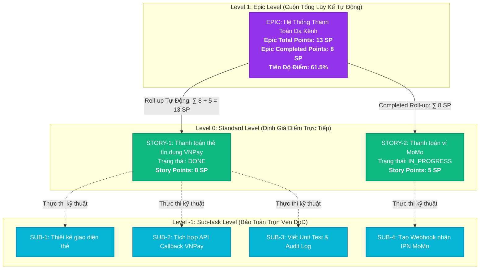

# 🏛️ TÀI LIỆU ĐẶC TẢ LOẠI CÔNG VIỆC & MÔ HÌNH PHÂN CẤP (WORK ITEM TYPES & HIERARCHY SPECIFICATION)
## WORK SERVICE (V2 JIRA-GRADE) — DATN-2026
### HỆ THỐNG QUẢN LÝ DỰ ÁN & CÔNG VIỆC DOANH NGHIỆP

> **Module:** `work-service` (Core Project & Work Management Engine)  
> **Phiên bản:** 2.0 (Jira-Grade Enterprise Specification)  
> **Tài liệu tham chiếu:**  
> - [`1_TONG_QUAN_KIEN_TRUC_WORK_SERVICE.md`](file:///d:/DATN-2026/docs/services/work_service/1_TONG_QUAN_KIEN_TRUC_WORK_SERVICE.md) (Kiến trúc tổng quan V2 & Triết lý Jira-Grade)  
> - [`2_THIET_KE_CO_SO_DU_LIEU.md`](file:///d:/DATN-2026/docs/services/work_service/2_THIET_KE_CO_SO_DU_LIEU.md) (Thiết kế CSDL bảng `work_item_types` & `work_items`)  
> - [`3_SO_DO_TUAN_TU_NGHIEP_VU.md`](file:///d:/DATN-2026/docs/services/work_service/3_SO_DO_TUAN_TU_NGHIEP_VU.md) (Sơ đồ tuần tự tạo việc & validate hierarchy)  
> - [`4_KE_HOACH_TRIEN_KHAI_CHI_TIET.md`](file:///d:/DATN-2026/docs/services/work_service/4_KE_HOACH_TRIEN_KHAI_CHI_TIET.md) (Lộ trình triển khai phân cấp 3 tầng)  
> - [`5_QUY_CHUAN_GIAO_DIEN_FRONTEND.md`](file:///d:/DATN-2026/docs/services/work_service/5_QUY_CHUAN_GIAO_DIEN_FRONTEND.md) (Quy chuẩn giao diện Kanban/Backlog/Modal)  
> - [`7_QUAN_HE_CONG_VIEC_VA_DO_THI_PHU_THUOC.md`](file:///d:/DATN-2026/docs/services/work_service/7_QUAN_HE_CONG_VIEC_VA_DO_THI_PHU_THUOC.md) (Phân hệ Issue Links đồ thị ngang hàng)

---

## 📑 MỤC LỤC

1. [Tổng Quan Về Phân Loại Công Việc (Work Item Types Overview)](#1-tổng-quan-về-phân-loại-công-việc-work-item-types-overview)
2. [Cơ Chế Phân Cấp 3 Cấp Độ Cốt Lõi & Cấu Hình Loại Công Việc (3-Level Hierarchy & Work Item Types)](#2-cơ-chế-phân-cấp-3-cấp-độ-cốt-lõi--cấu-hình-loại-công-việc-3-level-hierarchy--work-item-types)
   - [2.1. Cấu hình Mặc định khi Khởi tạo Dự án mới (`ProjectServiceImpl`)](#21-cấu-hình-mặc-định-khi-khởi-tạo-dự-án-mới-projectserviceimpl)
   - [2.2. Khả năng Mở rộng & Tùy biến Linh hoạt theo Nghiệp vụ (Extensibility)](#22-khả-năng-mở-rộng--tùy-biến-linh-hoạt-theo-nghiệp-vụ-extensibility)
   - [2.3. Đặc tả Các Loại Công Việc Phổ Biến (Epic, Story, Task, Bug, Sub-task)](#23-đặc-tả-các-loại-công-việc-phổ-biến-epic-story-task-bug-sub-task)
3. [Mô Hình Phân Cấp 3 Tầng Nghiêm Ngặt (Strict 3-Level Hierarchy)](#3-mô-hình-phân-cấp-3-tầng-nghiêm-ngặt-strict-3-level-hierarchy)
   - [3.1. Cấu Trúc Phân Cấp Trực Quan](#31-cấu-trúc-phân-cấp-trực-quan)
   - [3.2. Ma Trận Hợp Lệ Quan Hệ Cha - Con (Parent-Child Validation Matrix)](#32-ma-trận-hợp-lệ-quan-hệ-cha---con-parent-child-validation-matrix)
4. [Các Ràng Buộc Biên & Tính Toàn Vẹn Dữ Liệu (Integrity Constraints)](#4-các-ràng-buộc-biên--tính-toàn-vẹn-dữ-liệu-integrity-constraints)
5. [Quản Lý Mối Quan Hệ Thời Gian, Tiến Độ & Trạng Thái Giữa Các Task Type (Jira-Grade Time & Status Relationships)](#5-quản-lý-mối-quan-hệ-thời-gian-tiến-độ--trạng-thái-giữa-các-task-type-jira-grade-time--status-relationships)
   - [5.1. Mối Quan Hệ Về Thời Gian (Timeline, Start/Due Date & Milestone Span)](#51-mối-quan-hệ-về-thời-gian-timeline-startdue-date--milestone-span)
   - [5.2. Mối Quan Hệ Về Story Points (Story Points Estimation & Hierarchy Relationships)](#52-mối-quan-hệ-về-story-points-story-points-estimation--hierarchy-relationships)
   - [5.3. Mối Quan Hệ Về Chu Kỳ Sprint (Sprint Inheritance & Cascading)](#53-mối-quan-hệ-về-chu-kỳ-sprint-sprint-inheritance--cascading)
   - [5.4. Mối Quan Hệ Về Trạng Thái & Vòng Đời (Status Category & Workflow Transitions)](#54-mối-quan-hệ-về-trạng-thái--vòng-đời-status-category--workflow-transitions)
   - [5.5. Quản Lý Nhật Ký Công Việc & Đo Lường Thời Gian Thực Tế (Log Work & Time Tracking)](#55-quản-lý-nhật-ký-công-việc--đo-lường-thời-gian-thực-tế-log-work--time-tracking)
   - [5.6. Bảng Ma Trận Đối Chiếu Chuẩn Jira (Comprehensive Cheat Sheet Matrix)](#56-bảng-ma-trận-đối-chiếu-chuẩn-jira-comprehensive-cheat-sheet-matrix)
6. [Đối Chiếu: Cấu Trúc Cây (Hierarchy) vs Mạng Lưới Liên Kết (Issue Links)](#6-đối-chiếu-cấu-trúc-cây-hierarchy-vs-mạng-lưới-liên-kết-issue-links)
7. [Hiện Thực Kỹ Thuật (Technical Implementation)](#7-hiện-thực-kỹ-thuật-technical-implementation)
   - [7.1. Cấu Trúc Cơ Sở Dữ Liệu](#71-cấu-trúc-cơ-sở-dữ-liệu)
   - [7.2. Bộ Thẩm Định Phân Cấp Backend (`StrictHierarchyValidator`)](#72-bộ-thẩm-định-phân-cấp-backend-stricthierarchyvalidator)
   - [7.3. Thuật Toán Bảo Toàn Cây Khi Nhân Bản Template (Two-Pass Clone Remapping)](#73-thuật-toán-bảo-toàn-cây-khi-nhân-bản-template-two-pass-clone-remapping)
8. [Quy Chuẩn Trải Nghiệm Giao Diện Người Dùng (UI/UX Guidelines)](#8-quy-chuẩn-trải-nghiệm-giao-diện-người-dùng-uiux-guidelines)
   - [8.1. Modal Tạo Mới Thông Minh (`CreateWorkItemModal.jsx`)](#81-modal-tạo-mới-thông-minh-createworkitemmodaljsx)
   - [8.2. Bảo Vệ Kéo Thả Trực Quan (`dragGuards.js`)](#82-bảo-vệ-kéo-thả-trực-quan-dragguardsjs)
   - [8.3. Thể Hiện Phân Cấp Trên Chi Tiết Thẻ (Breadcrumbs & Badges)](#83-thể-hiện-phân-cấp-trên-chi-tiết-thẻ-breadcrumbs--badges)
   - [8.4. Xử Lý Giao Diện Cho Mối Quan Hệ Thời Gian, Sprint & Trạng Thái (Frontend Implementation)](#84-xử-lý-giao-diện-cho-mối-quan-hệ-thời-gian-sprint--trạng-thái-frontend-implementation)

---

## 1. TỔNG QUAN VỀ PHÂN LOẠI CÔNG VIỆC (WORK ITEM TYPES OVERVIEW)

Trong các hệ thống quản lý dự án Agile/Scrum doanh nghiệp hiện đại (tiêu biểu như Atlassian Jira Cloud), công việc không thể được quản lý dưới dạng một danh sách phẳng (flat todo list). Dự án quy mô lớn đòi hỏi sự phân tách rành mạch giữa:
1. **Tầm nhìn chiến lược & sáng kiến vĩ mô** (kéo dài qua nhiều tháng / nhiều Sprint).
2. **Giá trị nghiệp vụ bàn giao cho người dùng cuối** (được kiểm thử và nghiệm thu theo từng Sprint).
3. **Nhiệm vụ kỹ thuật vi mô** (được phân bổ chi tiết cho từng kỹ sư thực hiện trong vài giờ).

Để đạt được mục tiêu đó, `work-service` của DATN-2026 áp dụng **Mô hình Phân cấp 3 Tầng Nghiêm ngặt (Strict 3-Level Hierarchy)**. Mỗi công việc trong hệ thống (`WorkItem`) được gắn với một Loại công việc (`WorkItemType`), qua đó xác định:
- Cấp độ thẩm quyền phân cấp (`hierarchy_level`).
- Khả năng có công việc cha (`parent_id`) hoặc sở hữu công việc con.
- Cách thức tham gia vào chu kỳ Sprint, tính toán Story Points và đo lường tiến độ.

```
                    ┌─────────────────────────────────────────────────┐
                    │               LEVEL 1: EPIC                     │
                    │   Sáng kiến lớn, mục tiêu vĩ mô, đa Sprint       │
                    └───────────────────────┬─────────────────────────┘
                                            │ (1 - to - N)
                    ┌───────────────────────▼─────────────────────────┐
                    │          LEVEL 0: STANDARD WORK ITEMS           │
                    │   Story (Nghiệp vụ) | Task (Kỹ thuật) | Bug (Lỗi)│
                    └───────────────────────┬─────────────────────────┘
                                            │ (1 - to - N)
                    ┌───────────────────────▼─────────────────────────┐
                    │             LEVEL -1: SUB-TASK                  │
                    │  Nhiệm vụ vi mô thực thi (1 - 8 giờ làm việc)   │
                    └─────────────────────────────────────────────────┘
```

---

## 2. CƠ CHẾ PHÂN CẤP 3 CẤP ĐỘ CỐT LÕI & CẤU HÌNH LOẠI CÔNG VIỆC (3-LEVEL HIERARCHY & WORK ITEM TYPES)

Thay vì ràng buộc cố định hệ thống vào một danh mục 5 loại việc cứng nhắc như các tài liệu sơ khai, `work-service` của DATN-2026 chuẩn hóa toàn bộ dựa trên **Mô hình Phân cấp 3 Cấp độ Nghiêm ngặt (Strict 3-Level Hierarchy)**:

- **Cấp độ 1 (`hierarchy_level = 1` - Epic)**: Sáng kiến lớn, mục tiêu vĩ mô, không có công việc cha (`parent_id = NULL`).
- **Cấp độ 0 (`hierarchy_level = 0` - Standard Work Items)**: Công việc tiêu chuẩn (Task, User Story, Bug, Feature, Bài viết...). Có thể thuộc Epic hoặc đứng độc lập.
- **Cấp độ -1 (`hierarchy_level = -1` - Sub-task)**: Nhiệm vụ phân rã con của công việc Cấp độ 0, bắt buộc có `parent_id` trỏ tới công việc Cấp độ 0.

### 2.1. Cấu hình Mặc định khi Khởi tạo Dự án mới (`ProjectServiceImpl`)
Khi người dùng tạo một Dự án mới, mã nguồn backend `ProjectServiceImpl.java` (dòng 275–300) tự động khởi tạo sẵn **3 loại công việc cơ bản đại diện cho đúng 3 cấp độ phân cấp**:

1. **Epic** (`code = EPIC`, `hierarchyLevel = 1`, `isSubtask = false`): Đại diện Cấp độ 1.
2. **Task** (`code = TASK`, `hierarchyLevel = 0`, `isSubtask = false`): Đại diện Cấp độ 0.
3. **Sub-task** (`code = SUBTASK`, `hierarchyLevel = -1`, `isSubtask = true`): Đại diện Cấp độ -1.

### 2.2. Khả năng Mở rộng & Tùy biến Linh hoạt theo Nghiệp vụ (Extensibility)
Hệ thống cho phép Quản trị viên dự án hoặc các Bản mẫu Dự án (Project Templates) tự do bổ sung các Loại công việc khác theo đặc thù nghiệp vụ mà không bị gò bó:
- Tại **Cấp độ 0 (Standard Items)**: Có thể tạo thêm `User Story` (cho nhóm phát triển Agile Scrum), `Bug / Defect` (cho kiểm thử phần mềm), `Spike` (nghiên cứu kỹ thuật), `Post` (cho dự án sáng tạo nội dung), `Improvement` (cải tiến)...
- Tại **Cấp độ -1 (Sub-task)**: Có thể tạo thêm `Technical Sub-task`, `QA Sub-task`...

Dưới đây là bảng tổng hợp các Loại công việc đại diện phổ biến trong các dự án mẫu của hệ thống:

| Thuộc tính | 🟣 Epic (Mặc định) | 🟢 Story (Mở rộng) | 🔵 Task (Mặc định) | 🔴 Bug (Mở rộng) | ⚪ Sub-task (Mặc định) |
| :--- | :--- | :--- | :--- | :--- | :--- |
| **Mã định danh (`code`)** | `EPIC` | `STORY` | `TASK` | `BUG` | `SUBTASK` |
| **Tên hiển thị** | Epic | Story | Task | Bug | Sub-task |
| **Cấp bậc (`hierarchy_level`)** | **`1` (Epic)** | **`0` (Standard)** | **`0` (Standard)** | **`0` (Standard)** | **`-1` (Sub-task)** |
| **Cờ `is_subtask`** | `false` | `false` | `false` | `false` | **`true`** |
| **Cấu hình khởi tạo** | Mặc định hệ thống | Mở rộng / Template | Mặc định hệ thống | Mở rộng / Template | Mặc định hệ thống |
| **Icon đại diện** | `Zap` / `Layers` | `Bookmark` | `CheckSquare` | `Bug` / `AlertCircle` | `GitCommit` |
| **Mã màu thương hiệu** | `#9333EA` (Tím) | `#10B981` (Xanh lá) | `#3B82F6` (Xanh dương) | `#EF4444` (Đỏ) | `#06B6D4` (Xanh lam nhạt) |
| **Thời lượng ước lượng** | Quý / Tháng / Nhiều Sprint | 1 Sprint (1 - 13 Story Points) | 1 - 3 ngày | Vài giờ - 2 ngày | 1 - 8 giờ |
| **Đối tượng tạo chính** | Product Owner, PM | Product Owner, BA | Tech Lead, Dev | QA, Tester, User | Lập trình viên |
| **Thuộc tính đặc trưng** | Epic Name, Epic Color | Acceptance Criteria, Points | Kỹ thuật, Refactor | Steps to Reproduce, Severity | Checkbox checklist, Parent link |

---

### 2.3. Đặc tả Các Loại Công Việc Phổ Biến (Epic, Story, Task, Bug, Sub-task)

---

#### 2.3.1. Epic (Sáng Kiến Lớn / Module Bao Trùm)
* **Khái niệm:** Là một khối lượng công việc khổng lồ, bao hàm một tính năng cốt lõi hoặc một phân hệ lớn của dự án.
* **Đặc điểm kiến trúc:**
  - Cấp bậc phân cấp: `hierarchy_level = 1`.
  - **Không bao giờ có công việc cha** (`parent_id = NULL` bắt buộc).
  - Vòng đời dài: Thường kéo dài qua nhiều Sprint, thậm chí nhiều quý phát triển.
  - **Không gán trực tiếp vào 1 Sprint duy nhất:** Epic tồn tại ở cấp độ Backlog tổng thể để làm khung định hướng lộ trình (Roadmap).
  - Chứa tập hợp các User Story, Technical Task và Defect Bug.
* **Ví dụ thực tế:**
  - `DATN-1`: *Xây dựng hệ thống Xác thực Tập trung SSO & Phân quyền RBAC qua Keycloak*.
  - `DATN-2`: *Tích hợp Cổng thanh toán trực tuyến Đa kênh (VNPay, Momo, Stripe)*.

---

#### 2.3.2. User Story (Yêu Cầu Nghiệp Vụ Người Dùng)
* **Khái niệm:** Diễn đạt một yêu cầu tính năng dưới góc nhìn và ngôn ngữ của người dùng cuối nhằm mang lại giá trị nghiệp vụ cụ thể.
* **Khuôn mẫu mô tả chuẩn:**
  > *"Là một `[vai trò người dùng]`, tôi muốn `[hành động / tính năng]` để `[lợi ích đạt được]`."*
* **Đặc điểm kiến trúc:**
  - Cấp bậc phân cấp: `hierarchy_level = 0`.
  - Có thể thuộc về một Epic (`parent_id = Epic ID`) hoặc đứng độc lập trong Backlog (`parent_id = NULL`).
  - Được ước lượng độ phức tạp bằng **Story Points** (theo dãy Fibonacci: 1, 2, 3, 5, 8, 13...).
  - Là đơn vị cốt lõi được kéo vào kế hoạch chạy **Sprint Backlog**.
  - Có thể được chia nhỏ thành nhiều Sub-tasks kỹ thuật.
* **Ví dụ thực tế:**
  - `DATN-10`: *Là một Khách hàng, tôi muốn đăng nhập bằng tài khoản Google để truy cập nhanh chóng mà không cần nhớ mật khẩu mới*.

---

#### 2.3.3. Task (Nhiệm Vụ Kỹ Thuật Tiêu Chuẩn)
* **Khái niệm:** Công việc kỹ thuật thuần túy, nâng cấp hạ tầng, viết tài liệu hoặc tối ưu mã nguồn mà không nhất thiết xuất phát từ câu chuyện nghiệp vụ của người dùng cuối.
* **Đặc điểm kiến trúc:**
  - Cấp bậc phân cấp: `hierarchy_level = 0`.
  - Có thể thuộc về một Epic hoặc đứng độc lập (`parent_id = Epic ID` hoặc `NULL`).
  - Thường được ước lượng bằng thời gian (`originalEstimateSeconds`: ví dụ 4h, 8h, 16h) hoặc Story Points.
  - Được thực hiện trong phạm vi một Sprint cụ thể.
  - Có thể phân rã thành các Sub-tasks con.
* **Ví dụ thực tế:**
  - `DATN-15`: *Cấu hình Docker Compose môi trường Staging với PostgreSQL 16 và Redis 7*.
  - `DATN-16`: *Tối ưu hóa B-Tree Index cho bảng `work_item_links` để tăng tốc độ kiểm tra chu trình DFS*.

---

#### 2.3.4. Bug (Lỗi / Sự Cố Phần Mềm)
* **Khái niệm:** Khiếm khuyết, lỗi lập trình hoặc sai lệch hành vi so với tài liệu đặc tả yêu cầu xảy ra trên môi trường Development, Staging hoặc Production.
* **Cấu trúc nội dung chuẩn:**
  1. *Các bước tái hiện lỗi (Steps to Reproduce)*.
  2. *Kết quả thực tế quan sát được (Actual Behavior)*.
  3. *Kết quả kỳ vọng (Expected Behavior)*.
  4. *Môi trường kiểm thử & Log / Ảnh chụp màn hình*.
* **Đặc điểm kiến trúc:**
  - Cấp bậc phân cấp: `hierarchy_level = 0`.
  - Có thể được gom nhóm dưới một Epic phụ trách module đó, hoặc đứng độc lập.
  - Thường gắn với các liên kết ngữ nghĩa phụ trợ như `CAUSES` hoặc `DUPLICATES`.
  - Có thể phân tách thành Sub-task nếu việc sửa lỗi đòi hỏi nhiều bước riêng biệt (vd: 1 subtask viết Unit Test tái hiện lỗi, 1 subtask sửa mã backend, 1 subtask cập nhật UI).
* **Ví dụ thực tế:**
  - `DATN-32`: *Lỗi 500 khi người dùng tải lên tệp đính kèm vượt quá 20MB mà không có thông báo lỗi thân thiện*.

---

#### 2.3.5. Sub-task (Nhiệm Vụ Thực Thi Con)
* **Khái niệm:** Đơn vị công việc kỹ thuật nhỏ nhất trong hệ thống, đại diện cho một phần việc cụ thể được phân bổ cho một kỹ sư hoàn tất trong thời gian ngắn (thường từ 1 đến 8 giờ).
* **Đặc điểm kiến trúc nghiêm ngặt:**
  - Cấp bậc phân cấp: `hierarchy_level = -1`.
  - Cờ nhận diện: `is_subtask = true`.
  - **Bắt buộc phải có công việc cha thuộc Cấp độ 0** (Story, Task hoặc Bug).
  - **Không bao giờ được đứng độc lập** (`parent_id` không bao giờ được phép `NULL`).
  - **Không bao giờ được gắn trực tiếp vào Epic**.
  - **Không cho phép lồng Sub-task đa tầng** (Sub-task không thể có con là Sub-task khác).
  - **Kế thừa tự động Sprint từ công việc cha:** Sub-task luôn nằm trong cùng một Sprint với công việc cha của nó.
* **Ví dụ thực tế (phân rã từ Story `DATN-10` - Google Login):**
  - `DATN-11` (Sub-task): *Tạo OAuth2 Client Credentials trên Google Cloud Console*.
  - `DATN-12` (Sub-task): *Viết API endpoint `/api/v1/auth/google` xử lý exchange Authorization Code*.
  - `DATN-13` (Sub-task): *Xây dựng nút bấm "Đăng nhập với Google" và tích hợp SDK Google Identity Services trên React*.
  - `DATN-14` (Sub-task): *Viết kiểm thử tích hợp (Integration Test) cho luồng đăng ký tài khoản mới qua Google*.

---

## 3. MÔ HÌNH PHÂN CẤP 3 TẦNG NGHIÊM NGẶT (STRICT 3-LEVEL HIERARCHY)

### 3.1. Cấu Trúc Phân Cấp Trực Quan

```mermaid
graph TD
    classDef epicStyle fill:#581c87,stroke:#c084fc,stroke-width:2px,color:#fff;
    classDef storyStyle fill:#065f46,stroke:#34d399,stroke-width:2px,color:#fff;
    classDef taskStyle fill:#1e3a8a,stroke:#60a5fa,stroke-width:2px,color:#fff;
    classDef bugStyle fill:#7f1d1d,stroke:#f87171,stroke-width:2px,color:#fff;
    classDef subStyle fill:#164e63,stroke:#22d3ee,stroke-width:2px,color:#fff;

    subgraph Level1 ["TẦNG 1: EPIC LEVEL (hierarchy_level = 1)"]
        EPIC1["🟣 EPIC-1: Xây dựng Hệ thống Xác thực Keycloak & SSO"]:::epicStyle
    end

    subgraph Level0 ["TẦNG 0: STANDARD ISSUE LEVEL (hierarchy_level = 0)"]
        STORY1["🟢 DATN-10: Đăng nhập Google (Story)"]:::storyStyle
        TASK1["🔵 DATN-15: Cấu hình Redis Session Cluster (Task)"]:::taskStyle
        BUG1["🔴 DATN-32: Sửa lỗi Token hết hạn không tự Refresh (Bug)"]:::bugStyle
        STANDALONE["🔵 DATN-99: Dọn dẹp Log định kỳ (Standalone Task - No Epic)"]:::taskStyle
    end

    subgraph LevelSub ["TẦNG -1: SUB-TASK LEVEL (hierarchy_level = -1)"]
        SUB1["⚪ DATN-11: Cấu hình Google Console Client ID"]:::subStyle
        SUB2["⚪ DATN-12: Backend API Exchange OAuth Code"]:::subStyle
        SUB3["⚪ DATN-13: UI Button React & Hook"]:::subStyle
        SUB4["⚪ DATN-16: Thiết lập Sentinel & Helm Chart"]:::subStyle
        SUB5["⚪ DATN-33: Viết Test Case bắt lỗi Expired JWT"]:::subStyle
    end

    EPIC1 -->|Chứa Story| STORY1
    EPIC1 -->|Chứa Task| TASK1
    EPIC1 -->|Chứa Bug| BUG1

    STORY1 -->|Phân rã| SUB1
    STORY1 -->|Phân rã| SUB2
    STORY1 -->|Phân rã| SUB3

    TASK1 -->|Phân rã| SUB4
    BUG1 -->|Phân rã| SUB5

    class Level1,Level0,LevelSub fill:#0f172a,stroke:#334155,stroke-dasharray: 5 5,color:#94a3b8;
```

---

### 3.2. Ma Trận Hợp Lệ Quan Hệ Cha - Con (Parent-Child Validation Matrix)

Hệ thống thẩm định phân cấp tuân thủ nghiêm ngặt ma trận tổ hợp sau đây. Bất kỳ thao tác tạo mới hoặc cập nhật vi phạm ma trận đều bị chặn đứng bởi `StrictHierarchyValidator`:

| Cấp Bậc Cha (`parentLevel`) | Cấp Bậc Con (`childLevel`) | Trạng Thái | Ý Nghĩa Nghiệp Vụ & Quy Tắc Ràng Buộc | Mã Lỗi / Thông Báo |
| :---: | :---: | :---: | :--- | :--- |
| **`NULL` (Không có cha)** | **`1` (Epic)** | ✅ **HỢP LỆ** | Epic luôn đứng ở cấp cao nhất của dự án, không bao giờ có cha. | Thao tác thành công. |
| **`1` (Epic)** | **`1` (Epic)** | ❌ **TỪ CHỐI** | Không cho phép Epic lồng trong Epic khác (Epic không thể có cha). | `Epic (Hierarchy Level 1) cannot have a parent item.` |
| **`0` (Standard)** | **`1` (Epic)** | ❌ **TỪ CHỐI** | Task/Story thường không thể làm cha của một sáng kiến Epic vĩ mô. | `Epic (Hierarchy Level 1) cannot have a parent item.` |
| **`-1` (Sub-task)** | **`1` (Epic)** | ❌ **TỪ CHỐI** | Nhiệm vụ con không thể làm cha của Epic. | `Epic (Hierarchy Level 1) cannot have a parent item.` |
| **`NULL` (Không có cha)** | **`0` (Standard)** | ✅ **HỢP LỆ** | Story, Task, Bug có thể đứng độc lập trong Backlog mà không cần thuộc Epic nào. | Thao tác thành công. |
| **`1` (Epic)** | **`0` (Standard)** | ✅ **HỢP LỆ** | Story, Task, Bug nằm dưới sự bao trùm và định hướng của Epic. | Thao tác thành công. |
| **`0` (Standard)** | **`0` (Standard)** | ❌ **TỪ CHỐI** | Không cho phép liên kết Cha - Con giữa hai Standard Items. *(Để liên kết phụ thuộc, dùng Issue Links như BLOCKS).* | `Standard item (Story/Task/Bug) can only have an Epic (Level 1) as its parent.` |
| **`-1` (Sub-task)** | **`0` (Standard)** | ❌ **TỪ CHỐI** | Sub-task không thể làm cha của Story/Task/Bug. | `Standard item (Story/Task/Bug) can only have an Epic (Level 1) as its parent.` |
| **`NULL` (Không có cha)** | **`-1` (Sub-task)** | ❌ **TỪ CHỐI** | Sub-task không thể đứng mồ côi một mình, bắt buộc phải thuộc về một công việc cha. | `Sub-task (-1) must have a parent (Story/Task/Bug). It cannot stand alone.` |
| **`1` (Epic)** | **`-1` (Sub-task)** | ❌ **TỪ CHỐI** | Sub-task không được gắn trực tiếp vào Epic (phải đi qua trung gian Story/Task/Bug). | `Sub-task (-1) cannot be directly attached to an Epic (1).` |
| **`0` (Standard)** | **`-1` (Sub-task)** | ✅ **HỢP LỆ** | Sub-task được gắn trực tiếp vào Story, Task hoặc Bug để phân rã kỹ thuật. | Thao tác thành công. |
| **`-1` (Sub-task)** | **`-1` (Sub-task)** | ❌ **TỪ CHỐI** | Nghiêm cấm lồng Sub-task đa tầng (Sub-task con của Sub-task). | `Multi-level subtask nesting is not allowed.` |

---

## 4. CÁC RÀNG BUỘC BIÊN & TÍNH TOÀN VẸN DỮ LIỆU (INTEGRITY CONSTRAINTS)

Bên cạnh cấp bậc phân cấp, hệ thống thiết lập 5 tầng phòng thủ toàn vẹn dữ liệu:

### 1. Ràng buộc Phạm vi cùng Dự án (Same-Project Scope)
- Một công việc con (`child`) và công việc cha (`parent`) **bắt buộc phải thuộc cùng một dự án** (`child.project_id == parent.project_id`).
- Hệ thống từ chối việc gắn Story của Dự án Web Frontend vào Epic của Dự án Backend API thông qua quan hệ Cha - Con.
- *Giải pháp thay thế nếu muốn liên kết xuyên dự án:* Sử dụng **Issue Links** (`RELATES_TO` hoặc `BLOCKS`).

### 2. Ràng buộc Tự thân (Anti-Self Parent)
- Một công việc không bao giờ được phép gán chính nó làm cha (`itemId != parentId`).
- Ngăn chặn lỗi vô tận khi duyệt cây phân cấp.

### 3. Ràng buộc Công việc Đã Xóa (Active Parent Only)
- Không cho phép gán hoặc chuyển cha sang một công việc đã bị xóa mềm (`parent.deletedAt != null`).
- Khi một công việc cha bị xóa mềm (`Soft Delete`):
  - Toàn bộ các Sub-tasks con trực thuộc cũng được cascade cập nhật `deletedAt` để bảo đảm tính nhất quán trên bảng Kanban và báo cáo Sprint.

### 4. Kế thừa Sprint Tự động cho Sub-task (Sprint Inheritance)
- Khi một Sub-task được tạo thông qua API `POST /api/v1/work-items/{parentId}/subtasks`:
  ```java
  // WorkItemServiceImpl.java
  CreateWorkItemRequest fullRequest = CreateWorkItemRequest.builder()
          ...
          .parentId(parentId)
          .sprintId(parent.getSprintId()) // Tự động kế thừa Sprint của cha
          .build();
  ```
- Nếu Task cha chuyển từ Backlog vào `Sprint 1`, tất cả các Sub-task con tự động di chuyển theo Task cha vào `Sprint 1`.
- Không cho phép Sub-task nằm ở một Sprint khác với Sprint của Task cha.

### 5. Khả năng Mở rộng Loại Công Việc Tuỳ Biến (Custom Work Item Types)
- Quản trị viên dự án có thể tạo thêm các Loại công việc mới (ví dụ: *Spike, Design, Documentation, Security Vulnerability*).
- Tuy nhiên, mỗi Loại công việc mới **bắt buộc phải được xếp vào một trong 3 mức phân cấp** (`-1`, `0`, hoặc `1`).
- Nhờ đó, logic thẩm định cây toàn vẹn luôn hoạt động chính xác mà không cần sửa đổi mã nguồn.

---

## 5. QUẢN LÝ MỐI QUAN HỆ THỜI GIAN, TIẾN ĐỘ & TRẠNG THÁI GIỮA CÁC TASK TYPE (JIRA-GRADE TIME & STATUS RELATIONSHIPS)

Trong kiến trúc quản trị dự án Jira Cloud, mỗi loại thẻ công việc có vòng đời riêng biệt nhưng chịu sự ràng buộc chặt chẽ theo chiều dọc thông qua hai cơ chế nền tảng: **Roll-up (Cuộn dữ liệu tổng hợp từ dưới lên)** và **Cascading (Kế thừa & lan truyền từ trên xuống)**.

```
┌────────────────────────────────────────────────────────────────────────────────────────┐
│                                    LEVEL 1: EPIC                                       │
│  • Thời gian: Bao quát toàn bộ lộ trình Sprint & Ngày kết thúc của các Story           │
│  • Ước lượng: Tự động cuộn tổng Story Points (Không nhập thời gian chi tiết)           │
│  • Sprint: Đứng ngoài chu kỳ Sprint (Cross-sprint Container)                           │
│  • Trạng thái: Đóng mở độc lập bởi PM/PO; cảnh báo khi đóng dở dang                    │
└───────────────────────────────────────────▲────────────────────────────────────────────┘
                                            │ Roll-up Points / Dates
                                            │ (Loose Coupling)
┌───────────────────────────────────────────┴────────────────────────────────────────────┐
│                        LEVEL 0: STANDARD (STORY / TASK / BUG)                          │
│  • Thời gian: Dải ngày cốt lõi của tính năng (Start Date ➔ Due Date)                   │
│  • Ước lượng: Nơi DUY NHẤT chấm Story Points; đo lường Time Tracking tổng hợp          │
│  • Sprint: Gán trực tiếp vào Sprint hoặc Backlog; làm chuẩn cho con kế thừa            │
│  • Trạng thái: Bị CHẶN hoàn thành nếu còn Sub-task chưa hoàn tất (Blocking Guard)      │
└───────────────────────────────────────────▲────────────────────────────────────────────┘
                                            │ Roll-up Time / Status
                                            │ Cascading Sprint (Strict Coupling)
┌───────────────────────────────────────────┴────────────────────────────────────────────┐
│                                  LEVEL -1: SUB-TASK                                    │
│  • Thời gian: Nằm trong dải ngày của Task cha (Cảnh báo mềm nếu trễ hơn cha)           │
│  • Ước lượng: KHÔNG chấm Story Points; chỉ ghi nhận Giờ làm (Log Work / Estimates)    │
│  • Sprint: Bắt buộc đồng bộ 100% theo Sprint của Task cha                             │
│  • Trạng thái: Khi bắt đầu ➔ Tự động kích hoạt Task cha chuyển sang IN PROGRESS       │
└────────────────────────────────────────────────────────────────────────────────────────┘
```



---

### 5.1. Mối Quan Hệ Về Thời Gian (Timeline, Start/Due Date & Milestone Span)

#### 1. Quy tắc bao hàm thời gian (Time Boundary Hierarchy)
Theo logic vận hành, khoảng thời gian thực thi của một công việc con phải nằm trọn trong phạm vi thời gian của công việc cấp trên:
$$\text{parent.startDate} \le \text{subtask.startDate} \le \text{subtask.dueDate} \le \text{parent.dueDate}$$

#### 2. Cơ chế Cảnh Báo Mềm (Soft Warning / Non-blocking Alert)
* **Triết lý Jira:** Trong thực tế phát triển phần mềm, việc Subtask bị trễ hạn chót (`subtask.dueDate > parent.dueDate`) là sự kiện xảy ra thường xuyên. Nếu hệ thống chặn cứng (`Hard Block / 400 Bad Request`), lập trình viên sẽ không thể cập nhật đúng hạn chót thực tế của công việc, dẫn đến sai lệch dữ liệu theo dõi tiến độ.
* **Quy chuẩn xử lý:**
  - Hệ thống **vẫn cho phép lưu trữ** khi `subtask.dueDate > parent.dueDate`.
  - Backend trả về cờ `hasTimelineConflict = true` cùng thông điệp `timelineConflictMessage`.
  - Frontend tự động gắn huy hiệu cảnh báo màu vàng cam `⚠️ Hạn chót trễ hơn Task cha` trên thẻ Kanban Board và Drawer chi tiết.
  - Cung cấp nút tiện ích 1-click: `[Đồng bộ hạn về Task cha]` hoặc `[+ Nới hạn Task cha theo Subtask]` (chỉ dành cho Project Admin / Lead).

#### 3. Cơ chế Cuộn Thời Gian Tự Động (Dynamic Timeline Roll-up)
* Khi Task cha (Story/Task) không được người dùng gán ngày bắt đầu hoặc ngày kết thúc cụ thể, hệ thống sẽ tự động xác định dải ngày dựa trên các Subtasks con:
  $$\text{parent.startDate} = \min_{i=1}^{n} (\text{subtask}_i.\text{startDate})$$
  $$\text{parent.dueDate} = \max_{i=1}^{n} (\text{subtask}_i.\text{dueDate})$$
* **Đối với Epic (Level 1):** Epic bao quát toàn bộ các Story và Sprint trực thuộc:
  $$\text{epic.startDate} = \min \Big( \min_{j}(\text{story}_j.\text{startDate}), \min_{k}(\text{sprint}_k.\text{startDate}) \Big)$$
  $$\text{epic.dueDate} = \max \Big( \max_{j}(\text{story}_j.\text{dueDate}), \max_{k}(\text{sprint}_k.\text{endDate}) \Big)$$

---

### 5.2. Mối Quan Hệ Về Story Points (Story Points Estimation & Hierarchy Relationships)

#### 1. Story Point Là Gì & Dùng Để Làm Gì? (Nature & Purpose of Story Points)

##### a. Bản Chất Của Story Point
Trong phương pháp luận phát triển Agile/Scrum, **Story Point** là một đơn vị đo lường tương đối (Relative Unit of Measure) được toàn bộ nhóm phát triển (Development Team) thống nhất sử dụng nhằm định lượng **toàn bộ nỗ lực cần thiết** để hoàn thành trọn vẹn một hạng mục công việc (thường là User Story hoặc Standard Task) đáp ứng tiêu chuẩn bàn giao (**Definition of Done - DoD**).

Khác hoàn toàn với các đơn vị thời gian vật lý truyền thống (như Giờ hoặc Ngày làm việc), Story Point không đo lường thời gian kim đồng hồ chạy, mà là hàm số tổng hòa của **3 thành tố kỹ thuật cốt lõi**:
$$\text{Story Point} = f(\text{Độ phức tạp kỹ thuật}, \text{Khối lượng công việc}, \text{Mức độ rủi ro \& Bất định})$$

1. **Độ phức tạp kỹ thuật (Technical Complexity):**
   - Mức độ hóc búa của logic nghiệp vụ, thuật toán xử lý, việc tích hợp các hệ thống bên thứ ba qua Webhook/REST, giải quyết bài toán đồng thời (Concurrency), xử lý dữ liệu lớn hoặc tái cấu trúc module lõi.
2. **Khối lượng công việc (Work Volume / Effort):**
   - Quy mô công việc vật lý cần thực hiện: số lượng màn hình UI, số lượng endpoint API cần viết, số lượng trường dữ liệu, số lượng kịch bản kiểm thử tự động (Unit / Integration Tests) và tài liệu bàn giao.
3. **Mức độ rủi ro & Sự không chắc chắn (Risk & Uncertainty):**
   - Công nghệ mới mà đội ngũ chưa từng triển khai, các tài liệu kỹ thuật của đối tác còn thiếu sót, hoặc yêu cầu nghiệp vụ còn nhiều biến số tiềm ẩn có thể thay đổi giữa chừng.

##### b. Story Point Dùng Để Làm Gì? (5 Ứng Dụng Chiến Lược Trong Agile/Scrum)
Story Point không phải là công cụ để quản lý vi mô (Micromanagement) số giờ làm việc của từng cá nhân, mà phục vụ 5 mục tiêu vận hành tối quan trọng:

* **1. Đo lường Vận tốc Nhóm (Team Velocity):**
  - **Vận tốc (Velocity)** là tổng số Story Points mà đội ngũ hoàn thành trọn vẹn (`DONE`) trong một chu kỳ Sprint.
  - Sau từ 3 đến 5 Sprint, chỉ số Velocity của nhóm sẽ hội tụ về một con số ổn định (ví dụ: trung bình $35 \text{ SP} / \text{Sprint}$). Đây là thước đo thực nghiệm khách quan nhất phản ánh năng suất thực sự của toàn đội ngũ.

* **2. Lập Kế Hoạch Năng Lực Sprint (Sprint Capacity Planning):**
  - Trong buổi họp Sprint Planning, thay vì phỏng đoán cảm tính xem Sprint tới "nhét được bao nhiêu việc", Product Owner và Scrum Master căn cứ vào Average Velocity để lựa chọn lượng User Stories có tổng điểm tương đương (ví dụ: $33 - 35 \text{ SP}$).
  - Ngăn ngừa triệt để hội chứng **Cam kết quá mức (Over-commitment)** dẫn đến trễ hạn và nợ kỹ thuật, hoặc **Cam kết dưới mức (Under-commitment)** gây lãng phí tài nguyên.

* **3. Dự Báo Lộ Trình Phát Hành & Ngày Ra Mắt (Release Forecasting & Roadmap Planning):**
  - Story Point cho phép Product Owner dự báo mốc hoàn thành các sáng kiến lớn theo công thức toán học xác suất:
    $$\text{Số Sprint Dự Kiến} = \frac{\sum \text{Story Points (Product Backlog)}}{\text{Average Velocity}}$$
  - Doanh nghiệp có thể tự tin trả lời các bên liên quan (Stakeholders): *"Khi nào module Cổng thanh toán quốc tế sẽ sẵn sàng phát hành?"* với độ tin cậy khoa học cao thay vì đặt ra deadline ảo.

* **4. Triệt Tiêu Khoảng Cách Trình Độ Cá Nhân (Senior vs. Junior Discrepancy):**
  - Nếu ước lượng bằng Giờ: Kỹ sư Senior dự tính mất $4 \text{ giờ}$, nhưng Kỹ sư Junior cần $16 \text{ giờ}$ $\rightarrow$ Ước tính bị gắn chặt vào việc ai sẽ làm, gây tranh cãi và không nhất quán.
  - Khi ước lượng bằng Story Point: Cả Senior và Junior đều thống nhất tính năng này có độ phức tạp là $3 \text{ SP}$. Khi bước vào Sprint, năng lực khác nhau giữa các thành viên sẽ được phản ánh tự nhiên vào nhịp độ "đốt việc" của Burndown Chart mà không phá vỡ thước đo chuẩn hóa chung.

* **5. Thúc Đẩy Thảo Luận Chuyên Môn & Đồng Thuận (Team Consensus via Planning Poker):**
  - Hệ thống sử dụng thang đo **Chuỗi Fibonacci sửa đổi** chuẩn Agile quốc tế:
    $$0.5 \quad|\quad 1 \quad|\quad 2 \quad|\quad 3 \quad|\quad 5 \quad|\quad 8 \quad|\quad 13 \quad|\quad 20 \quad|\quad 40 \quad|\quad 100$$
  - Khoảng cách phi tuyến giữa các số phản ánh nguyên lý: **Công việc càng lớn thì độ bất định càng cao**. Các công việc từ 13 điểm trở lên được xem là "quá lớn" (Epic Smell), bắt buộc nhóm phải thảo luận để phân rã nhỏ hơn.
  - Trong buổi Planning Poker, nếu một kỹ sư chấm $2 \text{ SP}$ nhưng kỹ sư khác chấm $8 \text{ SP}$, sự chênh lệch này ngay lập tức mở ra cuộc đối thoại giá trị: Kỹ sư chấm 8 điểm chỉ ra những rủi ro bảo mật tiềm ẩn mà kỹ sư chấm 2 điểm chưa nhìn thấy. Từ đó nhóm đạt được sự thấu hiểu đồng thuận cao nhất trước khi viết mã.

```
┌─────────────────────────────────────────────────────────────────────────────┐
│                       VÒNG ĐỜI GIÁ TRỊ CỦA STORY POINT                     │
├─────────────────────────────────────────────────────────────────────────────┤
│  [Ước Lượng Tương Đối] ──► [Kế Hoạch Sprint] ──► [Đo Lường Burndown]        │
│  Planning Poker (Fibonacci)    Sprint Capacity        Daily Velocity        │
│                                                            │                │
│  [Dự Báo Lộ Trình (Roadmap)] ◄── [Vận Tốc Trung Bình] ◄────┘                │
│    Release Forecasting               Average Velocity                       │
└─────────────────────────────────────────────────────────────────────────────┘
```

---

#### 2. Mối Quan Hệ Phân Cấp Của Story Points (Story Points Hierarchy Relationships)

Trong mô hình phân cấp 3 tầng của DATN-2026, Story Points vận hành theo các nguyên tắc kết nối phân cấp chặt chẽ:



##### a. Tại Cấp Cốt Lõi Level 0 (User Story / Standard Task / Bug)
* **Tầng đơn vị định giá sơ cấp (Primary Estimation Level):** Mọi thao tác ước lượng Story Points được tập trung thực hiện trực tiếp trên các thẻ thuộc Level 0.
* **Đại diện cho giá trị bàn giao độc lập:** User Story hoặc Standard Task là lát cắt công việc hoàn chỉnh (Vertical Slice) mang lại giá trị có thể kiểm thử và nghiệm thu cho người dùng cuối theo bộ tiêu chí chấp nhận (**Acceptance Criteria - AC**). Điểm số Story Point được gán cho toàn bộ lát cắt đó.

##### b. Mối Quan Hệ Với Cấp Level -1 (Sub-task)
* **Bảo toàn tính toàn vẹn Definition of Done (DoD Integrity):**
  - Sub-task là phân rã kỹ thuật nội bộ (Internal Technical Tasks: viết migration DB, dựng giao diện React, tạo endpoint Spring Boot, viết unit test) do các kỹ sư chia nhỏ để dễ phân công trong ngày.
  - Sub-task riêng lẻ không mang lại giá trị độc lập cho người dùng cuối (ví dụ: làm xong DB nhưng chưa có API và UI thì tính năng vẫn chưa sử dụng được).
  - Điểm Story Point thuộc về User Story cha để bảo đảm nguyên lý tối cao của Agile: **Chỉ ghi nhận giá trị điểm khi toàn bộ User Story hoàn thành trọn vẹn (All-or-Nothing DoD)**. Không phân bổ điểm số manh mún theo kiểu "xong giao diện được 2 điểm, còn API chưa xong nên mất 3 điểm".

##### c. Cơ Chế Cuộn Lũy Kế Lên Cấp Level 1 (Epic Story Points Roll-up)
Epic đóng vai trò là chiếc ô bao trùm (Container) cho các mục tiêu chiến lược lớn. Điểm Story Points của Epic được tính toán tự động qua cơ chế cuộn điểm thời gian thực (Real-time Roll-up Aggregation) từ toàn bộ các Story/Task con trực thuộc:

1. **Tổng Story Points của Epic (Epic Total Story Points):**
   $$\text{Epic Total Points} = \sum_{\text{item} \in \text{Epic}} \text{item.storyPoints}$$
   *(Chỉ cộng các thẻ con có giá trị Story Points hợp lệ khác null).*

2. **Điểm Story Points đã hoàn thành (Epic Completed Points):**
   $$\text{Epic Completed Points} = \sum_{\substack{\text{item} \in \text{Epic} \\ \text{status.category} = \text{DONE}}} \text{item.storyPoints}$$

3. **Tiến độ hoàn thành Epic theo Story Points (Epic Points Progress %):**
   $$\text{Epic Progress (\%)} = \begin{cases} \left( \dfrac{\text{Epic Completed Points}}{\text{Epic Total Points}} \right) \times 100\%, & \text{khi } \text{Epic Total Points} > 0 \\ 0\%, & \text{khi } \text{Epic Total Points} = 0 \end{cases}$$

##### d. Cơ Chế Đồng Bộ & Phản Ứng Động Hai Chiều (Bidirectional Dynamic Recalculation)
Hệ thống `work-service` tự động kích hoạt tính toán lại các chỉ số Story Points của Epic ngay lập tức khi xảy ra các sự kiện:
* **Gán / Hủy liên kết Epic:** Khi một Story được gán vào Epic hoặc gỡ khỏi Epic (`parent_id` thay đổi), tổng điểm `Epic Total Points` và tỷ lệ `%` lập tức cập nhật lại.
* **Thay đổi điểm Story con:** Khi nhóm cập nhật lại điểm Story Point của một Story con trong buổi Refinement, tổng điểm của Epic cha tự động tăng/giảm tương ứng.
* **Chuyển đổi trạng thái Story con:**
  - Khi Story con chuyển sang nhóm trạng thái `DONE` $\rightarrow$ `Epic Completed Points` tăng lên, thanh tiến độ Epic tăng tương ứng.
  - Khi Story con bị mở lại (**Cascade Reopen** về `IN_PROGRESS` hoặc `TODO`) $\rightarrow$ `Epic Completed Points` tự động giảm trừ ngay lập tức, bảo đảm thanh tiến độ Epic luôn phản ánh đúng 100% hiện trạng sản phẩm.
* **Cảnh báo Story chưa ước lượng (Unestimated Stories Warning):**
  - Giao diện Epic hiển thị rõ chỉ số bao phủ: *“Đã ước lượng: 8/10 Stories (80%)”*.
  - Nếu Epic còn Story chưa được chấm điểm (`storyPoints == null`), hệ thống gắn nhãn cảnh báo nhẹ `⚠️ Còn 2 stories chưa ước lượng` để Product Owner nhận biết và tổ chức chấm điểm bổ sung.

---

### 5.3. Mối Quan Hệ Về Chu Kỳ Sprint (Sprint Inheritance & Cascading)

#### 1. Tính Toàn Vẹn Chu Kỳ Sprint (Sprint Integrity Rule)
* **Sub-task không có chu kỳ Sprint độc lập:** Công việc con bắt buộc phải thực hiện trong cùng một Sprint với công việc cha (`subtask.sprintId == parent.sprintId`).
* Sub-task không bao giờ được phép xuất hiện đơn lẻ trong Sprint Backlog khi Task cha đang nằm ở Product Backlog.

#### 2. Kế Thừa & Lan Truyền Tự Động (Cascading Sprint Synchronizer)
* **Khi tạo mới Sub-task:** Hệ thống tự động gán `subtask.sprintId = parent.sprintId`.
* **Khi dời Task cha (Level 0) sang Sprint khác:**
  - Nếu Task cha chuyển từ `Backlog` vào `Sprint 1`, toàn bộ Subtasks con tự động cập nhật `sprintId = Sprint 1`.
  - Nếu Task cha chuyển từ `Sprint 1` sang `Sprint 2` (Spillover / Roll-over), toàn bộ Subtasks con lập tức cập nhật sang `Sprint 2`.
  - Nếu Task cha bị trả về `Backlog` (`sprintId = null`), toàn bộ Subtasks con cũng tự động xóa liên kết Sprint (`sprintId = null`).

#### 3. Epic Đứng Ngoài Chu Kỳ Sprint (Cross-Sprint Container)
* Epic tồn tại độc lập ở cấp độ Dự án / Lộ trình (Roadmap).
* Thẻ Epic **không bao giờ được gán trực tiếp vào Sprint**. Các Story con của một Epic có thể phân bổ rải rác ở Sprint 1, Sprint 2, Sprint 3 hoặc Backlog dài hạn.

---

### 5.4. Mối Quan Hệ Về Trạng Thái & Vòng Đời (Status Category & Workflow Transitions)

Tất cả trạng thái tùy biến trong hệ thống đều phải được ánh xạ vào 1 trong 3 nhóm chuẩn chuẩn quốc tế (`StatusCategory`):
1. **`TODO`** (Chưa bắt đầu / Chờ thực hiện)
2. **`IN_PROGRESS`** (Đang tiến hành / Đang kiểm thử / Review)
3. **`DONE`** (Hoàn thành / Đã đóng / Đã giải quyết)

#### 1. Ràng Buộc Chặn Hoàn Thành Việc Cha & Đóng Đồng Loạt Toàn Bộ Hậu Duệ Đa Tầng (Multi-level Descendant Blocking & Cascading Resolve Guard)
* **Quy tắc cốt lõi:**
  - **Đối với Story / Task / Bug (Level 0):** Không cho phép chuyển Task cha sang trạng thái thuộc nhóm `DONE` nếu vẫn còn **bất kỳ Sub-task con nào (Level -1) chưa hoàn thành** (`status.category != DONE`).
  - **Đối với Epic (Level 1):** Không cho phép chuyển Epic sang trạng thái `DONE` nếu vẫn còn **bất kỳ công việc hậu duệ nào (Descendants) chưa hoàn thành**, bao gồm:
    1. Các User Story / Standard Task con trực thuộc (Level 0).
    2. Toàn bộ các Sub-tasks cháu (Level -1) nằm dưới các User Story con đó.
* **Hành vi xử lý khi người dùng chuyển công việc cấp trên (Story hoặc Epic) sang trạng thái `DONE`:**
  - **Cách 1 (Chặn nghiêm ngặt nếu không có cờ hỗ trợ):** Backend từ chối cập nhật và trả về mã lỗi `400 BAD REQUEST`:
    > 🚫 *"Không thể hoàn thành công việc này vì còn X nhiệm vụ con (Sub-task) chưa hoàn thành!"*
  - **Cách 2 (Hộp thoại hỗ trợ đóng đồng loạt - Guided Multi-level Modal):**
    - Hệ thống tự động mở hộp thoại cảnh báo: `[Nhiệm vụ con chưa hoàn thành]` (đối với Story) hoặc `[Công việc trực thuộc Epic chưa hoàn thành]` (đối với Epic).
    - Liệt kê chi tiết **toàn bộ danh sách công việc con và cháu chưa hoàn thành** kèm huy hiệu phân loại (`Story`, `Sub-task`) và liên kết cha (`thuộc DEV1-2`).
    - Cung cấp nút tiện ích 1-click: `[Hoàn thành tất cả nhiệm vụ con]` (với Story) hoặc `[Hoàn thành tất cả Story & Sub-task trực thuộc]` (với Epic).
    - Khi người dùng bấm xác nhận: Frontend gửi request API kèm cờ `resolveAllSubtasks: true`.
    - **Backend kích hoạt Thuật toán Đóng Đồng Loạt Đa Tầng (Recursive Cascading Resolve):**
      - Tự động quét toàn bộ cây hậu duệ (`findAllDescendants`).
      - Cập nhật trạng thái `DONE` cho tất cả các User Stories con dở dang VÀ toàn bộ các Sub-tasks cháu dở dang.
      - Thiết lập `resolution = DONE`, `resolvedAt = now()` và ghi nhận Audit Changelog kiểm toán cho từng công việc thành phần.
      - **Kết quả:** Đảm bảo toàn vẹn 100% cây dữ liệu, loại bỏ triệt để hiện tượng Epic đã `DONE`, Story đã `DONE` nhưng Subtask cháu vẫn còn treo ở trạng thái `IN_PROGRESS`.

#### 2. Tự Động Bắt Đầu Việc Cha (Auto-transition Parent to IN_PROGRESS)
* Khi Task cha đang ở trạng thái `TODO`:
* Ngay khi một thành viên chuyển bất kỳ một Sub-task con sang `IN_PROGRESS` (bắt đầu viết mã hoặc nghiên cứu):
* **Hệ thống tự động kích hoạt:** Chuyển trạng thái Task cha sang `IN_PROGRESS` (ghi nhận Audit log: *"Hệ thống tự động chuyển trạng thái do Sub-task [DATN-12] bắt đầu thực hiện"*).

#### 3. Tự Động Hoàn Thành Hoặc Gợi Ý Hoàn Thành Việc Cha (Auto-complete Parent)
* Khi Sub-task cuối cùng của Task cha được chuyển sang `DONE`:
* **Hành vi:**
  - Tự động gợi ý thông báo Toast trên màn hình: *"Tất cả Sub-tasks đã hoàn thành. Bạn có muốn chuyển Task cha [DATN-10] sang ĐÃ HOÀN THÀNH không?"*.
  - Hoặc cấu hình Rule tự động chuyển Task cha sang `IN_REVIEW` để chờ Tech Lead nghiệm thu.

#### 4. Quy Tắc Lan Truyền Mở Lại Đa Tầng Lên Công Việc Cha & Cụm Tổ Tiên (Cascading Ancestor Reopen / Reverse Roll-up Rule)
* **Nguyên lý cốt lõi:** Trong mô hình phân cấp Agile/Jira, một công việc cấp trên (Story, Task hoặc Epic) đại diện cho một gói bàn giao tổng hợp. Theo định nghĩa, công việc cấp trên **chỉ có thể ở trạng thái `DONE` khi và chỉ khi toàn bộ các công việc thành phần trực thuộc đều đã hoàn tất**.
* **Cơ chế kích hoạt tự động:**
  - Khi một công việc con (Sub-task hoặc Story/Task) được **Mở lại (Reopen)** hoặc chuyển sang trạng thái chưa hoàn thành (`category != DONE`, ví dụ: `IN_PROGRESS` hoặc `TODO`):
  - Hệ thống tự động kích hoạt thuật toán **Lan truyền ngược theo cây phân cấp (Reverse Roll-up Cascade)**:
    1. **Tầng 1 (Sub-task ➔ Story/Task cha):** Nếu Story/Task cha đang ở trạng thái `DONE`, hệ thống lập tức tự động mở lại Task cha chuyển về `IN_PROGRESS` (hoặc trạng thái Active tương ứng), đồng thời **xóa giá trị `resolution`** (`resolution = null`) và **xóa `resolvedAt`** (`resolvedAt = null`). Ghi nhận Changelog kiểm toán `STATUS` và `RESOLUTION`.
    2. **Tầng 2 (Story/Task ➔ Epic tổ tiên):** Nếu Task cha nằm dưới sự bao trùm của một Epic cấp 1 mà Epic đó cũng đang ở trạng thái `DONE`, hệ thống tiếp tục đệ quy tự động mở lại Epic đó chuyển về `IN_PROGRESS`, xóa `resolution`, `resolvedAt` của Epic và ghi nhận Audit log.
* **Ý nghĩa thực tiễn:** Ngăn chặn tuyệt đối tình trạng sai lệch dữ liệu tiến độ dự án (ví dụ: Story hoặc Epic hiển thị đã `DONE` trong khi thực tế bên dưới vẫn còn Sub-task đang `IN_PROGRESS`), đảm bảo biểu đồ Burndown Chart, Velocity và bảng Kanban luôn phản ánh trung thực 100% hiện trạng sản phẩm.

#### 5. Quy Tắc Bảo Lưu Khi Mở Lại Từ Trên Xuống (Descendant State Preservation on Parent Reopen)
* Khi một Task cha bị người dùng chủ động mở lại từ `DONE` quay về `IN_PROGRESS` hoặc `TODO`:
* **Nguyên tắc:** **Bảo lưu trạng thái của các Sub-tasks con**. Các Subtasks đã `DONE` không bị ép quay về `TODO` (vì các đầu việc kỹ thuật đó thực tế đã hoàn thành), lập trình viên sẽ tạo thêm Subtask mới cho phần việc phát sinh cần sửa đổi.

#### 6. Quy Tắc Khi Đóng Epic (Epic Cascading Resolution Guard)
* Epic là cấp quản trị bao trùm toàn bộ các Story và Sub-task thành phần.
* Khi PO hoặc Project Lead chuyển trạng thái Epic sang `DONE`:
  - Nếu toàn bộ các Story con và Sub-task cháu đã `DONE` $\rightarrow$ Epic chuyển sang `DONE` hợp lệ.
  - Nếu vẫn còn bất kỳ Story con hoặc Sub-task cháu nào chưa hoàn thành (`status.category != DONE`):
    - Hệ thống mở hộp thoại cảnh báo chi tiết liệt kê toàn bộ các Story và Sub-task dở dang đó.
    - Cung cấp lựa chọn:
      1. *`[Hủy bỏ]`* — Giữ nguyên trạng thái để hoàn tất nốt các công việc còn lại.
      2. *`[Hoàn thành tất cả Story & Sub-task trực thuộc]`* — Kích hoạt cờ `resolveAllSubtasks = true`, backend tự động hoàn thành trọn vẹn toàn bộ các Story con VÀ toàn bộ Sub-task cháu dưới Epic đó. Không để sót bất kỳ công việc nào dở dang.

---

### 5.5. QUẢN LÝ NHẬT KÝ CÔNG VIỆC & ĐO LƯỜNG THỜI GIAN THỰC TẾ (LOG WORK & TIME TRACKING)

Bên cạnh Story Points (đo lường độ phức tạp tương đối cho việc lập kế hoạch Sprint), hệ thống `work-service` cung cấp giải pháp toàn diện về **Theo Dõi Thời Gian Thực Tế (Time Tracking)** và **Ghi Nhật Ký Công Việc (Log Work)** theo chuẩn Atlassian Jira, phục vụ trực tiếp cho việc quản lý ngân sách dự án, theo dõi chấm công kỹ thuật (Timesheet) và đánh giá độ chính xác của năng lực ước lượng.

#### 1. Bộ Ba Chỉ Số Thời Gian Cốt Lõi (The Time Tracking Triad)

Mỗi công việc trong hệ thống được quản lý thông qua bộ 3 trường thời gian đo lường bằng giây (`seconds`) trong cơ sở dữ liệu và hiển thị trực quan theo định dạng nhân bản chuẩn Jira: `1w 2d 4h 30m` (với quy ước chuẩn công sở Agile: $1 \text{ ngày} = 8 \text{ giờ}$, $1 \text{ tuần} = 5 \text{ ngày} = 40 \text{ giờ}$):

```
┌─────────────────────────────────────────────────────────────────────────────┐
│                     BỘ BA CHỈ SỐ THỜI GIAN (TIME TRACKING TRIAD)            │
├─────────────────────────────────────────────────────────────────────────────┤
│                                                                             │
│  [1. ORIGINAL ESTIMATE] ─────────────► Đường cơ sở ước tính ban đầu        │
│        (Ví dụ: 16 giờ)                                                      │
│                                                                             │
│  [2. TIME SPENT] ────────────────────► Thời gian thực tế đã bỏ ra làm việc │
│        (Ví dụ: 10 giờ)                 (Tích lũy từ các lần Log Work)       │
│                                                                             │
│  [3. REMAINING ESTIMATE] ────────────► Dự báo thời gian còn lại để về đích │
│        (Ví dụ: 6 giờ)                  (Điều chỉnh tự động hoặc thủ công)   │
│                                                                             │
└─────────────────────────────────────────────────────────────────────────────┘
```

1. **Ước Tính Ban Đầu (Original Estimate - `original_estimate_seconds`):**
   - Là lượng thời gian dự kiến cần bỏ ra để hoàn thành công việc từ vạch xuất phát ban đầu.
   - Được xác lập khi tạo thẻ hoặc trong phiên Sprint Planning. Đây là **đường cơ sở cố định (Baseline)** giúp Scrum Master và PM đánh giá xem thực tế triển khai đang nhanh hơn hay chậm hơn so với phán đoán ban đầu.

2. **Thời Gian Thực Tế Đã Làm (Time Spent - `time_spent_seconds`):**
   - Là tổng lượng thời gian mà các kỹ sư đã thực sự tiêu hao để hoàn thành các hạng mục công việc trên thẻ.
   - Giá trị này được tích lũy tự động từ tổng của tất cả các bản ghi nhật ký công việc (`WorkLogEntry`) trực thuộc thẻ đó:
     $$\text{Time Spent} = \sum_{j=1}^{k} \text{workLog}_j.\text{timeSpentSeconds}$$

3. **Ước Tính Còn Lại (Remaining Estimate - `remaining_estimate_seconds`):**
   - Là lượng thời gian dự kiến còn cần thêm để đưa công việc về trạng thái hoàn thành (`DONE`).
   - Khác với phép trừ số học đơn thuần, Remaining Estimate mang **tính chất dự báo động (Dynamic Re-estimation)**: Trong quá trình triển khai, nếu kỹ sư phát hiện giải pháp nhanh hơn thì có thể giảm thời gian này, hoặc nếu gặp lỗi kiến trúc hóc búa thì có thể tăng thời gian còn lại lên nhiều hơn cả Original Estimate ban đầu.

---

#### 2. Cơ Chế Ghi Nhật Ký Công Việc (Log Work Action & WorkLog Structure)

Khi một kỹ sư bắt tay thực hiện công việc, họ mở hộp thoại **Log Work** trên thẻ để ghi nhận tiến độ:

```sql
-- Cấu trúc bảng nhật ký công việc work_logs
CREATE TABLE work_logs (
    id UUID PRIMARY KEY DEFAULT gen_random_uuid(),
    work_item_id UUID NOT NULL REFERENCES work_items(id) ON DELETE CASCADE,
    user_id UUID NOT NULL,                                       -- Kỹ sư thực hiện log work
    time_spent_seconds INT NOT NULL CHECK (time_spent_seconds > 0), -- Thời gian làm (giây)
    started_at TIMESTAMP WITH TIME ZONE NOT NULL,               -- Thời điểm bắt đầu công việc
    description TEXT,                                           -- Nội dung công việc chi tiết
    remaining_adjustment_mode VARCHAR(30) NOT NULL DEFAULT 'AUTO_DEDUCT',
    created_at TIMESTAMP WITH TIME ZONE NOT NULL DEFAULT CURRENT_TIMESTAMP,
    updated_at TIMESTAMP WITH TIME ZONE NOT NULL DEFAULT CURRENT_TIMESTAMP
);

CREATE INDEX idx_work_logs_item ON work_logs(work_item_id);
CREATE INDEX idx_work_logs_user_date ON work_logs(user_id, started_at);
```

##### 4 Chế Độ Điều Chỉnh Remaining Estimate Khi Log Work (Jira-Grade Adjustment Modes)
Hệ thống cung cấp 4 chế độ điều chỉnh thời gian còn lại linh hoạt tương thích 100% chuẩn Atlassian Jira:

1. **Chế độ 1: Tự động trừ lùi (Auto-deduct Remaining - Mặc định):**
   - Hệ thống tự động lấy thời gian còn lại trừ đi lượng thời gian vừa log:
     $$\text{Remaining Estimate}_{\text{new}} = \max \Big(0, \; \text{Remaining Estimate}_{\text{old}} - \text{Time Spent} \Big)$$
   - *Ví dụ:* Remaining đang là $8 \text{h}$, log thêm $3 \text{h} \rightarrow$ Remaining mới tự động còn $5 \text{h}$.

2. **Chế độ 2: Giữ nguyên thời gian còn lại (Keep Existing Remaining):**
   - Thời gian còn lại không thay đổi dù đã log thêm giờ làm việc:
     $$\text{Remaining Estimate}_{\text{new}} = \text{Remaining Estimate}_{\text{old}}$$
   - *Ý nghĩa thực tế:* Áp dụng khi kỹ sư đã làm $4 \text{h}$ nhưng phát hiện gặp lỗi ngoài tầm kiểm soát, ước tính vẫn còn nguyên $8 \text{h}$ phía trước mới xong.

3. **Chế độ 3: Thiết lập thủ công giá trị mới (Set to New Value / Manual Override):**
   - Cho phép kỹ sư trực tiếp nhập một giá trị dự báo mới cho Remaining Estimate:
     $$\text{Remaining Estimate}_{\text{new}} = \text{UserSpecifiedValue}$$
   - *Ý nghĩa thực tế:* Tái đánh giá lại tiến độ (Re-estimation) khi có yêu cầu kỹ thuật phát sinh đột xuất.

4. **Chế độ 4: Tự động làm sạch về 0 khi hoàn thành (Reset to 0 on DONE):**
   - Khi công việc được chuyển sang nhóm trạng thái `DONE`, bất kể Remaining Estimate trước đó còn lại bao nhiêu, hệ thống tự động thiết lập:
     $$\text{Remaining Estimate} = 0$$
   - Đảm bảo khi công việc đã kết thúc, không còn thời gian dở dang treo lơ lửng trên các biểu đồ dự báo công nợ tiến độ.

---

#### 3. Cơ Chế Cuộn Dữ Liệu Thời Gian Phân Cấp (Hierarchical Time Tracking Roll-up)

Trong mô hình phân cấp Agile, các kỹ sư thường ghi nhận giờ làm chi tiết tại tầng thực thi vi mô (**Sub-task Level -1**). Dữ liệu thời gian này được cuộn lũy kế tự động lên công việc cha (**Level 0**) và sáng kiến bao trùm (**Level 1**):

```
┌─────────────────────────────────────────────────────────────────────────────┐
│                     MÔ HÌNH CUỘN THỜI GIAN PHÂN CẤP                         │
├─────────────────────────────────────────────────────────────────────────────┤
│                                                                             │
│  [LEVEL 1: EPIC]                                                            │
│  Total Spent: 26h  |  Total Remaining: 14h                                  │
│         ▲                                                                   │
│         │ (Cuộn lũy kế toàn bộ Stories)                                     │
│         │                                                                   │
│  [LEVEL 0: STORY]                                                           │
│  Own Spent: 2h     |  Subtasks Spent: 14h    ──► Total Story Spent: 16h     │
│  Own Remain: 1h    |  Subtasks Remain: 7h    ──► Total Story Remain: 8h     │
│         ▲                                                                   │
│         │ (Cuộn từ các Sub-tasks kỹ thuật)                                  │
│         │                                                                   │
│  [LEVEL -1: SUB-TASKS]                                                      │
│  • Subtask A: Spent 8h, Remain 2h (API Backend)                             │
│  • Subtask B: Spent 6h, Remain 5h (UI Frontend)                             │
│                                                                             │
└─────────────────────────────────────────────────────────────────────────────┘
```

##### a. Công Thức Cuộn Tổng Lên Task Cha Level 0 (Story / Task / Bug)
* **Tổng thời gian ước tính ban đầu (Aggregated Original Estimate):**
  $$\text{Total Original Estimate} = \text{parent.originalEstimate} + \sum_{i=1}^{n} \text{subtask}_i.\text{originalEstimate}$$
* **Tổng thời gian đã làm (Aggregated Time Spent):**
  $$\text{Total Time Spent} = \text{parent.timeSpent} + \sum_{i=1}^{n} \text{subtask}_i.\text{timeSpent}$$
* **Tổng thời gian còn lại (Aggregated Remaining Estimate):**
  $$\text{Total Remaining Estimate} = \text{parent.remainingEstimate} + \sum_{i=1}^{n} \text{subtask}_i.\text{remainingEstimate}$$

##### b. Công Thức Cuộn Tổng Lên Epic Level 1
* **Tổng thời gian đã làm của Epic (Epic Total Time Spent):**
  $$\text{Epic Total Time Spent} = \sum_{\text{story} \in \text{Epic}} \text{story.totalTimeSpent}$$
* **Tổng thời gian còn lại của Epic (Epic Total Remaining Estimate):**
  $$\text{Epic Total Remaining} = \sum_{\text{story} \in \text{Epic}} \text{story.totalRemaining}$$

##### c. Hiển Thị Trực Quan: Thanh Tiến Độ Kép (Dual Progress Bar UI)
Trên Drawer chi tiết của Story/Task cha và Epic, hệ thống hiển thị đồng thời hai thanh đo tiến độ thời gian:
* **Thanh 1 - Thời gian riêng của thẻ này (Current Item Only):** Phản ánh giờ làm log trực tiếp trên chính thẻ cha.
* **Thanh 2 - Tổng thời gian gộp cả công việc con (Include Sub-tasks Aggregated):** Phản ánh toàn cảnh bức tranh thực thi của toàn bộ tính năng.

**Quy tắc mã màu trực quan:**
* 🟢 **Xanh lá (Trong hạn mức - Under Budget):** Khi $\text{Time Spent} + \text{Remaining Estimate} \le \text{Original Estimate}$.
* 🟠 **Cam (Cảnh báo sát hạn - Near Budget):** Khi tổng thời gian tiêu hao đạt $90\% - 100\%$ ước tính ban đầu.
* 🔴 **Đỏ (Vượt hạn mức - Over Budget):** Khi $\text{Time Spent} > \text{Original Estimate}$, thanh tiến độ hiển thị phần vượt ra màu đỏ kèm nhãn ghi rõ thời gian vượt: ví dụ `+4h quá hạn mức`.

---

#### 4. Bảng So Sánh Đối Chiếu Toàn Diện: Story Points vs. Log Work (Hours)

Nhầm lẫn giữa Story Points và Giờ làm (Log Work) là nguyên nhân hàng đầu khiến các dự án Agile thất bại trong việc lập kế hoạch. Dưới đây là bảng đối chiếu chi tiết để định hướng sử dụng chuẩn xác trong DATN-2026:

| Tiêu Chí So Sánh | Story Points (Điểm Ước Lượng Tương Đối) | Log Work & Time Tracking (Giờ Làm Tuyệt Đối) |
| :--- | :--- | :--- |
| **Bản chất cốt lõi** | Độ phức tạp, quy mô và rủi ro tương đối của công việc | Thời gian vật lý tuyệt đối (Giờ / Phút) tiêu hao trong thực tế |
| **Đơn vị đo lường** | Điểm số trừu tượng (Chuỗi Fibonacci: 1, 2, 3, 5, 8...) | Giờ, Ngày, Tuần làm việc chuẩn (8h/ngày, 40h/tuần) |
| **Mục đích chính** | • Lập kế hoạch năng lực Sprint (Sprint Capacity)<br/>• Đo lường vận tốc nhóm (Team Velocity)<br/>• Dự báo lộ trình dài hạn (Roadmap & Release) | • Quản lý ngân sách & Chi phí dự án (Project Costing)<br/>• Bảng chấm công làm việc hàng ngày (Timesheet)<br/>• Đo lường hiệu suất thực thi cá nhân (Productivity) |
| **Đối tượng định giá** | Toàn thể Nhóm phát triển cùng đồng thuận (Planning Poker) | Từng cá nhân kỹ sư trực tiếp thực hiện công việc |
| **Ảnh hưởng bởi trình độ** | **Không đổi:** Độ phức tạp của tính năng là như nhau đối với cả nhóm | **Thay đổi:** Kỹ sư Senior làm nhanh hơn kỹ sư Junior |
| **Tầng phân cấp áp dụng** | **Level 0 (Story/Task/Bug)** là chính; Cuộn tổng lên **Epic** | **Level -1 (Sub-task)** chi tiết; Cuộn tổng lên **Story** & **Epic** |
| **Biểu đồ theo dõi** | • Sprint Burndown Chart (Story Points)<br/>• Velocity Chart<br/>• Epic Burnup Chart | • Worklog Timesheet Report<br/>• Time Tracking Burndown (Hours)<br/>• Resource Utilization Report |
| **Biến động theo thời gian** | **Bảo toàn:** Thường cố định sau khi Sprint bắt đầu (Sprint Scope) | **Tăng dần liên tục:** Mỗi lần Log Work thì Time Spent tăng lên |
| **Quy tắc vàng (Golden Rule)** | 🚫 **TUYỆT ĐỐI KHÔNG QUY ĐỔI CỨNG:** $1 \text{ Story Point} \ne 4 \text{ Giờ}$ hoặc $8 \text{ Giờ}$. Mối quan hệ giữa điểm và giờ chỉ mang tính thống kê xác suất qua chỉ số Velocity. |

---

### 5.6. BẢNG MA TRẬN ĐỐI CHIẾU CHUẨN JIRA (COMPREHENSIVE CHEAT SHEET MATRIX)

| Tiêu Chí Đánh Giá | Sub-task (Level -1) | Standard: Story / Task / Bug (Level 0) | Epic (Level 1) |
| :--- | :--- | :--- | :--- |
| **Tính Độc Lập** | ❌ Bắt buộc phải có Cha (Level 0) | 🟢 Độc lập hoặc thuộc 1 Epic | 🟢 Độc lập (Cấp cao nhất dự án) |
| **Gán Sprint** | 🔗 Bắt buộc kế thừa từ Task cha | 🟢 Gán trực tiếp vào Sprint hoặc Backlog | ❌ Không thuộc Sprint (Cross-sprint) |
| **Story Points** | Định giá trọn vẹn ở Story cha | 🟢 Đơn vị chấm điểm chính (Primary Unit) | 🔄 Tự động tính tổng ($\sum$) từ Stories |
| **Time Tracking** | 🟢 Log work chi tiết từng giờ | 🔄 Nhập riêng hoặc cuộn từ Subtasks | 🔄 Cuộn tổng quát toàn bộ tính năng |
| **Dải Ngày (Timeline)**| Nằm trong dải ngày của Task cha | Hạn chót chính của tính năng bàn giao | Dải ngày bao trùm toàn bộ Stories |
| **Xử Lý Lệch Hạn** | ⚠️ Cảnh báo mềm nếu trễ hơn cha | ⚠️ Cảnh báo nếu trễ hơn Epic | Dải ngày mở rộng theo các Sprint |
| **Chuyển sang DONE** | Độc lập chuyển bất kỳ lúc nào | 🚫 **Chặn / Cascading Resolve** nếu còn Sub-task | 🚫 **Chặn / Cascading Resolve** toàn bộ Story & Sub-task |
| **Kích Hoạt Tự Động** | Bắt đầu $\rightarrow$ Kéo cha sang In Progress | Xong hết $\rightarrow$ Gợi ý đóng cha | Không tự động đóng theo Story con |
| **Lan Truyền Mở Lại (Cascade Reopen)** | Reopen $\rightarrow$ Tự động mở lại Cha & Epic | Reopen $\rightarrow$ Tự động mở lại Epic tổ tiên | Điểm kết thúc của chuỗi Reopen đệ quy |

---

## 6. ĐỐI CHIẾU: CẤU TRÚC CÂY (HIERARCHY) VS MẠNG LƯỚI LIÊN KẾT (ISSUE LINKS)

Trong phân hệ Work Service của DATN-2026, hai cơ chế này bổ trợ cho nhau nhưng phục vụ hai mục tiêu hoàn toàn khác nhau:

```
┌─────────────────────────────────────────────────────────────────────────────┐
│ 1. HIERARCHY (Cấu trúc Cây Dọc - Cha/Con Ràng Buộc Khung Sườn)              │
│    EPIC (1) ──────► STORY / TASK / BUG (0) ──────► SUB-TASK (-1)            │
│    • Tổ chức bố cục, phân rã công việc, roll-up tiến độ.                    │
│    • 1 Cha có nhiều Con, mỗi Con CHỈ CÓ DUY NHẤT 1 Cha.                    │
└─────────────────────────────────────────────────────────────────────────────┘
                                      vs
┌─────────────────────────────────────────────────────────────────────────────┐
│ 2. ISSUE LINKS (Mạng Lưới Đồ Thị Ngang - Quan Hệ Ngữ Nghĩa Tự Do)           │
│    Story A  <====(BLOCKS / IS BLOCKED BY)====>  Story B                     │
│    Task C   <====(RELATES TO)===============>  Bug D                        │
│    Bug E    <====(DUPLICATES)===============>  Bug F                        │
│    • Quan hệ phụ thuộc kỹ thuật, nguyên nhân, trùng lặp.                    │
│    • Có thể liên kết N - N giữa bất kỳ loại thẻ nào, kể cả xuyên dự án.     │
└─────────────────────────────────────────────────────────────────────────────┘
```

| Đặc Điểm So Sánh | Cấu Trúc Phân Cấp (Issue Hierarchy) | Mạng Lưới Liên Kết (Issue Links) |
| :--- | :--- | :--- |
| **Bản chất quan hệ** | Phân tầng dọc (Vertical Parent-Child) | Đồ thị ngang hàng (Horizontal Semantic Graph) |
| **Mục đích chính** | Phân rã độ phức tạp, gom nhóm module, tính tiến độ | Quản lý tắc nghẽn kỹ thuật (Deadlock), truy vết lỗi |
| **Cơ chế lưu trữ CSDL** | Cột `parent_id` trong bảng `work_items` | Bảng liên kết riêng `work_item_links` |
| **Số lượng liên kết** | Mỗi Subtask/Story **chỉ có tối đa 1 Cha** | Một công việc có thể liên kết với **vô số việc khác** |
| **Phạm vi dự án** | Bắt buộc **cùng một dự án** | Cho phép liên kết **xuyên nhiều dự án khác nhau** |
| **Ảnh hưởng vòng đời** | Cha xóa $\rightarrow$ Con xóa; Cha đổi Sprint $\rightarrow$ Con đổi theo | Độc lập vòng đời; xóa Task A không làm mất Task B |
| **Kiểm tra vòng lặp** | Kiểm tra cấp bậc 3 tầng cố định (`1 -> 0 -> -1`) | Chạy thuật toán DFS phát hiện chu trình (`DFS Cycle Check`) |
| **Hiển thị trên UI** | Epic Tag, Accordion lồng, Subtask checklist | Khối widget riêng "Linked Issues" (Blocks, Relates...) |

---

## 7. HIỆN THỰC KỸ THUẬT (TECHNICAL IMPLEMENTATION)

### 7.1. Cấu Trúc Cơ Sở Dữ Liệu

```sql
-- 1. BẢNG ĐỊNH NGHĨA LOẠI CÔNG VIỆC
CREATE TABLE work_item_types (
    id UUID PRIMARY KEY DEFAULT gen_random_uuid(),
    project_id UUID REFERENCES projects(id) ON DELETE CASCADE, -- NULL nếu là Global Type
    name VARCHAR(100) NOT NULL,                                 -- Epic, Story, Task, Bug, Subtask
    code VARCHAR(50) NOT NULL,                                 -- EPIC, STORY, TASK, BUG, SUBTASK
    description TEXT,
    icon_name VARCHAR(100),                                    -- Zap, Bookmark, CheckSquare, Bug, GitCommit
    color_hex VARCHAR(20),                                     -- #9333EA, #10B981, #3B82F6, #EF4444, #06B6D4
    hierarchy_level INT NOT NULL,                              -- 1: Epic, 0: Standard, -1: Subtask
    is_subtask BOOLEAN NOT NULL DEFAULT FALSE,
    is_system_default BOOLEAN NOT NULL DEFAULT FALSE,
    created_at TIMESTAMP WITH TIME ZONE NOT NULL DEFAULT CURRENT_TIMESTAMP
);

CREATE INDEX idx_work_item_types_project ON work_item_types(project_id);
CREATE INDEX idx_work_item_types_level ON work_item_types(hierarchy_level);

-- 2. BẢNG TRUNG TÂM CÔNG VIỆC (CHỨA LIÊN KẾT PHÂN CẤP)
CREATE TABLE work_items (
    id UUID PRIMARY KEY DEFAULT gen_random_uuid(),
    project_id UUID NOT NULL REFERENCES projects(id) ON DELETE CASCADE,
    type_id UUID NOT NULL REFERENCES work_item_types(id),
    parent_id UUID REFERENCES work_items(id) ON DELETE SET NULL, -- Liên kết đến công việc cha
    code VARCHAR(50) NOT NULL,                                  -- PROJ-101
    summary VARCHAR(500) NOT NULL,
    story_points DECIMAL(6, 2),
    sprint_id UUID REFERENCES sprints(id) ON DELETE SET NULL,
    created_at TIMESTAMP WITH TIME ZONE DEFAULT CURRENT_TIMESTAMP,
    deleted_at TIMESTAMP WITH TIME ZONE
);

CREATE INDEX idx_work_items_parent ON work_items(parent_id) WHERE deleted_at IS NULL;
CREATE INDEX idx_work_items_project_type ON work_items(project_id, type_id);
```

---

### 7.2. Bộ Thẩm Định Phân Cấp Backend (`StrictHierarchyValidator`)

Mã nguồn tại [`StrictHierarchyValidator.java`](file:///d:/DATN-2026/backend/work-service/src/main/java/com/datn/workservice/service/StrictHierarchyValidator.java):

```java
@Slf4j
@Service
@RequiredArgsConstructor
public class StrictHierarchyValidator {

    public static final int LEVEL_EPIC = 1;
    public static final int LEVEL_STANDARD = 0;
    public static final int LEVEL_SUBTASK = -1;

    private final WorkItemRepository workItemRepository;
    private final WorkItemTypeRepository workItemTypeRepository;

    public void validateHierarchy(UUID currentItemId, UUID childTypeId, UUID parentId, UUID projectId) {
        WorkItemType childType = workItemTypeRepository.findById(childTypeId)
                .orElseThrow(() -> new ResourceNotFoundException("WorkItemType not found: " + childTypeId));

        Integer childLevel = childType.getHierarchyLevel();

        // 1. Nếu không có parent (Công việc độc lập)
        if (parentId == null) {
            validateHierarchyLevels(null, childLevel);
            return;
        }

        // 2. Kiểm tra không được tự làm cha chính mình
        if (currentItemId != null && currentItemId.equals(parentId)) {
            throw new InvalidHierarchyException("An item cannot be its own parent.");
        }

        // 3. Kiểm tra công việc cha tồn tại và cùng dự án
        WorkItem parentItem = workItemRepository.findById(parentId)
                .orElseThrow(() -> new ResourceNotFoundException("Parent WorkItem not found: " + parentId));

        if (!parentItem.getProjectId().equals(projectId)) {
            throw new InvalidHierarchyException("Parent item (" + parentItem.getCode() + ") belongs to a different project.");
        }

        // 4. Kiểm tra cha không bị xóa mềm
        if (parentItem.getDeletedAt() != null) {
            throw new InvalidHierarchyException("Cannot link to a deleted parent item: " + parentItem.getCode());
        }

        // 5. Kiểm tra tính hợp lệ của cặp cấp bậc (Parent Level vs Child Level)
        WorkItemType parentType = workItemTypeRepository.findById(parentItem.getTypeId())
                .orElseThrow(() -> new ResourceNotFoundException("Parent WorkItemType not found: " + parentItem.getTypeId()));

        validateHierarchyLevels(parentType.getHierarchyLevel(), childLevel);
    }

    public void validateHierarchyLevels(Integer parentLevel, Integer childLevel) {
        if (childLevel == LEVEL_EPIC && parentLevel != null) {
            throw new InvalidHierarchyException("Epic (Hierarchy Level 1) cannot have a parent item.");
        }

        if (childLevel == LEVEL_STANDARD) {
            if (parentLevel != null && parentLevel != LEVEL_EPIC) {
                throw new InvalidHierarchyException(
                        "Standard item (Story/Task/Bug) can only have an Epic (Level 1) as its parent. Found: " + parentLevel
                );
            }
        }

        if (childLevel == LEVEL_SUBTASK) {
            if (parentLevel == null) {
                throw new InvalidHierarchyException("Sub-task (-1) must have a parent (Story/Task/Bug). It cannot stand alone.");
            }
            if (parentLevel == LEVEL_EPIC) {
                throw new InvalidHierarchyException("Sub-task (-1) cannot be directly attached to an Epic (1).");
            }
            if (parentLevel == LEVEL_SUBTASK) {
                throw new InvalidHierarchyException("Sub-task (-1) cannot have another Sub-task as parent (No multi-level nesting).");
            }
        }
    }
}
```

---

### 7.3. Thuật Toán Bảo Toàn Cây Khi Nhân Bản Template (Two-Pass Clone Remapping)

Khi người dùng nhân bản một Dự án Mẫu (Project Template) sang Dự án Thực thi mới:
1. **Pass 1 (Tạo toàn bộ bản ghi mà chưa gán `parentId`):**
   - Sao chép toàn bộ các công việc sang dự án mới.
   - Xây dựng bảng tra cứu ID cũ sang ID mới: `Map<UUID, UUID> oldToNewIdMap`.
2. **Pass 2 (Cập nhật `parentId` mới):**
   - Duyệt lại danh sách các công việc con vừa tạo.
   - Tìm ID cha mới: `UUID newParentId = oldToNewIdMap.get(item.getOldParentId())`.
   - Cập nhật `item.setParentId(newParentId)`.
3. **Kết quả:**
   - Toàn bộ cây phân cấp gồm Epic, Story và Sub-task được tái lập chính xác 100% trong dự án mới mà không bị đứt gãy liên kết hay vi phạm ràng buộc khóa ngoại.

---

## 8. QUY CHUẨN TRẢI NGHIỆM GIAO DIỆN NGƯỜI DÙNG (UI/UX GUIDELINES)

### 8.1. Modal Tạo Mới Thông Minh (`CreateWorkItemModal.jsx`)

Bộ chọn loại công việc tự động điều chỉnh các trường nhập liệu tương ứng:
- **Khi chọn `Epic`:**
  - Ẩn hoàn toàn trường chọn "Công việc cha (Parent)".
  - Ẩn trường chọn "Sprint" (Epic nằm ở cấp độ Backlog / Roadmap).
  - Bổ sung trường chọn "Màu Epic (Epic Color Tag)".
- **Khi chọn `Story / Task / Bug`:**
  - Trường "Parent" chuyển thành dropdown lọc danh sách: **Chỉ hiển thị các Epic** trong dự án hiện tại.
  - Cho phép để trống nếu người dùng muốn tạo công việc độc lập.
  - Hiển thị trường nhập "Story Points" (đối với Story).
- **Khi chọn `Sub-task`:**
  - Trường "Parent" trở thành **BẮT BUỘC** (`required`).
  - Dropdown tìm kiếm: **Chỉ hiển thị các Story, Task, Bug (Level 0)** trong dự án.
  - Tự động hiển thị huy hiệu: `Kế thừa Sprint từ công việc cha`.

---

### 8.2. Bảo Vệ Kéo Thả Trực Quan (`dragGuards.js`)

Khi người dùng thao tác kéo thả trên giao diện Backlog hoặc Kanban:
- Kéo thả thẻ Sub-task vào một Sub-task khác $\rightarrow$ Con trỏ chuột chuyển thành biểu tượng cấm `🚫`, kèm thông báo Tooltip màu đỏ: *"Không cho phép lồng Sub-task đa tầng!"*.
- Kéo thả thẻ Epic vào một Task khác $\rightarrow$ Chặn thao tác: *"Epic là cấp độ cao nhất, không thể làm con của công việc khác!"*.
- Kéo thả Sub-task ra khỏi Task cha thành thẻ độc lập $\rightarrow$ Chặn thao tác: *"Sub-task bắt buộc phải thuộc về một Story, Task hoặc Bug!"*.

---

### 8.3. Thể Hiện Phân Cấp Trên Chi Tiết Thẻ (Breadcrumbs & Badges)

Tại tiêu đề của modal chi tiết [`WorkItemDetailModal.jsx`](file:///d:/DATN-2026/frontend/src/components/items/WorkItemDetailModal.jsx), đường dẫn phân cấp (Breadcrumb) được thể hiện chuẩn mực:

```text
🟣 [DATN-1] Xây dựng Hệ thống SSO  >  🟢 [DATN-10] Đăng nhập Google  >  ⚪ [DATN-13] UI Button React
```

- Người dùng có thể nhấp chuột trực tiếp vào `DATN-10` hoặc `DATN-1` trên Breadcrumb để chuyển nhanh đến xem chi tiết công việc cha.
- Thẻ Subtask hiển thị danh sách checklist kèm checkbox hoàn thành nhanh trực tiếp mà không cần mở modal con.

---

### 8.4. Xử Lý Giao Diện Cho Mối Quan Hệ Thời Gian, Sprint & Trạng Thái (Frontend Implementation)

> [!IMPORTANT]
> **Toàn bộ các quy tắc liên tầng KHÔNG CHỈ nằm ở Backend** mà bắt buộc phải có các thành phần giao diện Frontend (React 19) tương ứng nhằm mang lại trải nghiệm mượt mà, phản hồi tức thời (Optimistic UI) và hướng dẫn người dùng trực quan chuẩn Jira.

#### 1. Huy Hiệu & Hành Động Cảnh Báo Lệch Hạn Chót (`TimelineConflictAlert`)
* **Vị trí hiển thị:** Trên thẻ công việc ở bảng Kanban/Scrum, danh sách Backlog và Drawer chi tiết [`WorkItemDetailModal.jsx`](file:///d:/DATN-2026/frontend/src/components/items/WorkItemDetailModal.jsx).
* **Trạng thái kích hoạt:** Khi `hasTimelineConflict === true` hoặc `subtask.dueDate > parent.dueDate`.
* **Giao diện trực quan:**
  - Hiển thị Badge màu vàng cam: `⚠️ Hạn chót trễ hơn Task cha`.
  - Trên Modal chi tiết: Xuất hiện Banner cảnh báo nhẹ nhàng kèm nút bấm:
    - `[Đồng bộ về hạn Task cha]` $\rightarrow$ Click phát sinh cập nhật ngay `dueDate = parent.dueDate`.
    - `[Nới hạn Task cha theo Subtask]` $\rightarrow$ Click mở xác nhận cập nhật `parent.dueDate = subtask.dueDate` (chỉ dành cho Project Lead).

#### 2. Modal Chặn Hoàn Thành Khi Còn Hậu Duệ Chưa Xong (`ResolveSubtasksModal.jsx`)
* **Cơ chế kích hoạt:** Khi người dùng chuyển trạng thái Story/Task cha (Level 0) hoặc Epic (Level 1) sang `DONE`:
  - Đối với Story/Task: Nếu còn Subtask con chưa hoàn thành (`statusCategory !== 'DONE'`).
  - Đối với Epic: Nếu còn bất kỳ Story con hoặc Subtask cháu nào chưa hoàn thành (`descendants.some(d => d.statusCategory !== 'DONE')`).
* **Hộp thoại tương tác xuất hiện:**
  - **Tiêu đề cảnh báo:** `⚠️ Nhiệm vụ con chưa hoàn thành` (với Story) hoặc `⚠️ Công việc trực thuộc Epic chưa hoàn thành` (với Epic).
  - **Mô tả chi tiết:**
    - Với Story: *"Công việc này còn X nhiệm vụ con (Sub-task) chưa xong."*
    - Với Epic: *"Công việc này còn X công việc trực thuộc (Story & Sub-task) chưa xong."*
  - **Danh sách Checklist đa tầng:** Liệt kê chi tiết mọi công việc con và cháu chưa xong kèm huy hiệu Type (`Story`, `Sub-task`), mã thẻ và chỉ dẫn thẻ cha tương ứng (ví dụ: `(thuộc DEV1-2)`).
  - **Hành động cung cấp:**
    - Nút 1: `[Hủy bỏ]` $\rightarrow$ Giữ nguyên trạng thái để hoàn tất nốt các việc dở dang.
    - Nút 2: `[Hoàn thành tất cả nhiệm vụ con]` (với Story) hoặc `[Hoàn thành tất cả Story & Sub-task trực thuộc]` (với Epic) $\rightarrow$ Gửi request API kèm `resolveAllSubtasks: true`, backend tự động hoàn thành đồng loạt đệ quy toàn bộ các Story con VÀ toàn bộ Sub-task cháu dưới Epic đó. Giao diện tức thì chuyển màu xanh lá cây `DONE` cho toàn bộ các thẻ thành phần.

#### 3. Đồng Bộ Kéo Thả Sprint Trên Giao Diện Backlog (`ProjectBacklogPage.jsx`)
* **Trải nghiệm Accordion:** Khi người dùng mở rộng Story cha trên Backlog, toàn bộ các Subtasks con hiển thị dạng hàng con thụt lề (Indented Sub-rows).
* **Đồng bộ kéo thả:** Khi kéo Story cha từ Backlog vào `Sprint 1`, toàn bộ các Subtasks con lập tức di chuyển theo vào `Sprint 1` trên màn hình (Optimistic Re-render) mà không đòi hỏi người dùng phải kéo từng Subtask lẻ.
* **Bảo vệ:** Chặn kéo thả Subtask riêng lẻ ra khỏi phạm vi Sprint của Task cha.

#### 4. Vô Hiệu Hóa Ô Nhập Story Points Tại Sub-task
* Khi form tạo mới hoặc form chỉnh sửa mở loại thẻ có `hierarchyLevel === -1` (Sub-task):
* Ô nhập `Story Points` tự động chuyển sang trạng thái **Disabled (Khóa xám)**, placeholder ghi rõ:
  > *"Story Points chỉ dành cho Story / Task (Level 0)"*.

#### 5. Thanh Đo Lường Tiến Độ Kép, Thẻ Kanban & Phân Bố Trạng Thái Epic
* **Tại Thẻ Công Việc Trên Bảng Kanban (`ProjectBoardView.jsx`):**
  - **Vị trí:** Đặt tại đáy mỗi thẻ (ngay dưới dòng thông tin Metadata footer), tự động hiển thị cho các công việc có công việc con trực thuộc (`subtaskCount > 0` đối với Story/Task có Sub-tasks hoặc Epic có Child Stories).
  - **Cơ chế tính toán:** Tỷ lệ phần trăm hoàn thành: $\text{Percent} = \text{round}\left(\frac{\text{subtaskDoneCount}}{\text{subtaskCount}} \times 100\right)\%$.
  - **Thanh tiến độ (Progress Bar):** Thiết kế bo góc dạng Pill (`height: 5px`), có rãnh nền (Track) và thanh chạy chuyển động mượt mà (`transition: width 0.3s ease`). Bên cạnh thanh là nhãn số `%` hiển thị đậm nét.
  - **Hệ Thống Phân Tầng Màu Sắc Theo Mốc Tiến Độ (Progress Milestones Palette):**
    - `100% (Hoàn thành tuyệt đối)`: Thanh màu **Xanh lá cây nổi bật / Emerald 500** (`#10B981`), chữ đậm `#059669`, rãnh nền `#DCFCE7`. Đồng thời biểu tượng checkmark trên thẻ chuyển xanh lá nổi bật.
    - `70% - 99% (Sắp hoàn thành / Tiến độ cao)`: Thanh màu **Xanh dương / Blue 600** (`#2563EB`), chữ `#1D4ED8`, rãnh nền `#DBEAFE`.
    - `40% - 69% (Đang triển khai / Trung bình)`: Thanh màu **Vàng cam hổ phách / Amber 500** (`#F59E0B`), chữ `#B45309`, rãnh nền `#FEF3C7`.
    - `1% - 39% (Mới bắt đầu)`: Thanh màu **Cam / Orange 600** (`#EA580C`), chữ `#C2410C`, rãnh nền `#FFEDD5`.
    - `0% (Chưa hoàn thành công việc nào)`: Thanh màu **Xám trung tính / Slate 400** (`#94A3B8`), chữ `#64748B`, rãnh nền `#E2E8F0` (loại bỏ hiện tượng checkmark xanh khi chưa có tiến độ).
  - **Tooltip trực quan:** Khi rê chuột vào thanh tiến độ, tooltip hiển thị chi tiết: *"Tiến độ công việc con: X/Y hoàn thành (Z%)"*.
* **Tại Task / Story cha (Drawer Chi Tiết):**
  - Thanh tiến độ Subtask Checklist: `3/4 Sub-tasks hoàn thành (75%)` với visual progress bar màu xanh lá.
  - Khối Time Tracking: Hiển thị 2 chỉ số phân biệt: `Thời gian riêng` (vd: 4h) và `Tổng thời gian đã gộp Sub-tasks` (vd: 16h).
* **Tại Epic:**
  - Thanh tiến độ Story Points: `Đã xong 21 / 34 Points (61.8%)`.
  - Thanh phân bổ trạng thái 3 màu (Tri-color Bar): Xanh lam (`To Do`), Vàng (`In Progress`), Xanh lá (`Done`).

> **Tài liệu được lưu trữ tại:** [`docs/services/work_service/8_LOAI_CONG_VIEC_VA_MO_HINH_PHAN_CAP_3_CAP_DO.md`](file:///d:/DATN-2026/docs/services/work_service/8_LOAI_CONG_VIEC_VA_MO_HINH_PHAN_CAP_3_CAP_DO.md)  
> **Tác giả:** Đội ngũ Kiến trúc Hệ thống DATN-2026  
> **Trạng thái phê duyệt:** Đã đồng bộ toàn diện với Backend Java 21, Frontend React 19 và CSDL PostgreSQL 16.
