# DỰ ÁN MẪU (PROJECT TEMPLATE) — TÀI LIỆU TRIỂN KHAI & CSDL

> Giới thiệu nghiệp vụ: [1_TEMPLATE_INTRODUCTION.md](1_TEMPLATE_INTRODUCTION.md).
> Migration: `backend/work-service/src/main/resources/db/migration/V6__project_templates.sql`.

---

## 1. Quyết định thiết kế

| Quyết định | Lý do |
|---|---|
| **Template = Project có `is_template = TRUE`**, không tạo bảng `templates` riêng | Cột `is_template` và bảng `project_clones` đã có từ V1. Mẫu tái sử dụng toàn bộ 25 bảng con cùng mọi màn hình chỉnh sửa (workflow, board, sprint, backlog...). Mô hình song song sẽ phải nhân đôi mọi quan hệ và dễ lệch nhau. |
| **Sao chép sâu (deep clone) thay vì tham chiếu** | Dự án sinh ra độc lập hoàn toàn với mẫu: sửa hoặc xóa mẫu không ảnh hưởng dự án đang chạy. Mọi truy vấn của work-service vẫn lọc theo `project_id` như cũ. |
| **Một engine chung cho 3 luồng** (tạo từ mẫu / lưu thành mẫu / nhân bản) | Ba luồng khác nhau ở cờ `is_template` của đích, offset thời gian và nguồn. Phần sao chép giống hệt nhau. |
| **Kiểm tra toàn vẹn là hàm thuần trên ảnh chụp** | Dùng lại được ở bốn nơi (đánh dấu mẫu, preview, trước clone, sau clone) và unit test được mà không cần DB. |
| **Kiểm tra lại dự án đích sau clone, trong cùng transaction** | Đảm bảo "mọi dự án sinh từ mẫu đều hợp lệ". Nếu vi phạm (ví dụ hạn chót người dùng nhập làm sprint vượt hạn) thì ném lỗi và rollback toàn bộ. |
| **Không thêm bảng mới, chỉ thêm cột** | Giữ migration nhỏ, tương thích ngược, không đụng dữ liệu cũ. |

---

## 2. Thay đổi CSDL — Migration V6

```sql
-- 1. Phân loại mẫu
ALTER TABLE projects ADD COLUMN IF NOT EXISTS template_category VARCHAR(50);

-- 2. Đường nạp thư viện mẫu theo workspace
CREATE INDEX IF NOT EXISTS idx_projects_templates
    ON projects(workspace_id, template_category)
    WHERE is_template = TRUE AND deleted_at IS NULL;

-- 3. Ngữ cảnh nhân bản
ALTER TABLE project_clones ADD COLUMN IF NOT EXISTS clone_type VARCHAR(30) NOT NULL DEFAULT 'FROM_TEMPLATE';
ALTER TABLE project_clones ADD COLUMN IF NOT EXISTS date_offset_days INT NOT NULL DEFAULT 0;
ALTER TABLE project_clones ADD COLUMN IF NOT EXISTS clone_options JSONB;
ALTER TABLE project_clones ADD COLUMN IF NOT EXISTS clone_stats JSONB;

-- 4. Bất biến
CREATE UNIQUE INDEX IF NOT EXISTS uq_project_clones_cloned ON project_clones(cloned_project_id);
ALTER TABLE project_clones ADD CONSTRAINT chk_project_clone_not_self
    CHECK (source_project_id <> cloned_project_id);   -- bọc trong DO $$ ... $$ để chạy lại được
```

### 2.1 Bảng `projects` (cột liên quan)

| Cột | Kiểu | Ý nghĩa |
|---|---|---|
| `is_template` | BOOLEAN NOT NULL DEFAULT FALSE | *(V1)* Đánh dấu dự án mẫu |
| `template_category` | VARCHAR(50) NULL | *(V6)* `SOFTWARE`, `BUSINESS`, `MARKETING`, `DESIGN`, `OPERATIONS`, `EDUCATION`, `OTHER` (enum `TemplateCategory`). Chỉ có nghĩa khi `is_template = TRUE` |
| `start_date` / `end_date` | DATE | Mốc gốc và hạn của timeline mẫu |
| `workspace_id` | UUID NOT NULL | Phạm vi hiển thị của mẫu: mọi thành viên workspace |

### 2.2 Bảng `project_clones` (nhật ký nguồn gốc)

| Cột | Kiểu | Ý nghĩa |
|---|---|---|
| `id` | UUID PK | |
| `source_project_id` | UUID FK → projects | Mẫu (hoặc dự án) nguồn |
| `cloned_project_id` | UUID FK → projects, **UNIQUE** | Dự án được sinh ra, mỗi dự án có đúng một nguồn |
| `cloned_by` | UUID | Keycloak `sub` của người thực hiện |
| `cloned_at` | TIMESTAMPTZ | |
| `clone_type` | VARCHAR(30) | *(V6)* `FROM_TEMPLATE` \| `SAVE_AS_TEMPLATE` \| `DUPLICATE` (enum `CloneType`) |
| `date_offset_days` | INT | *(V6)* Số ngày đã cộng vào mọi mốc thời gian |
| `clone_options` | JSONB | *(V6)* `{"includeSprints":true,"includeWorkItems":true,"includeVersions":false}` |
| `clone_stats` | JSONB | *(V6)* `{"statuses":6,"transitions":9,"sprints":4,"workItems":35,"links":3,...}` |

`usageCount` của một mẫu = `COUNT(*) WHERE source_project_id = ? AND clone_type = 'FROM_TEMPLATE'`.

### 2.3 Quan hệ được sao chép (ERD rút gọn)

```mermaid
erDiagram
    projects ||--o{ project_clones : "source / cloned"
    projects ||--o{ statuses : has
    projects ||--o{ work_item_types : has
    projects ||--o{ workflows : has
    workflows ||--o{ workflow_transitions : "from/to -> statuses"
    projects ||--o{ workflow_schemes : has
    workflow_schemes ||--o{ workflow_scheme_mappings : "type -> workflow"
    projects ||--o{ boards : has
    boards ||--o{ board_columns : has
    board_columns ||--o{ board_column_statuses : "-> statuses"
    boards ||--o{ board_swimlanes : has
    projects ||--o{ project_roles : has
    project_roles ||--o{ permission_scheme_entries : has
    projects ||--o{ labels : has
    projects ||--o{ components : has
    projects ||--o{ versions : has
    projects ||--o{ custom_field_definitions : "applicable_type_ids[]"
    projects ||--o{ automation_rules : has
    projects ||--o{ sprints : has
    projects ||--o{ work_items : has
    work_items ||--o{ work_items : "parent_id"
    work_items }o--|| statuses : status_id
    work_items }o--|| work_item_types : type_id
    work_items }o--o| sprints : "sprint_id (NULL = backlog)"
    work_items }o--o| components : component_id
    work_items }o--o| versions : fix_version_id
    work_items ||--o{ work_item_label_maps : has
    work_items ||--o{ work_item_component_maps : has
    work_items ||--o{ work_item_links : "source/target"
```



**Không sao chép:** `role_assignments` (thành viên), `work_item_comments`, `work_item_attachments`, `work_item_changelogs`, `sprint_report_snapshots`, `saved_filters`, `outbox_events`, `invitations`.

---

## 3. Kiến trúc mã nguồn

```
work-service/src/main/java/com/datn/workservice/
├── controller/ProjectTemplateController.java     REST: /templates/**, /projects/{id}/save-as-template|clone|template-check
├── service/ProjectTemplateService.java           Interface nghiệp vụ
├── service/impl/ProjectTemplateServiceImpl.java  Điều phối: quyền → nạp blueprint → kiểm tra → clone → gán thành viên → nhật ký → kiểm tra lại
├── service/template/
│   ├── ProjectBlueprint.java           record ảnh chụp 23 danh sách + tính anchorDate/latestDate/spanDays
│   ├── ProjectBlueprintLoader.java     nạp blueprint từ các repository, thứ tự ổn định
│   ├── ProjectCloneEngine.java         sao chép sâu + ánh xạ ID + thay UUID trong JSON + dời thời gian + đặt lại tiến độ
│   ├── TemplateIntegrityValidator.java hàm thuần: blueprint → TemplateIntegrityReport (errors/warnings)
│   └── TemplatePreviewBuilder.java     hàm thuần: blueprint → TemplateSummaryResponse / TemplatePreviewResponse
├── dto/request/  CreateProjectFromTemplateRequest, SaveAsTemplateRequest, CloneProjectRequest (có sẵn)
├── dto/response/ TemplateSummaryResponse, TemplatePreviewResponse, TemplateIntegrityReport, TemplateInstantiationResponse
└── enums/        TemplateCategory, CloneType
```

Các file có sẵn được sửa:

| File | Thay đổi |
|---|---|
| `entity/Project.java` | + `templateCategory` |
| `entity/ProjectClone.java` | + `cloneType`, `dateOffsetDays`, `cloneOptions`, `cloneStats` |
| `service/ProjectService(.Impl)` | + `assertCanCreateProject()` (mở quy tắc "chỉ trưởng nhóm/ADMIN tạo dự án" cho luồng mẫu); + `toProjectResponse()`; `updateProject` chạy kiểm tra toàn vẹn khi chuyển `isTemplate` false → true; ghi và trả `templateCategory` |
| `service/impl/SprintServiceImpl.java` | `startSprint` từ chối dự án mẫu |
| `repository/*` | `WorkItemLinkRepository.findBySourceItemIdIn`, `WorkItemComponentMapRepository.findByWorkItemIdIn`, `ProjectCloneRepository.countBySourceProjectIdAndCloneType` |

---

## 4. Thuật toán nhân bản (`ProjectCloneEngine`)

### 4.1 Thứ tự sao chép theo phụ thuộc khóa ngoại

```
0. CREATE SEQUENCE work_item_seq_<key>             (mã công việc KEY-n)
1. statuses                                        idMap[status]
2. work_item_types                                 idMap[type]
3. workflows → workflow_transitions                from/to = idMap[status], JSON remap
4. workflow_schemes → workflow_scheme_mappings     type/workflow = idMap; ghi nhớ workflowByType
5. boards → board_columns → board_column_statuses, board_swimlanes
6. project_roles → permission_scheme_entries
7. labels, components (lead = NULL)
8. versions            [tùy chọn]  release_date += offset, is_released = false
9. custom_field_definitions        applicable_type_ids[] = idMap, options/validation JSON remap
10. automation_rules               conditions/actions JSON remap
11. sprints            [tùy chọn]  state = FUTURE, start/end += offset, completed = NULL
12. work_items         [tùy chọn]
    12a. lượt 1: tạo theo thứ tự mã nguồn (KEY-1, KEY-2...), parent = NULL
    12b. lượt 2: parent_id = idMap[parent]
    12c. work_item_label_maps, work_item_component_maps, work_item_links (chỉ khi cả 2 đầu được sao chép)
    12d. changelog "Đã tạo công việc X từ Y của mẫu Z"
```

### 4.2 Bảng ánh xạ ID dùng chung

`Context.idMap: Map<UUID nguồn, UUID đích>` chứa **mọi** loại thực thể. Hai cách tra:

- `id(x)`: trả id đích nếu có, ngược lại **giữ nguyên** `x`. Dùng cho các tham chiếu có thể trỏ tới dữ liệu toàn cục (`project_id IS NULL`), ví dụ trạng thái/loại/workflow hệ thống.
- `idOrNull(x)`: trả id đích nếu có, ngược lại **NULL**. Dùng cho tham chiếu tới phần không được sao chép (sprint khi bỏ tùy chọn sprint, version khi bỏ version...). Nhờ vậy dự án mới không bao giờ trỏ sang dữ liệu của mẫu.

Vì UUID là duy nhất toàn cục nên một map chung không bị va chạm.

### 4.3 Thay UUID trong JSON

Các cột JSONB (`conditions_config`, `validators_config`, `post_functions_config`, `automation_rules.*_config`, `custom_field_definitions.options/validation_rules`, `work_items.custom_fields`) có thể nhúng id trạng thái, loại hoặc role. `remapJson()` duyệt đệ quy Map/List và thay mọi chuỗi 36 ký tự parse được thành UUID có trong `idMap`. Kết quả là một bản sao sâu, nên không đụng tới object của nguồn.

### 4.4 Dời thời gian

```
anchor = projects.start_date  ??  min(sprint.start/end, item.start/due, version.release)
latest = max(projects.end_date, sprint.start/end, item.start/due, version.release)
spanDays = latest - anchor

FROM_TEMPLATE : offset = request.startDate(mặc định hôm nay) - anchor
                endDate = request.endDate ?? latest + offset
SAVE_AS_TEMPLATE : offset = 0  (mẫu giữ mốc gốc của nguồn)
DUPLICATE        : offset = request.startDate - anchor
```

Offset cộng vào `sprints.start_date/end_date` (TIMESTAMPTZ, giữ nguyên giờ), `work_items.start_date/due_date`, `versions.release_date`. Offset được lưu ở `project_clones.date_offset_days`.

### 4.5 Trạng thái khởi tạo của công việc

```
workflowId = workflowByType[newTypeId]
status = transition (workflow = workflowId, from_status_id IS NULL).to_status_id
      ?? trạng thái TODO đầu tiên của dự án đích
      ?? trạng thái đầu tiên
```

Nhờ vậy dự án từ mẫu có workflow tùy chỉnh (ví dụ *Create → Backlog*) sẽ đặt công việc về đúng *Backlog* thay vì trạng thái TODO bất kỳ.

---

## 5. Kiểm tra toàn vẹn (`TemplateIntegrityValidator`)

Đầu vào: `ProjectBlueprint`. Đầu ra: `TemplateIntegrityReport { errors[], warnings[] }`, mỗi mục `{ code, message }`.

| Code | Mức | Điều kiện vi phạm |
|---|---|---|
| `PROJECT_DATE_RANGE` | ERROR | `end_date < start_date` |
| `NO_STATUS` / `NO_TODO_STATUS` / `NO_DONE_STATUS` | ERROR | Thiếu trạng thái / thiếu nhóm TODO / thiếu nhóm DONE |
| `DUPLICATE_STATUS` | ERROR | Trùng tên trạng thái (không phân biệt hoa thường) |
| `NO_IN_PROGRESS_STATUS` | WARNING | Không có nhóm IN_PROGRESS |
| `NO_STANDARD_TYPE` / `DUPLICATE_TYPE_CODE` | ERROR | Không có loại cấp 0 / trùng mã loại |
| `NO_WORKFLOW` | ERROR | Không có workflow |
| `TRANSITION_FOREIGN_STATUS` | ERROR | Transition trỏ tới trạng thái không thuộc dự án |
| `SCHEME_FOREIGN_TYPE` / `SCHEME_FOREIGN_WORKFLOW` | ERROR | Scheme ánh xạ ra ngoài dự án |
| `NO_CREATE_TRANSITION` / `STATUS_UNREACHABLE` / `TYPE_UNMAPPED` | WARNING | Workflow thiếu transition khởi tạo / trạng thái không có đường vào / loại chưa gắn workflow |
| `COLUMN_FOREIGN_STATUS` / `WIP_LIMIT_RANGE` | ERROR | Cột gom trạng thái ngoài dự án / WIP min > max |
| `NO_BOARD` / `STATUS_NOT_ON_BOARD` | WARNING | Không có board / trạng thái không thuộc cột nào |
| `MISSING_ROLE` | ERROR | Thiếu ADMINISTRATOR, MEMBER hoặc VIEWER |
| `SPRINT_DATE_RANGE` / `SPRINT_TOO_LONG` / `SPRINT_AFTER_PROJECT` | ERROR | end ≤ start / > 56 ngày / kết thúc sau hạn dự án |
| `SPRINT_BEFORE_PROJECT` / `SPRINT_OVERLAP` / `SPRINT_NOT_FUTURE` / `KANBAN_WITH_SPRINTS` | WARNING | |
| `ITEM_FOREIGN_STATUS/TYPE/SPRINT/PARENT` | ERROR | Công việc tham chiếu ra ngoài dự án (hoặc cha đã bị xóa mềm) |
| `ITEM_HIERARCHY` | ERROR | Vi phạm `StrictHierarchyValidator.validateHierarchyLevels` |
| `ITEM_DATE_RANGE` | ERROR | `due_date < start_date` |
| `ITEM_AFTER_PROJECT` | WARNING | Hạn công việc sau hạn dự án |

---

## 6. API

Tất cả nằm sau gateway: `/work/api/v1/work/...`. Response bọc trong `ApiResponse { success, message, data }`.

### 6.1 `GET /templates?workspaceId=&category=&search=`
Thư viện mẫu. Nếu có `workspaceId` thì bắt buộc là thành viên workspace đó; nếu bỏ trống thì lấy mọi workspace của người gọi (Global ADMIN: tất cả). Sắp xếp theo `updatedAt DESC`.

```json
[{
  "id": "…", "name": "Dự án phần mềm Scrum", "key": "TSW", "projectType": "SOFTWARE_SCRUM",
  "templateCategory": "SOFTWARE", "description": "…",
  "statuses": [{"name":"To Do","category":"TODO","colorHex":"#64748B"}, …],
  "workItemTypeCount": 5, "sprintCount": 4, "workItemCount": 35, "epicCount": 5,
  "timelineSpanDays": 56, "usageCount": 3
}]
```

### 6.2 `GET /templates/{templateId}/preview`
Quyền: như 6.1 (thành viên workspace của mẫu / thành viên mẫu / ADMIN). Trả `TemplatePreviewResponse`: `timeline {anchorDate, templateEndDate, spanDays}`, `stats`, `statuses`, `workItemTypes`, `workflows[{transitions[{name, fromStatus, toStatus}], appliesToTypes}]`, `boards[{columns[{statuses, min/maxWipLimit}], swimlanes}]`, `sprints[{startOffsetDays, durationDays, itemCount, storyPoints}]`, `workItems` (cây, tối đa 500 node, `workItemsTruncated`), `labels`, `components`, `versions[{releaseOffsetDays}]`, `customFields`, `roles[{permissions}]`, `integrity`.

### 6.3 `POST /templates/{templateId}/projects` → 201
```json
{
  "workspaceId": "…", "name": "Web bán hàng", "key": "SHOP",
  "description": null, "leadUserId": null,
  "startDate": "2026-10-01", "endDate": null,
  "includeSprints": true, "includeWorkItems": true, "includeVersions": true
}
```
Response `TemplateInstantiationResponse`:
```json
{ "project": { …ProjectResponse… }, "sourceProjectId": "…", "cloneType": "FROM_TEMPLATE",
  "dateOffsetDays": 269,
  "stats": {"statuses":6,"workItemTypes":5,"workflows":1,"transitions":9,"workflowSchemes":1,"boards":1,
            "boardColumns":6,"swimlanes":0,"roles":3,"permissionEntries":28,"labels":4,"components":3,
            "versions":2,"customFields":0,"automationRules":0,"sprints":4,"workItems":35,"links":3,
            "labelMaps":12,"componentMaps":0},
  "integrity": {"errors":[],"warnings":[…]} }
```
Lỗi: 404 (không phải mẫu hoặc đã xóa), 403 (không thuộc workspace), 400 (trùng mã, mẫu có lỗi toàn vẹn, hạn chót trước ngày bắt đầu, dự án đích vi phạm ràng buộc).

### 6.4 `POST /projects/{projectId}/save-as-template` → 201
`@RequireProjectPermission(PROJECT_ADMIN)`. Body `SaveAsTemplateRequest { name, key, description, templateCategory, includeSprints, includeWorkItems, includeVersions }`. Dữ liệu trả về giống 6.3 với `cloneType = SAVE_AS_TEMPLATE`, `dateOffsetDays = 0`.

### 6.5 `POST /projects/{projectId}/clone` → 201
`@RequireProjectPermission(PROJECT_ADMIN)`. Body `CloneProjectRequest { name, key, startDate (bắt buộc), includeItems, includeSprints }`. Dự án đích giữ cờ `is_template` của nguồn.

### 6.6 `GET /projects/{projectId}/template-check`
`@RequireProjectPermission(PROJECT_VIEW)`. Trả `TemplateIntegrityReport` của dự án. FE gọi trước khi *Lưu thành mẫu*.

### 6.7 Thay đổi API có sẵn
- `POST /projects`: nhận thêm `templateCategory` (chỉ lưu khi `isTemplate = true`).
- `PUT /projects/{id}`: nhận `templateCategory`. Khi chuyển `isTemplate` từ false sang true, nếu có ERROR thì trả 400 *"Dự án chưa đủ điều kiện làm mẫu: …"*.
- `ProjectResponse` / `ProjectDetailResponse`: thêm `templateCategory`.
- `POST /sprints/{id}/start` trên dự án mẫu: 400.

---

## 7. Luồng xử lý

```mermaid
sequenceDiagram
    actor U as Trưởng nhóm
    participant FE as CreateProjectModal
    participant C as ProjectTemplateController
    participant S as ProjectTemplateServiceImpl
    participant L as BlueprintLoader
    participant V as IntegrityValidator
    participant E as CloneEngine
    participant DB as PostgreSQL

    U->>FE: Tab "Chọn mẫu dự án"
    FE->>C: GET /templates?workspaceId
    C-->>FE: thẻ mẫu
    U->>FE: bấm thẻ
    FE->>C: GET /templates/{id}/preview
    C->>S: getPreview (kiểm quyền workspace)
    S->>L: load(template)
    S->>V: validate(blueprint)
    C-->>FE: preview + integrity
    U->>FE: Dùng mẫu này → nhập tên/mã/ngày → Tạo
    FE->>C: POST /templates/{id}/projects
    activate S
    Note over S: @Transactional
    S->>S: quyền dùng mẫu + workspace ≥ MEMBER + trưởng nhóm
    S->>L: load(template)
    S->>V: validate(nguồn) — ERROR → 400
    S->>S: offset = startDate − anchor; endDate mặc định
    S->>DB: INSERT projects (kiểm trùng key)
    S->>E: cloneInto(blueprint, target, options, actor)
    E->>DB: sequence + ~20 bảng theo thứ tự phụ thuộc
    S->>DB: role_assignments (lead, người tạo)
    S->>DB: INSERT project_clones
    S->>L: load(target)
    S->>V: validate(đích) — ERROR → rollback + 400
    deactivate S
    C-->>FE: 201 { project, stats, integrity }
    FE->>U: toast + điều hướng tới dự án mới
```

---

## 8. Frontend

| File | Vai trò |
|---|---|
| `src/api.js` → `templateApi` | `list`, `preview`, `createProject`, `saveAsTemplate`, `checkIntegrity` |
| `src/constants/templateConstants.js` | Nhãn/màu `TemplateCategory`, `addDays()` (cộng ngày không lệch múi giờ), `formatOffset()` |
| `src/components/template/TemplateGallery.jsx` | Lưới thẻ mẫu, tìm kiếm, lọc theo phân loại, trạng thái rỗng |
| `src/components/template/TemplatePreviewModal.jsx` | Modal Preview 5 tab + băng kiểm tra toàn vẹn; nút *Dùng mẫu này* bị khóa khi có ERROR |
| `src/components/template/SaveAsTemplateModal.jsx` | Lưu dự án thành mẫu, hiển thị trước lưu ý toàn vẹn |
| `src/components/project/CreateProjectModal.jsx` | Tab *Dự án trống / Chọn mẫu dự án*; banner mẫu đã chọn; tùy chọn Sprint/Công việc/Version; tự gợi ý hạn chót = ngày bắt đầu + `spanDays` (thôi gợi ý khi người dùng tự sửa hạn) |
| `src/pages/ProjectDetailPage.jsx` | Menu ⋯ → *Lưu thành dự án mẫu* (khi có PROJECT_ADMIN hoặc Global ADMIN); huy hiệu **MẪU** |

`TemplatePreviewModal` được render **cạnh** overlay của `CreateProjectModal`, không lồng bên trong, để sự kiện click trong preview không nổi bọt làm đóng form.

---

## 9. Kiểm thử

### 9.1 Unit test (JUnit 5 + Mockito + AssertJ, không cần DB)

| Test | Nội dung |
|---|---|
| `service/template/BlueprintFixtures` | Mẫu "Phần mềm Scrum" trong bộ nhớ: 4 trạng thái, 3 loại, workflow có validator JSON chứa UUID trạng thái, board 4 cột, 3 vai trò, 2 sprint × 14 ngày (1 CLOSED), Epic → Task → Subtask, 1 link, nhãn, component, version |
| `TemplateIntegrityValidatorTest` (11 case) | Mẫu hợp lệ; thiếu DONE; transition ra ngoài; Subtask gắn thẳng Epic; sprint vượt hạn dự án; sprint > 8 tuần; hạn công việc < ngày bắt đầu; thiếu VIEWER; trạng thái ngoài board (chỉ cảnh báo); sprint chồng lấn; tính `anchorDate`/`spanDays` |
| `ProjectCloneEngineTest` (4 case) | Mọi khóa ngoại trỏ sang bản ghi mới và UUID trong JSON validator được thay; cây cha-con, sprint, link, nhãn được nối lại; tiến độ đặt lại (trạng thái Create, bỏ assignee/resolution/timeSpent); dời offset 100 ngày, sprint về FUTURE, version chưa phát hành; tắt từng tùy chọn |

Chạy (máy không có JDK 21 thì dùng Docker):
```bash
docker run --rm -v "D:/DATN-2026/backend:/src" -v datn-m2:/root/.m2 -w /src \
  maven:3.9.9-eclipse-temurin-21-alpine mvn -B -pl work-service -am test
# hoặc chỉ nhóm template:
#   ... mvn -B -pl work-service -am test -Dtest='TemplateIntegrityValidatorTest,ProjectCloneEngineTest' -Dsurefire.failIfNoSpecifiedTests=false
```
Kết quả tại thời điểm triển khai: **188 test, 0 lỗi** (gồm 15 test mới).

### 9.2 Kịch bản kiểm thử thủ công (E2E)

| # | Bước | Kỳ vọng |
|---|---|---|
| 1 | Tạo dự án `TSW`, tích *Đặt làm Dự án mẫu*; thêm trạng thái *In Review* (IN_PROGRESS) + transition + gắn vào cột board; tạo 2 sprint 14 ngày, 1 Epic, 2 Task, 1 Subtask, 1 link BLOCKS | Dự án có huy hiệu MẪU |
| 2 | Trong `TSW` bấm *Bắt đầu Sprint* | 400 "Không thể bắt đầu Sprint trong dự án mẫu…" |
| 3 | Tạo dự án → tab *Chọn mẫu dự án* | Thẻ `TSW` hiển thị luồng trạng thái có *In Review*, 2 sprint, 4 việc |
| 4 | Bấm thẻ | Modal Preview: băng xanh; tab Sprint & Công việc có cây Epic → Task → Subtask |
| 5 | Dùng mẫu, tên "Web bán hàng", mã `SHOP`, bắt đầu 01/10/2026 | Hạn chót tự điền = 01/10 + spanDays |
| 6 | Tạo | Dự án `SHOP` có 4 trạng thái, 2 sprint FUTURE dời sang 01/10 → 29/10, công việc `SHOP-1..4` ở *To Do*, link BLOCKS còn nguyên, board có cột *In Review* |
| 7 | SQL `SELECT clone_type, date_offset_days, clone_stats FROM project_clones WHERE cloned_project_id = '<SHOP>'` | `FROM_TEMPLATE`, offset đúng, stats khớp |
| 8 | Lặp bước 5 nhưng hạn chót = 10/10 | 400 "…Sprint 'Sprint 2' kết thúc sau hạn chót dự án" và không có dự án `SHOP2` nào được tạo (rollback) |
| 9 | Dùng mã `SHOP` lần nữa | 400 trùng mã |
| 10 | Tài khoản không phải trưởng nhóm tạo dự án từ mẫu với nhóm đó | 403 |
| 11 | Tài khoản ngoài workspace gọi `GET /templates/{id}/preview` | 403 |
| 12 | Xóa cột chứa *Done* khỏi board của mẫu, mở Preview | Băng vàng "Trạng thái 'Done' không nằm trên cột board nào" |
| 13 | Đổi nhóm của *Done* thành IN_PROGRESS trong mẫu, mở Preview | Băng đỏ NO_DONE_STATUS, nút *Dùng mẫu này* bị khóa |
| 14 | Trong `SHOP`: ⋯ → *Lưu thành dự án mẫu* (mã `TSHOP`) | Mẫu mới `TSHOP`, `project_clones.clone_type = SAVE_AS_TEMPLATE`, offset 0 |

---

## 10. Lưu ý vận hành

- **Hai loại userId:** `cloned_by`, `reporter_id`, `role_assignments.user_id` đều là Keycloak `sub` (`SecurityUtils.getCurrentUserId()`), khớp quy ước của work-service. `leadUserId` trong request cũng phải ở dạng `sub`.
- **Hiệu năng:** clone chạy trong một transaction. Mỗi công việc tốn một `nextval` và một dòng changelog, nên mẫu vài trăm công việc vẫn chạy trong khoảng giây. Thư viện mẫu nạp blueprint cho từng mẫu (số mẫu thường nhỏ). Nếu số mẫu tăng mạnh thì chuyển sang truy vấn đếm tổng hợp.
- **Sequence:** engine tạo `work_item_seq_<key>` (qua `JdbcTemplate`) trước khi sinh mã. Nếu một sequence mồ côi còn sót lại sau rollback thì cũng vô hại: lệnh là `CREATE SEQUENCE IF NOT EXISTS` và key đó chưa có dự án nào dùng.
- **Flyway:** V6 là migration kế tiếp; migration mới sau này dùng V7 trở đi.
