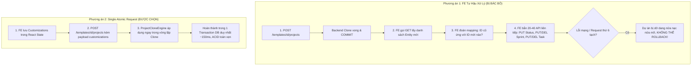

# TÙY CHỈNH NHANH KHI TẠO DỰ ÁN TỪ MẪU (QUICK CUSTOMIZATION ON TEMPLATE INSTANTIATION)

> Phạm vi: `work-service` (Spring Boot 3.x / Java 21) + `frontend` (React 19 / Vite).  
> Tài liệu liên quan:
> - Giới thiệu tổng quan: [1_TEMPLATE_INTRODUCTION.md](1_TEMPLATE_INTRODUCTION.md)
> - Thiết kế CSDL & Backend: [2_TEMPLATE_IMPLEMENTATION_DB.md](2_TEMPLATE_IMPLEMENTATION_DB.md)
> - Kịch bản kiểm thử E2E Thực chiến: [4_KICH_BAN_TEST_CLONE_FNB_TRA_CHANH_PHO.md](4_KICH_BAN_TEST_CLONE_FNB_TRA_CHANH_PHO.md)

---

## 1. Bối cảnh & Bài toán

Khi người dùng chọn một dự án mẫu (ví dụ: *Xây dựng Cửa hàng F&B* hoặc *Dự án phần mềm Scrum*), mẫu thường chứa một hệ sinh thái đầy đủ: 4–6 trạng thái, 3 phân cấp công việc, 2–4 sprint và 20–40 công việc dựng sẵn.

Tuy nhiên, trong thực tế triển khai:
- **Từ ngữ đặc thù của nhóm khác với mẫu**: Mẫu để loại việc là `Task` / `Epic`, nhưng nhóm muốn gọi là `Đầu việc` / `Dự án lớn`; mẫu để trạng thái là `To Do` nhưng nhóm muốn gọi là `Chờ duyệt`.
- **Thừa quy trình / công việc**: Mẫu F&B có giai đoạn mua sắm máy móc quầy bar đắt tiền hoặc thuê mặt bằng trung tâm thương mại, nhưng người dùng chỉ mở quán trà chanh nhỏ nên không cần các sprint và công việc này.
- **Trước đây**: Người dùng buộc phải clone toàn bộ mẫu $\to$ vào màn hình Cài đặt dự án để sửa từng trạng thái/loại việc $\to$ vào màn hình Backlog để xóa từng sprint $\to$ vào Board để xóa/sửa từng công việc. Thao tác này mất nhiều thời gian và gây phiền hà.
- **Vấn đề mất dữ liệu khi Hủy (UX)**: Trong Modal tạo dự án, nếu người dùng đã cấu hình mà bấm Hủy thì modal bị đóng phụt, mất sạch thông tin đã điền.

👉 **Tính năng "Tùy chỉnh nhanh" (Quick Customization)** cho phép người dùng **sửa tên trạng thái, sửa tên loại việc, sửa/bỏ bớt sprint, sửa/bỏ bớt công việc** NGAY TRONG MODAL XEM TRƯỚC (Preview Modal), sau đó bấm "Tạo dự án từ mẫu" để nhận về dự án đã được may đo chuẩn xác trong **1 lượt duy nhất (~150ms)**.

---

## 2. Quyết định Kiến trúc: Tại sao chọn Single Atomic Transaction?

Trong quá trình thiết kế, hai phương án kiến trúc đã được cân nhắc:



### So sánh kỹ thuật chi tiết:

| Tiêu chí | Phương án 1: FE Tự Hậu Xử Lý | Phương án 2: Single Atomic Request (Được chọn) |
|---|---|---|
| **Số lượng Request HTTP** | **15 – 40 requests liên tiếp** (Bão request mạng) | **1 request duy nhất** |
| **Thời gian phản hồi** | 5 – 10 giây (người dùng nhìn loading spinner quay lâu) | **~100 – 200 ms** (ngay lập tức) |
| **Tính toàn vẹn (ACID)** | Không thể rollback nếu request thứ $N$ bị lỗi $\to$ sinh rác dữ liệu | **100% nguyên tử**: Lỗi bất kỳ là DB tự rollback sạch sẽ |
| **Bẫy ID Mismatch** | ID sau clone là UUID mới ngẫu nhiên, FE phải "đoán" ánh xạ dựa trên text (rất dễ sai sót khi trùng tên) | Backend dùng trực tiếp `sourceId` khớp chính xác với Blueprint trong bộ nhớ |
| **Độ phức tạp mã nguồn** | FE phải viết hàng loạt Promise chaining, xử lý retry, debounce, error handle | Backend chỉ cần thêm ~35 dòng code lọc trong `ProjectCloneEngine` |

---

## 3. Quy tắc & Ranh giới Nghiệp vụ (Business Rules)

Hệ thống tuân thủ tiêu chuẩn quản lý dự án cấp Jira (Jira-grade), do đó việc tùy chỉnh nhanh ở modal tuân theo các ranh giới chặt chẽ:

### 3.1. Trạng thái (Statuses)
- **Cho phép**: Đổi tên hiển thị của trạng thái (ví dụ: *To Do* $\to$ *Cần làm*, *Done* $\to$ *Hoàn thành*).
- **Không cho phép trong modal**: Thêm mới hoặc xóa trạng thái.
- **Lý do**: Trạng thái liên kết chặt chẽ với FSM Workflow Transitions và cấu hình Board Columns. Việc xóa/thêm trạng thái mà không cấu hình luồng chuyển trạng thái sẽ làm gãy workflow. Đổi tên hiển thị là phương án an toàn tuyệt đối 100%.

### 3.2. Loại công việc (Work Item Types)
- **Cho phép**: Đổi tên loại công việc (ví dụ: *Epic* $\to$ *Dự án lớn*, *Task* $\to$ *Đầu việc*, *Subtask* $\to$ *Việc con*).
- **Không cho phép trong modal**: Thêm loại công việc mới.
- **Lý do**: Thêm loại mới đòi hỏi cấu hình cấp phân cấp (`hierarchyLevel`: 1, 0, -1) và Workflow Scheme Mapping. Sau khi tạo dự án, người dùng có thể vào phần Cài đặt dự án để tạo thêm loại tùy chỉnh.

### 3.3. Sprint
- **Cho phép**: Đổi tên Sprint, Bỏ qua (Exclude) Sprint không cần dùng.
- **Cơ chế Backlog tự động**: Khi một Sprint bị bỏ qua (không clone), các công việc thuộc Sprint đó trong mẫu sẽ **tự động chuyển về Backlog** (`sprint_id = null`).

### 3.4. Công việc (Work Items) & Cơ chế Cascade Exclude
- **Cho phép**: Sửa tiêu đề tóm tắt (Summary) của công việc, Bỏ qua (Exclude) công việc không cần dùng.
- **Cơ chế Lan truyền loại trừ (Cascade Exclude)**:
  - Nếu người dùng bỏ qua một công việc cấp cha (Epic hoặc Task cha), **toàn bộ các công việc con (Subtasks) của nó sẽ tự động bị loại trừ theo**.
  - Ngăn chặn hoàn toàn tình trạng sinh ra các subtask mồ côi không có công việc cha trong dự án đích.

---

## 4. Chi tiết Triển khai Backend (`work-service`)

### 4.1. Data Transfer Objects (DTO)

#### `TemplateCustomizationsRequest.java`:
```java
package com.datn.workservice.dto.request;

import lombok.AllArgsConstructor;
import lombok.Builder;
import lombok.Data;
import lombok.NoArgsConstructor;

import java.util.List;
import java.util.Map;
import java.util.UUID;

@Data
@Builder
@NoArgsConstructor
@AllArgsConstructor
public class TemplateCustomizationsRequest {

    /** Map sourceStatusId -> tên mới */
    private Map<UUID, String> renamedStatuses;

    /** Map sourceTypeId -> tên mới */
    private Map<UUID, String> renamedTypes;

    /** Danh sách sourceSprintId cần bỏ qua không nhân bản */
    private List<UUID> excludedSprintIds;

    /** Map sourceSprintId -> tên sprint mới */
    private Map<UUID, String> renamedSprints;

    /** Danh sách sourceWorkItemId cần bỏ qua (tự động loại trừ các subtask con của nó) */
    private List<UUID> excludedWorkItemIds;

    /** Map sourceWorkItemId -> tên tóm tắt (summary) mới */
    private Map<UUID, String> renamedWorkItems;
}
```

#### `CreateProjectFromTemplateRequest.java`:
Bổ sung trường `@Valid private TemplateCustomizationsRequest customizations;`.

### 4.2. Xử lý trong `ProjectCloneEngine.java`

1. **Record `Options`**: Bổ sung `customizations`, kèm overloaded constructor để bảo đảm tương thích ngược 100%:
   ```java
   public record Options(boolean includeSprints, boolean includeWorkItems, boolean includeVersions,
                         long dateOffsetDays, TemplateCustomizationsRequest customizations) {
       public Options(boolean includeSprints, boolean includeWorkItems, boolean includeVersions, long dateOffsetDays) {
           this(includeSprints, includeWorkItems, includeVersions, dateOffsetDays, null);
       }
   }
   ```

2. **Áp dụng Đổi tên Trạng thái & Loại việc**:
   ```java
   String name = s.getName();
   if (renamed.containsKey(s.getId())) {
       String val = renamed.get(s.getId());
       if (val != null && !val.isBlank()) name = val.trim();
   }
   ```

3. **Loại trừ Sprint**:
   ```java
   if (excluded.contains(s.getId())) {
       continue; // Bỏ qua, id không vào idMap -> work items thuộc sprint này tự có sprintId = null
   }
   ```

4. **Lan truyền loại trừ công việc cha - con (Cascade Exclude)**:
   ```java
   Set<UUID> excludedItemIds = new HashSet<>();
   if (cust != null && cust.getExcludedWorkItemIds() != null) {
       excludedItemIds.addAll(cust.getExcludedWorkItemIds());
   }

   // Lan truyền: nếu cha bị loại trừ thì con cũng bị loại trừ
   boolean cascadeFound = true;
   while (cascadeFound) {
       cascadeFound = false;
       for (WorkItem src : sourceItems) {
           if (src.getParentId() != null && excludedItemIds.contains(src.getParentId()) 
                   && !excludedItemIds.contains(src.getId())) {
               excludedItemIds.add(src.getId());
               cascadeFound = true;
           }
       }
   }
   ```

### 4.3. Unit Test Xác thực

Trong `ProjectCloneEngineTest.java`, bài test `appliesCustomizationsCorrectly` kiểm chứng:
- Đổi tên `To Do` $\to$ `Cần làm`, `Done` $\to$ `Hoàn tất`.
- Đổi tên `Epic` $\to$ `Sáng kiến`.
- Bỏ qua Sprint 2 $\to$ chỉ còn Sprint 1 (đổi tên thành `Sprint Khởi động`).
- Bỏ qua Task cha $\to$ Subtask con tự động bị bỏ qua $\to$ chỉ còn lại Epic.
- **Kết quả: 5/5 tests passed**.

---

## 5. Chi tiết Triển khai Frontend (`frontend`)

### 5.1. Component `TemplatePreviewModal.jsx`

1. **Quản lý State `customizations`**:
   - Khởi tạo từ `initialCustomizations` nếu có (được truyền khi người dùng quay lại từ form tạo dự án).
   - Tự động đếm tổng số lượng thay đổi (`countChanges`).
2. **Component `EditableText`**:
   - Hiển thị văn bản bình thường, kèm icon bút chì `Pencil`.
   - Khi nhấp vào: chuyển thành ô `<input>` nhỏ gọn, hỗ trợ phím `Enter` để Lưu, `Esc` để Hủy.
   - Khi đã sửa: hiển thị badge `(đã sửa)`, kèm nút `RotateCcw` để khôi phục về giá trị gốc của mẫu chỉ với 1 click.
3. **Thao tác Bỏ qua $\leftrightarrow$ Khôi phục (Delete / Undo)**:
   - Trong bảng Sprint: Cột "Thao tác" với nút đỏ "Bỏ qua" $\leftrightarrow$ nút xanh "Khôi phục". Dòng bị bỏ qua được gạch ngang và mờ 50%.
   - Trong Cây công việc: Mỗi dòng có nút Thùng rác. Nếu việc cha bị bỏ qua, việc con tự động bị gạch ngang và mờ, kèm tooltip *"Bị bỏ qua do công việc cấp cha bị xóa"*.
4. **Customization Banner**:
   - Khi `countChanges > 0`: Hiển thị thanh thông báo màu xanh dương nổi bật:
     `✨ Đã tùy chỉnh: X thay đổi (Đổi tên / Bỏ bớt). Các lựa chọn này sẽ được áp dụng tự động khi bạn tạo dự án.`
   - Có nút `[Đặt lại mặc định]` để xóa toàn bộ tùy chỉnh nếu muốn quay về nguyên bản.

### 5.2. Cải tiến UX Nút HỦY trong `CreateProjectModal.jsx`

#### Giải quyết triệt để lỗi "Ấn Hủy làm mất công điền":
- **Trước đây**: Khi người dùng đã xem mẫu, chọn xong mẫu và đang ở form nhập tên dự án $\to$ nếu bấm "Hủy" hoặc nút X thì modal đóng luôn, toàn bộ thông tin bị xóa trắng.
- **Cải tiến**:
  - Khi ở chế độ tạo dự án từ mẫu (`isTemplateMode && selectedTemplate`): Nút "Hủy" được chuyển thành nút **`← Quay lại xem mẫu`**.
  - Nhấp vào nút này sẽ mở lại `TemplatePreviewModal` với prop `initialCustomizations={templateCustomizations}`.
  - Toàn bộ dữ liệu tùy chỉnh (tên đã sửa, sprint đã bỏ qua, task đã xóa) **được giữ nguyên vẹn 100% trong bộ nhớ**.
  - Nút đóng `X` ở góc trên cùng của modal vẫn cho phép người dùng thoát hẳn nếu muốn hủy hoàn toàn.

#### Banner Mẫu Đã Chọn (`SelectedTemplateBanner`):
- Hiển thị badge: `✨ Đã tùy chỉnh (X thay đổi)` nếu có tùy chỉnh.
- Nút "Xem trước" đổi thành **"Tùy chỉnh"** để người dùng có thể nhấp vào xem lại và điều chỉnh tiếp bất cứ lúc nào.

---

## 6. Ví dụ Kịch bản Sử dụng Thực tế (Walkthrough)

**Kịch bản**: Khởi tạo dự án **"Trà Chanh Phố Cổ" (TCP)** từ mẫu **"Xây dựng Cửa hàng F&B"**:

1. **Bước 1**: Mở modal **Tạo dự án mới** $\to$ Tab **Chọn mẫu dự án** $\to$ Chọn mẫu **Xây dựng Cửa hàng F&B**.
2. **Bước 2**: Trong modal xem trước mẫu:
   - Tab *Trạng thái & Quy trình*: Bấm bút chì sửa trạng thái `To Do` thành `Chờ thực hiện`.
   - Tab *Sprint & Công việc*:
     - Bấm nút Bỏ qua ở Sprint `Giai đoạn 3: Tuyển dụng, Đào tạo & Khai trương` (vì quán gia đình tự đứng quầy).
     - Bấm icon Thùng rác xóa Epic `Xây dựng Thực đơn & Nhập trang thiết bị pha chế đắt tiền`. Toàn bộ các việc con về máy pha Espresso tự động bị gạch ngang bỏ qua.
     - Sửa tên công việc `Khảo sát mặt bằng` thành `Tìm vỉa hè phố cổ thoáng mát`.
   - Nhìn lên banner thấy: `✨ Đã tùy chỉnh: 4 thay đổi`.
3. **Bước 3**: Bấm **Dùng mẫu này (4 tùy chỉnh)** $\to$ Chuyển sang form nhập thông tin dự án:
   - Tên: `Trà Chanh Phố Cổ` | Mã: `TCP` | Ngày bắt đầu: `10/10/2026`.
   - Nếu bấm `← Quay lại xem mẫu`: Toàn bộ 4 thay đổi trên vẫn còn nguyên.
4. **Bước 4**: Bấm **Tạo dự án từ mẫu**:
   - Backend chạy `ProjectCloneEngine` trong 150ms.
   - Dự án `TCP` được tạo thành công với đúng 1 Sprint còn lại, các việc bị xóa không xuất hiện, các việc của Sprint 3 tự động nằm gọn gàng trong Backlog, tên trạng thái hiển thị đúng `Chờ thực hiện`.

---

## 7. Tổng kết Giá trị

1. **Tốc độ & Trải nghiệm đỉnh cao**: Người dùng có thể may đo dự án ngay trước khi tạo mà không cần phải vào từng trang cấu hình sau khi tạo.
2. **An toàn & Toàn vẹn 100%**: Áp dụng Single Atomic Transaction và Cascade Exclude, không có bão request HTTP, không có rác dữ liệu.
3. **Bảo toàn dữ liệu người dùng (Zero Data Loss UX)**: Không còn nỗi lo bấm nhầm nút Hủy làm mất sạch công điền form.
