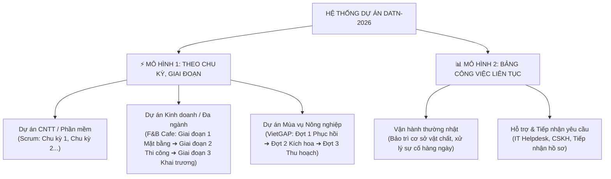
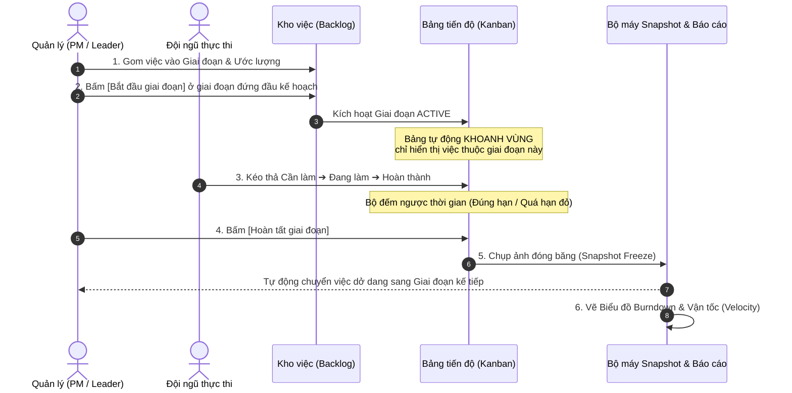

# ĐẶC TẢ KIẾN TRÚC & NGHIỆP VỤ: CÁC MÔ HÌNH QUẢN LÝ DỰ ÁN (DATN-2026)

> **Tài liệu chuẩn hóa nghiệp vụ hệ thống quản lý công việc và dự án**  
> **Dự án:** Hệ thống Quản trị Không gian làm việc và Quản lý Dự án Đa ngành (DATN-2026)  
> **Phiên bản:** 2.1 (Chuẩn hóa Tiếng Việt & Bổ sung Đặc tả Nhịp điệu Chu kỳ)

---

## 1. TỔNG QUAN & TRIẾT LÝ THIẾT KẾ

Trong thực tế doanh nghiệp và các nền tảng hàng đầu thế giới (Jira, Asana, Monday.com, ClickUp), công việc của con người chia làm **2 trường phái vận hành cốt lõi**:
1. **Dự án có đích đến, chia theo từng chặng/thời kỳ** (Project-based / Milestone-driven / Iterative).
2. **Công việc duy trì liên tục, phát sinh đều đặn mỗi ngày** (Operational / Continuous Flow).

Thay vì phân mảnh hệ thống thành nhiều loại dự án rời rạc (gây phình to cơ sở dữ liệu và phân mảnh giao diện), **DATN-2026** quy tụ về **2 mô hình tinh gọn, trực quan và thuần Việt**:

> [!NOTE]
> **Triết lý "Single Source of Truth":**
> Cả hai mô hình đều dùng chung hạ tầng thực thể `work_items`, phân cấp 3 tầng nghiêm ngặt (Cấp 1: Hạng mục lớn/Giai đoạn ➔ Cấp 0: Công việc tiêu chuẩn ➔ Cấp -1: Việc con). Điểm khác biệt nằm ở **bộ điều phối nhịp điệu (Timebox & Board Filter)**.

---

## 2. MÔ HÌNH 1: QUẢN LÝ THEO CHU KỲ, GIAI ĐOẠN

### 2.1. Bản chất cốt lõi: Nhịp điệu lặp lại & Sự tịnh tiến về đích
* **Tên kỹ thuật trong DB:** `SOFTWARE_SCRUM` (hoặc `PHASE_DRIVEN`).
* **Định nghĩa chuẩn xác về "Chu kỳ / Giai đoạn":**
  > **Chu kỳ KHÔNG CÓ NGHĨA LÀ tạo một việc rồi lặp đi lặp lại vô tận trong một vòng tròn luẩn quẩn.**  
  > Bản chất của Chu kỳ là **NHỊP ĐIỆU LẶP LẠI ĐỀU ĐẶN**:
  > - Cứ sau một khoảng thời gian cố định (ví dụ 2 tuần hoặc hết 1 giai đoạn thi công), cả đội ngũ lại thực hiện một chuỗi thao tác:  
  >   $$\text{Lập kế hoạch} \longrightarrow \text{Thực thi} \longrightarrow \text{Nghiệm thu / Đánh giá} \longrightarrow \text{Bắt đầu chu kỳ mới}$$
  > - **Hình tượng chiếc xe đạp:** Bánh xe quay tròn theo từng vòng (chu kỳ lặp lại), nhưng **chiếc xe đạp thì luôn tiến về phía trước trên đường thẳng**. Nhịp làm việc lặp lại đều đặn, nhưng khối lượng công việc hoàn thành và giá trị sản phẩm thì **liên tục tăng lên và tịnh tiến tới đích** (Khai trương quán Cafe / Golive phần mềm).
* **Quy tắc vàng:** Tại một thời điểm, đội ngũ chỉ tập trung toàn lực vào **MỘT giai đoạn/chu kỳ đang chạy (ACTIVE)**. Giai đoạn nào kết thúc thì mới nghiệm thu và mở tiếp giai đoạn sau.
  Hệ thống cưỡng chế quy tắc này bằng hai luật (chi tiết ở [`7_QUY_TAC_NGHIEP_VU_SPRINT_BOARD_BAO_CAO.md`](../7_QUY_TAC_NGHIEP_VU_SPRINT_BOARD_BAO_CAO.md)):
  - **BR-S11 — Một giai đoạn chạy:** đang có giai đoạn ACTIVE thì mọi nút `[Bắt đầu]` đều khoá.
  - **BR-S15 — Bắt đầu lần lượt:** kể cả khi chưa có giai đoạn nào chạy, **chỉ giai đoạn đứng đầu kế hoạch** (ngày bắt đầu dự kiến sớm nhất) mới bắt đầu được. Giai đoạn 2, 3 hiện nút `[Bắt đầu]` bị khoá kèm lý do *"Cần bắt đầu 'Giai đoạn 1…' trước"*. Gọi thẳng API cũng bị từ chối (409).

### 2.2. Áp dụng thực tế đa ngành
* **Đội Phần mềm (Software Team):** Chia thành các **Chu kỳ (Sprint)** kéo dài 1 - 2 tuần. Đặt mục tiêu điểm số (Story Points) và vẽ biểu đồ Cháy (Burndown).
* **Mở quán Cafe / Nhà hàng (F&B Setup):**
  * `Giai đoạn 1: Pháp lý, Mặt bằng & Thiết kế Concept` (20 ngày).
  * `Giai đoạn 2: Thi công nội thất, Máy móc & Menu` (22 ngày).
  * `Giai đoạn 3: Tuyển dụng, Đào tạo & Khai trương` (18 ngày).
* **Nông nghiệp VietGAP (Crop Operations):**
  * `Đợt 1: Phục hồi cây sau thu hoạch & Tỉa cành tạo tán` (25 ngày).
  * `Đợt 2: Xử lý ra hoa đồng loạt & Nuôi quả non` (35 ngày).
  * `Đợt 3: Bao trái ngừa sâu bệnh, Thu hái & Xuất bán` (30 ngày).

### 2.3. Vòng đời 6 bước tự động trong hệ thống

1. **Lập kế hoạch (Planning):** Kéo thả việc từ Kho việc chung (Backlog) vào các khối Giai đoạn 1, 2, 3. Việc con (Subtask) tự động đi theo việc cha. Các khối được xếp theo **ngày bắt đầu dự kiến**, và đây cũng là **thứ tự bắt buộc khi bắt đầu** (BR-S15): chỉ khối "Dự kiến" trên cùng có nút `[Bắt đầu giai đoạn]` sáng.
2. **Khoanh vùng tập trung (Scoped Board):** Khi bấm **`[Bắt đầu giai đoạn]`**, bảng Kanban chỉ tải đúng các việc của giai đoạn đó. Tránh tình trạng thợ thi công nhìn thấy việc của đội tuyển dụng gây rối mắt.
3. **Giám sát thời gian thực (Countdown Monitor):** Trên đỉnh bảng có thanh đếm ngược: `Còn 5 ngày` (bình thường) hoặc `Quá hạn 3 ngày` (chuyển đỏ cảnh báo).
4. **Xử lý việc dở dang (Roll-over Incomplete Items):** Khi bấm **`[Hoàn tất giai đoạn]`**, hệ thống nhận diện các việc chưa xong và hỏi người dùng:
   * Chuyển tự động sang **Giai đoạn tiếp theo**.
   * Đẩy ngược về **Kho việc chung (Backlog)** để phân loại lại.
5. **Đóng băng lịch sử (Snapshot Freeze):** `SprintReportSnapshotEngine.java` chụp lại nguyên trạng báo cáo của chặng vừa đóng, lưu vào cơ sở dữ liệu để phục vụ kiểm toán / nghiệm thu trung thực.
6. **Báo cáo chuyên sâu (Analytics):** Xuất biểu đồ Burndown (tiến độ cháy qua từng ngày) và Velocity Chart (vận tốc qua từng chặng).

---

## 3. MÔ HÌNH 2: BẢNG CÔNG VIỆC LIÊN TỤC (KANBAN TINH GỌN)

### 3.1. Bản chất cốt lõi
* **Tên kỹ thuật trong DB:** `SOFTWARE_KANBAN`.
* **Khái niệm:** Không có ngày bắt đầu hay ngày kết thúc của cả chặng. Công việc là một **dòng chảy liên tục (Continuous Flow)**. Việc mới phát sinh đến đâu, đưa vào cột *Cần làm* đến đó.
* **Quy tắc vàng:** Quản lý bằng **Giới hạn việc đang làm (WIP Limit - Work In Progress)**. Chặn không cho một cột nhận quá nhiều việc dẫn đến ùn ứ cổ chai.

### 3.2. Áp dụng thực tế
* **Vận hành quán cafe sau khi đã khai trương:** Mua bổ sung hạt cafe, sửa máy lạnh bị chảy nước, thanh toán tiền điện tháng này...
* **Bộ phận IT Support / Helpdesk:** Tiếp nhận ticket lỗi người dùng, xử lý và đóng ticket mỗi ngày.
* **Đội bảo trì thiết bị văn phòng / Cơ sở vật chất.**

### 3.3. Trải nghiệm người dùng trên hệ thống
* **Không có thanh điều hướng "Kho việc & Kế hoạch" (Backlog):** Người dùng không cần lập kế hoạch Sprint.
* **Không có nút "Bắt đầu / Hoàn tất":** Truy cập vào dự án là mở ngay Bảng Kanban. Toàn bộ công việc từ trước đến nay đều nằm trên bảng.
* **Báo cáo dòng chảy tích lũy (Cumulative Flow Diagram - CFD):** Theo dõi số lượng thẻ tồn đọng ở từng trạng thái theo thời gian.

---

## 4. BẢNG SO SÁNH ĐỐI CHIẾU TOÀN DIỆN

| Tiêu chuẩn so sánh | ⚡ Mô hình 1: Theo chu kỳ, giai đoạn | 📊 Mô hình 2: Bảng công việc liên tục |
| :--- | :--- | :--- |
| **Bản chất triết lý** | Hướng mục tiêu thời gian (Time-boxed / Stage-Gate) | Hướng luồng công việc liên tục (Continuous Flow / Pull) |
| **Thanh Menu (Sidebar & Header)** | Hiện đầy đủ: `[Bảng tiến độ]`, **`[Kho việc & Kế hoạch]`**, `[Báo cáo]`, `[Thành viên]` | **Ẩn tab `Kho việc & Kế hoạch`**; chỉ hiện Bảng, Báo cáo và Thành viên |
| **Nút kích hoạt trên UI** | Có nút **`[Bắt đầu giai đoạn / chu kỳ]`** và **`[Hoàn tất giai đoạn / chu kỳ]`** | **Không có nút bắt đầu/hoàn tất**. Vào là làm việc ngay |
| **Phạm vi hiển thị thẻ trên Bảng** | **Chỉ hiện thẻ của Giai đoạn đang ACTIVE**. Nếu chưa bấm Bắt đầu, bảng ở trạng thái chờ | **Hiện tất cả thẻ** đang mở của dự án từ trước tới nay |
| **Cảnh báo hạn chót** | Có thanh đếm ngược ngày kết thúc của chặng (`Còn X ngày` / `Quá hạn Y ngày`) | Theo dõi hạn chót (`dueDate`) trực tiếp trên từng thẻ việc riêng lẻ |
| **Xử lý việc chưa xong** | Tự động điều chuyển sang Chặng tiếp theo hoặc trả về Backlog | Thẻ việc tiếp tục nằm ở cột cũ cho đến khi hoàn thành |
| **Bộ máy Báo cáo** | **Biểu đồ Cháy (Burndown Chart)** & **Vận tốc (Velocity Chart)** | **Biểu đồ Dòng chảy tích lũy (CFD)** & Thông lượng (Throughput) |
| **Cơ chế Nhân bản Template** | Tự động **tịnh tiến ngày tháng (Timeline Shifting)** của toàn bộ các giai đoạn theo ngày bắt đầu mới $\Delta \text{days}$ | Clone danh sách việc, reset trạng thái về ban đầu |
| **Ngữ cảnh phù hợp nhất** | Mở quán cafe, làm Website, Xây dựng, Sự kiện, Mùa vụ nông nghiệp, Scrum IT | Bảo trì, CSKH, Helpdesk, Vận hành hàng ngày quán cafe |

---

## 5. GIẢI QUYẾT BÀI TOÁN "QUAY LẠI / LÀM LẠI" (REWORK & AUDIT TRAIL)

> [!IMPORTANT]
> **Câu hỏi nghiệp vụ quan trọng:**
> *"Ví dụ một chu kỳ / giai đoạn đã bấm Hoàn tất rồi, nhưng sau đó phát hiện có việc bị hỏng cần phải quay lại làm thì hệ thống xử lý thế nào?"*

### 5.1. Nguyên lý Trục thời gian Tuyến tính (Linear Time Principle)
Trong quản trị dự án hiện đại (chuẩn Agile Alliance & PMI):
* **Thời gian là đường thẳng một chiều.** Bạn không thể "quay ngược thời gian" về quá khứ 1 tháng trước để làm lại.
* **Giai đoạn đã đóng là một mốc lịch sử.** Nó đã tốn bao nhiêu ngày công, bao nhiêu chi phí thì phải giữ nguyên để bảo toàn tính trung thực của báo cáo tài chính và nghiệm thu.

### 5.2. Ba kịch bản làm lại thực tế

#### Kịch bản A: Lỗi phát sinh từ giai đoạn cũ (Ví dụ: Ống nước rò rỉ sau khi thi công quán cafe)
* **Thực tế:** Giai đoạn 1 (Mặt bằng & Thi công) đã đóng. Sang Giai đoạn 2 (Máy móc & Menu), cắm máy pha cafe vào thì ống nước quầy bar bị bục.
* **Cách xử lý:** 
  * **Không mở lại Giai đoạn 1.**
  * Tạo ngay công việc mới: *"Sửa chữa đường ống nước quầy bar"* và đưa vào **Giai đoạn 2 (Giai đoạn hiện tại)**.
  * **Lý do:** Công thợ sửa ống nước và chi phí mua vật tư đang diễn ra ở hiện tại. Đưa vào Giai đoạn 2 phản ánh đúng chi phí phát sinh thực tế.

#### Kịch bản B: Bể kế hoạch toàn diện (Ví dụ: Chủ nhà đòi lại mặt bằng quán cafe)
* **Thực tế:** Đã xong Giai đoạn 1 (Thuê mặt bằng), chuẩn bị thi công thì chủ nhà huỷ hợp đồng.
* **Cách xử lý:**
  * Bấm **`[+ Tạo chu kỳ]`**, đặt tên là:  
    `Giai đoạn 1.1: Tìm kiếm & Đàm phán mặt bằng thay thế`,  
    và đặt **ngày bắt đầu dự kiến sớm hơn Giai đoạn 2**. Nếu ngày của Giai đoạn 2 đã qua (kế hoạch bị trễ), bấm nút bút chì trên khối Giai đoạn 2 (và các giai đoạn sau) để **dời ngày** ra sau Giai đoạn 1.1. Vì các giai đoạn bắt đầu lần lượt theo ngày dự kiến (BR-S15), Giai đoạn 1.1 sẽ đứng đầu kế hoạch và là giai đoạn duy nhất bắt đầu được.
  * **Lý do:** Khi trình báo cáo lên nhà đầu tư, họ thấy rõ: Giai đoạn 1 cũ tốn 20 ngày và 50 triệu tiền cọc, Giai đoạn 1.1 tốn thêm 15 ngày ➔ Giải thích minh bạch 100% nguyên nhân dự án bị chậm.

#### Kịch bản C: Lỡ tay bấm nhầm nút "Hoàn tất giai đoạn"
* **Hệ thống bảo vệ bằng 2 tầng an toàn:**
  1. **Tầng 1 - Hộp thoại xác nhận (Confirmation Modal):** Cảnh báo danh sách các việc còn dở dang trước khi cho phép đóng.
  2. **Tầng 2 - Tự động Roll-over:** Nếu lỡ bấm đóng, toàn bộ việc chưa xong sẽ được chuyển ngay sang chặng tiếp theo để đội ngũ tiếp tục kéo thả trên bảng Kanban mà không bị gián đoạn hay mất dữ liệu.

---

## 6. HƯỚNG DẪN BẢO VỆ ĐỒ ÁN TỐT NGHIỆP (Q&A VỚI HỘI ĐỒNG)

Dưới đây là các câu hỏi "điểm huyệt" mà Hội đồng chấm thi thường đặt ra và câu trả lời chuẩn xác dựa trên kiến trúc hệ thống:

### Câu hỏi 1: "Tại sao hệ thống của em chỉ có 2 loại dự án mà lại áp dụng được cho cả lập trình CNTT lẫn mở Quán Cafe hay Nông nghiệp?"
> **Trả lời:**
> *"Thưa Thầy/Cô, hệ thống áp dụng triết lý trừu tượng hóa mô hình làm việc (Work Pattern Abstraction). Bản chất của mở quán Cafe hay lập trình phần mềm đều là mô hình **Quản lý theo chu kỳ / giai đoạn (Phase-based)**:
> - Đều chia dự án thành các chặng tuần tự có ngày bắt đầu, ngày kết thúc và mục tiêu.
> - Đều có cơ chế khoanh vùng công việc cần tập trung trên bảng Kanban.
> - Đều nghiệm thu việc dở dang khi kết thúc chặng.
> Hệ thống của em thiết kế giao diện tự nhận diện ngữ cảnh (Context-aware UI): Khi là dự án F&B, nút bấm và nhãn tự đổi thành 'Giai đoạn'; khi là dự án phần mềm thì gọi là 'Chu kỳ / Sprint'. Nhờ đó, cùng một kiến trúc lõi tinh gọn nhưng hệ thống phục vụ được đa ngành nghề mà không cần đẻ thêm bảng cơ sở dữ liệu."*

### Câu hỏi 2: "Tại sao không tạo một bảng `phases` riêng trong Database để lưu giai đoạn mà lại dùng chung bảng `sprints`?"
> **Trả lời:**
> *"Thưa Thầy/Cô, đây là bài học thiết kế từ các hệ thống hàng đầu thế giới như Asana, Linear và Monday.com:
> - Nếu tạo thêm bảng `phases`, hệ thống sẽ bị phân mảnh dữ liệu (Data Duplication): ta phải nhân đôi toàn bộ các bảng phân quyền, bảng liên kết công việc, các API CRUD, các engine tính toán báo cáo tiến độ và công thức dời lịch clone template.
> - Bằng cách trừu tượng hóa bảng `sprints` thành một **Khối thời gian thực thi (Timebox)** với các thuộc tính chuẩn (`startDate`, `endDate`, `goal`, `state: FUTURE/ACTIVE/CLOSED`), hệ thống đạt được tính toàn vẹn cao nhất, tái sử dụng 100% bộ máy tính Burndown Chart, Snapshot Engine và tối ưu hóa hiệu năng truy vấn của cơ sở dữ liệu."*
