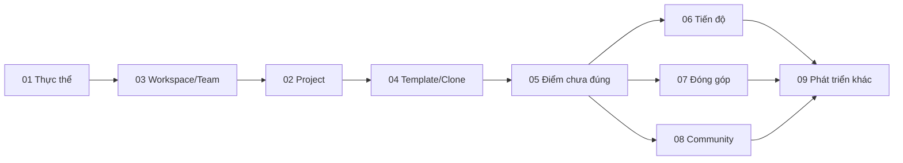
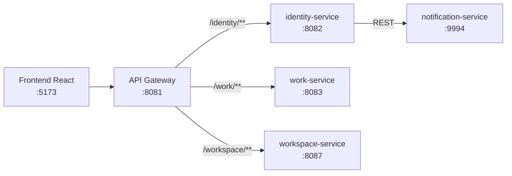
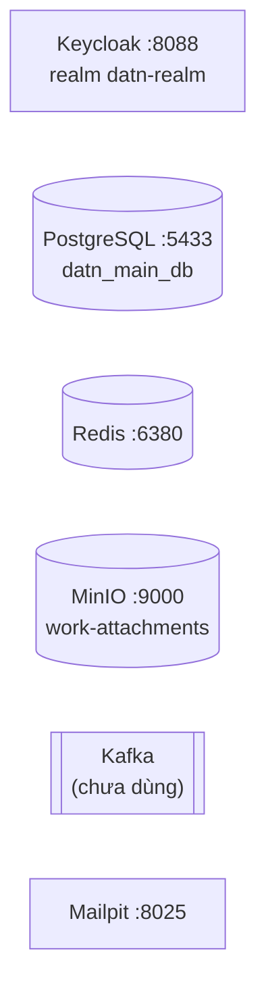
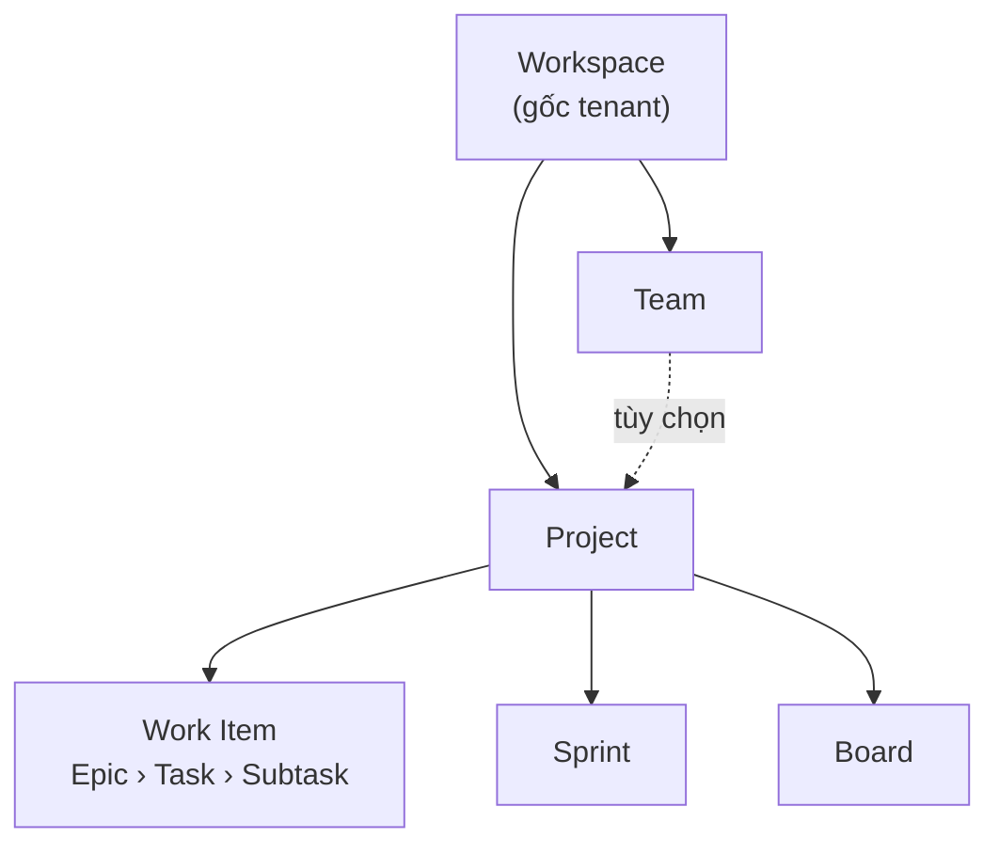

# Bộ tài liệu chính thức DATN-2026

> Hệ thống quản lý công việc kiểu Jira — tài liệu phân tích hiện trạng và định hướng phát triển.
> Lập dựa trên **toàn bộ mã nguồn** (backend 5 service, frontend React, migration SQL, docker-compose, realm Keycloak) tại nhánh `feat/sontx-template`, ngày 03/10/2026.

---

## 1. Danh sách tài liệu

| # | Tài liệu | Nội dung chính | Dành cho |
|---|----------|----------------|----------|
| 01 | [Quan hệ giữa các thực thể](01_QUAN_HE_THUC_THE.md) | Sơ đồ ER chia theo từng cụm nghiệp vụ, khóa, ràng buộc, quy tắc xóa | Dev, BA |
| 02 | [Nghiệp vụ — Project](02_NGHIEP_VU_PROJECT.md) | Vòng đời dự án, phân quyền, Work Item, Workflow, Sprint, Board, báo cáo | BA, Dev, Tester |
| 03 | [Nghiệp vụ — Workspace · Team · Member](03_NGHIEP_VU_WORKSPACE_TEAM_MEMBER.md) | Ba tầng thành viên, vai trò, lời mời, đồng bộ quyền | BA, Dev, Tester |
| 04 | [Nghiệp vụ — Template · Clone Project](04_NGHIEP_VU_TEMPLATE_CLONE.md) | Thư viện mẫu, ba kiểu nhân bản, engine clone, kiểm tra toàn vẹn | BA, Dev |
| 05 | [Điểm chưa đúng so với hệ thống chuẩn](05_DIEM_CHUA_DUNG_SO_VOI_CHUAN.md) | Lỗ hổng nghiệp vụ, kiến trúc, bảo mật, tính năng thiếu — kèm mức độ & đề xuất | Cả nhóm, GVHD |
| 06 | [Thiết kế tương lai — Quản lý tiến độ dự án](06_THIET_KE_QUAN_LY_TIEN_DO.md) | Milestone, sức khỏe dự án, Burn-up, Gantt, dự báo | BA, Dev |
| 06A | [Kế hoạch triển khai — Quản lý tiến độ](06A_KE_HOACH_TRIEN_KHAI_TIEN_DO.md) | 6 bước (0–5), việc cần làm, migration, API, tiêu chí nghiệm thu, rủi ro | Dev |
| 06B | [Kịch bản kiểm thử — Quản lý tiến độ](06B_KICH_BAN_TEST_TIEN_DO.md) | ~70 ca kiểm thử FE/đầu-cuối theo màn hình, ma trận vai trò, bộ tự động `tests/e2e/progress` | Tester, Dev |
| 07 | [Thiết kế tương lai — Quản lý đóng góp thành viên](07_THIET_KE_QUAN_LY_DONG_GOP.md) | Worklog, sự kiện hoạt động, chỉ số đóng góp đa chiều | BA, Dev |
| 08 | [Thiết kế tương lai — Community](08_THIET_KE_COMMUNITY.md) | Public project, bài đăng, tag, Remix/Clone kiểu Figma Community | BA, Dev |
| 09 | [Các hướng phát triển khác](09_PHAT_TRIEN_KHAC.md) | Thông báo, realtime, tìm kiếm, tự động hóa, AI, tích hợp, vận hành | Cả nhóm |

## 2. Thứ tự đọc gợi ý

- Đọc **01 → 03 → 02** để hiểu "ai sở hữu cái gì, ai được làm gì".
- Đọc **04** khi làm việc với dự án mẫu.
- **05** là tài liệu quan trọng nhất trước khi mở rộng: các thiết kế 06/07/08 đều giả định một số điểm trong 05 đã được sửa.

## 3. Bức tranh hệ thống trong một trang

### 3.1. Các service và cổng

### 3.2. Hạ tầng phụ trợ

### 3.3. Phân cấp nghiệp vụ

## 4. Quy ước trong bộ tài liệu

| Ký hiệu | Ý nghĩa |
|---------|---------|
| ✅ | Đã có trong mã nguồn và hoạt động |
| ⚠️ | Có nhưng chưa đúng / chưa đầy đủ |
| ❌ | Chưa có (chỉ có bảng hoặc chưa có gì) |
| 🔴 / 🟠 / 🟡 | Mức độ nghiêm trọng: Cao / Trung bình / Thấp |
| `sub` | Keycloak subject (id người dùng trong JWT) |
| `users.id` | Khóa chính bảng `users` của identity-service |

Tên bảng, tên lớp, tên endpoint được giữ nguyên tiếng Anh như trong mã nguồn để tra cứu dễ dàng.
