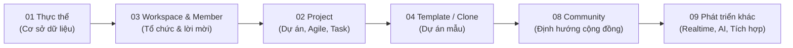
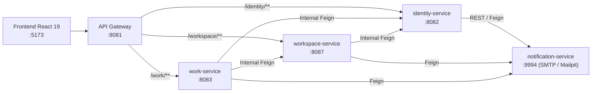
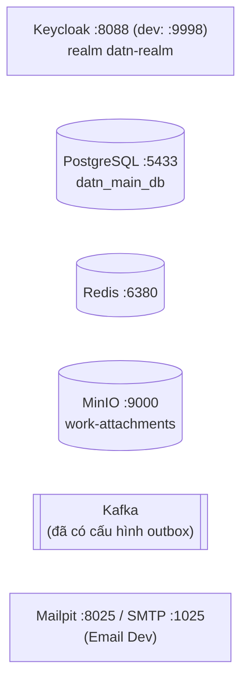
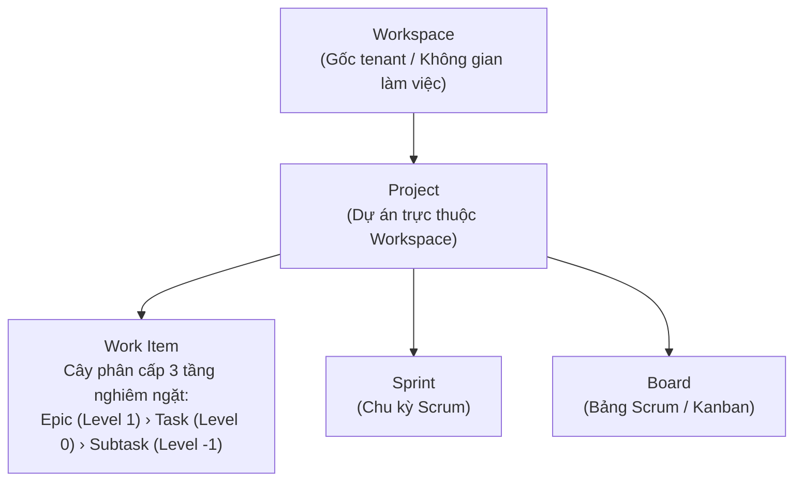

# Bộ tài liệu chính thức DATN-2026

> Hệ thống quản lý công việc kiểu Jira — tài liệu phân tích hiện trạng và định hướng phát triển.
> Cập nhật và chuẩn hóa đồng bộ với **toàn bộ mã nguồn thực tế** (backend Spring Boot 3.x / Java 21, frontend React 19, Flyway migrations V1..V8 của work-service, V1..V5 của workspace-service, docker-compose, realm Keycloak).

---

## 1. Danh sách tài liệu

| # | Tài liệu | Nội dung chính | Trạng thái mã nguồn | Dành cho |
|---|----------|----------------|:-------------------:|----------|
| 01 | [Quan hệ giữa các thực thể](01_QUAN_HE_THUC_THE.md) | Sơ đồ ER chia theo từng cụm nghiệp vụ, khóa, ràng buộc, quy tắc xóa | ✅ Đã chuẩn hóa theo V8 (bỏ Team, liên kết trực tiếp Workspace → Project) | Dev, BA |
| 02 | [Nghiệp vụ — Project](02_NGHIEP_VU_PROJECT.md) | Vòng đời dự án, phân quyền, Work Item, Workflow, Sprint, Board, báo cáo Agile | ✅ Chuẩn hóa theo kiến trúc 2 tầng Workspace → Project; làm rõ phần Tiến độ là định hướng | BA, Dev, Tester |
| 03 | [Nghiệp vụ — Workspace · Member · Phân quyền](03_NGHIEP_VU_WORKSPACE_TEAM_MEMBER.md) | Hai tầng thành viên (Workspace & Project), lời mời qua email, auto-cascade member | ✅ Chuẩn hóa theo kiến trúc đã loại bỏ hoàn toàn tầng Team | BA, Dev, Tester |
| 04 | [Nghiệp vụ — Template · Clone Project](04_NGHIEP_VU_TEMPLATE_CLONE.md) | Thư viện mẫu, ba kiểu nhân bản, clone engine, quick customization, kiểm tra toàn vẹn | ✅ Đồng bộ với CreateProjectFromTemplateRequest & Quick Customization | BA, Dev |
| 08 | [Thiết kế tương lai — Community](08_THIET_KE_COMMUNITY.md) | Public project, bài đăng, tag, Remix/Clone kiểu Figma Community | 💡 Đề xuất thiết kế tương lai (chưa có code) | BA, Dev |
| 09 | [Các hướng phát triển khác](09_PHAT_TRIEN_KHAC.md) | Thông báo, realtime, tìm kiếm JQL-lite, tự động hóa, AI, tích hợp | 💡 Định hướng mở rộng & lộ trình tương lai | Cả nhóm |

> ℹ️ **Ghi chú về các tài liệu chuyên sâu:** Các tài liệu phân tích nâng cao trước đây (05 Lỗ hổng & kiểm toán, 06/06A/06B Quản lý tiến độ chi tiết, 07 Quản lý đóng góp) đã được chuyển giao và lưu trữ chi tiết tại thư mục chuyên đề `docs/services/work_service/` (`qly_tien_do/`, `qly_dong_gop/`, `new structure/`, `status_time_management/`).

---

## 2. Thứ tự đọc gợi ý

- Đọc **01 → 03 → 02** để nắm vững kiến trúc dữ liệu và mô hình phân quyền 2 cấp ("ai sở hữu cái gì, ai được làm gì").
- Đọc **04** khi làm việc với tính năng nhân bản và dự án mẫu.
- Đọc **08, 09** khi định hướng mở rộng hoặc nghiên cứu các tính năng nâng cao.

---

## 3. Bức tranh hệ thống trong một trang

### 3.1. Các service và cổng

### 3.2. Hạ tầng phụ trợ

### 3.3. Phân cấp nghiệp vụ (Mô hình 2 cấp tinh gọn)

---

## 4. Quy ước trong bộ tài liệu

| Ký hiệu | Ý nghĩa |
|---------|---------|
| ✅ | Đã có trong mã nguồn và hoạt động chính xác |
| ⚠️ | Đang có nhưng cần lưu ý / cấu hình bổ sung |
| 💡 / ❌ | Định hướng đề xuất / Chưa triển khai trong mã nguồn hiện tại |
| `sub` | Keycloak subject UUID (ID người dùng trong JWT Bearer token) |
| `users.id` | Khóa chính bảng `users` của `identity-service` |

Tên bảng, tên lớp, tên thuộc tính và endpoint được giữ nguyên như trong mã nguồn Java/Spring Boot và React để tiện tra cứu trực tiếp.
