# 01 — Tài liệu quan hệ giữa các thực thể

> Nguồn: `work-service/.../db/migration/V1..V8`, `workspace-service/.../db/migration/V1..V5`, các lớp `entity/*` của identity-service, work-service, workspace-service.

---

## Mục lục

1. [Tổng quan: ai sở hữu bảng nào](#1-tổng-quan-ai-sở-hữu-bảng-nào)
2. [Định danh người dùng — hai loại ID](#2-định-danh-người-dùng--hai-loại-id)
3. [Cụm Danh tính (identity-service)](#3-cụm-danh-tính-identity-service)
4. [Cụm Tổ chức: Workspace → Project (Kiến trúc 2 tầng trực tiếp)](#4-cụm-tổ-chức-workspace--project-kiến-trúc-2-tầng-trực-tiếp)
5. [Cụm Phân quyền dự án](#5-cụm-phân-quyền-dự-án)
6. [Cụm Lời mời](#6-cụm-lời-mời)
7. [Cụm Cấu hình quy trình (Workflow)](#7-cụm-cấu-hình-quy-trình-workflow)
8. [Cụm Board](#8-cụm-board)
9. [Cụm Kế hoạch: Sprint · Version · Component · Label](#9-cụm-kế-hoạch-sprint--version--component--label)
10. [Thực thể trung tâm: Work Item](#10-thực-thể-trung-tâm-work-item)
11. [Cụm Hoạt động trên Work Item](#11-cụm-hoạt-động-trên-work-item)
12. [Cụm Mẫu & Nhân bản](#12-cụm-mẫu--nhân-bản)
13. [Định hướng mở rộng: Cụm Tiến độ dự án](#13-định-hướng-mở-rộng-cụm-tiến-độ-dự-án)
14. [Cụm Mở rộng khác (đã có bảng, chưa có nghiệp vụ)](#14-cụm-mở-rộng-khác-đã-có-bảng-chưa-có-nghiệp-vụ)
15. [Bảng tổng hợp thực thể](#15-bảng-tổng-hợp-thực-thể)
16. [Ràng buộc toàn vẹn quan trọng](#16-ràng-buộc-toàn-vẹn-quan-trọng)
17. [Tham chiếu "mềm" (không có khóa ngoại)](#17-tham-chiếu-mềm-không-có-khóa-ngoại)

---

## 1. Tổng quan: ai sở hữu bảng nào

Cả ba service có dữ liệu cùng ghi vào **một database** `datn_main_db`, nhưng mỗi service "sở hữu" một nhóm bảng riêng và tự quản lý schema theo cách khác nhau.

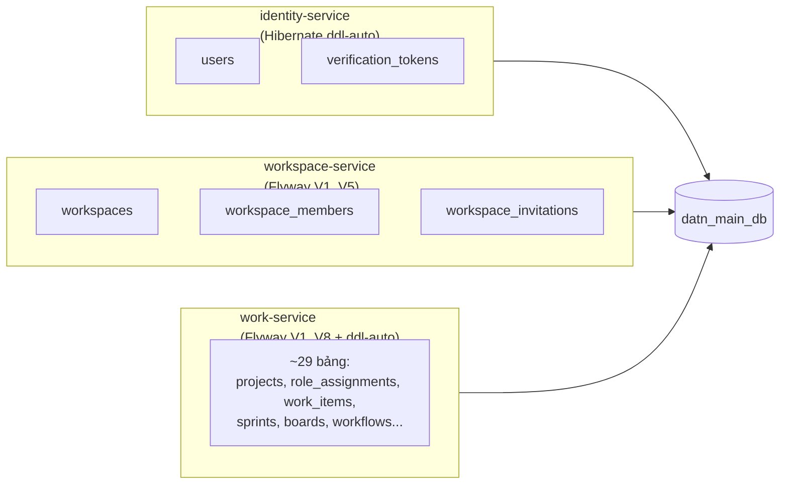

| Service | Số bảng | Quản lý schema | Bảng lịch sử Flyway |
|---------|:-------:|----------------|---------------------|
| identity-service | 2 | `ddl-auto: update` (không Flyway) | — |
| workspace-service | 3 | Flyway V1..V6 (`ddl-auto: validate`) | `flyway_workspace_schema_history` |
| work-service | ~29 | Flyway V1..V8 **và** `ddl-auto: update` | `flyway_work_schema_history` |

> ℹ️ **Lưu ý kiến trúc sau refactor (Flyway V8 & V5):**  
> Tầng trung gian `teams` và `team_members` đã được **loại bỏ hoàn toàn** khỏi cơ sở dữ liệu (`DROP TABLE IF EXISTS team_members, teams CASCADE` tại migration V8 của work-service). Khóa ngoại `fk_teams_workspace` cũng đã được gỡ bỏ tại V5 của workspace-service. Dự án (`projects`) hiện liên kết trực tiếp vào `workspaces` qua cột `workspace_id` có chỉ mục `idx_projects_workspace`.

---

## 2. Định danh người dùng — thống nhất theo Keycloak `sub`

Không có bảng nào ngoài `users` lưu thông tin cá nhân người dùng. Các service khác chỉ lưu **UUID** của người dùng, và toàn hệ thống dùng chung một loại UUID: **Keycloak `sub`** (K). ID riêng của identity-service (`users.id`, D) chỉ dùng bên trong identity-service.

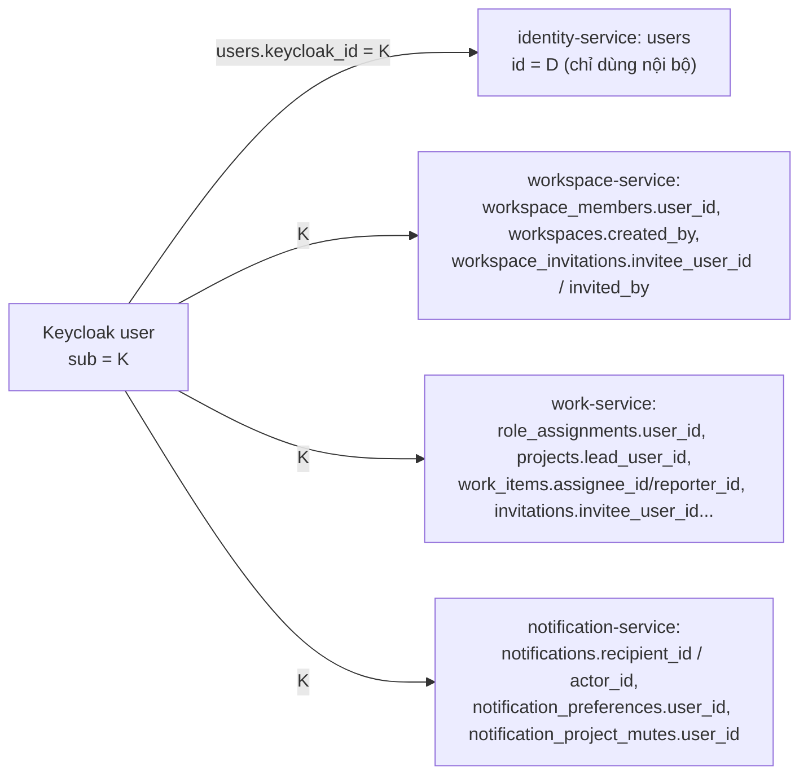

| Nơi lưu | Loại ID | Cách lấy (theo mã nguồn) |
|---------|---------|---------------------------|
| identity-service: `users.id`, `user_roles.user_id`, `verification_tokens.user_id` | `users.id` (D) | Khóa nội bộ, không đi ra ngoài identity-service; nối sang Keycloak qua `users.keycloak_id` |
| workspace-service: `workspace_members`, `workspaces.created_by`, `workspace_invitations` | Keycloak `sub` (K) | `CurrentUserResolver` đọc `sub` của JWT. Trước Flyway V6 `unify_user_id_keycloak_sub` các cột này lưu `users.id`; V6 đã chuyển toàn bộ dữ liệu cũ sang `sub` |
| work-service: mọi cột người dùng (`role_assignments`, `projects`, `work_items`, `invitations`…) | Keycloak `sub` (K) | `SecurityUtils.getCurrentUserId()` đọc `sub` của JWT |
| notification-service: `notifications`, `notification_preferences`, `notification_project_mutes` | Keycloak `sub` (K) | `NotificationController` đọc `sub` của JWT; bên phát sự kiện outbox điền sẵn `sub` của người nhận |

Hệ quả:
- Mỗi service lấy user id thẳng từ JWT, không phải gọi identity-service. Giữa các service (Feign `/internal/**`, sự kiện outbox) cũng truyền `sub`, nên work-service hỏi workspace-service "user X có trong workspace không" bằng chính `sub` của X mà không cần quy đổi.
- API của identity-service trả `id` = `users.id` kèm `keycloakId`. ID nhận từ identity (tìm người dùng theo email / username, `/users/me`) phải đổi sang `keycloakId` trước khi lưu hoặc so sánh: `ProjectMemberServiceImpl.canonicalUserId()` (work), `WorkspaceMemberServiceImpl.resolveUserIdByIdentifier()` (workspace), `IdentityUsers.indexByAnyId()` khi tra tên hàng loạt; frontend dùng `currentUser.keycloakId`.
- ⚠️ Khi đăng nhập Google và khi lấy hồ sơ (`/users/me`), identity-service (`UserService`) nối tài khoản theo email: nếu cùng một email đi vào bằng tài khoản Keycloak khác (ví dụ đã đăng ký bằng mật khẩu rồi đăng nhập bằng Google), `users.keycloak_id` bị ghi đè bằng `sub` mới trong khi dữ liệu nghiệp vụ vẫn gắn `sub` cũ.

---

## 3. Cụm Danh tính (identity-service)

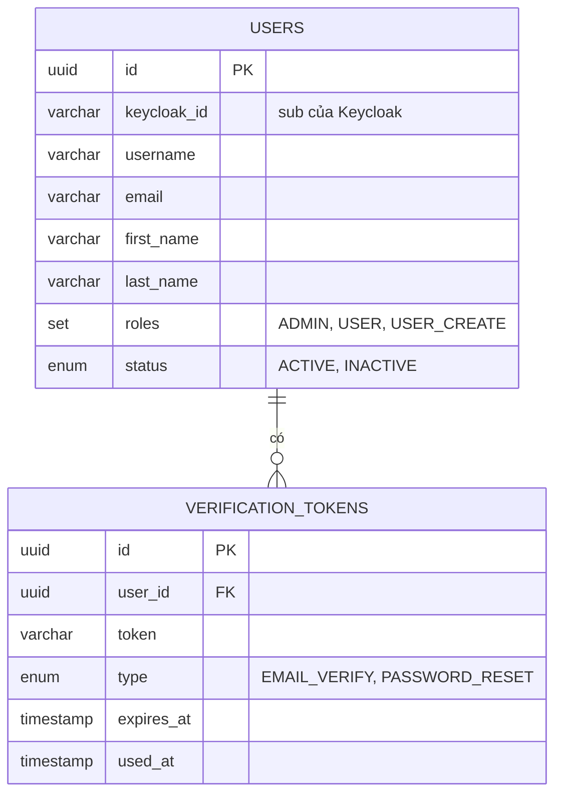

- Mật khẩu **không** lưu ở đây — do Keycloak quản lý.
- `status = INACTIVE` cho tới khi xác thực email thành công qua link verify token (người dùng đăng nhập Google bỏ qua bước này).

---

## 4. Cụm Tổ chức: Workspace → Project (Kiến trúc 2 tầng trực tiếp)

### 4.1. Workspace và thành viên

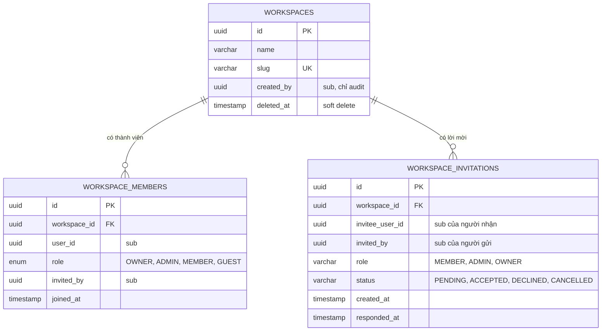

- Ràng buộc `UNIQUE(workspace_id, user_id)`: một người dùng chỉ giữ một vai trò trong mỗi workspace, nhưng có thể tham gia nhiều workspace.
- Workspace **không có** cột `owner_id`; quyền sở hữu xác định hoàn toàn qua `workspace_members.role = OWNER`.
- Bất biến an toàn: Luôn đảm bảo còn ít nhất một `OWNER` trong workspace (ngăn chặn tình huống workspace "mồ côi").

### 4.2. Loại bỏ hoàn toàn tầng Team (Flyway V8)

Trước Flyway V8, hệ thống từng có các bảng `teams` và `team_members`. Cấu trúc này đã bị **loại bỏ hoàn toàn** vì các lý do:
1. Gây cản trở trải nghiệm người dùng (bắt buộc tạo team và phải là Leader mới được tạo dự án).
2. Xung đột phân quyền đa tầng và phức tạp hóa logic đồng bộ thành viên.
3. Trong migration V8, toàn bộ dữ liệu thành viên từ `team_members` đã được tự động di trú an toàn sang `role_assignments` của từng dự án (`LEADER → ADMINISTRATOR`, `VIEWER → VIEWER`, `MEMBER → MEMBER`).

### 4.3. Project gắn trực tiếp vào Workspace

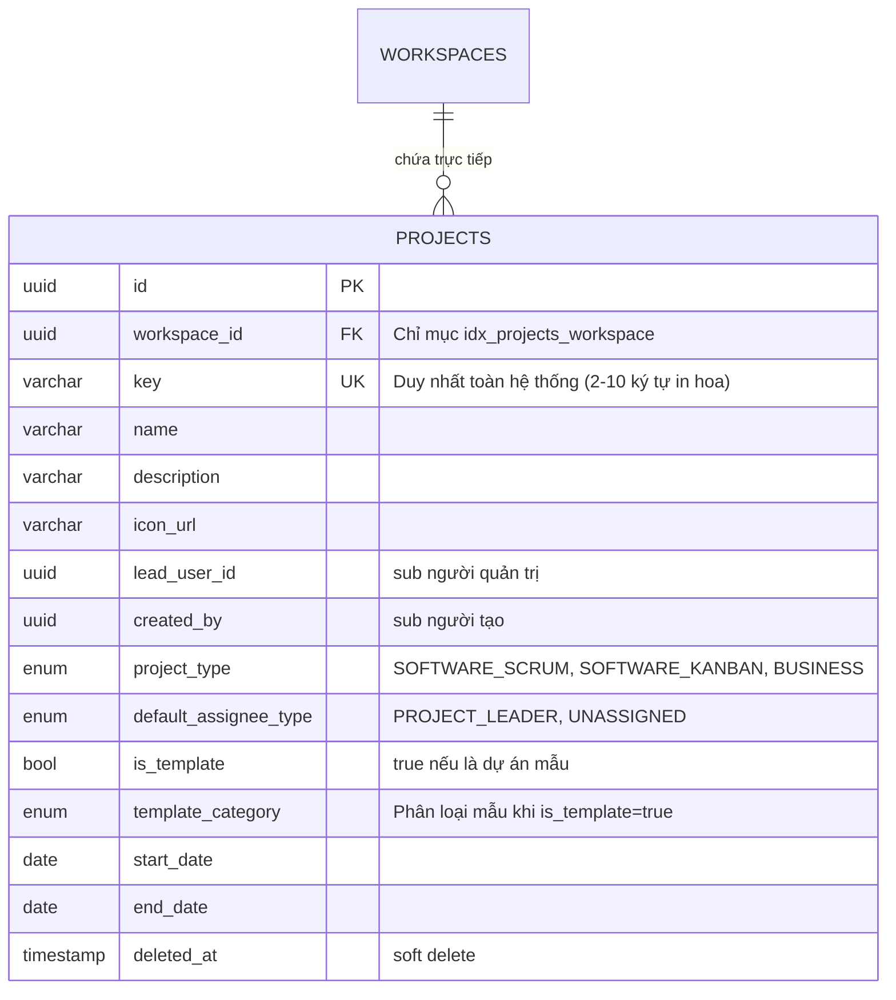

- Không còn cột `team_id`. Dự án trực thuộc thẳng `workspace_id`.
- Mọi thành viên Workspace có vai trò `MEMBER`, `ADMIN`, `OWNER` (hoặc Global ADMIN) đều có quyền khởi tạo dự án trực tiếp.
- `key` duy nhất **toàn hệ thống** (được kiểm tra không phân biệt hoa thường qua `existsByKeyIgnoreCase`).

---

## 5. Cụm Phân quyền dự án

Không có bảng `permissions`; danh sách quyền là enum `PermissionKey` trong mã nguồn (16 quyền chi tiết kiểu Jira).

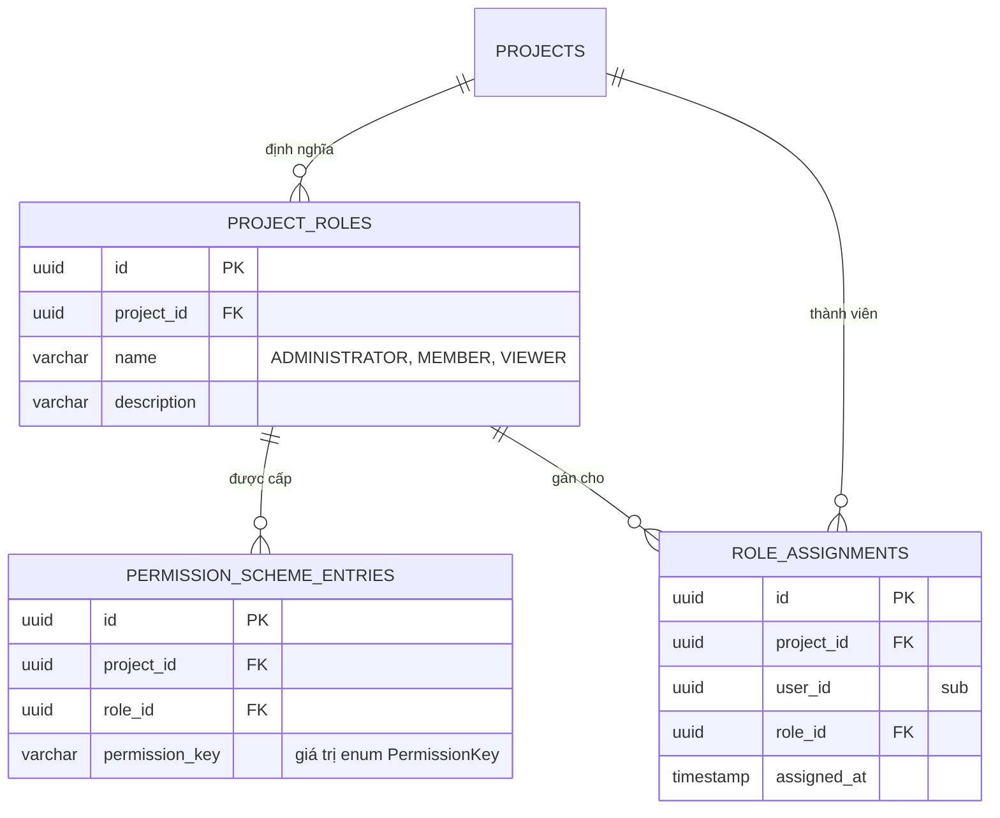

- `ROLE_ASSIGNMENTS` **chính là danh sách thành viên dự án** — không có bảng `project_members` riêng.
- Lead và người tạo dự án được tự động gán vai trò `ADMINISTRATOR` khi khởi tạo sinh thái dự án (`initProjectEcosystem`).
- Nguyên tắc phân quyền: **fail-closed** — nếu không khớp bất kỳ điều kiện hợp lệ nào thì mặc định từ chối.

---

## 6. Cụm Lời mời

Hệ thống có hai luồng lời mời độc lập, bảo mật và đều hỗ trợ gửi email thông báo qua `notification-service`:

```mermaid
flowchart TD
    subgraph WSI["Lời mời Workspace (workspace-service)"]
        W1["POST /workspaces/{id}/members"] --> W2["Tạo bản ghi workspace_invitations<br/>(status = PENDING)"]
        W2 --> W3["Gửi email mời tham gia qua NotificationClient"]
        W3 --> W4["Chấp nhận: POST /api/v1/workspace-invitations/{id}/accept<br/>→ Ghi vào workspace_members"]
    end

    subgraph PRI["Lời mời Dự án (work-service)"]
        P1["POST /projects/{id}/members"] --> P2["Tạo bản ghi invitations<br/>(type = PROJECT, status = PENDING)"]
        P2 --> P3["Gửi email mời tham gia dự án qua NotificationClient"]
        P3 --> P4["Chấp nhận: POST /invitations/{id}/accept<br/>→ Ghi vào role_assignments"]
    end

    subgraph AUTO["Auto-cascade Workspace Member"]
        C1["Mời vào Project hoặc đặt làm Project Lead"] -->|Internal Feign| C2["InternalWorkspaceController.ensureMember"]
        C2 -->|Tự động bổ sung| C3["Đảm bảo người dùng có mặt trong workspace_members (role MEMBER)"]
    end
```

### 6.1. Bảng `invitations` của `work-service`

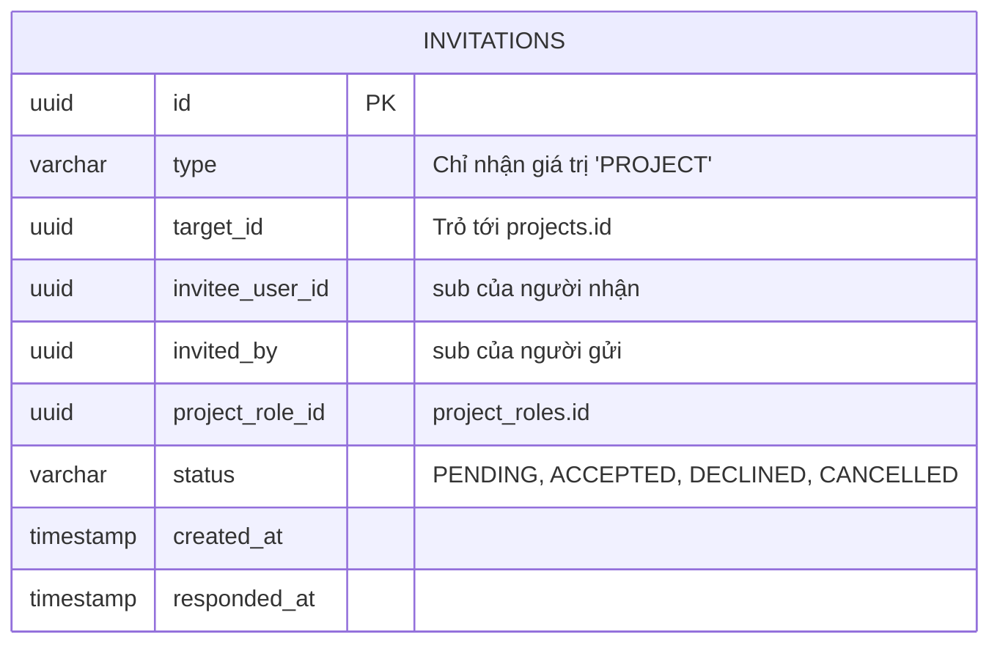

- Ràng buộc kiểm tra: `CHECK (type IN ('PROJECT'))`.
- Cột `team_role` đã được gỡ bỏ hoàn toàn ở Flyway V8.
- Chỉ mục duy nhất: `UNIQUE (type, target_id, invitee_user_id) WHERE status = 'PENDING'`.

---

## 7. Cụm Cấu hình quy trình (Workflow)

### 7.1. Loại công việc và trạng thái

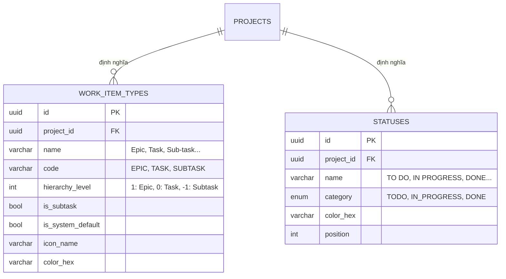

`category` là cầu nối chuẩn hóa giữa trạng thái tùy biến và các báo cáo Agile (Burndown, Velocity chỉ chốt khi sang nhóm `DONE`).

### 7.2. Workflow và bước chuyển (Transition)

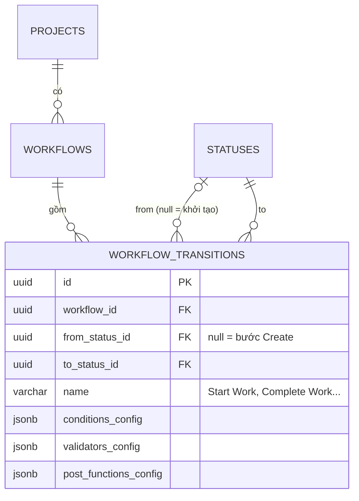

### 7.3. Workflow Scheme (Ánh xạ loại công việc vào quy trình)

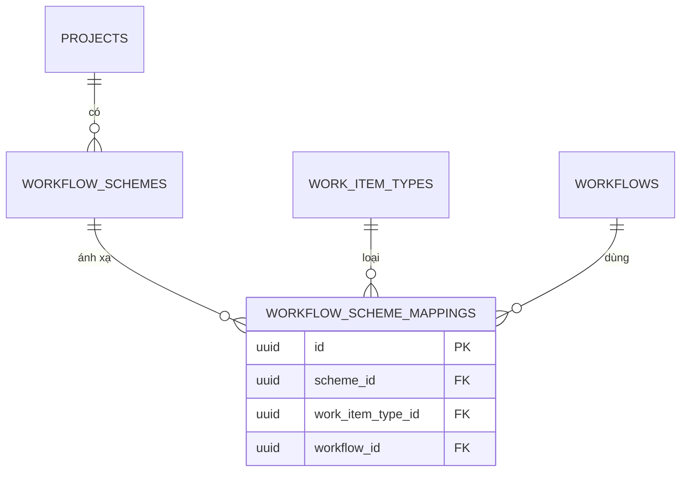

Ràng buộc `UNIQUE(scheme_id, work_item_type_id)`: mỗi loại công việc chỉ gắn với đúng một workflow trong một scheme.

---

## 8. Cụm Board

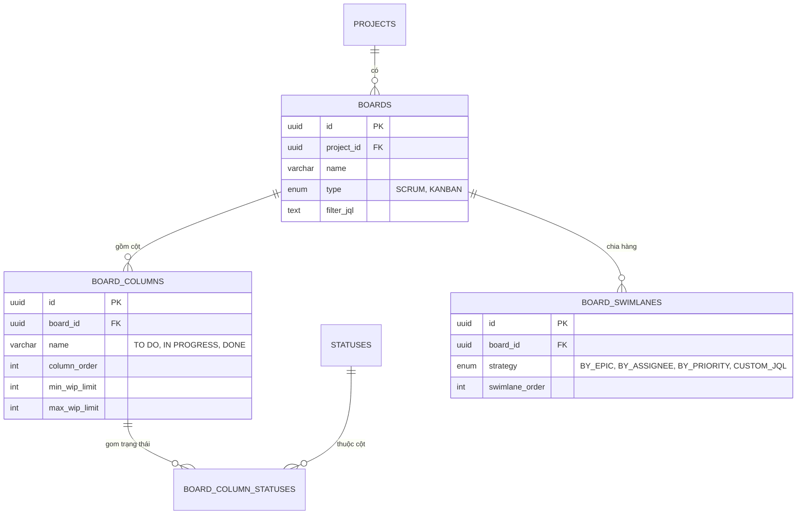

Một cột có thể gom nhiều trạng thái. Thẻ hiển thị ở cột nào được suy diễn từ `work_items.status_id`.

---

## 9. Cụm Kế hoạch: Sprint · Version · Component · Label

### 9.1. Sprint và snapshot báo cáo

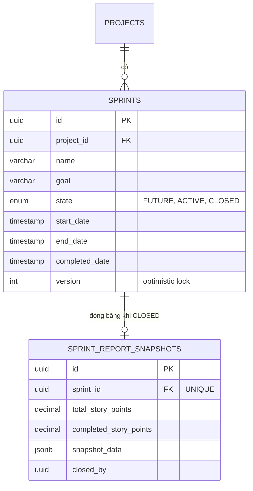

Chỉ mục duy nhất một phần `uq_sprints_one_active_per_project` bảo đảm **mỗi dự án chỉ có tối đa một Sprint ACTIVE tại một thời điểm**.

### 9.2. Version, Component, Label

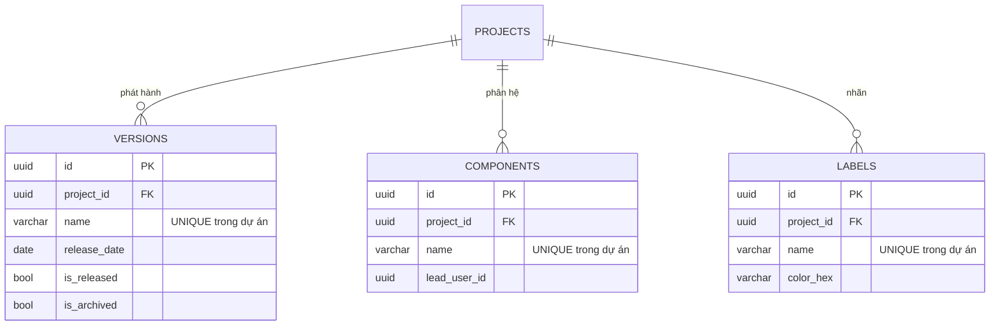

---

## 10. Thực thể trung tâm: Work Item

Một bảng duy nhất chứa mọi loại công việc (Epic, Task, Sub-task); loại công việc được phân biệt qua `type_id`.

### 10.1. Work Item và các tham chiếu cấu hình

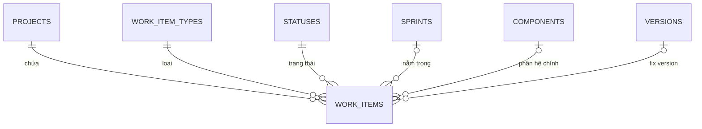

### 10.2. Mô hình phân cấp 3 cấp độ nghiêm ngặt

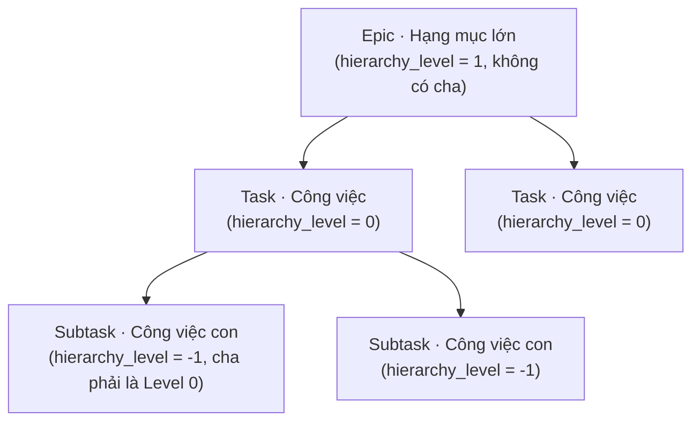

Được xác thực chặt chẽ bởi `StrictHierarchyValidator`:
- Epic không được có công việc cha.
- Subtask bắt buộc phải có cha ở cấp 0 (không gắn trực tiếp vào Epic, không lồng Subtask bên trong Subtask).

### 10.3. Thuộc tính chính

| Nhóm | Cột | Mô tả |
|------|-----|-------|
| Định danh | `id`, `code` | Mã công việc duy nhất trong dự án (ví dụ: `WEB-12`), sinh tự động từ sequence |
| Nội dung | `summary`, `description`, `custom_fields` | Tiêu đề, mô tả chi tiết, dữ liệu JSONB tùy biến |
| Phân loại | `priority`, `resolution` | Độ ưu tiên (`LOWEST` → `HIGHEST`), kết quả giải quyết |
| Con người | `reporter_id`, `assignee_id` | Người tạo việc và người được phân công (đều là Keycloak `sub`) |
| Ước lượng | `story_points`, `original_estimate_seconds`, `remaining_estimate_seconds`, `time_spent_seconds` | Điểm ước lượng Story Point và thời gian tính bằng giây |
| Thứ tự | `rank` | Chuỗi ký tự so sánh được theo chuẩn LexoRank |
| Thời gian | `start_date`, `due_date`, `resolved_at` | Ngày bắt đầu, hạn chót và thời điểm hoàn thành |
| Kỹ thuật | `version`, `deleted_at` | Khóa lạc quan (Optimistic Lock) và đánh dấu xóa mềm |

---

## 11. Cụm Hoạt động trên Work Item

### 11.1. Liên kết giữa các công việc (Work Item Links)

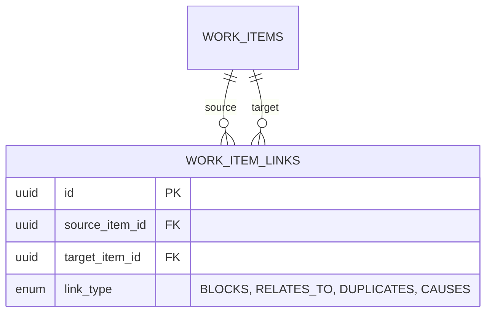

Ràng buộc `CHECK(source_item_id <> target_item_id)` và bean `DependencyCycleDetector` ngăn chặn chu trình phụ thuộc dạng vòng lặp `BLOCKS`.

### 11.2. Nhãn và phân hệ phụ (Quan hệ N–N)

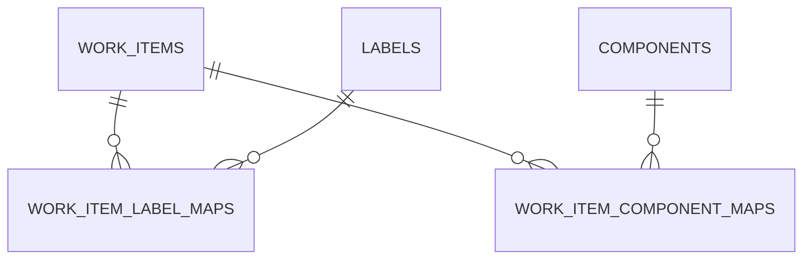

### 11.3. Thảo luận, tệp đính kèm và lịch sử thay đổi

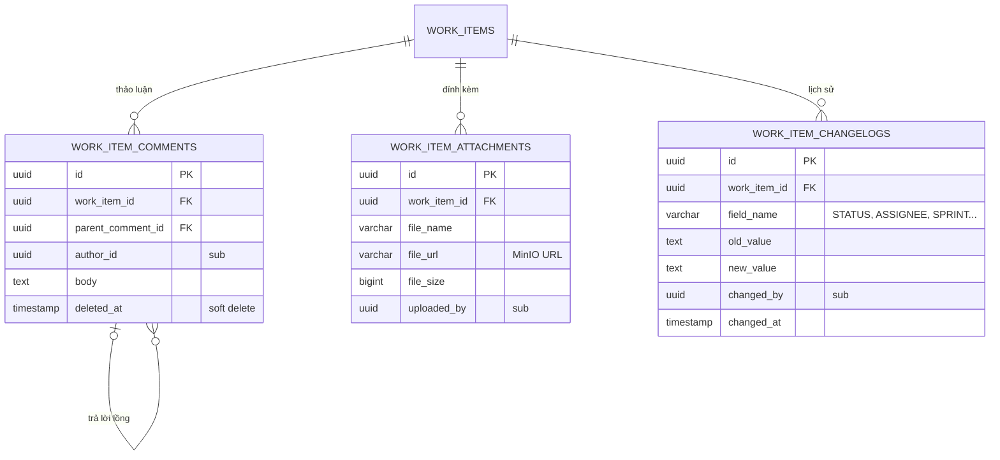

`work_item_changelogs` là nguồn dữ liệu thời gian thực để dựng lại lịch sử trạng thái phục vụ biểu đồ Burndown và CFD (`WorkItemStateReplayer`).

---

## 12. Cụm Mẫu & Nhân bản

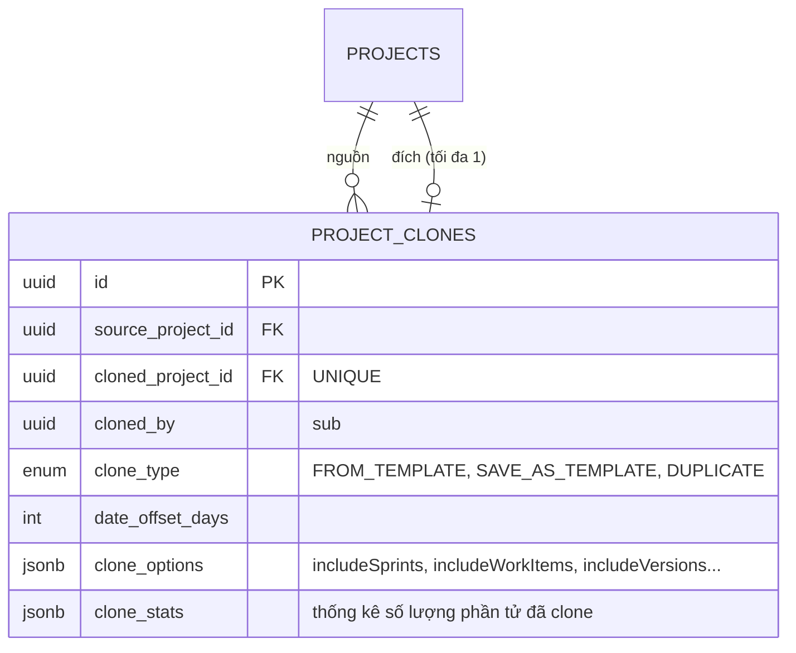

- Dự án mẫu **không phải bảng riêng**: là một `Project` có cờ `is_template = TRUE`.
- Ràng buộc: `CHECK(source_project_id <> cloned_project_id)`; mỗi dự án đích chỉ sinh từ duy nhất một nguồn.
- Hỗ trợ **Quick Customization** (`TemplateCustomizationsRequest`): cho phép đổi tên trạng thái, loại công việc, sprint, công việc và chọn lọc loại trừ phần tử không cần thiết khi tạo từ mẫu.

---

## 13. Định hướng mở rộng: Cụm Tiến độ dự án

> 💡 **Trạng thái:** Đây là cụm thực thể **định hướng mở rộng tương lai** (đã nghiên cứu tại tài liệu chuyên đề `docs/services/work_service/qly_tien_do/`), **chưa được triển khai** thành các bảng hay entity Java trong mã nguồn hiện tại (Flyway V1..V8).

Cụm thực thể đề xuất gồm:
- `project_progress_snapshots`: Lưu ảnh chụp số liệu tiến độ hằng ngày của dự án.
- `project_milestones` & `milestone_items`: Quản lý các mốc quan trọng (Milestone) và công việc liên quan.
- `project_baselines` & `baseline_items`: Chốt đường cơ sở kế hoạch để phân tích độ lệch tiến độ.
- `project_status_updates`: Nhật ký báo cáo tình trạng định kỳ của người quản trị dự án.

---

## 14. Cụm Mở rộng khác (đã có bảng, chưa có nghiệp vụ)

```mermaid
erDiagram
    PROJECTS ||--o{ CUSTOM_FIELD_DEFINITIONS : ""
    PROJECTS ||--o{ SAVED_FILTERS : ""
    PROJECTS ||--o{ AUTOMATION_RULES : ""
    OUTBOX_EVENTS {
        uuid id PK
        varchar aggregate_type
        varchar event_type
        jsonb payload
        enum status "PENDING, PROCESSED, FAILED"
    }
```

| Bảng | Trạng thái ghi | API nghiệp vụ | Ghi chú |
|------|:--------------:|:-------------:|---------|
| `custom_field_definitions` | Sao chép khi clone | ❌ | `work_items.custom_fields` lưu dữ liệu JSONB nhưng chưa kiểm tra schema |
| `saved_filters` | ❌ | ❌ | Đã có trường `jql_query` chờ engine tìm kiếm nâng cao |
| `automation_rules` | Sao chép khi clone | ❌ | Chờ module Automation Rule Runner |
| `outbox_events` | ✅ (Sprint start/close) | — | Chờ daemon publish sự kiện lên Kafka |

---

## 15. Bảng tổng hợp thực thể

| Thực thể | Service sở hữu | Phạm vi | Kiểu xóa | API CRUD |
|----------|---------------|---------|----------|:--------:|
| User | identity | Toàn hệ thống | Cứng (+ dọn dẹp tham chiếu) | ✅ |
| Workspace | workspace | Gốc Tenant | Mềm (`deleted_at`) | ✅ |
| WorkspaceMember | workspace | Workspace | Cứng | ✅ |
| WorkspaceInvitation | workspace | Workspace | Đổi trạng thái (`status`) | ✅ |
| Project | work | Workspace | Mềm (`deleted_at`) | ✅ |
| ProjectRole | work | Project | Cascade | ⚠️ Chỉ đọc |
| PermissionSchemeEntry | work | Project | Cascade | ❌ |
| RoleAssignment (Member) | work | Project | Cứng | ✅ |
| Invitation | work | Project | Đổi trạng thái (`status`) | ✅ |
| WorkItemType | work | Project | Cứng | ✅ |
| Status | work | Project | Cứng | ✅ |
| Workflow / Transition / Scheme | work | Project | Cứng | ✅ |
| Board / Column / Swimlane | work | Project | Cứng | ✅ |
| Sprint | work | Project | Cứng (chỉ khi `FUTURE`) | ✅ |
| SprintReportSnapshot | work | Sprint | Cascade | Chỉ đọc qua báo cáo |
| Version / Component / Label | work | Project | Cascade | Đang dùng nội bộ |
| WorkItem | work | Project | Mềm (`deleted_at`) | ✅ |
| WorkItemLink | work | WorkItem | Cứng | ✅ |
| WorkItemComment | work | WorkItem | Mềm (`deleted_at`) | ✅ |
| WorkItemAttachment | work | WorkItem | Cứng | ✅ |
| WorkItemChangelog | work | WorkItem | Cascade | Tự động ghi (Chỉ đọc) |
| ProjectClone | work | Project | Cascade | Ghi nhận qua Clone Engine |
| CustomField / SavedFilter / Rule | work | Project | Cascade | ❌ |
| OutboxEvent | work | — | Xử lý theo hàng đợi | — |

---

## 16. Ràng buộc toàn vẹn quan trọng

| Ràng buộc | Bảng | Ý nghĩa nghiệp vụ |
|-----------|------|-------------------|
| `UNIQUE(key)` | `projects` | Mã dự án duy nhất toàn hệ thống (không phân biệt hoa/thường) |
| `UNIQUE(project_id, code)` | `work_items` | Mã công việc duy nhất trong một dự án |
| `UNIQUE(slug)` | `workspaces` | Đường dẫn định danh workspace duy nhất |
| `UNIQUE(workspace_id, user_id)` | `workspace_members` | Mỗi người dùng chỉ giữ một vai trò trong workspace |
| `UNIQUE(workspace_id, invitee_user_id) WHERE status='PENDING'` | `workspace_invitations` | Không gửi trùng lời mời workspace khi đang chờ |
| `UNIQUE(project_id, user_id, role_id)` | `role_assignments` | Không gán trùng một vai trò cho cùng người dùng trong dự án |
| `UNIQUE(project_id) WHERE state='ACTIVE'` | `sprints` | Mỗi dự án chỉ có tối đa 1 Sprint đang chạy đồng thời |
| `UNIQUE(type, target_id, invitee_user_id) WHERE status='PENDING'` | `invitations` | Không gửi trùng lời mời tham gia dự án khi đang chờ |
| `CHECK(type IN ('PROJECT'))` | `invitations` | Bảo đảm lời mời trong work-service chỉ dành cho dự án |
| `UNIQUE(cloned_project_id)` | `project_clones` | Mỗi dự án đích chỉ có đúng một nguồn nhân bản |
| `CHECK(source_item_id <> target_item_id)` | `work_item_links` | Không cho phép công việc tự liên kết với chính nó |
| Sequence `work_item_seq_<key>` | PostgreSQL | Cơ chế cấp phát số hiệu công việc nguyên tử, tránh xung đột |

---

## 17. Tham chiếu "mềm" (không có khóa ngoại)

Các cột dưới đây lưu UUID nhưng **không có Foreign Key** vật lý giữa các service (Cross-service references) — tính toàn vẹn được mã nguồn bảo vệ:

```mermaid
flowchart LR
    subgraph User["Tham chiếu người dùng"]
        A["role_assignments.user_id"]
        B["projects.lead_user_id / created_by"]
        C["work_items.assignee_id / reporter_id"]
        D["workspace_members.user_id"]
        E["workspace_invitations.invitee_user_id"]
        F["invitations.invitee_user_id"]
    end
    subgraph Target["Tham chiếu dự án"]
        G["invitations.target_id (projects.id)"]
        H["invitations.project_role_id"]
    end
```

Khi một người dùng bị xóa khỏi hệ thống, `WorkDataCleanupService` (trong `identity-service`) tự động chạy transaction dọn dẹp các tham chiếu trong `work-service`:
1. Xóa các phân quyền trong dự án (`userRepository.deleteProjectRoleAssignmentsByUserId(id)`).
2. Gỡ bỏ người được giao việc (`userRepository.unassignWorkItemsByUserId(id)`).
