# 01 — Tài liệu quan hệ giữa các thực thể

> Nguồn: `work-service/.../db/migration/V1..V7`, `workspace-service/.../db/migration/V1..V3`, các lớp `entity/*` của identity-service, work-service, workspace-service.

---

## Mục lục

1. [Tổng quan: ai sở hữu bảng nào](#1-tổng-quan-ai-sở-hữu-bảng-nào)
2. [Định danh người dùng — hai loại ID](#2-định-danh-người-dùng--hai-loại-id)
3. [Cụm Danh tính (identity-service)](#3-cụm-danh-tính-identity-service)
4. [Cụm Tổ chức: Workspace → Team → Project](#4-cụm-tổ-chức-workspace--team--project)
5. [Cụm Phân quyền dự án](#5-cụm-phân-quyền-dự-án)
6. [Cụm Lời mời](#6-cụm-lời-mời)
7. [Cụm Cấu hình quy trình (Workflow)](#7-cụm-cấu-hình-quy-trình-workflow)
8. [Cụm Board](#8-cụm-board)
9. [Cụm Kế hoạch: Sprint · Version · Component · Label](#9-cụm-kế-hoạch-sprint--version--component--label)
10. [Thực thể trung tâm: Work Item](#10-thực-thể-trung-tâm-work-item)
11. [Cụm Hoạt động trên Work Item](#11-cụm-hoạt-động-trên-work-item)
12. [Cụm Mẫu & Nhân bản](#12-cụm-mẫu--nhân-bản)
    - 12a. [Cụm Tiến độ dự án (V8 – V11)](#12a-cụm-tiến-độ-dự-án-v8--v11)
13. [Cụm Mở rộng (đã có bảng, chưa có nghiệp vụ)](#13-cụm-mở-rộng-đã-có-bảng-chưa-có-nghiệp-vụ)
14. [Bảng tổng hợp thực thể](#14-bảng-tổng-hợp-thực-thể)
15. [Ràng buộc toàn vẹn quan trọng](#15-ràng-buộc-toàn-vẹn-quan-trọng)
16. [Tham chiếu "mềm" (không có khóa ngoại)](#16-tham-chiếu-mềm-không-có-khóa-ngoại)

---

## 1. Tổng quan: ai sở hữu bảng nào

Cả ba service có dữ liệu cùng ghi vào **một database** `datn_main_db`, nhưng mỗi service "sở hữu" một nhóm bảng riêng và tự quản lý schema theo cách khác nhau.

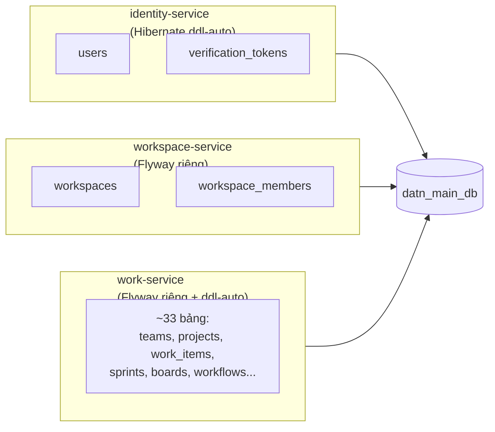

| Service | Số bảng | Quản lý schema | Bảng lịch sử Flyway |
|---------|---------|----------------|---------------------|
| identity-service | 2 | `ddl-auto: update` (không Flyway) | — |
| workspace-service | 2 | Flyway | riêng của workspace |
| work-service | ~33 | Flyway **và** `ddl-auto: update` | `flyway_work_schema_history` |

> ⚠️ Khóa ngoại `teams.workspace_id → workspaces.id` và `projects.workspace_id → workspaces.id` được tạo bởi migration **của workspace-service** (V3), vì phải chờ cả hai bảng tồn tại. Nếu workspace-service khởi động trước work-service trên DB mới, FK sẽ không bao giờ được tạo (xem `SchemaIntegrityChecker`).

---

## 2. Định danh người dùng — hai loại ID

Không có bảng nào ngoài `users` lưu thông tin người dùng. Các service khác chỉ lưu **UUID** của người dùng, nhưng **không thống nhất loại UUID**.

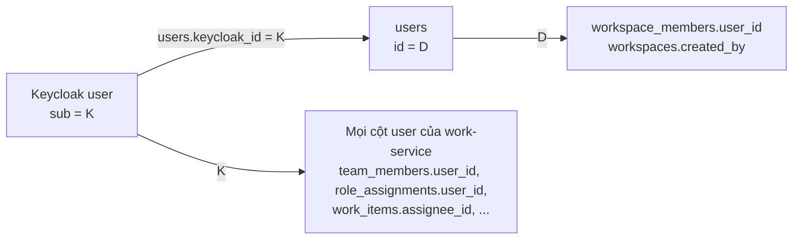

| Nơi lưu | Loại ID | Lý do (theo mã nguồn) |
|---------|---------|------------------------|
| `workspace_members.user_id` | `users.id` (D) | `keycloak_id` có thể bị ghi lại khi email trùng → không ổn định |
| Mọi bảng work-service | Keycloak `sub` (K) | Lấy trực tiếp từ JWT, không cần tra cứu |

Hệ quả: khi work-service hỏi workspace-service "user X có trong workspace không", nó phải đổi K → D qua `CanonicalUserResolver` (gọi identity-service). Ngược lại, khi nhận id từ client, work-service đổi về K qua `ProjectMemberServiceImpl.canonicalUserId()`.

---

## 3. Cụm Danh tính (identity-service)

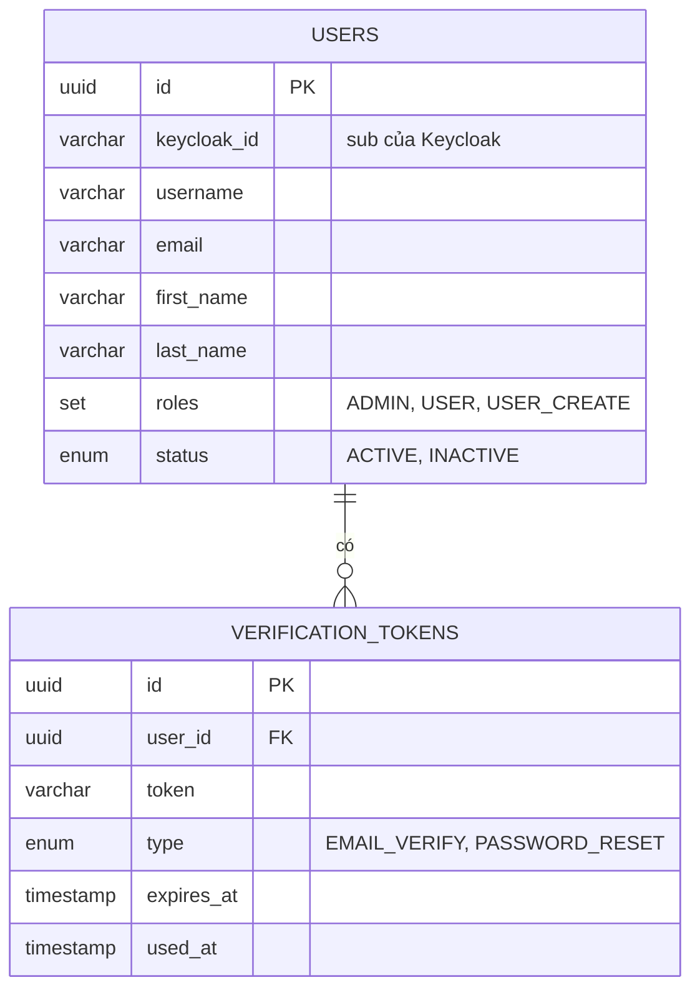

- Mật khẩu **không** lưu ở đây — do Keycloak quản lý.
- `status = INACTIVE` cho tới khi xác thực email (người dùng Google bỏ qua bước này).

---

## 4. Cụm Tổ chức: Workspace → Team → Project

### 4.1. Workspace và thành viên

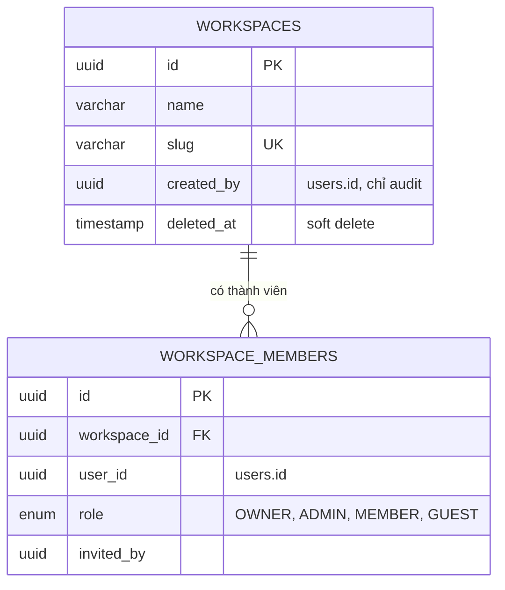

- Ràng buộc `UNIQUE(workspace_id, user_id)`: một người một vai trò trong mỗi workspace, nhưng có thể ở nhiều workspace.
- Workspace **không có** cột `owner_id`; quyền sở hữu xác định hoàn toàn qua `workspace_members.role = OWNER`.

### 4.2. Team và thành viên

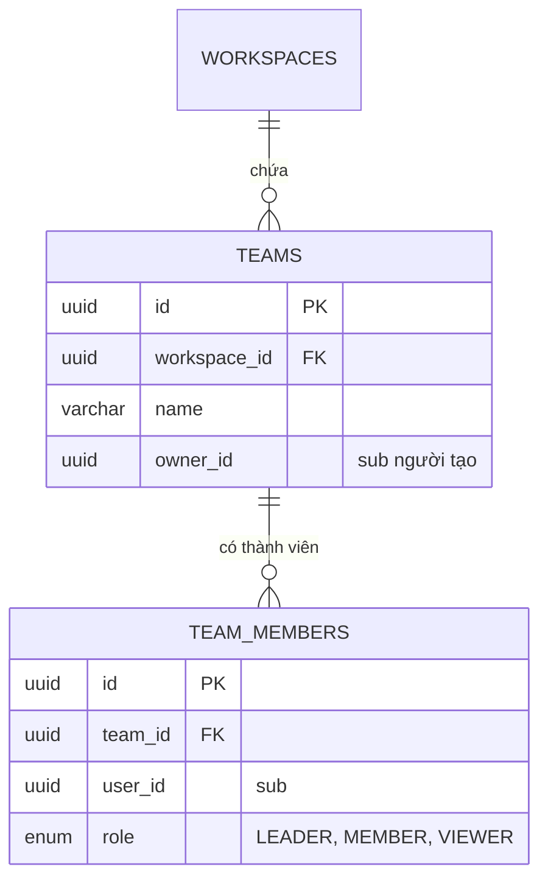

- Team **xóa cứng** (`ON DELETE CASCADE` sang `team_members`).
- "Trưởng nhóm" = `owner_id` **hoặc** thành viên có `role = LEADER` → hai nguồn sự thật.

### 4.3. Project gắn vào tổ chức

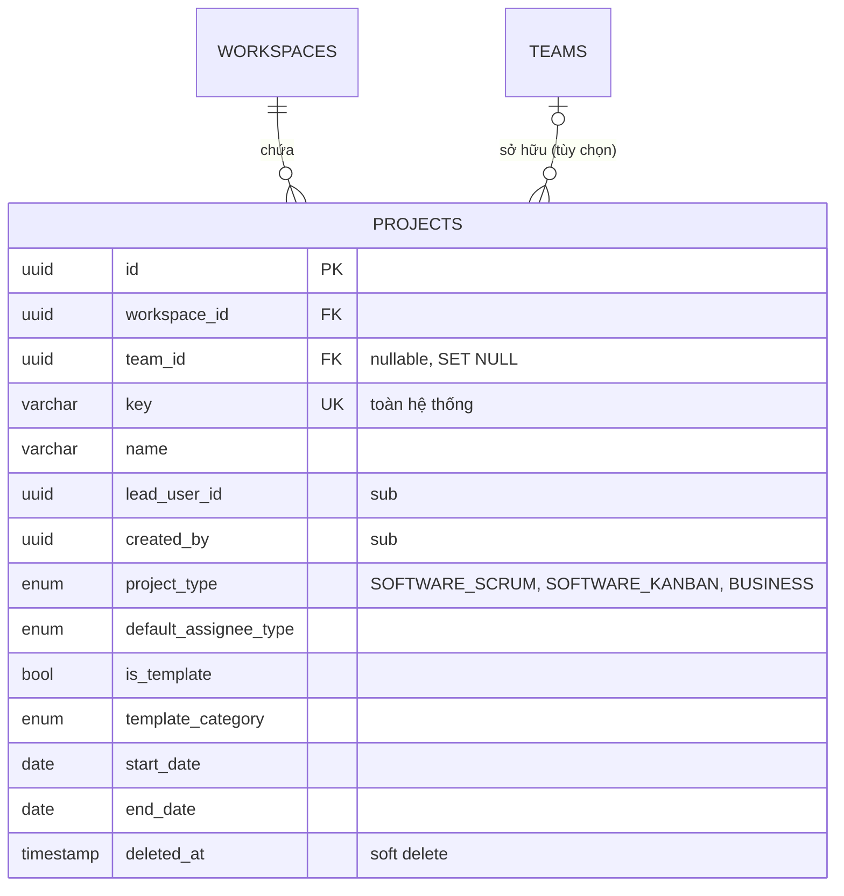

- `team_id` để trống được (chỉ Global ADMIN tạo được dự án không team).
- `key` duy nhất **toàn hệ thống**, không phải trong workspace.

---

## 5. Cụm Phân quyền dự án

Không có bảng `permissions`; danh sách quyền là enum `PermissionKey` trong mã nguồn (15 quyền).

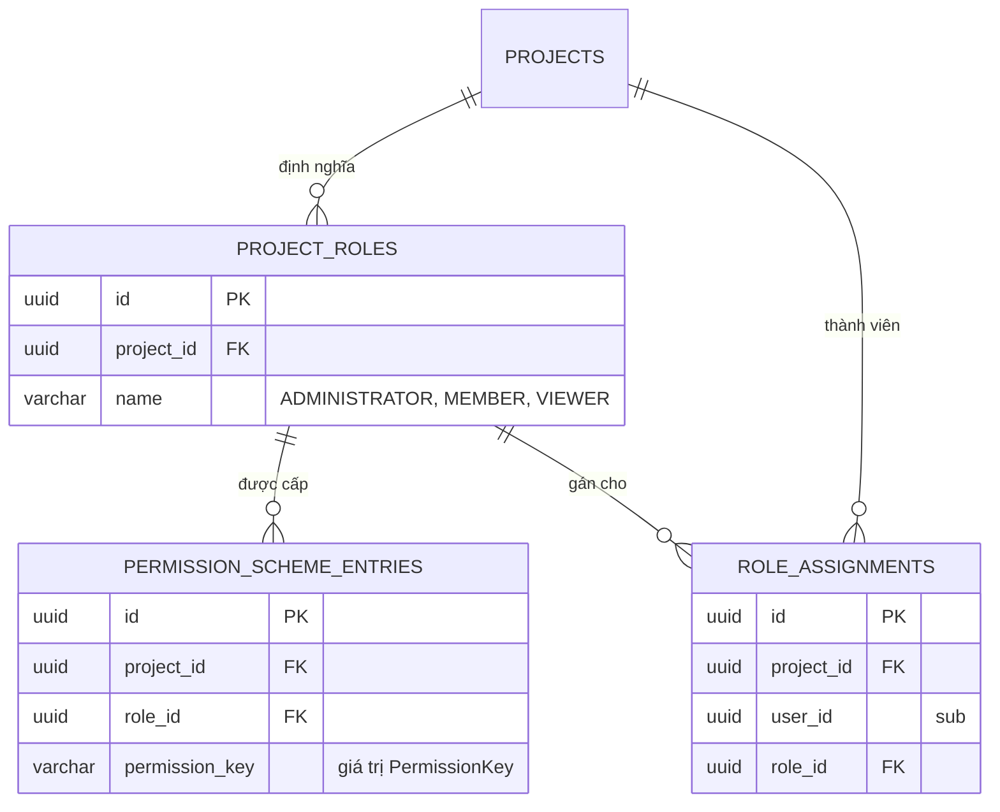

- `ROLE_ASSIGNMENTS` **chính là bảng "thành viên dự án"** — không có bảng `project_members` riêng.
- Lead và người tạo dự án có toàn quyền **ngầm định**, kể cả khi không có dòng trong `role_assignments`.

---

## 6. Cụm Lời mời

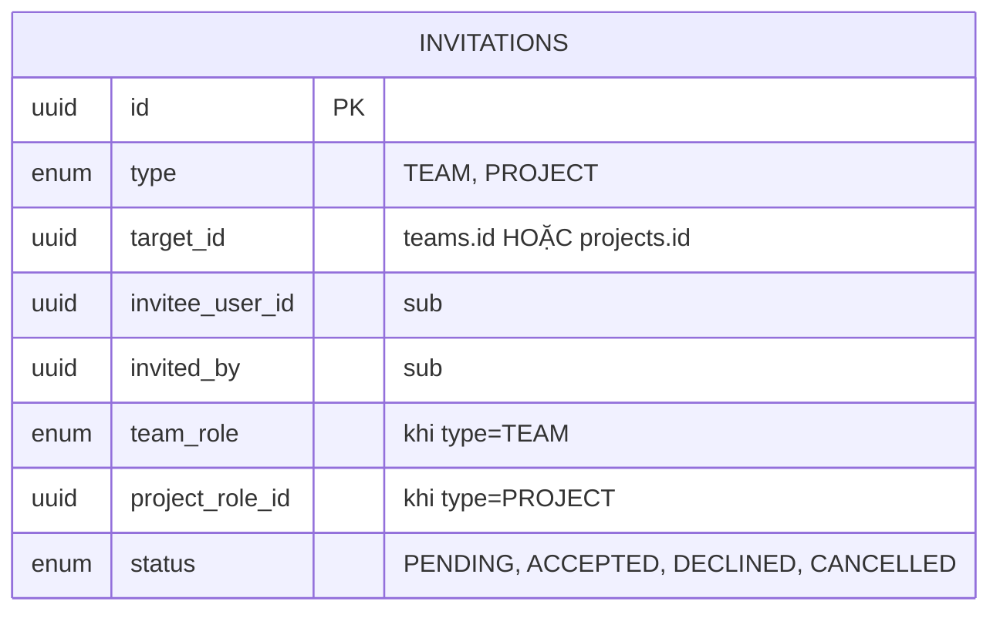

`target_id` là **khóa đa hình** (polymorphic) — trỏ tới `teams` hoặc `projects` tùy `type`, nên **không có khóa ngoại**. Chỉ mục duy nhất một phần đảm bảo mỗi người chỉ có một lời mời `PENDING` cho cùng một đích.

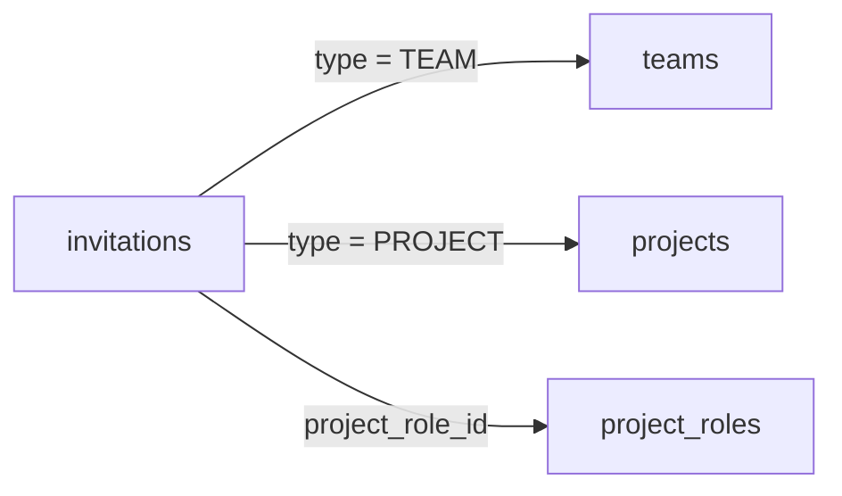

---

## 7. Cụm Cấu hình quy trình (Workflow)

### 7.1. Loại công việc và trạng thái

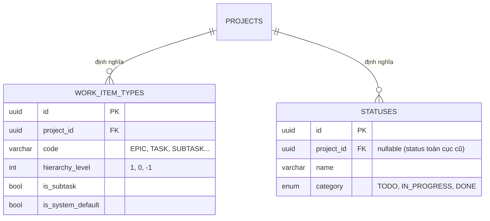

`category` là cầu nối giữa trạng thái tùy biến và các báo cáo (Burndown/Velocity chỉ hiểu `DONE`).

### 7.2. Workflow và bước chuyển

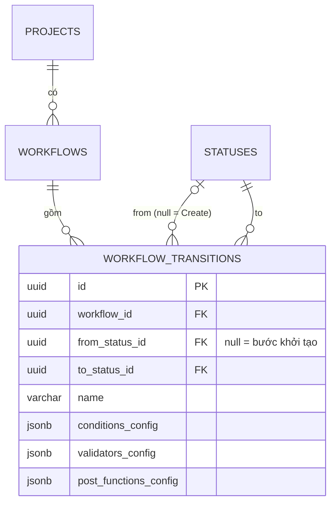

### 7.3. Workflow Scheme (loại nào dùng workflow nào)

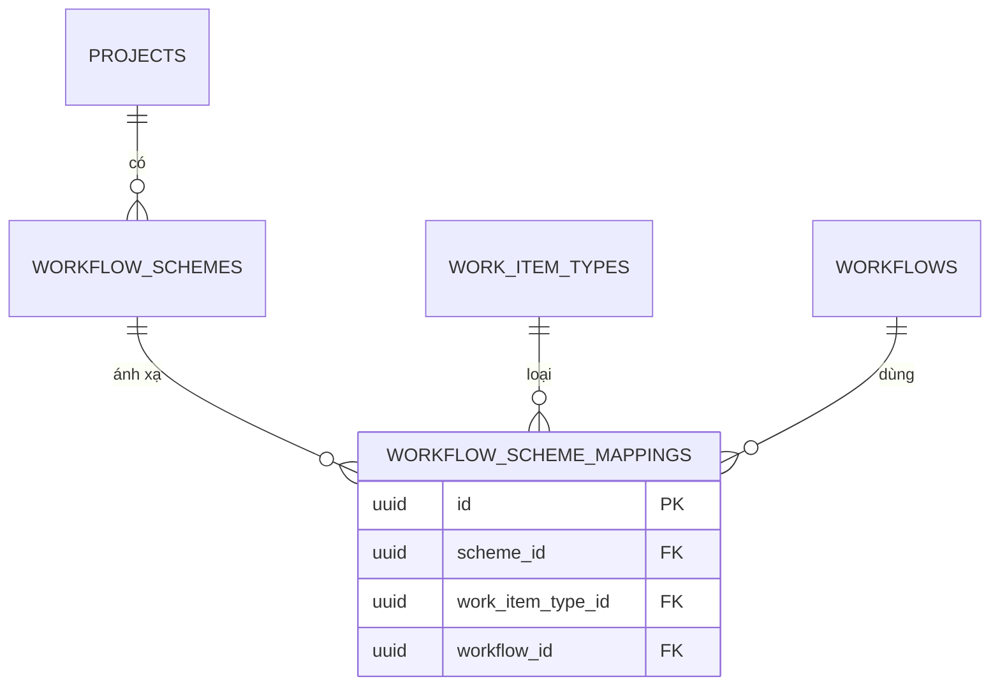

Ràng buộc `UNIQUE(scheme_id, work_item_type_id)`: mỗi loại công việc chỉ có một workflow trong một scheme.

---

## 8. Cụm Board

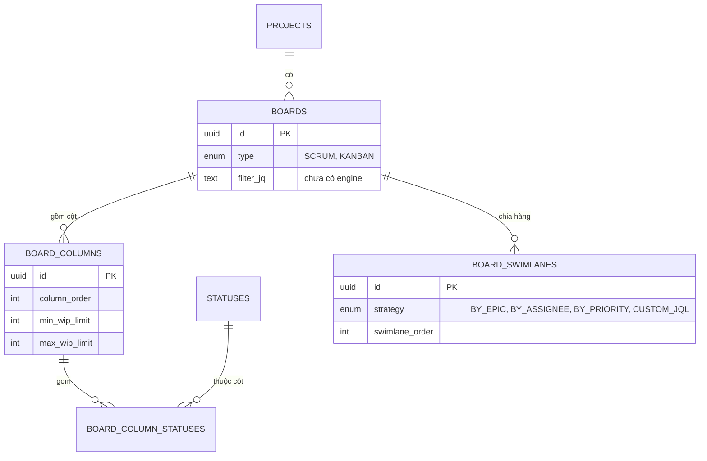

Một cột có thể gom nhiều trạng thái (ví dụ "In Progress" gom cả `IN_PROGRESS` và `IN_REVIEW`). Thẻ hiển thị ở cột nào được suy ra từ `work_items.status_id`.

---

## 9. Cụm Kế hoạch: Sprint · Version · Component · Label

### 9.1. Sprint và snapshot báo cáo

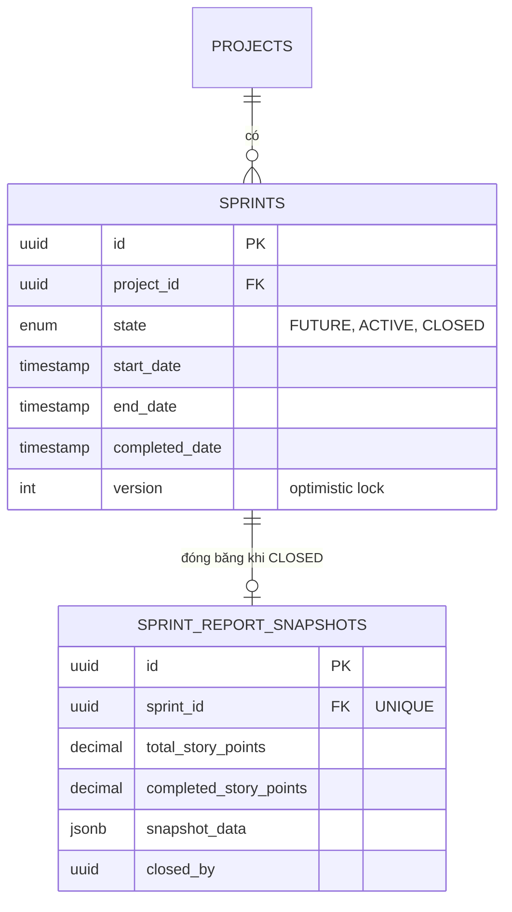

Chỉ mục duy nhất một phần `uq_sprints_one_active_per_project` → **mỗi dự án tối đa một Sprint ACTIVE**.

### 9.2. Version, Component, Label

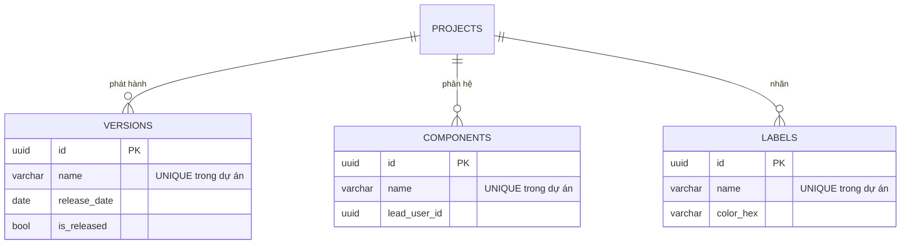

> ⚠️ Ba bảng này có entity/repository nhưng **chưa có REST API** (xem tài liệu 05).

---

## 10. Thực thể trung tâm: Work Item

Một bảng duy nhất chứa mọi loại công việc (Epic, Story, Task, Bug, Subtask); loại được phân biệt qua `type_id`.

### 10.1. Work Item và các tham chiếu cấu hình

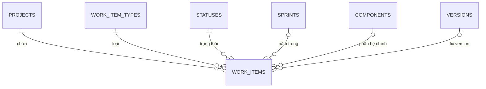

### 10.2. Cây cha – con

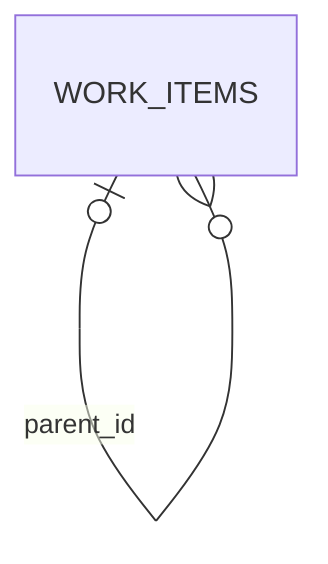

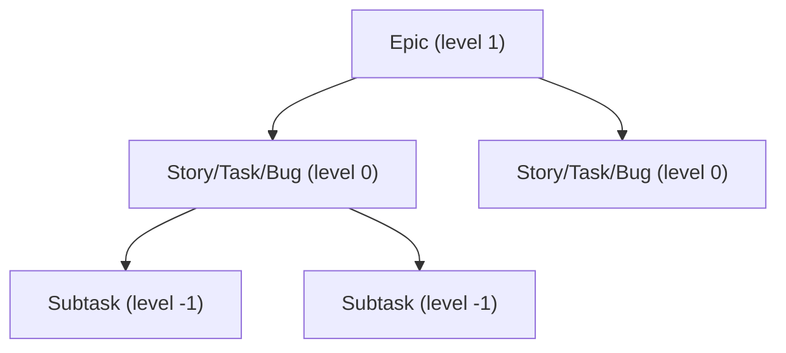

Phân cấp 3 tầng được kiểm tra bởi `StrictHierarchyValidator` (cha phải đúng một cấp cao hơn).

### 10.3. Thuộc tính chính

| Nhóm | Cột |
|------|-----|
| Định danh | `id`, `code` (vd `WEB-12`, duy nhất trong dự án) |
| Nội dung | `summary`, `description`, `custom_fields` (JSONB) |
| Phân loại | `priority` (LOWEST → HIGHEST), `resolution` |
| Con người | `reporter_id`, `assignee_id` (đều là `sub`) |
| Ước lượng | `story_points`, `original_estimate_seconds`, `remaining_estimate_seconds`, `time_spent_seconds` |
| Thứ tự | `rank` (LexoRank, chuỗi so sánh được) |
| Thời gian | `start_date`, `due_date`, `resolved_at` |
| Kỹ thuật | `version` (optimistic lock), `deleted_at` (soft delete) |

---

## 11. Cụm Hoạt động trên Work Item

### 11.1. Liên kết giữa các công việc

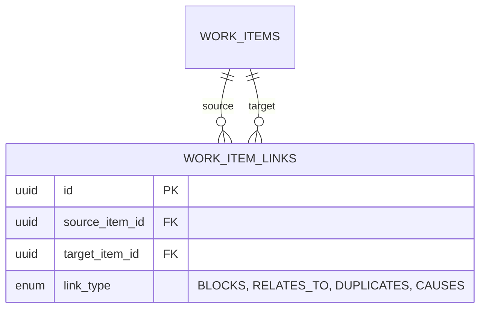

`CHECK(source <> target)` và `DependencyCycleDetector` chặn vòng phụ thuộc `BLOCKS`.

### 11.2. Nhãn và phân hệ phụ (N–N)

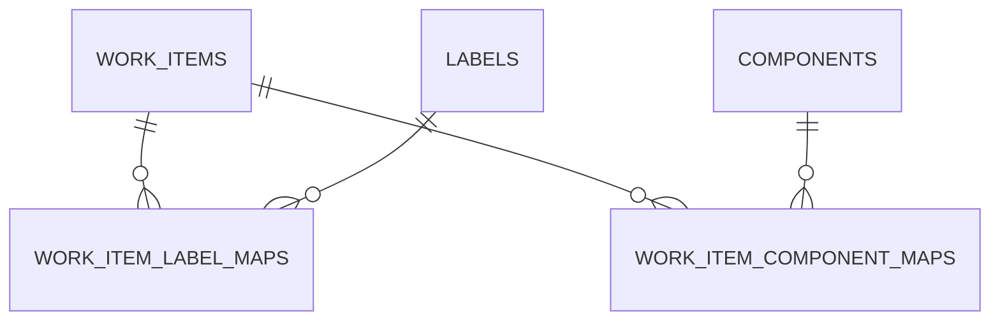

### 11.3. Bình luận, tệp đính kèm, nhật ký thay đổi

```mermaid
erDiagram
    WORK_ITEMS ||--o{ WORK_ITEM_COMMENTS : "thảo luận"
    WORK_ITEM_COMMENTS |o--o{ WORK_ITEM_COMMENTS : "trả lời"
    WORK_ITEMS ||--o{ WORK_ITEM_ATTACHMENTS : "đính kèm"
    WORK_ITEMS ||--o{ WORK_ITEM_CHANGELOGS : "lịch sử"
    WORK_ITEM_COMMENTS {
        uuid author_id
        text body
        timestamp deleted_at
    }
    WORK_ITEM_ATTACHMENTS {
        varchar file_url "MinIO"
        bigint file_size
        uuid uploaded_by
    }
    WORK_ITEM_CHANGELOGS {
        varchar field_name "STATUS, ASSIGNEE..."
        text old_value
        text new_value
        uuid changed_by
        timestamp changed_at
    }
```

`work_item_changelogs` là nguồn để **dựng lại** Burndown/CFD tại mọi thời điểm (`WorkItemStateReplayer`).

---

## 12. Cụm Mẫu & Nhân bản

```mermaid
erDiagram
    PROJECTS ||--o{ PROJECT_CLONES : "là nguồn"
    PROJECTS ||--o| PROJECT_CLONES : "là đích (tối đa 1)"
    PROJECT_CLONES {
        uuid id PK
        uuid source_project_id FK
        uuid cloned_project_id FK "UNIQUE"
        uuid cloned_by
        enum clone_type "FROM_TEMPLATE, SAVE_AS_TEMPLATE, DUPLICATE"
        int date_offset_days
        jsonb clone_options
        jsonb clone_stats
    }
```

- Dự án mẫu **không phải bảng riêng**: là `projects` với `is_template = TRUE`.
- `CHECK(source <> cloned)`; mỗi dự án đích chỉ sinh từ đúng một nguồn.

---

## 12a. Cụm Tiến độ dự án (V8 – V11)

> Thêm bởi kế hoạch [06A](06A_KE_HOACH_TRIEN_KHAI_TIEN_DO.md). Chi tiết nghiệp vụ ở tài liệu 02 – Phần E.

### 12a.1. Cột mới trên `projects`

```mermaid
erDiagram
    PROJECTS {
        varchar status "ACTIVE, ON_HOLD, COMPLETED, ARCHIVED"
        varchar progress_method "STORY_POINTS, ITEM_COUNT, ESTIMATE"
        timestamp completed_at
        varchar health_override "null = dùng giá trị tự động"
        text health_override_reason
        int at_risk_threshold_pct "mặc định 10"
        int off_track_threshold_pct "mặc định 20"
    }
```

### 12a.2. Số liệu hằng ngày

```mermaid
erDiagram
    PROJECTS ||--o{ PROJECT_PROGRESS_SNAPSHOTS : "mỗi ngày một dòng"
    PROJECT_PROGRESS_SNAPSHOTS {
        uuid project_id FK
        date snapshot_date "UNIQUE cùng project_id"
        int total_items
        int done_items
        decimal total_points
        decimal done_points
        decimal progress_pct
        decimal expected_pct
        varchar health
    }
```

### 12a.3. Milestone

```mermaid
erDiagram
    PROJECTS ||--o{ PROJECT_MILESTONES : "có"
    PROJECT_MILESTONES ||--o{ MILESTONE_ITEMS : "gồm"
    WORK_ITEMS ||--o{ MILESTONE_ITEMS : "thuộc"
    PROJECT_MILESTONES {
        uuid id PK
        varchar name
        date target_date
        varchar status "PLANNED, ACHIEVED, MISSED"
        timestamp achieved_at
    }
```

### 12a.4. Baseline và báo cáo tình trạng

```mermaid
erDiagram
    PROJECTS ||--o{ PROJECT_BASELINES : "chốt"
    PROJECT_BASELINES ||--o{ BASELINE_ITEMS : "chứa"
    PROJECTS ||--o{ PROJECT_STATUS_UPDATES : "báo cáo"
    PROJECT_BASELINES {
        uuid id PK
        varchar name
        bool is_active "tối đa 1 / dự án"
        date project_end_date
    }
    BASELINE_ITEMS {
        uuid work_item_id "không FK: giữ cả việc đã xóa"
        date planned_start
        date planned_due
        decimal planned_points
    }
    PROJECT_STATUS_UPDATES {
        varchar health
        text summary
        jsonb metrics "số liệu chụp lúc viết"
    }
```

| Bảng | Có trong mẫu / clone? | Lý do |
|------|:---:|-------|
| `project_milestones`, `milestone_items` | ✅ | Là một phần của kế hoạch; ngày đích được dời theo offset, trạng thái về PLANNED |
| `project_progress_snapshots` | ❌ | Lịch sử số liệu của dự án nguồn |
| `project_baselines`, `baseline_items` | ❌ | Kế hoạch đã chốt của dự án nguồn |
| `project_status_updates` | ❌ | Lịch sử báo cáo |

---

## 13. Cụm Mở rộng (đã có bảng, chưa có nghiệp vụ)

```mermaid
erDiagram
    PROJECTS ||--o{ CUSTOM_FIELD_DEFINITIONS : ""
    PROJECTS ||--o{ SAVED_FILTERS : ""
    PROJECTS ||--o{ AUTOMATION_RULES : ""
    OUTBOX_EVENTS {
        varchar aggregate_type
        varchar event_type
        jsonb payload
        enum status "PENDING, PROCESSED, FAILED"
    }
```

| Bảng | Có ghi dữ liệu? | Có API? | Ghi chú |
|------|-----------------|---------|---------|
| `custom_field_definitions` | Chỉ khi clone | ❌ | `work_items.custom_fields` lưu giá trị nhưng không kiểm tra theo định nghĩa |
| `saved_filters` | ❌ | ❌ | Cột `jql_query` chưa có engine |
| `automation_rules` | Chỉ khi clone | ❌ | Không có bộ chạy rule |
| `outbox_events` | ✅ (Sprint start/close) | — | Không có tiến trình đẩy lên Kafka |

---

## 14. Bảng tổng hợp thực thể

| Thực thể | Service | Phạm vi | Kiểu xóa | API CRUD |
|----------|---------|---------|----------|----------|
| User | identity | Toàn hệ thống | Cứng (+ dọn tham chiếu) | ✅ |
| Workspace | workspace | Gốc | Mềm | ✅ |
| WorkspaceMember | workspace | Workspace | Cứng | ✅ |
| Team | work | Workspace | Cứng | ✅ |
| TeamMember | work | Team | Cứng | ✅ (qua lời mời) |
| Project | work | Workspace | Mềm | ✅ |
| ProjectRole | work | Project | Cascade | ⚠️ chỉ đọc |
| PermissionSchemeEntry | work | Project | Cascade | ❌ |
| RoleAssignment | work | Project | Cứng | ✅ |
| Invitation | work | Team/Project | Đổi trạng thái | ✅ |
| WorkItemType | work | Project | Cứng | ✅ |
| Status | work | Project | Cứng | ✅ |
| Workflow / Transition / Scheme | work | Project | Cứng | ✅ |
| Board / Column / Swimlane | work | Project | Cứng | ✅ |
| Sprint | work | Project | Cứng (chỉ FUTURE) | ✅ |
| SprintReportSnapshot | work | Sprint | Cascade | Chỉ đọc qua báo cáo |
| Version / Component / Label | work | Project | Cascade | ❌ |
| WorkItem | work | Project | Mềm | ✅ |
| WorkItemLink | work | WorkItem | Cứng | ✅ |
| WorkItemComment | work | WorkItem | Mềm | ✅ |
| WorkItemAttachment | work | WorkItem | Cứng | ✅ |
| WorkItemChangelog | work | WorkItem | Cascade | Chỉ đọc |
| ProjectClone | work | Project | Cascade | Gián tiếp |
| CustomField / SavedFilter / AutomationRule | work | Project | Cascade | ❌ |
| OutboxEvent | work | — | — | — |

---

## 15. Ràng buộc toàn vẹn quan trọng

| Ràng buộc | Bảng | Ý nghĩa nghiệp vụ |
|-----------|------|-------------------|
| `UNIQUE(key)` | projects | Mã dự án duy nhất toàn hệ thống |
| `UNIQUE(project_id, code)` | work_items | Mã công việc duy nhất trong dự án |
| `UNIQUE(slug)` | workspaces | Đường dẫn workspace duy nhất |
| `UNIQUE(workspace_id, user_id)` | workspace_members | Một vai trò / người / workspace |
| `UNIQUE(team_id, user_id)` | team_members | Một vai trò / người / team |
| `UNIQUE(project_id, user_id, role_id)` | role_assignments | Không gán trùng vai trò |
| `UNIQUE(project_id) WHERE state='ACTIVE'` | sprints | Tối đa 1 Sprint đang chạy |
| `UNIQUE(type, target_id, invitee) WHERE PENDING` | invitations | Không mời trùng khi đang chờ |
| `UNIQUE(cloned_project_id)` | project_clones | Mỗi dự án chỉ có một nguồn |
| `CHECK(source <> target)` | work_item_links | Không tự liên kết |
| Sequence `work_item_seq_<key>` | PostgreSQL | Sinh mã công việc nguyên tử |

---

## 16. Tham chiếu "mềm" (không có khóa ngoại)

Các cột dưới đây lưu UUID nhưng **không có FK**, nên DB không tự bảo vệ tính toàn vẹn — mã ứng dụng phải tự làm.

```mermaid
flowchart LR
    subgraph User["Trỏ tới người dùng"]
        A["teams.owner_id"]
        B["team_members.user_id"]
        C["role_assignments.user_id"]
        D["projects.lead_user_id / created_by"]
        E["work_items.assignee_id / reporter_id"]
        F["workspace_members.user_id"]
    end
    subgraph Poly["Đa hình"]
        G["invitations.target_id"]
        H["invitations.project_role_id"]
    end
    subgraph Arr["Mảng"]
        I["custom_field_definitions.applicable_type_ids"]
    end
```

Khi xóa người dùng, identity-service tự chạy SQL dọn `team_members`, `role_assignments` và bỏ gán `work_items` (`WorkDataCleanupService`) — nhưng **không** dọn `workspace_members`, `invitations`, `teams.owner_id`, `projects.lead_user_id`.
