# 02 — Tài liệu nghiệp vụ: Project

> Nguồn: `ProjectController`, `ProjectServiceImpl`, `ProjectMemberServiceImpl`, `ProjectPermissionGuard`, `WorkItemServiceImpl`, `WorkflowEngineServiceImpl`, `SprintServiceImpl`, `BoardServiceImpl`, `BacklogServiceImpl`, `AgileReportServiceImpl` và các trang frontend `ProjectListPage`, `ProjectDetailPage`, `ProjectBoardPage`, `ProjectBacklogPage`, `ProjectReportsPage`.

---

## Mục lục

**Phần A — Dự án**
1. [Khái niệm và vị trí](#1-khái-niệm-và-vị-trí)
2. [Thuộc tính dự án](#2-thuộc-tính-dự-án)
3. [Vòng đời dự án](#3-vòng-đời-dự-án)
4. [Tạo dự án](#4-tạo-dự-án)
5. [Hệ sinh thái mặc định khi tạo](#5-hệ-sinh-thái-mặc-định-khi-tạo)
6. [Cập nhật dự án](#6-cập-nhật-dự-án)
7. [Xóa và khôi phục](#7-xóa-và-khôi-phục)
8. [Xem danh sách dự án](#8-xem-danh-sách-dự-án)

**Phần B — Phân quyền và thành viên dự án**

9. [Vai trò và ma trận quyền](#9-vai-trò-và-ma-trận-quyền)
10. [Thuật toán quyết định quyền](#10-thuật-toán-quyết-định-quyền)
11. [Ba lớp thực thi quyền](#11-ba-lớp-thực-thi-quyền)
12. [Quản lý thành viên dự án](#12-quản-lý-thành-viên-dự-án)

**Phần C — Công việc (Work Item)**

13. [Phân cấp công việc](#13-phân-cấp-công-việc)
14. [Tạo công việc](#14-tạo-công-việc)
15. [Cập nhật, xếp hạng, xóa](#15-cập-nhật-xếp-hạng-xóa)
16. [Chuyển trạng thái qua Workflow Engine](#16-chuyển-trạng-thái-qua-workflow-engine)
17. [Liên kết, bình luận, tệp, lịch sử](#17-liên-kết-bình-luận-tệp-lịch-sử)

**Phần D — Lập kế hoạch và theo dõi**

18. [Backlog](#18-backlog)
19. [Sprint](#19-sprint)
20. [Board](#20-board)
21. [Báo cáo Agile](#21-báo-cáo-agile)
22. [Danh mục API](#22-danh-mục-api)

**Phần E — Quản lý tiến độ**

23. [Trạng thái dự án](#23-trạng-thái-dự-án)
24. [% tiến độ và Health](#24--tiến-độ-và-health)
25. [Số liệu hằng ngày](#25-số-liệu-hằng-ngày)
26. [Milestone](#26-milestone)
27. [Timeline, đường găng, baseline, dự báo](#27-timeline-đường-găng-baseline-dự-báo)
28. [Danh mục API tiến độ](#28-danh-mục-api-tiến-độ)

---

# Phần A — Dự án

## 1. Khái niệm và vị trí

Dự án (Project) là **đơn vị phân quyền** và **đơn vị cấu hình** của hệ thống: mọi trạng thái, loại công việc, workflow, board, sprint và vai trò đều thuộc về đúng một dự án.

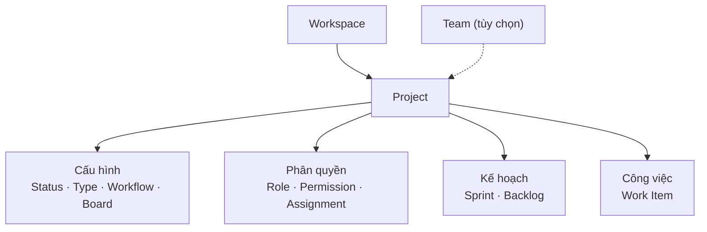

## 2. Thuộc tính dự án

| Thuộc tính | Bắt buộc | Quy tắc |
|------------|----------|---------|
| `name` | ✅ | Tối đa 255 ký tự |
| `key` | ✅ | 2–10 ký tự, `^[A-Z][A-Z0-9_]*$`, **duy nhất toàn hệ thống**, không đổi được sau khi tạo |
| `workspaceId` | ✅ | Người tạo phải là MEMBER trở lên trong workspace |
| `teamId` | ⚠️ | Bắt buộc với người thường; chỉ Global ADMIN tạo được dự án không team |
| `leadUserId` | — | Mặc định = người tạo; nếu khác thì phải là thành viên team |
| `projectType` | — | `SOFTWARE_SCRUM` (mặc định), `SOFTWARE_KANBAN`, `BUSINESS` |
| `defaultAssigneeType` | — | `PROJECT_LEADER` (mặc định), `UNASSIGNED` |
| `startDate`, `endDate` | — | Không ràng buộc khi tạo thường |
| `isTemplate`, `templateCategory` | — | Xem tài liệu 04 |

## 3. Vòng đời dự án

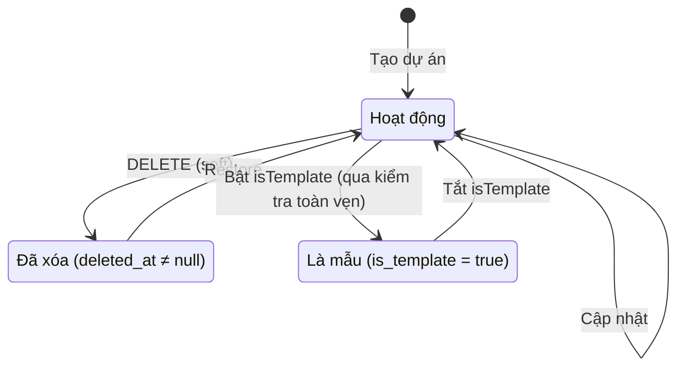

- Ngoài **còn / đã xóa**, dự án còn có trạng thái nghiệp vụ ACTIVE / ON_HOLD / COMPLETED / ARCHIVED — xem [Phần E](#23-trạng-thái-dự-án).
- Dự án đã xóa: mọi kiểm tra quyền đều trả về `false` (kể cả với Lead).

## 4. Tạo dự án

### 4.1. Điều kiện được tạo

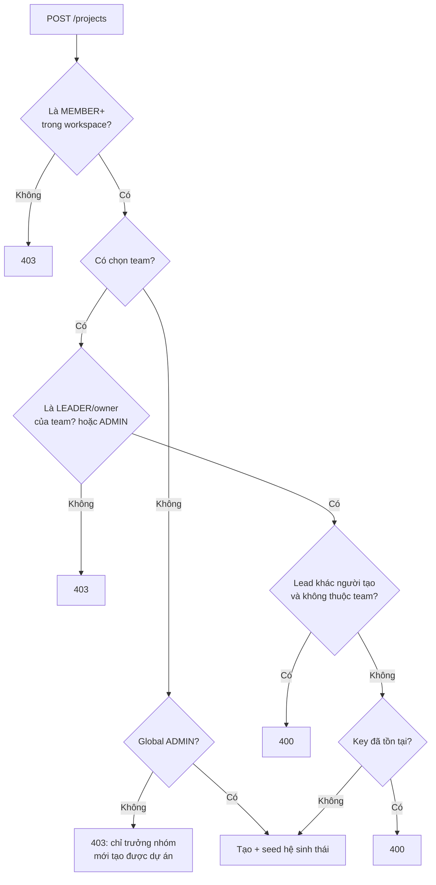

### 4.2. Trình tự xử lý

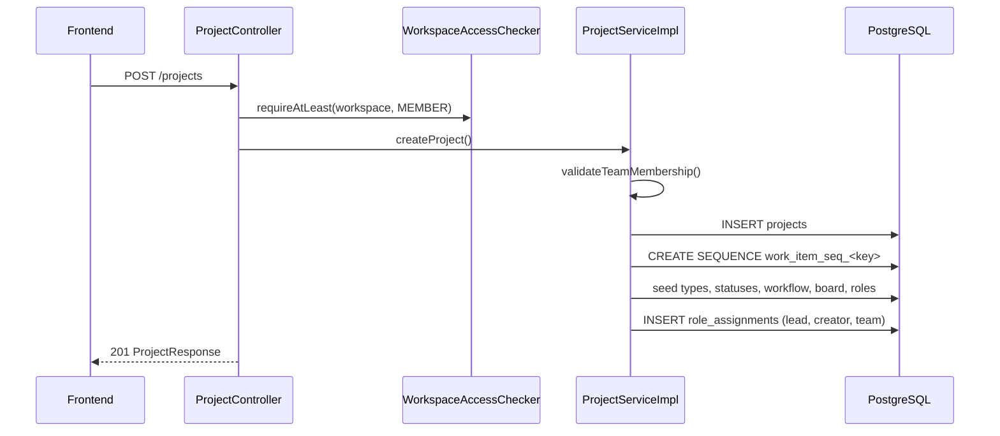

Toàn bộ chạy trong **một transaction** — lỗi ở bất kỳ bước seed nào sẽ rollback cả dự án (trừ việc tạo sequence vốn được bọc `try/catch`).

## 5. Hệ sinh thái mặc định khi tạo

### 5.1. Ba loại công việc

| Tên | Mã | Cấp | Subtask? |
|-----|----|-----|----------|
| Epic | `EPIC` | 1 | Không |
| Task | `TASK` | 0 | Không |
| Subtask | `SUBTASK` | -1 | Có |

### 5.2. Ba trạng thái và workflow mặc định

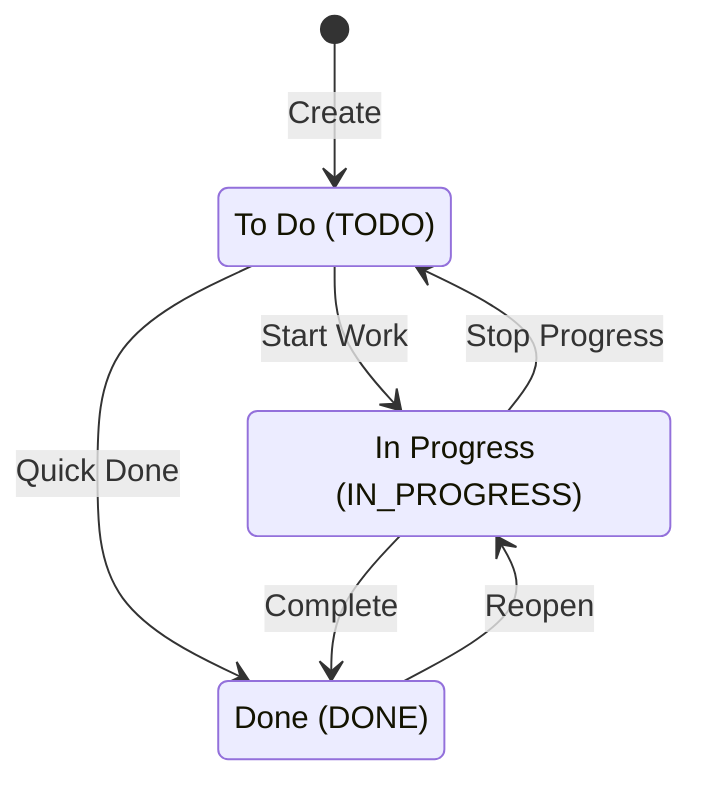

Một **Workflow Scheme** ánh xạ cả 3 loại công việc vào workflow này.

### 5.3. Board mặc định

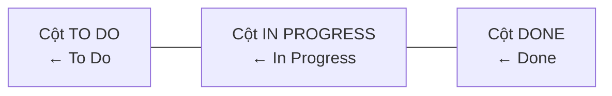

Kiểu board = `KANBAN` nếu `projectType = SOFTWARE_KANBAN`, ngược lại `SCRUM`.

### 5.4. Vai trò và thành viên ban đầu

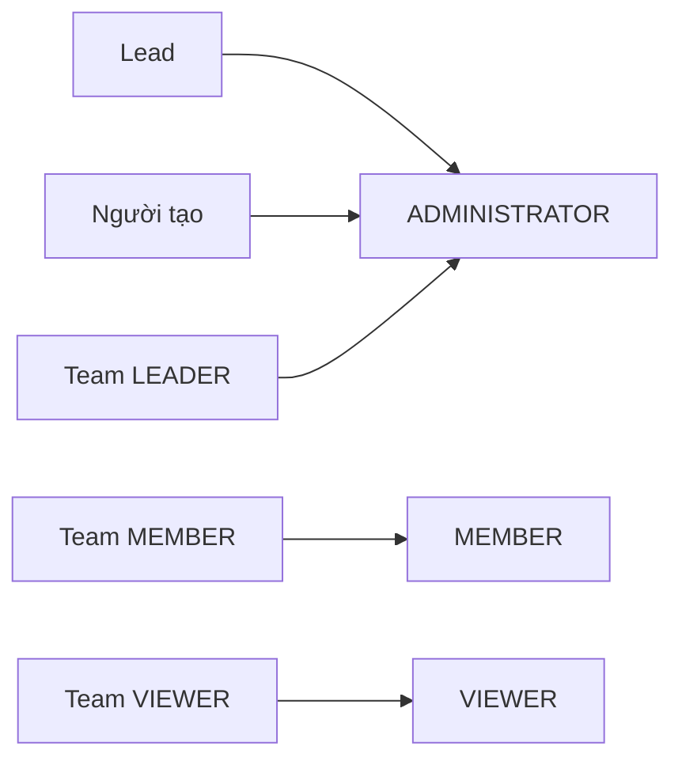

## 6. Cập nhật dự án

Yêu cầu quyền `PROJECT_ADMIN`. Các trường `null` trong request được hiểu là **không đổi**.

| Thay đổi | Hệ quả phụ |
|----------|------------|
| Đổi `teamId` | Người cập nhật phải là trưởng nhóm của team mới → đồng bộ thành viên team mới vào dự án (chỉ **thêm**, không gỡ thành viên team cũ) |
| Đổi `leadUserId` | Lead mới phải là thành viên dự án hoặc team → được gán `ADMINISTRATOR`. Lead cũ **vẫn giữ** vai trò cũ |
| Bật `isTemplate` | Phải qua `TemplateIntegrityValidator` (tài liệu 04) |
| Đổi `projectType` | Chỉ đổi giá trị; board và cấu hình **không** đổi theo |
| `key` | Không có trong request — không đổi được |

## 7. Xóa và khôi phục

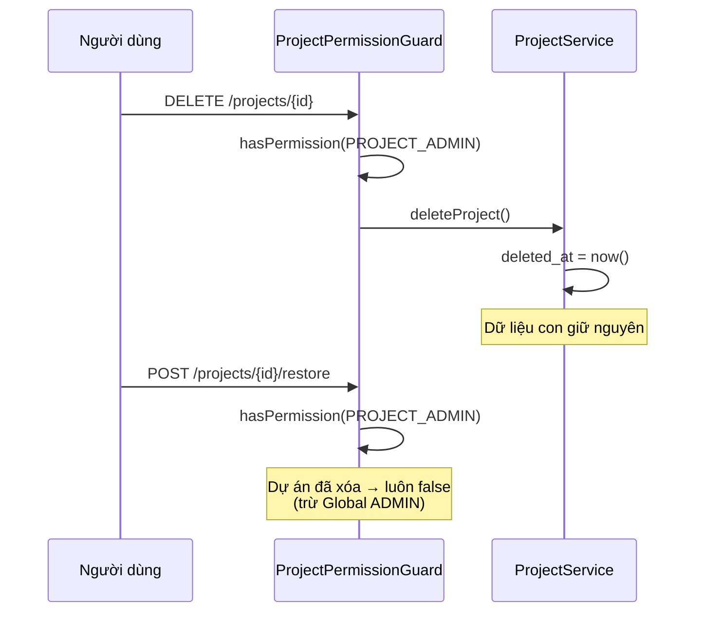

> ⚠️ Vì `hasPermission()` từ chối mọi thao tác trên dự án đã xóa, **chỉ Global ADMIN khôi phục được**; Lead của dự án không tự khôi phục được dự án của mình. Không có cơ chế tự xóa vĩnh viễn sau N ngày.

## 8. Xem danh sách dự án

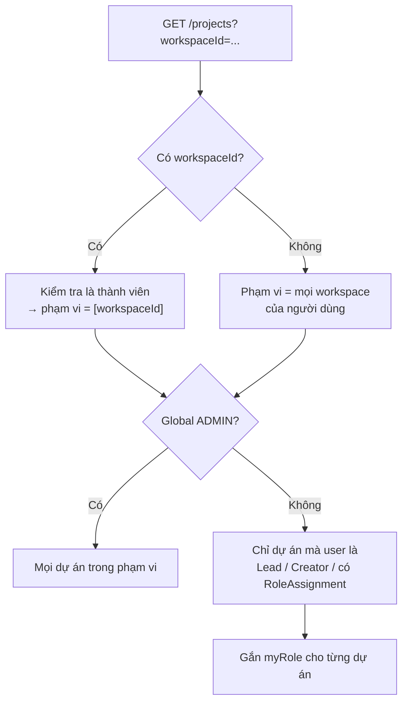

Người thường mặc định **không** thấy dự án mẫu trong danh sách này (`isTemplate=false`); mẫu được xem qua thư viện mẫu.

---

# Phần B — Phân quyền và thành viên dự án

## 9. Vai trò và ma trận quyền

### 9.1. Danh sách quyền (`PermissionKey`)

| Nhóm | Quyền | Ý nghĩa |
|------|-------|---------|
| Dự án | `PROJECT_VIEW` | Xem dự án, board, backlog, báo cáo |
| | `PROJECT_ADMIN` | Sửa dự án, cấu hình, thành viên |
| Công việc | `ISSUE_CREATE` | Tạo công việc, subtask |
| | `ISSUE_EDIT` | Sửa, xếp hạng, liên kết, đính kèm tệp |
| | `ISSUE_DELETE` | Xóa công việc |
| | `ISSUE_TRANSITION` | Chuyển trạng thái, kéo thẻ |
| | `ISSUE_ASSIGN` | Giao việc cho người khác |
| Kế hoạch | `SPRINT_MANAGE` | Tạo/sửa/bắt đầu/đóng sprint |
| | `RELEASE_MANAGE` | (chưa có chức năng dùng) |
| Bình luận | `COMMENT_CREATE`, `COMMENT_EDIT_OWN`, `COMMENT_DELETE_OWN`, `COMMENT_DELETE_ALL` | |
| Tệp | `ATTACHMENT_DELETE_OWN`, `ATTACHMENT_DELETE_ALL` | |

### 9.2. Ma trận mặc định

| Quyền | ADMINISTRATOR | MEMBER | VIEWER |
|-------|:---:|:---:|:---:|
| PROJECT_VIEW | ✅ | ✅ | ✅ |
| PROJECT_ADMIN | ✅ | | |
| ISSUE_CREATE / EDIT / TRANSITION / ASSIGN | ✅ | ✅ | |
| ISSUE_DELETE | ✅ | | |
| SPRINT_MANAGE, RELEASE_MANAGE | ✅ | | |
| COMMENT_CREATE / EDIT_OWN / DELETE_OWN | ✅ | ✅ | ✅ |
| COMMENT_DELETE_ALL | ✅ | | |
| ATTACHMENT_DELETE_OWN | ✅ | ✅ | |
| ATTACHMENT_DELETE_ALL | ✅ | | |

Ma trận được lưu thật trong `permission_scheme_entries` (theo từng dự án), nhưng **chưa có API/UI chỉnh sửa**.

## 10. Thuật toán quyết định quyền

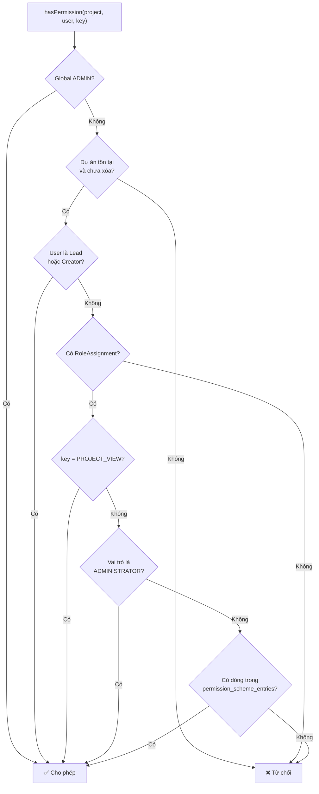

Nguyên tắc: **fail-closed** — mọi trường hợp không xác định đều từ chối.

## 11. Ba lớp thực thi quyền

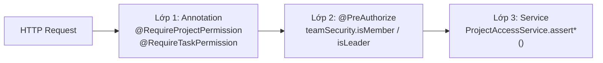

| Lớp | Dùng cho | Cách tìm `projectId` |
|-----|----------|----------------------|
| 1 | Hầu hết endpoint dự án | `@PathVariable projectId` → tham số UUID tên chứa "project" → DTO `getProjectId()` → `source = SPRINT/BOARD` tra ngược. Không tìm được → từ chối |
| 2 | Endpoint Team | `#teamId` |
| 3 | Quyền "của mình" (sửa/xóa bình luận, xóa tệp), tra cứu theo `key`/`code`, workflow/status theo id | Lấy từ bản ghi đã nạp |

## 12. Quản lý thành viên dự án

### 12.1. Hai con đường trở thành thành viên

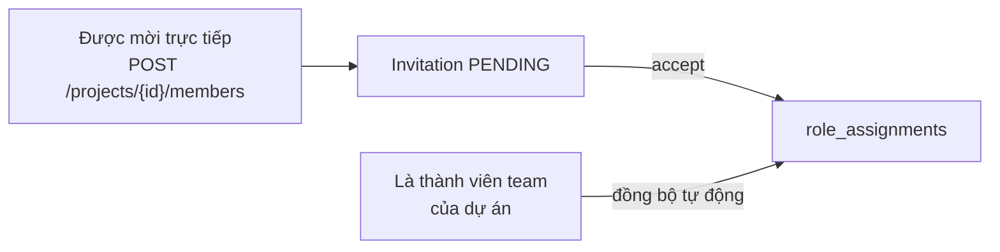

### 12.2. Quy tắc thay đổi

| Thao tác | Quyền | Ràng buộc |
|----------|-------|-----------|
| Mời | `PROJECT_ADMIN` | Vai trò phải thuộc dự án; người được mời chưa là thành viên; không có lời mời PENDING trùng |
| Đổi vai trò | `PROJECT_ADMIN` | Hạ ADMINISTRATOR cuối cùng → bị chặn |
| Xóa | `PROJECT_ADMIN` | Không xóa được Lead; không xóa ADMINISTRATOR cuối cùng |
| Xem | `PROJECT_VIEW` | Kèm tên/email lấy từ identity-service |
| Quyền của tôi | Đăng nhập | `GET /permissions/my` → frontend ẩn/hiện nút (`<Can>`) |

---

# Phần C — Công việc (Work Item)

## 13. Phân cấp công việc

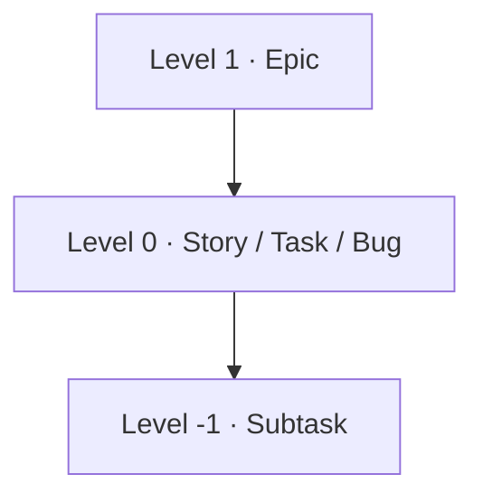

| Quy tắc (`StrictHierarchyValidator`) |
|---|
| Epic không có cha |
| Subtask bắt buộc có cha, và cha phải ở level 0 |
| Subtask không gắn trực tiếp vào Epic, không lồng Subtask |
| Không tự làm cha của chính mình; cha phải cùng dự án và chưa bị xóa |

## 14. Tạo công việc

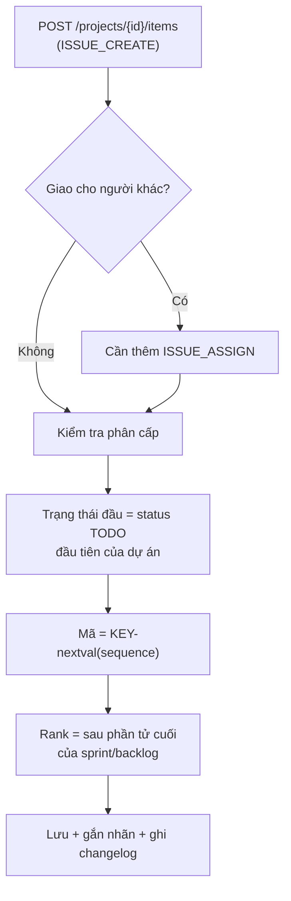

- Mã công việc sinh từ **PostgreSQL sequence riêng** cho mỗi dự án → không trùng kể cả khi tạo đồng thời.
- Tạo subtask (`POST /items/{id}/subtasks`): tự chọn loại level -1, **kế thừa sprint của cha**.

## 15. Cập nhật, xếp hạng, xóa

| Thao tác | Quyền | Hành vi |
|----------|-------|---------|
| Sửa (`PUT /items/{id}`) | `ISSUE_EDIT` (+ `ISSUE_ASSIGN` nếu đổi người làm) | Chỉ cập nhật trường khác `null`; ghi diff vào changelog |
| Đổi sprint của cha | — | Tự động **lan xuống** mọi subtask |
| Xếp hạng (`PATCH /items/{id}/rank`) | `ISSUE_EDIT` | Ghi đè chuỗi LexoRank |
| Xóa (`DELETE /items/{id}`) | `ISSUE_DELETE` | Soft delete; subtask và liên kết giữ nguyên |

## 16. Chuyển trạng thái qua Workflow Engine

### 16.1. Luồng xử lý một transition

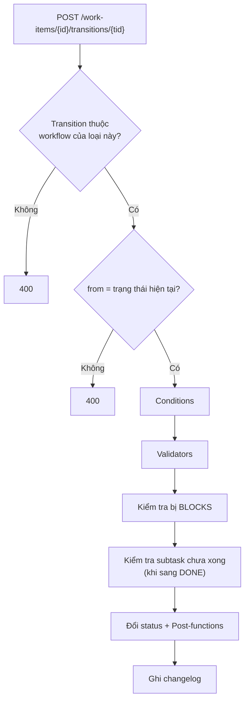

### 16.2. Các khối cấu hình hỗ trợ

| Loại | Giá trị | Tác dụng |
|------|---------|----------|
| Condition | `ASSIGNEE_ONLY` | Chỉ người được giao thực hiện |
| | `ONLY_CREATOR` / `REPORTER_ONLY` | Chỉ người tạo |
| | `PERMISSION_REQUIRED` | Cần một quyền cụ thể |
| Validator | `ALL_SUBTASKS_DONE` | Mọi subtask đã DONE |
| | `FIELD_REQUIRED` | Bắt buộc resolution / bình luận |
| | `ESTIMATE_REQUIRED` | Bắt buộc có story points / estimate |
| Post-function | `CLEAR_RESOLUTION` | Xóa resolution và thời điểm giải quyết (dùng cho Reopen) |
| | `SET_RESOLVED_TIME` | Ghi thời điểm giải quyết |

Ngoài ra, nếu request có kèm bình luận, engine tự lưu bình luận đó. Các loại post-function khác chỉ được ghi log, chưa có tác dụng.

### 16.3. Kéo thẻ trên Board

Kéo thẻ sang cột khác = tìm transition hợp lệ từ trạng thái hiện tại tới một trạng thái của cột đích, kiểm tra WIP, rồi chạy cùng engine ở trên.

## 17. Liên kết, bình luận, tệp, lịch sử

| Đối tượng | Quyền tạo | Quyền sửa/xóa | Ghi chú |
|-----------|-----------|---------------|---------|
| Liên kết | `ISSUE_EDIT` | `ISSUE_EDIT` | `BLOCKS` được kiểm tra chống vòng |
| Bình luận | `COMMENT_CREATE` | `*_OWN` cho của mình, `COMMENT_DELETE_ALL` cho mọi người | Hỗ trợ trả lời lồng, soft delete |
| Tệp đính kèm | `ISSUE_EDIT` | `ATTACHMENT_DELETE_OWN/ALL` | Lưu MinIO; tải về kiểm tra `PROJECT_VIEW` |
| Changelog | Tự động | Chỉ đọc | 14 trường được so sánh khi sửa (SUMMARY, STATUS, ASSIGNEE, SPRINT...) + sự kiện riêng (tạo, đính kèm, liên kết) |

---

# Phần D — Lập kế hoạch và theo dõi

## 18. Backlog

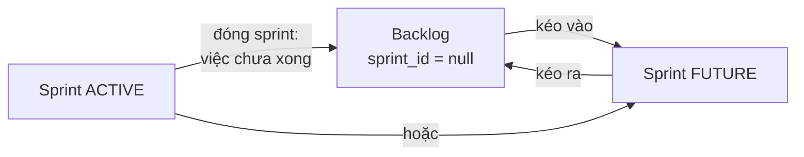

`GET /projects/{id}/backlog` trả về các nhóm: sprint đang chạy, các sprint tương lai, backlog — đã sắp theo `rank`, hỗ trợ lọc.

## 19. Sprint

### 19.1. Vòng đời

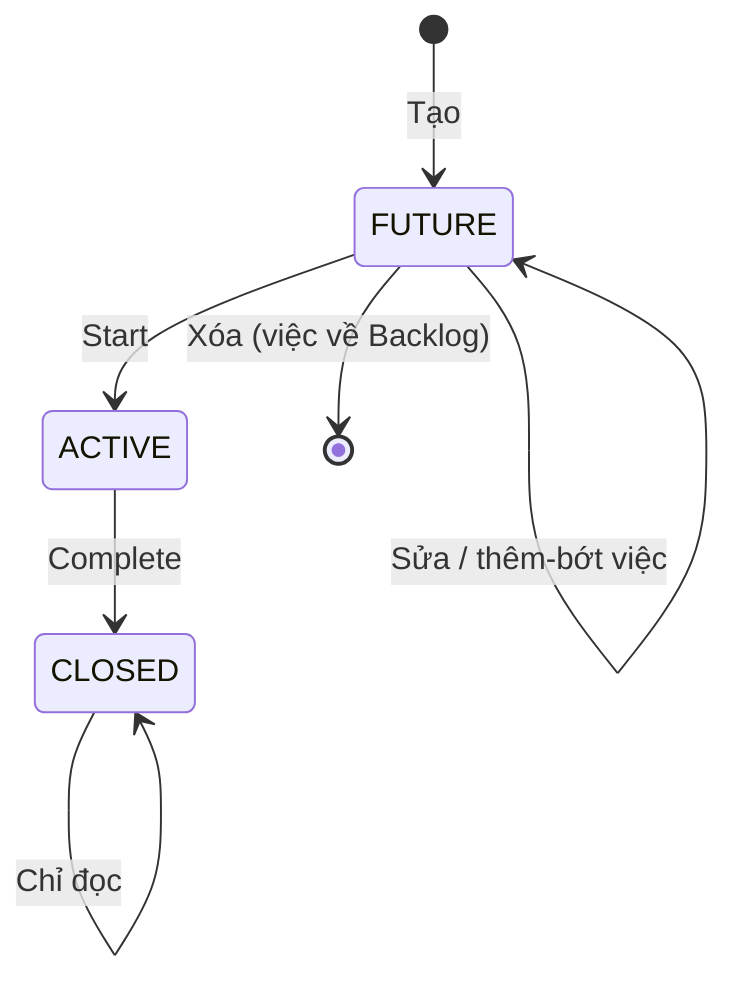

### 19.2. Điều kiện bắt đầu Sprint

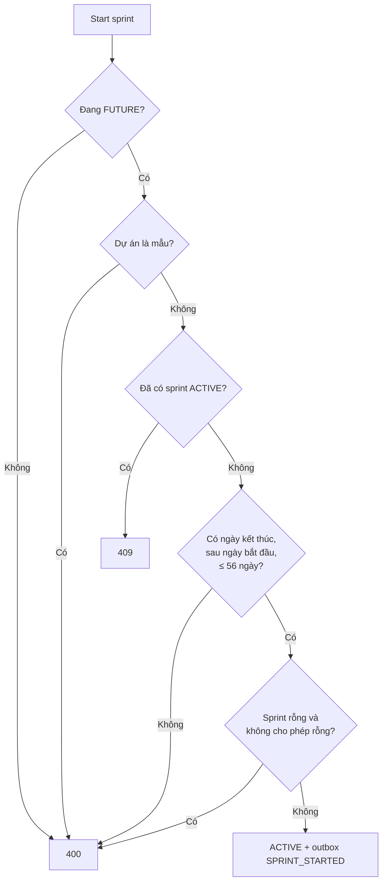

### 19.3. Đóng Sprint

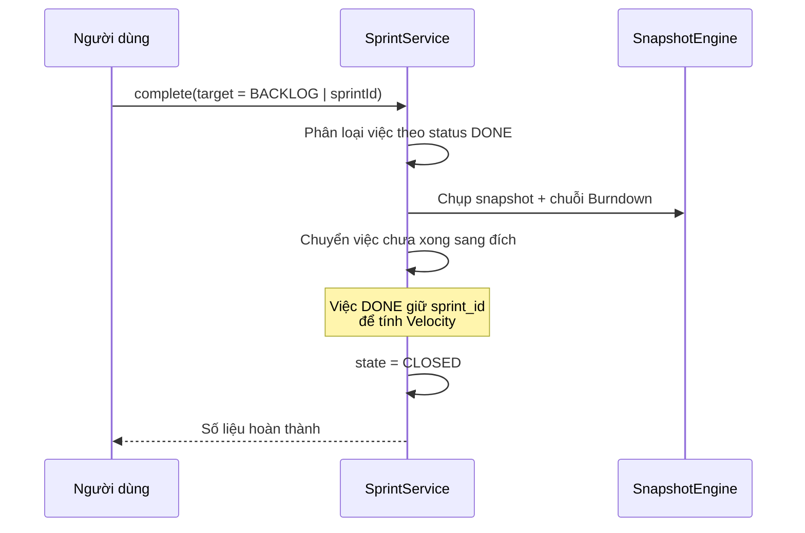

## 20. Board

| Tính năng | Trạng thái |
|-----------|-----------|
| Nhiều board / dự án, không xóa được board cuối | ✅ |
| Cấu hình cột, gom nhiều status / cột | ✅ |
| Giới hạn WIP: max **chặn**, min chỉ cảnh báo | ✅ |
| Swimlane theo Epic / Assignee / Priority | ✅ |
| Swimlane `CUSTOM_JQL`, `filter_jql` | ❌ lưu được nhưng không có engine |
| Board Scrum: chỉ hiện sprint ACTIVE; Kanban: liên tục | ✅ |

## 21. Báo cáo Agile

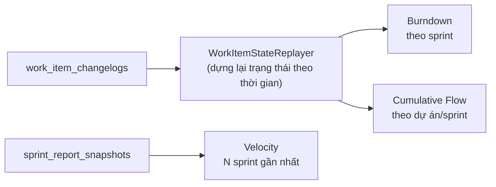

| Báo cáo | Endpoint | Đơn vị |
|---------|----------|--------|
| Burndown | `GET /sprints/{id}/burndown` | Story points (bỏ subtask), có tùy chọn bỏ cuối tuần |
| Velocity | `GET /projects/{id}/velocity` | Cam kết vs hoàn thành mỗi sprint |
| CFD | `GET /projects/{id}/cfd` | Số việc mỗi nhóm trạng thái theo ngày |

## 22. Danh mục API

| Nhóm | Endpoint (tiền tố `/work/api/v1/work`) |
|------|----------------------------------------|
| Dự án | `POST/GET /projects`, `GET /projects/{id}`, `GET /projects/key/{key}`, `PUT/DELETE /projects/{id}`, `POST /projects/{id}/restore` |
| Thành viên | `GET /projects/{id}/permissions/my`, `GET/POST /projects/{id}/members`, `PUT /members/{uid}/role`, `DELETE /members/{uid}`, `GET /projects/{id}/roles` |
| Loại công việc | `GET/POST /projects/{id}/types`, `PUT/DELETE /types/{typeId}` |
| Workflow | `GET /projects/{id}/workflow(s)`, `GET/PUT /workflow/scheme`, `GET/POST /projects/{id}/statuses`, `PUT/DELETE /statuses/{id}`, `GET/POST/PUT /workflows`, `POST/PUT/DELETE /workflows/{id}/transitions` |
| Công việc | `POST/GET /projects/{id}/items`, `GET/PUT/DELETE /items/{id}`, `GET /items/code/{code}`, `GET/POST /items/{id}/subtasks`, `PATCH /items/{id}/rank` |
| Chuyển trạng thái | `GET/POST /work-items/{id}/transitions[/{tid}]` |
| Hoạt động | `/items/{id}/links`, `/comments`, `/attachments`, `/changelogs` |
| Kế hoạch | `GET /projects/{id}/backlog`, `GET/POST /projects/{id}/sprints`, `GET/PUT/DELETE /sprints/{id}`, `POST /sprints/{id}/start`, `/complete`, `/items` |
| Board | `GET/POST /projects/{id}/boards`, `GET/PUT/DELETE /boards/{id}`, `GET /boards/{id}/data`, `PUT /boards/{id}/items/{iid}/move`, `/columns`, `/swimlanes` |
| Báo cáo | `/sprints/{id}/burndown`, `/projects/{id}/velocity`, `/projects/{id}/cfd` |

---

# Phần E — Quản lý tiến độ

> Triển khai theo [06A](06A_KE_HOACH_TRIEN_KHAI_TIEN_DO.md). Thiết kế gốc: [06](06_THIET_KE_QUAN_LY_TIEN_DO.md).

## 23. Trạng thái dự án

```mermaid
stateDiagram-v2
    [*] --> ACTIVE
    ACTIVE --> ON_HOLD
    ON_HOLD --> ACTIVE
    ACTIVE --> COMPLETED : không còn sprint đang chạy
    COMPLETED --> ACTIVE : mở lại
    ACTIVE --> ARCHIVED
    ON_HOLD --> ARCHIVED
    COMPLETED --> ARCHIVED
    ARCHIVED --> ACTIVE : khôi phục
```

| Trạng thái | Hệ quả |
|-----------|--------|
| ON_HOLD | Không bắt đầu được Sprint mới |
| COMPLETED | Không đánh giá Health, không chụp số liệu hằng ngày |
| ARCHIVED | **Chỉ đọc**: mọi quyền trừ `PROJECT_VIEW` và `PROJECT_ADMIN` bị từ chối ngay trong `hasPermission` |

Đổi trạng thái: `PUT /projects/{id}/status` (quyền `PROJECT_ADMIN`). Dự án mẫu luôn ACTIVE.

## 24. % tiến độ và Health

```mermaid
flowchart LR
    W["Công việc"] --> PC["ProgressCalculator<br/>cộng dồn theo cây"]
    PC --> P["% hoàn thành<br/>% kỳ vọng"]
    P --> HE["HealthEvaluator"]
    M["Milestone MISSED?"] --> HE
    F["Dự báo trễ hạn?"] --> HE
    HE --> H["ON_TRACK / AT_RISK / OFF_TRACK"]
    O["Ghi đè của quản trị<br/>(bắt buộc lý do)"] --> E["Health hiển thị"]
    H --> E
```

- Phương pháp tính: `STORY_POINTS` (mặc định Scrum), `ITEM_COUNT` (Kanban/Business), `ESTIMATE`. Không việc nào có giá trị thì tự rơi về `ITEM_COUNT`.
- Ngưỡng AT_RISK / OFF_TRACK (mặc định chậm 10% / 20% so với kỳ vọng) chỉnh được qua `PUT /projects/{id}`.

## 25. Số liệu hằng ngày

```mermaid
sequenceDiagram
    participant S as Service ghi công việc
    participant L as ProgressEventListener
    participant J as ProgressSnapshotJob (00:05)
    participant DB as project_progress_snapshots
    S->>L: WorkItemChangedEvent (sau commit, bất đồng bộ)
    L->>DB: tính lại milestone + upsert hôm nay
    J->>DB: mốc quá hạn -> MISSED, upsert mọi dự án ACTIVE/ON_HOLD
```

Quản trị hệ thống chạy ngay job qua `POST /admin/progress/run-snapshot-job` (để demo).

## 26. Milestone

| Trạng thái | Điều kiện (tính tự động) |
|-----------|--------------------------|
| PLANNED | Còn việc dở, chưa quá ngày đích |
| ACHIEVED | Mọi việc gắn với mốc đã DONE (ghi số ngày trễ nếu muộn) |
| MISSED | Quá ngày đích mà còn việc dở → dự án OFF_TRACK |

Quyền tạo / sửa / gắn việc: `PROJECT_MANAGE_SCHEDULE`. Việc gắn phải cùng dự án và chưa xóa.

## 27. Timeline, đường găng, baseline, dự báo

| Chức năng | Mô tả ngắn |
|-----------|-----------|
| Timeline / Gantt | Việc có ngày (không gồm Sub-task), nhóm theo Epic; kéo thanh để đổi ngày (`ISSUE_EDIT`) |
| Đường găng | Đi ngược từ hạn chót qua liên kết BLOCKS; việc có độ dự phòng nhỏ nhất được tô đỏ; báo phụ thuộc bị vi phạm |
| Baseline | Chốt ngày + điểm của mọi việc; so sánh: việc bị dời, việc sớm, việc đã bỏ, việc thêm mới, điểm thay đổi |
| Dự báo | Velocity (≥ 2 sprint đã đóng) hoặc throughput (≥ 14 ngày số liệu); cho ngày lạc quan / dự kiến / bi quan |
| Báo cáo tình trạng | Quản trị dự án viết định kỳ, kèm số liệu tự động; nhắc khi quá 7 ngày chưa có báo cáo |
| Portfolio | Mọi dự án trong workspace, sắp theo Health (chậm tiến độ lên đầu) |

## 28. Danh mục API tiến độ

| Nhóm | Endpoint (tiền tố `/work/api/v1/work`) |
|------|----------------------------------------|
| Trạng thái & tiến độ | `PUT /projects/{id}/status`, `GET /projects/{id}/progress`, `GET /projects/{id}/progress/history`, `PUT /projects/{id}/health-override` |
| Milestone | `GET/POST /projects/{id}/milestones`, `GET/PUT/DELETE /milestones/{mid}`, `PUT /milestones/{mid}/items`, `GET /items/{id}/milestones` |
| Timeline | `GET /projects/{id}/timeline` |
| Kế hoạch | `GET/POST /projects/{id}/baselines`, `POST .../baselines/{bid}/activate`, `DELETE .../baselines/{bid}`, `GET .../baselines/{bid}/variance`, `GET /projects/{id}/forecast`, `GET/POST /projects/{id}/status-updates` |
| Portfolio | `GET /portfolio?workspaceId=` |
| Quản trị | `POST /admin/progress/run-snapshot-job` |
