# 02 — Tài liệu nghiệp vụ: Project

> Nguồn: `ProjectController`, `ProjectServiceImpl`, `ProjectMemberServiceImpl`, `ProjectPermissionGuard`, `WorkItemServiceImpl`, `WorkflowEngineServiceImpl`, `SprintServiceImpl`, `BoardServiceImpl`, `BacklogServiceImpl`, `AgileReportServiceImpl` và các trang frontend `ProjectListPage`, `ProjectDetailPage`, `ProjectBoardPage`, `ProjectBacklogPage`, `ProjectReportsPage`.

---

## Mục lục

**Phần A — Dự án**
1. [Khái niệm và vị trí](#1-khái-niệm-và-vị-trí)
2. [Thuộc tính dự án](#2-thuộc-tính-dự-án)
3. [Vòng đời dự án](#3-vòng-đời-dự-án)
4. [Tạo dự án](#4-tạo-dự-án)
5. [Hệ sinh thái mặc định khi tạo](#5-hệ-sinh-thái-mặc-định-khi-tạo)
6. [Cập nhật dự án](#6-cập-nhật-dự-án)
7. [Xóa và khôi phục](#7-xóa-và-khôi-phục)
8. [Xem danh sách dự án](#8-xem-danh-sách-dự-án)

**Phần B — Phân quyền và thành viên dự án**
9. [Vai trò và ma trận quyền](#9-vai-trò-và-ma-trận-quyền)
10. [Thuật toán quyết định quyền](#10-thuật-toán-quyết-định-quyền)
11. [Ba lớp thực thi quyền](#11-ba-lớp-thực-thi-quyền)
12. [Quản lý thành viên dự án & Auto-cascade](#12-quản-lý-thành-viên-dự-án--auto-cascade)

**Phần C — Công việc (Work Item)**
13. [Mô hình phân cấp 3 cấp độ nghiêm ngặt](#13-mô-hình-phân-cấp-3-cấp-độ-nghiêm-ngặt)
14. [Tạo công việc](#14-tạo-công-việc)
15. [Cập nhật, xếp hạng LexoRank, xóa mềm](#15-cập-nhật-xếp-hạng-lexorank-xóa-mềm)
16. [Chuyển trạng thái qua Workflow Engine](#16-chuyển-trạng-thái-qua-workflow-engine)
17. [Liên kết, bình luận, tệp, lịch sử](#17-liên-kết-bình-luận-tệp-lịch-sử)

**Phần D — Lập kế hoạch và theo dõi**
18. [Backlog](#18-backlog)
19. [Sprint](#19-sprint)
20. [Board (Scrum & Kanban)](#20-board-scrum--kanban)
21. [Báo cáo Agile (Burndown, Velocity, CFD)](#21-báo-cáo-agile-burndown-velocity-cfd)
22. [Danh mục API Dự án](#22-danh-mục-api-dự-án)

**Phần E — Định hướng thiết kế nâng cao: Quản lý tiến độ (Roadmap)**
23. [Mô hình sức khỏe và tiến độ dự kiến](#23-mô-hình-sức-khỏe-và-tiến-độ-dự-kiến)
24. [Milestone & Đường cơ sở (Baseline)](#24-milestone--đường-cơ-sở-baseline)

---

# Phần A — Dự án

## 1. Khái niệm và vị trí

Dự án (Project) là **đơn vị phân quyền** và **đơn vị cấu hình** trọng tâm của hệ thống: mọi trạng thái, loại công việc, quy trình (workflow), bảng công việc (board), chu kỳ (sprint) và phân vai trò đều gắn liền với đúng một dự án.

Sau refactor loại bỏ tầng Team (Flyway V8), dự án liên kết **trực tiếp** vào Không gian làm việc (Workspace).

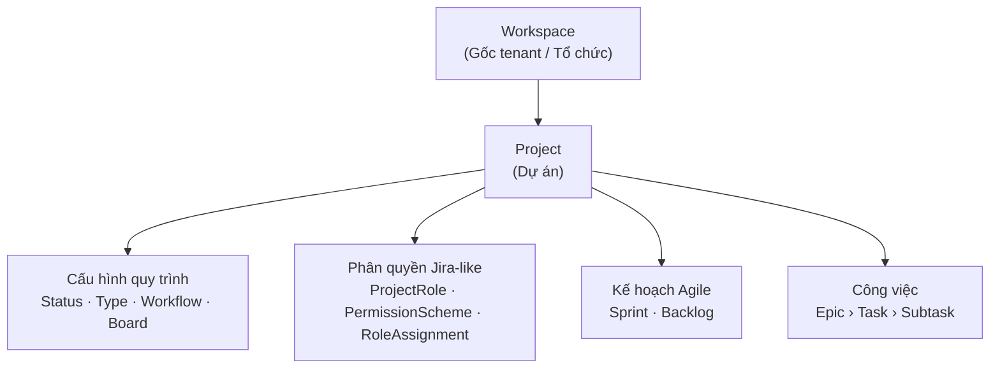

## 2. Thuộc tính dự án

| Thuộc tính | Bắt buộc | Quy tắc xác thực |
|------------|:--------:|-------------------|
| `name` | ✅ | Tối đa 255 ký tự, không được để trống |
| `key` | ✅ | 2–10 ký tự, định dạng `^[A-Z][A-Z0-9_]*$`, **duy nhất toàn hệ thống**, bất biến sau khi tạo |
| `workspaceId` | ✅ | UUID của Workspace. Người tạo phải có vai trò `MEMBER`, `ADMIN` hoặc `OWNER` trong Workspace |
| `leadUserId` | — | Người phụ trách dự án. Mặc định = người tạo; nếu chỉ định người khác thì người đó phải là thành viên trong Workspace |
| `projectType` | — | `SOFTWARE_SCRUM` (mặc định), `SOFTWARE_KANBAN`, `BUSINESS` |
| `defaultAssigneeType` | — | `PROJECT_LEADER` (mặc định), `UNASSIGNED` |
| `startDate`, `endDate` | — | Khoảng thời gian dự kiến (ngày bắt đầu và hạn chót dự án) |
| `isTemplate`, `templateCategory` | — | Cờ đánh dấu dự án mẫu và phân loại ngành nghề (xem tài liệu 04) |

## 3. Vòng đời dự án

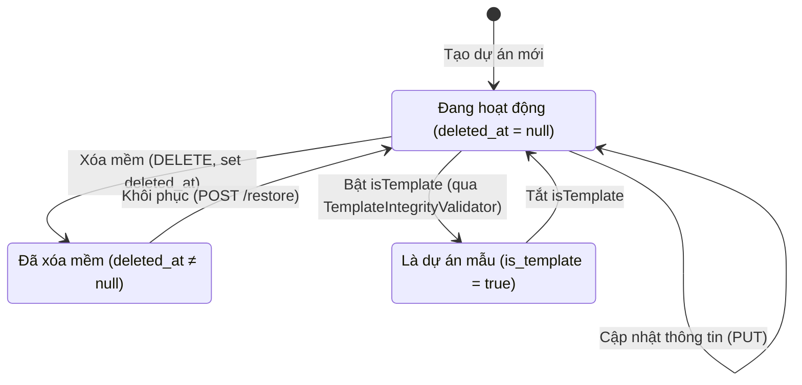

- **Xóa mềm (Soft Delete):** Khi xóa dự án, trường `deleted_at` được gán thời điểm hiện tại. Toàn bộ dữ liệu con (công việc, sprint, bảng) được bảo toàn nguyên vẹn.
- Khi dự án đã bị xóa mềm, các truy vấn nghiệp vụ thông thường sẽ từ chối truy cập (fail-closed) cho đến khi được khôi phục bởi Global ADMIN hoặc quản trị viên có thẩm quyền.

## 4. Tạo dự án

### 4.1. Điều kiện được tạo

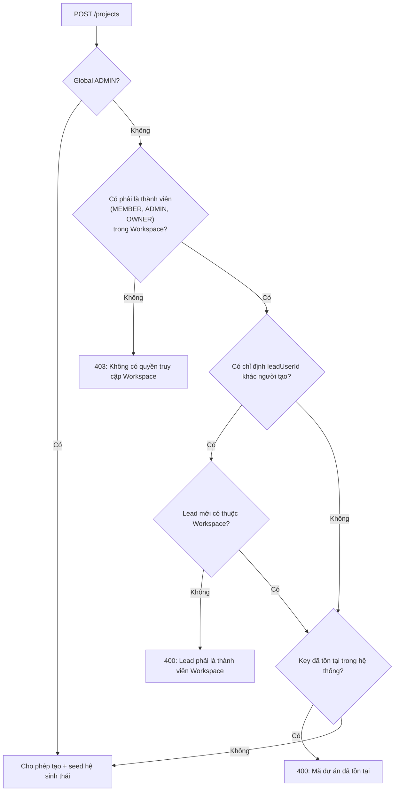

### 4.2. Trình tự xử lý

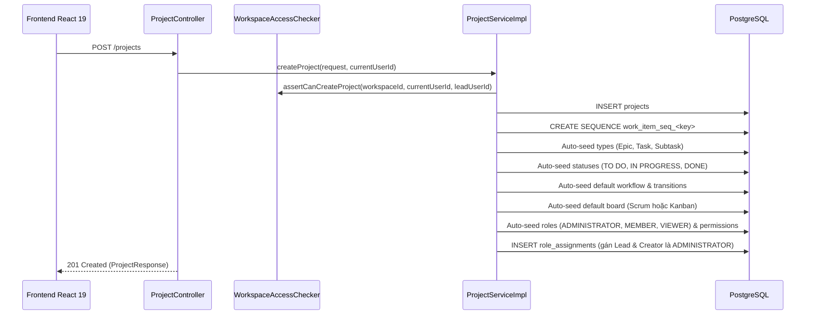

Toàn bộ quá trình tạo dự án và khởi tạo hệ sinh thái diễn ra trong **một transaction duy nhất** (`@Transactional`), đảm bảo tính nguyên tử: nếu có bất kỳ lỗi nào xảy ra trong các bước seed thì toàn bộ dữ liệu dự án sẽ được rollback hoàn toàn.

## 5. Hệ sinh thái mặc định khi tạo

### 5.1. Ba loại công việc cơ bản

| Tên | Mã code | Cấp độ phân cấp | Icon | Màu sắc | Bản chất |
|-----|---------|:---------------:|------|---------|----------|
| Epic | `EPIC` | 1 | bookmark | `#904EE2` | Hạng mục lớn bao quát nhiều công việc con |
| Task | `TASK` | 0 | check-square | `#4BADE8` | Công việc tiêu chuẩn thực thi độc lập |
| Sub-task | `SUBTASK` | -1 | corner-down-right | `#4BADE8` | Công việc con phân rã từ Task cấp 0 |

### 5.2. Ba trạng thái và quy trình (Workflow) mặc định

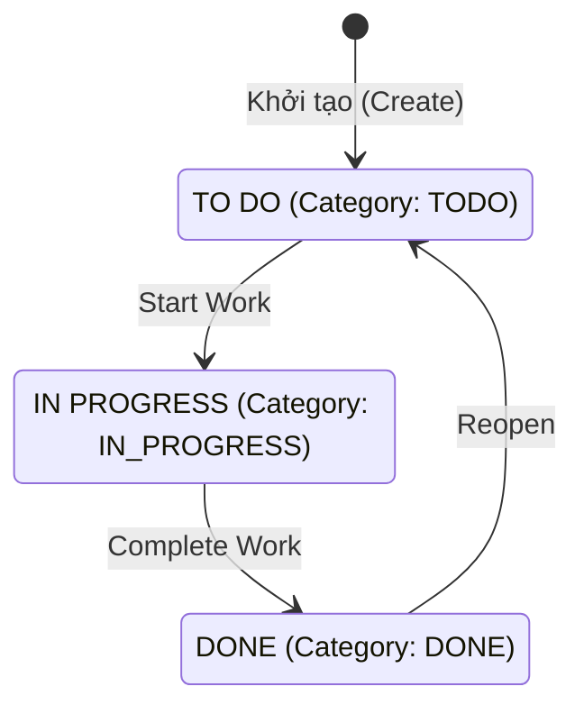

Một **Workflow Scheme** mặc định được khởi tạo để ánh xạ cả 3 loại công việc (`EPIC`, `TASK`, `SUBTASK`) vào quy trình trên.

### 5.3. Bảng công việc (Board) mặc định

- Dự án kiểu `SOFTWARE_SCRUM`: Tạo bảng **Scrum Board**.
- Dự án kiểu `SOFTWARE_KANBAN` hoặc `BUSINESS`: Tạo bảng **Kanban Board**.

Cột mặc định:
- Cột `TO DO` (thứ tự 0) $\rightarrow$ chứa trạng thái `TO DO`.
- Cột `IN PROGRESS` (thứ tự 1) $\rightarrow$ chứa trạng thái `IN PROGRESS`.
- Cột `DONE` (thứ tự 2) $\rightarrow$ chứa trạng thái `DONE`.

### 5.4. Vai trò dự án ban đầu

Hệ thống tự động sinh 3 vai trò dự án chuẩn Jira trong bảng `project_roles`:
1. `ADMINISTRATOR`: Toàn quyền quản trị dự án, cấu hình và phân quyền.
2. `MEMBER`: Thành viên thực thi (xem dự án, tạo/sửa/chuyển trạng thái công việc, thảo luận).
3. `VIEWER`: Chỉ xem (đọc bảng, backlog, công việc, bình luận).

**Gán vai trò ban đầu:** Người tạo dự án (`createdBy`) và Project Lead (`leadUserId`) được tự động cấp vai trò `ADMINISTRATOR` trong bảng `role_assignments`.

## 6. Cập nhật dự án

Yêu cầu quyền `PROJECT_ADMIN`. Các trường mang giá trị `null` trong request được hiểu là giữ nguyên giá trị hiện tại.

| Thuộc tính cập nhật | Hệ quả xử lý |
|---------------------|--------------|
| `name`, `description`, `iconUrl` | Cập nhật thông tin hiển thị |
| `leadUserId` | Lead mới phải là thành viên trong Workspace. Hệ thống tự động gán vai trò `ADMINISTRATOR` cho Lead mới nếu chưa có. Lead cũ vẫn giữ vai trò của mình |
| `startDate`, `endDate` | Cập nhật khoảng thời gian dự kiến |
| `isTemplate` | Bật cờ mẫu phải vượt qua bộ kiểm tra toàn vẹn `TemplateIntegrityValidator` (xem tài liệu 04) |
| `projectType` | Cập nhật kiểu dự án (Scrum/Kanban/Business) |
| `key` | Không cho phép thay đổi để bảo toàn tính toàn vẹn của mã công việc (Issue Key) |

## 7. Xóa và khôi phục

- **Xóa dự án:** `DELETE /projects/{id}` yêu cầu quyền `PROJECT_ADMIN`. Hệ thống gán `deleted_at = now()` (xóa mềm).
- **Khôi phục dự án:** `POST /projects/{id}/restore` do Global ADMIN hoặc Quản trị viên hệ thống thực hiện để đưa `deleted_at = null`.

## 8. Xem danh sách dự án

Endpoint: `GET /projects?workspaceId=...`

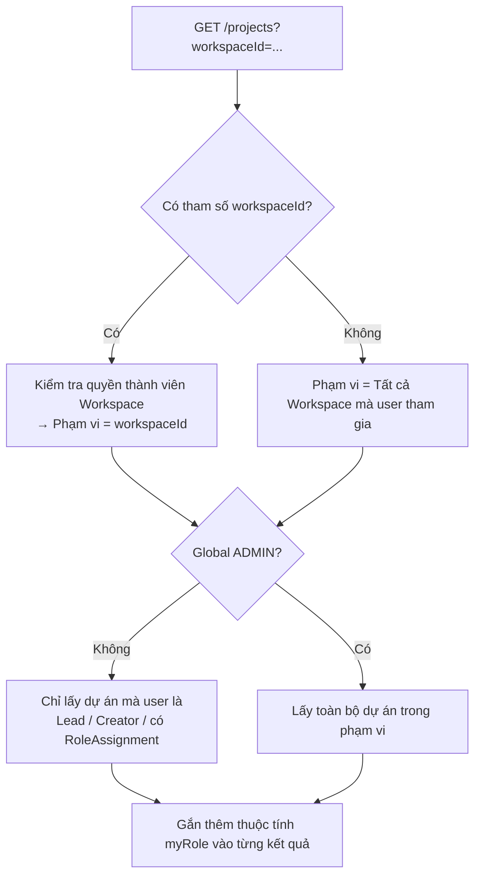

Dự án mẫu (`isTemplate = true`) mặc định bị loại trừ khỏi danh sách dự án làm việc thường, và được quản lý riêng qua Thư viện mẫu (`/templates`).

---

# Phần B — Phân quyền và thành viên dự án

## 9. Vai trò và ma trận quyền

### 9.1. Danh sách quyền chuẩn (`PermissionKey`)

| Nhóm quyền | Khóa quyền (`PermissionKey`) | Ý nghĩa nghiệp vụ |
|------------|------------------------------|-------------------|
| **Dự án** | `PROJECT_VIEW` | Xem tổng quan dự án, xem bảng công việc, backlog, báo cáo |
| | `PROJECT_ADMIN` | Toàn quyền cấu hình dự án, quản lý loại công việc, trạng thái, workflow, thành viên |
| **Công việc** | `ISSUE_CREATE` | Tạo công việc mới, tạo subtask |
| | `ISSUE_EDIT` | Sửa thông tin, thay đổi điểm số, liên kết, đính kèm tệp |
| | `ISSUE_DELETE` | Xóa công việc |
| | `ISSUE_TRANSITION` | Chuyển đổi trạng thái quy trình, kéo thả thẻ trên board |
| | `ISSUE_ASSIGN` | Phân công hoặc đổi người thực hiện công việc |
| **Kế hoạch** | `SPRINT_MANAGE` | Tạo sprint mới, chỉnh sửa, bắt đầu và đóng sprint |
| | `RELEASE_MANAGE` | Quản lý phát hành phiên bản (Version Release) |
| **Thảo luận** | `COMMENT_CREATE` | Viết bình luận vào công việc |
| | `COMMENT_EDIT_OWN` | Sửa bình luận do chính mình viết |
| | `COMMENT_DELETE_OWN` | Xóa bình luận do chính mình viết |
| | `COMMENT_DELETE_ALL` | Xóa bình luận của bất kỳ ai trong dự án |
| **Đính kèm** | `ATTACHMENT_DELETE_OWN` | Xóa tệp đính kèm do chính mình tải lên |
| | `ATTACHMENT_DELETE_ALL` | Xóa tệp đính kèm của bất kỳ ai |

### 9.2. Ma trận phân quyền mặc định

| Khóa quyền | ADMINISTRATOR | MEMBER | VIEWER |
|------------|:-------------:|:------:|:------:|
| `PROJECT_VIEW` | ✅ | ✅ | ✅ |
| `PROJECT_ADMIN` | ✅ | ❌ | ❌ |
| `ISSUE_CREATE` | ✅ | ✅ | ❌ |
| `ISSUE_EDIT` | ✅ | ✅ | ❌ |
| `ISSUE_TRANSITION` | ✅ | ✅ | ❌ |
| `ISSUE_ASSIGN` | ✅ | ✅ | ❌ |
| `ISSUE_DELETE` | ✅ | ❌ | ❌ |
| `SPRINT_MANAGE` | ✅ | ❌ | ❌ |
| `RELEASE_MANAGE` | ✅ | ❌ | ❌ |
| `COMMENT_CREATE` | ✅ | ✅ | ✅ |
| `COMMENT_EDIT_OWN` | ✅ | ✅ | ❌ |
| `COMMENT_DELETE_OWN` | ✅ | ✅ | ❌ |
| `COMMENT_DELETE_ALL` | ✅ | ❌ | ❌ |
| `ATTACHMENT_DELETE_OWN` | ✅ | ✅ | ❌ |
| `ATTACHMENT_DELETE_ALL` | ✅ | ❌ | ❌ |

## 10. Thuật toán quyết định quyền (Fail-closed)

Hàm `ProjectMemberServiceImpl.hasPermission(projectId, userId, permissionKey)` kiểm tra tuần tự:

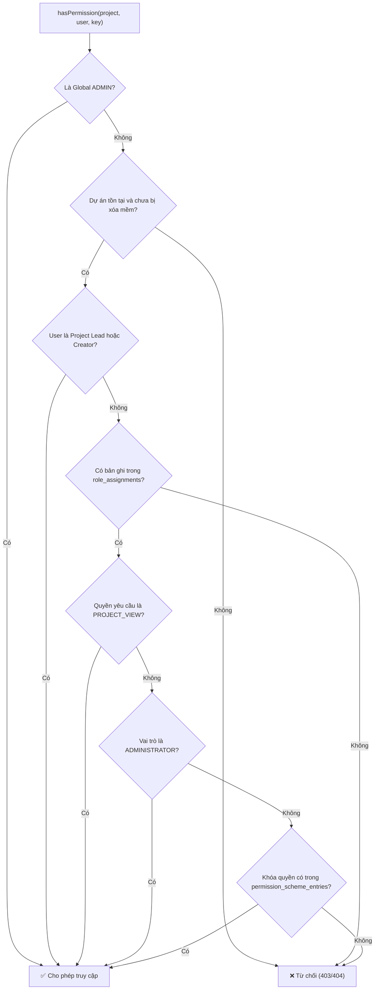

## 11. Ba lớp thực thi quyền

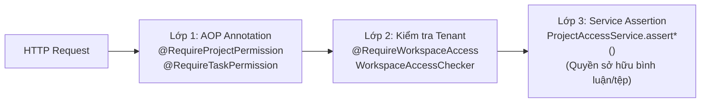

1. **Lớp 1 — Annotation Aspect (`ProjectPermissionGuard`):** Bắt các controller method có gắn `@RequireProjectPermission(PermissionKey)`. Aspect tự động giải quyết `projectId` qua `@PathVariable("projectId")`, tham số UUID có tên chứa "project", hoặc DTO có `getProjectId()`.
2. **Lớp 2 — Ranh giới Workspace:** Kiểm tra người dùng có quyền hợp lệ trong Workspace chứa dự án thông qua Feign call sang `workspace-service`.
3. **Lớp 3 — Nghiệp vụ sở hữu (Ownership Guard):** Xử lý trong Service cho các quyền theo ngữ cảnh đối tượng (chỉ tác giả mới được sửa comment của mình, trừ khi có quyền `COMMENT_DELETE_ALL`).

## 12. Quản lý thành viên dự án & Auto-cascade

### 12.1. Luồng mời thành viên dự án

Thành viên dự án được thêm thông qua cơ chế **Lời mời bất đồng bộ**:
1. Quản trị viên gửi lời mời: `POST /projects/{id}/members` với `email` hoặc `username` và vai trò dự án (`roleId`).
2. Hệ thống kiểm tra: Người được mời chưa là thành viên và chưa có lời mời `PENDING`.
3. Tạo bản ghi `invitations` (`type = 'PROJECT'`, `status = 'PENDING'`).
4. Gửi email thông báo mời tham gia dự án qua `notification-service` (`InvitationMailer`, `@Async`).
5. Người được mời chấp nhận tại `POST /invitations/{id}/accept` $\rightarrow$ hệ thống ghi nhận vào bảng `role_assignments`.

### 12.2. Cơ chế Auto-cascade Workspace Member

Để loại bỏ rào cản người dùng được mời vào dự án nhưng chưa có mặt trong Workspace, `work-service` triển khai cơ chế **tự động liên kết thành viên**:
- Khi một người dùng được tạo làm Project Lead hoặc được gửi lời mời tham gia dự án, `work-service` tự động gọi Feign client nội bộ:
  `POST /workspace/api/v1/workspaces/{workspaceId}/members/ensure`
- `workspace-service` lập tức đảm bảo người dùng đó đã có mặt trong `workspace_members` với vai trò tối thiểu là `MEMBER`.

---

# Phần C — Công việc (Work Item)

## 13. Mô hình phân cấp 3 cấp độ nghiêm ngặt

Hệ thống áp dụng chuẩn phân cấp công việc Jira 3 cấp độ, kiểm tra tự động qua `StrictHierarchyValidator`:

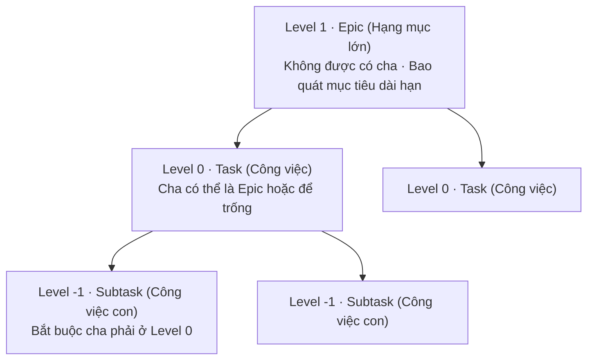

| Quy tắc bất biến | Chi tiết nghiệp vụ |
|------------------|-------------------|
| **Epic (Level 1)** | Không được có công việc cha (`parent_id = null`). |
| **Task / Standard (Level 0)** | Cha chỉ có thể là Epic (Level 1) hoặc để trống. |
| **Subtask (Level -1)** | Bắt buộc phải có `parent_id` trỏ tới một Task ở cấp 0. Không được gắn trực tiếp vào Epic, không được lồng Subtask con. |
| **Toàn vẹn quan hệ** | Công việc cha phải cùng thuộc dự án và chưa bị xóa mềm. Một công việc không thể tự làm cha của chính mình. |

## 14. Tạo công việc

- Endpoint: `POST /projects/{id}/items` (yêu cầu quyền `ISSUE_CREATE`).
- Nếu giao việc cho người khác ngay khi tạo: Cần thêm quyền `ISSUE_ASSIGN`.
- **Sinh mã tự động:** Sử dụng PostgreSQL Sequence riêng biệt `work_item_seq_<KEY>` để đảm bảo mã công việc (ví dụ `WEB-1`, `WEB-2`) tăng liên tục và không bị trùng lặp khi nhiều người tạo đồng thời.
- Trạng thái ban đầu: Trạng thái thuộc nhóm `TODO` đầu tiên của quy trình dự án.
- Tạo subtask: `POST /items/{id}/subtasks` tự động kế thừa Sprint của công việc cha.

## 15. Cập nhật, xếp hạng LexoRank, xóa mềm

- **Cập nhật:** `PUT /items/{id}` (yêu cầu quyền `ISSUE_EDIT`). Ghi nhận thay đổi vào `work_item_changelogs`. Khi đổi Sprint của công việc cha, hệ thống tự động lan truyền Sprint mới xuống toàn bộ Subtask con.
- **Xếp hạng vị trí (LexoRank):** `PATCH /items/{id}/rank` cập nhật chuỗi ký tự LexoRank phục vụ kéo thả sắp xếp trên Backlog và Board mà không cần cập nhật lại toàn bộ bảng.
- **Xóa công việc:** `DELETE /items/{id}` (yêu cầu quyền `ISSUE_DELETE`) thực hiện xóa mềm (`deleted_at = now()`).

## 16. Chuyển trạng thái qua Workflow Engine

Khi người dùng chuyển trạng thái hoặc kéo thẻ trên bảng, request đi qua `WorkflowEngineServiceImpl`:

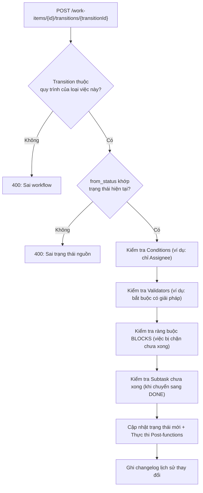

## 17. Liên kết, bình luận, tệp, lịch sử

- **Liên kết công việc (`work_item_links`):** Quan hệ giữa các công việc (`BLOCKS`, `RELATES_TO`, `DUPLICATES`, `CAUSES`). Kiểm tra chống chu trình khép kín đối với quan hệ `BLOCKS`.
- **Thảo luận (`work_item_comments`):** Hỗ trợ trả lời lồng nhau (Nested reply), phân quyền sửa/xóa theo tác giả hoặc quản trị viên.
- **Tệp đính kèm (`work_item_attachments`):** Lưu trữ đối tượng tại MinIO (bucket `work-attachments`), phân quyền tải xuống theo `PROJECT_VIEW`.
- **Lịch sử thay đổi (`work_item_changelogs`):** Tự động ghi lại diff trước/sau của các thuộc tính (`STATUS`, `ASSIGNEE`, `SPRINT`, `PRIORITY`...).

---

# Phần D — Lập kế hoạch và theo dõi

## 18. Backlog

Quản lý danh sách công việc chờ xử lý của dự án Scrum (`GET /projects/{id}/backlog`):
- Phân nhóm trực quan: Sprint đang chạy (`ACTIVE`), các Sprint tương lai (`FUTURE`), và Backlog chung (`sprint_id = null`).
- Sắp xếp vị trí chính xác theo thứ tự `rank` (LexoRank).
- Cho phép kéo thả công việc giữa Backlog và các Sprint.

## 19. Sprint

### 19.1. Vòng đời Sprint

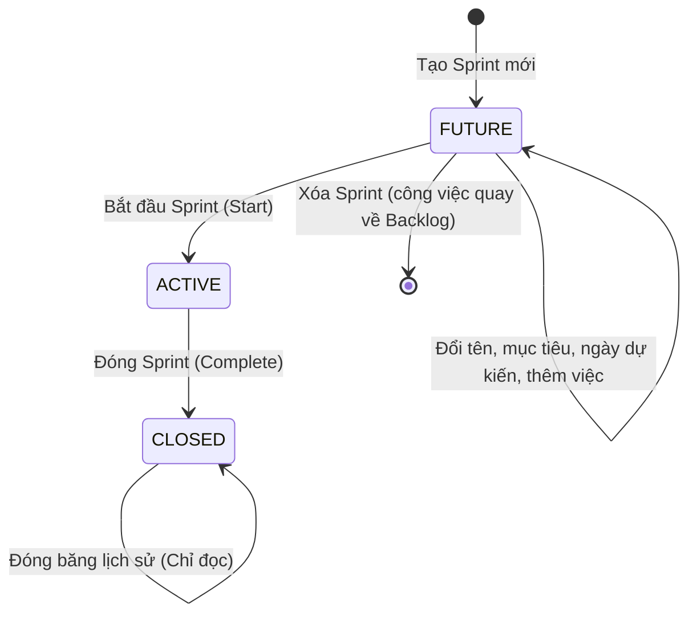

### 19.2. Bắt đầu Sprint

- Điều kiện: Sprint ở trạng thái `FUTURE`, dự án không phải là mẫu, và **chưa có Sprint nào khác đang ACTIVE** (mỗi dự án chỉ có tối đa 1 Sprint chạy đồng thời).
- Thời gian chạy tối đa không vượt quá 56 ngày (8 tuần).
- Ghi nhận sự kiện `SPRINT_STARTED` vào bảng outbox.

### 19.3. Đóng Sprint (Complete Sprint)

- Khi đóng Sprint, người dùng chỉ định đích chuyển tiếp cho các công việc chưa hoàn thành (chuyển về `BACKLOG` hoặc sang một `FUTURE` Sprint tiếp theo).
- Các công việc đã `DONE` được giữ nguyên `sprint_id` để phục vụ tính toán vận tốc hoàn thành (Velocity).
- Chụp ảnh số liệu đóng băng vào bảng `sprint_report_snapshots` (tổng Story Points cam kết, số Story Points hoàn thành, snapshot dữ liệu Burndown).

## 20. Board (Scrum & Kanban)

- **Scrum Board:** Chỉ hiển thị các công việc thuộc Sprint đang chạy (`ACTIVE`).
- **Kanban Board:** Hiển thị luồng công việc liên tục, áp dụng giới hạn WIP (Work In Progress) trên từng cột.
- Gom nhiều trạng thái vào một cột hiển thị.
- Phân làn bơi (Swimlane) linh hoạt theo Epic, Assignee hoặc Priority.

## 21. Báo cáo Agile (Burndown, Velocity, CFD)

Dựa trên sự kiện changelog thực tế được phục dựng lại qua `WorkItemStateReplayer`:

| Báo cáo | Endpoint | Ý nghĩa nghiệp vụ |
|---------|----------|-------------------|
| **Burndown Chart** | `GET /sprints/{id}/burndown` | Theo dõi tiến độ đốt Story Points theo từng ngày của Sprint, có tùy chọn loại trừ ngày cuối tuần |
| **Velocity Chart** | `GET /projects/{id}/velocity` | Biểu đồ thanh so sánh giữa khối lượng cam kết (Commitment) và thực tế hoàn thành qua các Sprint gần nhất |
| **Cumulative Flow Diagram (CFD)** | `GET /projects/{id}/cfd` | Biểu đồ luồng tích lũy phản ánh số lượng công việc ở từng nhóm trạng thái theo thời gian để phát hiện điểm nghẽn (Bottlenecks) |

## 22. Danh mục API Dự án

Tiền tố chung: `/work/api/v1/work`

| Nhóm chức năng | Endpoint | Phương thức | Mô tả |
|----------------|----------|:-----------:|-------|
| **Dự án** | `/projects` | GET, POST | Lấy danh sách dự án, tạo dự án mới |
| | `/projects/{id}` | GET, PUT, DELETE | Chi tiết, cập nhật, xóa mềm dự án |
| | `/projects/key/{key}` | GET | Tra cứu dự án theo Key |
| | `/projects/{id}/restore` | POST | Khôi phục dự án đã xóa mềm |
| **Thành viên & Quyền** | `/projects/{id}/permissions/my` | GET | Lấy danh sách quyền của user hiện tại |
| | `/projects/{id}/members` | GET, POST | Danh sách thành viên, gửi lời mời dự án |
| | `/members/{userId}/role` | PUT | Thay đổi vai trò thành viên |
| | `/members/{userId}` | DELETE | Xóa thành viên khỏi dự án |
| | `/projects/{id}/roles` | GET | Lấy danh sách vai trò dự án |
| **Công việc** | `/projects/{id}/items` | GET, POST | Lấy danh sách, tạo công việc mới |
| | `/items/{id}` | GET, PUT, DELETE | Chi tiết, cập nhật, xóa mềm công việc |
| | `/items/code/{code}` | GET | Tra cứu công việc theo mã (vd `WEB-12`) |
| | `/items/{id}/subtasks` | GET, POST | Danh sách, tạo công việc con |
| | `/items/{id}/rank` | PATCH | Cập nhật thứ tự LexoRank |
| **Quy trình** | `/work-items/{id}/transitions` | GET | Lấy danh sách bước chuyển trạng thái khả dụng |
| | `/work-items/{id}/transitions/{tId}` | POST | Thực thi chuyển trạng thái |
| **Kế hoạch & Báo cáo** | `/projects/{id}/backlog` | GET | Lấy dữ liệu màn hình Backlog |
| | `/projects/{id}/sprints` | GET, POST | Danh sách, tạo Sprint mới |
| | `/sprints/{id}/start` | POST | Bắt đầu chạy Sprint |
| | `/sprints/{id}/complete` | POST | Hoàn thành và đóng Sprint |
| | `/sprints/{id}/burndown` | GET | Dữ liệu biểu đồ Burndown |
| | `/projects/{id}/velocity` | GET | Dữ liệu biểu đồ Velocity |
| | `/projects/{id}/cfd` | GET | Dữ liệu biểu đồ CFD |

---

# Phần E — Định hướng thiết kế nâng cao: Quản lý tiến độ (Roadmap)

> 💡 **Ghi chú phân định:** Nội dung dưới đây là **định hướng nghiên cứu nâng cao** (được tài liệu hóa chuyên sâu tại `docs/services/work_service/qly_tien_do/`), phục vụ các giai đoạn phát triển tiếp theo, **chưa triển khai trong mã nguồn hiện tại**.

## 23. Mô hình sức khỏe và tiến độ dự kiến

- Tính toán % tiến độ tự động dựa trên trọng số Story Points hoặc số lượng công việc hoàn thành.
- Đánh giá chỉ số sức khỏe dự án (`Health`: `ON_TRACK`, `AT_RISK`, `OFF_TRACK`) dựa trên độ lệch giữa tiến độ thực tế so với đường kỳ vọng thời gian.

## 24. Milestone & Đường cơ sở (Baseline)

- **Milestone (Mốc trọng yếu):** Gắn nhóm các công việc quan trọng vào một mốc thời gian mục tiêu cụ thể, đánh giá hoàn thành tự động khi mọi công việc gắn với mốc đạt `DONE`.
- **Baseline (Đường cơ sở kế hoạch):** Đóng băng ảnh chụp kế hoạch ban đầu (ngày bắt đầu, hạn chót, điểm số) để so sánh phương sai tiến độ (Schedule Variance) trong suốt vòng đời dự án.
