# 03 — Tài liệu nghiệp vụ: Workspace · Team · Member

> Nguồn: workspace-service (`WorkspaceController`, `WorkspaceMemberController`, `WorkspaceServiceImpl`, `WorkspaceMemberServiceImpl`, `WorkspaceRoleGuard`, `CurrentUserResolver`), work-service (`TeamController`, `TeamSecurity`, `InvitationServiceImpl`, `ProjectMemberServiceImpl`, `WorkspaceAccessChecker`), frontend (`WorkspaceListPage`, `WorkspaceMembersPage`, `WorkspaceSettingsPage`, `TeamDetailPage`, `InvitationsPage`, `WorkspaceSwitcher`).

---

## Mục lục

1. [Mô hình ba tầng thành viên](#1-mô-hình-ba-tầng-thành-viên)
2. [Workspace](#2-workspace)
3. [Thành viên Workspace](#3-thành-viên-workspace)
4. [Team](#4-team)
5. [Thành viên Team](#5-thành-viên-team)
6. [Lời mời (Invitation)](#6-lời-mời-invitation)
7. [Đồng bộ Team → Project](#7-đồng-bộ-team--project)
8. [Kiểm tra quyền xuyên service](#8-kiểm-tra-quyền-xuyên-service)
9. [Ma trận "Ai được làm gì"](#9-ma-trận-ai-được-làm-gì)
10. [Kịch bản đầu – cuối](#10-kịch-bản-đầu--cuối)

---

## 1. Mô hình ba tầng thành viên

Một người dùng có thể đồng thời mang **ba loại vai trò độc lập**, mỗi loại lưu ở một bảng khác nhau.

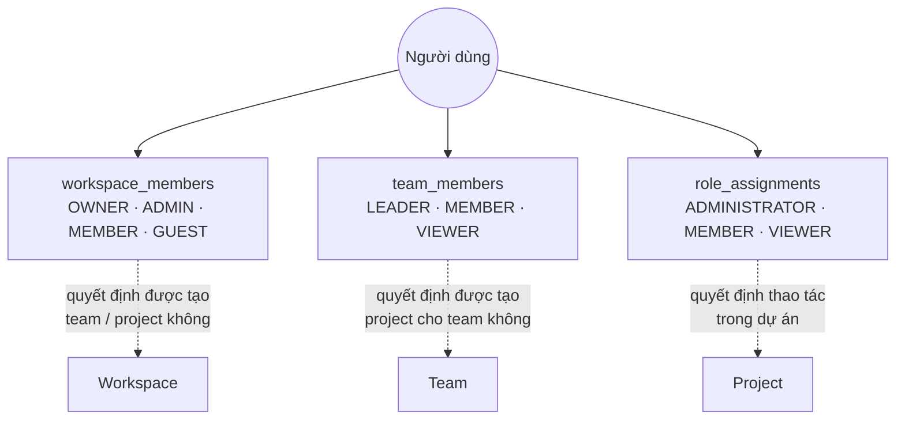

| Tầng | Bảng | Service | Loại user id | Vai trò |
|------|------|---------|--------------|---------|
| Workspace | `workspace_members` | workspace-service | `users.id` | OWNER > ADMIN > MEMBER > GUEST |
| Team | `team_members` (+ `teams.owner_id`) | work-service | Keycloak `sub` | LEADER, MEMBER, VIEWER |
| Project | `role_assignments` | work-service | Keycloak `sub` | ADMINISTRATOR, MEMBER, VIEWER |

Ngoài ra còn **Global ADMIN** (realm role `ADMIN` của Keycloak) vượt qua mọi kiểm tra tầng Team và Project.

---

## 2. Workspace

### 2.1. Khái niệm

Workspace là **gốc tenant**: ranh giới cô lập dữ liệu giữa các tổ chức. Mọi Team và Project đều thuộc đúng một workspace.

| Thuộc tính | Quy tắc |
|------------|---------|
| `name` | Bắt buộc |
| `slug` | Duy nhất toàn hệ thống; bỏ trống thì tự sinh từ tên (bỏ dấu tiếng Việt, thêm hậu tố `-2`, `-3`... nếu trùng) |
| `description`, `avatarUrl` | Tùy chọn |
| `createdBy` | Chỉ để audit, **không** quyết định quyền |

### 2.2. Vai trò workspace

| Vai trò | Quyền |
|---------|-------|
| OWNER | Toàn quyền, kể cả xóa / khôi phục workspace và cấp vai trò OWNER |
| ADMIN | Sửa thông tin workspace, quản lý thành viên (không động tới OWNER) |
| MEMBER | Tạo Team, tạo Project (nếu là trưởng nhóm) |
| GUEST | Chỉ xem; không tạo được gì |

### 2.3. Vòng đời

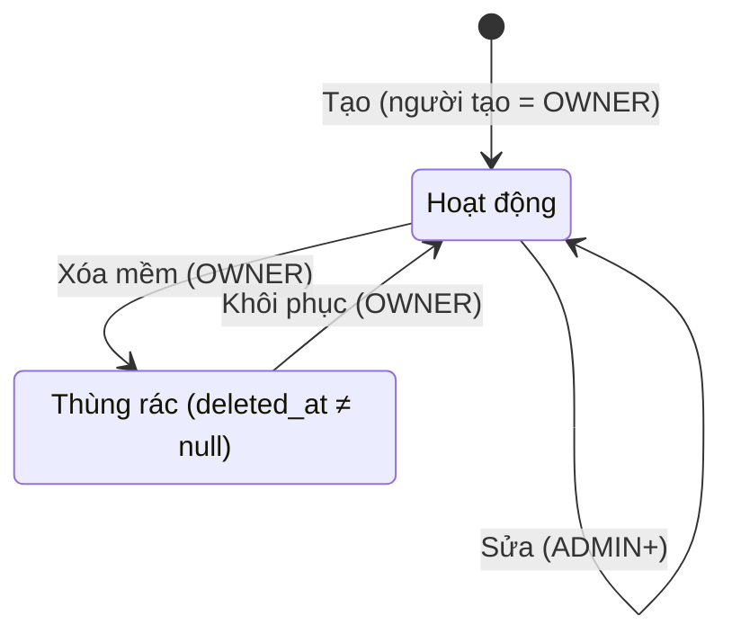

- Xóa mềm **giữ nguyên** toàn bộ thành viên, nên khôi phục sẽ trả lại đúng OWNER cũ.
- Workspace trong thùng rác bị loại khỏi danh sách `getWorkspaceIds` → dự án của nó không còn hiện trong danh sách.

### 2.4. Workspace mặc định

Migration `V2__seed_default_workspace_and_backfill` tạo **Default Workspace** với UUID cố định `a0000000-0000-0000-0000-000000000001`:
- Mọi user đang có được thêm vào với vai trò MEMBER; user đầu tiên là OWNER.
- Mọi team/project trỏ tới workspace không tồn tại được kéo về workspace này.
- Đây cũng là nơi chứa **mẫu hệ thống** (tài liệu 04).

### 2.5. Bất biến "luôn có ít nhất một OWNER"

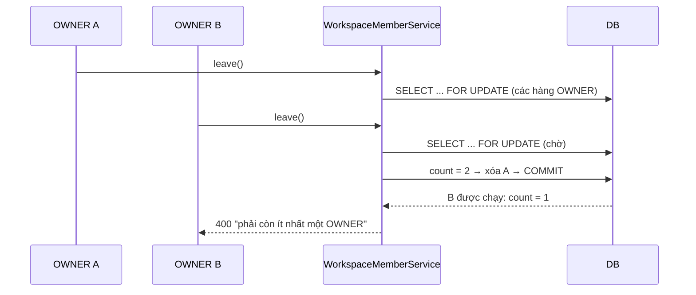

Khóa hàng (`lockOwners`) ngăn tình huống hai OWNER rời cùng lúc làm workspace "mồ côi".

---

## 3. Thành viên Workspace

### 3.1. Thêm thành viên

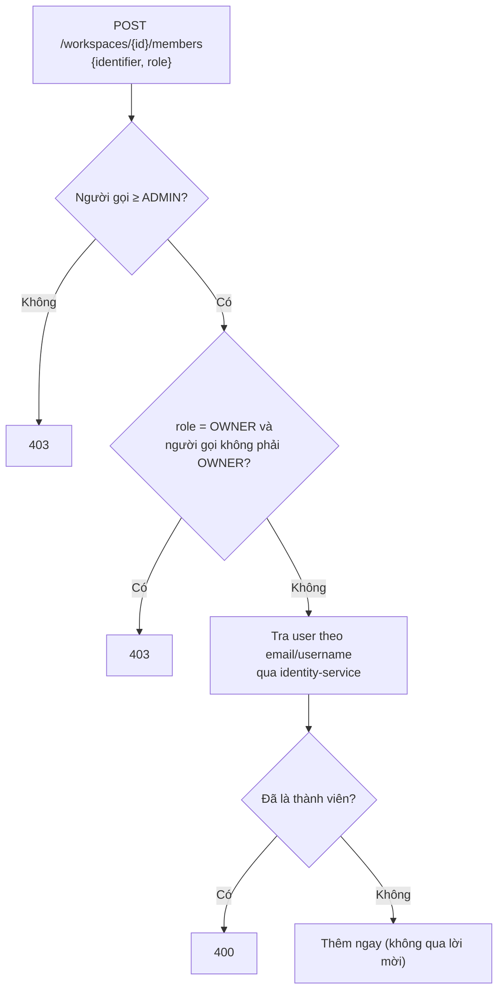

> Khác với Team/Project, thêm vào Workspace là **trực tiếp**, người được thêm không cần chấp nhận.

### 3.2. Đổi vai trò, xóa, rời

| Thao tác | Ai làm | Bị chặn khi |
|----------|--------|-------------|
| Đổi vai trò | ADMIN+ | Tự đổi chính mình; động tới OWNER mà không phải OWNER; làm mất OWNER cuối |
| Xóa thành viên | ADMIN+ | Tự xóa chính mình; xóa OWNER mà không phải OWNER; xóa OWNER cuối |
| Rời workspace | Bản thân | Là OWNER cuối |

### 3.3. Bảo mật ranh giới tenant

Người không phải thành viên luôn nhận **404** (không phải 403) để không lộ việc workspace có tồn tại.

---

## 4. Team

### 4.1. Khái niệm

Team là **nhóm người cố định** trong workspace, dùng để (1) xác định ai được tạo dự án và (2) tự động cấp quyền dự án cho cả nhóm.

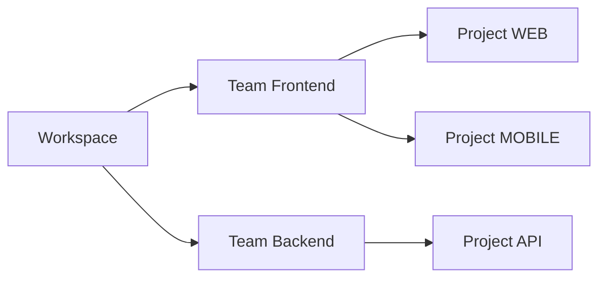

### 4.2. Trưởng nhóm: hai nguồn sự thật

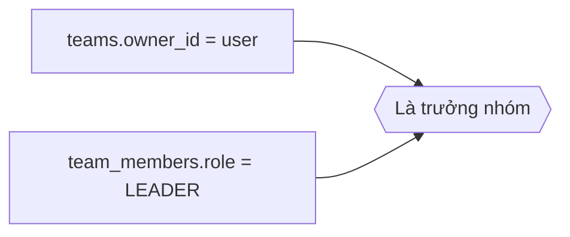

Người tạo team được ghi vào **cả hai** chỗ. Các thành viên được nâng lên LEADER sau đó chỉ có ở chỗ thứ hai. Owner **không thể rời** team và **không thể bị xóa**; hiện chưa có chức năng chuyển quyền sở hữu.

### 4.3. Các thao tác

| Thao tác | Endpoint | Quyền |
|----------|----------|-------|
| Liệt kê team trong workspace | `GET /teams?workspaceId=` | Thành viên workspace |
| Liệt kê mọi team | `GET /teams/all` | Global ADMIN |
| Team của tôi (kèm `myRole`) | `GET /teams/my?workspaceId=` | Đăng nhập |
| Xem team | `GET /teams/{id}` | Thành viên team |
| Tạo team | `POST /teams` | MEMBER+ trong workspace |
| Sửa tên/mô tả | `PUT /teams/{id}` | Trưởng nhóm |
| Xóa team | `DELETE /teams/{id}` | Trưởng nhóm |
| Rời team | `POST /teams/{id}/leave` | Thành viên (trừ owner) |

### 4.4. Xóa team

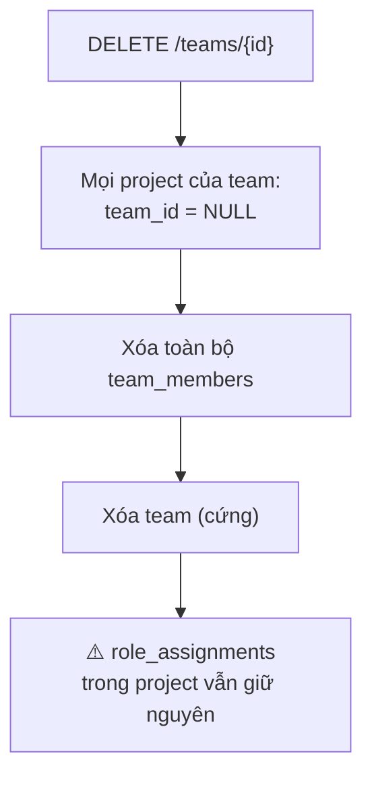

Dự án không bị xóa theo; chúng trở thành dự án "không team". Thành viên cũ vẫn giữ quyền trong dự án.

---

## 5. Thành viên Team

### 5.1. Mời thành viên

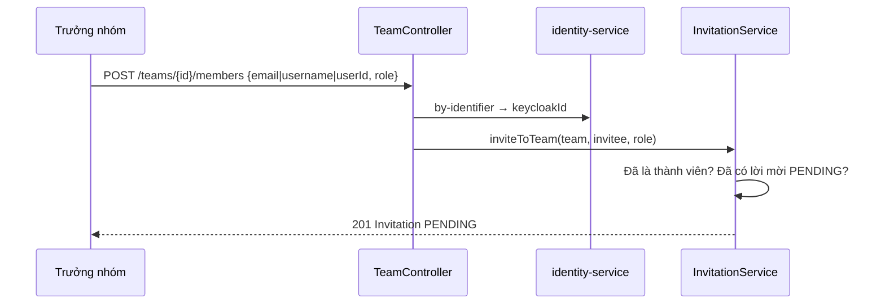

### 5.2. Đổi vai trò và xóa

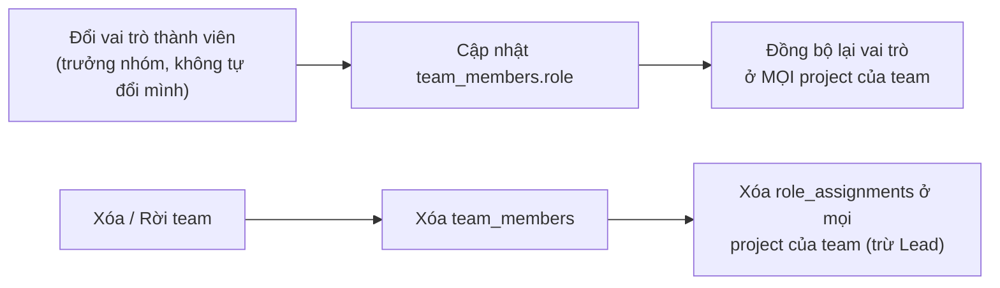

---

## 6. Lời mời (Invitation)

### 6.1. Vòng đời

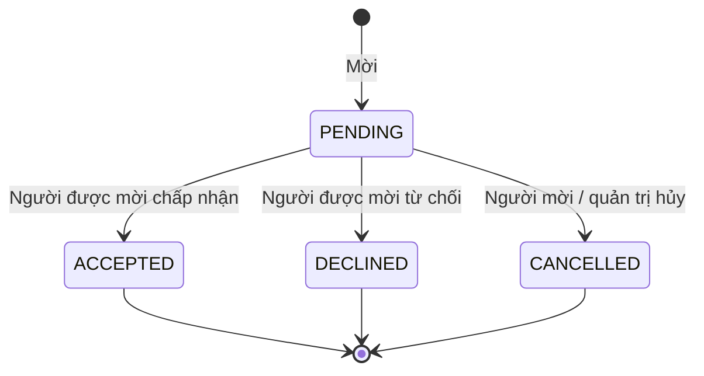

### 6.2. Khi chấp nhận

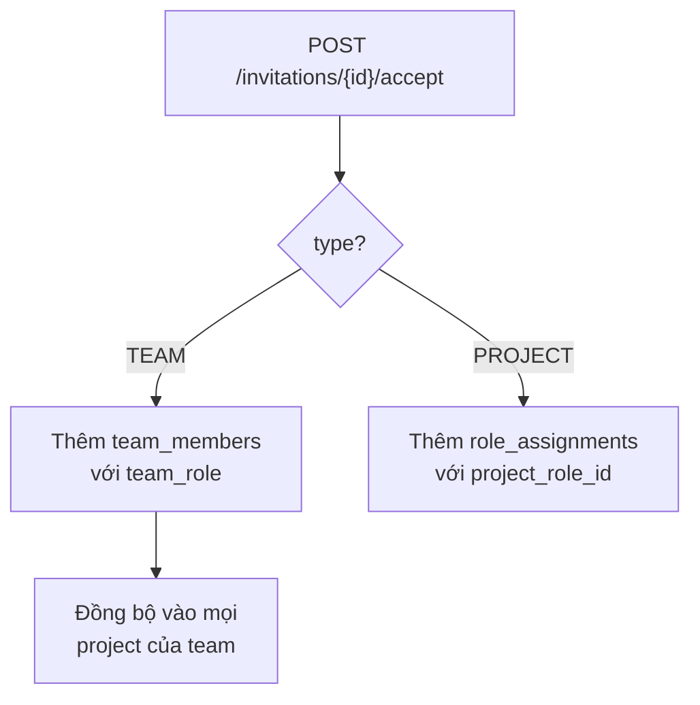

### 6.3. Ai được hủy lời mời

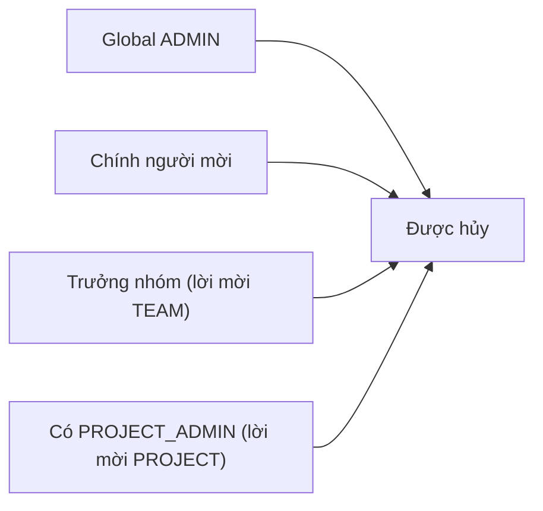

### 6.4. Giao diện

- `PendingInvitations` (trên header) và trang `/w/:id/invitations` liệt kê lời mời đang chờ của tôi.
- Trang Team / Project liệt kê lời mời đang chờ của đích (`GET /invitations?teamId=` cho trưởng nhóm, `?projectId=` cho người có PROJECT_ADMIN).
- Không gửi email, không có hạn hết hiệu lực.

---

## 7. Đồng bộ Team → Project

### 7.1. Bảng ánh xạ vai trò

| TeamRole | → ProjectRole |
|----------|---------------|
| LEADER | ADMINISTRATOR |
| MEMBER | MEMBER |
| VIEWER | VIEWER |

### 7.2. Các thời điểm đồng bộ

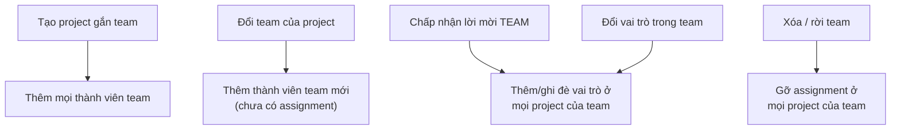

> Lưu ý: đồng bộ theo sự kiện "đổi vai trò team" **ghi đè** vai trò dự án — nếu quản trị dự án đã chỉnh tay vai trò của người đó trong dự án, thay đổi tay sẽ bị mất.

---

## 8. Kiểm tra quyền xuyên service

work-service không có bảng `workspace_members`, nên mỗi lần cần kiểm tra vai trò workspace nó phải hỏi workspace-service.

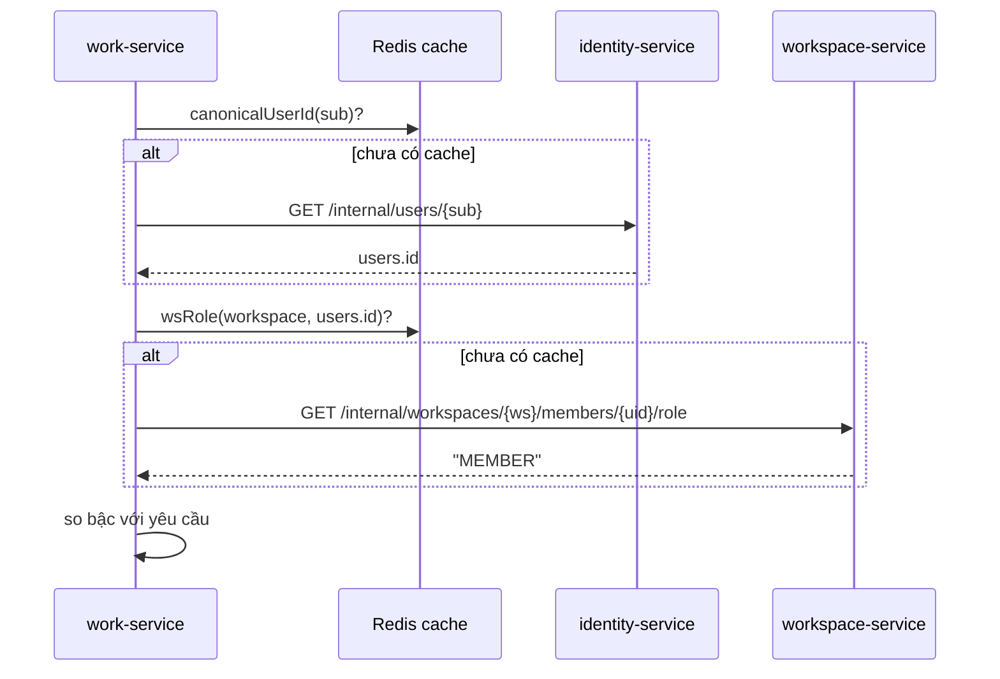

| Tình huống | Kết quả |
|------------|---------|
| workspace-service không phản hồi khi kiểm tra quyền | **403** (fail-closed) |
| workspace-service lỗi khi lấy danh sách workspace | Danh sách **rỗng** (trang trống) |
| Vai trò bị đổi ở workspace-service | work-service vẫn dùng giá trị cũ trong cache Redis tới **10 phút** (TTL mặc định) |

---

## 9. Ma trận "Ai được làm gì"

| Hành động | Global ADMIN | WS OWNER | WS ADMIN | WS MEMBER | WS GUEST | Team LEADER | Team MEMBER |
|-----------|:-:|:-:|:-:|:-:|:-:|:-:|:-:|
| Tạo workspace | ✅ | ✅ | ✅ | ✅ | ✅ | — | — |
| Sửa workspace | | ✅ | ✅ | | | | |
| Xóa / khôi phục workspace | | ✅ | | | | | |
| Quản lý thành viên workspace | | ✅ | ✅* | | | | |
| Tạo team | ✅ | ✅ | ✅ | ✅ | | | |
| Sửa / xóa team, mời vào team | ✅ | | | | | ✅ | |
| Tạo project cho team | ✅ | | | | | ✅ (+ WS MEMBER+) | |
| Tạo project không team | ✅ | | | | | | |

\* ADMIN không được động tới hàng OWNER.

---

## 10. Kịch bản đầu – cuối

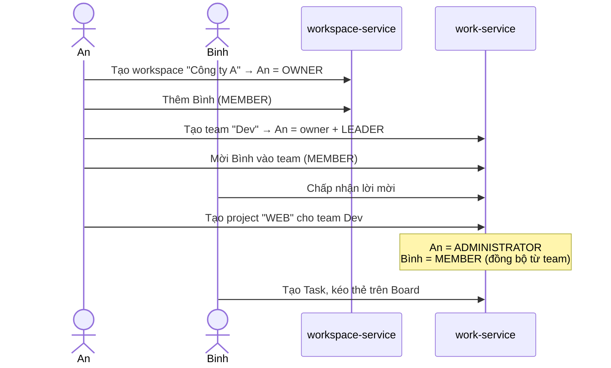
