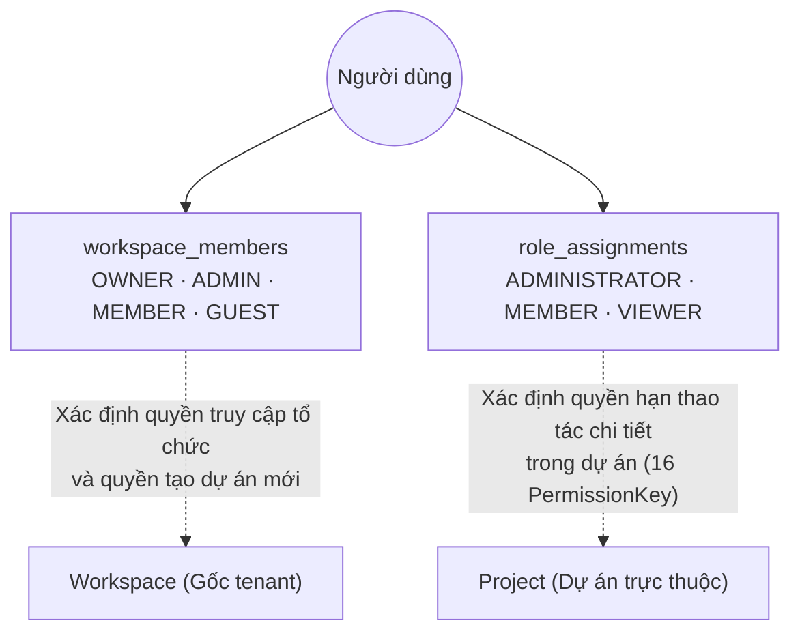
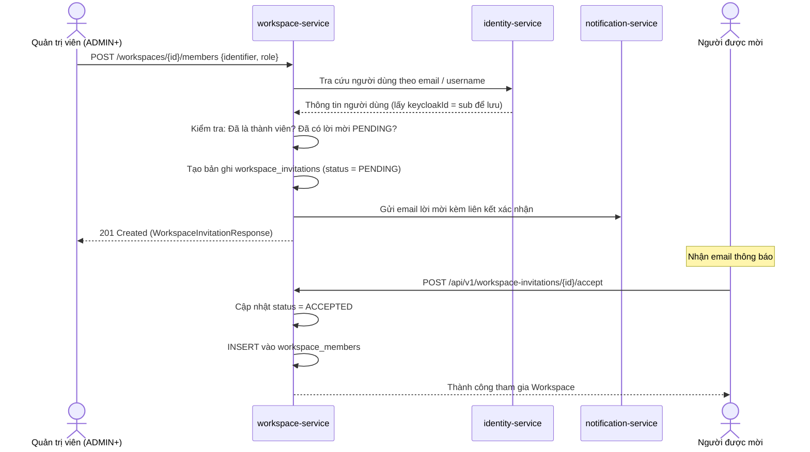
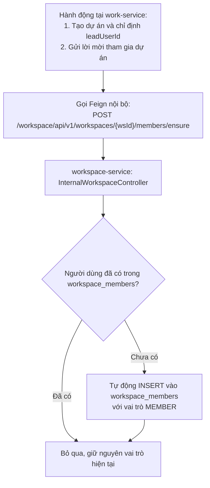
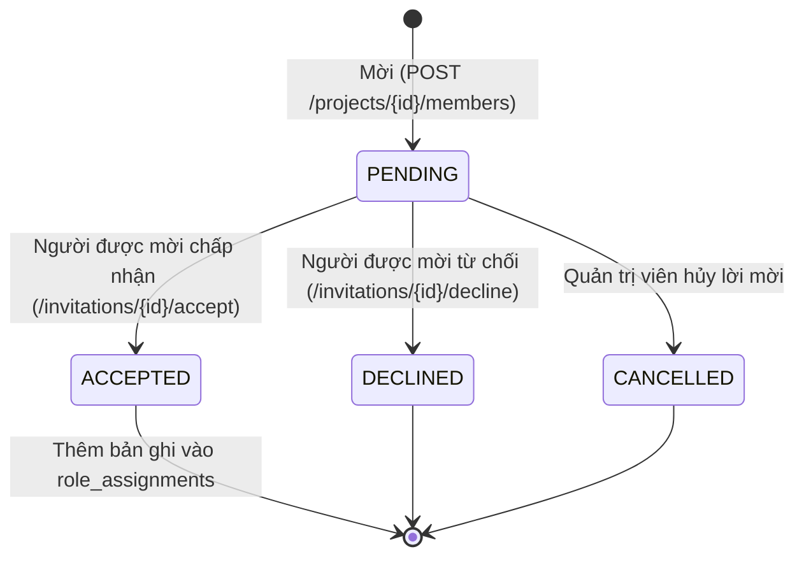
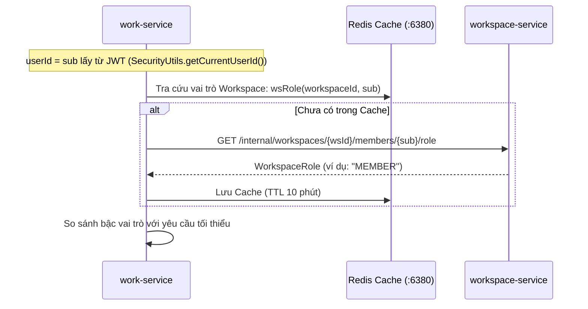
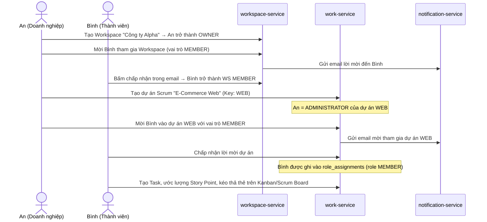

# 03 — Tài liệu nghiệp vụ: Không gian làm việc (Workspace) và Thành viên

> Nguồn: workspace-service (`WorkspaceController`, `WorkspaceMemberController`, `WorkspaceInvitationController`, `InternalWorkspaceController`, `WorkspaceServiceImpl`, `WorkspaceMemberServiceImpl`, `WorkspaceRoleGuard`, `CurrentUserResolver`), work-service (`ProjectMemberServiceImpl`, `WorkspaceAccessChecker`, `InvitationServiceImpl`), frontend (`WorkspaceListPage`, `WorkspaceMembersPage`, `WorkspaceSettingsPage`, `InvitationsPage`, `WorkspaceSwitcher`).

---

## Mục lục

1. [Mô hình hai tầng thành viên trực tiếp](#1-mô-hình-hai-tầng-thành-viên-trực-tiếp)
2. [Không gian làm việc (Workspace)](#2-không-gian-làm-việc-workspace)
3. [Lời mời và Thành viên Workspace](#3-lời-mời-và-thành-viên-workspace)
4. [Cơ chế Auto-cascade Workspace Member (`ensureMember`)](#4-cơ-chế-auto-cascade-workspace-member-ensuremember)
5. [Lời mời tham gia Dự án (Project Invitation)](#5-lời-mời-tham-gia-dự-án-project-invitation)
6. [Kiểm tra quyền xuyên service (Cross-service Authorization)](#6-kiểm-tra-quyền-xuyên-service-cross-service-authorization)
7. [Ma trận "Ai được làm gì"](#7-ma-trận-ai-được-làm-gì)
8. [Kịch bản đầu – cuối](#8-kịch-bản-đầu--cuối)

---

## 1. Mô hình hai tầng thành viên trực tiếp

Hệ thống DATN-2026 áp dụng mô hình phân cấp tổ chức 2 tầng tinh gọn và chuẩn mực kiểu Jira Cloud / Linear:

| Tầng | Bảng dữ liệu | Service quản lý | Loại User ID | Các vai trò chuẩn |
|------|--------------|-----------------|--------------|-------------------|
| **Workspace** | `workspace_members` | `workspace-service` | Keycloak `sub` (K) | `OWNER` > `ADMIN` > `MEMBER` > `GUEST` |
| **Project** | `role_assignments` | `work-service` | Keycloak `sub` (K) | `ADMINISTRATOR` > `MEMBER` > `VIEWER` |

> ℹ️ **Loại bỏ hoàn toàn tầng Team:**  
> Kiến trúc trước đây có tầng `Team` trung gian (`teams` & `team_members`). Tầng này đã bị gỡ bỏ hoàn toàn ở Flyway V8 của `work-service` và V5 của `workspace-service`. Mô hình hiện tại liên kết Dự án trực tiếp vào Workspace, giúp người dùng vào tổ chức có thể tạo dự án tức thì mà không gặp rào cản phân cấp thừa.

---

## 2. Không gian làm việc (Workspace)

### 2.1. Khái niệm

Workspace đóng vai trò là **gốc Tenant (Organization)**: ranh giới cô lập dữ liệu giữa các tổ chức/doanh nghiệp khác nhau. Mọi dự án đều thuộc về đúng một Workspace.

| Thuộc tính | Quy tắc nghiệp vụ |
|------------|-------------------|
| `name` | Bắt buộc, tên tổ chức / không gian làm việc |
| `slug` | Duy nhất toàn hệ thống; nếu để trống hệ thống tự động sinh từ tên (chuyển chữ thường, bỏ dấu tiếng Việt, thêm hậu tố số nếu trùng) |
| `description`, `avatarUrl` | Tùy chọn mô tả và ảnh đại diện |
| `createdBy` | Lưu trữ Keycloak `sub` của người khởi tạo phục vụ audit log |
| `deletedAt` | Hỗ trợ xóa mềm (Soft Delete) |

### 2.2. Vai trò trong Workspace

| Vai trò | Quyền hạn nghiệp vụ |
|---------|---------------------|
| `OWNER` | Chủ sở hữu Workspace: Toàn quyền quản trị cao nhất, được chuyển giao hoặc cấp quyền `OWNER` cho người khác, xóa mềm và khôi phục Workspace. |
| `ADMIN` | Quản trị viên: Quản lý thông tin Workspace, mời thành viên, đổi vai trò thành viên (không được can thiệp vào các tài khoản có vai trò `OWNER`). |
| `MEMBER` | Thành viên chính thức: Có quyền tạo dự án mới trong Workspace, tham gia vào các dự án được phân công. |
| `GUEST` | Khách: Chỉ có quyền xem thông tin cơ bản; không được tạo dự án mới. |

### 2.3. Bất biến "Luôn có ít nhất một OWNER"

Để bảo đảm an toàn dữ liệu và ngăn chặn tình huống Workspace "mồ côi" không có người quản trị, `WorkspaceMemberServiceImpl` áp dụng cơ chế khóa bi quan (`lockOwners` - `SELECT ... FOR UPDATE`):
- Một `OWNER` không thể tự giáng cấp vai trò của chính mình nếu họ là `OWNER` duy nhất còn lại.
- Một `OWNER` không thể rời (`leave`) hoặc bị xóa khỏi Workspace nếu không còn `OWNER` nào khác.

### 2.4. Workspace mặc định (Default Workspace)

Hệ thống được thiết lập sẵn một Workspace hệ thống cố định có UUID:
`a0000000-0000-0000-0000-000000000001`
- Mọi người dùng mới đăng ký đều có quyền truy cập vào Workspace này với vai trò tối thiểu là `MEMBER`.
- Đây là nơi lưu trữ các **Dự án mẫu hệ thống (System Templates)** dùng chung cho toàn bộ cộng đồng người dùng.

---

## 3. Lời mời và Thành viên Workspace

### 3.1. Quy trình mời tham gia Workspace

Quá trình thêm thành viên vào Workspace được chuẩn hóa theo cơ chế **Lời mời bất đồng bộ kèm thông báo email**:

### 3.2. Quản lý thành viên Workspace

| Thao tác | Endpoint | Quyền hạn yêu cầu | Ràng buộc an toàn |
|----------|----------|:-----------------:|-------------------|
| Xem danh sách | `GET /workspaces/{id}/members` | Thành viên Workspace | Hỗ trợ tìm kiếm theo tên/email và lọc theo vai trò |
| Mời thành viên | `POST /workspaces/{id}/members` | `ADMIN` hoặc `OWNER` | Chỉ `OWNER` mới có quyền mời hoặc nâng cấp người khác lên vai trò `OWNER` |
| Đổi vai trò | `PUT /workspaces/{id}/members/{userId}/role` | `ADMIN` hoặc `OWNER` | Không được tự đổi vai trò của chính mình; không được làm mất `OWNER` cuối cùng |
| Xóa thành viên | `DELETE /workspaces/{id}/members/{userId}` | `ADMIN` hoặc `OWNER` | Không thể xóa `OWNER` cuối cùng; `ADMIN` không thể xóa `OWNER` |
| Rời Workspace | `POST /workspaces/{id}/leave` | Bản thân người dùng | Bị chặn nếu đang là `OWNER` cuối cùng của Workspace |

---

## 4. Cơ chế Auto-cascade Workspace Member (`ensureMember`)

Trong quy trình làm việc thực tế, một người dùng có thể được phân công làm Project Lead hoặc được mời vào một Dự án cụ thể trong khi họ chưa từng chủ động tham gia vào Workspace chứa dự án đó.

Để loại bỏ hoàn toàn ma sát nghiệp vụ này, `work-service` và `workspace-service` phối hợp thông qua cơ chế **Auto-cascade (`ensureMember`)**:

Cơ chế này bảo đảm tính nhất quán dữ liệu: Bất kỳ ai là thành viên của Dự án thì nghiễm nhiên hợp lệ về mặt quyền hạn trong Workspace chứa dự án đó.

---

## 5. Lời mời tham gia Dự án (Project Invitation)

Lời mời tham gia vào dự án cụ thể được quản lý độc lập tại `work-service`:

- **Gửi lời mời:** `POST /projects/{id}/members` yêu cầu quyền `PROJECT_ADMIN`. Lời mời được lưu vào bảng `invitations` (`type = 'PROJECT'`).
- **Gửi email tự động:** `InvitationMailer` gửi email mời đến hòm thư người nhận thông qua `notification-service`.
- **Chấp nhận lời mời:** Khi người dùng bấm chấp nhận, hệ thống ghi nhận quyền tương ứng vào bảng `role_assignments` và kích hoạt ngay quyền truy cập dự án cho người dùng.

---

## 6. Kiểm tra quyền xuyên service (Cross-service Authorization)

Vì `work-service` không lưu trữ bảng `workspace_members`, các thao tác cần xác thực cấp độ Workspace sẽ thực hiện kiểm tra xuyên service có hỗ trợ bộ nhớ đệm Redis:

- **Không cần quy đổi ID:** `workspace_members` và `role_assignments` cùng lưu Keycloak `sub` (workspace-service chuyển sang từ Flyway V6), nên work-service hỏi thẳng bằng `sub` lấy từ JWT, không phải gọi identity-service.
- **Nguyên tắc an toàn (Fail-closed):** Nếu `workspace-service` gặp sự cố hoặc không phản hồi, `work-service` mặc định từ chối truy cập (HTTP 403 Forbidden).
- Khi vai trò của thành viên trong Workspace thay đổi hoặc bị thu hồi, quyền trong cache sẽ tự động hết hạn sau tối đa 10 phút.

---

## 7. Ma trận "Ai được làm gì"

| Hành động | Global ADMIN | WS OWNER | WS ADMIN | WS MEMBER | WS GUEST | Project ADMIN | Project MEMBER |
|-----------|:------------:|:--------:|:--------:|:---------:|:--------:|:-------------:|:--------------:|
| Tạo Workspace mới | ✅ | ✅ | ✅ | ✅ | ✅ | — | — |
| Chỉnh sửa thông tin Workspace | ✅ | ✅ | ✅ | ❌ | ❌ | — | — |
| Xóa mềm / Khôi phục Workspace | ✅ | ✅ | ❌ | ❌ | ❌ | — | — |
| Mời / Đổi vai trò thành viên Workspace | ✅ | ✅ | ✅* | ❌ | ❌ | — | — |
| Tạo Dự án mới trong Workspace | ✅ | ✅ | ✅ | ✅ | ❌ | — | — |
| Cấu hình dự án (Workflow, Board, Roles) | ✅ | — | — | — | — | ✅ | ❌ |
| Mời thành viên vào Dự án | ✅ | — | — | — | — | ✅ | ❌ |
| Tạo / Cập nhật / Kéo thẻ công việc | ✅ | — | — | — | — | ✅ | ✅ |
| Xem nội dung dự án, Backlog, Board | ✅ | — | — | — | — | ✅ | ✅ |

*\* `WS ADMIN` không được thao tác trên các bản ghi có vai trò `OWNER`.*

---

## 8. Kịch bản đầu – cuối

