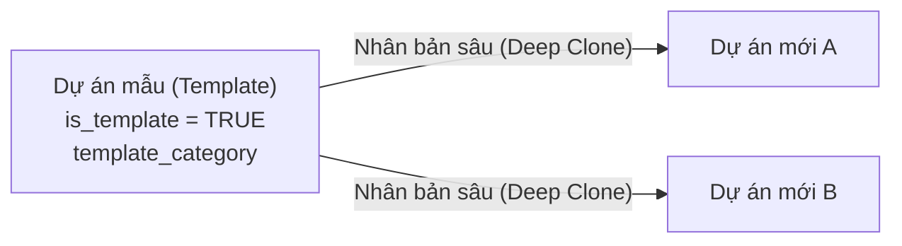
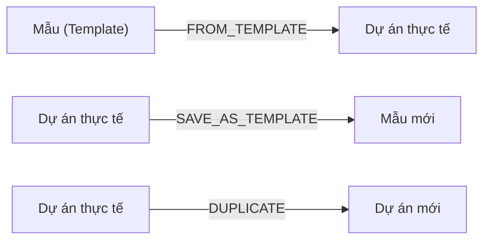
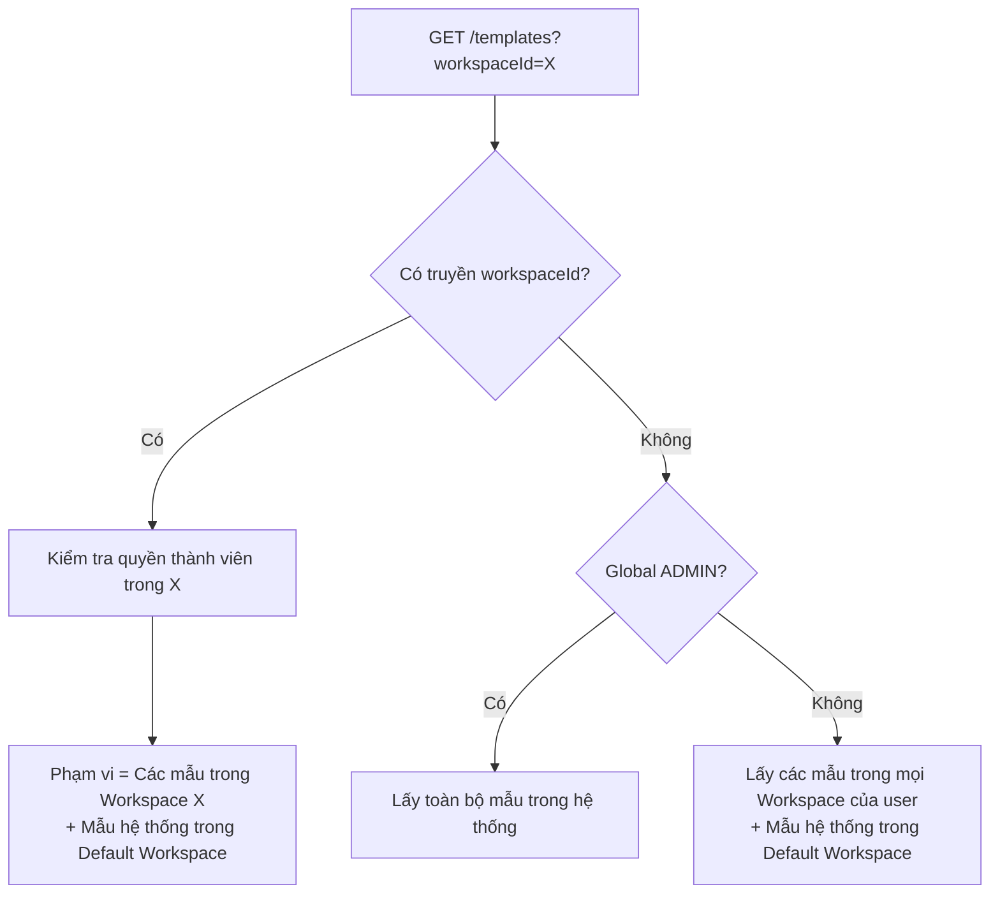
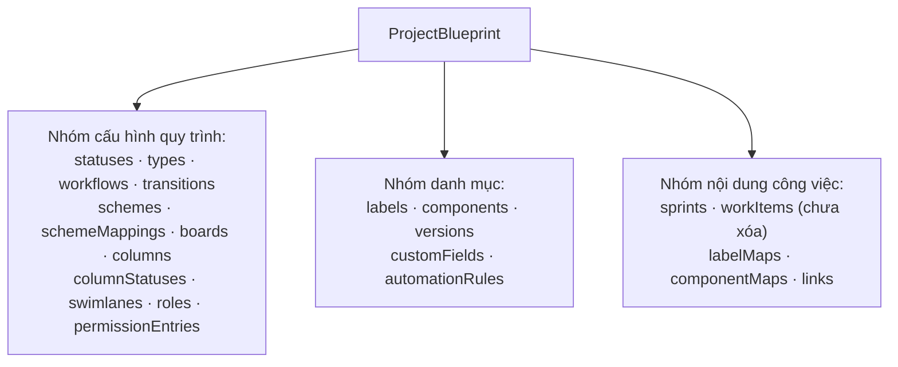
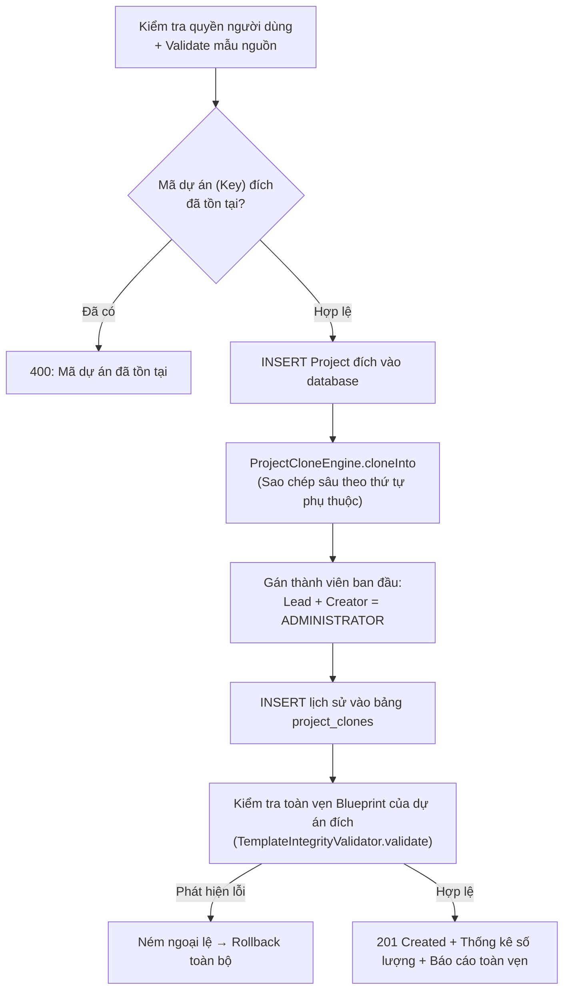
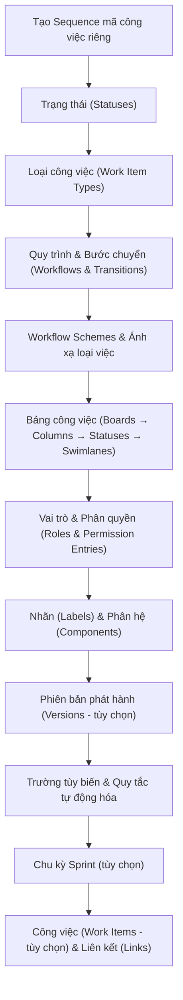

# 04 — Tài liệu nghiệp vụ: Template · Clone Project

> Nguồn: `ProjectTemplateController`, `ProjectTemplateServiceImpl`, `service/template/*` (`ProjectBlueprint`, `ProjectBlueprintLoader`, `ProjectCloneEngine`, `TemplateIntegrityValidator`, `TemplatePreviewBuilder`, `TemplateDataSeeder`), migration `V6__project_templates.sql`, `V7__seed_default_templates.sql`, frontend `TemplateGallery`, `TemplatePreviewModal`, `SaveAsTemplateModal`, `CreateProjectModal`.

---

## Mục lục

1. [Khái niệm](#1-khái-niệm)
2. [Ba kiểu nhân bản](#2-ba-kiểu-nhân-bản)
3. [Thư viện mẫu](#3-thư-viện-mẫu)
4. [Blueprint — "bản thiết kế" của một dự án](#4-blueprint--bản-thiết-kế-của-một-dự-án)
5. [Quy trình nhân bản chung](#5-quy-trình-nhân-bản-chung)
6. [Clone Engine](#6-clone-engine)
7. [Luồng 1 — Tạo dự án từ mẫu & Quick Customization](#7-luồng-1--tạo-dự-án-từ-mẫu--quick-customization)
8. [Luồng 2 — Lưu dự án thành mẫu](#8-luồng-2--lưu-dự-án-thành-mẫu)
9. [Luồng 3 — Nhân bản dự án](#9-luồng-3--nhân-bản-dự-án)
10. [Đánh dấu trực tiếp một dự án là mẫu](#10-đánh-dấu-trực-tiếp-một-dự-án-là-mẫu)
11. [Kiểm tra toàn vẹn (Template Integrity Validator)](#11-kiểm-tra-toàn-vẹn-template-integrity-validator)
12. [Nhật ký nhân bản và thống kê](#12-nhật-ký-nhân-bản-và-thống-kê)
13. [Mẫu hệ thống có sẵn](#13-mẫu-hệ-thống-có-sẵn)
14. [Danh mục API](#14-danh-mục-api)

---

## 1. Khái niệm

**Dự án mẫu** (Template) là một thực thể `Project` bình thường có cờ `is_template = TRUE`. Mẫu sở hữu đầy đủ toàn bộ hệ sinh thái của một dự án tiêu chuẩn (trạng thái, loại công việc, quy trình, bảng Kanban/Scrum, vai trò, sprint, công việc mẫu...) nhưng đóng vai trò là **khuôn mẫu để sao chép**, không dùng để vận hành công việc thực tế.



| Đặc điểm khác biệt giữa Mẫu và Dự án thông thường | Chi tiết xử lý trong mã nguồn |
|---|---|
| **Không được chạy Sprint** | `SprintServiceImpl.startSprint` chủ động chặn nếu dự án là mẫu |
| **Ẩn khỏi danh sách dự án làm việc** | `ProjectServiceImpl.getAllProjects` mặc định lọc `isTemplate = false` |
| **Có phân loại lĩnh vực** | Thuộc tính `template_category`: `SOFTWARE`, `BUSINESS`, `MARKETING`, `DESIGN`, `OPERATIONS`, `EDUCATION`, `OTHER` |
| **Đếm lượt sử dụng** | Tự động thống kê số lượt clone từ bảng `project_clones` |

---

## 2. Ba kiểu nhân bản



| Tiêu chí | FROM_TEMPLATE | SAVE_AS_TEMPLATE | DUPLICATE |
|---|---|---|---|
| **Nguồn** | Dự án mẫu (`is_template = true`) | Dự án thông thường | Dự án thực tế (hoặc mẫu) |
| **Đích sinh ra** | Dự án thực tế (`is_template = false`) | Dự án mẫu mới (`is_template = true`) | Cùng loại với dự án nguồn |
| **Dời mốc thời gian** | Tự động dời toàn bộ lịch theo `startDate` mới | **Không** (offset = 0 ngày) | Dời toàn bộ lịch theo `startDate` mới |
| **Workspace đích** | Người dùng lựa chọn trong các Workspace của mình | Cùng Workspace với dự án nguồn | Cùng Workspace với dự án nguồn |
| **Project Lead** | Chỉ định hoặc mặc định là người thực hiện | Người thực hiện | Người thực hiện |
| **Tùy chọn sao chép** | sprints, workItems, versions, **customizations** | sprints, workItems, versions | sprints, workItems (versions luôn sao chép) |
| **Quyền hạn yêu cầu** | Có quyền dùng mẫu + là `MEMBER+` trong Workspace đích | Có quyền `PROJECT_ADMIN` dự án nguồn + là `MEMBER+` Workspace | Có quyền `PROJECT_ADMIN` dự án nguồn + là `MEMBER+` Workspace |

---

## 3. Thư viện mẫu

### 3.1. Phạm vi hiển thị mẫu

Endpoint: `GET /templates?workspaceId=...`



Các mẫu thuộc **Default Workspace** (`a0000000-0000-0000-0000-000000000001`) là **mẫu hệ thống dùng chung**: bất kỳ người dùng nào ở mọi Workspace đều có thể xem và khởi tạo dự án từ các mẫu này.

### 3.2. Điều kiện được dùng một mẫu (`assertCanUseTemplate`)

Một người dùng được phép sử dụng một mẫu khi thỏa mãn một trong các điều kiện:
1. Là Global ADMIN.
2. Mẫu thuộc Default Workspace (mẫu hệ thống).
3. Là Lead, người tạo hoặc có gán vai trò trong chính dự án mẫu đó.
4. Là thành viên (bất kỳ vai trò nào) của Workspace sở hữu mẫu đó.

---

## 4. Blueprint — "bản thiết kế" của một dự án

Lớp `ProjectBlueprintLoader` đọc toàn bộ thực thể liên kết của một dự án và nạp vào một Java Record bất biến `ProjectBlueprint`. Mọi thao tác nhân bản và kiểm tra toàn vẹn đều xử lý tập trung trên Blueprint này.



### Các mốc thời gian của Blueprint

- `anchorDate()`: Ngày neo gốc của dự án. Lấy `project.startDate`, nếu để trống sẽ tự động lấy ngày sớm nhất trong các Sprint, công việc hoặc phiên bản phát hành.
- `latestDate()`: Mốc thời gian muộn nhất trong `project.endDate`, ngày kết thúc sprint, hạn chót công việc, hoặc ngày phát hành version.
- `spanDays()`: Độ dài tổng thể của timeline (`latestDate - anchorDate`).

---

## 5. Quy trình nhân bản chung

Cả ba luồng nhân bản đều thực thi qua lõi `cloneAndFinalize` trong **một transaction duy nhất**:



---

## 6. Clone Engine

### 6.1. Thứ tự sao chép chuẩn (Dependency Order)



### 6.2. Cơ chế Ánh xạ ID (`idMap`)

Trong quá trình sao chép, một bảng tra cứu `idMap` (UUID cũ $\rightarrow$ UUID mới) được duy trì:
- Các tham chiếu nội bộ trong dự án được cập nhật chính xác sang ID mới.
- Các thuộc tính JSONB cấu hình (`conditions_config`, `validators_config`, `custom_fields`) được duyệt đệ quy; mọi chuỗi UUID khớp với ID cũ sẽ tự động được thay thế bằng ID mới tương ứng.

### 6.3. Thuật toán dời mốc thời gian (Date Shifting)

$$offset = startDate_{mới} - anchorDate_{nguồn}$$

Toàn bộ mốc thời gian của Sprint, hạn chót công việc, ngày bắt đầu và ngày phát hành của version đều được cộng thêm đúng $offset$ ngày. Nhờ đó, khoảng cách tương đối và lộ trình tiến độ của dự án mẫu được giữ nguyên vẹn.

---

## 7. Luồng 1 — Tạo dự án từ mẫu & Quick Customization

### 7.1. Cấu trúc Request (`CreateProjectFromTemplateRequest`)

```json
{
  "workspaceId": "a1111111-...",
  "name": "Cửa Hàng Trà Sữa Phố",
  "key": "FNB",
  "description": "Dự án triển khai theo mẫu F&B",
  "leadUserId": "b2222222-...",
  "startDate": "2026-11-01",
  "endDate": "2027-02-01",
  "includeSprints": true,
  "includeWorkItems": true,
  "includeVersions": true,
  "customizations": { ... }
}
```

### 7.2. Tính năng Tùy biến nhanh (Quick Customization)

Hệ thống cung cấp đối tượng `TemplateCustomizationsRequest` cho phép người dùng tùy biến linh hoạt ngay trong lúc khởi tạo:

| Trường tùy biến | Ý nghĩa nghiệp vụ |
|-----------------|-------------------|
| `renamedStatuses` | Map `{sourceStatusId: "Tên trạng thái mới"}` để đổi tên trạng thái phù hợp với tổ chức |
| `renamedTypes` | Map `{sourceTypeId: "Tên loại việc mới"}` để đổi tên loại công việc |
| `excludedSprintIds` | Danh sách ID sprint trong mẫu cần **bỏ qua không sao chép** |
| `renamedSprints` | Map `{sourceSprintId: "Tên sprint mới"}` |
| `excludedWorkItemIds` | Danh sách ID công việc trong mẫu cần **bỏ qua** (hệ thống tự động loại bỏ toàn bộ subtask con của các việc này) |
| `renamedWorkItems` | Map `{sourceWorkItemId: "Tiêu đề summary mới"}` |

---

## 8. Luồng 2 — Lưu dự án thành mẫu

- Endpoint: `POST /projects/{id}/save-as-template`
- Request: `SaveAsTemplateRequest` (`name`, `key`, `description`, `templateCategory`, `includeSprints`, `includeWorkItems`, `includeVersions`).
- Yêu cầu quyền: `PROJECT_ADMIN` trên dự án nguồn và là `MEMBER+` trong Workspace.
- Cơ chế: Thực hiện sao chép với $offset = 0$ ngày, gán cờ `is_template = true`.

---

## 9. Luồng 3 — Nhân bản dự án

- Endpoint: `POST /projects/{id}/clone`
- Request: `CloneProjectRequest` (`name`, `key`, `startDate`, `includeItems`, `includeSprints`).
- Yêu cầu quyền: `PROJECT_ADMIN` trên dự án nguồn.
- Tạo ra một dự án mới hoàn toàn độc lập trong cùng Workspace với các mốc thời gian được dời tương ứng theo `startDate`.

---

## 10. Đánh dấu trực tiếp một dự án là mẫu

Quản trị viên có thể chuyển đổi một dự án đang có thành dự án mẫu bằng cách gọi `PUT /projects/{id}` và gán `isTemplate = true`.
- Trước khi cập nhật, `TemplateIntegrityValidator` kiểm tra tính hợp lệ của dự án. Nếu vi phạm bất kỳ ràng buộc nghiêm trọng nào, hệ thống từ chối cập nhật và trả về danh sách lỗi cụ thể (HTTP 400).
- Endpoint kiểm tra trước mà không thay đổi dữ liệu: `GET /projects/{id}/template-check`.

---

## 11. Kiểm tra toàn vẹn (Template Integrity Validator)

`TemplateIntegrityValidator` kiểm tra tính toàn vẹn của Blueprint và phân loại thành **Lỗi (Error - Chặn thực thi)** hoặc **Cảnh báo (Warning - Chỉ thông báo)**:

| Mã kiểm tra | Mức độ | Điều kiện vi phạm |
|-------------|:------:|-------------------|
| `PROJECT_DATE_RANGE` | Lỗi | Ngày kết thúc trước ngày bắt đầu |
| `NO_STATUS` | Lỗi | Dự án không có bất kỳ trạng thái nào |
| `NO_TODO_STATUS` / `NO_DONE_STATUS` | Lỗi | Thiếu trạng thái thuộc nhóm `TODO` hoặc nhóm `DONE` |
| `NO_IN_PROGRESS_STATUS` | Cảnh báo | Thiếu trạng thái thuộc nhóm `IN_PROGRESS` |
| `DUPLICATE_STATUS` | Lỗi | Trùng tên trạng thái trong cùng dự án |
| `NO_STANDARD_TYPE` | Lỗi | Không có loại công việc cấp 0 (Standard Task) |
| `DUPLICATE_TYPE_CODE` | Lỗi | Trùng mã loại công việc (Type Code) |
| `NO_WORKFLOW` | Lỗi | Dự án không có quy trình workflow nào |
| `TRANSITION_FOREIGN_STATUS` | Lỗi | Bước chuyển trỏ tới trạng thái không thuộc dự án |
| `NO_CREATE_TRANSITION` | Cảnh báo | Thiếu bước chuyển khởi tạo (`from_status = null`) |
| `STATUS_NOT_ON_BOARD` | Cảnh báo | Có trạng thái chưa được đưa vào cột nào trên Board |
| `MISSING_ROLE` | Lỗi | Thiếu một trong các vai trò cốt lõi (`ADMINISTRATOR`, `MEMBER`, `VIEWER`) |
| `ITEM_HIERARCHY` | Lỗi | Vi phạm phân cấp công việc 3 cấp độ |

---

## 12. Nhật ký nhân bản và thống kê

Mỗi lần nhân bản thành công, một bản ghi được lưu vào bảng `project_clones`:
- `source_project_id`: ID dự án nguồn.
- `cloned_project_id`: ID dự án mới sinh ra (duy nhất).
- `clone_type`: `FROM_TEMPLATE`, `SAVE_AS_TEMPLATE`, hoặc `DUPLICATE`.
- `date_offset_days`: Số ngày dịch chuyển mốc thời gian.
- `clone_options`: Lưu trữ các cờ tùy chọn (`includeSprints`, `includeWorkItems`, `includeVersions`).
- `clone_stats`: Thống kê số lượng bản ghi đã tạo (ví dụ: `{ "statuses": 3, "workItems": 24, "sprints": 3 }`).

---

## 13. Mẫu hệ thống có sẵn

Hệ thống được khởi tạo sẵn 3 dự án mẫu tiêu chuẩn trong Default Workspace (thông qua Flyway migration `V7` và `TemplateDataSeeder`):

| Mã Key | Tên dự án mẫu | Phân loại | Độ dài timeline |
|--------|---------------|-----------|:---------------:|
| `TPLFNB` | Xây dựng Cửa hàng F&B (Nhà hàng – Quán Café) | `BUSINESS` | 90 ngày |
| `TPLWEB` | Xây dựng Website Bán hàng E-Commerce | `SOFTWARE` | 90 ngày |
| `TPLAGRI` | Kế hoạch Vận hành Mùa vụ Cây ăn quả | `OPERATIONS` | 90 ngày |

Cả ba mẫu đều sở hữu đầy đủ quy trình chuẩn, các vai trò phân quyền, bảng Kanban/Scrum, nhãn, phân hệ, các Sprint kế hoạch và cây phân cấp công việc hoàn chỉnh (`Epic › Task › Subtask`).

---

## 14. Danh mục API

Tiền tố chung: `/work/api/v1/work`

| Phương thức | Endpoint | Quyền hạn yêu cầu | Mô tả |
|:-----------:|----------|-------------------|-------|
| GET | `/templates?workspaceId=&category=&search=` | Thành viên Workspace | Lấy danh sách mẫu trong thư viện |
| GET | `/templates/{id}/preview` | Quyền xem mẫu | Xem chi tiết cấu hình, sprint và cây công việc của mẫu |
| POST | `/templates/{id}/projects` | Quyền xem mẫu + WS MEMBER+ | Khởi tạo dự án mới từ mẫu (kèm tùy biến nhanh) |
| POST | `/projects/{id}/save-as-template` | `PROJECT_ADMIN` + WS MEMBER+ | Lưu dự án hiện tại thành một mẫu mới |
| POST | `/projects/{id}/clone` | `PROJECT_ADMIN` dự án nguồn | Nhân bản dự án trong cùng Workspace |
| GET | `/projects/{id}/template-check` | `PROJECT_VIEW` | Kiểm tra tính toàn vẹn của dự án trước khi lưu mẫu |
| GET | `/projects/templates` | Thành viên Workspace | API tương thích lấy danh sách mẫu dạng ProjectResponse |
