# 04 — Tài liệu nghiệp vụ: Template · Clone Project

> Nguồn: `ProjectTemplateController`, `ProjectTemplateServiceImpl`, `service/template/*` (`ProjectBlueprint`, `ProjectBlueprintLoader`, `ProjectCloneEngine`, `TemplateIntegrityValidator`, `TemplatePreviewBuilder`, `TemplateDataSeeder`), migration `V6__project_templates.sql`, `V7__seed_default_templates.sql`, frontend `TemplateGallery`, `TemplatePreviewModal`, `SaveAsTemplateModal`, `CreateProjectModal`.

---

## Mục lục

1. [Khái niệm](#1-khái-niệm)
2. [Ba kiểu nhân bản](#2-ba-kiểu-nhân-bản)
3. [Thư viện mẫu](#3-thư-viện-mẫu)
4. [Blueprint — "bản thiết kế" của một dự án](#4-blueprint--bản-thiết-kế-của-một-dự-án)
5. [Quy trình chung](#5-quy-trình-chung)
6. [Clone Engine](#6-clone-engine)
7. [Luồng 1 — Tạo dự án từ mẫu](#7-luồng-1--tạo-dự-án-từ-mẫu)
8. [Luồng 2 — Lưu dự án thành mẫu](#8-luồng-2--lưu-dự-án-thành-mẫu)
9. [Luồng 3 — Nhân bản dự án](#9-luồng-3--nhân-bản-dự-án)
10. [Đánh dấu trực tiếp một dự án là mẫu](#10-đánh-dấu-trực-tiếp-một-dự-án-là-mẫu)
11. [Kiểm tra toàn vẹn](#11-kiểm-tra-toàn-vẹn)
12. [Nhật ký nhân bản và thống kê](#12-nhật-ký-nhân-bản-và-thống-kê)
13. [Mẫu hệ thống có sẵn](#13-mẫu-hệ-thống-có-sẵn)
14. [Danh mục API](#14-danh-mục-api)

---

## 1. Khái niệm

**Dự án mẫu** (Template) là một `Project` bình thường có cờ `is_template = TRUE`. Mẫu có đủ mọi thứ một dự án có (trạng thái, workflow, board, vai trò, sprint, công việc...) nhưng dùng để **sao chép**, không dùng để làm việc thật.

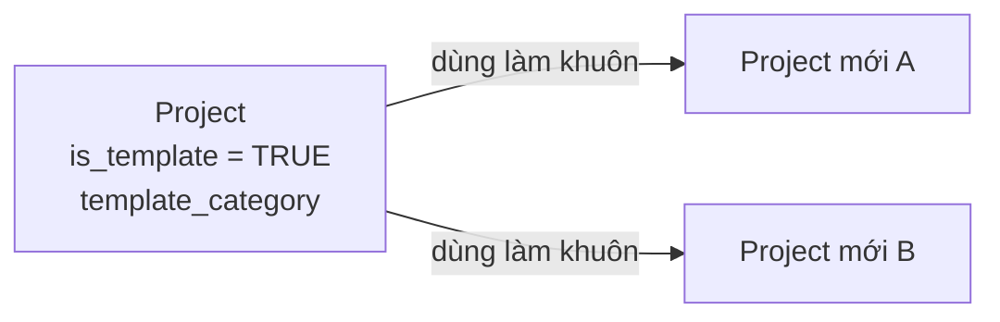

| Điểm khác giữa mẫu và dự án thường | |
|---|---|
| Không bắt đầu được Sprint | `SprintServiceImpl.startSprint` chặn |
| Không hiện trong danh sách dự án thường | Lọc `isTemplate = false` |
| Có phân loại | `SOFTWARE, BUSINESS, MARKETING, DESIGN, OPERATIONS, EDUCATION, OTHER` |
| Có đếm lượt dùng | Đếm từ `project_clones` |

---

## 2. Ba kiểu nhân bản

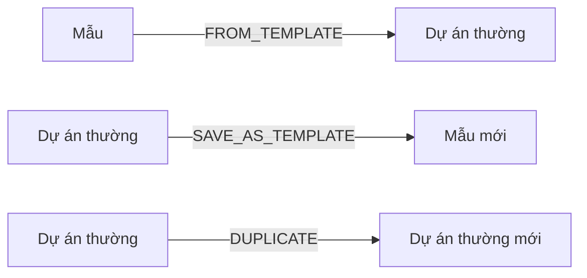

| | FROM_TEMPLATE | SAVE_AS_TEMPLATE | DUPLICATE |
|---|---|---|---|
| Nguồn | Mẫu | Dự án | Dự án (hoặc mẫu) |
| Đích | Dự án thường | Mẫu | Cùng loại với nguồn |
| Dời ngày | Theo `startDate` mới | **Không** (offset = 0) | Theo `startDate` bắt buộc |
| Workspace đích | Người dùng chọn | Như nguồn | Như nguồn |
| Team đích | Người dùng chọn | Chọn hoặc như nguồn | Như nguồn |
| Lead đích | Chọn hoặc người tạo | Người thực hiện | Người thực hiện |
| Tùy chọn | sprints, workItems, versions | sprints, workItems, versions | sprints, items (versions luôn có) |
| Quyền | Dùng được mẫu + được tạo dự án | `PROJECT_ADMIN` nguồn + được tạo dự án | `PROJECT_ADMIN` nguồn + được tạo dự án |

"Được tạo dự án" = trưởng nhóm của team đích, hoặc Global ADMIN (giống quy tắc tạo dự án trong tài liệu 02).

---

## 3. Thư viện mẫu

### 3.1. Phạm vi nhìn thấy

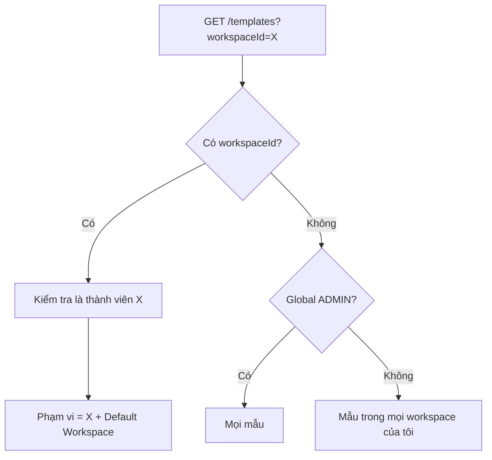

Mẫu thuộc **Default Workspace** được coi là **mẫu hệ thống**: mọi người dùng ở mọi workspace đều xem và dùng được.

### 3.2. Ai được dùng một mẫu

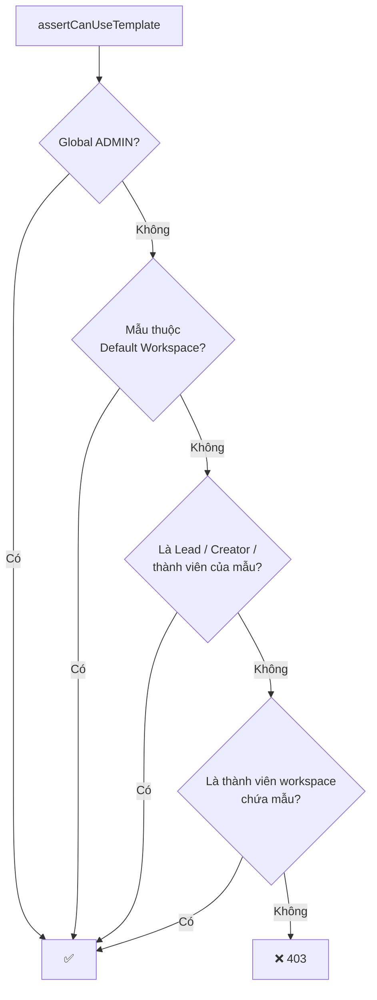

### 3.3. Thông tin hiển thị

| Màn hình | Nội dung (`TemplatePreviewBuilder`) |
|----------|------------------------------------|
| Thẻ mẫu (summary) | Tên, key, mô tả, phân loại, kiểu dự án, số loại công việc / Epic / sprint / công việc, độ dài timeline, số lượt dùng |
| Xem trước (preview) | Toàn bộ trạng thái, workflow + transition, loại công việc, cột board, vai trò + quyền, sprint, cây công việc, nhãn, component, version, báo cáo toàn vẹn |

---

## 4. Blueprint — "bản thiết kế" của một dự án

`ProjectBlueprintLoader` nạp **mọi bảng con** của một dự án vào một record bất biến `ProjectBlueprint`. Engine clone và validator đều chỉ làm việc trên blueprint.

### 4.1. Nhóm cấu hình

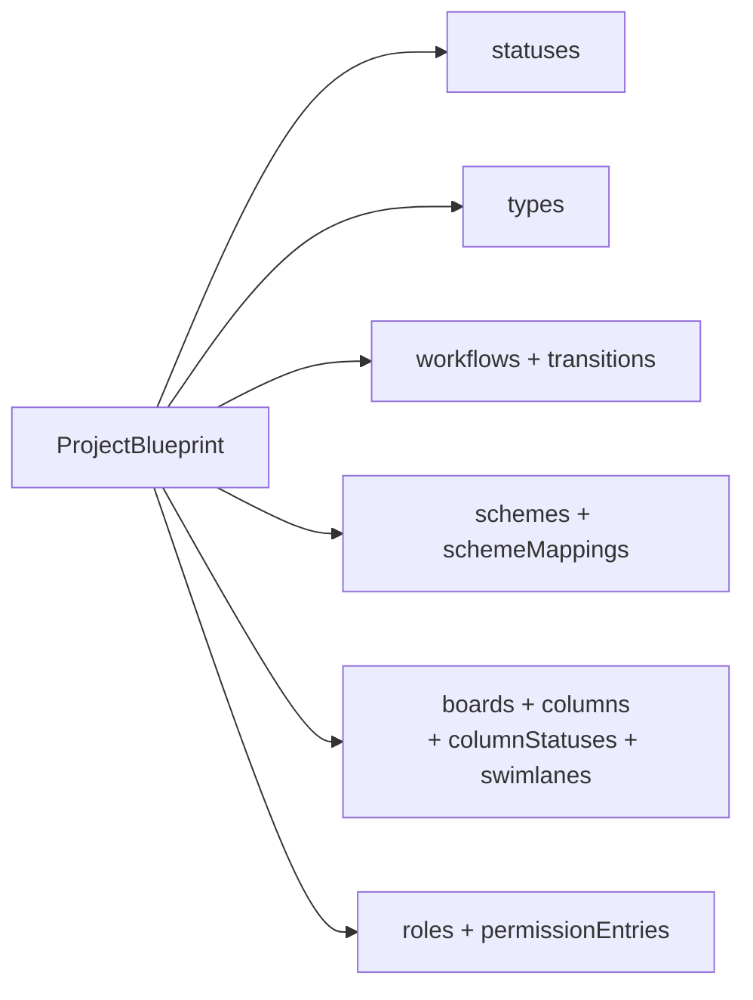

### 4.2. Nhóm danh mục

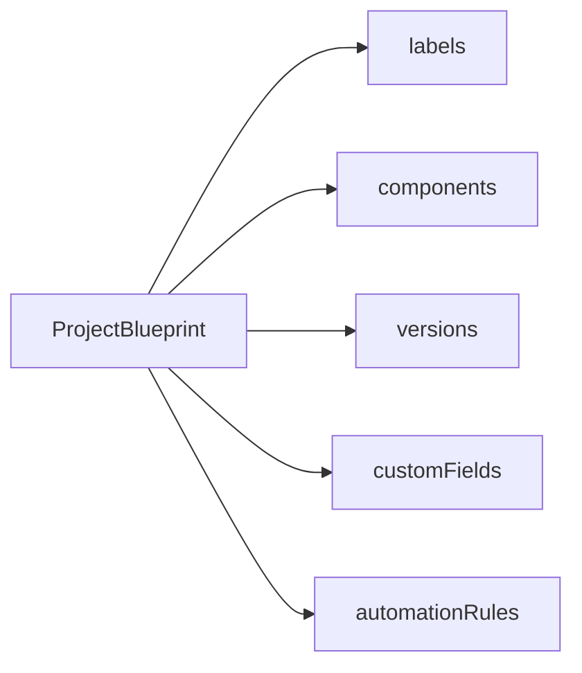

### 4.3. Nhóm nội dung

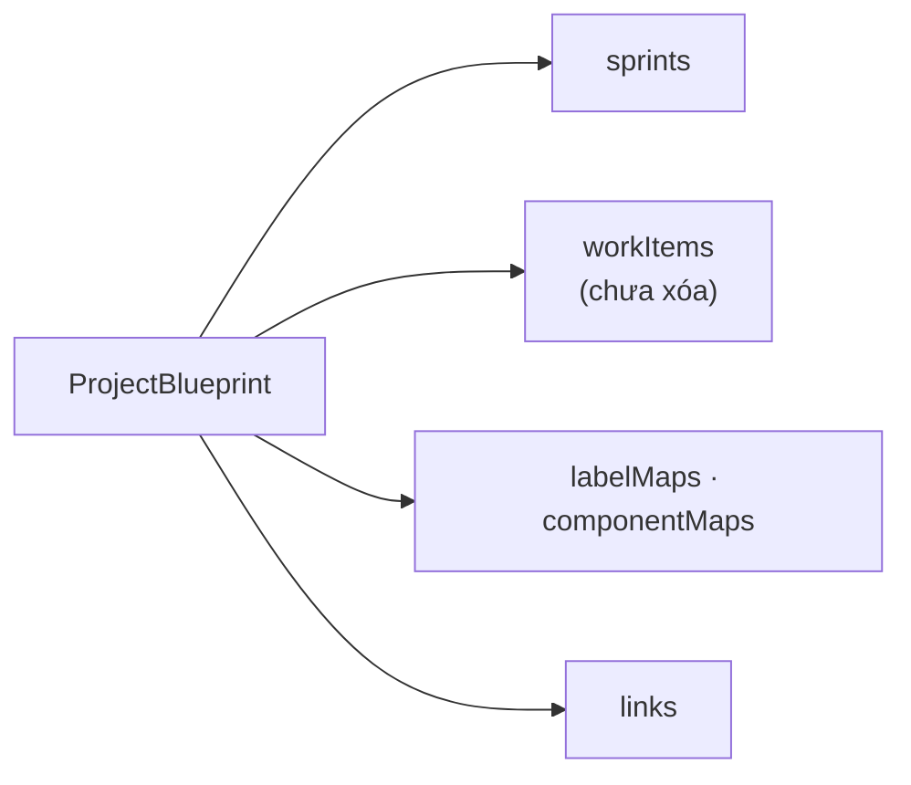

### 4.4. Mốc thời gian của blueprint

| Hàm | Ý nghĩa |
|-----|---------|
| `anchorDate()` | `project.startDate`, nếu trống thì ngày sớm nhất trong sprint / công việc / version |
| `latestDate()` | Muộn nhất trong `project.endDate`, sprint, hạn công việc, ngày phát hành |
| `spanDays()` | `latestDate − anchorDate` (độ dài timeline) |

> ⚠️ Thêm bảng con mới cho dự án thì **bắt buộc** bổ sung vào `ProjectBlueprint`, loader và engine; nếu không, mẫu sẽ âm thầm bỏ sót bảng đó.

---

## 5. Quy trình chung

Cả ba kiểu nhân bản đều đi qua cùng một lõi `cloneAndFinalize`, trong **một transaction**.

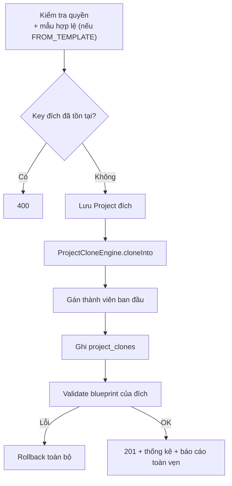

**Thành viên ban đầu** của dự án đích: Lead + người thực hiện là ADMINISTRATOR, cộng thành viên team (nếu có) theo ánh xạ LEADER→ADMINISTRATOR, VIEWER→VIEWER, còn lại MEMBER. Thành viên của mẫu **không** được sao chép.

---

## 6. Clone Engine

### 6.1. Thứ tự sao chép (theo phụ thuộc)

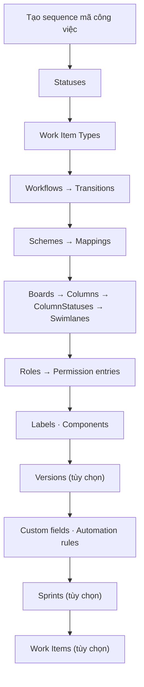

Bảng nào phụ thuộc bảng nào thì sao chép sau bảng đó, để khi sao chép đã biết id đích.

### 6.2. Ánh xạ ID

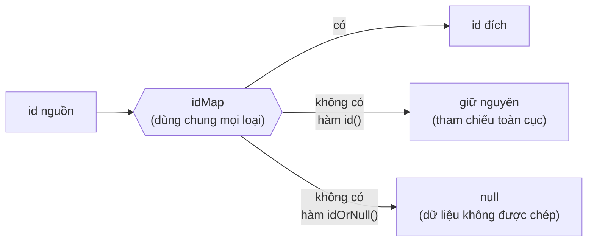

- `id()` dùng cho tham chiếu bắt buộc (status, type, workflow...).
- `idOrNull()` dùng cho tham chiếu tùy chọn (sprint, component, version) — nếu phần đó không được chọn sao chép thì đặt `null`.

### 6.3. Ánh xạ trong JSON

Các cột JSONB (`conditions/validators/post_functions_config`, `custom_fields`, `options`, `actions_config`...) được **duyệt đệ quy**; mọi chuỗi dài 36 ký tự parse được thành UUID có trong `idMap` sẽ được thay bằng id đích.

### 6.4. Dời mốc thời gian

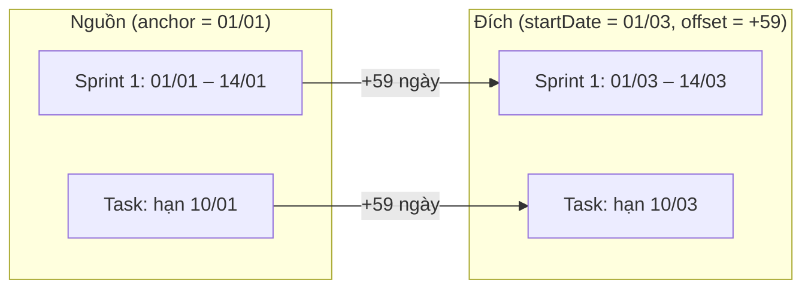

`offset = startDate_mới − anchorDate_nguồn`. Mọi ngày của sprint, công việc, version cộng cùng một offset → **khoảng cách tương đối được giữ nguyên**. Hạn chót dự án mặc định = `latestDate + offset`.

### 6.5. Cái gì được giữ, đặt lại, bỏ đi

| Đối tượng | Giữ nguyên | Đặt lại | Bỏ đi |
|-----------|-----------|---------|-------|
| Cấu hình (status, type, workflow, board, role, quyền) | ✅ toàn bộ | Tên workflow/scheme/board đổi tiền tố theo tên dự án mới | |
| Label, Component | Tên, màu, mô tả | | Lead của component |
| Version | Tên, mô tả, ngày (dời) | `is_released = false`, `is_archived = false` | |
| Sprint | Tên, mục tiêu, ngày (dời) | `state = FUTURE`, `completedDate = null` | |
| Work Item | Tóm tắt, mô tả, ưu tiên, story points, ước lượng ban đầu, rank, cây cha-con, nhãn, component, liên kết | Mã mới theo key đích; trạng thái = trạng thái khởi tạo của workflow; `remaining = original`; `reporter = người thực hiện` | Assignee, resolution, time spent, resolvedAt |
| Bình luận, tệp đính kèm, changelog | | | ✅ không sao chép |
| Thành viên (role_assignments) | | | ✅ không sao chép |

Mỗi công việc được tạo ra có một dòng changelog: *"Đã tạo công việc WEB-3 từ TPLWEB-3 của mẫu ..."*.

### 6.6. Trạng thái khởi tạo của công việc được chép

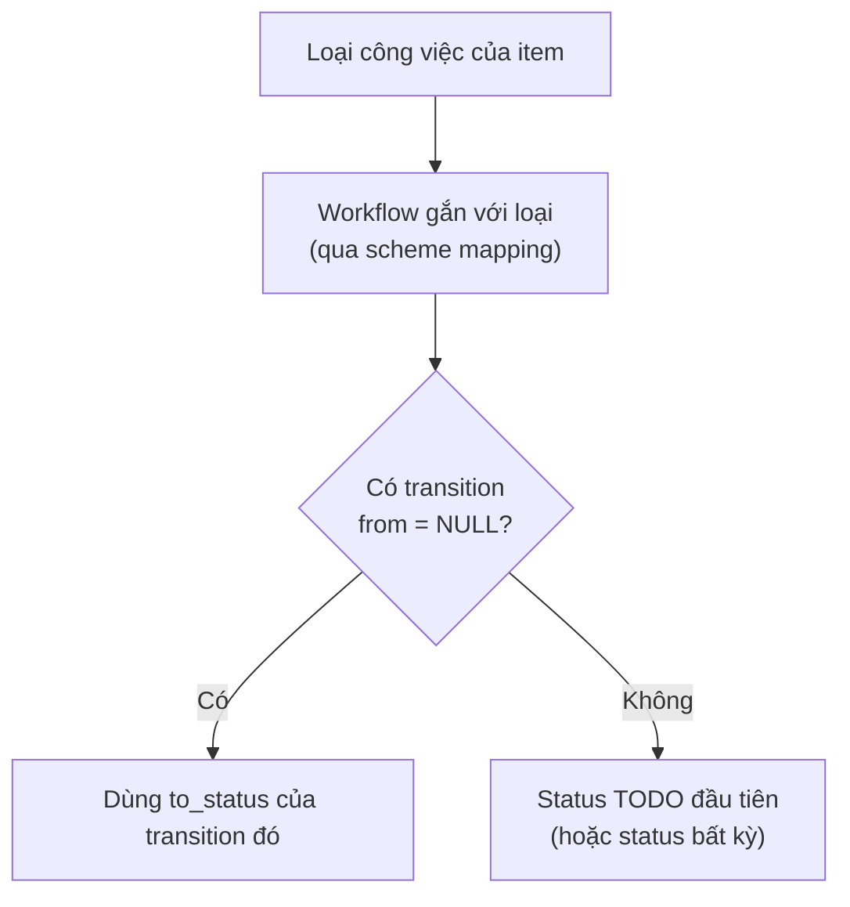

---

## 7. Luồng 1 — Tạo dự án từ mẫu

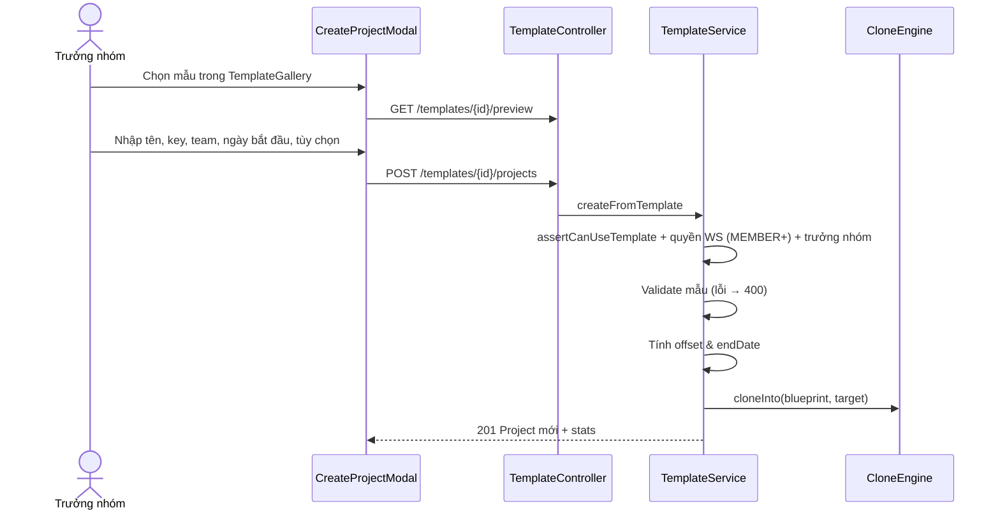

| Ràng buộc | |
|---|---|
| `endDate` (nếu nhập) không được trước `startDate` | 400 |
| `startDate` mặc định = hôm nay | |
| Mô tả mặc định = mô tả của mẫu | |

---

## 8. Luồng 2 — Lưu dự án thành mẫu

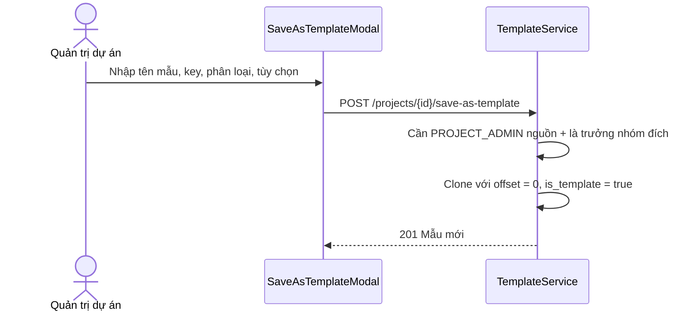

- Mẫu giữ nguyên ngày của dự án nguồn; việc dời ngày chỉ xảy ra khi **dùng** mẫu.
- Phân loại mặc định = `OTHER`.

---

## 9. Luồng 3 — Nhân bản dự án

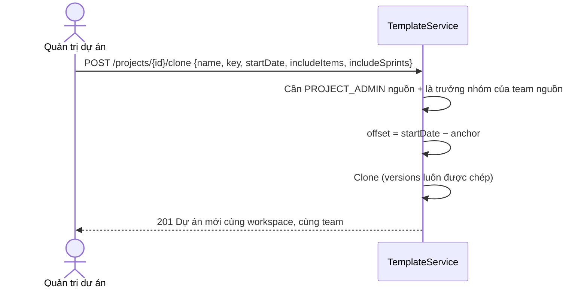

---

## 10. Đánh dấu trực tiếp một dự án là mẫu

Ngoài "Lưu thành mẫu" (tạo bản sao), quản trị dự án có thể **bật cờ** `isTemplate` ngay trên dự án hiện có qua `PUT /projects/{id}`:

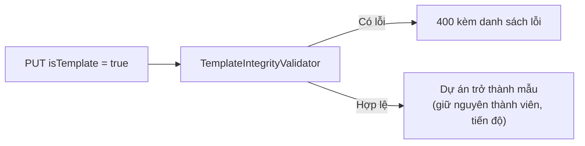

`GET /projects/{id}/template-check` cho phép kiểm tra trước mà không thay đổi gì.

---

## 11. Kiểm tra toàn vẹn

`TemplateIntegrityValidator` trả về danh sách **lỗi** (chặn) và **cảnh báo** (chỉ thông báo). Được chạy ở 3 thời điểm: trước khi dùng mẫu, sau khi clone (trên đích), và khi bật cờ mẫu.

### 11.1. Dự án và trạng thái

| Mã | Mức | Điều kiện |
|----|-----|-----------|
| `PROJECT_DATE_RANGE` | Lỗi | Hạn chót trước ngày bắt đầu |
| `NO_STATUS` | Lỗi | Không có trạng thái |
| `NO_TODO_STATUS` / `NO_DONE_STATUS` | Lỗi | Thiếu nhóm TODO / DONE |
| `NO_IN_PROGRESS_STATUS` | Cảnh báo | Thiếu nhóm IN_PROGRESS |
| `DUPLICATE_STATUS` | Lỗi | Trùng tên trạng thái |

### 11.2. Loại công việc, workflow, board, vai trò

| Mã | Mức | Điều kiện |
|----|-----|-----------|
| `NO_STANDARD_TYPE` | Lỗi | Không có loại cấp 0 |
| `DUPLICATE_TYPE_CODE` | Lỗi | Trùng mã loại |
| `NO_WORKFLOW` | Lỗi | Không có workflow |
| `TRANSITION_FOREIGN_STATUS` | Lỗi | Transition trỏ ra trạng thái ngoài dự án |
| `NO_CREATE_TRANSITION` / `STATUS_UNREACHABLE` | Cảnh báo | Thiếu bước khởi tạo / trạng thái không tới được |
| `SCHEME_FOREIGN_TYPE` / `SCHEME_FOREIGN_WORKFLOW` | Lỗi | Scheme trỏ ra ngoài dự án |
| `TYPE_UNMAPPED` | Cảnh báo | Loại chưa gắn workflow |
| `NO_BOARD` / `STATUS_NOT_ON_BOARD` | Cảnh báo | Thiếu board / trạng thái không nằm cột nào |
| `COLUMN_FOREIGN_STATUS`, `WIP_LIMIT_RANGE` | Lỗi | Cột gom trạng thái ngoài / WIP min > max |
| `MISSING_ROLE` | Lỗi | Thiếu một trong ADMINISTRATOR, MEMBER, VIEWER |

### 11.3. Sprint và công việc

| Mã | Mức | Điều kiện |
|----|-----|-----------|
| `KANBAN_WITH_SPRINTS` | Cảnh báo | Dự án Kanban có sprint |
| `SPRINT_NOT_FUTURE` | Cảnh báo | Sprint không ở FUTURE |
| `SPRINT_DATE_RANGE`, `SPRINT_TOO_LONG` (> 8 tuần), `SPRINT_AFTER_PROJECT` | Lỗi | |
| `SPRINT_BEFORE_PROJECT`, `SPRINT_OVERLAP` | Cảnh báo | |
| `ITEM_FOREIGN_STATUS/TYPE/SPRINT/PARENT`, `ITEM_HIERARCHY`, `ITEM_DATE_RANGE` | Lỗi | |
| `ITEM_AFTER_PROJECT` | Cảnh báo | Hạn công việc sau hạn dự án |

---

## 12. Nhật ký nhân bản và thống kê

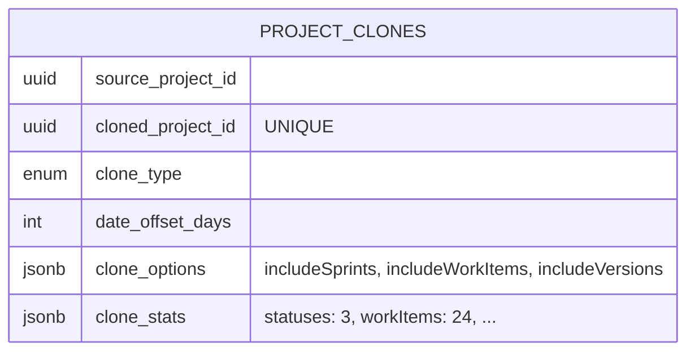

- **Lượt dùng** của một mẫu = số dòng `FROM_TEMPLATE` có `source_project_id` là mẫu đó.
- `clone_stats` cho phép hiển thị "Đã tạo 3 trạng thái, 2 workflow, 24 công việc...".

---

## 13. Mẫu hệ thống có sẵn

Ba mẫu được tạo sẵn trong Default Workspace bởi migration `V7` (và được `TemplateDataSeeder` tạo lại khi thư viện rỗng):

| Key | Tên | Phân loại | Độ dài |
|-----|-----|-----------|--------|
| `TPLFNB` | Xây dựng Cửa hàng F&B (Nhà hàng – Quán Café) | BUSINESS | 90 ngày |
| `TPLWEB` | Xây dựng Website Bán hàng E-Commerce | SOFTWARE | 90 ngày |
| `TPLAGRI` | Kế hoạch Vận hành Mùa vụ Cây ăn quả | OPERATIONS | 90 ngày |

Cả ba mẫu đều mang `project_type = SOFTWARE_SCRUM`, kể cả hai mẫu không phải phần mềm.

Mỗi mẫu có đủ vai trò, quyền, loại công việc, trạng thái, workflow, board, component, nhãn, sprint và cây công việc Epic → Task → Subtask.

---

## 14. Danh mục API

| Phương thức | Endpoint (tiền tố `/work/api/v1/work`) | Quyền |
|-------------|----------------------------------------|-------|
| GET | `/templates?workspaceId=&category=&search=` | Thành viên workspace |
| GET | `/templates/{id}/preview` | Dùng được mẫu |
| POST | `/templates/{id}/projects` | Dùng được mẫu + WS MEMBER+ + trưởng nhóm đích |
| POST | `/projects/{id}/save-as-template` | `PROJECT_ADMIN` + trưởng nhóm đích |
| POST | `/projects/{id}/clone` | `PROJECT_ADMIN` + trưởng nhóm team nguồn |
| GET | `/projects/{id}/template-check` | `PROJECT_VIEW` |
| GET | `/projects/templates` | (cũ) danh sách mẫu dạng `ProjectResponse` |
