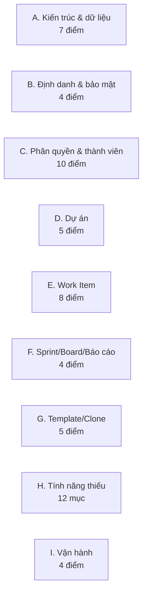
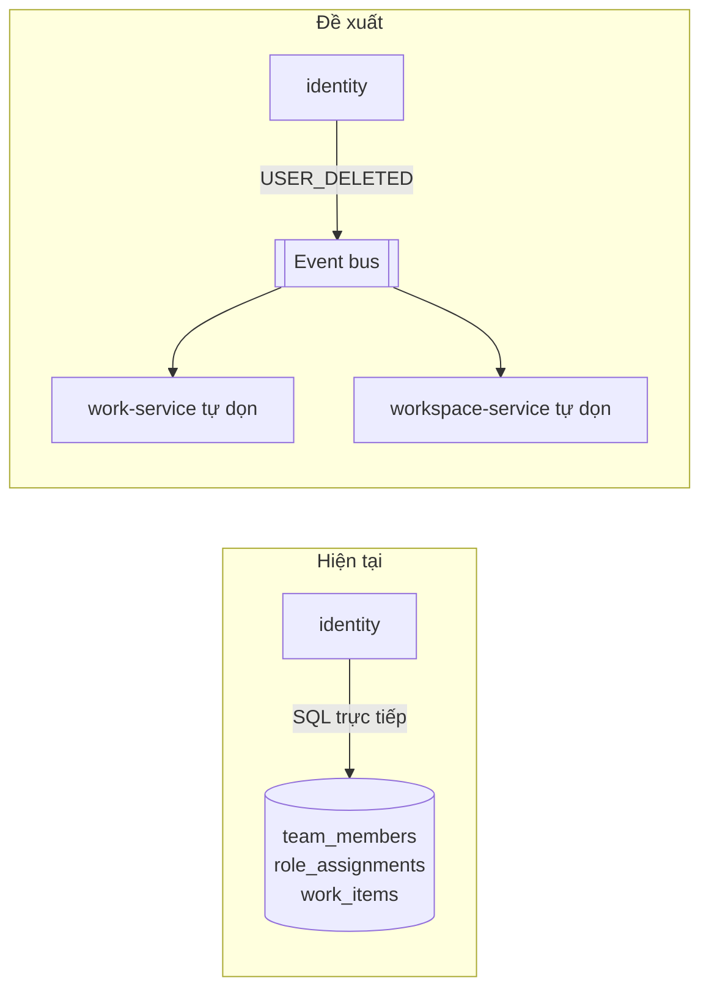
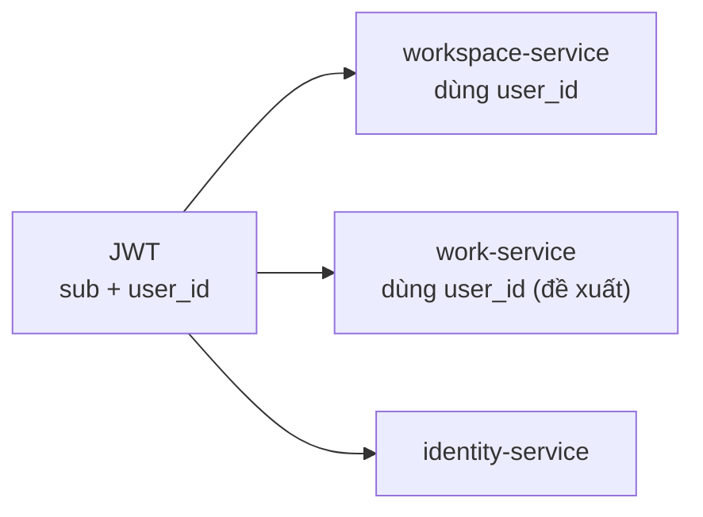
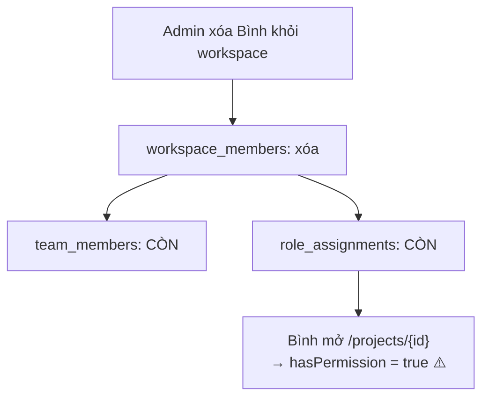
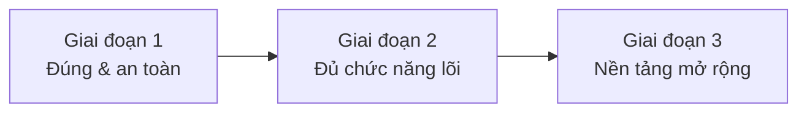
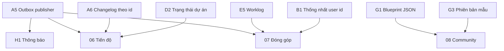

# 05 — Điểm chưa đúng so với một hệ thống quản lý tác vụ chuẩn

> Đối chiếu mã nguồn hiện tại với hành vi của các hệ thống quản lý công việc trưởng thành (Jira Software, Linear, ClickUp, Asana). Mỗi điểm đều **dẫn tới vị trí trong mã nguồn** để kiểm chứng.

---

## Mục lục

0. [Cách đọc tài liệu](#0-cách-đọc-tài-liệu)
1. [Tổng quan theo nhóm](#1-tổng-quan-theo-nhóm)
2. [Nhóm A — Kiến trúc và dữ liệu](#2-nhóm-a--kiến-trúc-và-dữ-liệu)
3. [Nhóm B — Định danh và bảo mật](#3-nhóm-b--định-danh-và-bảo-mật)
4. [Nhóm C — Phân quyền và thành viên](#4-nhóm-c--phân-quyền-và-thành-viên)
5. [Nhóm D — Dự án](#5-nhóm-d--dự-án)
6. [Nhóm E — Công việc (Work Item)](#6-nhóm-e--công-việc-work-item)
7. [Nhóm F — Sprint, Board, Báo cáo](#7-nhóm-f--sprint-board-báo-cáo)
8. [Nhóm G — Template và Clone](#8-nhóm-g--template-và-clone)
9. [Nhóm H — Tính năng thiếu so với chuẩn](#9-nhóm-h--tính-năng-thiếu-so-với-chuẩn)
10. [Nhóm I — Vận hành và hạ tầng](#10-nhóm-i--vận-hành-và-hạ-tầng)
11. [Lộ trình sửa đề xuất](#11-lộ-trình-sửa-đề-xuất)
12. [Những điểm hệ thống đang làm tốt](#12-những-điểm-hệ-thống-đang-làm-tốt)

---

## 0. Cách đọc tài liệu

| Mức | Ý nghĩa |
|-----|---------|
| 🔴 Cao | Sai nghiệp vụ, rò rỉ quyền, hoặc mất dữ liệu — nên sửa trước khi bảo vệ / mở rộng |
| 🟠 Trung bình | Hành vi khác chuẩn, gây khó hiểu hoặc hạn chế mở rộng |
| 🟡 Thấp | Chưa tối ưu, có thể chấp nhận trong phạm vi đồ án |

Mỗi mục gồm: **Hiện trạng** → **Chuẩn mong đợi** → **Rủi ro** → **Đề xuất**.

---

## 1. Tổng quan theo nhóm

### 1.1. Danh sách điểm mức Cao

| Mã | Vấn đề |
|----|--------|
| C1 | Rời/bị xóa khỏi workspace nhưng vẫn truy cập được dự án |
| C2 | Người tạo dự án có toàn quyền vĩnh viễn, không thu hồi được |
| C3 | Xóa team / đổi team không thu hồi quyền dự án của thành viên cũ |
| C4 | Mời vào team / dự án người ngoài workspace |
| D1 | Chỉ Global ADMIN khôi phục được dự án đã xóa |
| E1 | Không kiểm tra assignee / sprint / nhãn thuộc cùng dự án |
| E3 | Không thể bỏ giá trị một trường (bỏ assignee, xóa hạn) |
| A4 | Frontend gọi API Component / Version không tồn tại |
| A6 | Changelog lưu **tên** trạng thái thay vì id → báo cáo sai khi đổi tên |
| I1 | work-service, workspace-service chưa có trong docker-compose |

---

## 2. Nhóm A — Kiến trúc và dữ liệu

### A1 🟠 Ba service dùng chung một database, có service ghi vào bảng của service khác

- **Hiện trạng:** `identity-service/repository/UserRepository.java` chạy SQL native `DELETE FROM team_members`, `DELETE FROM role_assignments`, `UPDATE work_items SET assignee_id = NULL` khi xóa user (`WorkDataCleanupService`).
- **Chuẩn:** Mỗi service sở hữu dữ liệu riêng; service khác yêu cầu thay đổi qua API hoặc sự kiện (`UserDeleted`).
- **Rủi ro:** Đổi tên cột ở work-service làm hỏng identity-service mà không có lỗi biên dịch; không thể tách DB sau này.
- **Đề xuất:** Phát sự kiện `USER_DELETED` → work-service và workspace-service tự dọn.

### A2 🟠 Flyway và `ddl-auto: update` cùng quản lý một schema

- **Hiện trạng:** work-service bật cả hai; identity-service chỉ dùng `ddl-auto`. Migration V5 đã phải ghi chú tránh Hibernate tự thêm cột `NOT NULL`.
- **Chuẩn:** Chỉ Flyway (hoặc Liquibase) quản lý schema; Hibernate ở chế độ `validate`.
- **Rủi ro:** Schema giữa các máy lệch nhau; cột thêm bởi Hibernate không có trong migration nên môi trường mới thiếu.
- **Đề xuất:** Chuyển `ddl-auto: validate` cho cả 3 service, viết migration cho `users`, `verification_tokens`.

### A3 🟡 Khóa ngoại xuyên service phụ thuộc thứ tự khởi động

- **Hiện trạng:** FK `teams/projects → workspaces` chỉ được tạo nếu work-service migrate trước workspace-service (`SchemaIntegrityChecker` chỉ cảnh báo).
- **Đề xuất:** Gộp migration của các bảng dùng chung vào một module migration riêng chạy trước mọi service, hoặc bỏ FK xuyên service và kiểm tra bằng API.

### A4 🔴 Có bảng nhưng không có API: Label, Component, Version, Custom Field, Saved Filter, Automation

- **Hiện trạng:** Entity và repository tồn tại, nhưng **không có controller**. Trong khi đó `frontend/src/api.js` (dòng ~522–529) gọi `GET/POST /projects/{id}/components`, `/projects/{id}/versions`, `POST /versions/{id}/release` → luôn **404**.
- **Chuẩn:** Jira coi Component, Version (Release), Label là chức năng lõi.
- **Rủi ro:** Ô chọn Component / Fix Version trong form công việc rỗng; quyền `RELEASE_MANAGE` không có tác dụng.
- **Đề xuất:** Bổ sung `LabelController`, `ComponentController`, `VersionController` (CRUD + release/archive).

### A5 🟠 Outbox có ghi nhưng không có ai đọc

- **Hiện trạng:** `OutboxRecorder` ghi `SPRINT_STARTED`, `SPRINT_COMPLETED` vào `outbox_events`; `KafkaTemplate` được khai báo nhưng không có `@Scheduled` publisher. Bảng sẽ phình mãi ở trạng thái `PENDING`.
- **Đề xuất:** Viết `OutboxPublisher` (poll + gửi Kafka + đánh dấu `PROCESSED`), hoặc tạm tắt ghi outbox. Đây là nền tảng cho thông báo, tiến độ, đóng góp (tài liệu 06, 07).

### A6 🔴 Changelog lưu tên hiển thị thay vì id

- **Hiện trạng:** `WorkItemAuditServiceImpl` ghi `STATUS`, `TYPE`, `SPRINT` bằng **tên** (`oldName`, `newName`). `WorkItemStateReplayer` phải tra ngược trạng thái theo tên (`statusByName`).
- **Rủi ro:** Đổi tên trạng thái "In Review" → "Reviewing" làm Burndown/CFD của các sprint cũ dựng sai; hai dự án có trạng thái trùng tên cũng nhầm lẫn.
- **Đề xuất:** Thêm cột `old_ref_id`, `new_ref_id` (UUID) vào `work_item_changelogs`; giữ tên chỉ để hiển thị.

### A7 🟡 Trạng thái toàn cục còn sót

- **Hiện trạng:** `statuses.project_id` nullable; `POST /statuses` (không có projectId) cho Global ADMIN tạo trạng thái toàn cục; `resolveInitialStatus` có nhánh dự phòng lấy trạng thái TODO của **bất kỳ** dự án nào.
- **Đề xuất:** Bắt buộc `project_id NOT NULL` sau khi dọn dữ liệu; bỏ nhánh dự phòng toàn cục.

---

## 3. Nhóm B — Định danh và bảo mật

### B1 🟠 Hai loại user id cùng tồn tại

- **Hiện trạng:** workspace-service lưu `users.id`; work-service lưu Keycloak `sub`. Mỗi lần kiểm tra quyền workspace, work-service phải gọi identity-service để quy đổi. `canonicalUserId()` khi identity lỗi sẽ **giữ nguyên id đầu vào** → có thể ghi `users.id` vào `role_assignments`.
- **Chuẩn:** Một định danh duy nhất, bất biến, xuyên suốt.
- **Đề xuất:** Đưa `users.id` vào JWT qua protocol mapper (`user_id` claim — workspace-service đã hỗ trợ đọc claim này) và dùng nó ở **mọi** service; viết migration chuyển work-service sang `users.id`.

### B2 🟠 Endpoint `/internal/**` không xác thực

- **Hiện trạng:** identity-service và workspace-service `permitAll()` cho `/internal/**`, dựa vào việc gateway không route tới. Nếu cổng 8082/8087 lộ ra ngoài, ai cũng tra được user theo email và vai trò workspace.
- **Chuẩn:** Xác thực service-to-service (client credentials của Keycloak, hoặc mTLS, hoặc ít nhất shared secret header).
- **Đề xuất:** Dùng `client_credentials` grant cho Feign client; resource server kiểm tra scope `internal`.

### B3 🟡 Cache vai trò workspace không được làm mới khi đổi vai trò

- **Hiện trạng:** `WorkspaceAccessChecker.getRole` được cache Redis 10 phút; workspace-service không có cách báo work-service xóa cache.
- **Rủi ro:** Hạ một người từ MEMBER xuống GUEST nhưng họ vẫn tạo được team/dự án trong 10 phút.
- **Đề xuất:** Phát sự kiện `WORKSPACE_MEMBER_CHANGED` để evict; hoặc giảm TTL xuống 1 phút.

### B4 🟡 Tìm kiếm người dùng toàn hệ thống

- **Hiện trạng:** `GET /api/v1/users/search` mở cho mọi người đã đăng nhập; mời thành viên tra được user ở mọi workspace.
- **Đề xuất:** Giới hạn tìm trong thành viên workspace hiện tại; mời người ngoài phải qua email đầy đủ.

---

## 4. Nhóm C — Phân quyền và thành viên

### C1 🔴 Mất tư cách workspace nhưng vẫn vào được dự án

- **Hiện trạng:** `ProjectMemberServiceImpl.hasPermission()` chỉ xét `role_assignments`, **không** xét `workspace_members` và không xét workspace đã bị xóa mềm. Xóa thành viên workspace (`WorkspaceMemberServiceImpl.removeMember`) không dọn team/project.
- **Chuẩn:** Rời tổ chức = mất mọi quyền bên trong tổ chức.
- **Rủi ro:** Nhân viên đã nghỉ vẫn đọc/sửa dự án qua link trực tiếp.

- **Đề xuất:** (1) Thêm kiểm tra workspace membership vào `hasPermission` (có cache); (2) phát sự kiện `WORKSPACE_MEMBER_REMOVED` để work-service dọn `team_members` + `role_assignments`.

### C2 🔴 Người tạo dự án có toàn quyền vĩnh viễn

- **Hiện trạng:** `hasPermission()` trả `true` nếu `userId == project.createdBy`. `removeMemberFromProject` chặn xóa Lead nhưng **cho phép** xóa người tạo — xóa xong người đó vẫn toàn quyền.
- **Chuẩn:** Quyền chỉ đến từ vai trò; người tạo chỉ là thông tin audit.
- **Đề xuất:** Bỏ đặc quyền ngầm của `createdBy`; chỉ giữ cho `leadUserId` (hoặc bỏ cả hai và dựa hoàn toàn vào ADMINISTRATOR).

### C3 🔴 Đổi/xóa team không thu hồi quyền dự án

- **Hiện trạng:** `TeamController.deleteTeam` chỉ đặt `projects.team_id = NULL`; `updateProject` khi đổi team chỉ **thêm** thành viên team mới.
- **Rủi ro:** Chuyển dự án từ team A sang team B, toàn bộ team A vẫn giữ quyền.
- **Đề xuất:** Đánh dấu nguồn của assignment (`source = TEAM | DIRECT`); khi team rời dự án thì xóa các assignment có `source = TEAM`.

### C4 🔴 Mời người ngoài workspace

- **Hiện trạng:** `InvitationServiceImpl.inviteToTeam / inviteToProject` không kiểm tra người được mời có thuộc workspace.
- **Rủi ro:** Phá vỡ ranh giới tenant — người ngoài có quyền trong dự án nhưng không thấy workspace.
- **Đề xuất:** Hoặc chặn (yêu cầu vào workspace trước), hoặc khi chấp nhận lời mời thì tự thêm vào workspace với vai trò GUEST/MEMBER.

### C5 🟠 Team có hai nguồn sự thật về trưởng nhóm

- **Hiện trạng:** `teams.owner_id` và `team_members.role = LEADER`. Owner không rời được, không bị xóa được, không chuyển được; bất kỳ LEADER nào cũng xóa được cả team (kể cả team của owner).
- **Đề xuất:** Bỏ `owner_id` khỏi logic quyền (như workspace đã làm), bất biến "≥ 1 LEADER" có khóa hàng, thêm chức năng chuyển trưởng nhóm.

### C6 🟠 Đổi Lead không hạ quyền Lead cũ

- **Hiện trạng:** `updateProject` gán ADMINISTRATOR cho Lead mới, Lead cũ giữ nguyên.
- **Đề xuất:** Hỏi người dùng: giữ Lead cũ là ADMINISTRATOR hay hạ xuống MEMBER.

### C7 🟠 Vai trò và ma trận quyền cố định

- **Hiện trạng:** Chỉ có 3 vai trò seed sẵn; `GET /roles` chỉ đọc; không có API sửa `permission_scheme_entries`. MEMBER không thể quản lý sprint (thường Scrum Master là MEMBER).
- **Chuẩn:** Jira cho tạo vai trò tùy biến và chỉnh Permission Scheme.
- **Đề xuất:** API + UI "Project settings → Permissions" dạng ma trận tick.

### C8 🟠 Đồng bộ từ team ghi đè chỉnh sửa tay

- **Hiện trạng:** `syncTeamMemberToProjects` ghi đè vai trò dự án mỗi khi vai trò team đổi hoặc chấp nhận lời mời.
- **Đề xuất:** Chỉ ghi đè assignment có `source = TEAM` (cùng giải pháp C3).

### C9 🟡 Kiểm tra "Administrator cuối cùng" không khóa hàng

- **Hiện trạng:** `assertNotLastAdministrator` đọc thường; hai người hạ quyền nhau đồng thời có thể làm dự án mất admin. (workspace-service đã giải đúng bằng `SELECT ... FOR UPDATE`.)
- **Đề xuất:** Áp dụng cùng kỹ thuật khóa.

### C10 🟡 Lời mời thiếu các thuộc tính chuẩn

| Thiếu | Chuẩn |
|-------|-------|
| Hạn hết hiệu lực | 7–14 ngày |
| Email thông báo | Có, kèm link chấp nhận |
| Mời người chưa có tài khoản | Mời qua email → đăng ký → tự vào |
| Lời mời vào workspace | Workspace hiện thêm thẳng, không cần đồng ý |

---

## 5. Nhóm D — Dự án

### D1 🔴 Chỉ Global ADMIN khôi phục được dự án đã xóa

- **Hiện trạng:** `POST /projects/{id}/restore` yêu cầu `PROJECT_ADMIN`, nhưng `hasPermission()` trả `false` cho mọi dự án có `deleted_at` (kể cả Lead). Dự án đã xóa cũng không có màn hình "Thùng rác" cho người dùng thường.
- **Đề xuất:** Cho phép Lead / ADMINISTRATOR thao tác `restore` và xem thùng rác; thêm job xóa vĩnh viễn sau 30 ngày.

### D2 🟠 Không có trạng thái dự án — ✅ đã xử lý (06A Bước 1)

- **Hiện trạng:** Chỉ có "còn" và "đã xóa".
- **Chuẩn:** `ACTIVE → ON_HOLD → COMPLETED → ARCHIVED (chỉ đọc)`.
- **Đề xuất:** Thêm cột `status`; dự án ARCHIVED chặn mọi thao tác ghi. Là tiền đề cho tài liệu 06.

### D3 🟠 Mã dự án duy nhất toàn hệ thống và không đổi được

- **Hiện trạng:** `projects.key UNIQUE` toàn cục; dự án đã xóa vẫn giữ key; mẫu hệ thống chiếm `TPLFNB`, `TPLWEB`, `TPLAGRI`.
- **Rủi ro:** Hai công ty trên cùng hệ thống không thể cùng có dự án `WEB`.
- **Đề xuất:** Unique theo `(workspace_id, key)`; sequence đặt tên theo id dự án thay vì key.

### D4 🟠 `defaultAssigneeType` không có tác dụng

- **Hiện trạng:** Lưu được `PROJECT_LEADER` nhưng `WorkItemServiceImpl.createWorkItem` không đọc → công việc mới luôn không có người làm nếu không chọn.
- **Đề xuất:** Áp dụng khi `assigneeId == null`; mở rộng thêm `COMPONENT_LEAD`.

### D5 🟡 Đổi kiểu dự án không đổi cấu hình

- **Hiện trạng:** Đổi `SOFTWARE_SCRUM → SOFTWARE_KANBAN` không đổi kiểu board, sprint vẫn còn.
- **Đề xuất:** Khóa trường sau khi tạo, hoặc có trình hướng dẫn chuyển đổi.

---

## 6. Nhóm E — Công việc (Work Item)

### E1 🔴 Không kiểm tra tham chiếu thuộc cùng dự án

- **Hiện trạng:** `createWorkItem` / `updateWorkItem` không kiểm tra `typeId`, `sprintId`, `labelIds`, `componentId`, `fixVersionId` thuộc dự án hiện tại; không kiểm tra `assigneeId` là thành viên dự án. (Chỉ `parentId` được kiểm tra cùng dự án trong `StrictHierarchyValidator`; `typeId` chỉ được kiểm tra tồn tại.)
- **Rủi ro:** Gán việc cho người không có quyền xem; đưa công việc vào sprint của dự án khác (sprint đó sẽ hiện công việc lạ trên board); gán vào sprint đã CLOSED.
- **Đề xuất:** Một lớp `WorkItemReferenceValidator` chạy trước khi lưu.

### E2 🟠 Trạng thái khởi tạo không theo workflow

- **Hiện trạng:** `resolveInitialStatus` lấy trạng thái TODO **đầu tiên** của dự án, bỏ qua transition `Create` (from = NULL) của workflow gắn với loại công việc. Trong khi `ProjectCloneEngine.initialStatusFor` lại làm đúng.
- **Rủi ro:** Loại "Bug" có workflow bắt đầu ở "Triage" nhưng bug mới vẫn vào "To Do".
- **Đề xuất:** Dùng chung một hàm `initialStatusFor(type)` cho cả tạo mới và clone.

### E3 🔴 Không thể xóa giá trị một trường

- **Hiện trạng:** `updateWorkItem` dùng quy ước "`null` = không đổi" cho mọi trường → không bỏ được assignee, không xóa được due date, không đưa về Backlog (bỏ sprint), không bỏ parent.
- **Chuẩn:** PATCH ngữ nghĩa JSON Merge Patch, hoặc cờ `clearFields: ["assignee"]`.
- **Đề xuất:** Chuyển sang PATCH với `JsonNullable` (phân biệt "không gửi" và "gửi null").

### E4 🟠 Resolution tách rời trạng thái

- **Hiện trạng:** Đặt `resolution` qua sửa thường; không bắt buộc khi sang DONE, không tự xóa khi Reopen (trừ khi cấu hình post-function).
- **Đề xuất:** Mặc định: sang nhóm DONE → bắt buộc/tự đặt resolution `DONE`; rời DONE → tự xóa.

### E5 🟠 Không có nhật ký thời gian (worklog)

- **Hiện trạng:** `timeSpentSeconds` được **ghi đè** trực tiếp qua `PUT`.
- **Chuẩn:** Mỗi lần log là một bản ghi (ai, ngày nào, bao lâu, ghi chú); `timeSpent` = tổng.
- **Rủi ro:** Không đo được đóng góp, không làm timesheet. Xem tài liệu 07.

### E6 🟠 Xóa công việc không xử lý quan hệ

- **Hiện trạng:** Soft delete chỉ đặt `deleted_at`; subtask, liên kết `BLOCKS` vẫn còn (công việc khác có thể bị chặn bởi một công việc đã xóa); `GET /items/{id}` vẫn trả về công việc đã xóa.
- **Đề xuất:** Xóa cha → hỏi xóa/tách subtask; bỏ qua liên kết tới công việc đã xóa; trả 404 cho công việc đã xóa.

### E7 🟠 Ghi đè lẫn nhau khi hai người sửa cùng lúc

- **Hiện trạng:** `WorkItem` có `@Version`, nhưng client không gửi `version` lên → mỗi request nạp bản mới nhất rồi ghi → "người lưu sau thắng".
- **Đề xuất:** Nhận `version` (hoặc header `If-Match`) và trả 409 khi lệch.

### E8 🟡 Changelog chưa đầy đủ trường

- **Hiện trạng:** `recordDiff` ghi 14 trường (SUMMARY, DESCRIPTION, TYPE, STATUS, PRIORITY, ASSIGNEE, STORY_POINTS, DUE_DATE, START_DATE, SPRINT, COMPONENT, FIX_VERSION, PARENT, RESOLUTION). Thiếu: thời gian (ORIGINAL/REMAINING_ESTIMATE, TIME_SPENT — đã có nhãn hiển thị nhưng không được ghi), nhãn, custom fields, rank.
- **Đề xuất:** Bổ sung để phục vụ audit và báo cáo đóng góp.

---

## 7. Nhóm F — Sprint, Board, Báo cáo

### F1 🟡 Sprint thuộc dự án, tối đa một sprint chạy

- **Hiện trạng:** `uq_sprints_one_active_per_project`.
- **Chuẩn:** Jira gắn sprint với board và cho phép sprint song song (nhiều team chung một dự án).
- **Đánh giá:** Chấp nhận được với đồ án; ghi rõ là giới hạn thiết kế.

### F2 🟠 Bộ lọc JQL chỉ là dữ liệu chết

- **Hiện trạng:** `boards.filter_jql`, swimlane `CUSTOM_JQL`, `saved_filters.jql_query` lưu được nhưng không có trình phân tích.
- **Đề xuất:** Xây "JQL-lite" (xem tài liệu 09) hoặc tạm ẩn khỏi API/UI.

### F3 🟡 Báo cáo chỉ ở cấp sprint — ✅ đã bổ sung báo cáo cấp dự án (06A Bước 1–5)

- **Hiện trạng:** Burndown, Velocity, CFD. Không có báo cáo cấp dự án (tiến độ tổng, Burn-up, Epic progress), không có báo cáo theo người.
- **Đề xuất:** Tài liệu 06 và 07.

### F4 🟡 Trang "My tasks" chỉ là khung giao diện

- **Hiện trạng:** Route `/w/:id/my-issues` trong `App.jsx` hiển thị chữ tĩnh, không gọi API.
- **Chuẩn:** Danh sách việc được giao cho tôi xuyên mọi dự án — màn hình được dùng nhiều nhất trong mọi hệ thống quản lý tác vụ.
- **Đề xuất:** `GET /work/items/my?status=&due=` + trang danh sách.

---

## 8. Nhóm G — Template và Clone

### G1 🟠 Mẫu là một dự án thật

- **Hiện trạng:** Mẫu nằm trong bảng `projects`, có key, có thành viên, có work item; mọi truy vấn dự án đều phải nhớ lọc `is_template`.
- **Rủi ro:** Quên lọc ở một màn hình là mẫu lẫn vào danh sách, báo cáo, tìm kiếm.
- **Đề xuất (dài hạn):** Lưu mẫu dạng **blueprint JSON có phiên bản** (`template_versions.blueprint jsonb`) tách khỏi `projects`. Đây cũng là nền tảng cho Community (tài liệu 08).

### G2 🟠 GET thư viện mẫu có tác dụng phụ ghi dữ liệu

- **Hiện trạng:** `listTemplates` là `@Transactional` (ghi) và gọi `templateDataSeeder.seedDefaultTemplates()` khi kết quả rỗng.
- **Rủi ro:** Một người dùng có workspace riêng chưa có mẫu → mỗi lần mở thư viện lại cố seed; hai nguồn dữ liệu mẫu (migration V7 SQL và `TemplateDataSeeder` Java ~1000 dòng) có thể lệch nhau.
- **Đề xuất:** Chỉ một nguồn seed (migration); GET là `readOnly`.

### G3 🟡 Không có phiên bản mẫu

- **Hiện trạng:** Sửa mẫu là sửa trực tiếp; không biết dự án nào được tạo từ phiên bản nào.
- **Đề xuất:** `template_versions` + `project_clones.source_version`.

### G4 🟡 Mẫu hệ thống cứng hóa

- **Hiện trạng:** `DEFAULT_WORKSPACE_ID` và `DEFAULT_CREATOR_ID` là UUID viết cứng; frontend cũng từng hardcode workspace.
- **Đề xuất:** Cờ `is_system` cho mẫu thay cho việc dựa vào workspace mặc định.

### G5 🟡 Kiểu dự án của mẫu không phản ánh nội dung

- **Hiện trạng:** Cả 3 mẫu hệ thống (kể cả F&B, Nông nghiệp) đều là `SOFTWARE_SCRUM`.
- **Đề xuất:** Dùng `BUSINESS` cho mẫu phi phần mềm và cho phép kiểu này không có sprint.

---

## 9. Nhóm H — Tính năng thiếu so với chuẩn

| # | Tính năng | Trạng thái | Mức quan trọng |
|---|-----------|-----------|----------------|
| H1 | Thông báo trong ứng dụng (bị giao việc, được nhắc tên, sắp hết hạn) | ❌ | 🔴 |
| H2 | Thông báo email cho lời mời / giao việc | ❌ (chỉ email xác thực, quên mật khẩu) | 🟠 |
| H3 | Cập nhật thời gian thực (board đổi khi người khác kéo thẻ) | ❌ (`/ws-work` có route, chưa có code) | 🟠 |
| H4 | Danh sách "Việc của tôi" xuyên dự án | ❌ (F4) | 🔴 |
| H5 | Tìm kiếm toàn văn / bộ lọc nâng cao / lưu bộ lọc | ⚠️ chỉ lọc cơ bản trong dự án | 🟠 |
| H6 | @mention, người theo dõi (watcher) | ❌ | 🟠 |
| H7 | Quản lý phát hành (Version/Release) | ❌ (A4) | 🟠 |
| H8 | Worklog / Timesheet | ❌ (E5) | 🟠 |
| H9 | Timeline / Roadmap / Gantt | ❌ | 🟠 |
| H10 | Trường tùy biến có giao diện | ❌ | 🟡 |
| H11 | Tự động hóa (rule engine) | ❌ | 🟡 |
| H12 | Nhập/xuất (CSV, Excel), Audit log cấp tổ chức | ❌ | 🟡 |

---

## 10. Nhóm I — Vận hành và hạ tầng

### I1 🔴 Không chạy được toàn bộ hệ thống bằng Docker

- **Hiện trạng:** `docker-compose.tuananh.yml` có identity, notification, gateway nhưng **không có** work-service và workspace-service; `frontend/nginx.conf` chỉ proxy `/identity/`.
- **Đề xuất:** Thêm 2 service vào compose, bổ sung route gateway qua biến môi trường, thêm `location /work/` và `/workspace/` vào nginx.

### I2 🟠 Kiểm thử mỏng

- **Hiện trạng:** ~25 lớp test, gần như chỉ work-service, đều là unit test; không có integration test với DB thật, không có test frontend, không có CI.
- **Đề xuất:** Testcontainers (PostgreSQL) cho các luồng phân quyền và clone; GitHub Actions chạy `mvn test` + `npm run lint`.

### I3 🟡 Mã trùng lặp / mã chết

- `frontend/src/api/workServiceApi.js` trùng `src/api.js`, không ai dùng.
- `controller/TaskController.java` rỗng (0 dòng).
- `TeamController` tự viết lại `canonicalUserId` thay vì dùng `ProjectMemberService`.

### I4 🟡 Thiếu quan sát hệ thống

- Có `CorrelationIdFilter` ở gateway nhưng không có tracing phân tán, metrics, log tập trung.
- **Đề xuất:** Micrometer + OpenTelemetry, Prometheus/Grafana (tài liệu 09).

---

## 11. Lộ trình sửa đề xuất

| Giai đoạn | Mục tiêu | Các mã |
|-----------|----------|--------|
| 1 — Đúng & an toàn | Không rò quyền, không sai dữ liệu, chạy được trọn bộ | C1, C2, C3, C4, D1, E1, E3, A6, I1 |
| 2 — Đủ chức năng lõi | Đạt mức "dùng được hằng ngày" | A4, D4, E2, E4, E6, E7, F4, H1, H4, C7 |
| 3 — Nền tảng mở rộng | Chuẩn bị cho tài liệu 06/07/08 | A1, A2, A5, B1, B2, E5, G1, G3, D2, I2 |

Phụ thuộc giữa các bước:

---

## 12. Những điểm hệ thống đang làm tốt

Để đánh giá công bằng, các điểm sau **đạt hoặc vượt** mức chuẩn của một đồ án:

| Điểm mạnh | Vị trí |
|-----------|--------|
| Phân quyền fail-closed, aspect tự tìm projectId theo nhiều nguồn | `ProjectPermissionGuard` |
| Bất biến "≥ 1 OWNER" có khóa hàng chống race condition | `WorkspaceMemberServiceImpl.assertNotLastOwner` |
| Mã công việc sinh bằng PostgreSQL sequence riêng mỗi dự án | `AtomicKeySequenceGenerator` |
| Sắp xếp bằng LexoRank (không phải đánh lại toàn bộ thứ tự) | `LexoRankService` |
| Workflow engine có condition / validator / post-function cấu hình JSON | `WorkflowEngineServiceImpl` |
| Chống vòng phụ thuộc BLOCKS | `DependencyCycleDetector` |
| Snapshot sprint khi đóng + dựng lại Burndown/CFD từ changelog | `SprintReportSnapshotEngine`, `WorkItemStateReplayer` |
| Ràng buộc "1 sprint ACTIVE" ở tầng DB | `uq_sprints_one_active_per_project` |
| Clone sâu có ánh xạ ID, ánh xạ trong JSON, dời ngày, kiểm tra toàn vẹn và rollback | `ProjectCloneEngine`, `TemplateIntegrityValidator` |
| Không lộ sự tồn tại của workspace với người ngoài (404 thay vì 403) | `WorkspaceRoleGuard` |
