# 06A — Kế hoạch triển khai: Quản lý tiến độ dự án

> Triển khai thiết kế [06_THIET_KE_QUAN_LY_TIEN_DO.md](06_THIET_KE_QUAN_LY_TIEN_DO.md) theo từng bước nhỏ. Mỗi bước tự chạy được, demo được và có tiêu chí nghiệm thu riêng.
> Lập ngày 03/10/2026 dựa trên mã nguồn nhánh `feat/sontx-template`.

---

## Mục lục

1. [Tổng quan lộ trình](#1-tổng-quan-lộ-trình)
2. [Quyết định kỹ thuật chung](#2-quyết-định-kỹ-thuật-chung)
3. [Bước 0 — Chuẩn bị nền tảng](#3-bước-0--chuẩn-bị-nền-tảng)
4. [Bước 1 — Trạng thái dự án và % tiến độ](#4-bước-1--trạng-thái-dự-án-và--tiến-độ)
5. [Bước 2 — Snapshot hằng ngày, Burn-up, Health](#5-bước-2--snapshot-hằng-ngày-burn-up-health)
6. [Bước 3 — Milestone và Portfolio](#6-bước-3--milestone-và-portfolio)
7. [Bước 4 — Timeline / Gantt và đường găng](#7-bước-4--timeline--gantt-và-đường-găng)
8. [Bước 5 — Baseline, Dự báo, Status update](#8-bước-5--baseline-dự-báo-status-update)
9. [Tích hợp với Template / Clone](#9-tích-hợp-với-template--clone)
10. [Chiến lược kiểm thử](#10-chiến-lược-kiểm-thử)
11. [Rủi ro và cách xử lý](#11-rủi-ro-và-cách-xử-lý)
12. [Checklist tổng](#12-checklist-tổng)

---

## 1. Tổng quan lộ trình

### 1.1. Thứ tự các bước

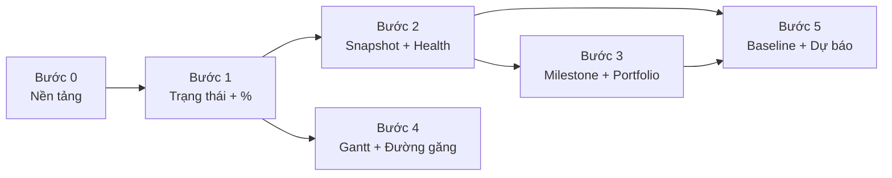

Bước 4 chỉ phụ thuộc Bước 1, nên có thể làm song song với Bước 2–3 nếu nhóm có hai người.

### 1.2. Ước lượng công sức

Đơn vị: ngày công của một người (backend + frontend + test).

| Bước | Backend | Frontend | Test | Tổng |
|------|:-:|:-:|:-:|:-:|
| 0 — Nền tảng | 2 | 0 | 1 | **3** |
| 1 — Trạng thái + % | 3 | 3 | 1.5 | **7.5** |
| 2 — Snapshot + Health | 3 | 2 | 1.5 | **6.5** |
| 3 — Milestone + Portfolio | 4 | 3 | 1.5 | **8.5** |
| 4 — Gantt + Đường găng | 3 | 5 | 1.5 | **9.5** |
| 5 — Baseline + Dự báo + Status update | 4 | 3 | 1.5 | **8.5** |
| **Tổng** | | | | **≈ 44 ngày công** |

### 1.3. Lịch dự kiến (một người làm tuần tự)

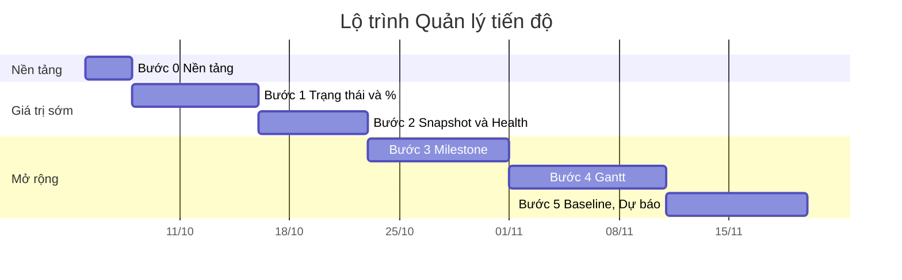

> **Phạm vi tối thiểu cho đồ án:** Bước 0 + 1 + 2 + 3 (≈ 26 ngày công) đã đủ để demo một "bảng điều khiển tiến độ" hoàn chỉnh. Bước 4 và 5 là phần nâng cao.

---

## 2. Quyết định kỹ thuật chung

| # | Quyết định | Lý do |
|---|-----------|-------|
| K1 | Làm thành **module trong work-service** (`service/progress/*`), chưa tách service | Cần đọc trực tiếp cây công việc, trạng thái, sprint |
| K2 | Dùng **Spring ApplicationEvent** nội bộ (`@TransactionalEventListener(AFTER_COMMIT)`), chưa dùng Kafka | Outbox chưa có publisher (tài liệu 05 – A5). Sau này chỉ cần thêm một listener đẩy sự kiện ra outbox, không phải sửa nơi phát |
| K3 | % tiến độ **tính khi đọc** (nạp mọi công việc của dự án một lần, O(n)), chưa cache | Quy mô đồ án (vài trăm việc/dự án) đủ nhanh. Thêm cache Redis chỉ khi đo thấy chậm |
| K4 | Lịch sử dùng **snapshot hằng ngày**, không replay changelog | Tránh lỗi A6 (changelog lưu tên trạng thái). Replay chỉ dùng cho tính năng backfill tùy chọn |
| K5 | Thuật toán viết thành **lớp thuần** (`ProgressCalculator`, `HealthEvaluator`, `CriticalPathCalculator`, `ForecastCalculator`), không phụ thuộc Spring | Unit test dễ, đúng phong cách `BurndownCalculator` đang có |
| K6 | Migration đánh số **V8 → V11** | V7 là bản mới nhất. Trước khi tạo, kiểm tra các nhánh khác chưa dùng số này |
| K7 | Frontend: thêm tab **"Tiến độ"** và **"Timeline"** trong trang dự án, biểu đồ dùng `recharts` đã có; Gantt tự dựng bằng CSS grid | Dự án không dùng thư viện UI ngoài |

### 2.1. Cấu trúc thư mục dự kiến

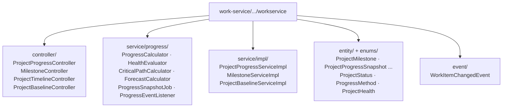

---

## 3. Bước 0 — Chuẩn bị nền tảng

**Mục tiêu:** tạo các "móc" mà mọi bước sau đều cần. Chưa có tính năng nào cho người dùng.

### 3.1. Công việc

| # | Việc | File chính |
|---|------|-----------|
| 0.1 | Bật lập lịch: `@EnableScheduling` + cấu hình múi giờ `Asia/Ho_Chi_Minh` cho cron | `WorkServiceApplication.java`, `application.yaml` |
| 0.2 | Tạo sự kiện nội bộ `WorkItemChangedEvent(projectId, itemId, kind)` với `kind` = CREATED / UPDATED / TRANSITIONED / DELETED / MOVED_SPRINT | `event/WorkItemChangedEvent.java` (mới) |
| 0.3 | Phát sự kiện tại các điểm ghi | xem 3.2 |
| 0.4 | Thêm quyền `PROJECT_MANAGE_SCHEDULE` vào `PermissionKey` | `enums/PermissionKey.java` |
| 0.5 | Seed quyền mới cho vai trò ADMINISTRATOR khi tạo dự án (tự động vì ADMINISTRATOR nhận mọi `PermissionKey.values()`) và migration bổ sung cho dự án cũ | `ProjectServiceImpl.seedProjectEcosystem`, `V8` |
| 0.6 | Hàm dùng chung `StatusCategoryResolver.doneStatusIds(projectId)` | thay cho đoạn lặp ở `SprintServiceImpl.completeSprint` |

### 3.2. Các điểm phát sự kiện

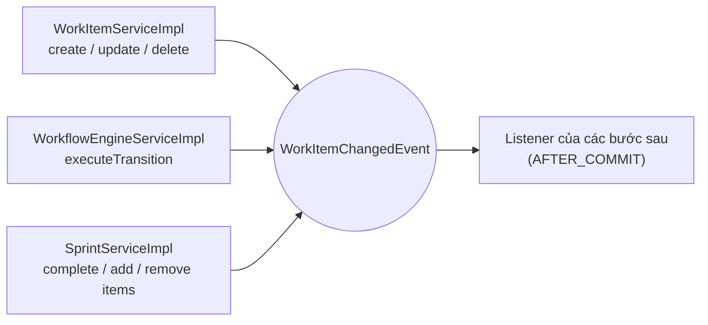

Kéo thẻ trên Board đã đi qua `executeTransition` (`BoardServiceImpl` dòng ~335) nên không cần móc riêng. `ProjectCloneEngine` **không** phát sự kiện cho từng công việc; thay vào đó phát một `ProjectBulkChangedEvent` sau khi clone xong.

### 3.3. Tiêu chí nghiệm thu

- [ ] Unit test: tạo / sửa / chuyển trạng thái / xóa công việc đều phát đúng một sự kiện, và **không** phát khi transaction rollback.
- [x] Dự án cũ có `PROJECT_MANAGE_SCHEDULE` cho ADMINISTRATOR sau khi chạy V8.
- [x] Mọi test hiện có vẫn xanh.

---

## 4. Bước 1 — Trạng thái dự án và % tiến độ

**Demo được:** mở tab "Tiến độ" thấy % hoàn thành của dự án và từng Epic; đổi dự án sang COMPLETED / ARCHIVED.

### 4.1. Cơ sở dữ liệu — `V8__project_progress_status.sql`

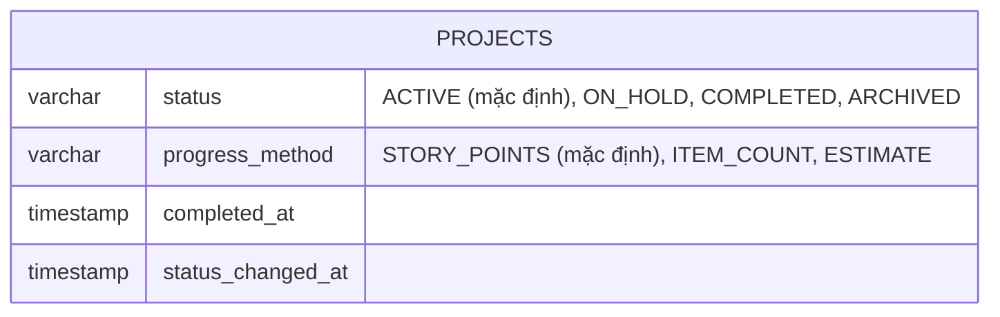

- `ALTER TABLE projects ADD COLUMN ... NOT NULL DEFAULT ...` (luôn có `DEFAULT` để không lỗi trên bảng có dữ liệu — cùng lý do ghi chú ở V5).
- Dự án `BUSINESS` hoặc `SOFTWARE_KANBAN` cũ: `UPDATE ... SET progress_method = 'ITEM_COUNT'`.
- Cùng file: chèn `PROJECT_MANAGE_SCHEDULE` cho vai trò ADMINISTRATOR của mọi dự án (việc 0.5).

### 4.2. Backend

| # | Việc | Ghi chú |
|---|------|---------|
| 1.1 | Enum `ProjectStatus`, `ProgressMethod`; thêm field vào `Project`, `ProjectResponse`, `ProjectDetailResponse` | |
| 1.2 | `ProgressCalculator` (lớp thuần) | Thuật toán ở 4.3 |
| 1.3 | `ProjectProgressService.getProgress(projectId)` | Nạp công việc chưa xóa + loại + trạng thái một lần |
| 1.4 | `PUT /projects/{id}/status` | Quyền `PROJECT_ADMIN`; quy tắc chuyển ở 4.4 |
| 1.5 | `PUT /projects/{id}` nhận `progressMethod` | `UpdateProjectRequest` |
| 1.6 | Chặn ghi khi ARCHIVED | Trong `ProjectMemberServiceImpl.hasPermission`: dự án ARCHIVED chỉ trả `true` cho `PROJECT_VIEW` và `PROJECT_ADMIN` (để còn mở lại được) |
| 1.7 | `SprintServiceImpl.startSprint`: chặn khi dự án không ACTIVE | |
| 1.8 | Danh sách dự án lọc theo `status` | `ProjectSpecification.withFilters` |

### 4.3. Thuật toán `ProgressCalculator`

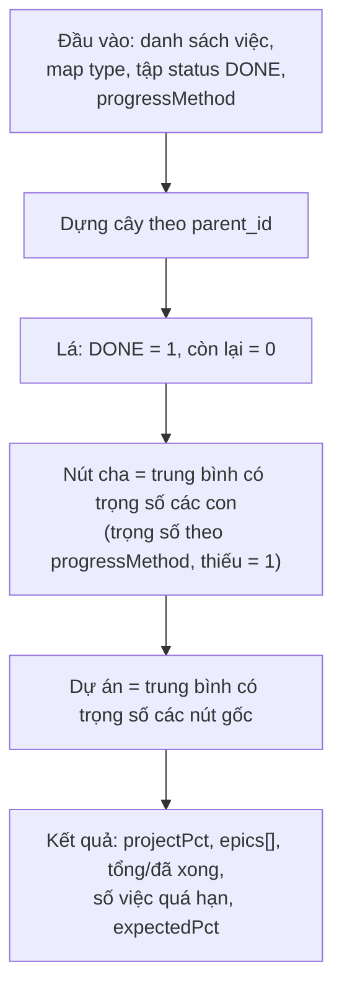

| Trường hợp biên | Xử lý |
|-----------------|-------|
| Dự án không có việc | `pct = null` (giao diện hiện "Chưa có dữ liệu"), không phải 0% |
| Theo STORY_POINTS mà không việc nào có điểm | Tự rơi về ITEM_COUNT, trả cờ `fallbackUsed = true` |
| Subtask | Chỉ góp vào cha, không tính trực tiếp vào dự án (tránh đếm hai lần) |
| Cha DONE nhưng còn subtask chưa xong | Cha tính 100% (trạng thái của cha là quyết định cuối) |
| Thiếu `startDate`/`endDate` | `expectedPct = null` |

`expectedPct = (hôm nay − startDate) / (endDate − startDate)`, kẹp trong [0, 1].

### 4.4. Quy tắc chuyển trạng thái dự án

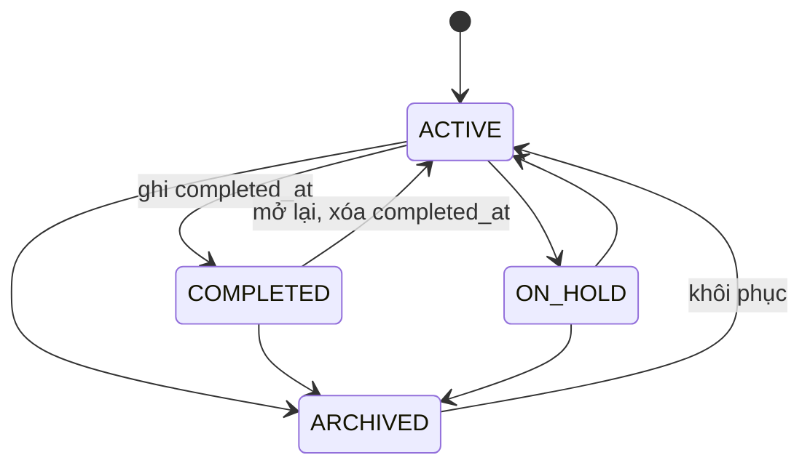

- Sang COMPLETED khi còn sprint ACTIVE → 400, yêu cầu đóng sprint trước.
- Mẫu (`is_template = true`) luôn ở ACTIVE, không đổi được.

### 4.5. API

| Phương thức | Endpoint | Quyền | Trả về |
|-------------|----------|-------|--------|
| GET | `/projects/{id}/progress` | `PROJECT_VIEW` | `ProjectProgressResponse` |
| PUT | `/projects/{id}/status` | `PROJECT_ADMIN` | `ProjectResponse` |

```json
{
  "method": "STORY_POINTS", "fallbackUsed": false,
  "progressPct": 0.62, "expectedPct": 0.70,
  "totals": { "items": 48, "doneItems": 27, "points": 120, "donePoints": 74 },
  "overdueItems": 4,
  "epics": [ { "id": "...", "code": "WEB-1", "summary": "Catalog", "pct": 0.75, "items": 10, "doneItems": 7 } ]
}
```

### 4.6. Frontend

| # | Việc | File |
|---|------|------|
| 1.9 | `progressApi.get(projectId)`, `projectApi.updateStatus(...)` | `src/api.js` |
| 1.10 | Route + tab "Tiến độ" | `App.jsx` (`projects/:projectId/progress`), `ProjectDetailPage.jsx` (mảng tab dòng ~413) |
| 1.11 | Trang `ProjectProgressPage` | 4 thẻ số liệu (tái dùng `ReportMetricCard`), danh sách Epic có thanh % |
| 1.12 | Huy hiệu trạng thái dự án + menu đổi trạng thái | Header trang dự án; ẩn bằng `<Can permission="PROJECT_ADMIN">` |
| 1.13 | Chế độ chỉ đọc khi ARCHIVED | Banner + ẩn nút tạo/sửa; backend vẫn là chốt chặn thật |
| 1.14 | Lọc theo trạng thái ở danh sách dự án | `ProjectListPage.jsx` |

### 4.7. Tiêu chí nghiệm thu

- [x] `ProgressCalculatorTest` phủ mọi trường hợp biên ở 4.3.
- [x] Dự án mới tạo có `status = ACTIVE`, `progressMethod` đúng theo loại dự án.
- [x] Dự án ARCHIVED: MEMBER tạo việc nhận 403; ADMINISTRATOR mở lại được.
- [x] Tab "Tiến độ" hiển thị đúng với dữ liệu mẫu `TPLWEB` sau khi tạo dự án từ mẫu và kéo vài việc sang Done.

---

## 5. Bước 2 — Snapshot hằng ngày, Burn-up, Health

**Demo được:** biểu đồ Burn-up nhiều tuần; huy hiệu 🟢🟠🔴 trên danh sách dự án.

### 5.1. Cơ sở dữ liệu — `V9__project_progress_snapshots.sql`

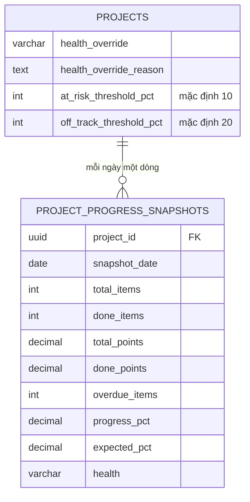

Ràng buộc `UNIQUE(project_id, snapshot_date)`; `ON DELETE CASCADE` theo dự án.

### 5.2. Backend

| # | Việc | Ghi chú |
|---|------|---------|
| 2.1 | `HealthEvaluator` (lớp thuần) | Luật ở tài liệu 06 – mục 6.1 |
| 2.2 | `ProgressSnapshotJob` `@Scheduled(cron = "0 5 0 * * *")` | Duyệt dự án ACTIVE / ON_HOLD, không phải mẫu, chưa xóa |
| 2.3 | Ghi snapshot kiểu **upsert** (`ON CONFLICT DO UPDATE`) | Chạy lại trong ngày không tạo trùng |
| 2.4 | Mỗi dự án một transaction riêng; lỗi một dự án chỉ log | Một dự án hỏng dữ liệu không làm dừng cả job |
| 2.5 | `ProgressEventListener`: khi nhận `WorkItemChangedEvent` → cập nhật snapshot **của hôm nay** | Burn-up luôn có điểm cuối mới nhất |
| 2.6 | `GET /projects/{id}/progress/history?from=&to=` | Mặc định 90 ngày |
| 2.7 | `PUT /projects/{id}/health-override` (bắt buộc lý do; gửi `null` để bỏ ghi đè) | `PROJECT_ADMIN` |
| 2.8 | `ProjectResponse` thêm `health` (tự động) và `healthOverride` | Lấy từ snapshot hôm nay, không tính lại cho cả danh sách |
| 2.9 | (Tùy chọn) `POST /admin/projects/{id}/progress/backfill` | Dựng lịch sử cũ bằng `WorkItemStateReplayer`; chỉ Global ADMIN; ghi chú rủi ro A6 |

### 5.3. Luồng dữ liệu

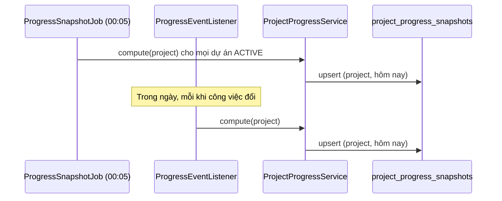

> Khi chạy nhiều instance work-service, job sẽ chạy trùng. Upsert giúp kết quả vẫn đúng; nếu cần tránh chạy thừa thì thêm ShedLock (dùng Redis đã có).

### 5.4. Frontend

| # | Việc |
|---|------|
| 2.10 | `BurnupChart` (recharts): đường "tổng phạm vi", đường "đã xong", đường chấm "kỳ vọng" |
| 2.11 | `HealthBadge` dùng ở header dự án, `ProjectListPage`, trang Tiến độ (hiện cả giá trị tự động và giá trị ghi đè) |
| 2.12 | Hộp thoại ghi đè health có ô lý do bắt buộc |

### 5.5. Tiêu chí nghiệm thu

- [x] `HealthEvaluatorTest`: đủ ba mức và các ngưỡng biên (đúng 10%, đúng 20%).
- [x] Chạy job hai lần trong một ngày → chỉ có một dòng snapshot.
- [x] Kéo thẻ sang Done → gọi lại `/progress/history`, thấy điểm của hôm nay tăng ngay.
- [x] Dự án mẫu và dự án đã xóa không có snapshot.

---

## 6. Bước 3 — Milestone và Portfolio

**Demo được:** tạo mốc "Go-live", gắn việc, mốc tự chuyển ACHIEVED/MISSED; trang Portfolio liệt kê mọi dự án trong workspace kèm health.

### 6.1. Cơ sở dữ liệu — `V10__project_milestones.sql`

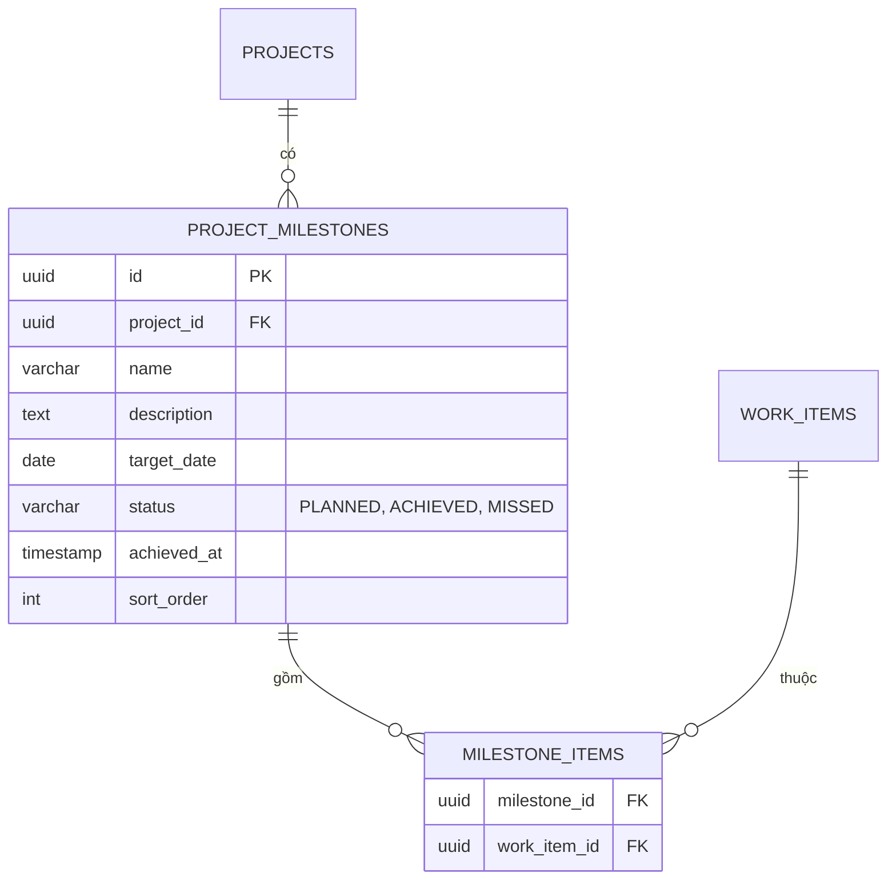

Khóa chính `MILESTONE_ITEMS(milestone_id, work_item_id)`. Một công việc được thuộc nhiều milestone.

### 6.2. Backend

| # | Việc | Ghi chú |
|---|------|---------|
| 3.1 | Entity, repository, `MilestoneService` CRUD | Tạo/sửa/xóa cần `PROJECT_MANAGE_SCHEDULE`; xem cần `PROJECT_VIEW` |
| 3.2 | Gắn / gỡ việc vào milestone | Việc phải cùng dự án và chưa xóa (tránh lặp lại lỗi E1) |
| 3.3 | `MilestoneEvaluator.recompute(milestone)` | Theo state machine ở tài liệu 06 – mục 7.1 |
| 3.4 | Listener: `WorkItemChangedEvent` → tính lại các milestone chứa việc đó | |
| 3.5 | Job hằng ngày: mốc PLANNED quá `target_date` còn việc dở → MISSED | Gộp vào `ProgressSnapshotJob` |
| 3.6 | `HealthEvaluator` thêm luật "có milestone MISSED → OFF_TRACK" | |
| 3.7 | `GET /projects/portfolio?workspaceId=` | `workspaceAccessChecker.requireMember`; trả các dự án người gọi thấy được, kèm %, health, mốc kế tiếp |
| 3.8 | **Đưa milestone vào Template/Clone** | Xem mục 9 — bắt buộc |

### 6.3. Frontend

| # | Việc |
|---|------|
| 3.9 | Dải milestone trên trang Tiến độ (✅ ⏳ ⬜ ❌ theo thời gian) |
| 3.10 | Modal tạo/sửa milestone; chọn việc bằng ô tìm theo mã/tiêu đề |
| 3.11 | Trong `WorkItemDetailModal`: hiện milestone mà việc thuộc về |
| 3.12 | Trang Portfolio `/w/:workspaceId/portfolio` + mục trên Sidebar; bảng sắp theo health (đỏ trước) |

### 6.4. Tiêu chí nghiệm thu

- [x] Mọi việc trong mốc Done trước hạn → ACHIEVED; Reopen một việc → về PLANNED.
- [x] Qua hạn còn việc dở → MISSED, dự án chuyển OFF_TRACK.
- [x] Gắn việc của dự án khác vào milestone → 400.
- [x] Portfolio không hiện dự án của workspace mà người gọi không thuộc về.
- [x] Tạo dự án từ mẫu có milestone → milestone được chép, ngày được dời đúng offset.

---

## 7. Bước 4 — Timeline / Gantt và đường găng

**Demo được:** tab "Timeline" vẽ thanh thời gian theo Epic, mũi tên phụ thuộc, việc trên đường găng tô đỏ; kéo thanh để đổi ngày.

Bước này không cần bảng mới.

### 7.1. Backend

| # | Việc | Ghi chú |
|---|------|---------|
| 4.1 | `GET /projects/{id}/timeline` | Trả `nodes` (việc có ngày, nhóm theo Epic), `edges` (liên kết BLOCKS), `milestones`, `criticalPath` |
| 4.2 | `CriticalPathCalculator` (lớp thuần) | Sắp xếp topo → tính sớm nhất đi xuôi, muộn nhất đi ngược → `slack = 0` là đường găng |
| 4.3 | Việc thiếu ngày | Trả trong `unscheduled[]`, không đưa vào tính đường găng |
| 4.4 | Cập nhật ngày khi kéo thanh | Dùng lại `PUT /items/{id}` (`ISSUE_EDIT`). Muốn **xóa** ngày thì cần sửa lỗi E3 trước |
| 4.5 | (Tùy chọn) `POST /projects/{id}/timeline/auto-schedule` | Dời các việc bị chặn phía sau; trả bản xem trước, người dùng xác nhận mới ghi |

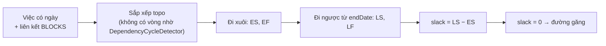

### 7.2. Frontend (phần nặng nhất của bước này)

| # | Việc |
|---|------|
| 4.6 | Tab "Timeline" + route `projects/:projectId/timeline` |
| 4.7 | Component `GanttChart` tự dựng bằng CSS grid: cột trái là cây Epic → Task, phần phải là lưới ngày, thanh việc, mũi tên SVG |
| 4.8 | Thu phóng tuần / tháng / quý; đường dọc "hôm nay"; vạch milestone |
| 4.9 | Kéo thả thanh (tái dùng `@dnd-kit` đã có) → cập nhật lạc quan, lỗi thì hoàn tác (giống `utils/optimisticMove.js`) |
| 4.10 | Nút bật/tắt tô đường găng |

### 7.3. Tiêu chí nghiệm thu

- [x] `CriticalPathCalculatorTest`: chuỗi thẳng, nhánh song song, việc độc lập, đồ thị rỗng.
- [x] 300 việc hiển thị mượt (không render lại toàn bộ khi kéo một thanh).
- [x] VIEWER xem được nhưng không kéo được.

---

## 8. Bước 5 — Baseline, Dự báo, Status update

**Demo được:** chốt kế hoạch, vài ngày sau xem việc nào bị dời; ngày dự kiến hoàn thành; Lead viết báo cáo tuần.

### 8.1. Cơ sở dữ liệu — `V11__project_baselines_status_updates.sql`

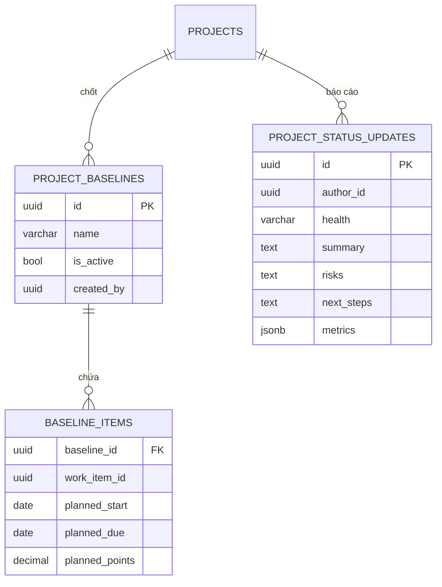

Chỉ mục duy nhất một phần: mỗi dự án tối đa một baseline `is_active = true`.

### 8.2. Backend

| # | Việc | Ghi chú |
|---|------|---------|
| 5.1 | `POST /projects/{id}/baselines` | Chụp mọi việc chưa xóa; đặt baseline mới là active |
| 5.2 | `GET /baselines/{bid}/variance` | Slip từng việc, scope added/removed, points drift |
| 5.3 | `ForecastCalculator` | Scrum: velocity trung bình 3–5 sprint (dùng lại `AgileReportService.getVelocity`); Kanban/BUSINESS: throughput 4 tuần lấy từ snapshot. Trả ngày lạc quan / dự kiến / bi quan |
| 5.4 | `GET /projects/{id}/forecast` | Chưa đủ dữ liệu (< 2 sprint hoặc < 14 ngày snapshot) → trả `insufficientData = true` |
| 5.5 | `HealthEvaluator` thêm luật "dự báo > endDate → AT_RISK" | |
| 5.6 | `GET/POST /projects/{id}/status-updates` | `metrics` được chụp tự động từ `getProgress` lúc tạo |
| 5.7 | Nhắc viết báo cáo: job thứ Sáu đánh dấu "cần cập nhật" | Chưa có hệ thống thông báo → hiện banner cho Lead; email qua notification-service là tùy chọn |

### 8.3. Frontend

| # | Việc |
|---|------|
| 5.8 | Nút "Chốt kế hoạch" + bảng độ lệch (lọc việc trễ > N ngày) |
| 5.9 | Bóng mờ baseline phía sau thanh thực tế trên Gantt (nếu đã làm Bước 4) |
| 5.10 | Thẻ "Dự báo xong" trên trang Tiến độ với khoảng lạc quan – bi quan |
| 5.11 | Dòng thời gian Status update + form viết (summary, rủi ro, bước tiếp) |

### 8.4. Tiêu chí nghiệm thu

- [x] Dời hạn một việc 5 ngày → variance báo slip +5.
- [x] Tạo việc mới sau baseline → nằm trong "scope added".
- [x] Dự án chưa đủ dữ liệu → giao diện hiện "Chưa đủ dữ liệu để dự báo", không hiện ngày sai.

---

## 9. Tích hợp với Template / Clone

Quy tắc của dự án: **thêm bảng con của project thì phải bổ sung vào `ProjectBlueprint`, loader và engine**. Áp dụng cho từng bảng mới:

| Bảng mới | Đưa vào mẫu? | Cách xử lý khi clone |
|----------|:-:|---------------------|
| Cột mới trên `projects` (status, progress_method, ngưỡng health) | ✅ một phần | Chép `progress_method` và ngưỡng; `status` luôn = ACTIVE; bỏ `health_override`, `completed_at` |
| `project_progress_snapshots` | ❌ | Lịch sử của dự án nguồn, không chép |
| `project_milestones`, `milestone_items` | ✅ | Ánh xạ id qua `idMap`, dời `target_date` theo offset, `status = PLANNED`, `achieved_at = null`; `milestone_items` chỉ chép khi `includeWorkItems` |
| `project_baselines`, `baseline_items` | ❌ | Kế hoạch đã chốt của nguồn, không chép |
| `project_status_updates` | ❌ | Lịch sử |

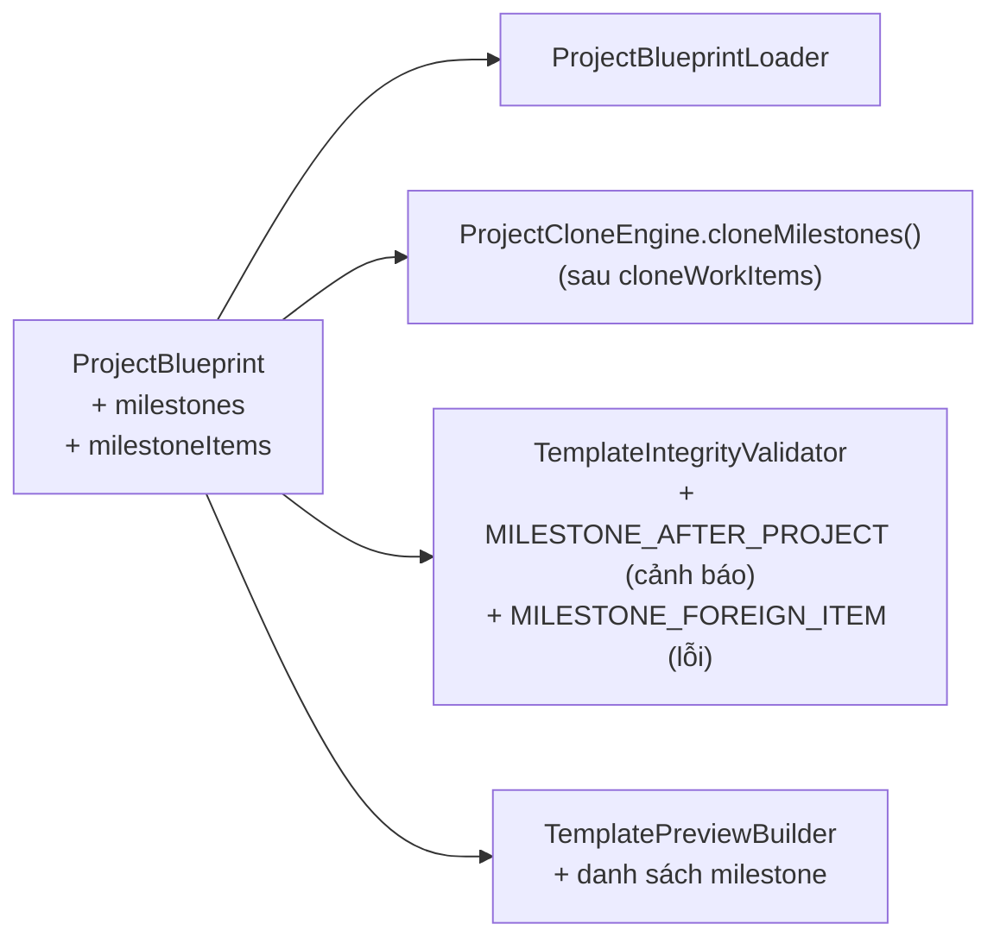

Thêm vào `anchorDate()` / `latestDate()` các `target_date` của milestone để dời ngày chính xác.

---

## 10. Chiến lược kiểm thử

| Tầng | Công cụ | Phạm vi |
|------|---------|---------|
| Thuật toán thuần | JUnit 5 + AssertJ | `ProgressCalculator`, `HealthEvaluator`, `MilestoneEvaluator`, `CriticalPathCalculator`, `ForecastCalculator` — mục tiêu phủ nhánh ≥ 90% |
| Service | Mockito (theo phong cách `SprintServiceTest`) | Quy tắc chuyển trạng thái dự án, chặn ghi khi ARCHIVED, quyền milestone |
| Controller | MockMvc standalone (theo `ProjectMemberControllerTest`) | Mã HTTP, validation DTO |
| Phân quyền | Mở rộng `ProjectPermissionGuardTest` | Quyền `PROJECT_MANAGE_SCHEDULE`, dự án ARCHIVED |
| Clone | Mở rộng test trong `service/template` | Milestone được chép và dời ngày |
| Thủ công | Kịch bản trên dữ liệu mẫu `TPLWEB` | Tạo dự án từ mẫu → kéo thẻ vài ngày (đổi giờ hệ thống hoặc chạy job thủ công) → kiểm Burn-up, health, milestone |

Chạy test qua Docker hoặc trên máy có JDK 21 (máy hiện tại chỉ có JDK 17 — xem `CLAUDE.md`).

Nên thêm endpoint `POST /admin/progress/run-snapshot-job` (chỉ Global ADMIN, chỉ bật ở profile dev) để demo mà không phải chờ tới 00:05.

---

## 11. Rủi ro và cách xử lý

| Rủi ro | Mức | Xử lý |
|--------|-----|-------|
| Tính % khi đọc chậm với dự án lớn | 🟡 | Đo trước; nếu > 300 ms thì cache theo `(projectId, version)` trong Redis, xóa cache trong `ProgressEventListener` |
| Job snapshot chạy trùng khi nhiều instance | 🟡 | Upsert idempotent; ShedLock nếu cần |
| Dữ liệu changelog cũ không dựng lại được lịch sử (lỗi A6) | 🟠 | Lịch sử chỉ bắt đầu từ ngày bật tính năng; backfill là tùy chọn, có ghi chú độ tin cậy |
| Không xóa được ngày công việc khi kéo trên Gantt (lỗi E3) | 🟠 | Sửa E3 trước Bước 4, hoặc tạm thời chỉ cho đổi ngày, không cho xóa |
| Quên đưa milestone vào clone | 🔴 | Đưa vào checklist bắt buộc của Bước 3; viết test clone trước khi viết code |
| Thêm `@EnableScheduling` vô tình kích hoạt `@Scheduled` cũ | 🟢 | Hiện chưa có `@Scheduled` nào trong code — đã kiểm tra |
| Xung đột số migration với nhánh khác | 🟡 | Kiểm tra `git log --all -- '**/db/migration/*'` trước khi tạo file |

---

## 12. Checklist tổng

### Bước 0
- [x] `@EnableScheduling` + múi giờ cron
- [x] `WorkItemChangedEvent` + phát tại 3 service
- [x] `PROJECT_MANAGE_SCHEDULE`
- [x] `StatusCategoryResolver`

### Bước 1
- [x] V8 migration
- [x] Enum + entity + DTO
- [x] `ProgressCalculator` + test
- [x] `GET /progress`, `PUT /status`
- [x] Chặn ghi khi ARCHIVED, chặn start sprint khi không ACTIVE
- [x] Tab Tiến độ, huy hiệu trạng thái, lọc danh sách

### Bước 2
- [x] V9 migration
- [x] `HealthEvaluator` + test
- [x] `ProgressSnapshotJob` + listener cập nhật hôm nay
- [x] `GET /progress/history`, `PUT /health-override`
- [x] Burn-up, HealthBadge

### Bước 3
- [x] V10 migration
- [x] Milestone CRUD + gắn việc + evaluator + job MISSED
- [x] Blueprint / loader / engine / validator / preview cho milestone
- [x] Portfolio API + trang

### Bước 4
- [x] `CriticalPathCalculator` + test
- [x] `GET /timeline`
- [x] `GanttChart` + kéo thả + đường găng

### Bước 5
- [x] V11 migration
- [x] Baseline + variance
- [x] `ForecastCalculator` + `GET /forecast`
- [x] Status update + nhắc hằng tuần

### Sau khi xong mỗi bước
- [x] Cập nhật mục "Trạng thái hiện tại" trong `CLAUDE.md` (migration mới, bảng con mới của project)
- [x] Cập nhật tài liệu 01 (thực thể) và 02 (nghiệp vụ Project)
- [x] Đánh dấu bước đã xong trong tài liệu này
