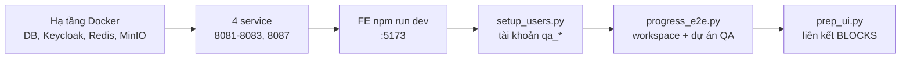
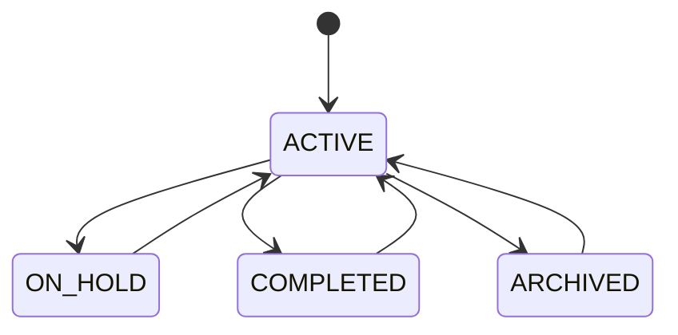

# 06B — Kịch bản kiểm thử: Quản lý tiến độ (Frontend + đầu-cuối)

> Kiểm thử cho các tính năng của [06A](06A_KE_HOACH_TRIEN_KHAI_TIEN_DO.md). Mỗi ca có thể chạy tay theo các bước dưới đây. Cột **Tự động** cho biết ca đó đã được bộ script ở [`tests/e2e/progress/`](../tests/e2e/progress/README.md) chạy hay chưa.
> Lần chạy gần nhất (03/10/2026, dữ liệu thật trên DB dev): **API 52/52 PASS · UI 35/35 PASS · Gantt 300 việc p95 16,7 ms/khung**.

---

## Mục lục

1. [Chuẩn bị](#1-chuẩn-bị)
2. [Ma trận vai trò](#2-ma-trận-vai-trò)
3. [TC-PG — Tab Tiến độ](#3-tc-pg--tab-tiến-độ)
4. [TC-HL — Sức khỏe dự án](#4-tc-hl--sức-khỏe-dự-án)
5. [TC-MS — Milestone](#5-tc-ms--milestone)
6. [TC-TL — Timeline / Gantt](#6-tc-tl--timeline--gantt)
7. [TC-BL — Kế hoạch gốc, dự báo, báo cáo tình trạng](#7-tc-bl--kế-hoạch-gốc-dự-báo-báo-cáo-tình-trạng)
8. [TC-ST — Trạng thái dự án](#8-tc-st--trạng-thái-dự-án)
9. [TC-PF — Portfolio và danh sách dự án](#9-tc-pf--portfolio-và-danh-sách-dự-án)
10. [TC-NF — Phi chức năng](#10-tc-nf--phi-chức-năng)
11. [Cách chạy bộ tự động](#11-cách-chạy-bộ-tự-động)

---

## 1. Chuẩn bị



| Dữ liệu | Giá trị |
|---------|---------|
| Tài khoản | `qa_lead` (trưởng nhóm, ADMINISTRATOR dự án), `qa_member` (MEMBER), `qa_viewer` (VIEWER), `qa_admin` (Global ADMIN) — mật khẩu `Qa@123456` |
| Workspace | "QA Tiến độ XXXX" (mỗi lần chạy tạo mới) |
| Dự án | "QA Web XXXX", tạo từ mẫu `TPLWEB`, ngày bắt đầu = hôm nay − 20 ngày |
| Trạng thái sau `progress_e2e.py` | 3 việc DONE (1 việc bị mở lại), 2 milestone (QA Beta, QA Trễ), 1 baseline, 1 báo cáo tình trạng |

URL dùng trong các ca: `/w/{workspaceId}/projects/{projectId}/progress` (Tiến độ), `.../timeline` (Timeline), `/w/{workspaceId}/portfolio`.

## 2. Ma trận vai trò

| Hành động trên UI | qa_lead | qa_member | qa_viewer |
|-------------------|:-:|:-:|:-:|
| Xem Tiến độ, Timeline, Portfolio | ✅ | ✅ | ✅ |
| Nút "Ghi đè" Health | ✅ | | |
| "Thêm milestone", sửa milestone | ✅ | | |
| "Chốt kế hoạch" | ✅ | | |
| "Viết báo cáo tình trạng" | ✅ | | |
| Kéo thanh Gantt | ✅ | ✅ | |
| Đổi trạng thái dự án (huy hiệu) | ✅ | | |

## 3. TC-PG — Tab Tiến độ

| ID | Bước | Kết quả mong đợi | Tự động |
|----|------|------------------|:-:|
| PG-01 | Đăng nhập `qa_lead`, mở dự án QA | Thanh tab có "Tiến độ" và "Timeline" | ✅ |
| PG-02 | Mở tab Tiến độ | Có 5 thẻ: Hoàn thành, Kỳ vọng theo thời gian, Chênh lệch, Quá hạn, Dự báo xong | ✅ |
| PG-03 | Xem thẻ "Hoàn thành" | Hiện % và "x / y điểm" (dự án Scrum tính theo Story Points) | ✅ |
| PG-04 | Xem thanh "Tiến độ tổng thể" | Có vạch đen "Kỳ vọng N%" đúng vị trí; dưới có số việc Cần làm / Đang làm / Hoàn thành | Ảnh `01` |
| PG-05 | Chuyển 1 việc sang Done ở Board, quay lại tab, bấm "Làm mới" | % Hoàn thành tăng; số Hoàn thành +1 | ✅ (API) |
| PG-06 | Xem "Tiến độ theo Epic" | Mỗi Epic có mã, thanh %, "x/y việc"; bấm vào mở chi tiết Epic | ✅ |
| PG-07 | Dự án không có ngày bắt đầu / hạn chót | Thẻ Kỳ vọng hiện "—" và "Cần ngày bắt đầu & hạn chót dự án" | Tay |
| PG-08 | Dự án chưa có việc nào | % hiện "—" và thanh tiến độ gạch chéo "Chưa có dữ liệu" (không hiện 0%) | Tay |
| PG-09 | Biểu đồ Burn-up | Có 3 đường: Phạm vi, Kỳ vọng (đỏ nét đứt), Đã xong; trục Y "Story Points" | ✅ |
| PG-10 | Dự án mẫu | Không có tab "Tiến độ" | Tay |

## 4. TC-HL — Sức khỏe dự án

| ID | Bước | Kết quả mong đợi | Tự động |
|----|------|------------------|:-:|
| HL-01 | Xem header dự án | Có huy hiệu trạng thái ("ĐANG HOẠT ĐỘNG") và Health (ON/AT RISK/OFF TRACK) | Ảnh `01` |
| HL-02 | `qa_lead` bấm "Ghi đè" → chọn "Có rủi ro" → nhập lý do → Lưu | Huy hiệu thành "AT RISK*"; rê chuột thấy giá trị tự động và lý do | ✅ |
| HL-03 | Ghi đè nhưng bỏ trống lý do | Toast "Vui lòng nêu lý do ghi đè", không lưu | Tay (API: 400 ✅) |
| HL-04 | "Sửa ghi đè" → "Dùng giá trị tự động" | Mất dấu "*", về Health tự động | ✅ |
| HL-05 | Có milestone bị lỡ | Health thành OFF TRACK | ✅ (API) |
| HL-06 | Đăng nhập `qa_viewer` | Không thấy nút "Ghi đè" | ✅ |
| HL-07 | Danh sách dự án | Mỗi thẻ dự án có huy hiệu Health | ✅ (API) |

## 5. TC-MS — Milestone

| ID | Bước | Kết quả mong đợi | Tự động |
|----|------|------------------|:-:|
| MS-01 | Mở tab Tiến độ | Mục "Milestone (2)" có thẻ "QA Beta" và "QA Trễ" | ✅ |
| MS-02 | Xem thẻ "QA Trễ" | Màu đỏ, "Bị lỡ · dd/mm/yyyy · trễ N ngày", "0/1 việc xong" | Ảnh `01` |
| MS-03 | "Thêm milestone" → tên "UI Go-live", ngày +10, tìm & tick 1 việc → "Tạo milestone" | Thẻ mới xuất hiện trên dải | ✅ |
| MS-04 | Tạo milestone thiếu tên hoặc ngày | Toast báo lỗi, không đóng hộp thoại | Tay |
| MS-05 | Bấm bút chì trên thẻ → bỏ hết việc → Lưu | "Chưa gắn công việc" | Tay |
| MS-06 | Sửa → "Xóa" → "Xác nhận xóa" | Thẻ biến mất | Tay |
| MS-07 | Đưa mọi việc của một mốc sang Done | Mốc thành "Đã đạt" ✅ | ✅ (API) |
| MS-08 | Mở lại (Reopen) một việc của mốc đã đạt | Mốc về "Dự kiến" | ✅ (API) |
| MS-09 | Mở chi tiết một công việc thuộc mốc "QA Trễ" | Có mục "MILESTONE" liệt kê "QA Trễ" | ✅ |
| MS-10 | Đăng nhập `qa_viewer` | Không có "Thêm milestone" và nút bút chì | ✅ |

## 6. TC-TL — Timeline / Gantt

| ID | Bước | Kết quả mong đợi | Tự động |
|----|------|------------------|:-:|
| TL-01 | Mở tab Timeline | Cột trái: Epic (tím, đậm) rồi việc con thụt vào; phải: thanh theo ngày | ✅ |
| TL-02 | Quan sát lớp phủ | Vạch cam "Hôm nay", hình thoi + nét đứt cho milestone, mũi tên phụ thuộc | ✅ |
| TL-03 | Bật/tắt "Tô đường găng" | Thanh đường găng đỏ ↔ màu theo trạng thái | ✅ (bật) |
| TL-04 | Rê chuột lên thanh | Tooltip: "MÃ: ngày → ngày · dự phòng N ngày" | Tay |
| TL-05 | `qa_lead` kéo thân thanh sang phải 60px (zoom Tháng) | Toast "MÃ: ... → ..."; ngày dời đúng +5 ngày cả hai đầu | ✅ |
| TL-06 | Kéo mép phải của thanh | Chỉ đổi hạn chót; kéo qua ngày bắt đầu thì dừng ở ngày bắt đầu | Tay |
| TL-07 | Đổi zoom Tuần / Tháng / Quý | Độ rộng ngày đổi, nhãn trục đổi (ngày ↔ tháng) | ✅ (Tuần) |
| TL-08 | Đăng nhập `qa_viewer`, kéo thanh | Con trỏ không phải "grab"; ngày không đổi | ✅ |
| TL-09 | Tạo liên kết A chặn B nhưng B bắt đầu trước khi A xong | Mũi tên đỏ nét đứt + thông báo "N phụ thuộc bị vi phạm" | Tay (API ✅) |
| TL-10 | Có việc không có ngày | Dòng "▸ N công việc chưa có ngày..." mở ra danh sách; bấm mở chi tiết | Ảnh `02` |
| TL-11 | Đã chốt kế hoạch gốc | Bóng xám mờ dưới thanh; bỏ tick "Hiện kế hoạch gốc" thì ẩn | ✅ (hiện) |
| TL-12 | Server từ chối đổi ngày (vd hạn trước ngày bắt đầu) | Toast lỗi, thanh quay về vị trí cũ | Tay (API 400 ✅) |

## 7. TC-BL — Kế hoạch gốc, dự báo, báo cáo tình trạng

| ID | Bước | Kết quả mong đợi | Tự động |
|----|------|------------------|:-:|
| BL-01 | Mục "Kế hoạch gốc (Baseline) và độ lệch" | Ô chọn "QA Kế hoạch gốc (đang dùng)" | Ảnh `01` |
| BL-02 | Sau khi dời hạn 1 việc +5 ngày | Thẻ "Việc bị dời: 1"; bảng có dòng "+5 ngày · Bị dời" (màu đỏ) | ✅ |
| BL-03 | Tạo việc mới sau khi chốt | Thẻ "Phạm vi" +1; dòng "Thêm sau khi chốt: MÃ" | ✅ (API) |
| BL-04 | "Chốt kế hoạch" → nhập tên → "Chốt" | Baseline mới thành "(đang dùng)"; độ lệch về 0 | Tay |
| BL-05 | Chọn baseline cũ → "Đặt làm kế hoạch đang dùng" | Bóng mờ trên Gantt đổi theo | Tay |
| BL-06 | Thẻ "Dự báo xong" khi dự án mới | "—" và "Chưa đủ dữ liệu để dự báo" | ✅ |
| BL-07 | Dự án có ≥ 2 sprint đã đóng | Thẻ hiện ngày, khoảng lạc quan–bi quan, "velocity N điểm/sprint"; trễ hạn thì màu vàng | Tay (unit ✅) |
| BL-08 | `qa_lead` "Viết báo cáo tình trạng" → chọn Health, nhập tóm tắt → "Đăng báo cáo" | Báo cáo xuất hiện đầu danh sách, kèm "Lúc viết: N% hoàn thành" | ✅ |
| BL-09 | Dự án ACTIVE quá 7 ngày chưa có báo cáo | Banner vàng nhắc viết báo cáo (chỉ quản trị thấy) | Tay |
| BL-10 | `qa_viewer` | Không có nút "Viết báo cáo tình trạng"; vẫn đọc được báo cáo | ✅ |

## 8. TC-ST — Trạng thái dự án



| ID | Bước | Kết quả mong đợi | Tự động |
|----|------|------------------|:-:|
| ST-01 | `qa_lead` bấm huy hiệu "ĐANG HOẠT ĐỘNG" | Menu: Tạm dừng / Đánh dấu hoàn thành / Lưu trữ | ✅ |
| ST-02 | Chọn "Lưu trữ (chỉ đọc)" | Huy hiệu "LƯU TRỮ"; banner "Dự án đã được lưu trữ..."; ẩn nút "Tạo công việc" | ✅ |
| ST-03 | Khi lưu trữ, `qa_member` cố tạo việc (API / thao tác bất kỳ) | Bị từ chối 403 | ✅ (API) |
| ST-04 | Bấm "LƯU TRỮ" → "Kích hoạt lại" | Nút "Tạo công việc" xuất hiện lại | ✅ |
| ST-05 | "Tạm dừng" rồi bắt đầu một Sprint ở Backlog | Toast lỗi "Chỉ dự án đang hoạt động (ACTIVE) mới bắt đầu được Sprint" | Tay (API ✅) |
| ST-06 | "Đánh dấu hoàn thành" khi còn Sprint đang chạy | Toast lỗi yêu cầu đóng Sprint trước | Tay |
| ST-07 | `qa_viewer` | Huy hiệu không bấm được (không có mũi tên) | Tay |

## 9. TC-PF — Portfolio và danh sách dự án

| ID | Bước | Kết quả mong đợi | Tự động |
|----|------|------------------|:-:|
| PF-01 | Sidebar có "Portfolio tiến độ" → bấm | Trang "Portfolio dự án" với 4 thẻ đếm và bảng dự án | ✅ |
| PF-02 | Xem bảng | Mỗi dòng: dự án, Health, thanh tiến độ (có vạch kỳ vọng), quá hạn, hạn chót, milestone kế tiếp, trạng thái | Ảnh `05` |
| PF-03 | Có dự án OFF TRACK | Dòng đó nằm đầu bảng | ✅ (API) |
| PF-04 | Bấm một dòng | Mở tab Tiến độ của dự án | Tay |
| PF-05 | Mở Portfolio của workspace mình không thuộc (sửa URL) | Bị từ chối (thông báo lỗi), không lộ dữ liệu | ✅ (API) |
| PF-06 | Danh sách dự án → chọn lọc "Lưu trữ" | Dự án đang hoạt động bị ẩn; chọn "Mọi trạng thái" hiện lại | ✅ |
| PF-07 | Thẻ dự án không ACTIVE | Có thêm huy hiệu trạng thái (Tạm dừng / Đã hoàn thành / Lưu trữ) | Tay |

## 10. TC-NF — Phi chức năng

| ID | Nội dung | Tiêu chí | Kết quả |
|----|----------|----------|---------|
| NF-01 | Kéo thanh Gantt với 300 việc | p95 ≤ 16,7 ms/khung (60 fps) | ✅ p95 16,7 ms (trước tối ưu 33 ms, tệ nhất 133 ms) |
| NF-02 | Mở tab Timeline 300 việc | < 2 giây | ✅ 1,0–1,7 giây |
| NF-03 | API `/progress`, `/portfolio` | < 300 ms | ✅ 40–70 ms |
| NF-04 | Không lỗi JS / cảnh báo React / HTTP 5xx trong cả phiên | 0 lỗi | ✅ (đã sửa 1 cảnh báo prop của modal) |
| NF-05 | Số liệu hôm nay cập nhật sau khi đổi công việc | ≤ 5 giây (listener bất đồng bộ) | ✅ |

## 11. Cách chạy bộ tự động

Xem [`tests/e2e/progress/README.md`](../tests/e2e/progress/README.md). Tóm tắt:

```bash
cd tests/e2e/progress
python setup_users.py && python progress_e2e.py && python prep_ui.py
npm install && npm run ui
```

Các ca đánh dấu "Tay" cần người kiểm thử chạy theo bước trong bảng; các ca có "Ảnh" được kiểm bằng ảnh chụp `shots/0x_*.png` mà script lưu lại.
