# 06 — Thiết kế tương lai: Quản lý tiến độ dự án

> Trạng thái: **Đề xuất thiết kế**. Chưa có mã nguồn. Tài liệu bám theo mô hình dữ liệu hiện có (tài liệu 01) để tái sử dụng tối đa.

---

## Mục lục

1. [Bài toán](#1-bài-toán)
2. [Hiện trạng có thể tận dụng](#2-hiện-trạng-có-thể-tận-dụng)
3. [Phạm vi và các khái niệm mới](#3-phạm-vi-và-các-khái-niệm-mới)
4. [Mô hình dữ liệu](#4-mô-hình-dữ-liệu)
5. [Cách tính tiến độ](#5-cách-tính-tiến-độ)
6. [Sức khỏe dự án](#6-sức-khỏe-dự-án)
7. [Milestone](#7-milestone)
8. [Baseline và độ lệch kế hoạch](#8-baseline-và-độ-lệch-kế-hoạch)
9. [Timeline / Gantt và đường găng](#9-timeline--gantt-và-đường-găng)
10. [Dự báo ngày hoàn thành](#10-dự-báo-ngày-hoàn-thành)
11. [Báo cáo tình trạng định kỳ](#11-báo-cáo-tình-trạng-định-kỳ)
12. [Kiến trúc xử lý](#12-kiến-trúc-xử-lý)
13. [API đề xuất](#13-api-đề-xuất)
14. [Giao diện đề xuất](#14-giao-diện-đề-xuất)
15. [Phân quyền](#15-phân-quyền)
16. [Lộ trình triển khai](#16-lộ-trình-triển-khai)

---

## 1. Bài toán

Hiện hệ thống trả lời tốt câu hỏi *"Sprint này đang thế nào?"* (Burndown), nhưng **không** trả lời được các câu hỏi cấp quản lý:

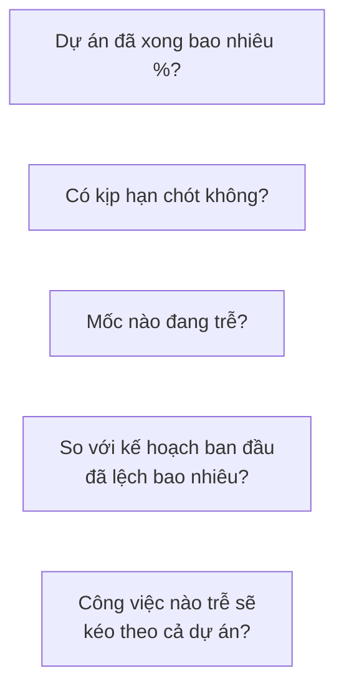

## 2. Hiện trạng có thể tận dụng

| Đã có | Dùng cho |
|-------|----------|
| `projects.start_date / end_date` | Khung thời gian dự án |
| `work_items.start_date / due_date / story_points / estimate` | Lập lịch, trọng số |
| `statuses.category` (TODO / IN_PROGRESS / DONE) | Xác định hoàn thành |
| Cây Epic → Task → Subtask | Cộng dồn tiến độ |
| `work_item_links` loại `BLOCKS` | Phụ thuộc cho Gantt |
| `work_item_changelogs` + `WorkItemStateReplayer` | Dựng lại lịch sử |
| `sprint_report_snapshots`, Velocity | Dự báo |
| `versions.release_date` | Mốc phát hành |

**Điều kiện tiên quyết** (từ tài liệu 05): A6 (changelog theo id), D2 (trạng thái dự án), A5 (outbox publisher), E3 (xóa được giá trị trường).

## 3. Phạm vi và các khái niệm mới

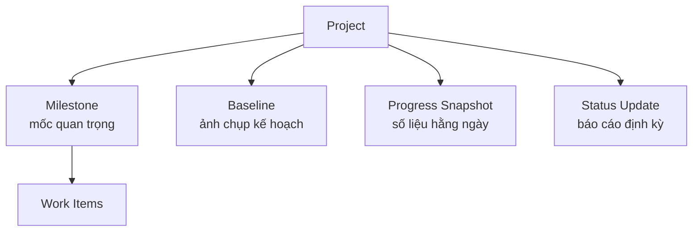

| Khái niệm | Định nghĩa |
|-----------|-----------|
| **Milestone** | Một mốc có ngày đích và tập công việc phải xong trước mốc (vd "Khai trương", "Go-live") |
| **Progress** | % hoàn thành tính theo một phương pháp chọn được |
| **Health** | ON_TRACK / AT_RISK / OFF_TRACK, tính tự động và có thể ghi đè tay |
| **Baseline** | Ảnh chụp ngày bắt đầu/kết thúc của mọi công việc tại thời điểm "chốt kế hoạch" |
| **Progress Snapshot** | Một dòng số liệu mỗi ngày mỗi dự án, để vẽ Burn-up dài hạn |
| **Status Update** | Báo cáo do Lead viết định kỳ (tuần), kèm số liệu tự động |

## 4. Mô hình dữ liệu

### 4.1. Trạng thái dự án (bổ sung cột)

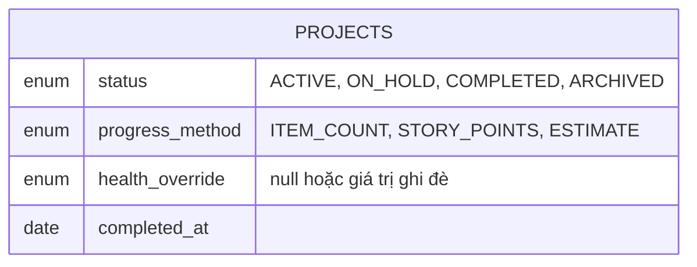

### 4.2. Milestone

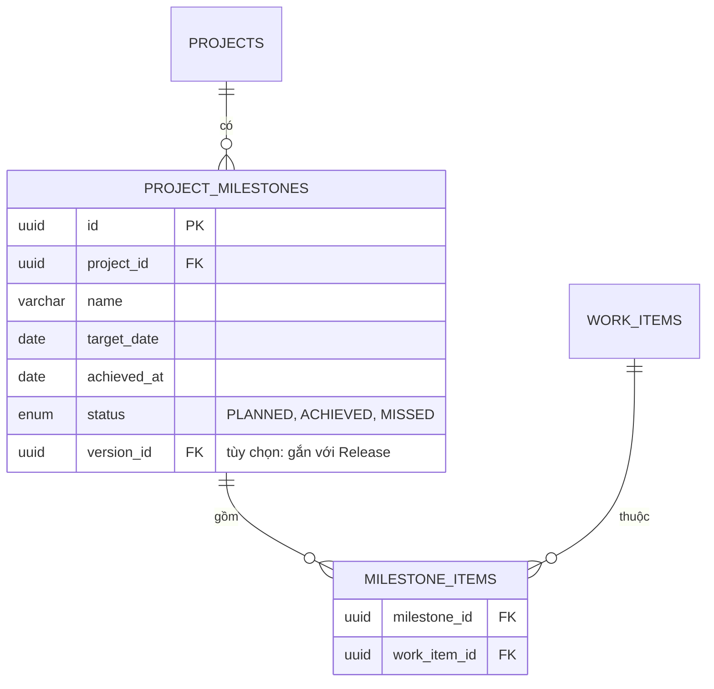

### 4.3. Baseline

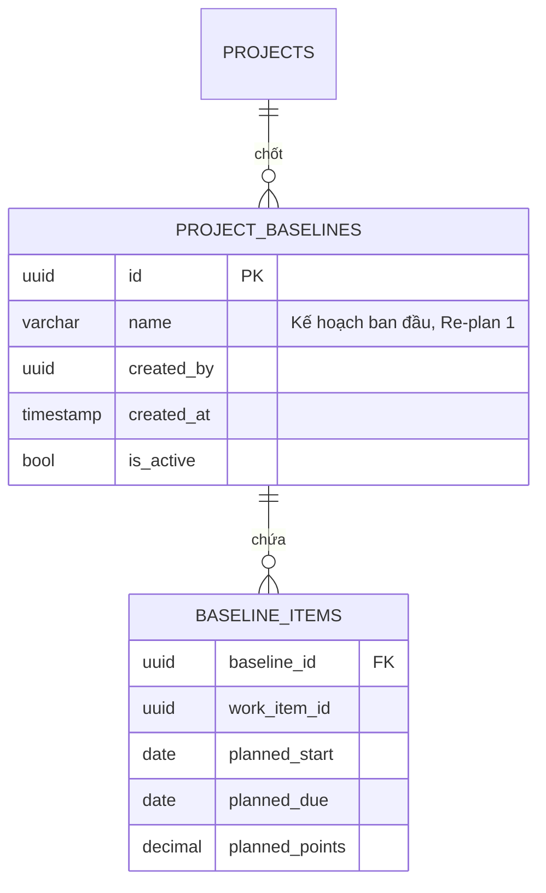

### 4.4. Snapshot hằng ngày và báo cáo tình trạng

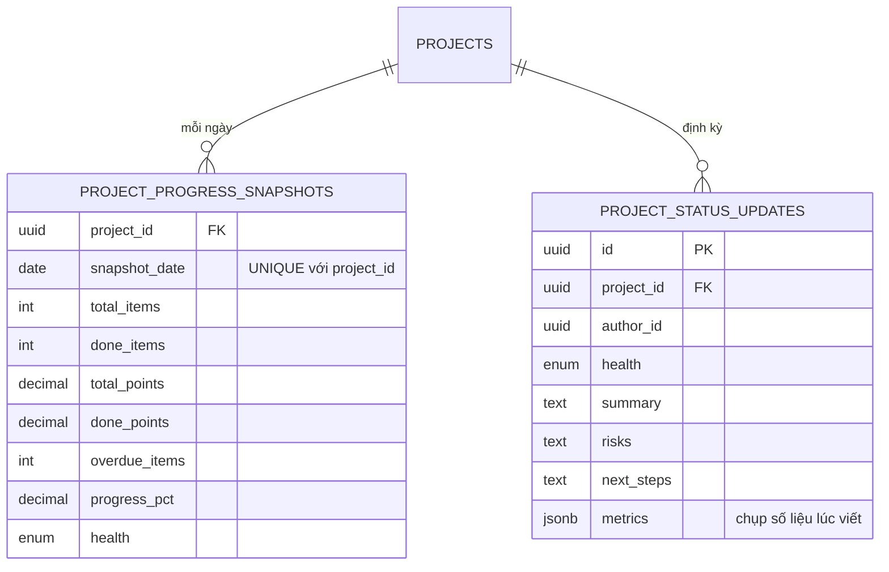

## 5. Cách tính tiến độ

### 5.1. Ba phương pháp

| Phương pháp | Công thức | Hợp với |
|-------------|-----------|---------|
| `ITEM_COUNT` | việc DONE / tổng việc | Dự án BUSINESS, không ước lượng |
| `STORY_POINTS` | điểm DONE / tổng điểm | Scrum |
| `ESTIMATE` | giờ ước lượng của việc DONE / tổng giờ ước lượng | Dự án tính theo giờ |

Chỉ tính công việc cấp 0 và cấp 1 (bỏ Subtask khi tính theo điểm để tránh đếm hai lần — đúng như Burndown hiện tại đang làm).

### 5.2. Cộng dồn theo cây

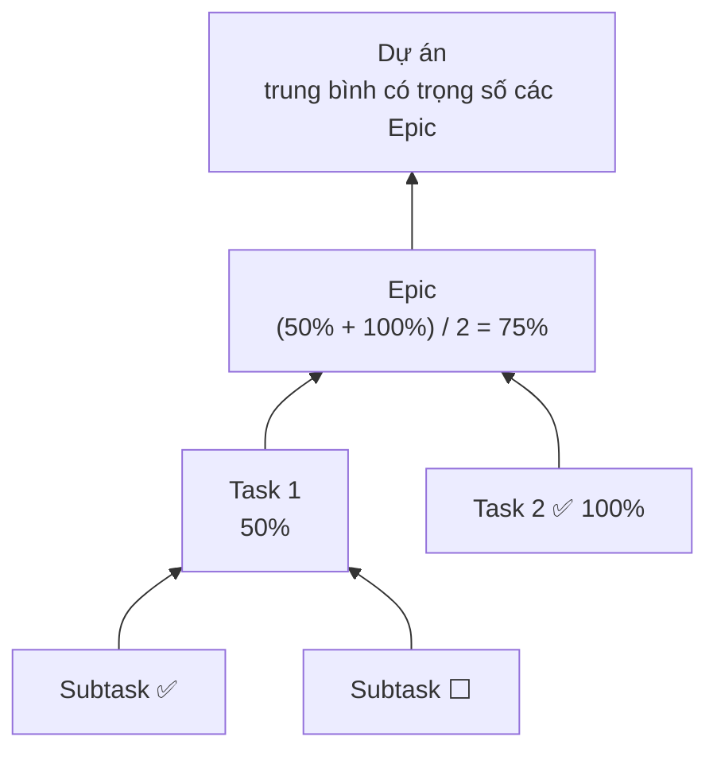

Quy tắc:
1. Lá (không có con): DONE = 100%, IN_PROGRESS = 50% (tùy chọn) hoặc 0%, TODO = 0%.
2. Nút có con: trung bình có trọng số (trọng số = story points hoặc estimate; thiếu thì = 1).
3. Dự án: cộng dồn tất cả nút gốc.

### 5.3. Tiến độ kỳ vọng theo thời gian

```
expected_pct(t) = (t − start_date) / (end_date − start_date)
schedule_gap    = progress_pct − expected_pct
```

## 6. Sức khỏe dự án

### 6.1. Luật tự động

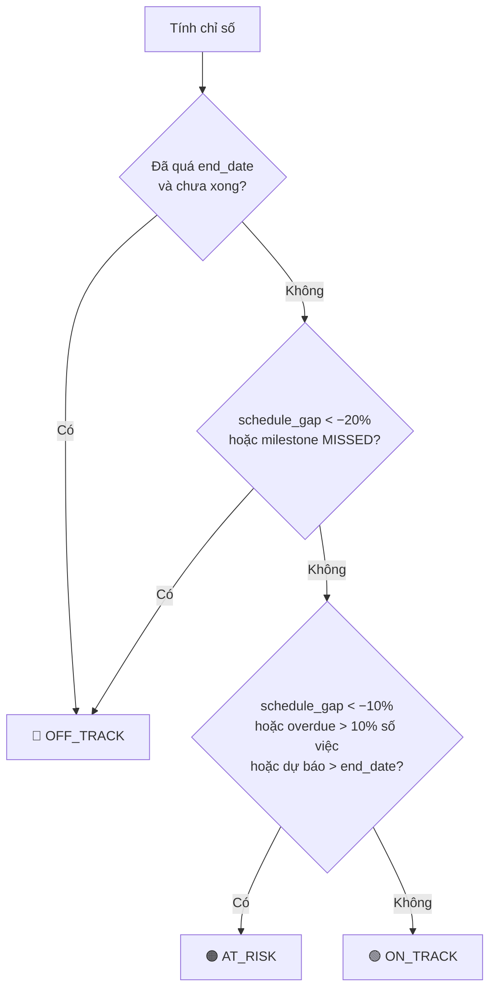

Các ngưỡng (10%, 20%) lưu ở cấu hình dự án để Lead điều chỉnh.

### 6.2. Ghi đè thủ công

Lead có thể ghi đè (`health_override`) kèm lý do bắt buộc — ví dụ dự án "trễ" theo số liệu nhưng khách hàng đã đồng ý dời hạn. Giao diện luôn hiển thị **cả hai** giá trị (tự động và ghi đè).

## 7. Milestone

### 7.1. Vòng đời

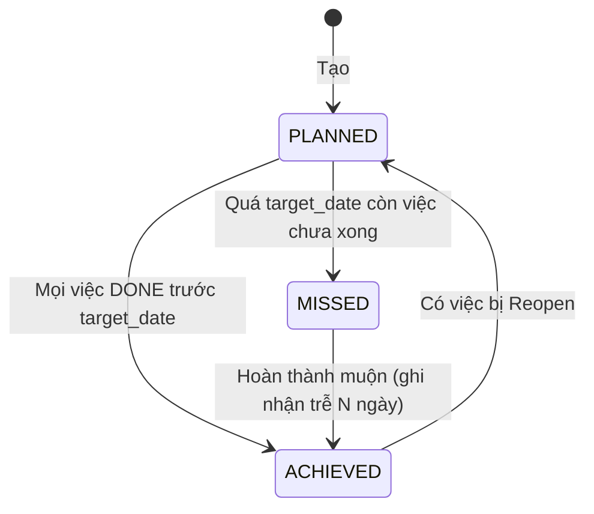

### 7.2. Quy tắc

- Công việc thêm vào milestone phải cùng dự án.
- Khi công việc trong milestone chuyển trạng thái → tính lại milestone (lắng nghe sự kiện `WORK_ITEM_TRANSITIONED`).
- Milestone có thể gắn với một `Version` để "Release = Milestone".

## 8. Baseline và độ lệch kế hoạch

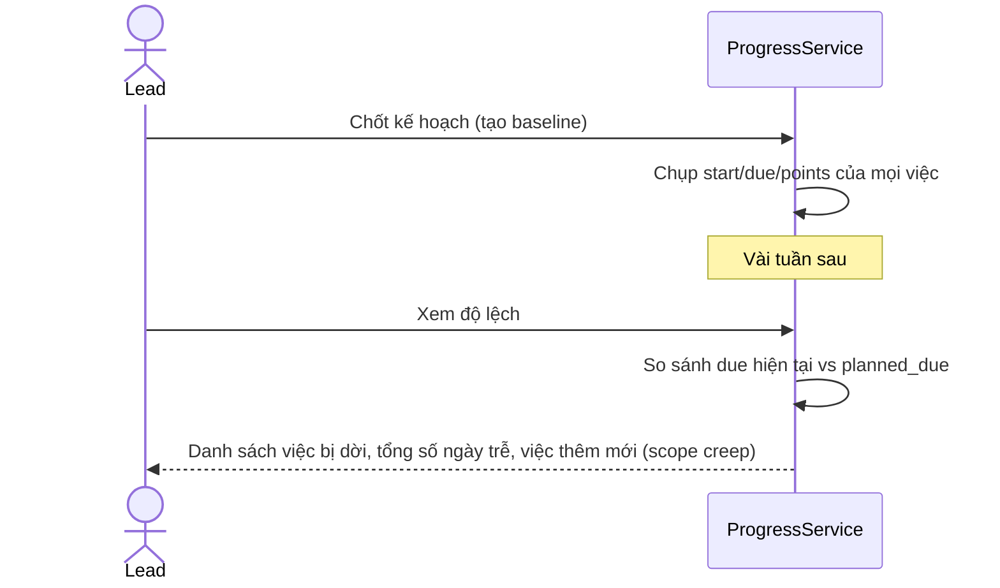

| Chỉ số | Ý nghĩa |
|--------|---------|
| Slip (ngày) | `due_hiện_tại − planned_due` |
| Scope added | Việc tạo sau baseline |
| Scope removed | Việc trong baseline đã bị xóa |
| Points drift | Tổng điểm hiện tại − tổng điểm baseline |

## 9. Timeline / Gantt và đường găng

### 9.1. Dữ liệu đầu vào

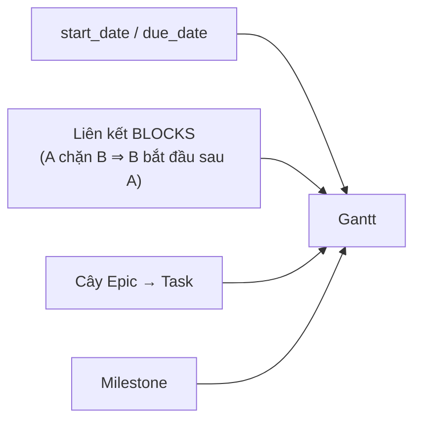

### 9.2. Đường găng (Critical Path)

Đồ thị phụ thuộc `BLOCKS` là DAG (đã được `DependencyCycleDetector` đảm bảo không có vòng) → áp dụng thuật toán đường dài nhất:

1. Sắp xếp topo các công việc.
2. Tính *earliest start / finish* đi xuôi, *latest start / finish* đi ngược từ `end_date`.
3. `slack = latest_start − earliest_start`; công việc có `slack = 0` nằm trên đường găng.

Giao diện tô đỏ các công việc trên đường găng: trễ một ngày ở đây = cả dự án trễ một ngày.

### 9.3. Kéo thả trên Gantt

- Kéo thanh → cập nhật `start_date/due_date` (cần `ISSUE_EDIT`).
- Tùy chọn "dời theo" (auto-schedule): dời các việc bị chặn phía sau.

## 10. Dự báo ngày hoàn thành

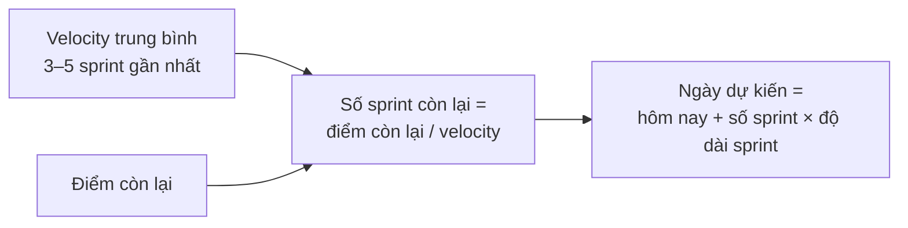

- Dự án Kanban / BUSINESS: dùng **throughput** (số việc xong mỗi tuần) thay velocity.
- Hiển thị khoảng tin cậy: dùng velocity thấp nhất / cao nhất để ra ngày "bi quan / lạc quan".

## 11. Báo cáo tình trạng định kỳ

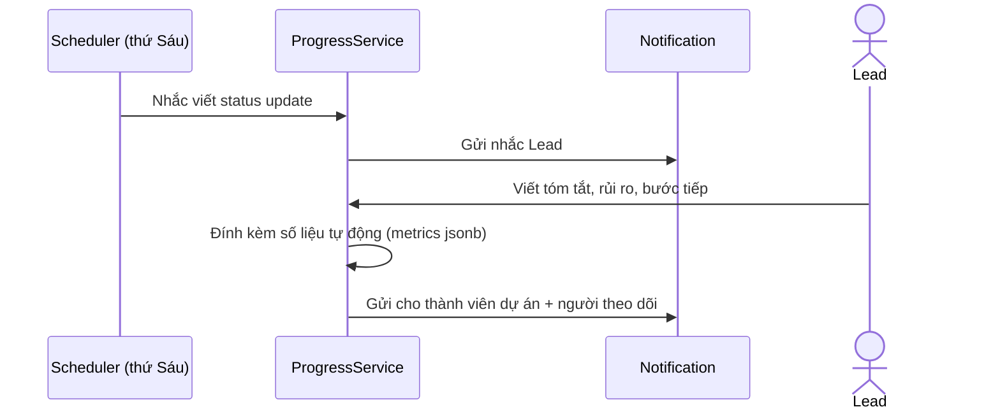

## 12. Kiến trúc xử lý

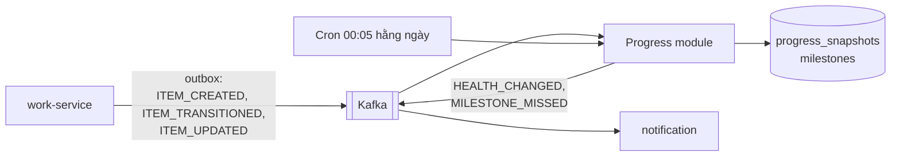

| Quyết định | Lý do |
|-----------|-------|
| Bắt đầu như **module** trong work-service, chưa tách service | Cần truy cập trực tiếp cây công việc; giảm độ phức tạp |
| Tính tiến độ **khi có sự kiện** + snapshot **hằng ngày** | Số liệu hiện tại luôn mới; lịch sử rẻ để vẽ |
| Cache `progress_pct` của Epic | Tránh duyệt cả cây mỗi lần mở trang |

## 13. API đề xuất

| Phương thức | Endpoint | Quyền |
|-------------|----------|-------|
| GET | `/projects/{id}/progress` | PROJECT_VIEW |
| GET | `/projects/{id}/progress/history?from=&to=` | PROJECT_VIEW |
| PUT | `/projects/{id}/status` (ACTIVE/ON_HOLD/COMPLETED/ARCHIVED) | PROJECT_ADMIN |
| PUT | `/projects/{id}/health-override` | PROJECT_ADMIN |
| GET/POST | `/projects/{id}/milestones` | VIEW / PROJECT_MANAGE_SCHEDULE |
| PUT/DELETE | `/milestones/{id}`, `/milestones/{id}/items` | PROJECT_MANAGE_SCHEDULE |
| POST | `/projects/{id}/baselines` | PROJECT_MANAGE_SCHEDULE |
| GET | `/projects/{id}/baselines/{bid}/variance` | PROJECT_VIEW |
| GET | `/projects/{id}/timeline` (Gantt + đường găng) | PROJECT_VIEW |
| GET | `/projects/{id}/forecast` | PROJECT_VIEW |
| GET/POST | `/projects/{id}/status-updates` | VIEW / PROJECT_ADMIN |
| GET | `/workspaces/{id}/portfolio` (mọi dự án + health) | WS MEMBER+ |

Quyền mới: `PROJECT_MANAGE_SCHEDULE` (bổ sung vào `PermissionKey`, mặc định cho ADMINISTRATOR).

## 14. Giao diện đề xuất

### 14.1. Bảng điều khiển tiến độ dự án

```
┌─────────────────────────────────────────────────────────────┐
│ WEB · Website bán hàng          🟠 AT_RISK   ON TRACK* (Lead)│
├──────────────┬──────────────┬──────────────┬───────────────┤
│ Hoàn thành   │ Kỳ vọng      │ Quá hạn      │ Dự báo xong   │
│   62%        │   70%        │  4 việc      │ 18/12 (+5 ng) │
├──────────────┴──────────────┴──────────────┴───────────────┤
│ Burn-up (tổng phạm vi vs đã xong theo ngày)                 │
├─────────────────────────────────────────────────────────────┤
│ Milestone: ✅ Thiết kế  ⏳ Beta (12/11)  ⬜ Go-live (01/12)  │
├─────────────────────────────────────────────────────────────┤
│ Epic progress: ██████░░ Catalog 75% │ ███░░░░ Checkout 40%  │
└─────────────────────────────────────────────────────────────┘
```

### 14.2. Portfolio cấp workspace

Bảng mọi dự án: tên · Lead · % · health · hạn chót · milestone kế tiếp — sắp theo health để người quản lý thấy dự án có vấn đề trước.

## 15. Phân quyền

| Hành động | ADMINISTRATOR | MEMBER | VIEWER | WS OWNER/ADMIN |
|-----------|:-:|:-:|:-:|:-:|
| Xem tiến độ, timeline, dự báo | ✅ | ✅ | ✅ | ✅ (portfolio) |
| Quản lý milestone, baseline | ✅ | tùy cấu hình | | |
| Đổi trạng thái dự án, ghi đè health | ✅ | | | |
| Viết status update | ✅ | | | |

## 16. Lộ trình triển khai

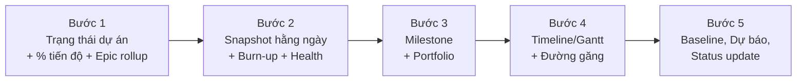

| Bước | Giá trị mang lại | Độ khó |
|------|------------------|--------|
| 1 | Thấy ngay % hoàn thành dự án và từng Epic | Thấp |
| 2 | Biết dự án đang tốt hay xấu theo thời gian | Trung bình |
| 3 | Quản lý mốc giao hàng, nhìn toàn bộ tổ chức | Trung bình |
| 4 | Lập lịch trực quan, biết việc nào quyết định hạn chót | Cao |
| 5 | Quản trị dự án chuyên nghiệp (kiểm soát thay đổi phạm vi) | Trung bình |
