# 07 — Thiết kế tương lai: Quản lý đóng góp của thành viên

> Trạng thái: **Đề xuất thiết kế**. Chưa có mã nguồn.

---

## Mục lục

1. [Mục tiêu và nguyên tắc](#1-mục-tiêu-và-nguyên-tắc)
2. [Dữ liệu hiện có và khoảng trống](#2-dữ-liệu-hiện-có-và-khoảng-trống)
3. [Các chiều đóng góp](#3-các-chiều-đóng-góp)
4. [Mô hình dữ liệu](#4-mô-hình-dữ-liệu)
5. [Ghi nhận công: ai được tính](#5-ghi-nhận-công-ai-được-tính)
6. [Nhật ký thời gian (Worklog)](#6-nhật-ký-thời-gian-worklog)
7. [Luồng sự kiện hoạt động](#7-luồng-sự-kiện-hoạt-động)
8. [Tổng hợp chỉ số](#8-tổng-hợp-chỉ-số)
9. [Ghi nhận đồng nghiệp (Kudos)](#9-ghi-nhận-đồng-nghiệp-kudos)
10. [Quyền riêng tư và ai được xem](#10-quyền-riêng-tư-và-ai-được-xem)
11. [Chống sai lệch và lạm dụng](#11-chống-sai-lệch-và-lạm-dụng)
12. [API đề xuất](#12-api-đề-xuất)
13. [Giao diện đề xuất](#13-giao-diện-đề-xuất)
14. [Lộ trình triển khai](#14-lộ-trình-triển-khai)

---

## 1. Mục tiêu và nguyên tắc

### 1.1. Mục tiêu

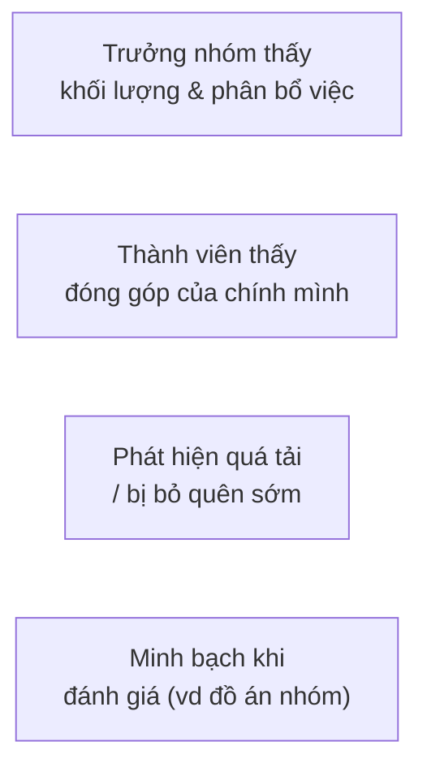

### 1.2. Nguyên tắc thiết kế

| Nguyên tắc | Cách thể hiện |
|-----------|---------------|
| **Đa chiều** | Không có một con số "điểm đóng góp" duy nhất; hiển thị nhiều chỉ số cạnh nhau |
| **Ngữ cảnh** | Mọi chỉ số đi kèm khoảng thời gian, dự án, và so với chính mình trước đó |
| **Minh bạch** | Người dùng xem được dữ liệu thô tạo nên chỉ số của mình |
| **Không xếp hạng công khai** | Không có bảng xếp hạng toàn workspace mặc định |
| **Tự động là chính** | Thu thập từ hoạt động thật, hạn chế nhập tay |

## 2. Dữ liệu hiện có và khoảng trống

| Nguồn hiện có | Cho biết | Hạn chế |
|---------------|----------|---------|
| `work_items.assignee_id`, `reporter_id` | Ai đang được giao, ai tạo | Chỉ trạng thái hiện tại |
| `work_item_changelogs` (STATUS, ASSIGNEE) | Ai đổi trạng thái, khi nào | Lưu tên, không lưu id (tài liệu 05 – A6); không biết **ai đang được giao lúc việc xong** |
| `work_item_comments.author_id` | Ai thảo luận | |
| `work_item_attachments.uploaded_by` | Ai đóng góp tài liệu | |
| `sprint_report_snapshots.snapshot_data` | Việc nào xong trong sprint | Không tách theo người |
| `time_spent_seconds` | Tổng thời gian | Ghi đè, không biết của ai |

**Khoảng trống cần lấp:** (1) worklog theo người, (2) "người hoàn thành" của mỗi công việc, (3) luồng sự kiện hoạt động có cấu trúc.

## 3. Các chiều đóng góp

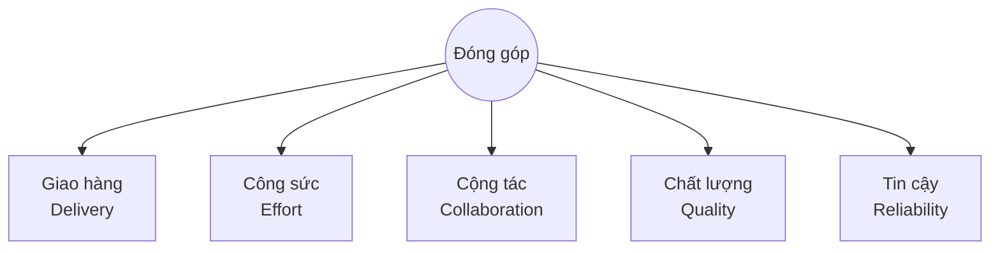

| Chiều | Chỉ số | Cách tính |
|-------|--------|-----------|
| Giao hàng | Việc hoàn thành | Số việc chuyển sang DONE mà người đó là assignee lúc hoàn thành |
| | Story points hoàn thành | Tổng điểm các việc trên |
| Công sức | Giờ đã log | Tổng `work_logs.duration` |
| | Việc đang làm | Số việc IN_PROGRESS đang được giao |
| Cộng tác | Bình luận | Số bình luận (bỏ bình luận trên việc của chính mình nếu muốn) |
| | Gỡ chặn | Số việc mình hoàn thành đang `BLOCKS` việc của người khác |
| | Review | Số lần chuyển việc của người khác qua trạng thái "Review" (nếu workflow có) |
| Chất lượng | Tỉ lệ mở lại | Việc đã DONE bị Reopen / tổng việc DONE |
| | Bug phát sinh | Số Bug liên kết `CAUSES` tới việc của mình |
| Tin cậy | Đúng hạn | Việc DONE trước `due_date` / việc DONE có `due_date` |
| | Độ chính xác ước lượng | `time_spent / original_estimate` (gần 1 là tốt) |

## 4. Mô hình dữ liệu

### 4.1. Worklog

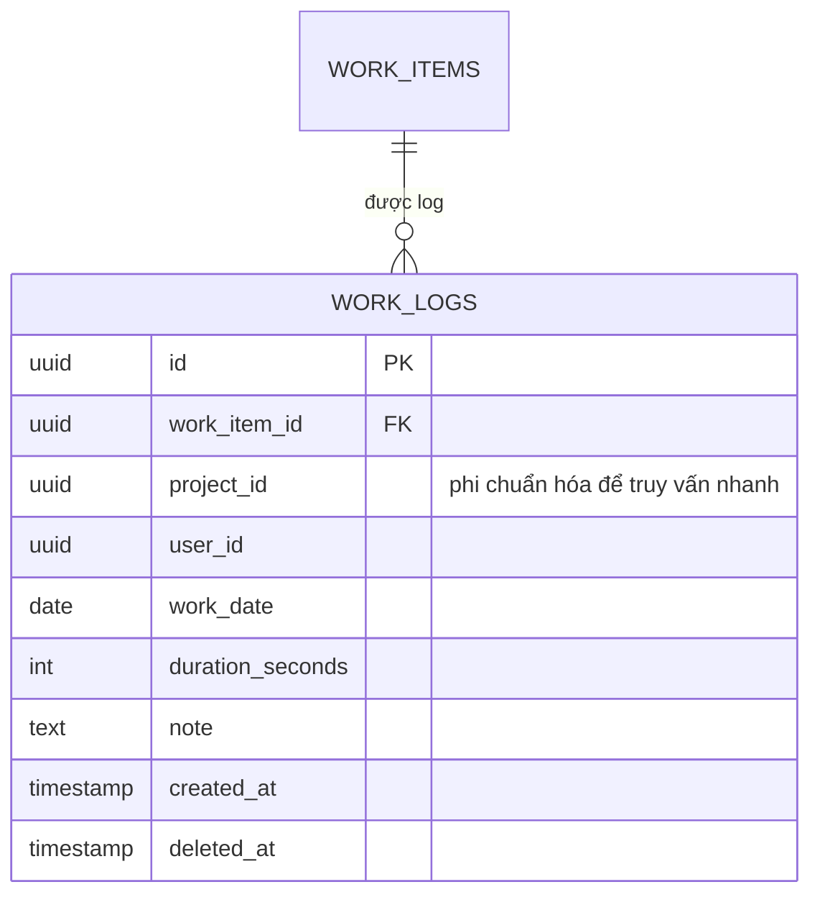

`work_items.time_spent_seconds` trở thành **giá trị dẫn xuất** = tổng `work_logs` (không còn sửa trực tiếp).

### 4.2. Người hoàn thành

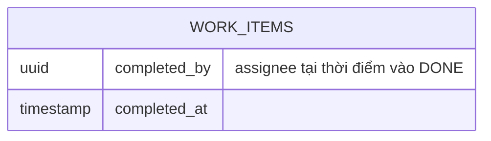

### 4.3. Sự kiện hoạt động

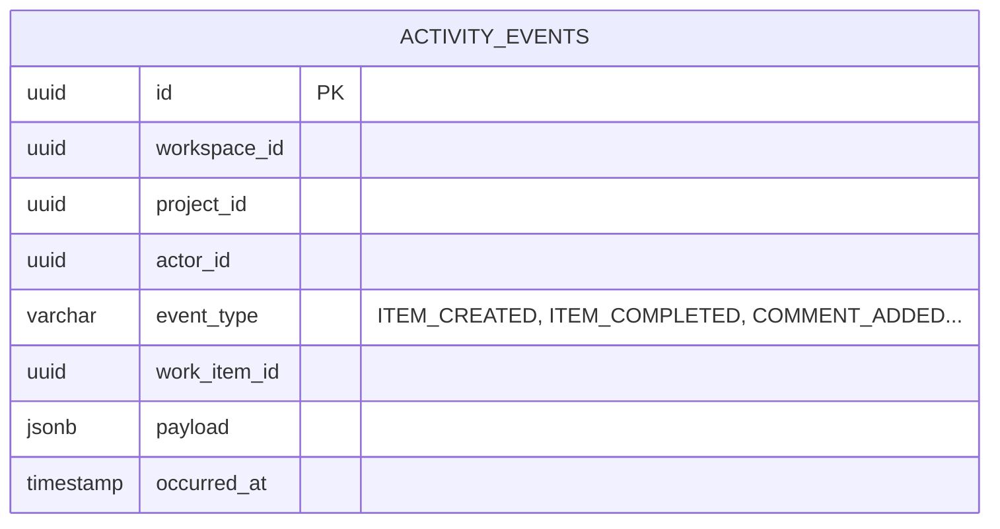

### 4.4. Bảng tổng hợp

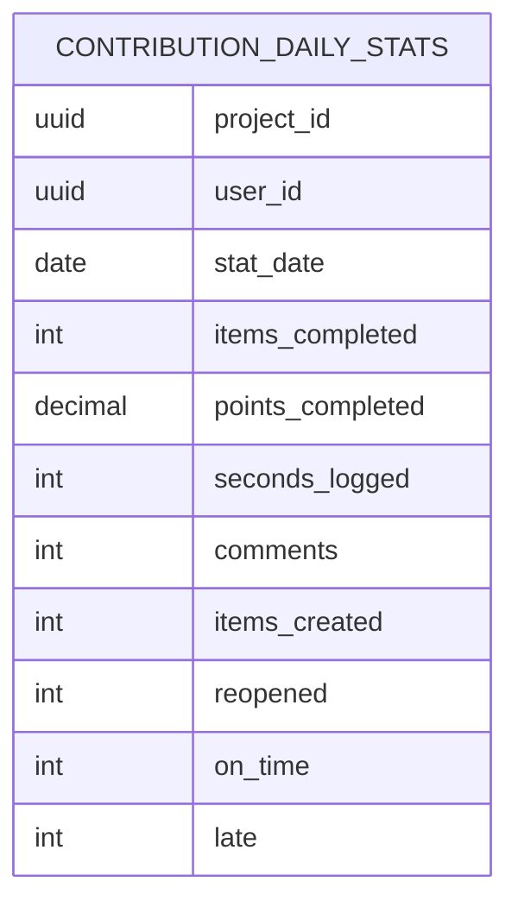

Khóa `(project_id, user_id, stat_date)`. Mọi báo cáo đọc từ bảng này, không quét `activity_events`.

### 4.5. Ghi nhận đồng nghiệp

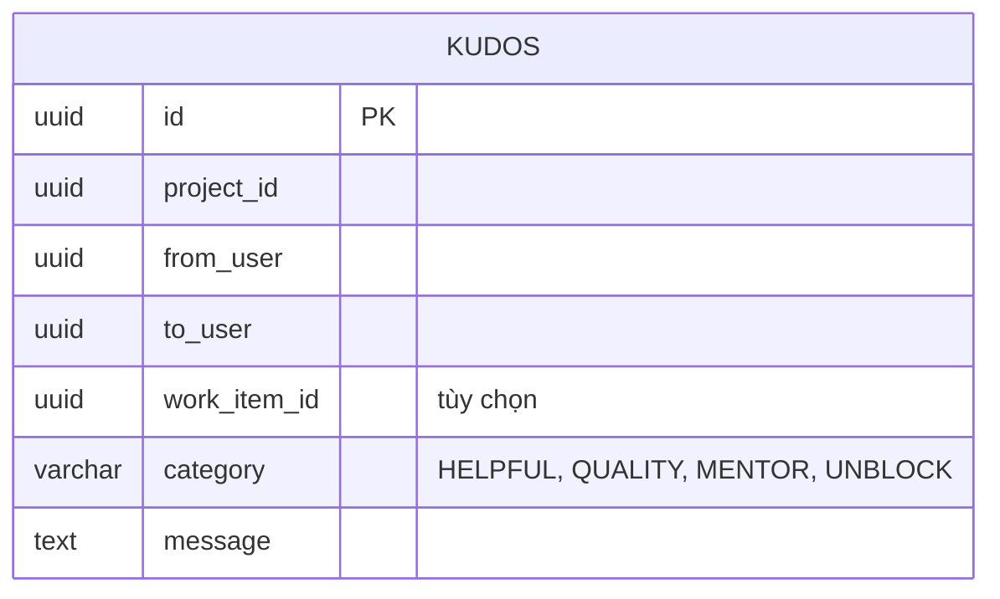

## 5. Ghi nhận công: ai được tính

### 5.1. Quy tắc cho việc hoàn thành

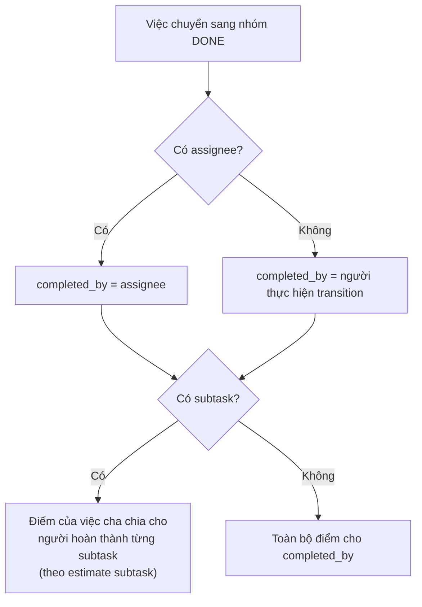

### 5.2. Các tình huống đặc biệt

| Tình huống | Xử lý |
|-----------|-------|
| Việc bị Reopen sau khi DONE | Ghi sự kiện `ITEM_REOPENED`; trừ ở ngày Reopen (không sửa lịch sử) |
| Đổi assignee giữa chừng | Công giao hàng cho người lúc DONE; công sức (giờ log) cho từng người đã log |
| Việc không có điểm | Đếm vào "số việc", không vào "điểm" |
| Việc bị xóa | Loại khỏi tổng hợp (ghi sự kiện `ITEM_DELETED`) |

## 6. Nhật ký thời gian (Worklog)

### 6.1. Luồng log thời gian

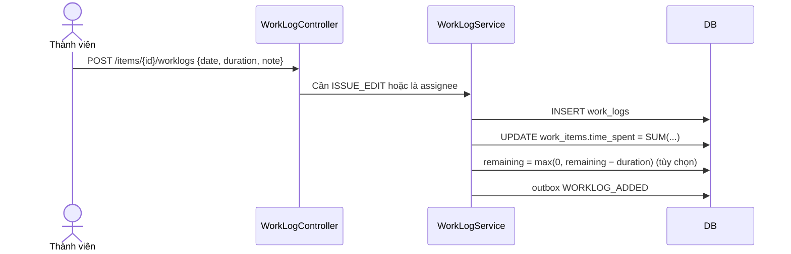

### 6.2. Quy tắc

| Quy tắc | |
|--------|---|
| `duration` > 0 và ≤ 24 giờ / ngày / người | |
| Chỉ sửa/xóa worklog của mình (trừ ADMINISTRATOR) | Quyền mới `WORKLOG_EDIT_ALL` |
| Khóa sổ: không sửa worklog cũ hơn N ngày (cấu hình) | Chống sửa số liệu sau khi đã đánh giá |
| Hỗ trợ nhập `1h 30m`, `2d` | Frontend chuyển sang giây |

### 6.3. Timesheet tuần

```
              T2   T3   T4   T5   T6   | Tổng
WEB-12        2h   3h              1h  |  6h
WEB-15             2h   4h   4h        | 10h
API-3         1h                  3h   |  4h
──────────────────────────────────────────────
Tổng          3h   5h   4h   4h   4h   | 20h
```

## 7. Luồng sự kiện hoạt động

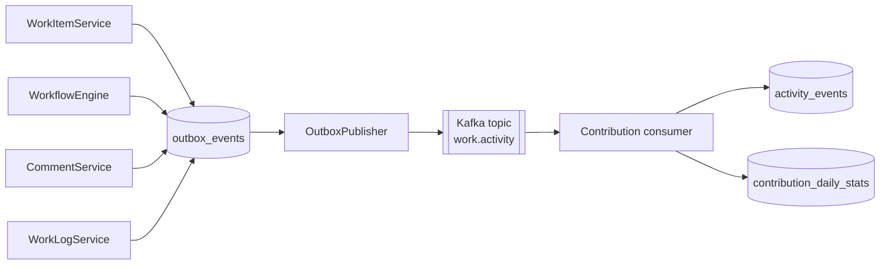

| Sự kiện | Phát từ | Ảnh hưởng tới |
|---------|---------|---------------|
| `ITEM_CREATED` | WorkItemService | items_created |
| `ITEM_TRANSITIONED` (vào DONE) | WorkflowEngine, BoardService | items/points_completed, on_time/late |
| `ITEM_REOPENED` | WorkflowEngine | reopened |
| `ITEM_ASSIGNED` | WorkItemService | (dòng thời gian) |
| `COMMENT_ADDED` | CommentService | comments |
| `WORKLOG_ADDED/UPDATED/DELETED` | WorkLogService | seconds_logged |
| `ATTACHMENT_ADDED` | AttachmentService | (dòng thời gian) |

Consumer phải **idempotent** (dùng `event_id` để bỏ qua sự kiện trùng) vì Kafka có thể giao lại.

## 8. Tổng hợp chỉ số

### 8.1. Theo thời gian thực và theo lô

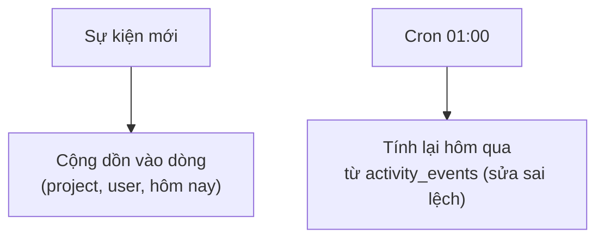

### 8.2. Truy vấn mẫu

| Câu hỏi | Nguồn |
|---------|-------|
| Bình làm được bao nhiêu điểm trong sprint 5? | `contribution_daily_stats` lọc theo khoảng ngày của sprint |
| Phân bổ việc trong team có đều không? | Độ lệch chuẩn `items_completed` giữa thành viên |
| Ai đang quá tải? | Việc IN_PROGRESS đang giao + giờ log 7 ngày gần nhất |

### 8.3. Đóng góp theo sprint (gắn với báo cáo hiện có)

Khi đóng sprint, `SprintReportSnapshotEngine` bổ sung vào `snapshot_data` một mảng:

```json
"contributors": [
  { "userId": "...", "itemsCompleted": 5, "pointsCompleted": 13, "secondsLogged": 72000 }
]
```

## 9. Ghi nhận đồng nghiệp (Kudos)

Chỉ số tự động không thấy được việc "giúp đỡ", "hướng dẫn". Kudos bổ sung chiều định tính:

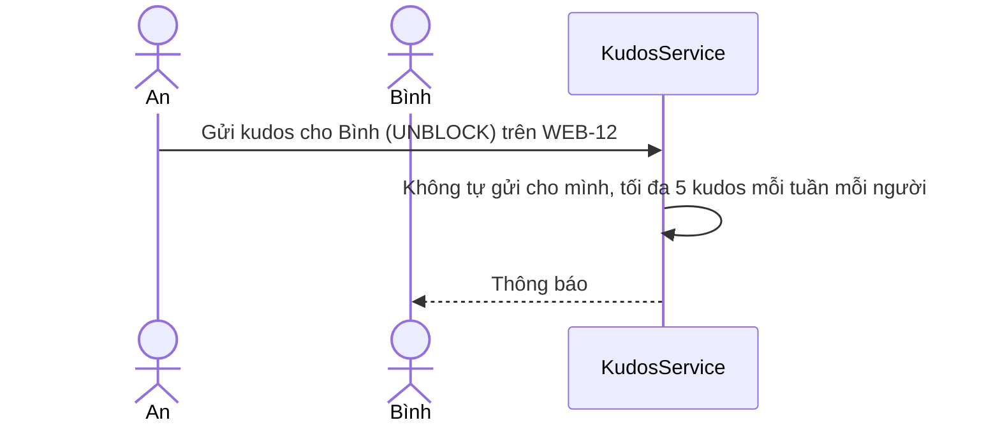

## 10. Quyền riêng tư và ai được xem

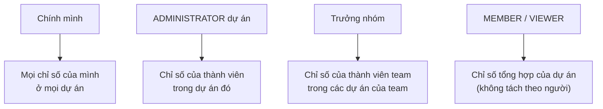

| Quyền mới | Mặc định cấp cho |
|-----------|------------------|
| `CONTRIBUTION_VIEW_ALL` | ADMINISTRATOR |
| `WORKLOG_EDIT_ALL` | ADMINISTRATOR |

Workspace có thể **tắt** tính năng đóng góp theo người (chỉ giữ số liệu tổng) — cấu hình ở cấp workspace.

## 11. Chống sai lệch và lạm dụng

| Rủi ro | Biện pháp |
|--------|-----------|
| Chia nhỏ việc để tăng "số việc" | Ưu tiên hiển thị story points / giờ; cảnh báo việc < 0.5 điểm hàng loạt |
| Log giờ khống | Giới hạn 24h/ngày; khóa sổ; Lead xem được worklog chi tiết |
| Bình luận rác để tăng "cộng tác" | Không hiển thị số bình luận như một điểm; chỉ dùng trong dòng thời gian |
| Người làm việc khó (ít việc, nhiều điểm) bị đánh giá thấp | Luôn hiển thị song song số việc và điểm |
| Người không được giao việc bị coi là kém | Hiển thị tỉ lệ "được giao / hoàn thành" thay vì số tuyệt đối |

## 12. API đề xuất

| Phương thức | Endpoint | Quyền |
|-------------|----------|-------|
| GET/POST | `/items/{id}/worklogs` | VIEW / ISSUE_EDIT hoặc assignee |
| PUT/DELETE | `/worklogs/{id}` | Chủ worklog / WORKLOG_EDIT_ALL |
| GET | `/me/timesheet?from=&to=` | Bản thân |
| GET | `/me/contributions?from=&to=&projectId=` | Bản thân |
| GET | `/projects/{id}/contributions?from=&to=` | CONTRIBUTION_VIEW_ALL |
| GET | `/projects/{id}/contributions/{userId}` | CONTRIBUTION_VIEW_ALL hoặc bản thân |
| GET | `/teams/{id}/workload` | Trưởng nhóm |
| GET | `/projects/{id}/activity?userId=&type=` | PROJECT_VIEW |
| POST | `/projects/{id}/kudos` | PROJECT_VIEW |

## 13. Giao diện đề xuất

### 13.1. Hồ sơ đóng góp cá nhân

```
┌─────────────────── Đóng góp của tôi · 30 ngày ───────────────────┐
│ Hoàn thành: 18 việc · 42 điểm   Giờ log: 96h   Đúng hạn: 89%      │
│                                                                   │
│ Lịch hoạt động  ░▒▓█▓▒░ ░▒▓██▓░ ░▒▓▓▒░░ ░▒▓█▓▒░  (heatmap theo ngày)│
│                                                                   │
│ Theo dự án:   WEB ██████████ 28đ    API █████ 14đ                 │
│ Kudos nhận:   🙌 UNBLOCK ×3   ⭐ QUALITY ×2                        │
└───────────────────────────────────────────────────────────────────┘
```

### 13.2. Bảng phân bổ của dự án (cho ADMINISTRATOR)

| Thành viên | Đang làm | Xong | Điểm | Giờ | Đúng hạn | Mở lại |
|-----------|---------|------|------|-----|---------|--------|
| An | 3 | 12 | 30 | 80h | 92% | 1 |
| Bình | 6 ⚠️ | 9 | 21 | 95h | 78% | 2 |

Cột "Đang làm" có cảnh báo khi vượt ngưỡng (gợi ý quá tải).

## 14. Lộ trình triển khai

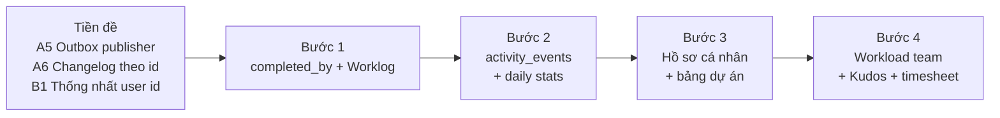

| Bước | Kết quả | Độ khó |
|------|---------|--------|
| 1 | Biết ai hoàn thành, ai log bao nhiêu giờ | Thấp |
| 2 | Hạ tầng sự kiện dùng chung cho cả tài liệu 06 và thông báo | Trung bình |
| 3 | Có màn hình đóng góp | Trung bình |
| 4 | Quản lý khối lượng và văn hóa ghi nhận | Thấp |
