# 08 — Thiết kế tương lai: Community

> Trạng thái: **Đề xuất thiết kế**. Hiện chưa có mã nguồn (`community-service` mới chỉ được nhắc tên trong kế hoạch dự án).
> Cảm hứng: **Figma Community** (publish file → người khác Duplicate/Remix), **GitHub** (public repo, star, fork), **Notion Template Gallery**.

---

## Mục lục

1. [Tầm nhìn](#1-tầm-nhìn)
2. [Khái niệm cốt lõi](#2-khái-niệm-cốt-lõi)
3. [Nguyên tắc thiết kế quan trọng nhất: Publish là ảnh chụp](#3-nguyên-tắc-thiết-kế-quan-trọng-nhất-publish-là-ảnh-chụp)
4. [Kiến trúc tổng thể](#4-kiến-trúc-tổng-thể)
5. [Mô hình dữ liệu](#5-mô-hình-dữ-liệu)
6. [Luồng Publish](#6-luồng-publish)
7. [Làm sạch dữ liệu trước khi công khai](#7-làm-sạch-dữ-liệu-trước-khi-công-khai)
8. [Luồng Remix (Clone về workspace của tôi)](#8-luồng-remix-clone-về-workspace-của-tôi)
9. [Phiên bản và cập nhật](#9-phiên-bản-và-cập-nhật)
10. [Bài đăng (Post)](#10-bài-đăng-post)
11. [Tag và khám phá](#11-tag-và-khám-phá)
12. [Tương tác xã hội](#12-tương-tác-xã-hội)
13. [Trang hồ sơ người sáng tạo](#13-trang-hồ-sơ-người-sáng-tạo)
14. [Kiểm duyệt](#14-kiểm-duyệt)
15. [Phân quyền](#15-phân-quyền)
16. [API đề xuất](#16-api-đề-xuất)
17. [Giao diện đề xuất](#17-giao-diện-đề-xuất)
18. [Rủi ro và cách giảm thiểu](#18-rủi-ro-và-cách-giảm-thiểu)
19. [Lộ trình triển khai](#19-lộ-trình-triển-khai)

---

## 1. Tầm nhìn

Biến mỗi dự án tốt thành **tài sản dùng lại được cho cả cộng đồng**: một người lập kế hoạch mở quán café rất kỹ, publish lên Community; hàng trăm người khác bấm **Remix** để có ngay một dự án đầy đủ workflow, board, sprint, công việc mẫu trong workspace của mình.

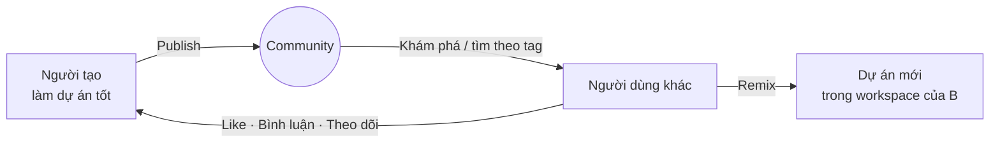

Giá trị cho đồ án: tận dụng gần như nguyên vẹn **engine clone + blueprint** đã có (tài liệu 04), chỉ mở rộng phạm vi từ "trong workspace" ra "toàn hệ thống".

## 2. Khái niệm cốt lõi

| Khái niệm | Mô tả | Tương đương Figma |
|-----------|-------|-------------------|
| **Visibility** | Mức hiển thị của dự án: `PRIVATE`, `WORKSPACE`, `PUBLIC`, `UNLISTED` | Share settings |
| **Listing** | Trang công khai của một dự án đã publish | Community file page |
| **Listing Version** | Một ảnh chụp bất biến của blueprint tại thời điểm publish | File version |
| **Remix** | Tạo dự án mới trong workspace của tôi từ một listing | Duplicate |
| **Post** | Bài viết (chia sẻ kinh nghiệm, hỏi đáp, giới thiệu) có thể nhúng listing | Community post |
| **Tag** | Nhãn chủ đề toàn hệ thống (`#fnb`, `#scrum`, `#ecommerce`) | Tags |
| **Creator** | Hồ sơ công khai của người publish | Creator profile |

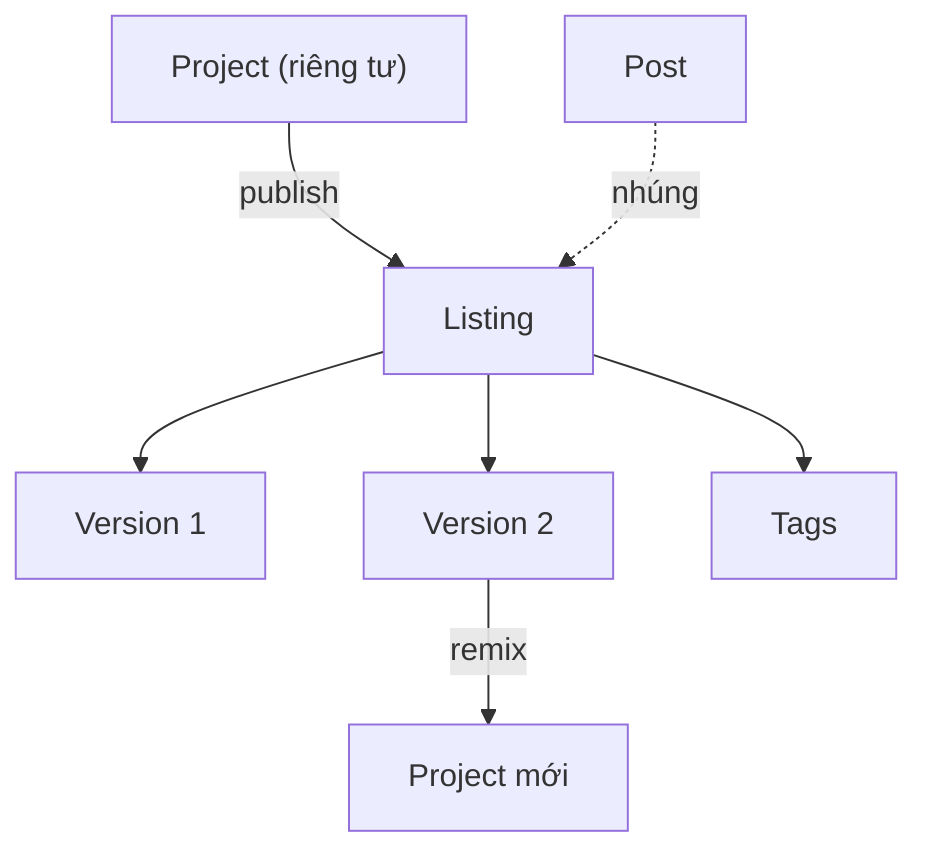

## 3. Nguyên tắc thiết kế quan trọng nhất: Publish là ảnh chụp

**Không** cho người khác đọc trực tiếp dự án đang sống. Publish = chụp blueprint thành **JSON bất biến**, đã làm sạch, lưu ở community-service.

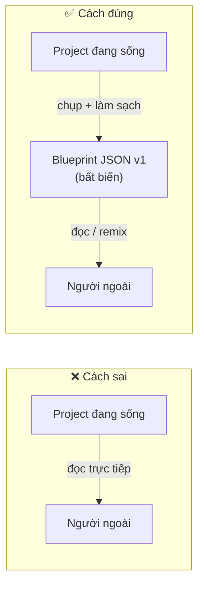

| Lý do | |
|-------|---|
| Bảo mật | Không thể vô tình lộ tên khách hàng, email, bình luận nội bộ thêm vào **sau** khi publish |
| Ổn định | Người remix luôn nhận đúng nội dung họ đã xem trước |
| Hiệu năng | Đọc một JSON thay vì join ~20 bảng |
| Tách service | community-service không cần truy cập DB của work-service |
| Phiên bản | Mỗi lần cập nhật là một version mới, có changelog |

Hệ quả kỹ thuật: cần bổ sung **tuần tự hóa / giải tuần tự hóa** `ProjectBlueprint ↔ JSON` và cho `ProjectCloneEngine` nhận blueprint từ JSON (hiện chỉ nhận từ DB). Đây cũng là đề xuất G1 trong tài liệu 05.

## 4. Kiến trúc tổng thể

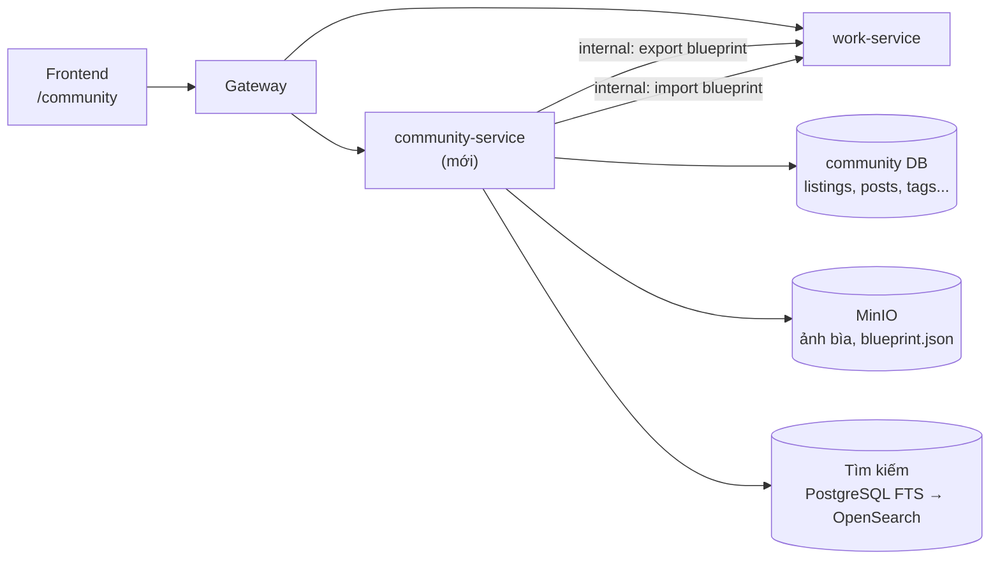

| Thành phần | Trách nhiệm |
|-----------|-------------|
| community-service | Listing, version, post, tag, like, follow, bình luận, kiểm duyệt, tìm kiếm |
| work-service (bổ sung) | `GET /internal/projects/{id}/blueprint` (xuất), `POST /internal/blueprints/instantiate` (nhập) |
| workspace-service | Kiểm tra người remix là MEMBER+ của workspace đích |
| identity-service | Thông tin hồ sơ công khai (tên, ảnh) |

## 5. Mô hình dữ liệu

### 5.1. Listing và phiên bản

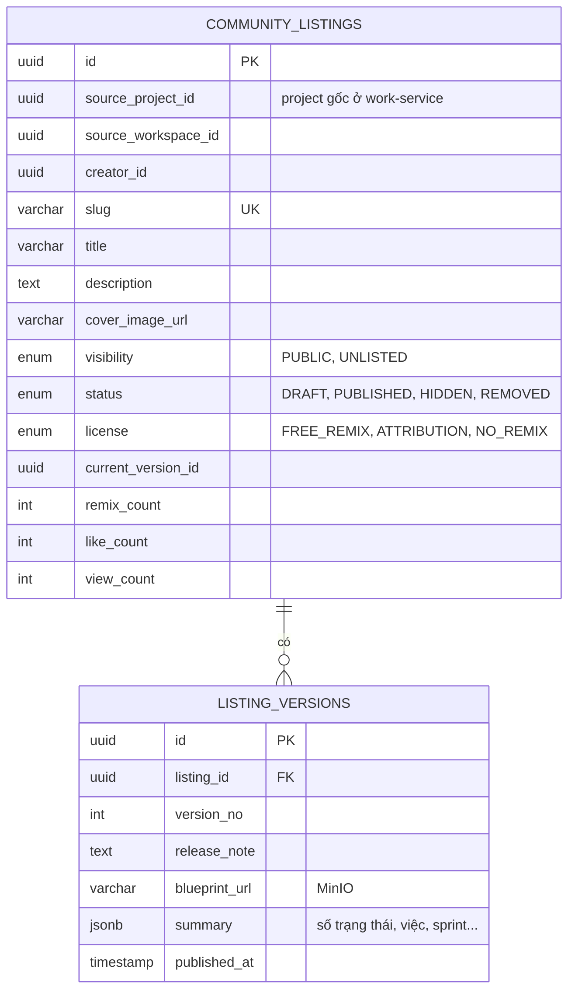

### 5.2. Tag

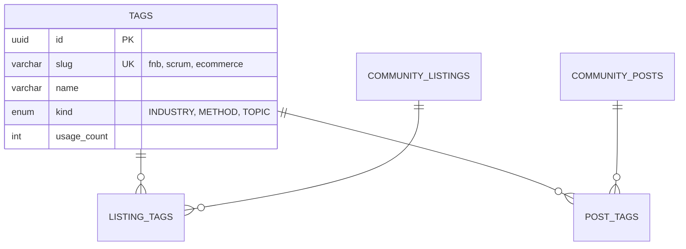

### 5.3. Bài đăng và bình luận

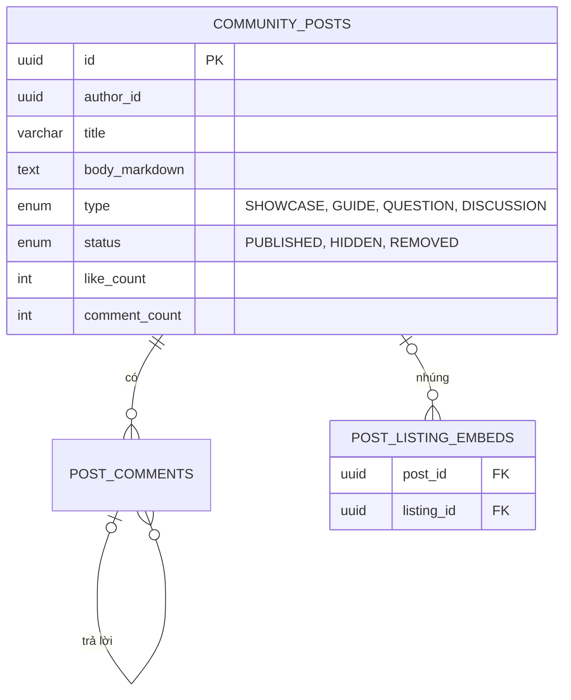

### 5.4. Tương tác và nguồn gốc remix

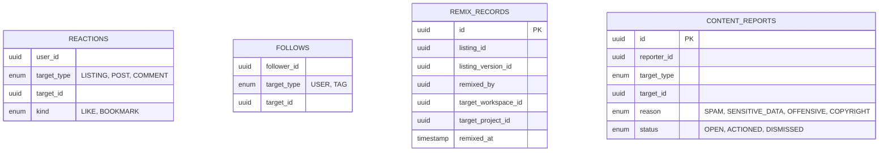

## 6. Luồng Publish

### 6.1. Trình tự

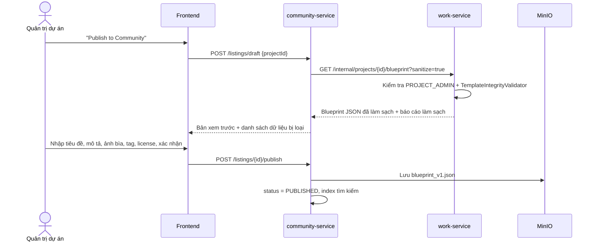

### 6.2. Điều kiện publish

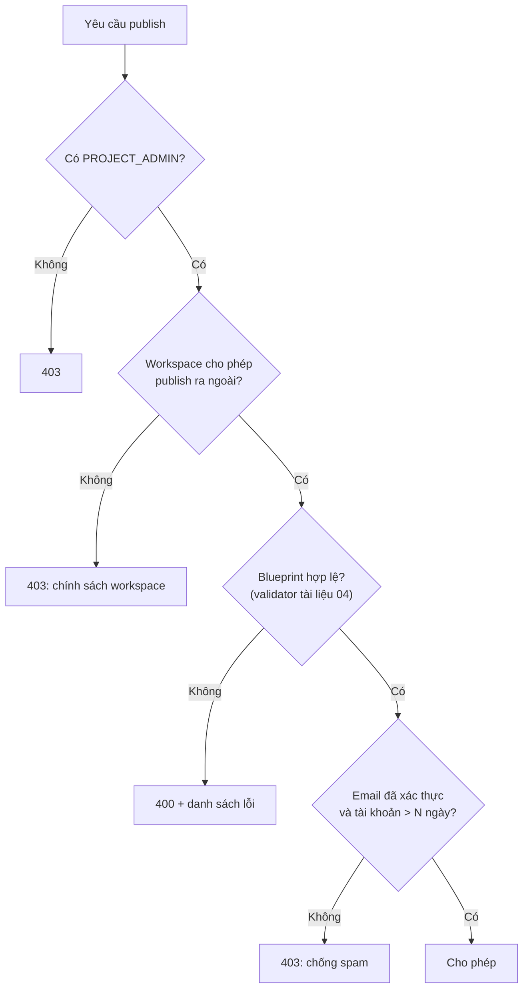

Chính sách workspace mới: `workspaces.allow_public_publish` (mặc định `false`, chỉ OWNER bật được).

## 7. Làm sạch dữ liệu trước khi công khai

| Dữ liệu | Hành động |
|---------|-----------|
| Thành viên, role_assignments | Loại bỏ |
| `assignee_id`, `reporter_id`, `lead_user_id`, `component.lead_user_id` | Loại bỏ |
| Bình luận, tệp đính kèm, changelog, worklog | Loại bỏ |
| Email / số điện thoại / URL trong `summary`, `description` | Phát hiện bằng regex → **cảnh báo**, người publish tự sửa hoặc xác nhận |
| `custom_fields` kiểu `USER` | Loại bỏ giá trị |
| Ngày tuyệt đối | Chuyển thành **ngày tương đối** (ngày thứ N kể từ mốc) |
| Mã công việc `WEB-12` | Thay bằng chỉ số `#12` |
| Trạng thái tiến độ (DONE, sprint CLOSED) | Đặt lại như khi clone (tài liệu 04 – mục 6.5) |
| Tùy chọn của người publish | Có kèm công việc? kèm sprint? (giống `includeWorkItems`, `includeSprints`) |

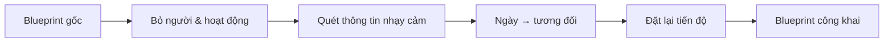

## 8. Luồng Remix (Clone về workspace của tôi)

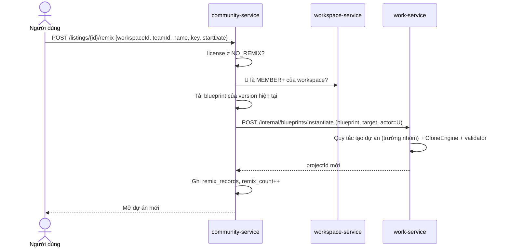

- Dự án mới có thông tin nguồn gốc: *"Remixed from **Mở quán café 90 ngày** v3 by @an"* (lưu `source_listing_id`, `source_version_id` trong `projects` hoặc `project_clones` với `clone_type = FROM_COMMUNITY`).
- Ngày tương đối được neo vào `startDate` người dùng chọn — đúng cơ chế dời ngày hiện có.

## 9. Phiên bản và cập nhật

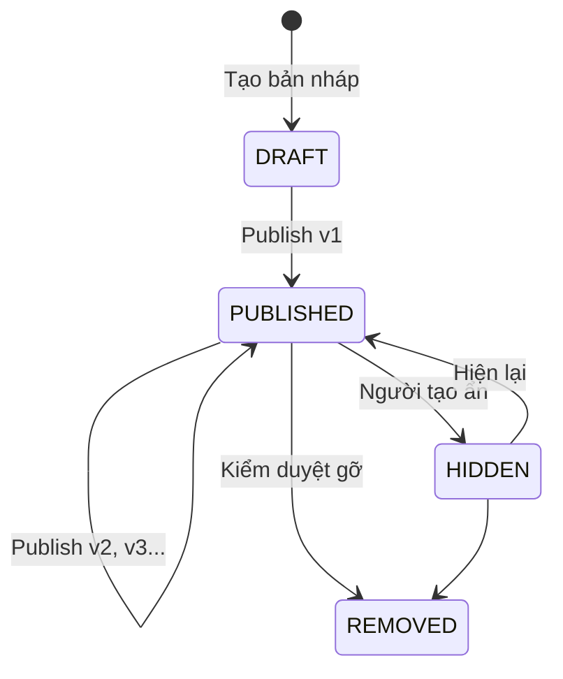

| Quy tắc | |
|---------|---|
| Mỗi lần "Cập nhật listing" tạo version mới; version cũ vẫn giữ | Người đã remix không bị ảnh hưởng |
| Người theo dõi listing được thông báo khi có version mới | |
| Dự án đã remix **không** tự cập nhật theo nguồn (khác GitHub fork) | Tránh ghi đè dữ liệu thật của người dùng |
| Xóa project gốc không làm mất listing | Listing chỉ phụ thuộc blueprint đã lưu |

## 10. Bài đăng (Post)

| Loại | Mục đích | Ví dụ |
|------|----------|-------|
| `SHOWCASE` | Giới thiệu một listing | "Quy trình 12 tuần mở quán café của mình" |
| `GUIDE` | Hướng dẫn, kinh nghiệm | "Cách chia Epic cho dự án thương mại điện tử" |
| `QUESTION` | Hỏi đáp | "Nên dùng Scrum hay Kanban cho team 3 người?" |
| `DISCUSSION` | Thảo luận chung | |

- Nội dung Markdown, nhúng được listing dạng thẻ (ảnh bìa + số liệu + nút Remix).
- `QUESTION` có thể đánh dấu một bình luận là "câu trả lời được chấp nhận".

## 11. Tag và khám phá

### 11.1. Ba loại tag

| Loại | Ví dụ |
|------|-------|
| INDUSTRY (ngành) | `#fnb`, `#ecommerce`, `#agriculture`, `#education` |
| METHOD (phương pháp) | `#scrum`, `#kanban`, `#waterfall` |
| TOPIC (chủ đề) | `#mvp`, `#marketing-campaign`, `#event` |

Tag do quản trị hệ thống quản lý danh mục; người dùng chọn tối đa 5 tag / listing. `TemplateCategory` hiện có được ánh xạ sẵn sang tag INDUSTRY.

### 11.2. Các cách khám phá

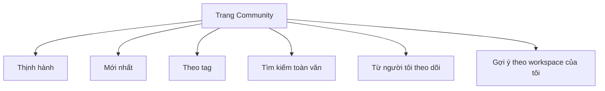

### 11.3. Điểm thịnh hành

```
trending = (remix × 5 + like × 2 + comment × 1 + view × 0.05) / (giờ_kể_từ_publish + 2)^1.5
```

Tính lại mỗi giờ bằng job; lưu vào cột `trending_score` có chỉ mục.

## 12. Tương tác xã hội

| Tương tác | Đối tượng | Ghi chú |
|-----------|-----------|---------|
| Like | Listing, Post, Comment | Một người một lần |
| Bookmark | Listing, Post | Danh sách "Đã lưu" riêng tư |
| Bình luận | Listing, Post | Trả lời lồng 1 cấp, @mention |
| Theo dõi | User, Tag | Bảng tin cá nhân hóa |
| Remix | Listing | Đếm công khai |

Mọi tương tác phát sự kiện → notification-service gửi thông báo trong ứng dụng / email tổng hợp hằng tuần.

## 13. Trang hồ sơ người sáng tạo

```
┌─────────────────────────────────────────────┐
│ 🧑 An Nguyễn  @an        [Theo dõi]          │
│ 12 listing · 1.2k remix · 340 người theo dõi │
├─────────────────────────────────────────────┤
│ Listing   Bài đăng   Đã thích                │
│ ┌────────┐ ┌────────┐ ┌────────┐             │
│ │ Café   │ │ Shop   │ │ Event  │             │
│ │ 320 ⟳  │ │ 210 ⟳  │ │ 95 ⟳   │             │
│ └────────┘ └────────┘ └────────┘             │
└─────────────────────────────────────────────┘
```

Cần thêm ở identity-service: `display_name`, `avatar_url`, `bio`, `public_handle` (duy nhất), cờ `is_public_profile`.

## 14. Kiểm duyệt

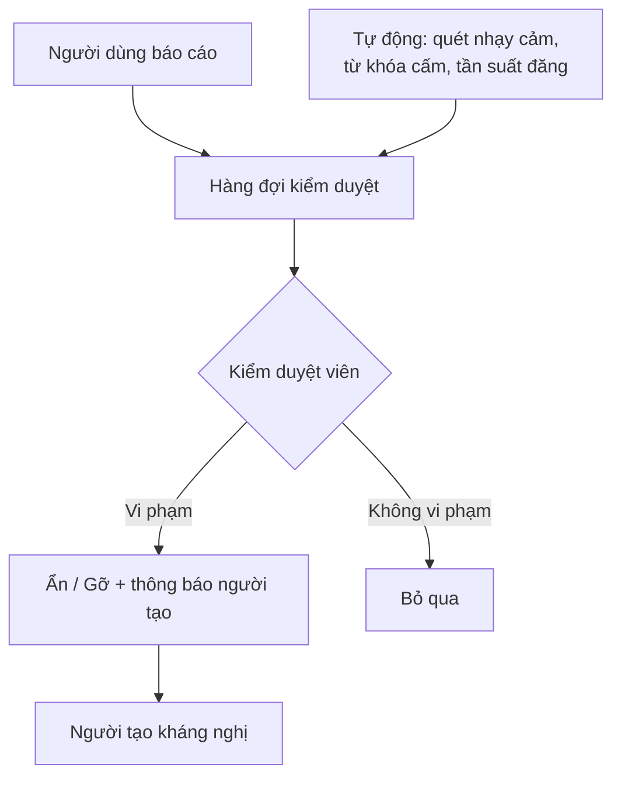

| Biện pháp chống spam | |
|---------------------|---|
| Giới hạn tần suất | ≤ 3 listing / ngày, ≤ 10 bài / ngày / người |
| Tài khoản mới | Phải xác thực email và đủ 7 ngày tuổi |
| Ẩn tự động | ≥ 5 báo cáo khác nhau → tạm ẩn chờ duyệt |
| Vai trò mới | `COMMUNITY_MODERATOR` (realm role Keycloak) |

## 15. Phân quyền

| Hành động | Khách (chưa đăng nhập) | Người dùng | Quản trị dự án nguồn | Người tạo listing | Moderator |
|-----------|:-:|:-:|:-:|:-:|:-:|
| Xem listing / post công khai | ✅ | ✅ | ✅ | ✅ | ✅ |
| Like, bình luận, theo dõi, báo cáo | | ✅ | ✅ | ✅ | ✅ |
| Remix | | ✅ (MEMBER+ workspace đích) | ✅ | ✅ | ✅ |
| Publish listing | | | ✅ (+ chính sách WS) | | |
| Cập nhật version, ẩn listing | | | | ✅ | |
| Gỡ nội dung | | | | | ✅ |

## 16. API đề xuất

Tiền tố `/community/api/v1`.

| Nhóm | Endpoint |
|------|----------|
| Listing | `POST /listings/draft`, `POST /listings/{id}/publish`, `GET /listings?tag=&q=&sort=trending\|new`, `GET /listings/{slug}`, `PUT /listings/{id}`, `POST /listings/{id}/versions`, `POST /listings/{id}/hide` |
| Xem trước | `GET /listings/{id}/versions/{v}/preview` |
| Remix | `POST /listings/{id}/remix` |
| Post | `POST/GET /posts`, `GET/PUT/DELETE /posts/{id}` |
| Bình luận | `GET/POST /{listings\|posts}/{id}/comments` |
| Tương tác | `POST/DELETE /reactions`, `POST/DELETE /follows` |
| Tag | `GET /tags`, `GET /tags/{slug}` |
| Hồ sơ | `GET /creators/{handle}`, `GET /me/feed`, `GET /me/bookmarks` |
| Kiểm duyệt | `POST /reports`, `GET /moderation/queue`, `POST /moderation/{id}/action` |

Bổ sung ở work-service (nội bộ, có xác thực service-to-service — tài liệu 05 – B2):
- `GET /internal/projects/{id}/blueprint?sanitize=true`
- `POST /internal/blueprints/instantiate`

## 17. Giao diện đề xuất

### 17.1. Trang listing

```
┌───────────────────────────────────────────────────────────────┐
│ [Ảnh bìa]                                                     │
│ Mở quán café trong 90 ngày                     [ ⟳ Remix ]    │
│ by @an · v3 · cập nhật 2 ngày trước   ♥ 210  ⟳ 320  💬 18      │
│ #fnb  #scrum  #mvp                                            │
├───────────────────────────────────────────────────────────────┤
│ Tổng quan │ Workflow │ Board │ Công việc │ Sprint │ Phiên bản  │
│                                                               │
│  (tái sử dụng TemplatePreviewModal hiện có)                   │
├───────────────────────────────────────────────────────────────┤
│ Bình luận                                                     │
└───────────────────────────────────────────────────────────────┘
```

### 17.2. Lối vào trong ứng dụng

- Trong `CreateProjectModal`: tab mới **"Từ Community"** bên cạnh "Mẫu của workspace".
- Trong trang dự án: nút **"Publish to Community"** (cạnh "Lưu thành mẫu").
- Sidebar: mục **Community**.

## 18. Rủi ro và cách giảm thiểu

| Rủi ro | Mức | Giảm thiểu |
|--------|-----|-----------|
| Lộ dữ liệu nội bộ công ty | 🔴 | Ảnh chụp đã làm sạch; chính sách workspace mặc định tắt; màn hình xem trước bắt buộc |
| Spam, nội dung xấu | 🟠 | Giới hạn tần suất, báo cáo, moderator |
| Blueprint cũ không tương thích khi schema đổi | 🟠 | Lưu `schema_version` trong JSON; bộ chuyển đổi theo phiên bản |
| Remix tạo hàng loạt dự án rác | 🟡 | Giới hạn remix / giờ; dự án remix vẫn chịu quy tắc "trưởng nhóm mới tạo được" |
| Tranh chấp bản quyền | 🟡 | Trường `license`, ghi nguồn bắt buộc, quy trình báo cáo COPYRIGHT |

## 19. Lộ trình triển khai

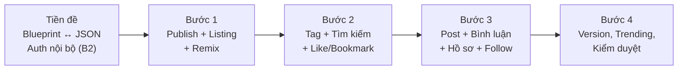

| Bước | Kết quả demo được | Độ khó |
|------|-------------------|--------|
| 1 | Publish một dự án, người khác remix về workspace của họ | Trung bình (tái sử dụng clone engine) |
| 2 | Duyệt Community theo tag, tìm kiếm | Thấp |
| 3 | Mạng xã hội thu nhỏ quanh dự án | Trung bình |
| 4 | Vận hành bền vững ở quy mô lớn | Trung bình |

> Gợi ý cho phạm vi đồ án: **Bước 1 + 2** đã đủ tạo điểm nhấn khác biệt so với các hệ thống quản lý tác vụ thông thường.
