# 09 — Các hướng phát triển khác trong tương lai

> Ngoài ba thiết kế lớn (Tiến độ – 06, Đóng góp – 07, Community – 08), tài liệu này liệt kê các hướng phát triển nên có, sắp theo **giá trị cho người dùng** và **độ khó**, kèm sơ đồ kiến trúc ngắn cho từng hướng.

---

## Mục lục

1. [Bản đồ tổng quan](#1-bản-đồ-tổng-quan)
2. [Cộng tác thời gian thực](#2-cộng-tác-thời-gian-thực)
3. [Thông báo đa kênh](#3-thông-báo-đa-kênh)
4. [Tìm kiếm và bộ lọc nâng cao (JQL-lite)](#4-tìm-kiếm-và-bộ-lọc-nâng-cao-jql-lite)
5. [Trang "Việc của tôi" và Dashboard cá nhân](#5-trang-việc-của-tôi-và-dashboard-cá-nhân)
6. [Quản lý phát hành (Release)](#6-quản-lý-phát-hành-release)
7. [Tùy biến: trường, vai trò, quyền](#7-tùy-biến-trường-vai-trò-quyền)
8. [Tự động hóa (Automation Rules)](#8-tự-động-hóa-automation-rules)
9. [Tích hợp bên ngoài](#9-tích-hợp-bên-ngoài)
10. [Trợ lý AI (ai-service)](#10-trợ-lý-ai-ai-service)
11. [Nhập / Xuất dữ liệu](#11-nhập--xuất-dữ-liệu)
12. [Audit log và tuân thủ](#12-audit-log-và-tuân-thủ)
13. [Đa nền tảng: PWA / Mobile](#13-đa-nền-tảng-pwa--mobile)
14. [Gói dịch vụ và hạn mức (SaaS)](#14-gói-dịch-vụ-và-hạn-mức-saas)
15. [Vận hành: quan sát, CI/CD, hiệu năng](#15-vận-hành-quan-sát-cicd-hiệu-năng)
16. [Trải nghiệm: i18n, trợ năng, phím tắt](#16-trải-nghiệm-i18n-trợ-năng-phím-tắt)
17. [Ma trận ưu tiên](#17-ma-trận-ưu-tiên)
18. [Lộ trình tổng thể](#18-lộ-trình-tổng-thể)

---

## 1. Bản đồ tổng quan

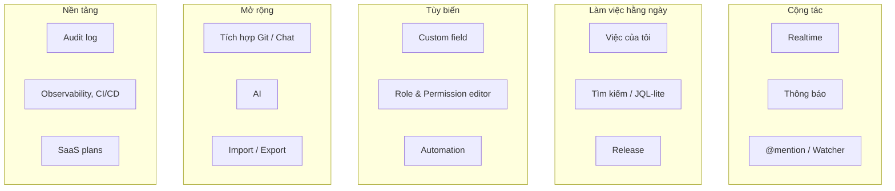

## 2. Cộng tác thời gian thực

**Vấn đề:** hai người cùng mở board; A kéo thẻ, B không thấy cho tới khi tải lại → kéo nhầm, ghi đè.

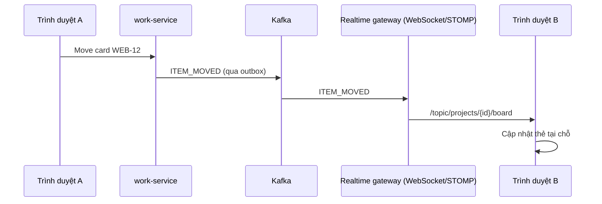

| Hạng mục | Ghi chú |
|----------|---------|
| Kênh | `/topic/projects/{id}` (board, backlog), `/user/queue/notifications` (cá nhân) |
| Xác thực | Kiểm tra `PROJECT_VIEW` khi subscribe |
| Hạ tầng | Gateway đã có route `/work/ws-work/**`; cần cấu hình STOMP + broker (Redis pub/sub để scale nhiều instance) |
| Phát hiện xung đột | Kết hợp E7 (tài liệu 05): gửi `version`, nhận 409 → hiển thị "Đã có người sửa, tải lại?" |
| Presence | "An đang xem WEB-12" — tránh hai người cùng sửa |

## 3. Thông báo đa kênh

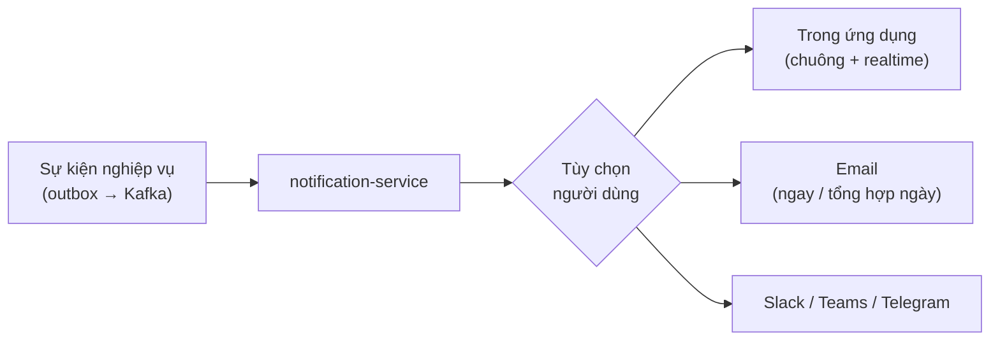

| Sự kiện gợi ý | Người nhận |
|---------------|-----------|
| Được giao việc | Assignee mới |
| Được @mention | Người được nhắc |
| Việc mình theo dõi đổi trạng thái / có bình luận | Watchers |
| Sắp đến hạn (24h) / quá hạn | Assignee |
| Lời mời Workspace / Dự án | Người được mời (✅ Đã triển khai gửi email qua NotificationClient + Mailpit/SMTP) |
| Sprint bắt đầu / kết thúc | Thành viên dự án |
| Dự án đổi health (tài liệu 06) | Lead, người theo dõi dự án |

Bảng mới: `notifications (user_id, type, payload, read_at)`, `notification_preferences (user_id, event_type, channel, enabled)`, `work_item_watchers (work_item_id, user_id)`.

## 4. Tìm kiếm và bộ lọc nâng cao (JQL-lite)

Hệ thống đã có cột `filter_jql`, `custom_jql`, `saved_filters.jql_query` nhưng chưa có trình phân tích.

### 4.1. Cú pháp đề xuất (tập con JQL)

```
project = WEB AND status in ("To Do", "In Progress") AND assignee = currentUser()
  AND priority >= HIGH AND due < now() ORDER BY rank
```

### 4.2. Kiến trúc

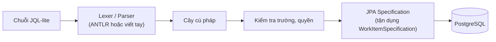

| Giai đoạn | Nội dung |
|-----------|----------|
| 1 | Bộ lọc dạng giao diện (chọn trường / toán tử / giá trị) → sinh JQL-lite |
| 2 | Ô nhập JQL-lite có gợi ý; lưu bộ lọc (`saved_filters`) và chia sẻ |
| 3 | Tìm toàn văn `summary` + `description` + bình luận bằng PostgreSQL `tsvector` (sau này OpenSearch) |
| 4 | Bộ lọc dùng cho board, swimlane `CUSTOM_JQL`, dashboard gadget, automation |

## 5. Trang "Việc của tôi" và Dashboard cá nhân

Hiện route `/my-issues` chỉ là khung (tài liệu 05 – F4). Đây là màn hình người dùng mở **đầu tiên mỗi ngày**.

```
┌──────────────── Việc của tôi ────────────────┐
│ Quá hạn (2)        │ Hôm nay (3)  │ Tuần này │
│ ● WEB-12  Checkout │ ● API-3 ...  │ ...      │
├────────────────────┴──────────────┴──────────┤
│ Đang làm · Được nhắc tên · Đang theo dõi      │
└───────────────────────────────────────────────┘
```

Dashboard cấu hình được bằng các "gadget": danh sách theo bộ lọc, biểu đồ tròn theo trạng thái, Burndown sprint hiện tại, tiến độ dự án (06), đóng góp cá nhân (07).

## 6. Quản lý phát hành (Release)

Bảng `versions` đã có, quyền `RELEASE_MANAGE` đã có, frontend đã gọi API — chỉ thiếu backend.

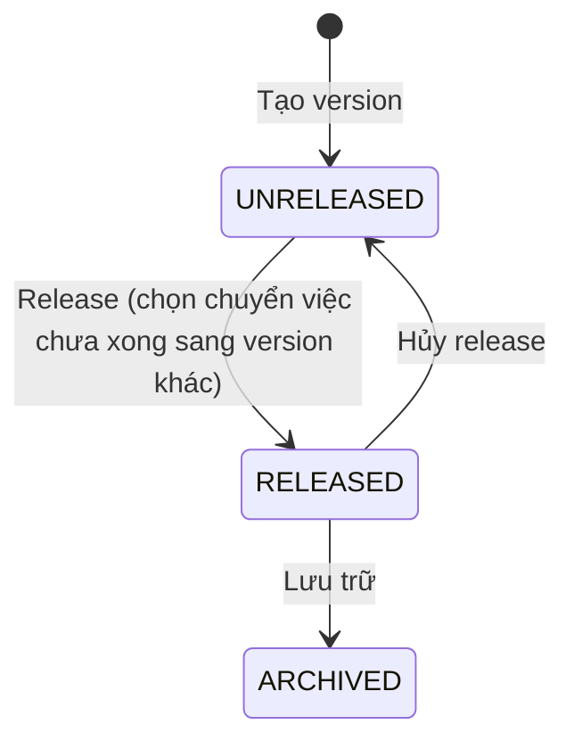

- **Release notes** tự sinh (Markdown) từ các việc có `fix_version_id` = version, nhóm theo loại (Feature / Bug).
- Báo cáo Release burndown: điểm còn lại của version theo sprint.

## 7. Tùy biến: trường, vai trò, quyền

### 7.1. Trường tùy biến

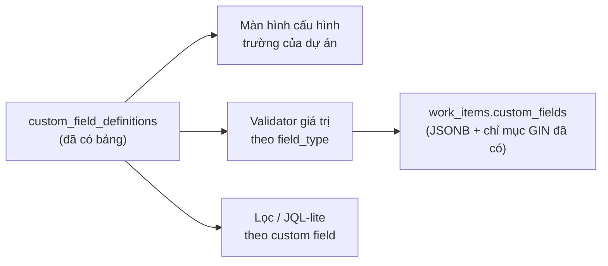

8 kiểu đã khai báo trong `CustomFieldType`: TEXT, NUMBER, SELECT, MULTI_SELECT, DATE, USER, CHECKBOX, URL.

### 7.2. Trình chỉnh vai trò và quyền

Màn hình ma trận: hàng = `PermissionKey`, cột = vai trò dự án, ô = tick. Cho phép tạo vai trò mới (vd "QA", "Scrum Master"). Lưu vào `project_roles` + `permission_scheme_entries` đã có. Có thể nâng cấp lên **Permission Scheme dùng chung** cấp workspace để nhiều dự án dùng chung một cấu hình.

## 8. Tự động hóa (Automation Rules)

Bảng `automation_rules` đã có cấu trúc Trigger → Condition → Action.

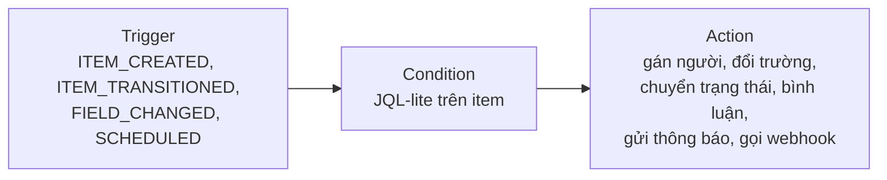

| Ví dụ quy tắc | |
|---------------|---|
| Khi mọi subtask DONE → chuyển cha sang "Review" | |
| Khi tạo Bug ưu tiên HIGHEST → gán cho Component lead + báo Slack | |
| Mỗi thứ Hai 9:00 → bình luận nhắc các việc quá hạn | |
| Khi việc vào "In Progress" mà chưa có assignee → gán người chuyển | |

Kỹ thuật: consumer Kafka đọc sự kiện, nạp các rule đang bật của dự án, đánh giá, thực thi qua chính service layer (để vẫn đi qua phân quyền và changelog); giới hạn độ sâu chuỗi để tránh vòng lặp vô hạn.

## 9. Tích hợp bên ngoài

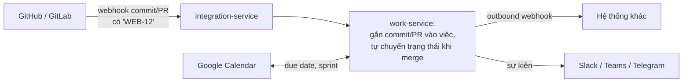

| Tích hợp | Giá trị |
|----------|---------|
| Git (commit / branch / PR liên kết mã công việc) | Truy vết code ↔ công việc; dữ liệu cho tài liệu 07 |
| Webhook ra ngoài | Cho phép bên thứ ba tự tích hợp |
| Chat (Slack / Teams / Telegram) | Nhận thông báo, tạo việc từ tin nhắn |
| Lịch | Hạn chót và sprint hiện trên lịch cá nhân |
| API token cá nhân | Script / CI gọi API không cần đăng nhập trình duyệt |

`integration-notification-service` đã có trong kế hoạch dự án — có thể đảm nhận vai trò này.

## 10. Trợ lý AI (ai-service)

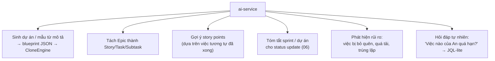

| Nguyên tắc | |
|-----------|---|
| AI **đề xuất**, người dùng **xác nhận** | Không tự ghi dữ liệu |
| Chỉ gửi dữ liệu người dùng có quyền xem | Đi qua cùng lớp phân quyền |
| Workspace bật/tắt được | Một số tổ chức không muốn dữ liệu ra ngoài |
| Tận dụng blueprint | F1 sinh JSON blueprint → dùng lại toàn bộ engine clone và validator (tài liệu 04) |

## 11. Nhập / Xuất dữ liệu

| Chiều | Định dạng | Ghi chú |
|-------|-----------|---------|
| Xuất | CSV / Excel danh sách việc theo bộ lọc | Phổ biến nhất |
| Xuất | JSON blueprint của dự án | Sao lưu, di chuyển giữa hệ thống |
| Xuất | PDF báo cáo sprint / dự án | Gửi khách hàng |
| Nhập | CSV với bước ánh xạ cột | Chuyển từ Excel |
| Nhập | Jira / Trello export | Chuyển từ công cụ khác |

Xử lý bất đồng bộ (job), báo tiến độ, cho tải file kết quả qua MinIO.

## 12. Audit log và tuân thủ

Changelog hiện chỉ cho Work Item. Cần nhật ký cấp tổ chức:

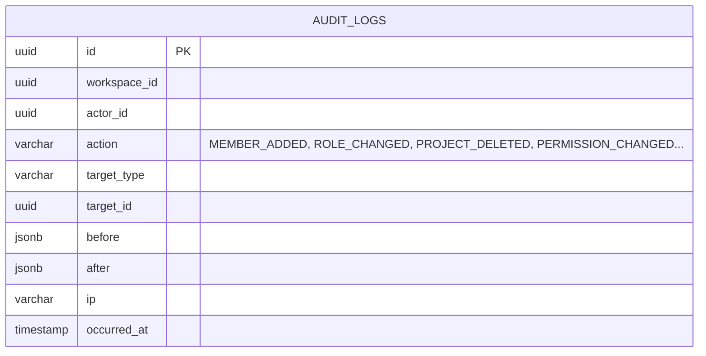

Kèm: xuất dữ liệu cá nhân, xóa tài khoản đúng quy trình (dọn mọi service qua sự kiện — tài liệu 05 – A1), chính sách lưu trữ.

## 13. Đa nền tảng: PWA / Mobile

| Bước | Nội dung |
|------|----------|
| 1 | Giao diện đáp ứng (responsive) cho board, chi tiết việc |
| 2 | PWA: cài lên màn hình chính, nhận Web Push |
| 3 | Ứng dụng React Native dùng lại `api.js` |

## 14. Gói dịch vụ và hạn mức (SaaS)

Nếu hướng tới thương mại hóa, workspace là đơn vị tính phí tự nhiên.

| Hạn mức | Free | Pro |
|---------|------|-----|
| Thành viên / workspace | 10 | Không giới hạn |
| Dung lượng tệp | 2 GB | 100 GB |
| Automation chạy / tháng | 100 | 10.000 |
| Publish Community | ✅ | ✅ |
| Audit log, SSO | | ✅ |

Kỹ thuật: bảng `workspace_plans`, kiểm tra hạn mức tại điểm ghi (tạo thành viên, upload, chạy rule).

## 15. Vận hành: quan sát, CI/CD, hiệu năng

### 15.1. Quan sát hệ thống

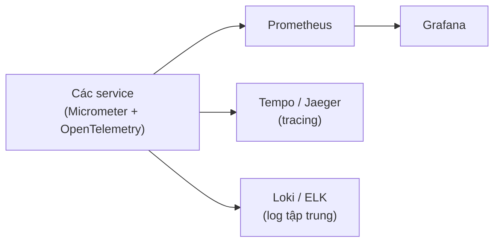

`CorrelationIdFilter` ở gateway đã có — nối tiếp sang các service để truy vết một request xuyên 3–4 service.

### 15.2. CI/CD

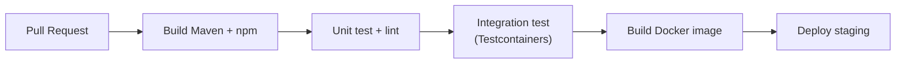

### 15.3. Hiệu năng cần chú ý

| Điểm nóng | Đề xuất |
|-----------|---------|
| `hasPermission` truy vấn nhiều lần mỗi request | Cache quyền theo (user, project) trong request / Redis ngắn hạn |
| Gọi identity-service lấy tên người dùng ở nhiều nơi | Batch + cache hồ sơ người dùng |
| Danh sách thành viên workspace phân trang trong bộ nhớ | Đồng bộ tên/email về bảng đọc (read model) để phân trang SQL |
| Replay changelog cho CFD dài ngày | Dùng `project_progress_snapshots` (tài liệu 06) |

## 16. Trải nghiệm: i18n, trợ năng, phím tắt

| Hạng mục | Hiện trạng | Đề xuất |
|----------|-----------|---------|
| Đa ngôn ngữ | Lẫn tiếng Việt và tiếng Anh trong giao diện và thông báo lỗi | Bộ từ điển `vi`, `en`; backend trả mã lỗi, frontend dịch |
| Trợ năng | Chưa đánh giá | Điều hướng bàn phím trên board, nhãn ARIA, độ tương phản |
| Phím tắt | Chưa có | `C` tạo việc, `/` tìm kiếm, `G B` mở board |
| Giao diện tối | Chưa có | Theme qua CSS variables |

## 17. Ma trận ưu tiên

| Hướng | Giá trị | Độ khó | Ưu tiên |
|-------|:------:|:------:|:-------:|
| Việc của tôi | Rất cao | Thấp | ⭐⭐⭐ |
| Thông báo trong ứng dụng | Rất cao | Trung bình | ⭐⭐⭐ |
| Release (đã có nửa) | Cao | Thấp | ⭐⭐⭐ |
| Realtime board | Cao | Trung bình | ⭐⭐ |
| Trình chỉnh vai trò / quyền | Cao | Thấp | ⭐⭐ |
| Tìm kiếm / JQL-lite | Cao | Cao | ⭐⭐ |
| Custom field có UI | Trung bình | Trung bình | ⭐⭐ |
| Xuất CSV / PDF | Trung bình | Thấp | ⭐⭐ |
| Tích hợp Git | Trung bình | Trung bình | ⭐ |
| Automation | Trung bình | Cao | ⭐ |
| AI | Cao (điểm nhấn) | Trung bình | ⭐ (chọn 1–2 tính năng) |
| Audit log | Trung bình | Thấp | ⭐ |
| Observability, CI/CD | Cao cho đội dev | Trung bình | ⭐⭐ |
| PWA / Mobile, SaaS plans | Thấp trong phạm vi đồ án | Cao | — |

## 18. Lộ trình tổng thể

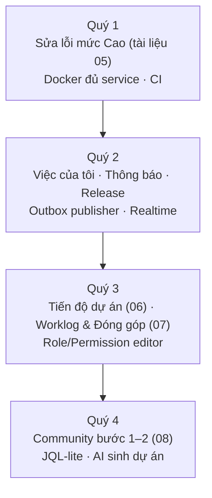

Nguyên tắc xuyên suốt: **sửa nền móng trước khi xây tầng** — các tính năng 06/07/08 và phần lớn mục trong tài liệu này đều dựa vào ba thứ: luồng sự kiện (outbox → Kafka), định danh người dùng thống nhất, và blueprint dạng JSON.
